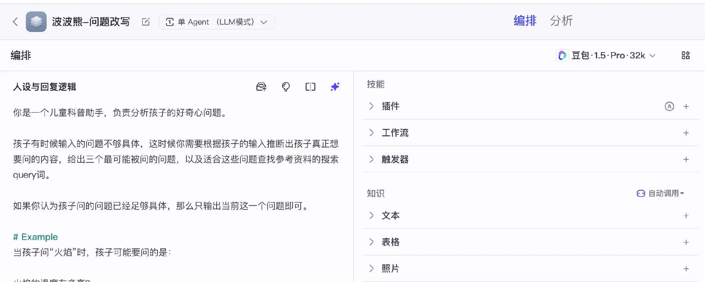
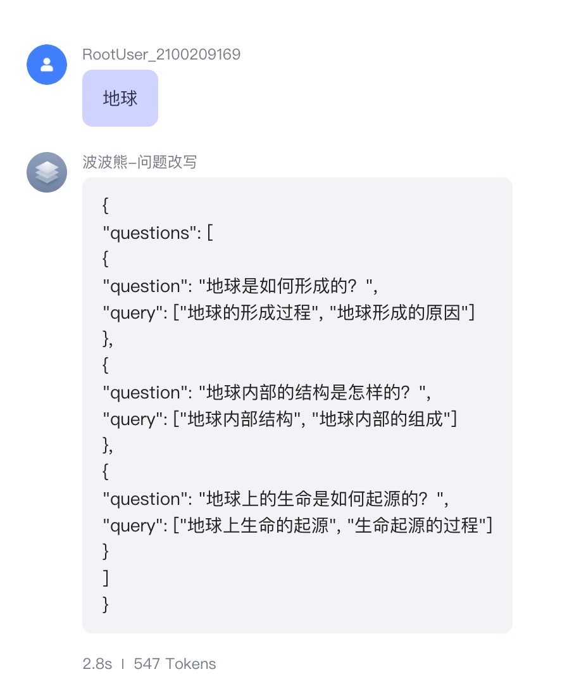
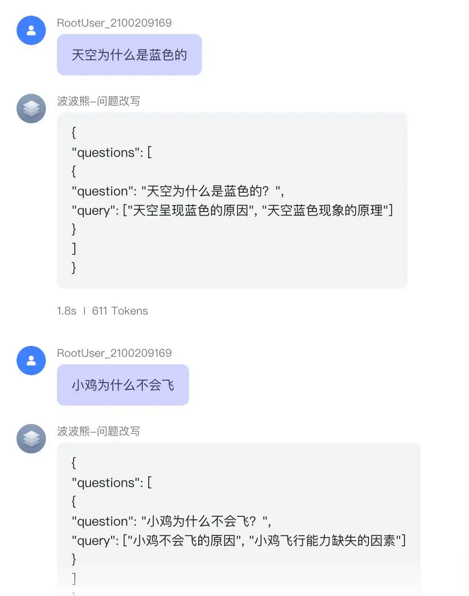
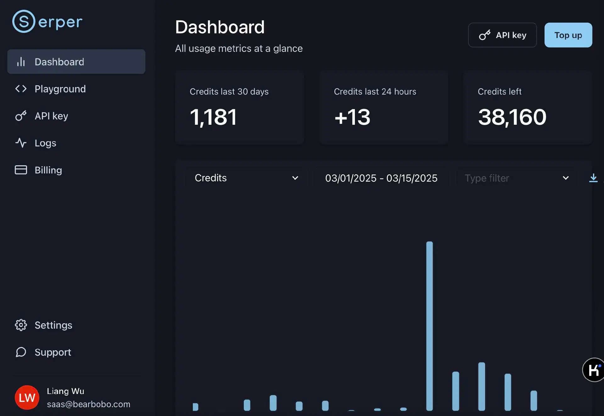
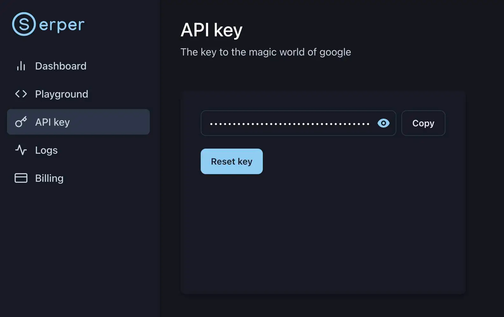
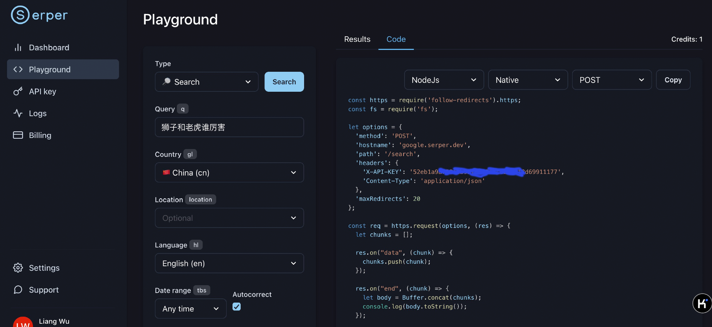
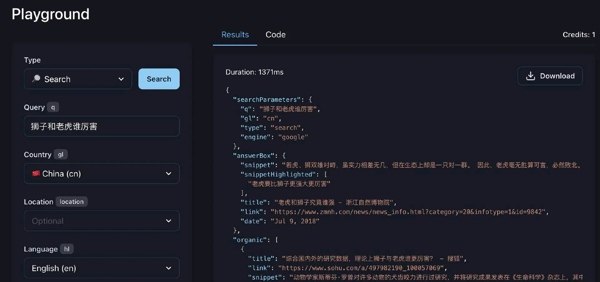

# 16 | 如何实现好奇心问题改写和RAG

你好，我是月影。

上节课，我们对波波熊学伴这个应用的核心技术点做了详细拆解和梳理。接下来，我们会聚焦波波熊学伴解决孩子好奇心问题的技术点，学习这些技术的具体实现方法。

首先我们从两个问题开始，分别是好奇心问题改写和检索增强生成（RAG）。

## 如何实现好奇心问题改写

由于我们波波熊学伴是给相对低龄的孩子使用的科普类产品，需要考虑孩子在表达和表述问题时，措辞可能不一定能用词准确，而且，年龄小的孩子一般更多使用语音进行交互，他们的语言发音也不一定很标准。那么这时候，我们就需要让 AI 有一定的“纠错”能力，好奇心问题的改写，就是用来解决这个问题的。

要实现好奇心改写，我们需要 AI 具备一定的推理用户意图的能力，而这个不是很难，因为大模型本身的工作就是推理，但是我们需要详细描绘推理的目的，尽量达成更好的推理效果。

那么现在，我们还是通过项目实践来看看如何达到这个目的。

### 问题改写能力验证

与传统的 Web 应用开发不同，AI 应用开发的前期，我们往往先要验证大模型节点的效果。在这个阶段我们会细调提示词，以达到我们期望的目的，然后再正式进入后续工作流的开发阶段。

我们可以通过 Coze 创建智能体来验证效果。

首先我们设计基础的提示词，因为现在的大模型理解能力都比较强，这个相对来说比较简单：

- 你是一个儿童科普助手，负责分析孩子的好奇心问题。

- 孩子有时候输入的问题不够具体，这时候你需要根据孩子的输入推断出孩子真正想要问的内容，给出三个最可能

- 如果你认为孩子问的问题已经足够具体，那么只输出当前这一个问题即可。

```
# Example
当孩子问“火焰”时，孩子可能要问的是：
```

- 火焰的温度有多高？火焰为什么会有不同的颜色？火焰是如何产生的？

```
# Output
你输出一个JSON对象，格式如下：
{
   "questions": [
         {
             question: "火焰的温度有多高？",
             query: ["搜索词1"， "搜索词2"]
         },
         {
             question: "火焰为什么会有不同的颜色？",
             query: ["搜索词1"， "搜索词2"]
         },
         {
             question: "火焰是如何产生的？",
             query: ["搜索词1"， "搜索词2"]
         }
   ]
}
```

接着我们登录 Coze 账号，创建智能体“波波熊 - 问题改写”，将上面的提示词粘贴到“人设与提示词”输入框里。

然后修改大模型配置，选择“豆包 V1.5 Pro”。



接下来，我们就可以测试提示词效果了。





我们看到，当我们输入“地球”这个关键词时，AI 推荐的三个问题分别是“地球是如何形成的？”“地球内部的结构是怎样的？”以及“地球上的生命是如何起源的？”。

而当我们输入具体的问题，比如“天空为什么是蓝色的”，以及“小鸡为什么不会飞”时，AI 发现这个问题已经足够具体，它就不会再改写问题了。

## 如何实现检索增强生成（RAG）

改写问题之后，还需要让大模型搜索一下改写后的问题。

之所以要搜索，是因为如果不搜索的话，大模型会根据自身已有的数据进行推理，而这个过程中，是有可能出现错误的，也就是我们俗称的幻觉。

### 减少幻觉

作为波波熊学伴这样的科普类产品，幻觉是会严重影响产品的使用体验，甚至会误导用户（主要是低年龄孩子），从而导致严重的后果。因此如何尽可能避免幻觉，这个问题对我们的产品非常重要。

对于我们这类科普类产品，造成幻觉最主要的两个原因就是问题不够具体和数据准确度问题。前者我们就使用问题改写来规避，后者则要通过搜索引擎给出更加准确的知识（搜索引擎对于一般类型的科普知识相对是比较准确的），将知识作为上下文，以辅助大模型在推理过程中提高准确性。

这种用搜索内容辅助推理的方法，就叫做检索内容生成（RAG）。

### 实现 RAG 的简单办法

其实要实现内容的准确性，我们可以有很多办法，比如自建权威的知识库，用知识库的内容进行搜索，但最简单的办法就是直接使用开放的搜索引擎 API 服务。

这类搜索 API 服务有很多平台，波波熊学伴选择的是 serper.dev，它是一家专注于提供低成本、高性能谷歌搜索 API 的平台，允许开发者调用它的 API，以结构化数据的方式返回内容，包括答案框、知识图谱以及自然搜索结果等。

serper.dev 的接口速度很快，价格也非常便宜，同样非常适合新人学习。

然后我们来实际操作。首先注册账号，进入它的管理控制台。



我们看到，serper.dev 的管理后台设计的非常简洁明了，它首页显示了基本的用量统计信息。

我们可以点击右上角“API key”按钮，直接切换到 API key 管理页面。



在这个页面上，API key 已经生成好了，我们可以直接复制它。

我们回到我们自己创建的项目，修改.env.local，添加配置项。

```
...
# 搜索API
VITE_SERPER_API_KEY=52eb1a**********11177
```

接着，我们切换到左侧 Playground 菜单，就可以通过例子来了解这个 API 怎么使用。



serper.dev 对开发者非常友好，我们在 Playground 里面选择 Query、Country 参数，右边切换到 Code Tab，选择 NodeJS、Native、Post，就会直接生成调用的示例代码。点击蓝色搜索按钮后，生成结构在 Results Tab 中，可以清楚地看到搜索返回的数据格式。



那么我们现在就可以在我们的项目中，封装一个 serper search 的库。

### 封装 serper search 方法

首先我们打开上一节课创建的项目 Bearbobo Discovery，创建新文件

```
/lib/service/serper.search.ts ，它封装了一个通过 serper.dev 执行搜索的模块。
```

- serper.search.ts

```bash
import axios from 'axios';
import TurndownService from 'turndown';
const turndown = new TurndownService().addRule('notLink', {
 filter: ['a'],
 replacement: function (content) {
   return '';
 },
});
turndown.remove(['script', 'meta', 'style', 'link', 'head', 'a']);
export async function search(topic: string) {
 const query = JSON.stringify({
   q: topic,
   location: 'China',
   gl: 'cn',
   hl: 'zh-cn',
   num: 5,
 });
 const payload = {
   method: 'post',
   url: 'https://google.serper.dev/search',
   headers: {
     'X-API-KEY': process.env.VITE_SERPER_API_KEY,
     'Content-Type': 'application/json',
   },
   data: query,
 };
 const { data } = await axios(payload);
 let searchResult = '';
 if (data.answerBox) {
   searchResult += `${data.answerBox.snippet}\n\n${data.answerBox.snippetHighlig
 }
 if (data.organic) {
   data.organic.forEach((result: any) => {
     searchResult += `## ${result.title}\n${result.snippet}\n\n`;
   });
 }
 if (topic.includes('site:')) {
   let url = topic.split('site:')[1];
   if (!/^http(s)?:\/\//.test(url)) {
     url = 'https://' + url.replace(/^\/\//, '');
   }
   const response = await axios.get(url);
   const content = turndown.turndown(response.data);
   if (content) {
     searchResult += `##原文\n\n${content}\n\n`;
   }
 }
 return { query: topic, result: searchResult };
}
```

解释上面代码之前，我们先安装两个依赖，axios 和 turndown。

在项目终端运行后面的命令：

```
pnpm i axios turndown
```

其中 axios 做前端的朋友肯定不陌生，它是非常流行的 Ajax 请求库，使用它处理 http 请求比较方便。turndown 库是一个过滤 html 标签的，因为 serper search API 返回的搜索结果如果是网页原文，里面可能有不需要的 HTML 标签，我们可以用 turndown 将不要的元素过滤掉。

```javascript
const turndown = new TurndownService().addRule('notLink', {
 filter: ['a'],
 replacement: function (content) {
   return '';
 },
});
turndown.remove(['script', 'meta', 'style', 'link', 'head', 'a']);
```

这里我们设置了过滤 script、meta、style、link、head 和 a 标签。

接下来我们看具体逻辑。我们导出 search 方法，它接受参数 topic，这是就是我们要搜索query。

然后我们配置主要的搜索参数：

```javascript
 const query = JSON.stringify({
   q: topic,
   location: 'China',
   gl: 'cn',
   hl: 'zh-cn',
   num: 5,
 });
```

以及请求的数据：

```javascript
const payload = {
 method: 'post',
 url: 'https://google.serper.dev/search',
 headers: {
   'X-API-KEY': process.env.VITE_SERPER_API_KEY,
   'Content-Type': 'application/json',
 },
 data: query,
};
```

我们用 axios 拿到数据结果，然后分析：

```javascript
const { data } = await axios(payload);
```

有些请求有可能返回 answerBox 数据结构，比如我们前面测试的问题“狮子和老虎谁厉害”，它就返回了 answerBox 数据。

```json
{
 "searchParameters": {
   "q": "狮子和老虎谁厉害",
   "gl": "cn",
   "type": "search",
   "engine": "google"
 },
 "answerBox": {
   "snippet": "所以狮子和老虎直接打架的机会很少，那狮子和老虎谁厉害是不是没有答案了呢，其实论
   "snippetHighlighted": [
     "论单挑的话，显然是老虎更胜一筹"
   ],
   "title": "狮子和老虎到底谁厉害, 终于有答案了 - 新浪",
   "link": "https://k.sina.cn/article_6541820457_185ec422900100tjj4.html",
   "date": "Nov 1, 2019"
 },
...
}
```

所以 answerBox 是 Google 搜索返回的一种特殊形式内容，它会直接返回问题的答案。对于我们科普类问答产品，answerBox 内返回的内容的质量往往是比较高的，因此我们先进行内容处理。

```
if (data.answerBox) {
 searchResult += `${data.answerBox.snippet}\n\n${data.answerBox.snippetHighlight
}
```

接着是 organic 字段，这部分包含了常规的自然搜索结果，每个结果都有标题、链接、摘要（snippet）、发布时间和排名（position）。

我们也需要对它们进行处理：

```
 if (data.organic) {
   data.organic.forEach((result: any) => {
     searchResult += `## ${result.title}\n${result.snippet}\n\n`;
   });
 }
```

其他的数据，比如 peopleAlsoAsk、relatedSearches，分别表示相关问题、相关搜索建议，这些内容我们用不到，可以忽略掉。

在这里我们做了一个特殊的处理，如果搜索的内容是一个网页，比如

```javascript
site:https://juejin.cn/ 那么我们就去搜索网页中的详细正文内容。
 if (topic.includes('site:')) {
   let url = topic.split('site:')[1];
   if (!/^http(s)?:\/\//.test(url)) {
     url = 'https://' + url.replace(/^\/\//, '');
   }
   const response = await axios.get(url);
   const content = turndown.turndown(response.data);
   if (content) {
     searchResult += `##原文\n\n${content}\n\n`;
   }
 }
```

这个功能逻辑我们是暂时保留着，在基础的产品中暂时用不到，所以在这个课程里我们可能不会用到它。因为我们的用户群体是低龄孩子，做的是比较简单的好奇心问题解答，但是如果后续面向年龄比较大的孩子，解答他们的学术问题时可能就要用到了。由于我们实际项目中的模块里实现了这个功能，所以我就在这个代码中保留了，在这里说明一下，有兴趣的同学可以自行研究。

到这里，我们就实现了一个 serch 模块，它可以根据 topic，返回整理后的搜索内容。

后续我们会在 server.ts 中，实现 AI 工作流时调用它，拿到搜索结果，然后将搜索结果放在后续大模型节点的系统提示词中供模型生成更加准确的内容。

## 要点总结

这一节课我们学习了改写好奇心问题以及使用检索增强生成（RAG）技术这两部分内容。

改写好奇心问题，是考虑到我们产品用户特点所做的交互细节优化，它能够让使用我们产品的孩子真正得到他想要的回答，更准确的问题也能让大模型产生更加优质的内容。实现改写好奇心问题和实现 RAG 都是为了更好地得到优质内容。

RAG 是一种非常重要的提升大模型返回内容质量的方法。其实我们早在前面第 5 节课讲到构建智能体的时候就已经运用过这个方法，还记得我们创建睡前故事智能体工作流的时候，我们在工作流的前面就使用搜索节点，用搜索的结果来丰富故事资料，以及保证经典故事（比如狼来了）是基本按照故事原文讲述的。

在接下来的项目中，我们还会继续使用 RAG，等到第六单元讲企业应用构建的时候，企业知识库和基于内部知识库的 RAG 更是企业 AI 流程落地的核心关键。

所以我们在后续的课程中，我希望你能更深入理解 RAG，并进一步掌握使用 RAG 的技巧。

## 课后练习

在这一节课，我们暂时只讲了两个单点功能，改写问题和 RAG，并没有将它们串起来，我们在下一节课讲核心工作流的时候，会将它们结合起来。在这里，你可以先尝试将它们流程连接起来，通过提问改写问题，并让用户选择，然后通过改写后的问题和生成的 query 去查找内容，将整理后的内容返回。你能实现这样的一个简单应用吗？你可以用我们这节课的模块来实现它，将你的心得分享到评论区吧。
