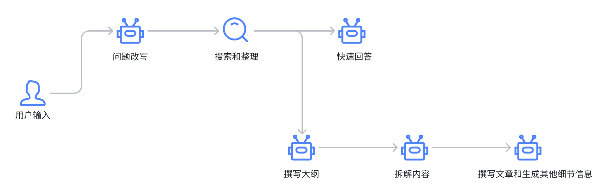
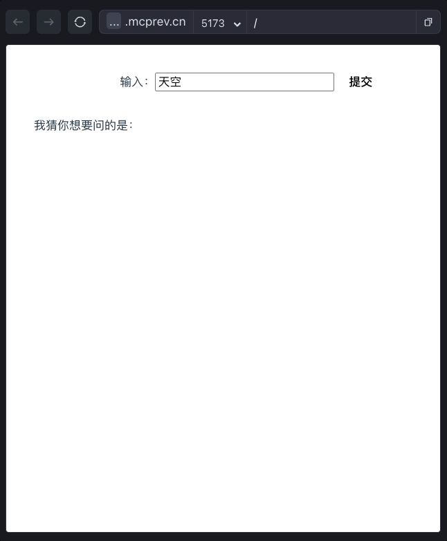
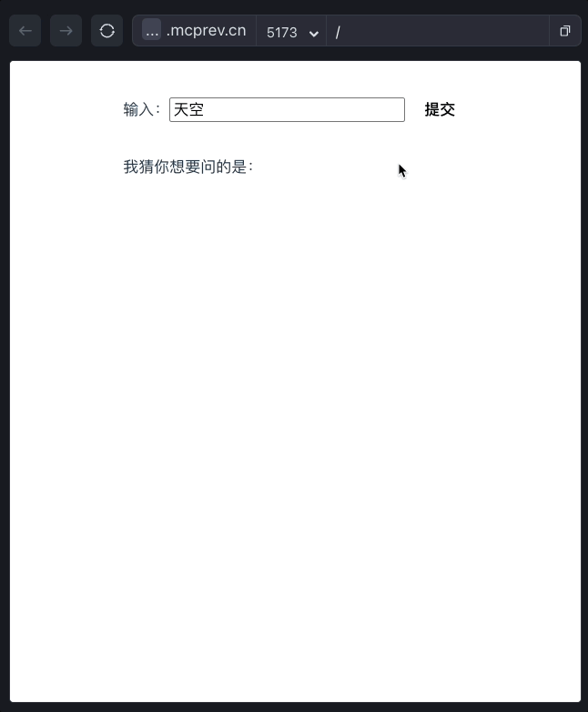
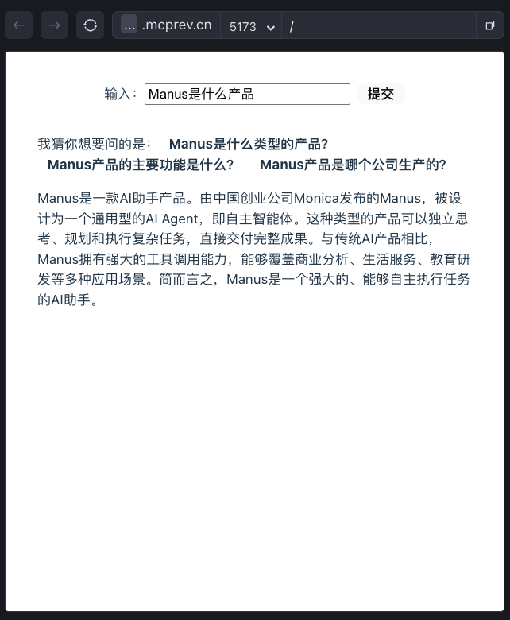

# 17 | 如何实现波波熊学伴核心工作流（一）

你好，我是月影。

上一节课，我们介绍了如何通过问题改写和 RAG 来让大模型减少幻觉，给出质量高的内容。那么这节课，我们要继续深入，完成波波熊学伴产品整体的核心工作流。

现在我们通过 search 得到了参考资料，我们让大模型按照两条线并行处理。

一是先针对问题和参考资料给出一轮快速简答，这样能够快速给出一个比较基础的回答，减少用户的等待时间。

二是针对问题和参考资料，构建内容大纲、拆解子标题、完成段落撰写，最后生成其他需要的内容，比如生成段落配图的提示词。

针对详细内容拆解的过程，有一套方法论，叫做 PBL（Problem‑Based Learning）教学法。

- PBL 教学法，即“问题导向学习法”，是一种以学生为中心、通过解决真实情境中的复杂问题来促进知识建构与能力培养的教学模式。其核心思想是：将学习置于“问题情境”之中，让学生主动探索、合作交流、自主反思，从而形成深度理解与可迁移的技能。

我们将波波熊学伴的整体工作流完整的节点拆解如下图：



接下来我们就来具体实现其中的每个步骤。

## 问题改写和选择

首先，我们要实现用户输入后问题的改写选择的具体交互逻辑。在前一节课，我们已经把这块底层逻辑给实现了，现在我们来添加交互细节。

我们打开 Bearbobo Discovery 项目，首先将前一节课的问题改写逻辑添加到项目中。

```bash
我们创建 /lib/prompts/make-question.tpl.ts ，内容如下：
export default `你是一个儿童科普助手，负责分析孩子的好奇心问题。
```

- 孩子有时候输入的问题不够具体，这时候你需要根据孩子的输入推断出孩子真正想要问的内容，给出三个最可能

```
如果你认为孩子问的问题已经足够具体(即已经是一个完整的疑问句，且问题适合孩子问），那么只输出当前这一
# Example
当孩子问“火焰”时，孩子可能要问的是：
```

- 火焰的温度有多高？火焰为什么会有不同的颜色？火焰是如何产生的？

```xml
# Output
你输出一个JSON对象，格式如下：
{
   "questions": [
         {
             question: "火焰的温度有多高？",
             query: ["火焰的温度"， "火焰高温特诊"]
         },
         {
             question: "火焰为什么会有不同的颜色？",
             query: ["火焰的颜色"， "火焰颜色与温度关系"]
         },
         {
             question: "火焰是如何产生的？",
             query: ["火焰产生的原理"， "火焰燃烧的过程"]
         }
   ]
}`;
然后创建 server.ts ，添加一个 http 接口 make-question ：
import * as dotenv from 'dotenv'
import express from 'express';
import { pipeline } from 'node:stream/promises';
import { type ChatConfig, Ling } from '@bearbobo/ling';
import makeQuestionPrompt from './lib/prompts/make-question.tpl.ts';
import bodyParser from 'body-parser';
dotenv.config({
   path: ['.env.local', '.env']
})
const apiKey = process.env.VITE_KIMI_API_KEY as string;
const endpoint = process.env.VITE_KIMI_END_POINT as string;
const modelName = process.env.VITE_KIMI_MODEL_NAME as string;
const app = express();
const port = 3000;
app.use(express.json({ limit: '50mb' }));
app.use(bodyParser.json());
const config: ChatConfig = {
   model_name: modelName,
   api_key: apiKey,
   endpoint,
   sse: true,
};
app.get('/make-question', async (req, res) => {
   const question = req.query.question as string;
   // ------- The work flow start --------
   const ling = new Ling(config);
   const bot = ling.createBot();
   bot.addPrompt(makeQuestionPrompt);
   bot.chat(question);
   ling.close();
   // setting below headers for Streaming the data
   res.writeHead(200, {
       'Content-Type': "text/event-stream",
       'Cache-Control': "no-cache",
       'Connection': "keep-alive"
   });
   pipeline((ling.stream as any), res);
});
// 启动服务器
app.listen(port, () => {
   console.log(`Server running on http://localhost:${port}`);
});
在 /src/components 下创建一个 Vue 组建 MakeQuestion.vue ，内容如下：
<script setup lang="ts">
defineProps({
 questions: {
   type: Array,
   default: [],
 }
});
const emit = defineEmits(['selection'])
const selection = (question: string) => {
 emit('selection', question)
}
</script>
<template>
 <div class="questions">
   <div>我猜你想要问的是：</div>
   <div v-for="(question, index) in questions" :key="index">
     <div class="question selection" @click="selection(question as string)">{{ q
   </div>
 </div>
</template>
<style scoped>
.questions {
 display: flex;
 flex-direction: row;
 flex-wrap: wrap;
}
.question {
 margin: 0 10px;
 font-weight: bold;
}
.question.selection {
 cursor: pointer;
}
</style>
```

这个组件的功能比较简单，就是接收一个问题列表数组，将它展示出来供用户选择。

```
那么列表数组怎么来呢？就是通过我们请求 /api/make-question 接口来获得。
```

我们修改 App.vue：

```sql
<script setup lang="ts">
import { ref, type Ref } from 'vue';
import MakeQuestion from './components/MakeQuestion.vue';
const question = ref('天空为什么是蓝色的？');
const rewritedQuestions: Ref<Array<string>> = ref([]);
const update = async () => {
 if (!question) return;
 rewritedQuestions.value = [];
 const endpoint = '/api/make-question';
 const eventSource = new EventSource(`${endpoint}?question=${question.value}`);
 eventSource.addEventListener("message", function (e: any) {
   let { uri, delta } = JSON.parse(e.data);
   const matches = uri.match(/questions\/(\d+)\/question$/);
   if (matches) {
     const index = parseInt(matches[1]);
     rewritedQuestions.value[index] = rewritedQuestions.value[index] || '';
     rewritedQuestions.value[index] += delta;
   }
 });
 eventSource.addEventListener('finished', () => {
   console.log('传输完成');
   eventSource.close();
 });
}
const questionSelected = (question: string) => {
 console.log('questionSelected', question);
}
</script>
<template>
 <div class="container">
   <div>
     <label>输入：</label><input class="input" v-model="question" />
     <button @click="update">提交</button>
   </div>
   <div class="output">
     <MakeQuestion :questions="rewritedQuestions" @selection="questionSelected"
   </div>
 </div>
</template>
<style scoped>
.container {
 display: flex;
 flex-direction: column;
 align-items: center;
 justify-content: start;
 width: 100%;
 height: 100vh;
 font-size: .85rem;
}
.input {
 width: 200px;
}
.output {
 margin-top: 30px;
 min-height: 300px;
 width: 100%;
 text-align: left;
}
</style>
在这里，我们调用 /api/make-question 接口，通过 EventSource 拿到数据，根据提示词
设定的 JSON 数据结构，匹配 /questions\/(\d+)\/question 接口数据，将它传给
```

MakeQuestion 组件。核心代码如下：

```javascript
 eventSource.addEventListener("message", function (e: any) {
   let { uri, delta } = JSON.parse(e.data);
   const matches = uri.match(/questions\/(\d+)\/question$/);
   if (matches) {
     const index = parseInt(matches[1]);
     rewritedQuestions.value[index] = rewritedQuestions.value[index] || '';
     rewritedQuestions.value[index] += delta;
   }
 });
```

这样，我们就实现了改写问题并选择的主体逻辑，具体 UI 效果如下：



## 搜索与快速回答

好了，现在我们实现了问题的改写选择，接下来我们要执行搜索整理资料，并进行简答。

search 的部分我们在上一节课已经封装好了模块，那么现在我们还需要实现具体的搜索和简答 API。

```bash
首先创建 /lib/prompts/quick-answer.tpl.ts ，内容如下：
export default `# Overall Rules to follow
1. Do response in 简体中文.
2. Do NOT explain your response.
3. DO NOT mention the student' Information when you generate the content.
## Student Information:
- gender: {{gender}}
- age: {{age}}
- student location: 中国
## Study Style
The students' learning style preferences
- Communication-Style: Simple and Clear
- Tone-Style: Interesting and Vivid
- Reasoning-Framework: Intuitive
- Language: 简体中文
# Role and Goals
你正在模拟一个科学教育家，以<Study Style>的方式快速回答<Student Information>的学生的好奇心
1. 学生会给你一个好奇心问题，你以科普的方式对这个问题作出**简明扼要**的回答。
2. 你的答案要严谨科学，包含对问题的根本原理的解释，但需要以合适学生理解的方式表达，以助于学生快速
3. 将回答的内容控制在300字以内，简明扼要，将内容分成1-3个小段，自然的串联起知识点，使用段落叙述。
4. 回答请用**书面语**，不要有对提问者的称呼，回答形式参考[Example]
5. 该学生年龄是 {{age}} 岁，务必用适合学生年龄的能理解的方式回答。
# Example
[为什么焦虑的时候会出汗？]
这是“战斗或逃跑反应”的一部分。在产生“或战或逃”反应时，人体的交感神经系统会释放激素，其中包括肾上腺
```

- 因此，有一种理论认为，这种出汗是一种利于进化的行为：一人焦虑出汗，其他人会更加警觉，准备好应对任何

```
`
```

你可能会疑惑，为什么我们上面这段提示词有中文也有英文？这个是因为我们产品里有些配置项，那部分提示词我们之前用英文撰写的，这个没有关系，并不影响大模型的理解，如果你自己实现时，改成中文也可以。

这部分提示词中有些配置参数，主要在 Student Information 和 Student Style 两个部分，其中一些配置是用户注册后在个人信息里面维护的，我做了一些简化，用固定值替代了这些配置项，只保留性别 gender 和年龄 age。但为了简化操作便于讲解，我会在 server.ts 中将这部分内容写死，有兴趣的同学可以在课后自己修改这些配置，看看更改后 AI 输出的内容会有什么不同。

```python
现在我们继续，在 server.ts 中添加 /quick-answer 接口：
...
import quickAnswerPrompt from './lib/prompts/quick-answer.tpl.ts';
...
app.get('/quick-answer', async (req, res) => {
   const question = req.query.question as string;
   // ------- The work flow start --------
   const ling = new Ling(config);
   const bot = ling.createBot('quick-answer', {}, {
       response_format: { type: 'text' }
   });
   bot.addPrompt(quickAnswerPrompt, {
       gender:'female',
       age: '6',
   });
   bot.chat(question);
   ling.close();
   // setting below headers for Streaming the data
   res.writeHead(200, {
       'Content-Type': "text/event-stream",
       'Cache-Control': "no-cache",
       'Connection': "keep-alive"
   });
   pipeline((ling.stream as any), res);
});
在上面的代码中，我们让 quick-answer以文本方式返回，所以将 response_format 设为
```

text。

我们将 quickAnswerPrompt 传给 bot，设置孩子年龄为 6 岁，性别为女孩。这样 AI 会返回更适合 6 岁女孩理解的回答内容。

好了，接下来我们修改 App.vue，在 questionSelected 方法中添加新的逻辑：

```xml
<script setup lang="ts">
...
import { marked } from 'marked';
...
const quickAnswer = ref('');
const questionSelected = (question: string) => {
 // console.log('questionSelected', question);
 quickAnswer.value = '';
 const endpoint = '/api/quick-answer';
 const eventSource = new EventSource(`${endpoint}?question=${question}`);
 eventSource.addEventListener("message", function (e: any) {
   let { delta } = JSON.parse(e.data);
   quickAnswer.value += delta;
 });
 eventSource.addEventListener('finished', () => {
   console.log('传输完成');
   eventSource.close();
 });
}
</script>
<template>
...
   <div class="output">
     <MakeQuestion :questions="rewritedQuestions" @selection="questionSelected"
     <div v-html="marked.parse(quickAnswer)"></div>
   </div>
...
</template>
```

因为 AI 有可能输出 markdown 格式数据，所以我们这里用 marked 来解析 markdown 文本。

我们需要安装一下 marked 依赖库：

```
pnpm i markded
```

这样，我们实现了简答的基础功能。来看一下效果：



## 启用 RAG

注意到我们这个版本的简答并没有使用 search。如果用户询问一些和时事有关的问题，最好还是先搜索一下资料，否则由于大模型语料库的问题，很可能不能非常好地进行解答。

我们现在修改 server.ts，引入 search 接口：

```python
...
import { search } from './lib/service/serper.search.ts';
...
app.get('/quick-answer', async (req, res) => {
   const question = req.query.question as string;
   const query = req.query.query as string;
   let searchResults = '';
   if (query) {
       const queries = query.split(';');
       const promises = queries.map((query) => search(query));
       searchResults = JSON.stringify(await Promise.all(promises));
   }
   // ------- The work flow start --------
   const ling = new Ling(config);
   const bot = ling.createBot('quick-answer', {}, {
       response_format: { type: 'text' }
   });
   bot.addPrompt(quickAnswerPrompt, {
       gender:'female',
       age: '6',
   });
   if (searchResults) bot.addPrompt(`参考资料:\n${searchResults}`)
   bot.chat(question);
   ling.close();
   // setting below headers for Streaming the data
   res.writeHead(200, {
       'Content-Type': "text/event-stream",
       'Cache-Control': "no-cache",
       'Connection': "keep-alive"
   });
   pipeline((ling.stream as any), res);
});
```

我们对前端传入的 query 参数（多个 query 以 ; 连接）进行分割，然后调用 search 返回搜索结果。最终我们讲 searchResults 作为参考资料传给 bot，那么 bot 在回答问题时，就会参考搜索结果内容来回答了。

前端我们也增加处理搜索的逻辑，修改 App.vue 代码：

```sql
...
let queries: string[][] = [];
const update = async () => {
 if (!question) return;
 rewritedQuestions.value = [];
 quickAnswer.value = '';
 queries = [];
 const endpoint = '/api/make-question';
 const eventSource = new EventSource(`${endpoint}?question=${question.value}`);
 eventSource.addEventListener("message", function (e: any) {
   let { uri, delta } = JSON.parse(e.data);
   let matches = uri.match(/questions\/(\d+)\/question$/);
   if (matches) {
     const index = parseInt(matches[1]);
     rewritedQuestions.value[index] = rewritedQuestions.value[index] || '';
     rewritedQuestions.value[index] += delta;
   }
   matches = uri.match(/questions\/(\d+)\/query\/(\d+)$/);
   if (matches) {
     const index = parseInt(matches[1]);
     const queryIndex = parseInt(matches[2]);
     queries[index] = queries[index] || [];
     queries[index][queryIndex] = queries[index][queryIndex] || '';
     queries[index][queryIndex] += delta;
   }
 });
 eventSource.addEventListener('finished', () => {
   console.log('传输完成');
   eventSource.close();
 });
}
const quickAnswer = ref('');
const questionSelected = (question: string, index: number) => {
 quickAnswer.value = '';
 const query = queries[index].join(';');
 const endpoint = '/api/quick-answer';
 const eventSource = new EventSource(`${endpoint}?question=${question}&query=${q
 eventSource.addEventListener("message", function (e: any) {
   let { delta } = JSON.parse(e.data);
   quickAnswer.value += delta;
 });
 eventSource.addEventListener('finished', () => {
   console.log('传输完成');
   eventSource.close();
 });
}
...
```

因为我们在 make-question 接口中返回了 query 内容（具体格式你可以回顾 make-question.tpl.ts 的内容），所以我们增加一个 matches 过程，匹配出

```javascript
/questions/0/query/0 这样的 uri。
   matches = uri.match(/questions\/(\d+)\/query\/(\d+)$/);
   if (matches) {
     const index = parseInt(matches[1]);
     const queryIndex = parseInt(matches[2]);
     queries[index] = queries[index] || [];
     queries[index][queryIndex] = queries[index][queryIndex] || '';
     queries[index][queryIndex] += delta;
   }
```

这样我们就可以更新 queries。

然后我们在 questionSelected 中多传一个 index 参数，这里我们通过修改 MakeQuestion.vue的 selection 事件实现：

```xml
<script setup lang="ts">
...
const selection = (question: string, index: number) => {
 emit('selection', question, index)
}
</script>
<template>
...
   <div v-for="(question, index) in questions" :key="index">
     <div class="question selection" @click="selection(question as string, index
   </div>
...
</template>
```

这样当用户选择对应的问题后，我们就可以匹配到 query 词，将它传给 server 处理了。

```javascript
const quickAnswer = ref('');
const questionSelected = (question: string, index: number) => {
 quickAnswer.value = '';
 const query = queries[index].join(';');
 const endpoint = '/api/quick-answer';
 const eventSource = new EventSource(`${endpoint}?question=${question}&query=${q
 eventSource.addEventListener("message", function (e: any) {
   let { delta } = JSON.parse(e.data);
   quickAnswer.value += delta;
 });
 eventSource.addEventListener('finished', () => {
   console.log('传输完成');
   eventSource.close();
 });
}
```

最终，由于有了搜索做支撑，那么当用户问一些比较新的内容时，AI 就能给出相对准确的结果了。

比如下图是当我问 Manus 是什么产品时，AI 给出的结果是后面这样。



```
到此为止，我们实现了波波熊学伴核心工作流的上半部分，即问题改写->资料搜索和整理->
```

快速回答 这一部分流程。

接下来，我们还有下半部分流程需要并行处理，我把它留到下一节课解决，敬请期待。

## 要点总结

在这一节里，我们讨论了波波熊学伴产品核心工作流的整体过程，以及上半部分流程，即从问题改写到搜索和整理资料再到快速回答的这部分流程。

在这部分流程中，最关键的是对每一个阶段节点的数据处理和流程控制，这也是大部分内容类AI 应用的核心，希望大家通过反复练习，打好基础。

## 课后练习

为了更好地突出重点，我将波波熊学伴产品中最核心的部分抽取出来讲解，但限于篇幅原因，里面有些细节被我们忽略了，比如服务端我们传给 quick-answer 的提示词，先定了 6 岁女孩，你可以修改这些参数，看看如果孩子的信息改变了，AI 回答的一些内容会不会跟着变化。

另外，在前端，我们也忽略了一些细节。比如如果我问的问题很具体了，那么 AI 在改写问题时只会返回原始问题，这时候我们没必要再用鼠标点击一下进行下一步。如果我问的问题不够具体，那么 AI 会返回三个改写的问题让我选择，而我选择其中一个后，该问题应该高亮或者用其他的 UI 方式标注出来，这样用户才会清晰地知道后续的回答是针对该问题的。这些细节我们都没有去处理，有兴趣的同学，可以修改代码进行研究，然后将结果分享到评论区。

完整的代码在 GitHub 仓库。
