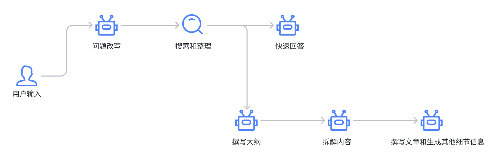
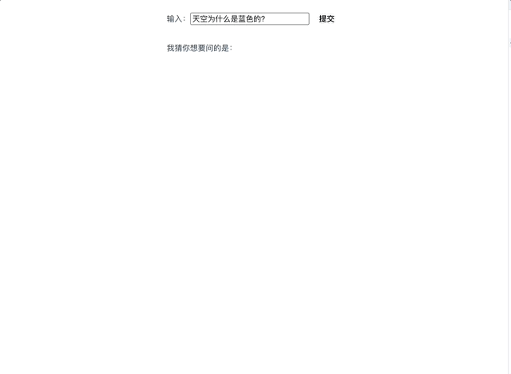

# 18 | 如何实现波波熊学伴核心工作流（二）

你好，我是月影。

在上一节课，我们梳理了波波熊学伴核心工作流，并实现了它的上半部分，即如何改写问题、搜索资料和快速回答。

这一节课我们将继续实现波波熊学伴核心工作流的下半部分，让我们先来回顾一下整体流程：



我们来看下半部分，当我们完成搜索和资料整理后，要开始撰写大纲，然后对大纲进一步进行内容拆解，最后撰写具体文章详情。

我们这就一一往下看。

## 如何撰写内容大纲

首先是大纲的撰写。大纲撰写的提示词如下：

```
# Overall Rules to follow
1. Do response in 简体中文 and output **correct JSON Format ONLY**.
2. Do NOT explain your response.
3. DO NOT mention the student' Information when you generate the content.
## Student Information
- gender: {{gender}}
- age: {{age}}
- student location: 中国
## Study Style
The article must always adhere to the following elements:
- Communication-Style: Simple and Clear
- Tone-Style: Interesting and Vivid
- Reasoning-Framework: Intuitive
- Language: 简体中文
# Role and Goals
你正在模拟一个教育家，专门制作针对 {{age}} 岁学生的教育内容大纲，采用<Communication-Style>的
1. 学生会给你一个好奇心问题，你需要结合学生已有的知识和认知，比如身边常见的的事物，给出回答。
2. 使用PBL 方法(Problem-Based Learning)和建构主义学习理论，通过提出实际问题激发学生的学习兴
3. [IMPORTANT!]该学生年龄是 {{age}} 岁，务必用适合学生年龄的能理解的问题来引导学生。

4. 由于该学生年龄小于 8 岁，你最多输出 3 个 topic。

4. 由于该学生年龄大于 8 岁，你可以输出 3 到 7 个 topic。

5. Generate prompts for the a cover image, written in English, store in 'image_pr
# Output Format(JSON)
你输出的 JSON 格式如下，这里有一个“木头为什么会燃烧”的示例：
\`\`\`
{"question":"木头为什么会燃烧？","topics":[{"topic":"燃烧是一种什么物理现象？"},{"topic"
\`\`\`
```

同样为了聚焦重点，我简化了 Study Style 的配置变量，只需要传 age 和 gender 进去即可。

在这里我们关注一个细节，我们已经知道，Ling 框架的提示词默认支持 nunjucks 模板，所以我们可以通过 if 分支动态生成提示词，来针对不同年龄的孩子输出不同深度的内容：

```

4. 由于该学生年龄小于 8 岁，你最多输出 3 个 topic。

4. 由于该学生年龄大于 8 岁，你可以输出 3 到 7 个 topic。

现在我们在 Trae 中打开 Bearbobo Discovery 项目，创建 lib/prompts/outline.tpl.ts
```

，内容如下：

```bash
export default `
# Overall Rules to follow
1. Do response in 简体中文 and output **correct JSON Format ONLY**.
2. Do NOT explain your response.
3. DO NOT mention the student' Information when you generate the content.
## Student Information
- gender: {{gender}}
- age: {{age}}
- student location: 中国
## Study Style
The article must always adhere to the following elements:
- Communication-Style: Simple and Clear
- Tone-Style: Interesting and Vivid
- Reasoning-Framework: Intuitive
- Language: 简体中文
# Role and Goals
你正在模拟一个教育家，专门制作针对 {{age}} 岁学生的教育内容大纲，采用<Communication-Style>的
1. 学生会给你一个好奇心问题，你需要结合学生已有的知识和认知，比如身边常见的的事物，给出回答。
2. 使用PBL 方法(Problem-Based Learning)和建构主义学习理论，通过提出实际问题激发学生的学习兴
3. [IMPORTANT!]该学生年龄是 {{age}} 岁，务必用适合学生年龄的能理解的问题来引导学生。

4. 由于该学生年龄小于 8 岁，你最多输出 3 个 topic。

4. 由于该学生年龄大于 8 岁，你可以输出 3 到 7 个 topic。

5. Generate prompts for the a cover image, written in English, store in 'image_pr
# Output Format(JSON)
你输出的 JSON 格式如下，这里有一个“木头为什么会燃烧”的示例：
\`\`\`
{"question":"木头为什么会燃烧？","topics":[{"topic":"燃烧是一种什么物理现象？"},{"topic"
\`\`\`
`;
```

接着，我们改写 server.ts，我们直接把上一节课写的 quick-answer 改成 generate，因为有Ling 框架的管理，我们完全可以把完整流程放在一个接口中：

```javascript
app.get('/generate', async (req, res) => {
   const userConfig = {
       gender: 'female',
       age: '6',
   };
   const question = req.query.question as string;
   const query = req.query.query as string;
   let searchResults = '';
   if (query) {
       const queries = query.split(';');
       const promises = queries.map((query) => search(query));
       searchResults = JSON.stringify(await Promise.all(promises));
   }
   // ------- The work flow start --------
   const ling = new Ling(config);
   const quickAnswerBot = ling.createBot('quick-answer', {}, {
       response_format: { type: 'text' }
   });
   quickAnswerBot.addPrompt(quickAnswerPrompt, userConfig);
   const outlineBot = ling.createBot('outline');
   outlineBot.addPrompt(outlinePrompt, userConfig);
   if (searchResults) {
       quickAnswerBot.addPrompt(`参考资料:\n${searchResults}`);
       outlineBot.addPrompt(`参考资料:\n${searchResults}`);
   }
   quickAnswerBot.chat(question);
   outlineBot.chat(question);
   ling.close();
   // setting below headers for Streaming the data
   res.writeHead(200, {
       'Content-Type': "text/event-stream",
       'Cache-Control': "no-cache",
       'Connection': "keep-alive"
   });
   pipeline((ling.stream as any), res);
});
```

上面的代码是基于上一节课的 quick-answer 接口修改的，我们新创建了一个 outlineBot，然后将内容输出。

### 生成封面图片

考虑到我们的提示词生成的内容包含封面图片的英文提示，我们要对它进行处理。

```
首先我们添加 /lib/service/generate-image.ts ，它是一个用 flux.ai 生成图片的模
```

块。

代码如下：

```bash
export async function generateImage(prompt: string): Promise<{ error: string, url
   const endpoint = process.env.VITE_FLUX_END_POINT;
   const modelName = process.env.VITE_FLUX_MODEL_NAME;
   const payload = {
       prompt,
       width: 1024,
       height: 1024,
       steps: 40,
       prompt_upsampling: true,
       seed: 42,
       guidance: 3,
       sampler: 'dpmpp_2m',
       safety_tolerance: 2,
   };
   const headers: any = {
       'Content-Type': 'application/json',
       'x-key': process.env.VITE_FLUX_API_KEY,
   };
   const res = await fetch(`${endpoint}/${modelName}`, {
       headers,
       method: 'POST',
       body: JSON.stringify(payload),
   });
   const id = (await res.json()).id;
   const resultUrl = `${endpoint}/get_result?id=${id}`;
   do {
       await new Promise((resolve) => setTimeout(resolve, 100));
       const result = await fetch(resultUrl);
       const resultJson = await result.json();
       if (resultJson.status === 'Pending') {
           continue;
       }
       const sample = resultJson.result?.sample;
       if (sample) {
           return {
               error: '',
               url: sample,
           }
       } else {
           return {
               error: 'No result',
               url: 'https://res.bearbobo.com/resource/upload/vNg4ALJv/6659895-o
           }
       }
   } while (1);
   return { error: '', url: '' };
}
```

这部分代码，我们之前的课程中有介绍过，虽然当时调用是放在客户端，但是和放在服务端没什么本质区别，这里就不再重复了。

### 改写 sever 逻辑

接着我们将 server 的接口从 quick-answer 改写为 generate，代码如下：

```python
...
import outlinePrompt from './lib/prompts/outline.tpl.ts';
import { generateImage } from './lib/service/generate-image.ts';
...
app.get('/generate', async (req, res) => {
   const userConfig = {
       gender: 'female',
       age: '6',
   };
   const question = req.query.question as string;
   const query = req.query.query as string;
   let searchResults = '';
   if (query) {
       const queries = query.split(';');
       const promises = queries.map((query) => search(query));
       searchResults = JSON.stringify(await Promise.all(promises));
   }
   // ------- The work flow start --------
   const ling = new Ling(config);
   const quickAnswerBot = ling.createBot('quick-answer', {}, {
       response_format: { type: 'text' }
   });
   quickAnswerBot.addPrompt(quickAnswerPrompt, userConfig);
   const outlineBot = ling.createBot('outline');
   outlineBot.addPrompt(outlinePrompt, userConfig);
   outlineBot.addFilter('image_prompt');
   outlineBot.addListener('string-response', ({ uri, delta }) => {
       ling.handleTask(async () => {
           if (uri.includes('image_prompt')) {
               // generate image
               const { url } = await generateImage(`A full-size picture suitable
               ling.sendEvent({ uri: 'cover_image', delta: url });
           }
       });
   });
   if (searchResults) {
       quickAnswerBot.addPrompt(`参考资料:\n${searchResults}`);
       outlineBot.addPrompt(`参考资料:\n${searchResults}`);
   }
   quickAnswerBot.chat(question);
   outlineBot.chat(question);
   ling.close();
   // setting below headers for Streaming the data
   res.writeHead(200, {
       'Content-Type': "text/event-stream",
       'Cache-Control': "no-cache",
       'Connection': "keep-alive"
   });
   pipeline((ling.stream as any), res);
});
```

在这里，我们创建一个新的 outlingBot，并添加提示词。注意，由于 AI 输出的 image_prompt

```
属性不需要发给前端，我们可以通过 outlineBot.addFilter 将它过滤掉，这样可以减少
```

发送给前端的数据量和等待时间。

```javascript
const outlineBot = ling.createBot('outline');
outlineBot.addPrompt(outlinePrompt, userConfig);
outlineBot.addFilter('image_prompt');
```

然后是处理 image_prompt，我们可以通过监听 outlineBot 的 string-response 事件获得完整的image_prompt 内容，然后把它发给 generateImage 方法处理成图像。

```
因为整个过程是异步过程，所以我们通过 ling.handleTask 处理，这样能确保流式输出不
```

会在异步事件处理完成之前被关闭。

```javascript
outlineBot.addListener('string-response', ({ uri, delta }) => {
   ling.handleTask(async () => {
       if (uri.includes('image_prompt')) {
           // generate image
           const { url } = await generateImage(`A full-size picture suitable as
           ling.sendEvent({ uri: 'cover_image', delta: url });
       }
   });
});
最后，当我们拿到图片 URL 后，还要通过 ling.sendEvent 将它发送给前端。
```

这样我们就实现了 server 逻辑。

### 实现前端 UI

接着我们创建一个 Vue 组件 BookCard，代码如下：

```xml
<script setup lang="ts">
import { marked } from 'marked';
defineProps({
   image: {
       type: String,
       default: '',
   },
   question: {
       type: String,
       default: '',
   },
   description: {
       type: String,
       default: '',
   }
});
const emit = defineEmits(['expand']);
const expand = () => {
   emit('expand');
}
</script>
<template>
   <div v-if="description" class="card" @click="expand">
       <div v-if="image" class="cover">
           
       </div>
       <div v-else class="cover animated-border">
           
       </div>
       <div class="description">
           <h3>{{ question }}</h3>
           <div v-html="marked.parse(description)"></div>
       </div>
   </div>
</template>
<style scoped>
.card {
   display: flex;
   flex-direction: row;
   flex-wrap: wrap;
   justify-content: space-between;
   align-items: center;
   min-width: 600px;
   border: solid 2px #ccc;
   border-radius: 24px;
   padding: 0;
   margin: 40px 0px;
   cursor: pointer;
   position: relative;
}
.description {
   flex-grow: 2;
   padding: 20px;
   max-width: 600px;
}
.description h3 {
   position: absolute;
   top: 5px;
}
.cover {
   width: 160px;
   height: 160px;
   font-size: 0;
}
.animated-border {
   box-sizing: border-box;
   display: inline-block;
   border: 4px solid transparent;
   border-radius: 20px 0 0 20px;
   /* 两层背景：第一层填充内容区（白色），第二层绘制渐变边框 */
   background-image:
       linear-gradient(#fff, #fff),
       linear-gradient(90deg, #f00, #0f0, #00f);
   background-origin: border-box;
   background-clip: padding-box, border-box;
   background-size: 200% 200%;
   animation: border-slide 4s linear infinite;
}
@keyframes border-slide {
   0% {
       background-position: 0% 50%;
   }
   50% {
       background-position: 100% 50%;
   }
   100% {
       background-position: 0% 50%;
   }
}
.img-fluid {
   border-radius: 16px 0 0 16px;
   width: 100%;
}
</style>
```

这个组件没有复杂的逻辑，主要是用来展示卡片样式的。

我们修改 App.vue：

```sql
<script setup lang="ts">
import { ref, type Ref } from 'vue';
import MakeQuestion from './components/MakeQuestion.vue';
import { marked } from 'marked';
import BookCard from './components/BookCard.vue';
import BookDetails from './components/BookDetails.vue';
const question = ref('天空为什么是蓝色的？');
const rewritedQuestions: Ref<Array<string>> = ref([]);
let queries: string[][] = [];
const update = async () => {
 if (!question) return;
 rewritedQuestions.value = [];
 quickAnswer.value = '';
 description.value = '';
 queries = [];
 const endpoint = '/api/make-question';
 const eventSource = new EventSource(`${endpoint}?question=${question.value}`);
 eventSource.addEventListener("message", function (e: any) {
   let { uri, delta } = JSON.parse(e.data);
   let matches = uri.match(/questions\/(\d+)\/question$/);
   if (matches) {
     const index = parseInt(matches[1]);
     rewritedQuestions.value[index] = rewritedQuestions.value[index] || '';
     rewritedQuestions.value[index] += delta;
   }
   matches = uri.match(/questions\/(\d+)\/query\/(\d+)$/);
   if (matches) {
     const index = parseInt(matches[1]);
     const queryIndex = parseInt(matches[2]);
     queries[index] = queries[index] || [];
     queries[index][queryIndex] = queries[index][queryIndex] || '';
     queries[index][queryIndex] += delta;
   }
 });
 eventSource.addEventListener('finished', () => {
   console.log('传输完成');
   eventSource.close();
 });
}
const coverUrl = ref('');
const quickAnswer = ref('');
const description = ref('');
const questionSelected = (question: string, index: number) => {
 quickAnswer.value = '';
 description.value = '';
 const query = queries[index].join(';');
 const endpoint = '/api/generate';
 const eventSource = new EventSource(`${endpoint}?question=${question}&query=${q
 eventSource.addEventListener("message", function (e: any) {
   let { uri, delta } = JSON.parse(e.data);
   if (uri.endsWith('quick-answer')) {
     quickAnswer.value += delta;
   }
   if (uri.endsWith('introduction')) {
     description.value += delta;
   }
   if (uri.endsWith('cover_image')) {
     coverUrl.value = delta;
   }
 });
 eventSource.addEventListener('finished', () => {
   console.log('传输完成');
   eventSource.close();
 });
}
</script>
<template>
 <div class="container>
   <div>
     <label>输入：</label><input class="input" v-model="question" />
     <button @click="update">提交</button>
   </div>
   <div class="output">
     <MakeQuestion :questions="rewritedQuestions" @selection="questionSelected"
     <div v-html="marked.parse(quickAnswer)"></div>
     <BookCard :image="coverUrl" :description="description" :question="question"
   </div>
   <BookDetails :image="coverUrl" :expand="expand" :introduction="description" :
 </div>
</template>
<style scoped>
.container {
 display: flex;
 flex-direction: column;
 align-items: center;
 justify-content: start;
 width: 100%;
 height: 100vh;
 font-size: .85rem;
}
.input {
 width: 200px;
}
.output {
 margin-top: 30px;
 min-height: 300px;
 width: 100%;
 text-align: left;
}
button {
 padding: 0 10px;
 margin-left: 6px;
}
</style>
```

上面这段代码中，最核心的逻辑就是从 sever 获取数据后更新数据到 Vue 组件：

```javascript
const coverUrl = ref('');
const quickAnswer = ref('');
const description = ref('');
const questionSelected = (question: string, index: number) => {
 quickAnswer.value = '';
 description.value = '';
 const query = queries[index].join(';');
 const endpoint = '/api/generate';
 const eventSource = new EventSource(`${endpoint}?question=${question}&query=${q
 eventSource.addEventListener("message", function (e: any) {
   let { uri, delta } = JSON.parse(e.data);
   if (uri.endsWith('quick-answer')) {
     quickAnswer.value += delta;
   }
   if (uri.endsWith('introduction')) {
     description.value += delta;
   }
   if (uri.endsWith('cover_image')) {
     coverUrl.value = delta;
   }
 });
 eventSource.addEventListener('finished', () => {
   console.log('传输完成');
   eventSource.close();
 });
}
```

这里我们将 introduction 和 cover_image 赋给 Ref 变量，然后传给 BookCard 组件进行展示就可以了，实现起来非常简单。最终效果如下：



这样我们就实现了大纲生成和卡片展示。

## 要点总结

这一节课，我们重点讲了大纲的撰写，其中最核心的是生成大纲的工作流节点和封面图的生成，代码虽然看起来不少，但理解起来并不复杂。它们都是异步过程，通过 Ling 框架，能够很好地将流程整合到一起，并通过数据流的方式统一发送给前端处理。

在下一节课，我们将继续讲解大纲生成后，子主题的拆解和最终的正文生成逻辑。

## 课后练习

在上面的实战中，如果你仔细看代码，会发现我们对生成的封面图的风格进行了限定。思考我们为什么要这么做，如果想做的更好，让封面图的风格多样化，可以怎么做？将你的想法或做法分享到评论区。

你可以修改代码来实践，完整代码位于代码仓库。
