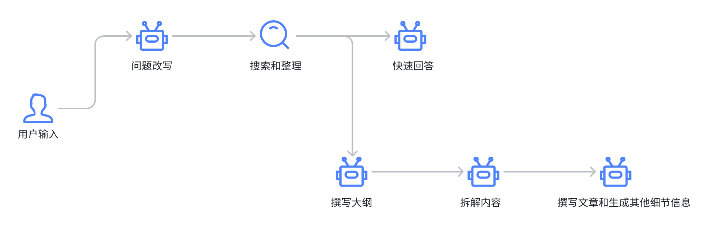
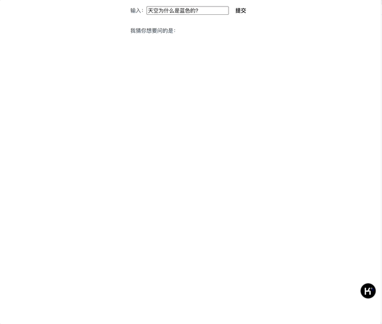
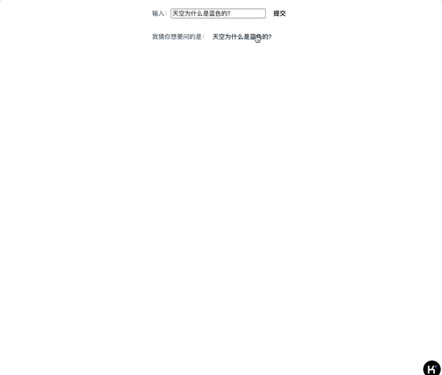

# 19 | 如何实现波波熊学伴核心工作流（三）

你好，我是月影。

在上一节课，我们讲了生成内容大纲的部分，接下来我们继续深入，讨论如何实现内容的拆解以及文章的生成。

同样，我们首先回顾整体工作流：



目前我们实现到了撰写大纲，那么接下来，我们要根据大纲拆解内容了。

## 根据大纲拆解内容

首先，我们还是用 Trae 打开 Bearbobo Discovery 项目，创建新的提示词模板文件

```bash
/lib/prompts/sub-topics.tpl.ts ，内容如下：
export default `
# Overall Rules to follow
1. Do response in 简体中文 and output **correct JSON Format ONLY**.
2. Do NOT explain your response.
3. DO NOT mention the student' Information when you generate the content.
## Student Information
- gender: {{gender}}
- age: {{age}}
- student location: 中国
## Study Style
The article must always adhere to the following elements:
- Communication-Style: Simple and Clear
- Tone-Style: Interesting and Vivid
- Reasoning-Framework: Intuitive
- Language: 简体中文
# Role and Goals
你正在模拟一个教育家，专门编写针对 {{age}} 岁学生的教学内容，采用<Communication-Style>的行文
1. You will receive an educational outline that includes 'topics'和'introduction'
2. [IMPORTANT!]该学生年龄是 {{age}} 岁，务必用适合学生年龄认知的问题来引导学生。
# Output Format(JSON)
你输出的 JSON 格式如下，这里有一个问题是“云是什么，我们能躺在云上吗？”的示例：
\`\`\`
{"topics":[{"topic":"云是由什么组成的，它们看起来是什么样的？","subtopics":["云主要由水蒸气
\`\`\`
`;
```

这个提示词中，我们重点是大纲主题的拆解，其核心指令就是后面这句话：

```
You will receive an educational outline that includes 'topics'和'introduction', 你
```

当 AI 收到大纲中的 topic 和 introduction 时，根据问题，将 topic 拆解成和问题直接相关的subtopic（子主题）。

接下来我们修改 server.ts，改进工作流：

```sql
...
import subTopicsPrompt from './lib/prompts/sub-topics.tpl.ts';
...
app.get('/generate', async (req, res) => {
   const userConfig = {
       gender: 'female',
       age: '6',
   };
   const question = req.query.question as string;
   const query = req.query.query as string;
   let searchResults = '';
   if (query) {
       const queries = query.split(';');
       const promises = queries.map((query) => search(query));
       searchResults = JSON.stringify(await Promise.all(promises));
   }
   // ------- The work flow start --------
   const ling = new Ling(config);
   const quickAnswerBot = ling.createBot('quick-answer', {}, {
       response_format: { type: 'text' }
   });
   quickAnswerBot.addPrompt(quickAnswerPrompt, userConfig);
   const outlineBot = ling.createBot('outline');
   outlineBot.addPrompt(outlinePrompt, userConfig);
   outlineBot.addFilter('image_prompt');
   outlineBot.addListener('string-response', ({ uri, delta }) => {
       ling.handleTask(async () => {
           if (uri.includes('image_prompt')) {
               // generate image
               const { url } = await generateImage(`A full-size picture suitable
               ling.sendEvent({ uri: 'cover_image', delta: url });
           }
       });
   });
   outlineBot.addListener('inference-done', (content) => {
       const outline = JSON.parse(content);
       delete outline.image_prompt;
       const bot = ling.createBot();
       bot.addPrompt(subTopicsPrompt, userConfig);
       bot.addFilter(/\/subtopics\//);
       bot.chat(JSON.stringify(outline));
   });
   if (searchResults) {
       quickAnswerBot.addPrompt(`参考资料:\n${searchResults}`);
       outlineBot.addPrompt(`参考资料:\n${searchResults}`);
   }
   quickAnswerBot.chat(question);
   outlineBot.chat(question);
   ling.close();
   // setting below headers for Streaming the data
   res.writeHead(200, {
       'Content-Type': "text/event-stream",
       'Cache-Control': "no-cache",
       'Connection': "keep-alive"
   });
   pipeline((ling.stream as any), res);
});
```

对比一下上一节课的版本，其实 server 中最主要的改变是增加了当 outlineBot 推理完成之后的处理：

```sql
 outlineBot.addListener('inference-done', (content) => {
     const outline = JSON.parse(content);
     delete outline.image_prompt;
     const bot = ling.createBot();
     bot.addPrompt(subTopicsPrompt, userConfig);
     bot.addFilter(/\/subtopics\//);
     bot.chat(JSON.stringify(outline));
 });
```

在这里，我们等 outlineBot 完成推理后，将 content 取出，删掉不要的 image_prompt。因为这只是生成封面图的提示词，留着它输入给 subtopics 相关的处理，可能会影响 AI 的注意力，导致出来的结果不理想。

接着我们创建一个新的 bot，设置 subTopicsPrompt 提示词，最后将不用发送给前端的字段（主要是 subtopics 的部分）过滤掉，然后执行 bot.chat 即可。

现在我们修改一下前端 App.vue 代码：

```xml
<script setup lang="ts">
...
import { set, get } from 'jsonuri';
...
...
const details: any = { topics: [] };
const topics: Ref<any[]> = ref([]);
const details: any = { topics: [] };
const topics: Ref<any[]> = ref([]);
const questionSelected = (question: string, index: number) => {
 quickAnswer.value = '';
 description.value = '';
 const query = queries[index].join(';');
 const endpoint = '/api/generate';
 const eventSource = new EventSource(`${endpoint}?question=${question}&query=${q
 eventSource.addEventListener("message", function (e: any) {
   let { uri, delta } = JSON.parse(e.data);
   if (uri.endsWith('quick-answer')) {
     quickAnswer.value += delta;
   }
   if (uri.endsWith('introduction')) {
     description.value += delta;
   }
   if (uri.endsWith('cover_image')) {
     coverUrl.value = delta;
   }
   if (uri.startsWith('topics')) {
     let content = get(details, uri) || '';
     set(details, uri, content + delta);
     topics.value = [...details.topics];
   }
 });
 eventSource.addEventListener('finished', () => {
   console.log('传输完成');
   eventSource.close();
 });
}
</script>
<template>
...
   <BookDetails :image="coverUrl" :expand="expand" :introduction="description" :
...
</template>
```

最主要的部分是我们处理 topics 的逻辑分支：

```javascript
   if (uri.startsWith('topics')) {
     let content = get(details, uri) || '';
     set(details, uri, content + delta);
     topics.value = [...details.topics];
   }
```

在这里我们通过 jsonuri 的 get 和 set 方法来把接收到的增量数据更新到 details 对象中，再通过 details 对象更新 topics 数据，从而更新 UI。

```javascript
注意这里一个小细节，我们要提前定义好数据类型：const details: any = { topics:
[] }; 让 details 变量的 topics 是一个数组，这样 jsonuri 更新的 topics 数据才会转成数组，
```

否则的话，它会被转成 key 为"0"“1”、"2"的对象。

我们有了 topics 数据，还要把它传给 BookDetails 组件进行渲染，所以我们要修改BookDetails.vue：

```xml
<script setup lang="ts">
import { marked } from 'marked';
import { type PropType } from 'vue';
interface Topic {
   topic: string,
   post_reading_question: string,
   article?: string,
   image_prompt?: string,
}
defineProps({
   image: {
       type: String,
       default: '',
   },
   question: {
       type: String,
       default: '',
   },
   introduction: {
       type: String,
       default: '',
   },
   expand: {
       type: Boolean,
       default: false,
   },
   topics: {
       type: Array as PropType<Topic[]>,
       default: [],
   }
});
</script>
<template>
   <div v-if="expand" class="details" @click.stop="">
       <div class="cover">
           
       </div>
       <h1>{{ question }}</h1>
       <p class="introduction" v-html="marked.parse(introduction)"></p>
       <div class="article">
           <div v-for="topic in topics" class="topic">
               <h3 class="topic-title">{{ topic.topic }}</h3>
               <p class="post-reading-question">{{ topic.post_reading_question }
           </div>
       </div>
   </div>
</template>
<style scoped>
.details {
   position: absolute;
   top: 90px;
   width: 600px;
   height: 800px;
   overflow-y: auto;
   background-color: white;
   box-shadow: #aaa 0px 0px 10px 10px;
}
.cover {
   height: 260px;
   overflow: hidden;
   position: relative;
}
.img-fluid {
   position: absolute;
   left: 50%;
   top: 50%;
   transform: translate(-50%, -50%);
   width: 100%;
}
.introduction {
   padding: 20px;
   font-size: 1rem;
   border-bottom: solid 1px #ccc;
}
.article {
   padding: 20px;
   text-align: start;
}
</style>
```

我们增加了 topics 属性，它是一个 Topic 数组，现在我们只获得了 topic 和post_reading_question 两部分数据，我们先把它们展示出来。

```xml
<div class="article">
 <div v-for="topic in topics" class="topic">
     <h3 class="topic-title">{{ topic.topic }}</h3>
     <p class="post-reading-question">{{ topic.post_reading_question }}</p>
 </div>
</div>
```

最终代码运行效果如下图：



这样我们就实现了大纲拆解部分，接下来就是最后的文章生成了。

## 根据拆解后的大纲生成正文

接下来我们生成文章。同样地，我们先添加提示词模块：

- /lib/prompts/article.tpl.ts

```bash
export default `# Overall Rules to follow
1. Do response in  简体中文 and output **correct JSON Format ONLY**.
2. Do NOT explain your response.
3. DO NOT mention the student' Information when you generate the content.
## Student Information:
- gender: {{gender}}
- age: {{age}}
- student location: 中国
## Study Style
The students' learning style preferences
- Communication-Style: Simple and Clear
- Tone-Style: Interesting and Vivid
- Reasoning-Framework: Intuitive
- Language: 简体中文
# Role and Goals
你是波波熊，你正在和其它作家共同编写一个文章，你的任务为 {{age}} 岁，处于 {{config.location
1. You will receive a JSON that includes 'topic','subtopics','post_reading_questi
2. 首先，明确该部分的主要主题(topic)和知识点(subtopics)，这有助于文章结构的清晰性，让学生们能
3. 【重要！】不要在开场打招呼，避免使用<AvoidKeywords>中的任何词语。
4. 明确目标读者的年龄和知识水平，该学生年龄是 {{age}} 岁，所以你采用的语言和内容要贴近学生能接受
5. 使用<Communication-Style>的风格和<Tone-Style>的写作风格。如果学生年龄较小，描述云时使用
6. 将内容分成小段，自然的串联起知识点，使用段落叙述。这有助于学生逐步理解，不至于感到信息过载，确
7. 使用具有**极具画面感**的语言编写，把你写好的文章段落存储于'article_paragraph'内。

   【重要！】如果是数学、自然科学和科普类主题，介绍概念的同时，尽量深入解释原理。

8. 务必确保文章内容回答了''post_reading_question'中的问题。
9. 根据 topic 定制一个图像提示，存储于'image_prompt'。
10. 生成具有古典风格 'image_title' 和一个打油诗风格的'poetic_line'。
##  AvoidKeywords
['魔法', '超级英雄','想象一下'，‘你知道吗？']
# Output Format(JSON)
你输出的 JSON 格式如下，这里有一个主题是“云是由什么组成的，它们看起来是什么样的？”的示例：
\`\`\`
{"article_paragraph":"云是由什么组成的呢？主要成分是水蒸气，一种无色无味的气体，悄无声息地弥漫
\`\`\`
`;
```

在这个提示词中，我们以大纲拆解后的内容作为输入，分别创建每个章节，输出article_paragraph、image_prompt，另外还有 image_title 和 poetic_line 是用来保留作为答题奖励卡片的。不过我们在课程里把这些不重要的部分简化掉了，暂时不使用这两个字段。

接着我们继续改写 server.ts:

```sql
...
import articleTpl from './lib/prompts/article.tpl.ts';
...
app.get('/generate', async (req, res) => {
   const userConfig = {
       gender: 'female',
       age: '6',
   };
   const question = req.query.question as string;
   const query = req.query.query as string;
   let searchResults = '';
   if (query) {
       const queries = query.split(';');
       const promises = queries.map((query) => search(query));
       searchResults = JSON.stringify(await Promise.all(promises));
   }
   // ------- The work flow start --------
   const ling = new Ling(config);
   const quickAnswerBot = ling.createBot('quick-answer', {
       max_tokens: 4096 * 4,
   }, {
       response_format: { type: 'text' }
   });
   quickAnswerBot.addPrompt(quickAnswerPrompt, userConfig);
   const outlineBot = ling.createBot('outline');
   outlineBot.addPrompt(outlinePrompt, userConfig);
   outlineBot.addFilter('image_prompt');
   outlineBot.addListener('string-response', ({ uri, delta }) => {
       ling.handleTask(async () => {
           if (uri.includes('image_prompt')) {
               // generate image
               const { url } = await generateImage(`A full-size picture suitable
               ling.sendEvent({ uri: 'cover_image', delta: url });
           }
       });
   });
   outlineBot.addListener('inference-done', (content) => {
       const outline = JSON.parse(content);
       delete outline.image_prompt;
       const bot = ling.createBot();
       bot.addPrompt(subTopicsPrompt, userConfig);
       bot.addFilter(/\/subtopics\//);
       bot.chat(JSON.stringify(outline));
       // 文章生成
       bot.addListener('inference-done', (content) => {
           const { topics } = JSON.parse(content);
           for (let i = 0; i < topics.length; i++) {
               const topic = topics[i];
               const bot = ling.createBot(`topics/${i}`);
               bot.addPrompt(articleTpl, userConfig);
               bot.addFilter({
                   article_paragraph: true,
                   image_prompt: true,
               });
               bot.addListener('inference-done', (content) => {
                   console.log(JSON.parse(content));
               });
               bot.chat(JSON.stringify(topic));
           }
       });
   });
   if (searchResults) {
       quickAnswerBot.addPrompt(`参考资料:\n${searchResults}`);
       outlineBot.addPrompt(`参考资料:\n${searchResults}`);
   }
   quickAnswerBot.chat(question);
   outlineBot.chat(question);
   ling.close();
   // setting below headers for Streaming the data
   res.writeHead(200, {
       'Content-Type': "text/event-stream",
       'Cache-Control': "no-cache",
       'Connection': "keep-alive"
   });
   pipeline((ling.stream as any), res);
});
最核心的逻辑就是，我们在 subtopics 生成后，对应 bot 的 inference-done 事件中，循环
```

遍历每个章节，用章节的 subtopics 内容去并行生成文章。

```javascript
for (let i = 0; i < topics.length; i++) {
   const topic = topics[i];
   const bot = ling.createBot(`topics/${i}`);
   bot.addPrompt(articleTpl, userConfig);
   bot.addFilter({
       article_paragraph: true,
       image_prompt: true,
   });
   bot.addListener('inference-done', (content) => {
       console.log(JSON.parse(content));
   });
   bot.chat(JSON.stringify(topic));
}
```

注意一个细节，我们前端只需要用到 article_paragraph 和 image_prompt（image_prompt 留待下一个章节介绍生成插画的时候使用），所以我们可以添加过滤器，传一个对象 Map 可以告诉 Ling 我们只需要这些字段的内容。

这样我们就完成了服务端的部分，因为我们直接将文章 bot 的输出 root 指定为

```
topics/${i} ，所以它的内容会输出到 details.topics 对象上去，这样我们就不用修改
```

App.vue 了。

前端我们只需要修改 BootDetails 组件，添加 article_paragraph 的展示就可以了。

```xml
...
   <div class="article">
       <div v-for="topic in topics" class="topic">
           <h3 class="topic-title">{{ topic.topic }}</h3>
           <p class="article_paragraph" v-html="marked.parse(topic.article_parag
           <p class="post-reading-question">{{ topic.post_reading_question }}</p
       </div>
   </div>
...
```

我们现在运行代码，得到效果如下：



## 要点总结

至此，我们把波波熊学伴的主体流程都讲完了，它是波波熊学伴产品最核心的部分。

开发 AI 应用实际上最核心的就是开发大模型的工作流，需要梳理输入输出，也要定义每个节点的输入输出数据格式和结构。

有了 Ling 框架的帮助，我们能够非常快速和方便地处理每个流程节点的数据，并且能够第一时间将更新的数据发送给前端，所以能够达到比较好的效果。

## 课后练习

因为时间所限，我只分析了主体流程，至于很多技术细节，实际上在实战代码中还有许多值得研究和思考的部分。你可以课后试着分析一下 server 代码，说说看为什么波波熊学伴生成复杂结构内容的响应速度能够这么快，在这些细节里还有没有进一步优化的空间，欢迎大家把想法发到评论区讨论。

波波熊学伴的完整源代码详见GitHub 仓库。

欢迎你在留言区和我交流互动，如果这节课对你有启发，别忘了分享给身边更多朋友。
