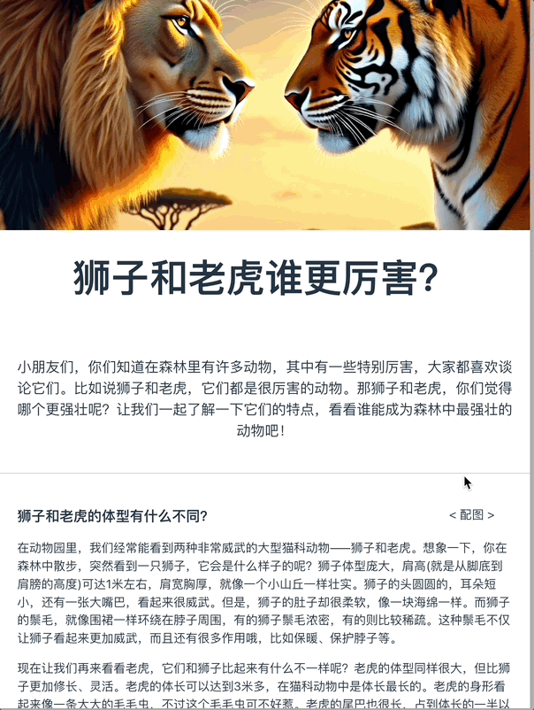

# 20 | 如何实现插图和听书功能

你好，我是月影。

回顾上一节课，我们实现了波波熊学伴的主体流程，这样从用户输入好奇心问题，到最后生成文字内容的全过程就已经完整了。

但是，因为波波熊学伴是给孩子使用的产品，而对于低年龄的孩子来说，太多的文字会让他们觉得内容过于深奥，从而影响他们的学习效果。

因此我们希望波波熊学伴不只是文字，而且能够有一些图片和语音，甚至在将来，还能够在页面上多一些互动。

那我们先来看图片和语音功能具体如何设计和实现。

## 实现独立的“插图”功能

如果你仔细学习了前面的课程，一定会发现我们其实为段落生成了插图提示词，但是我们没有在工作流中将图片直接生成出来，这是为什么呢？

其实这是产品为了控制成本的权衡，因为相较于文字来说，生成图片的成本较高，目前大概每张图 1-2 角钱。如果我们给每一个问题都生成了好几张图片，那么回答一个问题的成本就要是现在的好几倍，所以我们做了一个权衡，当用户主动要求生成图片的时候，才让 AI 为用户生成图片。

那么我们现在来看如何实现这一功能。

我们还是用 Trae 打开 Bearbobo Discovery 项目。

首先，我们要在 server.ts 文件里添加一个独立的生成插画的接口，因为我们在主工作流中已

```
经用到了，generate-image.ts 模块来生成封面图，在前面的课程里我们已经完成了它的
```

封装，所以 server.ts 里，实现的接口就非常简单，代码如下：

```javascript
app.post('/gen-image', async (req, res) => {
   const { prompt } = req.body;
   const { url } = await generateImage(prompt);
   res.json({
       url
   });
});
```

这里我们就直接复用主工作流里用到的 generateImage 方法就可以了。

```xml
接着我们调整前端逻辑。首先我们修改 /src/components/BookDetails.vue ：
<script setup lang="ts">
...
import { ref, type PropType, type Ref } from 'vue';
...
const pictures: Ref<string[]> = ref([]);
const addPic = async (index: number, image_prompt: string) => {
   const picture = pictures.value[index];
   if (picture) return;
   pictures.value[index] = 'https://res.bearbobo.com/resource/upload/e8OEDOJz/lo
   const res = await fetch('/api/gen-image', {
       method: 'POST',
       headers: {
           'Content-Type': 'application/json',
       },
       body: JSON.stringify({
           prompt: image_prompt,
       }),
   });
   const data = await res.json();
   pictures.value[index] = data.url;
}
</script>
<template>
...
       <div class="article">
           <div v-for="(topic, index) in topics" :key="index"
               :class="{ 'topic': true, 'odd': index % 2 === 0, 'even': index %
               <div class="topic-title">
                   <h3>{{ topic.topic }}</h3>
                   <div v-if="topic.image_prompt" class="btn" @click="addPic(ind
               </div>
               
               <p class="article_paragraph" v-html="marked.parse(topic.article_p
               <p class="post-reading-question">{{ topic.post_reading_question }
           </div>
       </div>
...
</template>
<style scoped>
...
.topic-title {
   display: flex;
   flex-direction: row;
   margin-top: 40px;
}
.topic:first-child .topic-title {
   margin: 0;
}
.topic-title h3 {
   margin: 0;
}
.topic-title .btn {
   margin-right: 20px;
   cursor: pointer;
}
.topic-title .btn:first-of-type {
   margin-left: auto;
}
.topic-title .btn::before {
   content: "< "
}
.topic-title .btn::after {
   content: " >"
}
/* 奇数段落：图左文右 */
.topic.odd img {
   float: left;
   margin-right: 20px;
}
/* 偶数段落：图右文左 */
.topic.even img {
   float: right;
   margin-left: 20px;
}
/* 图片样式 */
.topic img {
   width: 200px;
   height: auto;
   border-radius: 8px;
   margin-top: 20px;
}
</style>
```

我们调整了一些组件的展现和功能逻辑。在结构上，在每个段落的标题后边，我们加上了一个配图的按钮；在内容结构里，如果有图片 URL，我们就会展示一张图片。

注意一个前端细节，为了让文章更加生动，我们配图的时候做了一个设计，当图片在奇数段落时，我们让图片被文字环绕在左侧；否则，当图片在偶数段落时，我们让图片被文字环绕在右

```
侧。这一功能是通过给容器元素分别添加 odd 和  even class，然后通过控制 CSS 样式来实
```

现的。

最后，我们在配图按钮被点击的时候，调用 addPic 异步方法。该方法会先在段落中展示出一

```
张 loading 占位图，然后用我们已经拿到的 image_prompt 数据调用 /api/gen-image ，拿
```

到接口返回的图片 URL，再通过 img 标签显示出来。

这样我们就完成了文章配图的功能，注意这里我们对业务逻辑进行了简化。实际上完整的业务逻辑里，我们需要将生成的图片和文章绑定，将两者一同保存到数据库里。这样下次用户打开同样的文章，就可以把之前生成的图片显示出来。但数据入库并不是我们这门课程的重点，故而被我省略掉了。

这样我们就完成了文章配图功能，它的实际效果如下图：



## 实现“听书”功能

除了插图以外，波波熊学伴还提供了听书的功能，但该功能只针对付费会员。

之所以这么设计，也是经过权衡的。与插图不一样，大段的文字转语音价格虽然也很贵，但是当用户想要听内容的时候，再去实时转换，这样的效果也不是很好，因为毕竟图片还可以通过占位符，让用户先阅读文字，等待图片的生成完成。

而当用户立即要听语音时，如果再去让用户等待，就有点消耗用户的耐心了，因此最终我们还是把语音转换流程添加到了主工作流中，只是把这个功能只开放给付费订阅的用户，借此控制成本。

那么我们现在看一下，添加语音功能到主工作流具体要怎么做。

### 口语化的听书

波波熊学伴的听书，并不是直接把文章里的内容原封不动地念出来。因为如果那样做，就变成朗读文章了，不够口语化，读起来也就不够有趣。

所以波波熊学伴做了细节上的改进，我们不是直接将书面语的文章内容转成语音，而是让大模型做了口语化改写，再将改写的内容转为语音。

我们来看一下具体怎么实现。

首先我们需要文字转语音的模块，这个在我们前面做拍照记单词的课程里已经创建过，我们直

```
接拿来使用就行，将它放在 lib/services/audio.ts 文件中。
然后我们需要一个改写书面语内容到口语的 bot，先在 /lib/prompts/podcast.tpl.ts
```

文件中创建它的提示词：

```bash
export default `# Role and Goals
```

- 你是一个风趣幽默、擅长以生动有趣且简单清晰的语言进行科普教学的主播，你需要参考我发给你的文本段落，

```
- 确保使用简体中文输出纯文本，不要使用任何表情符号或Emoji
- 不要在开头和学生打招呼，避免使用<AvoidKeywords>中的词语
- 避免使用任何引导性的短语，直接陈述事实或给出答案
- 保持与原文一致的叙事风格，保留原文中的情感表达和细腻描写
- 在每个情境的描述中加入更多的细节，让学生能更好地想象和理解
- 在保持易懂的基础上，补充加入一些相关的科学知识解释，帮助学生理解原文中相关的科学原理
## AvoidKeywords
 [''魔法'', ''超级英雄'',''想象一下''，‘你知道吗'']
## Student Information:
- gender: {{gender}}
- age: {{age}}
- student location: 中国
## Study Style
The students'' learning style preferences
- Communication-Style: Simple and Clear
- Tone-Style: Interesting and Vivid
- Reasoning-Framework: Intuitive
- Language: 简体中文`;
```

接着我们改写 server.ts：

```python
...
import podcastTpl from './lib/prompts/podcast.tpl.ts';
import { generateAudio } from './lib/service/audio.ts';
...
app.get('/generate', async (req, res) => {
...
   // 文章生成
   bot.addListener('inference-done', (content) => {
       const { topics } = JSON.parse(content);
       // console.log(topics);
       for (let i = 0; i < topics.length; i++) {
           const topic = topics[i];
           const bot = ling.createBot(`topics/${i}`);
           bot.addPrompt(articleTpl, userConfig);
           bot.addFilter({
               article_paragraph: true,
               image_prompt: true,
           });
           bot.addListener('string-response', ({ uri, delta }) => {
               if (uri.endsWith('article_paragraph')) {
                   const podcastBot = ling.createBot('', undefined, {
                       quiet: true,
                       response_format: { type: 'text' }
                   });
                   podcastBot.addPrompt(podcastTpl, userConfig);
                   podcastBot.chat(delta);
                   podcastBot.addListener('inference-done', (content) => {
                       // console.log(content);
                       ling.handleTask(async () => {
                           const audioData = await generateAudio(content);
                           const tmpId = Math.random().toString(36).substring(7)
                           audioBuffers[tmpId] = Buffer.from(audioData, 'base64'
                           // console.log('create audio', `/api/audio?id=${tmpId
                           ling.sendEvent({ uri: `topics/${i}/audio`, delta: `/a
                       });
                   });
               }
           });
           bot.addListener('inference-done', (content) => {
               console.log(JSON.parse(content));
           });
           bot.chat(JSON.stringify(topic));
       }
   });
...
}
```

我们在文章生成的主流程中，创建博客 bot，然后将文章改写成口语风格，并转换为语音。这个步骤我们在前面的课程中已经学习过，具体转换逻辑如下：

```javascript
 podcastBot.addListener('inference-done', (content) => {
     // console.log(content);
     ling.handleTask(async () => {
         const audioData = await generateAudio(content);
         const tmpId = Math.random().toString(36).substring(7);
         audioBuffers[tmpId] = Buffer.from(audioData, 'base64');
         ling.sendEvent({ uri: `topics/${i}/audio`, delta: `/api/audio?id=${tmpI
     });
 });
```

与之前拍照记单词的课程里一样，我们还需要一个接口以文件的的方式请求语音数据，避免将语音的二进制或者 base64 内容直接放到流式接口中，造成接口堵塞。

```javascript
const audioBuffers: Record<string, Buffer> = {};
app.get('/audio', (req, res) => {
   const id = req.query.id as string;
   const audioData = audioBuffers[id];
   if (!audioData) {
       res.status(404).send('Audio not found');
       return;
   }
   res.setHeader('Content-Type', 'audio/ogg');
   res.send(audioData);
});
```

这样我们就改写好了 server.ts 的逻辑，接下来要实现前端交互。

```
我们还是修改 BookDetails.vue 组件。
```

首先我们在代码中添加 Topic 对象的 audio 属性，然后增加 playAudio 方法。由于我们在

```
server.ts 中，已经通过 ling.sendEvent 将 audio 的 url 通过 topics/${i}/audio 发送给前
```

端，所以我们的组件直接可以拿到这个数据。

```xml
<script setup lang="ts">
...
interface Topic {
   topic: string,
   post_reading_question: string,
   article_paragraph?: string,
   image_prompt?: string,
   audio?: string,
}
...
const playAudio = (audioUrl: string) => {
 const audio = new Audio(audioUrl);
 audio.play();
}
</script>
然后我们在 .topic-title 元素中，添加一个新的按钮：
<template>
...
   <div class="topic-title">
       <h3>{{ topic.topic }}</h3>
       <div v-if="topic.image_prompt" class="btn" @click="addPic(index, topic.im
       <div v-if="topic.audio" class="btn" @click="playAudio(topic.audio)">听书</
   </div>
</template>
```

当 topic.audio 数据返回的时候，这个听书按钮就会出现在页面上，在用户想要听书的时候，点击按钮直接播放对应的音频就可以了。

最终，文章内容转换语音效果如下：

audio.ogg

## 要点总结

以上就是波波熊学伴插图和听书的整体功能了，在这里为了讲解方便，我做了一些简化，比如“听书”在真正的波波熊学伴产品里，还实现了一个播放器界面，在播放语音的同时显示文字内容。在课程中为了便于理解我省略掉了这部分，但并不影响核心技术实现。

在这节课中，最重要的还是进一步理解 AI 大模型应用的异步工作流开发思路。要完全掌握这些技巧，光听我讲是不够的，大家还是应该要多动手实践。

完整的代码在Github 仓库里，你可以拉代码下来运行和自行修改研究。

## 课后练习

可能仔细学习的小伙伴会发现，我们的配图功能配置出来的图片形态相对比较单一，多样性和丰富性不够，或者说不是很生动。这是因为，我其实在提炼这个实战项目的时候，为了便于大家理解技术内容，对一些固有产品逻辑的细节做了简化。

实际上我们这里用的配图提示词，在原本的产品里是用来生成奖励卡片的，它会在孩子回答问题之后生成。原本插画的提示词生成另有一套流程，但是它并不影响我们具体的技术实现，所以我就没有再重复这套流程，以免课程变得越来越复杂。

那么问题来了，如果你想要为波波熊学伴生成更加生动、内容丰富的插图，你会怎么改进呢？

请认真思考一下，将你的想法分享到评论区，等后面有空，我可能会单独写一篇“加餐”的内容来讲讲究竟如何让 AI 生成更加生动有趣的内容，到时候有机会详细展开，把这块的方法和思路再给同学们多说一说。
