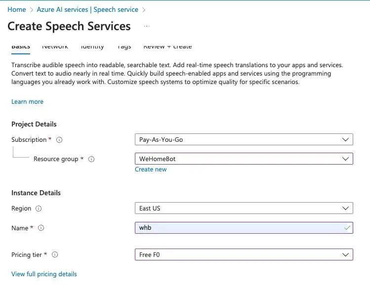
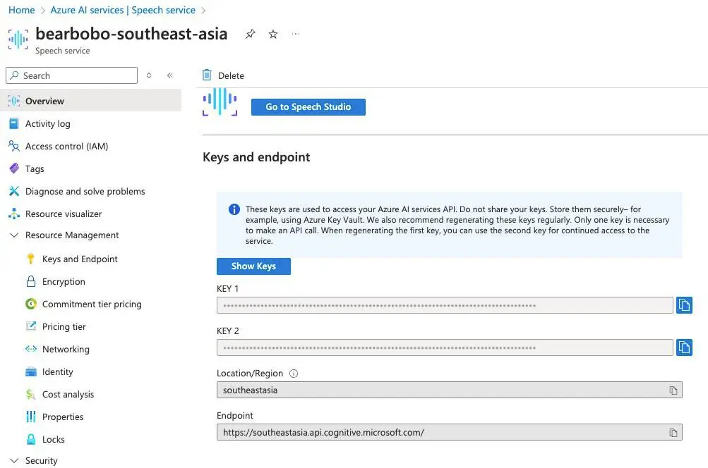
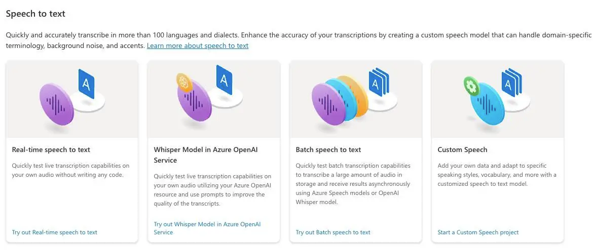
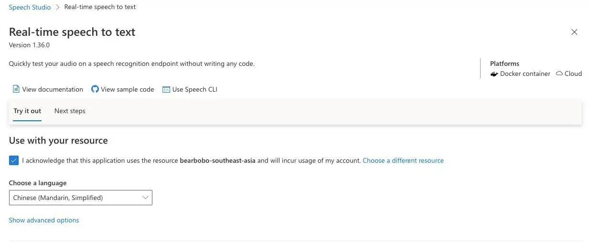
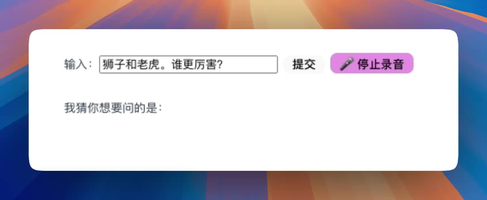

# 21 | 如何实现语音输入

你好，我是月影。

前面的章节我们讲的都是 AI 的多模态输出。所谓的多模态输出，指的是 AI 生成的内容不仅仅可以是文本，还可以是图像、语音等其他媒体形式。

在这一章，我们换一个角度，讲一讲多模态输入，也就是我们不仅可以输入文字，还可以输入语音。这个能力大家应该不陌生，因为豆包、Kimi 等很多 AI 应用都是可以输入语音转文字，甚至支持语音对话聊天的，而对于像波波熊学伴这样的儿童产品来说，语音输入格外重要，因为这是低龄孩子的主要输入方式。

从本质上来说，语音输入有两种形式，如果大模型本身是支持多模态输入的，那么我们直接将语音数据传给大模型就可以了，而如果大模型本身并不支持多模态输入，那么我们也可以先通过文本转语音的模型，将语音识别为文字，然后再传给大模型。二者对于用户来说，其实差别并不大。

目前，大部分大模型 API 并不直接支持多模态输入，所以我们还是更多地将语音先转文字，然后再让大模型进行处理。

语音转文字也有很多选择，比如字节火山引擎提供大模型语音识别，微软 Azure 也提供语音识别服务，我们波波熊学伴产品用的是微软 Azure 的语音识别服务。在这里我们就以这个为例子，通过实战来看看语音识别文字具体该怎么实现。

## Azure 语音识别服务

首先我们注册并登录 Azure 账号，进入控制台https://portal.azure.com/#home。

然后选择 Speech service。

在这里，我们需要创建一个 Speech Service 服务，点击控制台右侧列表上方的 Create 按钮，创建一个新的服务。



这里需要选择订阅方式为 Pay-As-You-Go，选择一个资源组，如果你是新注册账号，还没有创建资源组，可以回到控制台，先创建资源组。

下方 Region 选择一个地域，默认是 East US，一般可以选择比较靠近我们的地区，比如 EastAsia 或者 Southeast Asia。

Pricing tier 是付费价格等级，这里我们只是为了体验功能，选择 Free F0 即可。

创建好之后，我们进入 Speech service 资源页，页面如下所示。



这里最主要的信息就是下方 Keys and endpoint。

Azure 默认提供了两个 key，这两个 key 选任意一个来用都可以。另外注意 Location/Region和 Endpoint，这两个数据，我们在调用 API 的时候也会用到。

```
接着我们点击上方的 Go to Speech Studio 按钮，进入到 Azuer 语音服务的管理界面。
```

在这个界面的服务列表中，我们选择 “Speech to text > Real-time speech to text”。



点击这个服务，进入到“Real-time speech to text”的试用页面，在这个页面上，我们可以上传语音文件进行测试。



不过这里我们不用做测试，最主要还是看具体怎么在项目中使用。接下来我们就来实际操作。

## 实现波波熊学伴语音输入

首先，我们需要配置 Key 和 Region，我们用 Trae 打开项目 Bearbobo Discovery，修改.env.local 文件，添加如下配置。

```
# Azure STT
VITE_AZURE_SPEECH_KEY=2JdU********niFW
VITE_AZURE_SPEECH_REGION=southeastasia
```

接着，我们需要在 server.ts 中实现一个鉴权接口，用来交换 token。

打开 server.ts，添加以下接口。

```javascript
app.get('/voice-token', async (req, res) => {
   const region = process.env.VITE_AZURE_SPEECH_REGION;
   const key = process.env.VITE_AZURE_SPEECH_KEY;
   const headers: any = {
     'Ocp-Apim-Subscription-Key': key,
     'Content-Type': 'application/x-www-form-urlencoded',
   };
   const token = await (
       await fetch(`https://${region}.api.cognitive.microsoft.com/sts/v1.0/issue
           method: 'POST',
           headers,
       })
   ).text();
   res.send({
       data: {
           token: token,
           region: region,
       }
   });
});
```

这个接口逻辑比较简单，我们通过请求https://southeast.api.cognitive.microsoft.com/sts/v1.0/issueToken 这个接口来获得一个临时token，前端需要用这个 token 来鉴权。

这样我们就实现了服务端的部分，接着我们实现前端的部分。

```
我们在项目下创建  src/lib/voice/helper.ts 文件，打开这个文件，首先添加鉴权接
```

口。

```python
import Cookie from 'universal-cookie';
async function getTokenOrRefresh() {
 const cookie = new Cookie();
 const speechToken = cookie.get('speech-token');
 console.log(speechToken, 'speechToken');
 if (speechToken === undefined || speechToken === 'undefined:undefined') {
   try {
     const res = await fetch('/api/voice-token', {
       method: 'GET',
       headers: {
         'Content-Type': 'application/json',
       },
     });
     const { data } = await res.json();
     const token = data.token;
     const region = data.region;
     cookie.set('speech-token', `${region}:${token}`, {
       maxAge: 540,
       path: '/',
     });
     console.log('Token fetched from back-end: ' + token);
     return { authToken: token, region: region };
   } catch (err: any) {
     console.log(err);
     return { authToken: null, error: err.response.data };
   }
 } else {
   const idx = speechToken.indexOf(':');
   return {
     authToken: speechToken.slice(idx + 1),
     region: speechToken.slice(0, idx),
   };
 }
}
```

注意上面的代码，在 getTokenOrRefresh 函数里我们通过 /api/voice-token 接口拿到 token，然后将它缓存在 cookie 中，时间是 540 秒。因为服务端获取的 token 的最大有效时间是 10分钟，所以我们这里在前端缓存了 9 分钟。

然后我们实现录音的逻辑，继续添加内容到 helper.ts 中。

```bash
import * as speechsdk from 'microsoft-cognitiveservices-speech-sdk';
export async function sttFromMic(onMessage: (text: string, delta: string, isClose
 const tokenObj = await getTokenOrRefresh();
 const speechConfig = speechsdk.SpeechConfig.fromAuthorizationToken(tokenObj.aut
 speechConfig.speechRecognitionLanguage = 'zh-CN';
 const audioConfig = speechsdk.AudioConfig.fromDefaultMicrophoneInput();
 const recognizer = new speechsdk.SpeechRecognizer(speechConfig, audioConfig);
 console.log('speak into your microphone...');
 let text = '';
 recognizer.recognizing = (s, e) => {
   (recognizer as any).startRecord = true;
 };
 recognizer.recognized = (s, e) => {
   if (e.result.reason == speechsdk.ResultReason.RecognizedSpeech) {
     text += e.result.text;
     onMessage(text, e.result.text, false);
   } else if (e.result.reason == speechsdk.ResultReason.NoMatch) {
     // console.log('NOMATCH: Speech could not be recognized.');
   }
 };
 recognizer.canceled = (s, e) => {
   console.log(`CANCELED: Reason=${e.reason}`);
   if (e.reason == speechsdk.CancellationReason.Error) {
     console.log(`"CANCELED: ErrorCode=${e.errorCode}`);
     console.log(`"CANCELED: ErrorDetails=${e.errorDetails}`);
     console.log('CANCELED: Did you set the speech resource key and region value
   }
   recognizer.stopContinuousRecognitionAsync();
 };
 recognizer.sessionStopped = (s, e) => {
   recognizer.stopContinuousRecognitionAsync();
   onMessage(text, '', true);
 };
 recognizer.startContinuousRecognitionAsync();
 return recognizer;
}
```

这里的代码，我们直接参考了官网的Github 项目，用的是官方的 microsoft-cognitiveservices-speech-sdk，代码并不复杂，通过 config 配置 SpeechRecognizer 对象，然后监听几个异步方法（主要是 recognized 方法）就可以。

注意，我们需要安装两个 npm 包，分别是 universal-cookie 和 microsoft-cognitiveservices-speech-sdk，我们在终端中执行。

```
pnpm i universal-cookie microsoft-cognitiveservices-speech-sdk
```

这样就实现了语音识别的底层逻辑。

```bash
接下来我们封装业务对象，创建  src/lib/voice/index.ts 文件，代码如下。
import { sttFromMic } from './helper';
export class Recognizer {
 #recorder: MediaRecorder | null = null;
 #initialized: boolean = false;
 #isRecording: boolean = false;
 #azureSTT: any = null;
 onAudioRecording?: (event: MessageEvent<any>) => void;
 onAudioTranscription?: ((transcription: { text: string; delta: string; done: bo
 async #init() {
   const stream: MediaStream = await navigator.mediaDevices.getUserMedia({
     audio: true,
   });
   const audioContext = new AudioContext();
   const mediaStreamSource = audioContext.createMediaStreamSource(stream);
   await audioContext.audioWorklet.addModule('/worklet/vumeter.js');
   const node = new AudioWorkletNode(audioContext, 'vumeter');
   node.port.onmessage = event => {
     if (event.data.volume) {
       if (this.#isRecording) {
         this.onAudioRecording && this.onAudioRecording(event);
       }
     }
   };
   mediaStreamSource.connect(node).connect(audioContext.destination);
   this.#initialized = true;
 }
 async cancel() {
   await this.stop();
 }
 get state() {
   return this.#recorder?.state;
 }
 async start() {
   if (this.#isRecording) return;
   this.#isRecording = true;
   this.#azureSTT = await sttFromMic((text, delta, done) => {
     if (this.onAudioTranscription) {
       this.onAudioTranscription({
         text,
         delta,
         done,
       });
     }
   });
   if (!this.#initialized) await this.#init();
 }
 async stop() {
   if (!this.#isRecording) return;
   this.#isRecording = false;
   return new Promise(resolve => {
     setTimeout(() => {
       this.#azureSTT.close();
       if (!this.#azureSTT.startRecord) {
         this.onAudioTranscription &&
           this.onAudioTranscription({
             text: '',
             delta: '',
             done: true,
           });
       }
       resolve(null);
     }, 500);
   });
 }
 async destroy() {
   this.onAudioTranscription = null;
   await this.stop();
 }
}
```

上面的代码，主要是封装一个 Recognizer 类，提供 start 和 stop 方法，用来开启和停止录音。在 start 方法中，我们调用 sttFromMic，在它的回调函数中，将获取到的内容通过onAudioTranscription 转发出去，这样我们在 vue 组件里就可以获得需要的文本内容了。

注意在初始化的时候，#init 函数中，我们要创建一个对象。这个对象是 w3c 标准 Web AudioAPI 中的AudioContext 对象，它的作用是为了监听音频的音量，方便我们显示一些 UI 效果，以及有可能过滤掉音量太低的一些环境音或杂音。

```
根据 Web Audio API 的规范，我们通过 await
audioContext.audioWorklet.addModule('/worklet/vumeter.js'); 来获取音
量，/worklet/vumeter.js是一个在 Audio Worklet 线程中运行的一段 JS 代码，我们将它
```

放到 vue 的 public 目录下。

```python
我们创建 /public/worklet/vumeter.js 文件，内容如下。
// /worklet/vumeter.js
class VUMeterProcessor extends AudioWorkletProcessor {
 constructor() {
   super();
   this._volume = 0;
 }
 process(inputs) {
   const input = inputs[0];
   if (input.length > 0) {
     const channelData = input[0];
     let sum = 0;
     for (let i = 0; i < channelData.length; i++) {
       sum += channelData[i] * channelData[i];
     }
     const rms = Math.sqrt(sum / channelData.length);
     this._volume = rms;
     this.port.postMessage({ volume: rms }); // 发送给主线程
   }
   return true;
 }
}
registerProcessor('vumeter', VUMeterProcessor);
```

这段代码，我们主要是获取音频输入信息，处理其中的音量数据并通过 postMessage 发送给主线程。这样主线程就可以在 onMessage 中处理事件了：

```javascript
const node = new AudioWorkletNode(audioContext, 'vumeter');
node.port.onmessage = event => {
 if (event.data.volume) {
   if (this.#isRecording) {
     this.onAudioRecording && this.onAudioRecording(event);
   }
 }
};
```

以上这部分内容，我们在实际业务中并没有具体用到，它是用来作为未来可能的 UI 扩展（比如我们想在用户说话的时候显示动态音量的状态条）保留的，所以如果你不太理解，也没有关系。它不影响我们这一节课的最终效果。

接着我们在 App.vue 中实现最终的业务逻辑。

我们修改一下 App.vue。

```sql
<script setup lang="ts">
...
import { Recognizer } from './lib/voice';
...
const recognizer = new Recognizer();
const isRecording = ref(false);
recognizer.onAudioTranscription = ({ text }) => {
 question.value = text;
};
const startRecording = () => {
 isRecording.value = true;
 question.value = '';
 recognizer.start();
}
const stopRecording = () => {
 isRecording.value = false;
 recognizer.stop();
}
</script>
<template>
 <div class="container" @click="expand && (expand = false)">
   <div>
     <label>输入：</label><input class="input" v-model="question" />
     <button @click="update">提交</button>
     <button v-if="!isRecording" @click.prevent="startRecording()"> 开始录音</bu
     <button class="recording" v-if="isRecording" @click.prevent="stopRecording(
   </div>
...
</template>
<style scoped>
...
button {
 padding: 0 10px;
 margin-left: 6px;
 user-select: none;
}
button.recording {
 background-color: rgb(231, 148, 228);
}
...
</style>
```

在上面的代码里，我们添加了开始录音和停止录音的按钮，开始录音时，我们通过

```
recognizer.start() 启动录音，停止录音时，我们通过 recognizer.stop() 结束录
音。录音过程中，我们通过 recognizer.onAudioTranscription 将录音内容同步给
```

question.value，这样我们就实现了整体的语音输入功能。

注意，recognizer 的具体录音逻辑中，当我们启动录音时，浏览器在第一次会自动申请麦克风权限，同意之后，开始录音。在说话停顿超过 2 秒钟，或者停止录音时，onAudioTranscription 都会被调用，收到语音转文字的数据，具体的交互效果如下：



## 要点总结

这一节课，我们讨论波波熊学伴一个相对独立的功能——语音识别文字输入。这也是很多 AI应用必备的交互功能。

我们使用微软 Azure 的语音识别服务，具体的实现步骤如下。

1. 首先在 server 实现获取 Token 的 API，它将用来鉴权。

2. 在客户端，我们首先通过 server 实现的获取 Token API 来申请 Token 并缓存在 cookie 中，为后续实现录音并识别为文字提供鉴权。

3. 接着我们通过微软提供的 SDK 实现 sttFromMic，将从麦克风输入的语音内容转为文字。这部分 SDK 已经封装好了，所以我们只需要根据配置创建好对象，监听对应的 recognized 事件就可以了。

4. 然后我们实现一个 Recognizer 类，底层通过调用 sttFromMic，将更新的数据发送给 UI 处理。这里有一个细节，就是我们可以通过 AudioContext 来拿到语音音量，方便我们做一些 UI效果。

5. 最后我们在 Vue 组件中使用 Recognizer 实现录音交互。

到此为止，我们就几乎实现了波波熊学伴的全部核心功能，而这一单元的内容也顺利完成了。最终波波熊学伴 Demo 的完整代码在GitHub 仓库中，里面可能仍有一些细节课内未曾提及，有兴趣的同学可以将它下载下来，多研究多实践。有什么问题也可以在留言区一起交流探讨。

## 课后练习

在这节课，我们提到了 AudioContext 获取语音音量这个保留功能，因为简化了 UI 交互，我们并没有具体用到它。而我们在后续的新项目前端面试官中，由于用户输入比波波熊学伴更加复杂，所以语音交互的细节就会考虑更多，到时候我们就会用到这个部分。你可以提前尝试一下，使用它，将语音输入封装成一个交互更好的 Vue 组件。将你的想法或实现方式分享到评论区吧。

下一节课我们将进入第四单元，讨论另外一个很有意思也很具有代表性的产品——AI 前端面试官。
