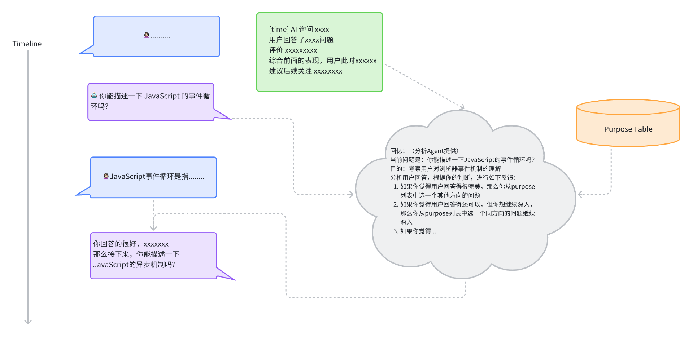
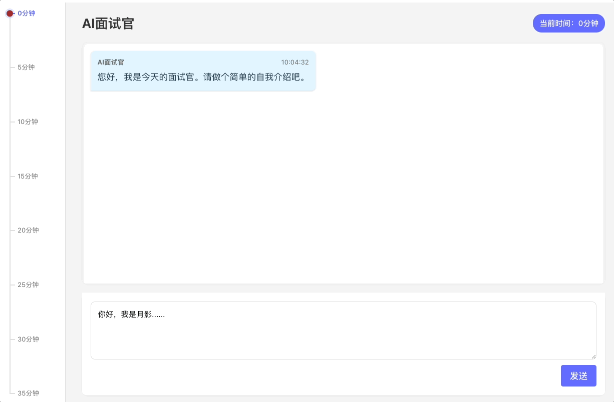

# 23 | 多轮对话（一）：时间线与记忆

你好，我是月影。

接下来，我们就要正式进入复杂多轮对话的实现环节，这是 AI 应用里很复杂、很具有挑战的一部分。不过不要担心，跟住我的节奏，你就能掌握其中精髓。

在具体实现之前，我们要先定义一些概念。

- 会话（session）：用来标记一轮面试，我们用同一个会话表示一个面试，相同会话的Agent（智能体）之间才能共享和交换数据。

- 记忆（memory）：用来记录之前的内容，根据前一节设计的 MoE 模型，我们会用一个Agent 来专门负责记忆。在真正的应用中，记忆是需要存储的，通常采用 redis、数据库等

- 方式进行存储。但为了同学们实操方便，在这里我们将它简化为存储在内存的对象中，不影响对基本原理的理解。

- 时间线（timeline)：这是一份配置，用来控制面试流程，它的每个节点包含起、止时间，和在该区间内的整体目标（objective）。在实际代码里，我们还会有一个控制器来操纵时间线，让 AI 有一定的自主权。你可能会想 AI 为什么要控制时间线，这个问题我先抛出来供你思考，我们后面深入讲解的时候再解释。

- 目的表（purpose table）：这也是一份配置表，用于思考的 Agent 根据时间线和记忆，参考目的表来筛选出当前轮次的目的，根据目的来生成一组具体的行动方针（actions），对话 Agent 会根据候选人的回答和行动方针，参考目的表来进行下一轮的提问。

下面是一个典型的对话、分析和思考配合过程的示意图。



根据上面的示意图，当 AI 询问“你能描述一下 JavaScript 的事件循环吗？”之后，等待候选人回答的期间，AI 将制定如下行动方针：

```
- 如果你觉得用户回答得很完美，那么你从purpose列表中选一个其他方向的问题
- 如果你觉得用户回答得还可以，但你想继续深入，那么你从purpose列表中选一个同方向的问题继续深入
- 如果你觉得……
```

这里需要强调的是，就是整体 Agent 协同的过程是一个异步过程。仔细看上面的图，当 AI 询问一个问题时，候选人开始回答，同时 AI 开始准备下一步的策略，生成行动方针。注意行动方针并不考虑候选人实际是如何回答的，而是将候选人任何一种回答的可能性都考虑进去，并针对该可能性制定计划（即行动方针）。正是这样的诀窍，大大提升了面试流程的思考和对话并行能力，极大提高了面试流程的实时性。

## 时间线（Timeline）

前面已经提到过，面试整体要遵循一定的节奏，所以我们可以通过配置时间线，来让 AI 针对不同的时间点思考不同的面试对策。这一点和真正的面试官是一样的，我们在真实的面试中，面试官也会考虑如何安排整体时间，从而把握整个面试节奏。

```bash
在 Server 端，时间线是一份配置文件，我们创建  timeline.config.ts ，内容如下：
/*
 定义面试过程的时间线
 0~3 分钟 自我介绍
 3~10 分钟 项目讨论
 10~17 分钟 技术讨论
 17～25 分钟 代码和算法讨论
 25~30 分钟 非技术问题讨论
 30~32 分钟 反问
 32 分钟以上 结束
*/
interface TimelineStep {
 startTime: number;
 endTime: number;
 focus: string; // 聚焦的问题，例如项目、技术、代码、算法、非技术问题
 prompt: string; // 提示语
}
interface TimelineConfig {
 steps: TimelineStep[];
}
export const timelineConfig: TimelineConfig = {
 steps: [
   {
     startTime: 0,
     endTime: 3,
     focus: '自我介绍',
     prompt: `当前在自我介绍阶段，你要求候选人提供简历或者自我介绍，简历和介绍内容包括：
1. 个人信息
2. 教育背景
3. 工作经历
4. 项目经历
5. 擅长的技术
6. 自我评价
你首先根据<memory>的信息，判断候选人是否完成了介绍，如果没有完成，你询问并收集候选人缺失的信息，
     `,
   }, {
     startTime: 3,
     endTime: 10,
     focus: '项目讨论',
     prompt: `当前在项目讨论阶段，你要求候选人讨论他/她在项目中的表现。
你首先根据<memory>的信息，回顾 interviewSummary，针对你感兴趣的项目经历或技术细节，深入询问候
     `,
   }, {
     startTime: 10,
     endTime: 17,
     focus: '技术讨论',
     prompt: `当前在技术讨论阶段，你要求候选人讨论他/她在技术方面的表现。
如果你之前在和候选人讨论TA过往项目，你可以收尾，然后开始讨论前端工程师的技术栈和基础知识。
首先根据候选人应聘的岗位描述，判断对前端技术的总体要求，并结合<memory>的信息，针对你感兴趣的技术
注意整体节奏遵循先JS（包括Node.js如果岗位要求或候选人简历提到的话）、再CSS/HTML、然后是框架和库
你通过<memory>中的askedQuestions回溯之前的问题，以把控整体节奏。
     `,
   }, {
     startTime: 17,
     endTime: 25,
     focus: '代码和算法讨论',
     prompt: `当前在代码和算法讨论阶段，你要求候选人讨论他/她在代码和算法方面的表现。
```

- 如果你之前在和候选人讨论前端技术栈和基础知识，你可以收尾，然后开始讨论代码问题和算法题。

```
首先根据候选人应聘的岗位描述，判断对代码和算法的总体要求，并结合<memory>的信息，针对你感兴趣的代
```

- 整体节奏上你先出一道简单的代码题，让候选人说出代码运行结果，然后你再出一道算法题，让候选人说出算法

```
你通过<memory>中的askedQuestions回溯之前的问题，以把控整体节奏。
`
   }, {
     startTime: 25,
     endTime: 30,
     focus: '非技术问题讨论',
     prompt: `当前在非技术问题讨论阶段，你要求候选人讨论他/她在软素质方面的表现。
```

- 如果你之前在和候选人讨论代码和算法，你可以收尾，然后开始讨论非技术问题。

```
首先根据候选人应聘的岗位描述，判断对软素质的总体要求，并结合<memory>的信息，针对你感兴趣的软素质
```

- 整体节奏上你按照价值观、团队沟通协作、项目管理、时间管理、学习能力、沟通表达能力、解决问题能力、自

```
你通过<memory>中的askedQuestions回溯之前的问题，以把控整体节奏。
`
   }, {
     startTime: 30,
     endTime: 32,
     focus: '反问',
     prompt: `当前在反问阶段，你要求候选人反问面试官，补充判断候选人对岗位是否有兴趣。
```

- 候选人提问后，你进行回答，如果候选人说没有问题了，你可以结束面试。

```
`
   }, {
     startTime: 32,
     endTime: Infinity,
     focus: '结束',
     prompt: `当前在结束阶段，你礼貌地与候选人沟通，结束面试。`
   }
 ]
};
```

在这里，我们适当缩减了面试整体时间，将面试节奏把控在大约 35 分钟之内，这是为了体验和测试方便。在真实产品中，我们可以根据需要调整时间节奏，延长面试的总体时间。

我们先看一下上面的代码，TimelineConfig 是一份配置数据，它的 steps 是一个 TimelineStep数组，数组中每一个元素表示当前时间下的面试阶段配置，它由以下属性构成：

- startTime 当前阶段开始时间，以分钟为单位

- endTime 当前阶段结束时间，以分钟为单位

- focus 当前面试阶段聚焦的问题

- prompt 当前面试阶段的主要策略提示词

在实际使用的时候，我们将根据前端传入的时间参数来控制当前具体的阶段。当然，这是一种简易的办法，根据产品特点的不同，还有其他决定时间的方式。

因为我们的产品主要卖点是模拟面试，所以可以采用简单的方式，不用担心用户自己更改了传入的参数，而如果产品最终的用途是替代真正的面试官完成真实面试，那么考虑到安全性，可能我们就要用服务端的时间来计算具体的 Timeline 阶段了。

配套地，在前端我们通过实现一个 UI 组件来展示 Timeline。

```xml
我们封装一个 Vue 组件。首先创建  src/components/Timeline.vue ，内容如下：
<script setup lang="ts">
import { ref, defineProps, defineEmits, watch, onBeforeUnmount } from 'vue';
const props = defineProps<{
 currentTime: number;
 totalDuration: number;
 started: boolean;
}>();
const emit = defineEmits(['updateTime']);
const timePoints = ref<number[]>([]);
const startTime = ref<number>(0);
const intervalId = ref<number | null>(null);
// 生成时间点数组，从0到总时长，每5分钟一个刻度
for (let i = 0; i <= props.totalDuration; i += 5) {
 timePoints.value.push(i);
}
// 监听started状态变化
watch(() => props.started, (newValue) => {
 if (newValue && !intervalId.value) {
   // 记录开始时间
   startTime.value = Date.now();
   // 启动计时器，每秒更新一次时间
   intervalId.value = window.setInterval(() => {
     const elapsedMinutes = (Date.now() - startTime.value) / 60000;
     // 确保不超过总时长
     const newTime = Math.min(elapsedMinutes, props.totalDuration);
     if (newTime !== props.currentTime) {
       emit('updateTime', newTime);
     }
   }, 1000);
 }
});
// 组件卸载时清除计时器
onBeforeUnmount(() => {
 if (intervalId.value) {
   clearInterval(intervalId.value);
 }
});
</script>
<template>
 <div class="timeline-container">
   <div class="timeline">
     <div
       v-for="time in timePoints"
       :key="time"
       class="time-point"
       :class="{ active: time === currentTime }"
     >
       <div class="time-marker"></div>
       <div class="time-label">{{ time }}分钟</div>
     </div>
     <div
       class="current-time-indicator"
       :class="{ active: intervalId != null }"
       :style="{ top: `${(currentTime / totalDuration) * 100}%` }"
     ></div>
   </div>
 </div>
</template>
<style scoped>
.timeline-container {
 width: 160px;
 height: 100%;
 padding: 20px 0;
 display: flex;
 justify-content: center;
 box-sizing: border-box;
}
.timeline {
 position: relative;
 height: 100%;
 width: 2px;
 background-color: #ddd;
 display: flex;
 flex-direction: column;
 justify-content: space-between;
}
.time-point {
 position: relative;
 cursor: pointer;
 display: flex;
 align-items: center;
}
.time-marker {
 width: 10px;
 height: 2px;
 background-color: #ddd;
 position: absolute;
 left: 0;
}
.time-label {
 position: absolute;
 left: 15px;
 font-size: 12px;
 color: #666;
 white-space: nowrap;
}
.time-point.active .time-marker {
 background-color: #646cff;
}
.time-point.active .time-label {
 color: #646cff;
 font-weight: bold;
}
.current-time-indicator {
 position: absolute;
 width: 12px;
 height: 12px;
 border-radius: 50%;
 background-color: brown;
 left: -5px;
 transform: translateY(-50%);
 box-shadow: 0 0 0 3px rgba(100, 108, 255, 0.2);
}
.current-time-indicator.active {
 background-color: #646cff;
}
</style>
```

在上面的代码中，我们创建了一个 Timeline 的 UI，它通过开关控制是否开启计时，具体实现上是用 watch 方法监听 props.started 状态。

```javascript
// 监听started状态变化
watch(() => props.started, (newValue) => {
 if (newValue && !intervalId.value) {
   // 记录开始时间
   startTime.value = Date.now();
   // 启动计时器，每秒更新一次时间
   intervalId.value = window.setInterval(() => {
     const elapsedMinutes = (Date.now() - startTime.value) / 60000;
     // 确保不超过总时长
     const newTime = Math.min(elapsedMinutes, props.totalDuration);
     if (newTime !== props.currentTime) {
       emit('updateTime', newTime);
     }
   }, 1000);
 }
});
```

当计时开启后，Timeline 会启动计时器，即通过 window.setInterval 定时器动态更新时间，并且通过 updateTime 方法将更新的时间发给父级组件，这样父级组件调用 AI 对话的时候，就可以将具体的时间参数传给 Server 端。

在 UI 方面，通过更新元素的样式来控制小圆点在时间轴中的位置：

```xml
 <div
   class="current-time-indicator"
   :class="{ active: intervalId != null }"
   :style="{ top: `${(currentTime / totalDuration) * 100}%` }"
 ></div>
```

最终的 UI 效果如下图所示：



图里面的动态效果展示得不太明显，但是你可以看到随着候选人发送消息后，面试正式开始，左侧时间轴的蓝色小圆点就开始缓慢向下移动了。

这个页面的其他部分功能还没有实现，所以我发送消息后，AI 并没有回复，我们先不用管它，在后续章节里，我们再逐步完善，到时候也会详细讲解右侧这一部分的前端逻辑和实现。

## 记忆（memory）

现在我们先回过头来看一下记忆（memory）模块。

在 AI 智能体和应用的设计中，记忆（memory）是一个非常重要的特性，因为我们很多时候必须让 AI 能够记住之前发生的事情，从而进行下一步的动作。就拿面试官应用来说，如果 AI 没有记忆，那它就很可能问重复的问题，这就和真实的面试过程不符了。

一般来说，记忆又分为长期记忆和短期记忆。通常情况下，短期记忆是通过聊天上下文，由大模型自己管理的；而长期记忆，则是通过记录和整理文本（知识库）、向量数据库等方式实现，对于不同的应用，有不同的要求。

对我们的产品而言，如果不考虑多轮面试，那么最重要的还是短期记忆。不过我们不能依靠默认的聊天上下文，这是因为，面试过程比较长，对话上下文比较复杂，而且面试有比较严格的流程，只依赖单纯的聊天上下文，是达不到效果的。

所以我们用另外一种短期记忆的方式，即结构化短期记忆。

其实结构化短期记忆的实现非常简单，也就是我们不是简单记录聊天上下文，在下一次对话时提交之前的聊天记录，而是用一个负责记忆的智能体，来整理记录每轮聊天之后的内容，将其记录为 JSON 数据，这对应了我们前面说的 MoE 结构中信息分析记录的部分。

在这一节里，我们先不说它的具体逻辑实现，只定义它的数据结构。

```bash
我们将 Memory 定义如下，首先创建  lib/service/memory.ts ，内容如下。
export interface InterviewMemory {
 sessionId: string;
 conversationIndex: number, // 当前记忆的对话轮次，因为是异步更新的，需要用这个来匹配对话
 lastConversation: string, // 上一轮对话内容
 // 候选人的基本信息和自我介绍
 candidateIntroduction: string;
 // 面试官已经问过的问题（按顺序记录）
 askedQuestions: string[];
 // 对候选人各项能力的评价
 candidateEvaluation: {
   technicalSkills: string;       // 技术能力评价
   problemSolving: string;        // 问题解决能力
   communication: string;         // 沟通表达能力
   codingStyle?: string;          // 可选：编码风格或代码质量
   overallImpression: string;     // 总体印象
 };
 // 面试摘要：总结整个过程，比如面试重点、表现亮点或不足
 interviewSummary: string;
 // 特别备注：如迟到、网络问题、态度问题、需进一步确认的信息等
 additionalNotes: string[];
 lastUpdateTime: number;
}
export function createInterviewMemory(sessionId: string): InterviewMemory {
 return {
   sessionId,
   conversationIndex: 0,
   lastConversation: '',
   candidateIntroduction: '',
   askedQuestions: [],
   candidateEvaluation: {
     technicalSkills: '',
     problemSolving: '',
     communication: '',
     codingStyle: '',
     overallImpression: '',
   },
   interviewSummary: '',
   additionalNotes: [],
   lastUpdateTime: Date.now(),
 }
}
```

根据上面的代码，我们记忆的数据格式如下。

- sessionId：会话 ID，在一场面试中唯一，同样的会话 ID 将同一场面试中的对话、记忆和思考关联起来。

- conversationIndex：对话轮次，多轮对话中我们会异步更新记忆，所以当前记忆已经更新到第几轮对话了，需要记录下来，这样我们才能匹配记忆的“版本”，具体内容在后续章节中会详细说明。

- lastCoversation：上一轮对话内容，我们记录下较少的历史聊天上下文，因为有了 memory不需要记录太多轮。

- candidateInstruction：候选人介绍，在自我介绍和项目讨论阶段主要更新这部分记忆。

- askedQuestions：已经问过的问题，这个列表很重要，AI 要记住问过的问题，以免重复询问。

- candidateEvaluation：候选人评价，通过几个维度对候选人做出评价，在每一轮面试中分析智能体会根据评价制定后续提问策略，面试结束后，负责给出评价的智能体也需要根据这部分内容给出最终的评价。

- interviewSummary：面试摘要，每轮面试对话后都会更新摘要，记录面试过程里比较重要的信息。

- additionalNotes；特别备注，面试过程中需要额外留意的信息，面试官的自我提醒。

- lastUpdateTime：记忆最后更新时间。

以上就是整体的记忆表，在每一轮对话后，负责记录的智能体就会将需要更新的信息更新到该表中，智能体提问前，也会通过将记忆信息放入系统提示词中，控制下一轮的询问。

具体详细的流程我们后续的章节中会一一展开细说。

## 要点总结

这一节里，我们具体了解了时间线（Timeline）和记忆（Memory）的概念定义和数据结构，它们是后续实现核心工作流的重要对象。

另外，我们还实现了时间线的前端 UI 组件。下一节课，我们还会继续探索，看看如何用时间线搭配记忆，来实现节奏合理的高质量面试对话。

## 课后练习

这节课虽然没有涉及 UI 核心功能，但对于前端工程师来说，交互体验也特别重要。

时间线 UI 组件还有些细节值得优化，你可以考虑在它之上加入一些小功能，比如鼠标移动到时间线小圆点上时，具体显示对应的时间，以及对时间线上某个时间点设置一个倒计时，这样就可以在面试中候选人需要较长时间的思考时提醒对方（比如写代码环节里，设置一个 10 分钟的提醒）。

你可以动手试试看，将你的改进分享到评论区。
