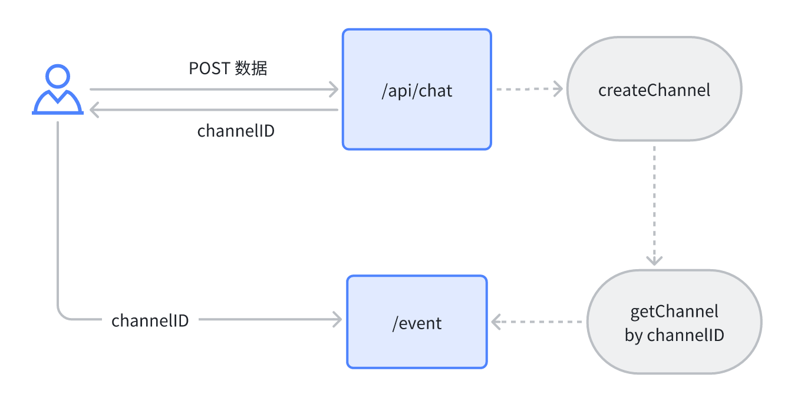
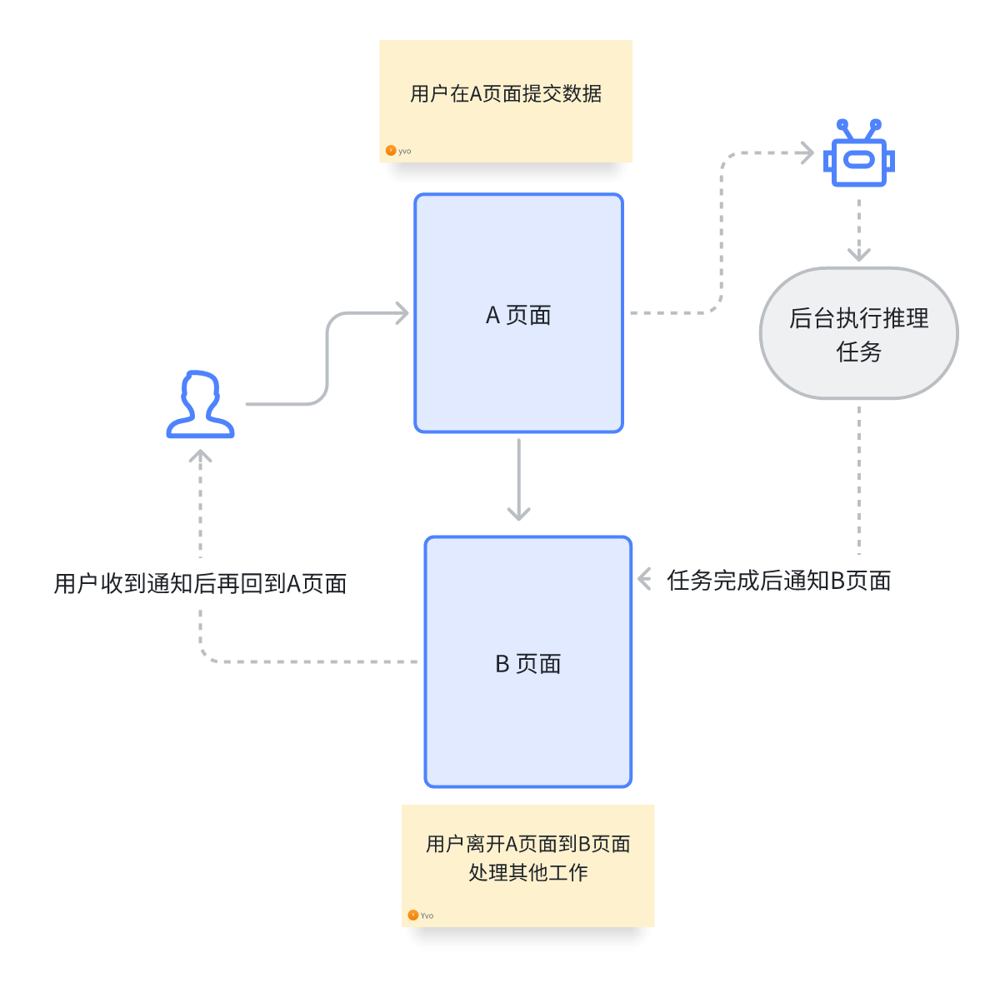
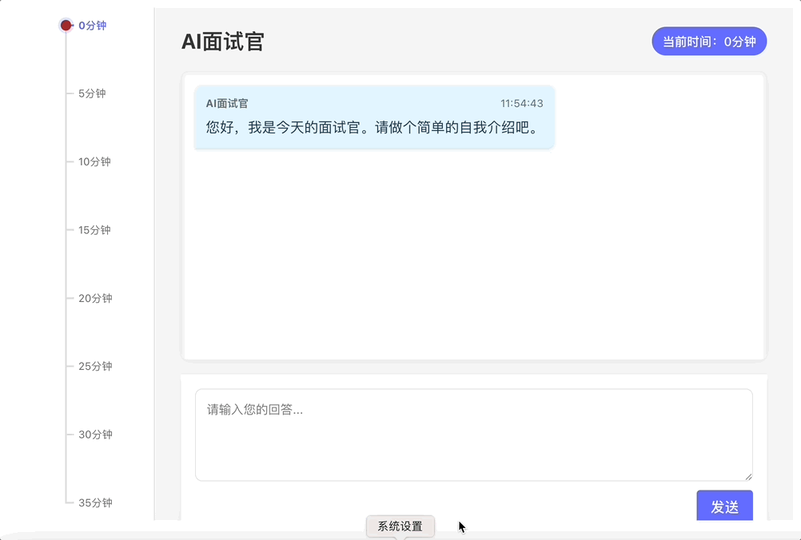

# 24 | 多轮对话（二）：API读写分离设计

你好，我是月影。

接下来我们继续实现复杂的多轮对话。在这一讲里，我们在深入业务前，需要解决一个技术难题。

还记得我们在使用 Ling 的时候，推荐大家用 Server-Sent Events 模式，因为 Server-SentEvent 是现代浏览器支持的协议，前端处理比较简单。

但是，Server-Sent Events 有个弊端，那就是根据规范，它只支持 GET 请求。这是因为，SSE 的设计初衷就是客户端建立一个单向连接从服务器接收事件，而这个连接只能通过 GET请求发起，因为它是用来“获取资源”的，服务器通过流式传输的方式持续返回数据。

对于前面的波波熊学伴产品而言，由于孩子问的问题内容通常比较简单，所以用 GET 请求的问题不大。因为简单的参数我们完全可以通过浏览器的 URL 查询传递参数。

然而对于面试官这种需求，因为我们提交回答的内容可能会很长，甚至未来有可能提交图片之类非文本的内容，所以通过 GET 的方式就不再合适，我们需要采用 POST 方法提交数据。

那么我们这个时候就要做一个读写分离的处理，通过 POST 请求提交数据，建立EventSource 通道，然后再通过通道来读取流式数据。



在 AI 应用的技术架构中，这实际上是非常常用的一种接口设计范式。因为通常 GET 请求处理AI 的流式推理的时间，远比 POST 提交用户请求和数据的时间要长。这么设计之后，我们可以让读取数据不会阻塞整个业务流程，也就意味着用户可以提交数据后离开页面，等待 server的更新，server 更新完成后，再通过轮询或者浏览器自身的消息机制告诉用户。



## 实现读写分离设计

了解了读写分离的好处，那我们具体来看看，要怎么设计读写分离的结构。

首先，我们打开 Trae IDE，在 Get Offer AI 的项目下，创建

```
/lib/service/eventChannel.ts 模块。
```

在这里，我们创建一个类 EventChannel：

```python
class EventChannel {
 private frequency: number = 100; // 100 ms 异步刷新
 private eventBuffer: string[] = [];
 public id: string;
 init(ling: Ling): { message: string; code: number; channel: string;}
{
     ...
 }
 getStream(
   lastEventId?: string,
 ): { stream: ReadableStream; controller: ReadableStreamDefaultController | null
     ...
 }
}
```

这个类主要有两个方法，其中一个 init 方法，它接受 Ling 对象实例作为参数，返回一个JSON 对象，其中 channel 参数就是我们后续要使用的通道 ID。

另一个是 getStream 方法，因为 Server-Sent Events 自带中断恢复机制，所以它可以接受一个额外的 lastEventId，让它从指定的 event 之后的数据再继续发送。

我们看一下具体实现，就可以理解它们的用途。

首先是 init 方法：

```javascript
 init(ling: Ling): { message: string; code: number; channel: string;} {
   this.id = Math.random().toString(36).substring(2, 10);
   ling.on('finished', () => {
     try {
       // @ts-ignore
       ling.tube?.controller?.close();
     } catch (ex) {}
   });
   const reader = ling.stream.getReader();
   const events = this.eventBuffer;
   reader.read().then(async function processText({ done: _done, value }): Promis
     if (_done) {
       return;
     }
     events.push(value);
     return reader.read().then(processText);
   }).catch((ex) => {
     console.error(ex);
   });
   return {
     message: 'success',
     code: 201,
     channel: this.id,
   }
 }
在 init 方法中，我们通过 ling.stream.getReader() 得到 Reader 对象，然后通过
reader.read()  异步读取 Ling 发出的流数据，将它们先暂时 push 到 eventBuffer 中，也
```

就是直接放到了内存中。

- 注意，在实际的生产环境中，我们通常不会在内存中管理这些数据，而是将它们放到 Redis之类的持久化存储对象中，但是在本课程中，为了让你聚焦主线，这些持久化存储方案就不做展开了，有兴趣的同学，在课后练习中可以自行研究。

这个过程是个异步的过程，但我们不必等待过程处理完，因此我们这里并没有用 await，而是直接将随机生成的 channel 返回。

接着我们看 getStream 方法，它的实现稍微复杂一些，代码如下：

```sql
 getStream(
   lastEventId?: string,
 ): { stream: ReadableStream; controller: ReadableStreamDefaultController | null
   let controller: ReadableStreamDefaultController | null = null;
   const stream = new ReadableStream({
     start(_controller: ReadableStreamDefaultController) {
       controller = _controller;
     },
   });
   const events = this.eventBuffer;
   let i = 0;
   let isFinished = false;
   if (lastEventId) {
     for( let j = 0; j < events.length; j++) {
       const event = events[i];
       if (event.startsWith('data: {"event":"finished"}')) {
         isFinished = true;
         break;
       }
       if (event.includes(`id: ${lastEventId}`)) {
         i = j + 1;
         break;
       }
     }
   }
   for(; i < events.length; i++) {
     const event = events[i];
     if (event.startsWith('data: {"event":"finished"}')) {
       isFinished = true;
       break;
     }
     if (controller) {
       (controller as ReadableStreamDefaultController).enqueue(event);
     }
   }
   (async () => {
     // 等待更新
     while (true) {
       if (isFinished) {
         break;
       }
       await sleep(this.frequency);
       for (; i < events.length; i++) {
         const event = events[i];
         if (event.startsWith('data: {"event":"finished"}')) {
           isFinished = true;
         }
         if (controller) {
           (controller as ReadableStreamDefaultController).enqueue(event);
         }
       }
     }
     // console.log(events);
     this.eventBuffer = [];
     if (controller) {
       (controller as ReadableStreamDefaultController).close();
     }
     delete EventChannelMap[this.id];
   })();
   return { stream, controller }
 }
```

首先我们创建个 ReadableStream 对象，同时获取它内部的 Controller 对象。接着我们对缓存的 eventBuffer 数组进行逐条处理。

如果有 lastEventId，那么我们要先略过之前的数据。这个情况通常发生在前端读取数据过程中网络临时中断。

```javascript
 if (lastEventId) {
   for( let j = 0; j < events.length; j++) {
     const event = events[i];
     if (event.startsWith('data: {"event":"finished"}')) {
       isFinished = true;
       break;
     }
     if (event.includes(`id: ${lastEventId}`)) {
       i = j + 1;
       break;
     }
   }
 }
注意，我们判断消息是否传输结束的条件是看有没有 data: {"event":"finished"}  的
```

数据。如果你还记得第二单元讲过的 Ling 框架的内容，那么应该知道这是 Ling 框架内部的约定。后面的处理也是一样，通过这个数据来判断消息是否发送完。

接着我们看一下存量的数据，因为 init 之后，Ling 对象会不断将数据发送到 eventBuffer 中，所以在我们 getStream 函数调用的时候，eventBuffer 里面很可能已经有一部分数据。

```javascript
 for(; i < events.length; i++) {
   const event = events[i];
   if (event.startsWith('data: {"event":"finished"}')) {
     isFinished = true;
     break;
   }
   if (controller) {
     (controller as ReadableStreamDefaultController).enqueue(event);
   }
 }
```

然后我们等待增量数据到来。这里我们采用一个异步轮询，每 100 毫秒轮询一次，这是一种常用的方式，它可能不是最好的，但是最简单，在大部分场景下就够用了。

```sql
 (async () => {
   // 等待更新
   while (true) {
     if (isFinished) {
       break;
     }
     await sleep(this.frequency);
     for (; i < events.length; i++) {
       const event = events[i];
       if (event.startsWith('data: {"event":"finished"}')) {
         isFinished = true;
       }
       if (controller) {
         (controller as ReadableStreamDefaultController).enqueue(event);
       }
     }
   }
   // console.log(events);
   this.eventBuffer = [];
   if (controller) {
     (controller as ReadableStreamDefaultController).close();
   }
   delete EventChannelMap[this.id];
 })();
```

```
注意我们这里的一个用法细节，我们用一个  (async () => {})() 的异步匿名函数将这部
```

分代码套起来，实现异步过程。这是因为 getStream 的过程也是异步处理的，我们不需要在这里 await 中间的处理过程，所以我们并没有将 getStream 声明成一个 async 的函数。

好了，这样我们就完成了 EventChannel 对象的设计，接着我们只要暴露两个模块方法：

```bash
const EventChannelMap: Record<string, EventChannel> = {};
export function getEventChannel(id: string) {
 return EventChannelMap[id];
}
export function createEventChannel(ling: Ling) {
 const channel = new EventChannel();
 const ret = channel.init(ling);
 EventChannelMap[channel.id] = channel;
 return ret;
}
```

我们用 EventChannelMap 来存储所有的 EventChannel 对象到内存中，随机生成的 ID 作为channel 的唯一标识。getEventChannel 根据 channel 的 id 获取指定 EventChannel 对象，createEventChannel 则创建新的 EventChannel 对象。

这样我们就可以在 server 中使用 EventChannel 了。

我们修改 server.ts，增加两个方法：

```python
import { createEventChannel, getEventChannel } from './lib/service/eventChannel';
import { pipeline } from 'node:stream/promises';
...
app.post('/chat', async (req, res) => {
   const { message, sessionId, timeline } = req.body;
   const config = {
       model_name: modelName,
       api_key: apiKey,
       endpoint: endpoint,
       sse: true,
   };
   // ------- The work flow start --------
   const ling = new Ling(config);
   const bot = ling.createBot();
   bot.chat(message);
   ling.close();
   res.send(createEventChannel(ling));
});
app.get('/event',  (req, res) => {
   const lastEventId = req.headers['last-event-id'] as string | undefined;
   const eventChannel = getEventChannel(req.query.channel as string);
   res.setHeader('Content-Type', 'text/event-stream');
   res.setHeader('Cache-Control', 'no-cache');
   res.setHeader('Connection', 'keep-alive');
   res.setHeader('Access-Control-Allow-Origin', '*');
   res.flushHeaders();
   const { stream, controller } = eventChannel.getStream(lastEventId);
   try {
       pipeline(stream as any, res);
   } catch (ex) {
       console.log(ex);
       controller?.close();
   }
});
```

首先是 /chat 方法，它是一个 POST 方法，接受 message、sessionId 和 timeline 三个参数。这里我们目前先只用到了 message，没关系，后面课程我们会继续使用 sessionId 和timeline。

我们先试一下 EventChannel 的效果，所以我们创建一个 Ling 对象，创建一个默认的 Bot 对象，将 message 发送给它。然后我们通过 createEventChannel(ling) 创建一个通道，并将结果通过 res.send 返回给前端。

这样，我们在前端能拿到 channel ID，就可以调用 /event 方法，它是流式 GET 方法。首先我们通过 req.headers[‘last-event-id’] 判断一下是否存在 lastEventId，这是浏览器默认的 SSE 续传机制。接着我们通过传递来的 channel 参数获取对应的 eventChannel 对象。然后我们通过getStream 方法获取 stream 和 controller 对象，再通过 pipeline 将内容发送给前端。

这样我们就实现了服务端的逻辑。

接着我们处理前端部分。我们这样修改 App.vue。

```javascript
const sessionId = Math.random().toString(36).slice(2, 9);
// 发送新消息
const sendMessage = async (content: string) => {
 const newMessage: Message = {
   id: messages.value.length + 1,
   sender: 'user',
   content,
   timestamp: new Date()
 };
 messages.value.push(newMessage);
 const res = await fetch('/api/chat', {
   method: 'POST',
   headers: {
     'Content-Type': 'application/json'
   },
   body: JSON.stringify({
     message: newMessage.content,
     sessionId,
     timeline: currentTime.value
   })
 });
 const { channel } = await res.json();
 const eventSource = new EventSource(`/api/event?channel=${channel}`);
 let aiResponse: Message = {
   id: messages.value.length + 1,
   sender: 'ai',
   content: '',
   timestamp: new Date()
 };
 eventSource.addEventListener("message", function (e: any) {
   let { uri, delta } = JSON.parse(e.data);
   if (aiResponse.content === '') {
     aiResponse.content = delta;
     messages.value.push(aiResponse);
   } else {
     aiResponse.content += delta;
     messages.value = [...messages.value]; // 强制更新
   }
   console.log(uri, delta);
 });
 eventSource.addEventListener('finished', () => {
   console.log('传输完成');
   eventSource.close();
 });
};
当用户在面试输入框中输入文字，点击发送后，我们首先通过 /api/chat 拿到 channel，然
后再用  /api/event?channel=${channel} 去请求真正的数据，最终处理数据，通过
mesages.value.push(aiResponse)  更新数据。
```

这里我们还设计了一个 ChatDisplay 的 Vue 组件来显示聊天记录，它的具体代码如下：

- ChatDisplay.vue

```xml
<script setup lang="ts">
import { ref, watch } from 'vue';
interface Message {
 id: number;
 sender: 'ai' | 'user';
 content: string;
 timestamp: Date;
}
const props = defineProps<{
 messages: Message[];
}>();
// 创建聊天容器的引用
const chatDisplayRef = ref<HTMLElement | null>(null);
const emit = defineEmits(['content-change']);
// 记录是否已经触发过内容变化事件
const hasEmittedContentChange = ref(false);
// 监听消息变化，自动滚动到底部并在首次变化时触发事件
watch(() => props.messages, (newMessages, oldMessages) => {
 scrollToBottom();
 // 如果消息数量变化且之前没有触发过内容变化事件
 if (newMessages.length > 1 && !hasEmittedContentChange.value) {
   emit('content-change');
   hasEmittedContentChange.value = true;
 }
}, { deep: true });
// 滚动到底部的方法
const scrollToBottom = () => {
 setTimeout(() => {
   if (chatDisplayRef.value) {
     chatDisplayRef.value.scrollTop = chatDisplayRef.value.scrollHeight;
   }
 }, 0);
};
</script>
<template>
 <div class="chat-display" ref="chatDisplayRef">
   <div v-if="messages.length === 0" class="empty-state">
     <p>面试即将开始，请准备好...</p>
   </div>
   <div v-else class="message-list">
     <div
       v-for="message in messages"
       :key="message.id"
       class="message"
       :class="message.sender"
     >
       <div class="message-header">
         <span class="sender">{{ message.sender === 'ai' ? 'AI面试官' : '候选人' }
         <span class="timestamp">{{ new Date(message.timestamp).toLocaleTimeStri
       </div>
       <div class="message-content">
         {{ message.content }}
       </div>
     </div>
   </div>
 </div>
</template>
<style scoped>
.chat-display {
 height: 100%;
 overflow-y: auto;
 padding: 16px;
 background-color: #f9f9f9;
 border-radius: 8px;
 box-shadow: inset 0 0 5px rgba(0, 0, 0, 0.1);
 text-align: left;
}
.empty-state {
 height: 100%;
 display: flex;
 justify-content: center;
 align-items: center;
 color: #888;
 font-style: italic;
}
.message-list {
 display: flex;
 flex-direction: column;
 gap: 16px;
 margin-bottom: 40px;
}
.message {
 max-width: 80%;
 padding: 12px;
 border-radius: 8px;
 box-shadow: 0 1px 2px rgba(0, 0, 0, 0.1);
}
.message.ai {
 align-self: flex-start;
 background-color: #e1f5fe;
 border-bottom-left-radius: 0;
}
.message.user {
 align-self: flex-end;
 background-color: #e8f5e9;
 border-bottom-right-radius: 0;
}
.message-header {
 display: flex;
 justify-content: space-between;
 margin-bottom: 6px;
 font-size: 12px;
 color: #666;
}
.sender {
 font-weight: bold;
}
.message-content {
 white-space: pre-wrap;
 word-break: break-word;
}
</style>
```

再加上右下方的输入发送消息的组件 MessageInput.vue：

```xml
<script setup lang="ts">
import { ref } from 'vue';
const emit = defineEmits(['sendMessage']);
const message = ref('');
const handleSendMessage = () => {
 if (message.value.trim()) {
   emit('sendMessage', message.value);
   message.value = '';
 }
};
const handleKeydown = (event: KeyboardEvent) => {
 // Ctrl+Enter 发送消息
 if (event.ctrlKey && event.key === 'Enter') {
   handleSendMessage();
 }
};
</script>
<template>
 <div class="message-input-container">
   <textarea
     v-model="message"
     class="message-input"
     placeholder="请输入您的回答..."
     @keydown="handleKeydown"
   ></textarea>
   <button class="send-button" @click="handleSendMessage">发送</button>
 </div>
</template>
<style scoped>
.message-input-container {
 display: flex;
 flex-direction: column;
 gap: 10px;
 padding: 16px;
 background-color: #fff;
 border-top: 1px solid #eee;
 border-radius: 0 0 8px 8px;
}
.message-input {
 min-height: 80px;
 max-height: 120px;
 padding: 12px;
 border: 1px solid #ddd;
 border-radius: 8px;
 resize: vertical;
 font-family: inherit;
 font-size: 14px;
 line-height: 1.5;
 outline: none;
 transition: border-color 0.2s;
}
.message-input:focus {
 border-color: #646cff;
 box-shadow: 0 0 0 2px rgba(100, 108, 255, 0.2);
}
.send-button {
 align-self: flex-end;
 padding: 8px 16px;
 background-color: #646cff;
 color: white;
 border: none;
 border-radius: 4px;
 cursor: pointer;
 font-weight: 500;
 transition: background-color 0.2s;
}
.send-button:hover {
 background-color: #535bf2;
}
</style>
```

这两个纯 UI 组件功能比较简单，你可以结合代码看一下，有兴趣的同学也可以自行研究一下它们的实现细节。

这样，我们实际上已经实现了完整的基础对话功能，它的运行效果如下图所示：



## 要点总结

在这一节课里，我们讲了一个重要的 API 设计范式读写分离设计。因为在 AI 应用里，往往 AI大模型执行推理，发送推理结果给前端的时间远大于前端提交数据或发送指令请求给服务端的时间，所以通常会采用读写分离的设计范式。

要实现读写分离设计，其要点是在处理 POST 请求时，将接收到的流式数据异步写入缓存对象中，该缓存对象可以是内存对象（不推荐），也可以是 Redis 等持久化缓存。在课程里，为了简单起见，我们使用了内存对象。

异步写入数据时，我们将 channel ID 作为唯一标识返回给前端，前端可以通过

```
/api/event?channle=${channel} 这样的方式来异步读取流式数据。
```

这样既能解决 SSE 限制为 GET 请求的参数传递问题，又可以实现生成内容时不阻塞用户操作，让用户可以继续浏览应用的其他页面，等待内容处理完成后再通知用户，提升用户的体验。

## 课后练习

前面我们说了，对象缓存在生产环境中一般不会直接用内存，而是用 Redis 等持久化存储对象。你可以试一试，将 EventChannel 修改为使用 Redis 持久化缓存的版本，这个版本对你自己的实际业务也许会有帮助，可以将你的实现版本分享到评论区。

读写分离是一种通用的范式，它也可以用来优化前面我们波波熊学伴的产品，用了读写分离后，我们就能做到用户在生成文章时不必留在页面中等待，而是可以做其他事情，等到生成结束后再收到通知。要实现这个效果，我们应该怎么做，你可以想一想，动手用你的方案来改进波波熊学伴，然后将你的改进结果分享到评论区。
