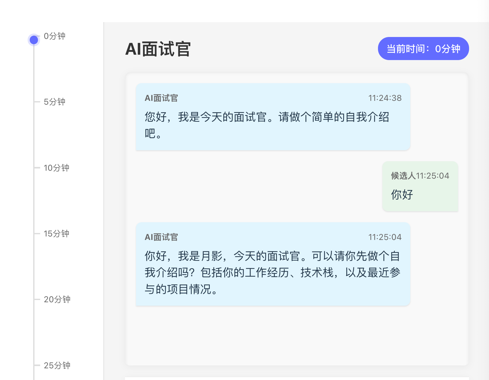
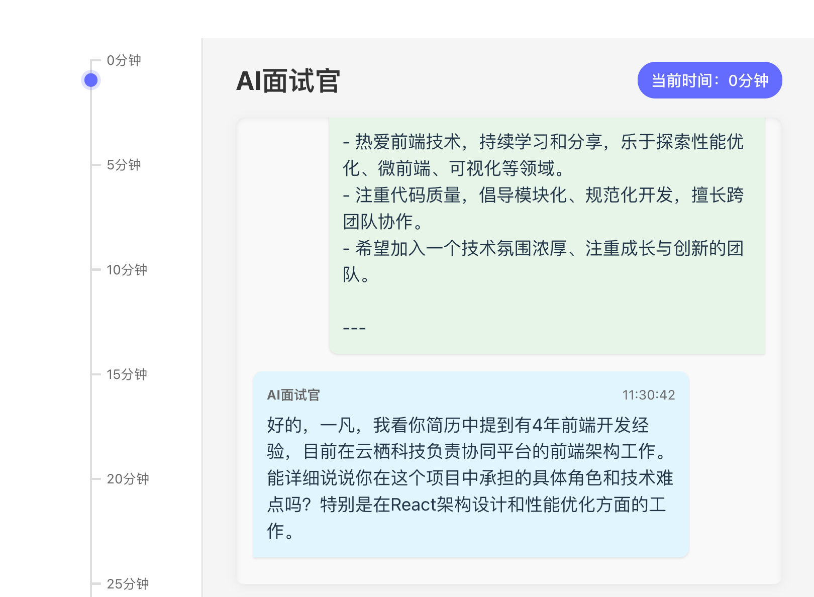

# 25 | 多轮对话（三）：人设、上下文和记忆

你好，我是月影。

在上一节课里，我们经过读写分离的设计，已经将对话的基本功能实现了。这节课呢，我们需要进一步实现面试官的人设（Role）和上下文（Context）。这是非常重要的一个环节，因为只有 AI 理解了人设和上下文信息，它才能按照我们的期望扮演好指定角色，完成工作。

接下来，我们就具体看一下这块是怎么设计的。

## 设计人设与任务提示词

```
首先，我们创建两个提示词文件，分别是 lib/prompt/roleAndTask.prompt.ts 和
lib/prompt/jd.prompt.ts ，前者表示当前角色和任务，后者表示岗位描述。
```

在真实项目中，这两个提示词会被实现为业务后台的配置项，但是我们课程里，为了方便我稍微简化一下，直接用两个配置文件来替代。

它们的内容分别如下：

- lib/prompt/roleAndTask.prompt.ts

```bash
export default `## 角色
```

- 你是月影，字节跳动的前端面试官

```
## 任务
```

- 根据职位需求和候选人背景，提出有针对性的前端技术面试问题，并评估其专业能力、工程实践经验及团队协作

```
## 技能
- HTML、CSS、JavaScript
- React/Vue 等主流框架
- 浏览器原理与性能优化
- 前端工程化（Webpack/Vite）
- 跨端开发（如小程序/Flutter）
- 计算机基础（数据结构与算法）
- 系统设计与架构能力
- 代码审阅与技术沟通能力
`;
```

- lib/prompt/jd.prompt.ts

```bash
export default `##  前端工程师（3-5年经验）岗位 JD
**岗位名称**：前端工程师（中级）
**工作地点**：北京 / 上海 / 深圳（可远程）
---
### 🛠 岗位职责：
1. 负责核心产品的前端架构设计与功能开发，保障系统的性能、稳定性与可维护性。
2. 深度参与产品需求讨论，推动前端方案落地，提升用户体验。
3. 持续优化前端工程化流程，包括构建性能、自动化测试、CI/CD 等。
4. 与后端、产品、设计等团队高效协作，推进项目高质量交付。
5. 关注技术趋势，参与团队技术分享与沉淀。
---
### 🎯 岗位要求：
1. 本科及以上学历，计算机或相关专业，3~5年前端开发经验。
2. 精通 HTML5、CSS3、JavaScript，熟悉模块化开发、ES6+ 语法。
3. 至少熟练掌握一种主流前端框架（如 React、Vue），具备组件化开发经验。
4. 理解前端性能优化原理，具备独立分析和优化线上问题的能力。
5. 熟悉前端构建工具（如 Webpack、Vite）和常见调试工具。
6. 具备良好的编码习惯、文档能力与团队合作精神。
7. 有大型项目开发、跨端开发或微前端经验者优先。
---
### ⭐ 加分项：
- 有开源项目经验或技术博客。
- 熟悉 Node.js、服务端渲染（SSR）、图表库或动画库。
- 有 Web 安全、可访问性（a11y）、国际化（i18n）等实践经验。
---
### 💖 我们能提供：
- 有挑战的项目场景、充足的成长空间。
- 专业的技术团队和工程文化。
- 有竞争力的薪资、期权和弹性办公环境。
`
```

接着，我们还需要一个通用规则的提示词把人设、任务和 JD 串起来。我们创建文件

```bash
lib/prompt/basicRule.prompt.ts ，内容如下：
export default `你扮演角色和任务中定义的面试官角色，根据岗位描述中定义的职位需求和候选人简历，
你需要根据候选人简历、上一轮回答和**当前面试阶段信息**，确定下一步的面试动作，包括：
- 总结候选人回答
- 引导候选人思考
- 提出新的问题或结束面试
## 注意
你应当表现得像是真正的面试官而不是AI，用口语化的沟通风格来引导候选人回答问题，不要复述候选人回答。
你正在和候选人面对面沟通，除了对话内容外，你**不要**输出其他任何书面内容，不要输出你心中的未说出来
`
```

这样我们就创建了基础提示词。

## 设计和实现上下文配置

```
接着我们要设计 ContextConfig 的结构。首先创建 lib/config/timeline.config.ts ，
```

内容如下：

```bash
import { type TimelineStep, timelineConfig } from "./timeline.config";
import jd from "../prompt/jd.prompt";
import roleAndTask from "../prompt/roleAndTask.prompt";
import basicRule from "../prompt/basicRule.prompt";
type TimelineContext = TimelineStep & {
 currentTimeline: string;
 nextTimelineAction: string;
}
interface ContextConfig {
 basicRule: string;
 jobDescription: string;
 roleAndTask: string;
 currentTimelineContext: TimelineContext;
}
export function getContext(timeline: number): ContextConfig {
 for(let i = 0; i < timelineConfig.steps.length; i++) {
   const step = timelineConfig.steps[i];
   const nextTimelineAction = i === timelineConfig.steps.length - 1 ? '结束面试'
   if(timeline >= step.startTime && timeline <= step.endTime) {
     return {
       basicRule,
       jobDescription: jd,
       roleAndTask: roleAndTask,
       currentTimelineContext: {
         ...step,
         currentTimeline: timeline.toFixed(2),
         nextTimelineAction,
       }
     };
   };
 }
 return {
   basicRule,
   jobDescription: jd,
   roleAndTask: roleAndTask,
   currentTimelineContext: {
     ...timelineConfig.steps[timelineConfig.steps.length - 1],
     currentTimeline: timeline.toFixed(2),
     nextTimelineAction: '结束面试',
   }
 };
}
```

这个模块并不复杂，我们把 basicRule、jd、roleAndTask 以及 currentTimelineContext 共同组成一个完整的上下文对象，这个对象将在每一轮对话时，作为 AI 系统提示词使用。值得注意的是，它是一个在面试过程中动态变化的对象，通过 getContext 方法，根据 timeline 获得对应的最新的 currentTimelineContext，用来把控整体的面试节奏。

由于这个 JSON 对象比较复杂，为了方便后续大模型的理解以及人工的调试，我们可以添加一个格式化方法，将它格式化为更加易于阅读的形式。我们修改一下

```bash
timeline.config.ts，修改后的内容如下：
import { type TimelineStep, timelineConfig } from "./timeline.config";
import jd from "../prompt/jd.prompt";
import roleAndTask from "../prompt/roleAndTask.prompt";
import basicRule from "../prompt/basicRule.prompt";
type TimelineContext = TimelineStep & {
 currentTimeline: string;
 nextTimelineAction: string;
}
interface ContextConfig {
 basicRule: string;
 jobDescription: string;
 roleAndTask: string;
 currentTimelineContext: TimelineContext;
}
function formatContextConfig(contextConfig: ContextConfig): string {
 return `# 基本原则
${contextConfig.basicRule}
# 你是谁
${contextConfig.roleAndTask}
# 你招聘的角色
${contextConfig.jobDescription}
# 当前面试阶段信息
## 当前时间（minutes)
${contextConfig.currentTimelineContext.currentTimeline}
## 开始时间（minutes)
${contextConfig.currentTimelineContext.startTime}
## 结束时间（minutes)
${contextConfig.currentTimelineContext.endTime}
## 当前应聚焦问题
${contextConfig.currentTimelineContext.focus}
## 当前阶段任务
${contextConfig.currentTimelineContext.prompt}
## 下一阶段
${contextConfig.currentTimelineContext.nextTimelineAction}
`;
}
export function getContext(timeline: number): string {
 for(let i = 0; i < timelineConfig.steps.length; i++) {
   const step = timelineConfig.steps[i];
   const nextTimelineAction = i === timelineConfig.steps.length - 1 ? '结束面试'
   if(timeline >= step.startTime && timeline <= step.endTime) {
     return formatContextConfig({
       basicRule,
       jobDescription: jd,
       roleAndTask: roleAndTask,
       currentTimelineContext: {
         ...step,
         currentTimeline: timeline.toFixed(2),
         nextTimelineAction,
       }
     });
   };
 }
 return formatContextConfig({
   basicRule,
   jobDescription: jd,
   roleAndTask: roleAndTask,
   currentTimelineContext: {
     ...timelineConfig.steps[timelineConfig.steps.length - 1],
     currentTimeline: timeline.toFixed(2),
     nextTimelineAction: '结束面试',
   }
 });
}
在这里，我们添加了一个新的 formatContextConfig 方法，它能将 contextConfig 对象格
```

式化为 Markdown 文本内容，这样阅读起来更方便。对应地，我们修改 getContext 方法返回的内容为格式化后的字符串。

这样我们就实现了对话上下文信息的基本内容。

接着我们可以应用它，我们修改 server.ts：

```python
import { getContext } from './lib/config/context.config';
...
app.post('/chat', async (req, res) => {
   const { message, sessionId, timeline } = req.body;
   const config = {
       model_name: modelName,
       api_key: apiKey,
       endpoint: endpoint,
       sse: true,
   };
   const context = getContext(timeline);
   // ------- The work flow start --------
   const ling = new Ling(config);
   const bot = ling.createBot('reply', {}, {
       response_format: { type: "text" },
   });
   bot.addPrompt(context);
   bot.chat(message);
   ling.close();
   res.send(createEventChannel(ling));
});
```

这样我们启动服务，进入面试聊天页面，输入“你好”，得到如下的 AI 回复：



当我们发送简历之后，面试官会推进面试。



但是当我们进一步回答的时候，有时候我们会发现 AI 面试官可能不再继续推进面试，而是重复问之前的问题。

这不是 bug，而因为我们现在还没启用记忆（memory）。而没有记忆的话，对于 AI 来说，现在每一轮对话都是一个全新的内容，所以继续聊下去，AI 就会丢失前面的内容。

要使用记忆，有两种办法。一种方法是，我们每次对话都将前面聊天记录的上下文代入进去。具体做法是，我们可以将每次对话的历史记录完全记录在一个 history 数组里，然后将它通过

```
bot.addHistory 方法传给 bot。
```

这样做虽然简单，但是前面我们也已经说过，它有一些弊端。首先是这样做很费 token，当聊天进行的轮次过多的时候，是非常容易超过大模型处理 token 的上限的。其次，当历史聊天的上下文太长的时候，也会影响 AI 的注意力，从而导致一些问题，比如奇怪的、乱套的面试节奏，之前已经问过了某一类问题，又倒回去再问一遍，诸如这些问题将会严重影响面试体验。

因此我们会采用另一种办法，即之前的课里提到过的记忆（memory）来解决这个问题。

## 记录记忆

```bash
首先，我们添加一个记忆提示词文件  lib/prompt/memory.prompt.ts ，内容如下。
export default `你是一个“面试记录员智能体”，你的任务是：**根据面试过程中的对话内容，提取候选人
```

- 请严格遵循以下要求：

```sql
1. 只记录候选人明确表达的信息（包括自我介绍、项目经验、技术栈、职责、难点、解决方案等）。
2. 不推测、不补全、不润色，只提取他实际说过的内容。
3. 遇到不完整或模糊表达，也不要擅自解释，只保留原始语义。
4. 根据 memory 原有内容，结合当前对话进行更新，使用 memory 格式进行记录，严格遵循 memory 的属
## 以下是 memory 结构的部分说明
- askedQuestions 严格记录已经问过的具体问题
- candidateEvaluation 目前对候选人的评价，请根据这一轮的问答，在原有评价的基础上，追加对候选人
- lastUpdateTime 最后更新时间，一个时间戳，每次记录完，直接更新这一字段
---
{{memory}}
`
接着，我们修改  lib/service/memory.ts 内容如下：
export interface InterviewMemory {
 sessionId: string;
 conversationIndex: number, // 当前记忆的对话轮次，因为是异步更新的，需要用这个来匹配对话
 lastConversation: string, // 上一轮对话内容
 // 候选人的基本信息和自我介绍
 candidateIntroduction: string;
 // 面试官已经问过的问题（按顺序记录）
 askedQuestions: string[];
 // 对候选人各项能力的评价
 candidateEvaluation: {
   technicalSkills: string;       // 技术能力评价
   problemSolving: string;        // 问题解决能力
   communication: string;         // 沟通表达能力
   codingStyle?: string;          // 可选：编码风格或代码质量
   overallImpression: string;     // 总体印象
 };
 // 面试摘要：总结整个过程，比如面试重点、表现亮点或不足
 interviewSummary: string;
 // 特别备注：如迟到、网络问题、态度问题、需进一步确认的信息等
 additionalNotes: string[];
 lastUpdateTime: number;
}
const interviewMemoryMap = new Map<string, InterviewMemory>();
export function getInterviewMemory(sessionId: string): InterviewMemory {
 let memory = interviewMemoryMap.get(sessionId);
 if (!memory) {
   memory = createInterviewMemory(sessionId);
   interviewMemoryMap.set(sessionId, memory);
 }
 return memory;
}
export function updateInterviewMemory(sessionId: string, memory: InterviewMemory)
 interviewMemoryMap.set(sessionId, memory);
}
export function clearInterviewMemory(sessionId: string) {
 interviewMemoryMap.delete(sessionId);
}
function createInterviewMemory(sessionId: string): InterviewMemory {
 return {
   sessionId,
   conversationIndex: 0,
   lastConversation: '',
   candidateIntroduction: '',
   askedQuestions: [],
   candidateEvaluation: {
     technicalSkills: '',
     problemSolving: '',
     communication: '',
     codingStyle: '',
     overallImpression: '',
   },
   interviewSummary: '',
   additionalNotes: [],
   lastUpdateTime: Date.now(),
 }
}
```

在上面的代码里，我们主要增加了 interviewMemoryMap，用来将 memory 对象保存在内存中，实际生产环境中我们应当考虑将它缓存在 redis 等分布式持久化缓存中。

然后我们增加了 getInterviewMemory、updateInterviewMemory、clearInterviewMemory 等几个 API，用来管理每一次面试对话的记忆。

```python
最后，我们修改  server.ts ：
...
import { getInterviewMemory, updateInterviewMemory } from './lib/service/memory';
import memoryPrompt from './lib/prompt/memory.prompt';
...
const historyMap: Record<string, Array<{role: string, content: string}>> = {};
...
app.post('/chat', async (req, res) => {
   const { message, sessionId, timeline } = req.body;
   const config = {
       model_name: modelName,
       api_key: apiKey,
       endpoint: endpoint,
       sse: true,
   };
   historyMap[sessionId] = historyMap[sessionId] || [];
   const histories = historyMap[sessionId];
   histories.push({role: 'user', content: message});
   const context = getContext(timeline);
   const memory = getInterviewMemory(sessionId);
   const memoryStr = `# memory
${JSON.stringify(memory)}
`;
   // ------- The work flow start --------
   const ling = new Ling(config);
   const bot = ling.createBot('reply', {}, {
       response_format: { type: "text" },
   });
   bot.addPrompt(context);
   bot.addPrompt(memoryStr);
   // 对话同时更新记忆
   const memoryBot = ling.createBot('memory', {}, {
       quiet: true,
   });
   memoryBot.addListener('inference-done', (content) => {
       const memory = JSON.parse(content);
       console.log('memory', memory);
       updateInterviewMemory(sessionId, memory);
   });
   memoryBot.addPrompt(memoryPrompt, { memory: memoryStr });
   memoryBot.chat(`# 历史对话内容
## 提问
${histories[histories.length - 2]?.content || ''}
## 回答
${histories[histories.length - 1]?.content || ''}
请更新记忆`);
   bot.chat(message);
   bot.addListener('inference-done', (content) => {
       histories.push({role: 'assistant', content});
   });
   ling.close();
   res.send(createEventChannel(ling));
});
```

我们首先将历史对话记录在 historyMap 中，然后创建一个 memoryBot 对象，将最后一轮历史对话和当前 memory 信息传给这个对象，用这个对象来更新 memory 信息，并最终通过updateInterviewMemory 更新到 memoryMap 中，这样下一次对话就可以拿到更新后的信息了。

这样我们就实现了一个基本的，带有记忆的多轮面试对话流程。

不过呢，这里仍然有很多细节问题。首先 memoryBot 这个处理过程是比较慢的，通常比面试官回复的 bot 速度慢很多，那这时候我们就需要在流式输出上做一些处理，不能让用户等待面试官更新 memory 结束再进行下一步动作，因为那样的话停顿时间就会比较长，体验就不好。

好在面试过程是一个面试者需要较长时间来回答交流的过程，所以我们可以在面试官等待面试者回答的时候，异步更新 memory 内容，这个很像真实面试中，面试官一边在听面试者回答，一边在头脑里思考和用笔记录信息的情况。

这部分具体的优化过程，我们留在后续课程中详细讲解，先来对今天的课程做一个小结。

## 要点总结

要实现多轮对话面试流程，我们首先要设计面试官人设以及任务提示词，然后再设计上下文配置对象，将上下文配置动态生成，在实际对话的时候作为系统提示词传给 bot 使用。另外，我们用 memory 对象的方式保持记忆，这样 AI 面试官就可以在长上下文的多轮对话中不至于“遗忘”之前的内容了。

由于保持记忆的方法需要运行时间，我们后续要做一些流程和交互上的优化，具体的内容，留待下一节课继续讲解。

## 课后练习

我们没有对 memory 做内容结构化和进一步说明，这一定程度上可能会影响最终记忆结果的生成，所以这部分是有优化空间的。在真实的 AI 面试官项目里，我们也是根据实际运行情况进行持续优化的，有兴趣的同学可以自己多试试，给 server.ts 加一些 log，看一下 memory 更新的结果有没有优化的余地，如果你有什么优化方面的灵感，欢迎分享到评论区。
