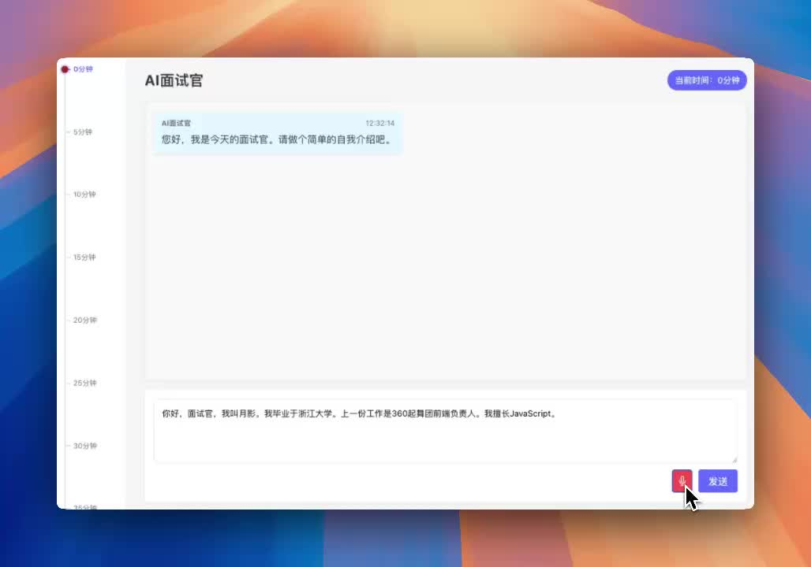
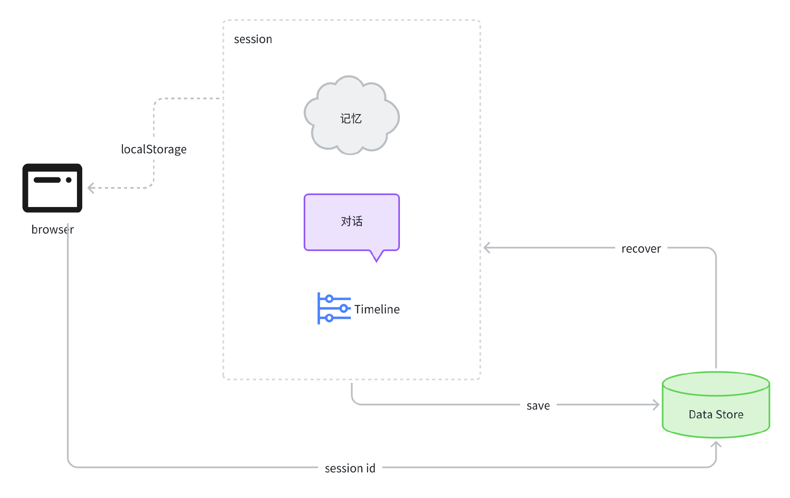

# 26 | 交互细节功能的丰富和功能优化

你好，我是月影。

上一节课，我们几乎已经实现了 AI 面试官项目完整的流程，给面试官智能体赋予了人设、上下文和记忆。

但是，在这里，我们还需要进行一些细节优化，以保证面试效果和面试体验。

## 异步更新记忆及前端优化

我们上一节课有一个细节，那就是我们在工作流中对 memory 的更新采用了 quiet 的方式，在Ling 框架的介绍中我提到过，当我们给 Bot 设置 quiet 参数后，它在执行推理的过程里，并不会将任何内容发送给前端。

```javascript
   // 对话同时更新记忆
   const memoryBot = ling.createBot('memory', {}, {
       quiet: true,
   });
```

所以，我们无需等待这部分内容更新结束，就可以继续前端的对话。这样就不会因为记忆的更新需要的时间过长，而导致用户等待很久，让面试沟通变得不够流畅。

不过这带来另一个问题，那就是我们持续对话的时候，有可能记忆还未更新，这会导致 AI 记住的内容和当前对话不一定同步。例如面试对话已经进行到了第 5 轮，而记忆可能才更新到第3 轮。所以我们还是需要传递给 AI 少量的上下文，以防止这种情况下 AI 对话丢失了最近的上下文信息，产生不恰当的提问或者重复对话等问题。

所以，这时候，我们还是需要把最近的一部分历史对话传给大模型。上一节课，我们通过historyMap 记录了所有的历史对话，因此我们可以取最近两轮历史对话，也就是 histories 的最后 3 条记录传给当前对话。

这部分历史对话内容虽然不是很多，但还是要消耗部分 token，因此我们需要适当增加max_tokens 配置，这样才能够确保对话时 token 数量够用。

我们修改一下 server.ts：

```javascript
app.post('/chat', async (req, res) => {
   const { message, sessionId, timeline } = req.body;
   const config = {
       model_name: modelName,
       api_key: apiKey,
       endpoint: endpoint,
       sse: true,
   };
   historyMap[sessionId] = historyMap[sessionId] || [];
   const histories = historyMap[sessionId];
   histories.push({role: 'user', content: message});
   const context = getContext(timeline);
   const memory = getInterviewMemory(sessionId);
   const memoryStr = `# memory
${JSON.stringify(memory)}
`;
   // ------- The work flow start --------
   const ling = new Ling(config, {
       max_tokens: 8192,
   });
   const bot = ling.createBot('reply', {}, {
       response_format: { type: "text" },
   });
   bot.addPrompt(context);
   bot.addPrompt(memoryStr);
   bot.addHistory(histories.slice(-3));
   // 对话同时更新记忆
   const memoryBot = ling.createBot('memory', {}, {
       quiet: true,
   });
   memoryBot.addListener('inference-done', (content) => {
       const memory = JSON.parse(content);
       updateInterviewMemory(sessionId, memory);
   });
   memoryBot.addPrompt(memoryPrompt, { memory: memoryStr });
   memoryBot.chat(`# 历史对话内容
## 提问
${histories[histories.length - 2]?.content || ''}
## 回答
${histories[histories.length - 1]?.content || ''}
请更新记忆`);
   bot.chat(message);
   bot.addListener('inference-done', (content) => {
       histories.push({role: 'assistant', content});
   });
   bot.addListener('response', () => {
       ling.sendEvent({event: 'response-finished'});
   });
   ling.close();
   res.send(createEventChannel(ling));
});
```

上面的代码里，我们主要修改了三个地方。

首先是我们给 Ling 对象增加了一个 max_tokens 参数，设置为 8192。如果是 moonshot-8k，这个是最大值，如果是上下文更大的模型，可以设置为更大值，比如 16k 或者 32k。

```javascript
   const ling = new Ling(config, {
       max_tokens: 8192,
   });
```

其次，我们给面试对话的 bot 增加了一组最近的聊天记录，上面说过我们取最后三段历史聊天结果：

```
bot.addHistory(histories.slice(-3));
最后，我们在 bot 输出结束时，给前端发送一个 response-finished 事件，这个事件可以
```

用来控制前端 UI 展示，因为此时 memoryBot 还在处理，所以 Ling 工作流整体还未结束，前端还收不到 Ling 本身的 finished 事件。

这样，我们在前端可以进行 UI 处理，为了防止用户重复提交，我们在用户提交后，将提交按

```
钮状态置为 disabled，等收到  response-finished 事件后，再恢复按钮可用。
```

我们修改 src/components/MessageInput 组件。

```xml
<script setup lang="ts">
...
const buttonDisabled = ref(false);
...
const handleSendMessage = () => {
 if (message.value.trim()) {
   buttonDisabled.value = true;
   emit('sendMessage', message.value, buttonDisabled);
   message.value = '';
 }
};
<template>
...
   <button class="send-button" @click="handleSendMessage" :disabled="buttonDisab
...
</template>
<style scoped>
...
.send-button:disabled {
 background-color: #ccc;
 cursor: not-allowed;
}
</style>
```

上面的代码里，我们在发送消息给 AI 时，将按钮状态通过 buttonDisabled 置为不可用，并将该变量传递给父级组件。因此我们在父级组件，即 App.vue 中也要修改代码。

```xml
<script setup lang="ts">
...
// 发送新消息
const sendMessage = async (content: string, buttonDisabled: any) => {
 ...
 eventSource.addEventListener('response-finished', () => {
   buttonDisabled.value = false;
 });
 ...
}
</script>
...
```

这样当 AI 回复完成时，我们就恢复提交按钮状态，用户就可以继续进行对话了。

## 语音输入

接下来，我们要实现语音输入功能，因为面试对话时候选人回答通常比较多，语音输入能极大降低交流成本提升体验。

在第 21 节课程中，我们已经讲解过语音输入的解决方案了，在这里我们可以直接照搬过来。

```
首先修改  .env.local 增加配置。
# Azure STT
VITE_AZURE_SPEECH_KEY=2JdU********niFW
VITE_AZURE_SPEECH_REGION=southeastasia
```

接着编辑 server.ts 添加鉴权接口。

```javascript
app.get('/voice-token', async (req, res) => {
   const region = process.env.VITE_AZURE_SPEECH_REGION;
   const key = process.env.VITE_AZURE_SPEECH_KEY;
   const headers: any = {
     'Ocp-Apim-Subscription-Key': key,
     'Content-Type': 'application/x-www-form-urlencoded',
   };
   const token = await (
       await fetch(`https://${region}.api.cognitive.microsoft.com/sts/v1.0/issue
           method: 'POST',
           headers,
       })
   ).text();
   res.send({
       data: {
           token: token,
           region: region,
       }
   });
});
```

然后实现前端功能。首先安装必要的依赖：

```bash
pnpm i universal-cookie microsoft-cognitiveservices-speech-sdk
接着在项目下创建  src/lib/voice/helper.ts 文件：
import Cookie from 'universal-cookie';
import * as speechsdk from 'microsoft-cognitiveservices-speech-sdk';
async function getTokenOrRefresh() {
 const cookie = new Cookie();
 const speechToken = cookie.get('speech-token');
 console.log(speechToken, 'speechToken');
 if (speechToken === undefined || speechToken === 'undefined:undefined') {
   try {
     const res = await fetch('/api/voice-token', {
       method: 'GET',
       headers: {
         'Content-Type': 'application/json',
       },
     });
     const { data } = await res.json();
     // console.log(data);
     const token = data.token;
     const region = data.region;
     cookie.set('speech-token', `${region}:${token}`, {
       maxAge: 540,
       path: '/',
     });
     console.log('Token fetched from back-end: ' + token);
     return { authToken: token, region: region };
   } catch (err: any) {
     console.log(err);
     return { authToken: null, error: err.response.data };
   }
 } else {
   // console.log('Token fetched from cookie: ' + speechToken);
   const idx = speechToken.indexOf(':');
   return {
     authToken: speechToken.slice(idx + 1),
     region: speechToken.slice(0, idx),
   };
 }
}
export async function sttFromMic(onMessage: (text: string, delta: string, isClose
 const tokenObj = await getTokenOrRefresh();
 const speechConfig = speechsdk.SpeechConfig.fromAuthorizationToken(tokenObj.aut
 speechConfig.speechRecognitionLanguage = 'zh-CN';
 const audioConfig = speechsdk.AudioConfig.fromDefaultMicrophoneInput();
 const recognizer = new speechsdk.SpeechRecognizer(speechConfig, audioConfig);
 console.log('speak into your microphone...');
 let text = '';
 recognizer.recognizing = (s, e) => {
   // console.log(`RECOGNIZING: Text=${e.result.text}`);
   (recognizer as any).startRecord = true;
 };
 recognizer.recognized = (s, e) => {
   if (e.result.reason == speechsdk.ResultReason.RecognizedSpeech) {
     // console.log(`RECOGNIZED: Text=${e.result.text}`);
     text += e.result.text;
     onMessage(text, e.result.text, false);
   } else if (e.result.reason == speechsdk.ResultReason.NoMatch) {
     // console.log('NOMATCH: Speech could not be recognized.');
   }
 };
 recognizer.canceled = (s, e) => {
   console.log(`CANCELED: Reason=${e.reason}`);
   if (e.reason == speechsdk.CancellationReason.Error) {
     console.log(`"CANCELED: ErrorCode=${e.errorCode}`);
     console.log(`"CANCELED: ErrorDetails=${e.errorDetails}`);
     console.log('CANCELED: Did you set the speech resource key and region value
   }
   recognizer.stopContinuousRecognitionAsync();
 };
 recognizer.sessionStopped = (s, e) => {
   // console.log('\n    Session stopped event.');
   recognizer.stopContinuousRecognitionAsync();
   onMessage(text, '', true);
 };
 recognizer.startContinuousRecognitionAsync();
 return recognizer;
}
然后创建 src/lib/voice/index.ts。
import { sttFromMic } from './helper';
export class Recognizer {
 private recorder: MediaRecorder | null = null;
 private initialized: boolean = false;
 private isRecording: boolean = false;
 private azureSTT: any = null;
 onAudioRecording?: (event: MessageEvent<any>) => void;
 onAudioTranscription?: ((transcription: { text: string; delta: string; done: bo
 async init() {
   const stream: MediaStream = await navigator.mediaDevices.getUserMedia({
     audio: true,
   });
   const audioContext = new AudioContext();
   const mediaStreamSource = audioContext.createMediaStreamSource(stream);
   await audioContext.audioWorklet.addModule('/worklet/vumeter.js');
   const node = new AudioWorkletNode(audioContext, 'vumeter');
   node.port.onmessage = event => {
     if (event.data.volume) {
       if (this.isRecording) {
         this.onAudioRecording && this.onAudioRecording(event);
       }
     }
   };
   mediaStreamSource.connect(node).connect(audioContext.destination);
   this.initialized = true;
 }
 async cancel() {
   await this.stop();
 }
 get state() {
   return this.recorder?.state;
 }
 async start() {
   if (this.isRecording) return;
   this.isRecording = true;
   this.azureSTT = await sttFromMic((text, delta, done) => {
     if (this.onAudioTranscription) {
       this.onAudioTranscription({
         text,
         delta,
         done,
       });
     }
   });
   if (!this.initialized) await this.init();
 }
 async stop() {
   if (!this.isRecording) return;
   this.isRecording = false;
   return new Promise(resolve => {
     setTimeout(() => {
       this.azureSTT.close();
       if (!this.azureSTT.startRecord) {
         this.onAudioTranscription &&
           this.onAudioTranscription({
             text: '',
             delta: '',
             done: true,
           });
       }
       resolve(null);
     }, 500);
   });
 }
 async destroy() {
   this.onAudioTranscription = null;
   await this.stop();
 }
}
```

接着我们在 MessageInput 组件中引入语音输入功能。

我们修改 MessageInput.vue，添加后面的内容，后面的代码你对照注释也很容易理解。

```xml
<script setup lang="ts">
import { ref, onUnmounted } from 'vue';
import { Recognizer } from '../lib/voice';
...
const isRecording = ref(false);
const recognizer = ref<Recognizer | null>(null);
// 初始化语音识别器
const initRecognizer = () => {
 if (!recognizer.value) {
   recognizer.value = new Recognizer();
   recognizer.value.onAudioTranscription = (transcription) => {
     if (transcription.text) {
       message.value = transcription.text;
     }
   };
 }
};
// 开始录音
const startRecording = async () => {
 initRecognizer();
 await recognizer.value?.start();
 isRecording.value = true;
};
// 停止录音
const stopRecording = async () => {
 if(!isRecording.value) {
   return;
 }
 isRecording.value = false;
 setTimeout(() => {
   recognizer.value?.stop();
 }, 1000);
};
// 处理语音按钮按下事件
const handleVoiceButtonDown = () => {
 startRecording();
};
// 处理语音按钮释放事件
const handleVoiceButtonUp = () => {
 stopRecording();
};
...
// 组件卸载时销毁语音识别器
onUnmounted(() => {
 recognizer.value?.destroy();
});
</script>
<template>
...
   <div class="button-container">
     <button
       class="voice-button"
       @mousedown="handleVoiceButtonDown"
       @mouseup="handleVoiceButtonUp"
       @mouseleave="handleVoiceButtonUp"
       :class="{ 'recording': isRecording }"
       title="长按进行语音输入"
     >
       <svg xmlns="http://www.w3.org/2000/svg" width="16" height="16" viewBox="0
         <path d="M12 1a3 3 0 0 0-3 3v8a3 3 0 0 0 6 0V4a3 3 0 0 0-3-3z"></path>
         <path d="M19 10v2a7 7 0 0 1-14 0v-2"></path>
         <line x1="12" y1="19" x2="12" y2="23"></line>
         <line x1="8" y1="23" x2="16" y2="23"></line>
       </svg>
     </button>
     <button class="send-button" @click="handleSendMessage" :disabled="buttonDis
   </div>
...
</template>
<style scoped>
.button-container {
 display: flex;
 justify-content: flex-end;
 gap: 10px;
}
.voice-button {
 padding: 8px;
 background-color: #f5f5f5;
 color: #646cff;
 border: 1px solid #ddd;
 border-radius: 4px;
 cursor: pointer;
 transition: all 0.2s;
 display: flex;
 align-items: center;
 justify-content: center;
}
.voice-button:hover {
 background-color: #eaeaea;
}
.voice-button.recording {
 background-color: #ff4d4f;
 color: white;
 border-color: #ff4d4f;
 animation: pulse 1.5s infinite;
}
@keyframes pulse {
 0% {
   box-shadow: 0 0 0 0 rgba(255, 77, 79, 0.4);
 }
 70% {
   box-shadow: 0 0 0 10px rgba(255, 77, 79, 0);
 }
 100% {
   box-shadow: 0 0 0 0 rgba(255, 77, 79, 0);
 }
}
</style>
```

这样我们就在界面上添加了语音输入的 UI 效果，实际效果你可以对照后面的演示视频看一下。



## 提高容错性

到此为止，正常的前端面试功能我们已经完全实现了，大家可以体验看看，体会一下这个面试官的水平到底如何。

这个面试官智能体，作为一个 Demo 演示，它的功能是比较完整的，但是作为一款用于模拟面试的成熟产品，肯定还有很多需要优化的地方。其中最大的问题是容错性，我们这就来看看有什么方式做改善。

### 面试记录的存储及恢复

因为面试过程通常时间较长，所以用户在这个过程中可能会中断面试，此时我们应该将当前Timeline、 Memory、以及 History 记录到持久化的存储对象中，可以是数据库或者 Redis，以便于用户在适当的时候恢复面试。当用户处理完手头事情，回到产品中，可以通过前端持久化的 session id 来读取服务器持久化存储的内容，然后继续面试。

前端持久化，可以用 Vue 的 store 持久化机制来实现，比如 pinia 就是不错的选择。鉴于课程内容主要还是聚焦在 AI 方向，因此与 AI 无关的细节就不再展开细讲了，我将这套机制画成下面的流程图，就留给有兴趣的同学们自行研究和完善吧。



### 控制时间线，跳过当前面试阶段

在实际面试中，如果候选人表现正常，那么面试通常是按照 Timeline 的节奏来进行的，但如果候选人表现在正常范围之外，比如某个阶段表现特别差，或者特别完美，那么真实面试中，面试官是有可能跳过这一面试阶段的，那么如何跳过面试阶段呢？实际上有很多办法，这里我提供一个思路，有兴趣的同学可以具体研究。

首先我们可以通过 Ling 的 sendEvent 能力，通知前端更新 Timeline，具体方法是，我们发送

```sql
一个  update-timeline 事件给前端，参数传递 timeline 的值：
```

- server.ts

```sql
...
import { skipToNextSection } from './lib/config/timeline.config';
...
   const bot = ling.createBot('reply', {}, {
       response_format: { type: "json_object" },
   });
   bot.addFilter("updateTimeline"); // 对前端屏蔽这个字段
...
   bot.addListener('response', (content) => {
...
       const message = JSON.parse(content);
       if(message.updateTimeline) {
           const newTimeline = skipToNextSection(timeline);
           ling.sendEvent({event: 'update-timeline', delta: newTimeline});
       }
   });
...
```

在前面的代码里，我们根据返回的内容中是否要求更新 timeline 来判断是否跳过面试阶段，如

```sql
果跳过，则调用 skipToNextSection 获得新的 timeline 值，然后通过  update-timeline 事
```

件发送给前端，前端获得 timeline 数据后更新该数值即可。

注意如果这么修改，那么 bot 返回格式就不能是 text 而应该是 json_object 了，输出内容也应该是修改成后面这样的 JSON 结构。

```json
{
 "reply": "",
 "updateTimeline": false
}
```

在系统提示词中，可以插入如下规则。

```
根据 memory 和当前用户回答进行判断，如果该阶段用户回答得非常好，或者回答得非常差，那么输出 `upd
```

这样我们就可以进行控制了。具体的细节有兴趣的同学可以自行实现。

## 产品化及其他细节优化

为了产品化，我们还要做一些事情，比如将 Job Description 配置项抽取出来，以便于针对不同岗位，让 AI 有侧重点地去问问题。另外还可以将 AI 的人设也抽取出来，赋予面试官不同的性格偏好。还有我们面试结束时，也需要通过 Memory 中的内容，进行整体的面试回顾和评估，让 AI 给出面试结论。

此外，在前端体验上，我们面试过程中有写代码环节，在前面初始化项目的时候，我们也添加了 vue-codemirror。我们在前端可以添加输入切换，让输入过程可以切换输入框为多行文本或者 CodeMirror 编辑器，以便于获得更好的体验，这些产品细节都是需要花时间去慢慢打磨的。

这些内容不在我们课程核心内容的范畴内，因此我将这些任务留给大家，希望大家多去思考，多去练习。因为前端技能只有在不断实战练习中，才能得到巩固和提升。

## 要点总结

这一节课，我们讲了异步更新记忆的前端优化，以及添加语音输入功能，这些改进能够进一步优化面试体验。

我们还了解了进一步优化产品的方向，例如通过支持面试记录的持久化存储来支持面试过程的中断与恢复，以及通过控制时间线允许跳过当前阶段来更好地掌控面试流程，这些改进提高了产品容错性，在自身服务异常或者用户胡乱回答的时候，不至于出现大的问题。

最后，我们探讨了一些可能的产品化和其他细节优化方向，至此我们这个单元就基本上结束了。希望大家通过这个实战例子理解并掌握了复杂对话流程的智能体实现的思路。

从下一节课开始，我们将进入一个新的单元，讨论 AI 如何助力个人成长，这是一个全新的，但也是非常关键的话题，我相信这个话题对你的职业成长将会非常有帮助。

## 课后练习

可能有细心的同学会发现，我们在 22 节课系统设计里，提出的架构，除了对话流、记录与分析，还有一个慢思考的过程，但是我们在后续的章节里并没有实现这个慢思考的过程。

实际上我们并不是没有实现，而是通过 Memory 对象结构，用语义化的 JSON 字段，引导了AI 在记录 Memory 时的思考，相当于将慢思考和记录分析二合一了。而这么做，对于我们 AI面试官产品在实际运行测试时得到的结果来看，是没什么问题的。当然，如果再进一步增加深度思考，有可能进一步提升 AI 面试官问问题的能力，让它问问题变得更加犀利，面试效果也会更好。

在这里，我就留下这个作业，有兴趣的同学给我们的面试过程工作流再添加一个慢思考的大模型节点，结合 Memory 和当前讨论进行思考和分析，从而给对话模型一些建议，让它能够问出更有针对性的问题。

这个任务并不简单，甚至有一点挑战性，你可以花时间尝试一下，有结果可以分享到评论区。后续有机会的话，我可能会通过加餐或者其他的方式，带着大家进一步深入探讨。
