# 28 | 如何创建AI智能体管理笔记和收集信息（二）

你好，我是月影。

在上一节课，我们实现了智能收藏助手的网页收藏流程，接下来我们继续实现其他功能。

首先是一个非常重要的功能——内容转写。

为什么说这个功能重要呢？我们做技术的同学，平时都会遇到需要收集和查阅第一手英文技术资料的时候，但是对英文内容的阅读和理解，并不是所有人都能像阅读中文一样高效。以前我们很难解决这个问题，但是有了 AI，我们现在有更好的办法解决这个问题了。

## 将英文内容转写为中文

首先我们来实现一个将任意一篇英文网页内容转写为中文，并保存成飞书文档的工作流RewriteContent，它的工作流逻辑如下：

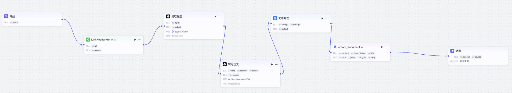

第一步，我们调用上一节实现的 LinkReaderPro，从网页中读取英文内容。

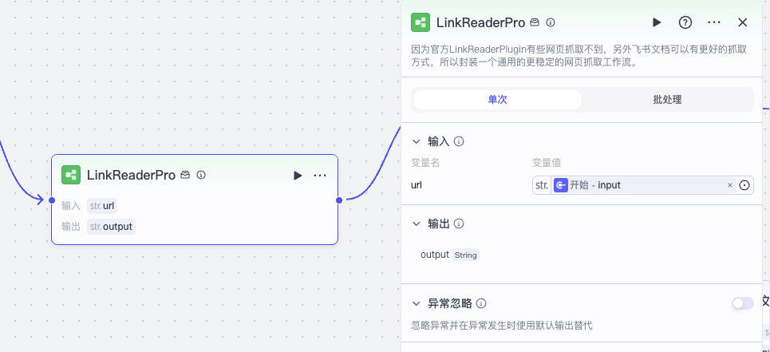

接着我们用两个大模型节点，从读取链接的内容中转写中文标题和中文正文内容。

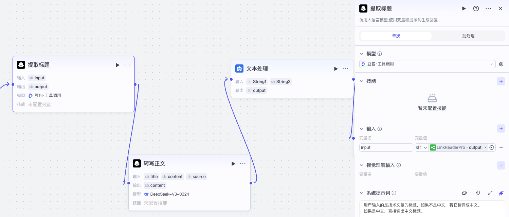

我们分别看一下它们的提示词：

- 提取标题：系统提示词

```
用户输入的是一篇技术文章摘要，你只需要提取出它的**文章标题**。
```

- 如果标题不是中文，将它翻译成中文。

```
输出标题的文本内容就行，不要带有任何Markdown格式。
```

- 提取标题：用户提示词

```
{{input}}
```

转写正文的配置：

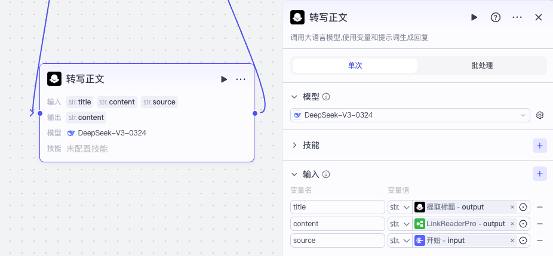

- 转写正文：系统提示词

- 将文章转写为中文内容，并重新组织内容，以方便初学者理解。

```
- 标题已经翻译过了，忽略【原文内容】中的标题
- 保持文章的原始内容信息完全不丢失。
- 采用合适的方便阅读的Markdown格式，尤其注意标题的层次。
- 保留原文中的图片链接。
- 文章中如包含实操，循序渐进，把代码操作步骤讲清楚。
- 如果有比较深的概念，增加一些便于初学者理解的比喻或解释。
- 如有与文章内容无关的文字，将其去掉。
- 保持正文标题与中文标题的翻译一致。
```

- 转写正文：用户提示词

```
# 中文标题
{{title}}
# 原文内容
{{content}}
```

有同学可能会问，这里为什么我们不用一个大模型同时提取标题和正文输出 JSON 格式，而要这样用两个大模型节点分别输出标题和正文呢？

实际上本来应该可以用一个大模型完成的，但是实际在 Coze 中测试下来，可能由于很多文章内容较长，在正文 content 内容过长的情况下，JSON 格式无法正常识别输出。所以我就退而求其次，采用了两步输出的方式，如果不在 Coze 中，而是自己用 Ling 实现的工作流，用一个大模型节点应该就够了。

接下来，我们还需要实现一个细节，就是在转写后的正文前面，增加一个原文链接引用。

这个可以通过添加一个文本处理节点来完成。

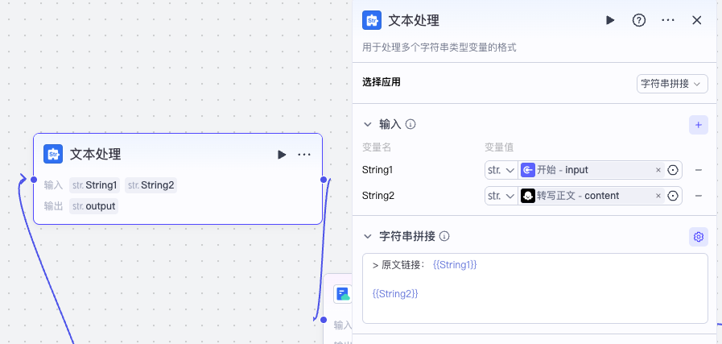

最后，我们用官方飞书文档的插件 create_document，将 doc_url 通过结束节点输出即可。

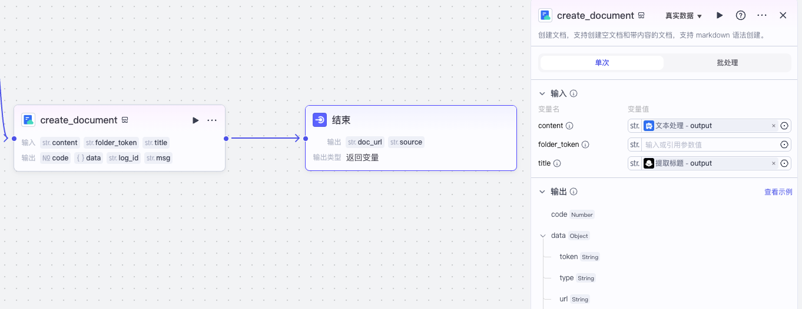

这样我们就完成了将英文内容转写为中文的主体流程。

接着我们使用它和上一节课的收藏网址流程结合，就可以实现完整的转写工作流AI_Favorites_Rewrite。

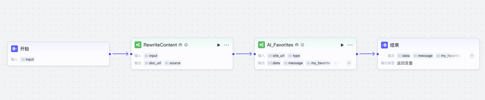

注意一个细节，因为我们将文章撰写了，收藏的链接不是文章原文，而是转写的文档，所以我们在调用工作流 AI_Favorites 时，将 type 设置为“笔记”而不是默认的“网页”。

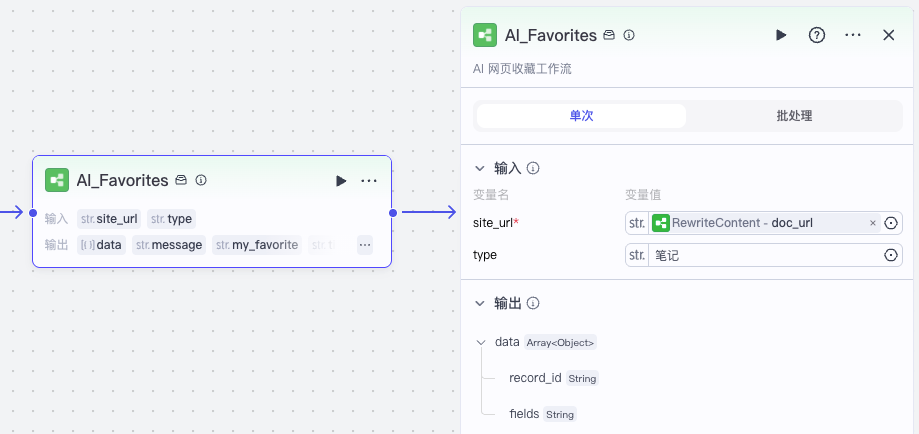

这样我们就实现了收藏助手里英文内容转写为中文的功能。

接下来，我们实现第三个功能：智能笔记。

## 整理智能笔记

与转写文章相比，智能笔记的工作流会稍微复杂一些，它的工作流逻辑如下：

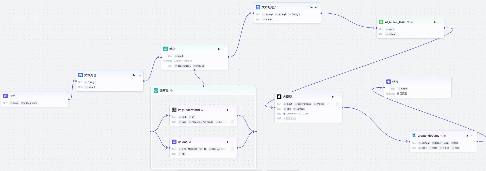

首先，在开始节点中，我们除了输入文本信息外，还添加附件，它是一个图片数组类型，这样我们就可以上传图片给助手，让它帮我们记录。

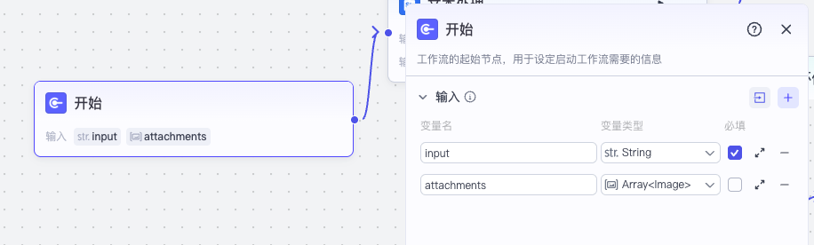

接下来是用户上传图片处理。

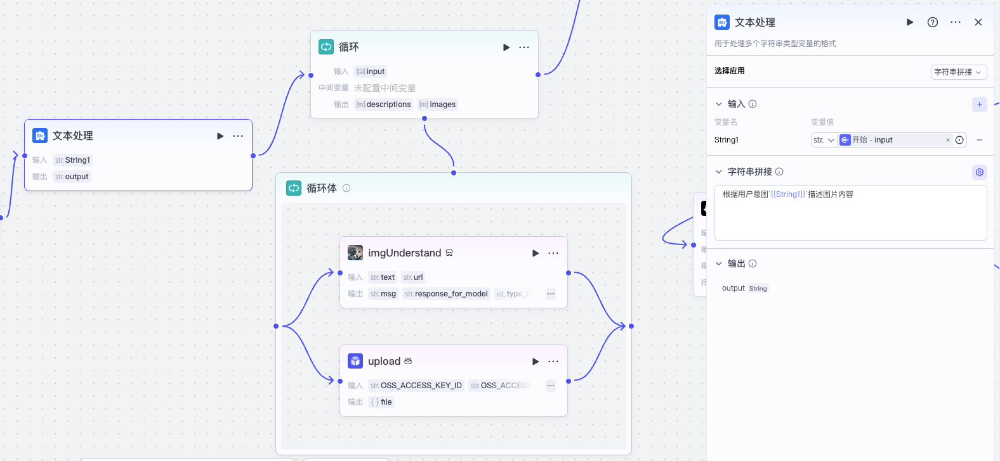

我们首先用文本处理节点拼接一个图像识别的提示词，然后用一个循环来对每一个附件图片分别处理。注意这里也可以用批处理替代循环，但考虑到 Coze 的并发限制，所以我这里选择了循环体，这样如果图片很多，处理起来就是时间慢一点，但是不会因为超过并发限制而产生错误。

在循环体内，我们做两件事情，一是我们将图片用官方图像识别插件进行识别，二是我们用一个自定义图片上传插件 upload，将用户上传的图片转存到阿里云上。

### 图片上传 upload 插件

这个 upload 插件你可以自己创建，具体方法是在 coze 资源面板中新建插件：

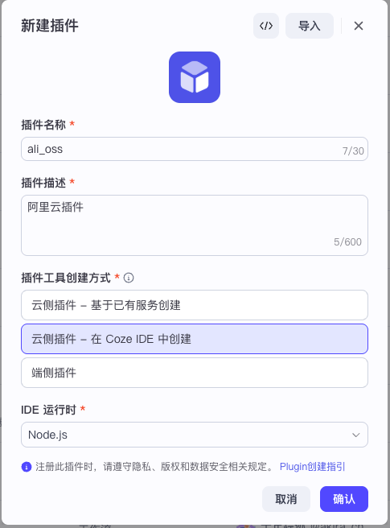

然后在插件的 Coze IDE 中的工具列表里添加工具 upload，代码如下：

```bash
import { Args } from '@/runtime';
import { Input, Output } from "@/typings/upload/upload";
import Client from 'ali-oss';
interface UploadFileResponse {
 HttpCode: number;
 Message: string;
 url?: string;
}
interface OssConfig {
 OSS_ACCESS_KEY_ID: string,
 OSS_ACCESS_KEY_SECRET: string,
 OSS_STORAGE_HOST_URL: string,
 OSS_CDN_URL: string,
 OSS_REGION: string,
 OSS_BUCKET: string,
}
function randomFileName(fileName) {
 const randomStr = Math.random().toString(36).slice(2);
 if (/\.([^.]+)$/.test(fileName)) {
   return fileName.replace(/\.([^.]+)$/, `-${randomStr}.$1`);
 }
 return `${fileName}-${randomStr}`;
}
async function uploadFile(ossConfig: OssConfig, buffer: any, filename: string, di
 const client = new Client({
   region: ossConfig.OSS_REGION, // 示例：'oss-cn-hangzhou'，填写Bucket所在地域。
   accessKeyId: ossConfig.OSS_ACCESS_KEY_ID, // 确保已设置环境变量OSS_ACCESS_KEY_ID
   accessKeySecret: ossConfig.OSS_ACCESS_KEY_SECRET, // 确保已设置环境变量OSS_ACCES
   bucket: ossConfig.OSS_BUCKET, // 示例：'my-bucket-name'，填写存储空间名称。
 });
 const hostUrl = ossConfig.OSS_STORAGE_HOST_URL;
 const cdnUrl = ossConfig.OSS_CDN_URL;
 filename = randomFileName(filename);
 if (filename.startsWith('-')) {
   filename = filename.slice(1);
 }
 try {
   const data: UploadFileResponse = { HttpCode: 201, Message: '上传成功' };
   const res = await client.put(`${dir}/${filename}`, buffer);
   if (res.res.status === 200) {
     data.url = res.url.replace(hostUrl, cdnUrl);
   }
   return data;
 } catch (ex) {
   console.error(ex);
   return { HttpCode: 500, Message: ex, url: filename };
 }
}
const randomFile = (ext: string = '') => {
 const ret = Math.random().toString(36).slice(2, 8);
 if (ext) return `${ret}.${ext}`;
 return ret;
}
/**
 * Each file needs to export a function named `handler`. This function is the en
 * @param {Object} args.input - input parameters, you can get test input value b
 * @param {Object} args.logger - logger instance used to print logs, injected by
 * @returns {*} The return data of the function, which should match the declared
 *
 * Remember to fill in input/output in Metadata, it helps LLM to recognize and u
 */
export async function handler({ input, logger }: Args<Input>): Promise<Output> {
 let inputBuffer = input.buffer;
 let filename = input.filename;
 let buffer: Buffer;
 if (typeof inputBuffer === 'string' && /^https?:\/\//.test(inputBuffer)) {
   // 图片转存
   const res = await fetch(inputBuffer);
   const arrayBuffer = await res.arrayBuffer();
   if (!filename) {
     const bytes = new Uint8Array(arrayBuffer);
     if (bytes[0] === 0x89 && bytes[1] === 0x50) {
       console.log('是 PNG 格式');
       filename = randomFile('png');
     } else if (bytes[0] === 0xFF && bytes[1] === 0xD8) {
       console.log('是 JPEG 格式');
       filename = randomFile('jpg');
     } else if (bytes[0] === 0x47 && bytes[1] === 0x49) {
       console.log('是 GIF 格式');
       filename = randomFile('gif');
     } else {
       console.log('未知格式');
       filename = randomFile();
     }
   }
   buffer = Buffer.from(arrayBuffer);
 } else {
   buffer = Buffer.from(inputBuffer);
 }
 const file = await uploadFile(
   {
     OSS_ACCESS_KEY_ID: input.OSS_ACCESS_KEY_ID,
     OSS_ACCESS_KEY_SECRET: input.OSS_ACCESS_KEY_SECRET,
     OSS_STORAGE_HOST_URL: input.OSS_STORAGE_HOST_URL,
     OSS_CDN_URL: input.OSS_CDN_URL,
     OSS_BUCKET: input.OSS_BUCKET,
     OSS_REGION: input.OSS_REGION,
   },
   buffer,
   filename || randomFile(),
 );
 return {
   file,
 };
};
```

设置元数据中的输入、输出参数：

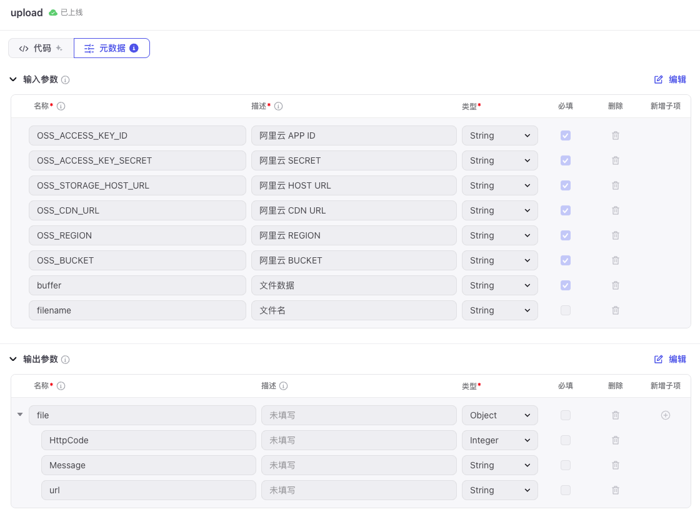

更详细的插件创建和使用方法，大家可以回顾“加餐 1”那篇内容，现在让我们回到正题。

### 智能笔记的 AI 分析

记智能笔记的时候，除了记录笔记内容外，我们可以让 AI 搜索资料，然后给我们做一些分析。

具体的做法是，我们先拼接好用户输入内容的文本，然后调用一个 AI_Notes_RAG 的子工作流。

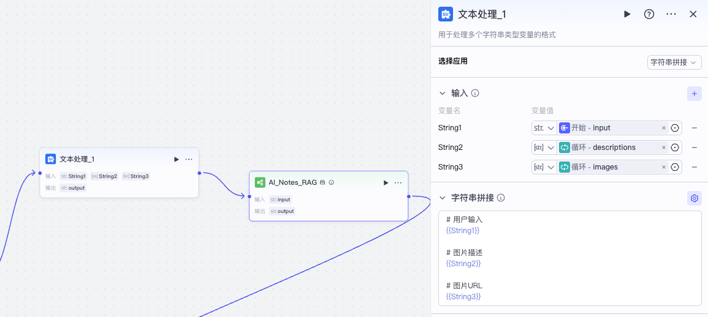

AI_Notes_RAG 工作流逻辑如下。

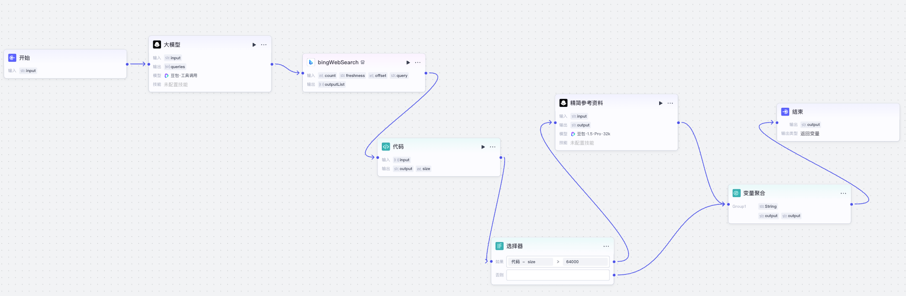

我们先用豆包大模型读取用户输入并提取 query。

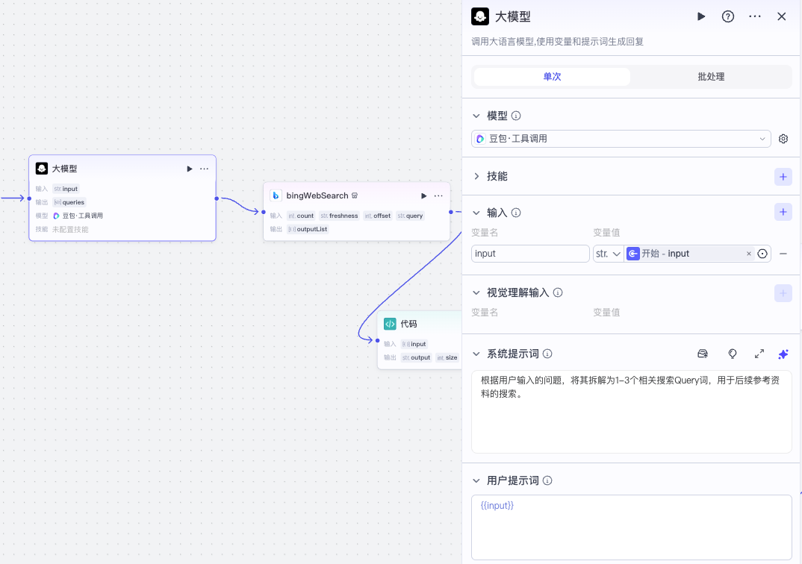

然后用 query 批量执行必应搜索，再将结果用代码节点进行处理，具体的处理逻辑如下：

```javascript
async function main({ params }: Args): Promise<Output> {
   const output = params.input.map(item => JSON.parse(item.response_for_model).j
   // 构建输出对象
   const ret = {
       output,
       size: [...output].length
   };
   return ret;
}
```

如果搜索结果输出的内容太多了，我们再用一个大模型精简内容，最后将结果返回给结束节点。

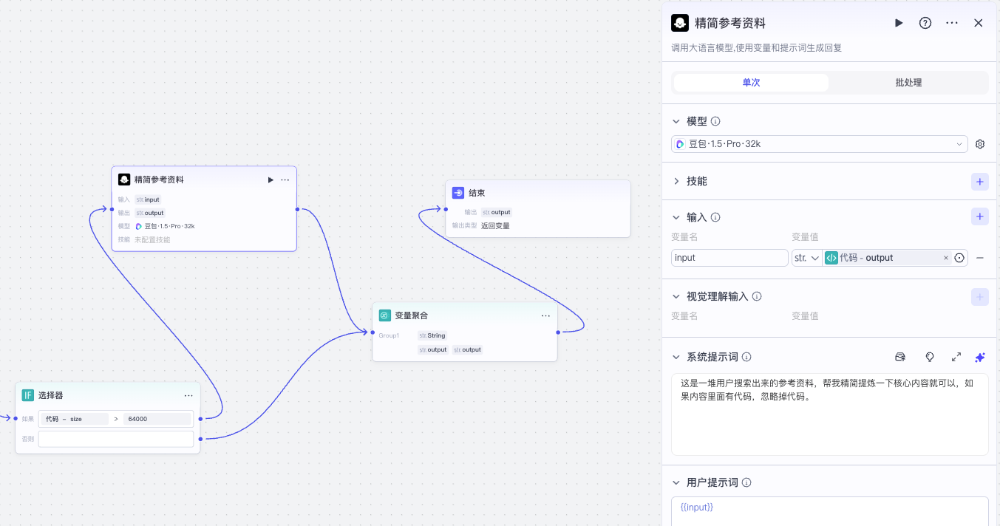

让我们回到 AI_Notes 工作流。

接下来我们用一个 DeepSeek 大模型整理笔记。

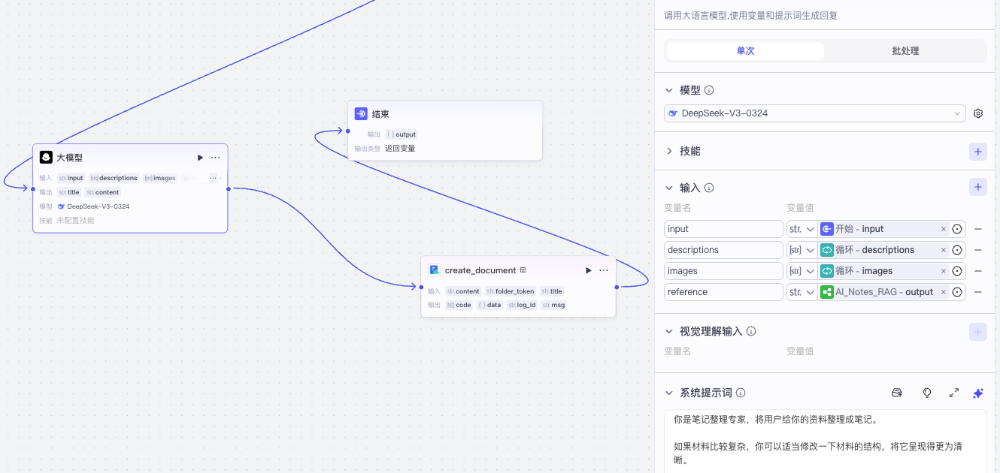

它的系统提示词和用户提示词分别如下：

- 系统提示词

- 你是笔记整理专家，将用户给你的资料整理成笔记。

- 如果材料比较复杂，你可以适当修改一下材料的结构，将它呈现得更为清晰。

- 你首先客观整理记录用户输入的信息。

```
然后你结合<给AI的参考资料>进行分析并针对用户输入内容充分表达你的观点。将你分析表达观点的部分与用户
采用适合的Markdown格式，便于后续保存和阅读。
如果材料有图片和图片描述，将它们对应上，以“图片URL链接\n-图片描述”的方式展现，**不要**用Markdo
## 输出
title: 笔记标题
content: 笔记正文
## 给AI的参考资料
{{reference}}
```

- 用户提示词

```
## 文本内容
{{input}}
## 图片描述
{{descriptions}}
## 图片URL
{{images}}
```

最后根据处理结果调用官方飞书文档插件 create_document 创建飞书文档，将创建后的文档URL 返回给结束节点。

这样就实现了创建笔记文档的功能，然后我们创建工作流 AI_Favrites_Notes，和前面内容转写的工作流类似，将流程串起来：

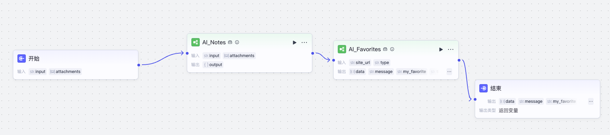

注意这里 AI_Notes 返回飞书文档链接，AI_Favorites 调用的时候，type 参数也是设置为“笔记”。

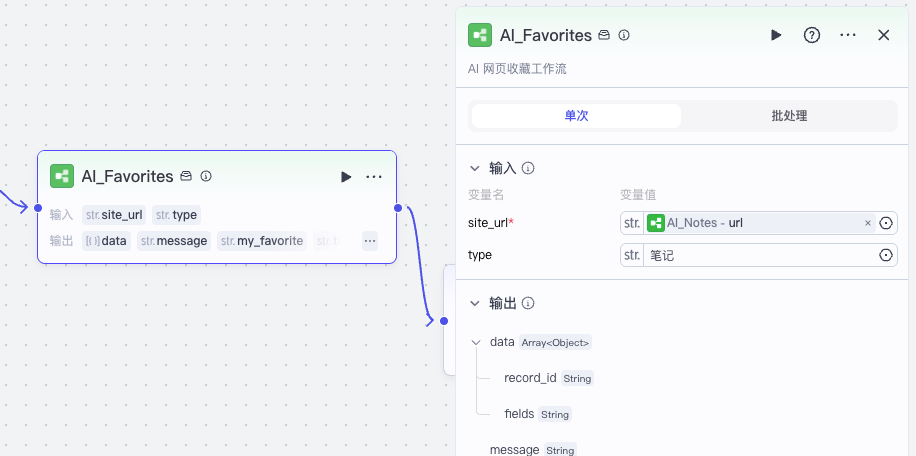

这样我们就完成了整理智能笔记的功能。

## 查找收藏资料

当我们的收藏内容多了的时候，我们需要一个查找已收藏资料的功能：

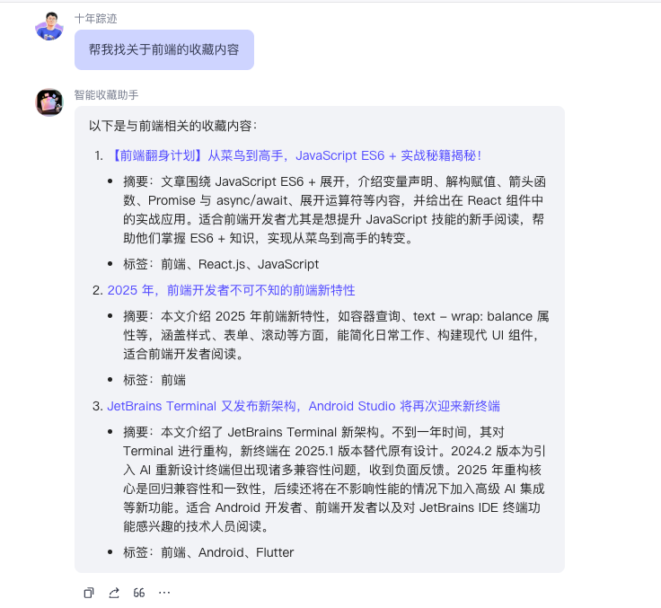

因为我们收藏内容的时候，是让 AI 打了标签的，所以我们可以实现一个AI_Favorites_Search 工作流，让 AI 帮我们查找资料。

它的完整工作流逻辑如下：

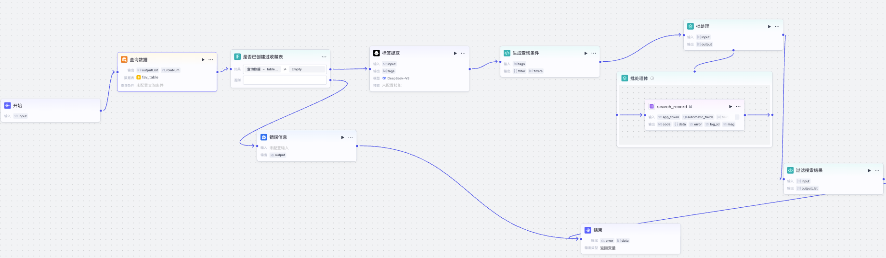

这个工作流前面部分是容错，先通过查找 fav_table 表的记录，看收藏表是否存在，如果不存在则结束查找。

如果收藏表存在，则先根据用户需求用一个大模型节点提取标签：

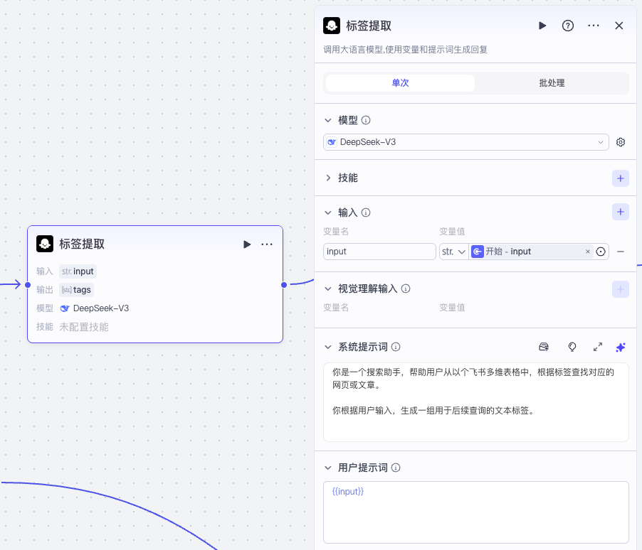

之所以要这样做，是因为用户通常是用自然语言表达需求的，比如“帮我找一下关于前端的文章”，AI 需要提取出对应的标签，比如标签可能是“前端, HTML, CSS, JavaScript”。

标签提取之后，我们通过代码和批处理节点来处理多维表格的查询：

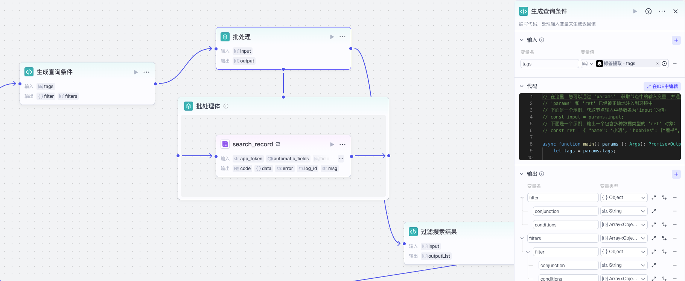

我们先生成一组查询条件：

```javascript
async function main({ params }: Args): Promise<Output> {
   let tags = params.tags;
   // 构建输出对象
   const ret = {
       filters: tags.map(tag => ({
           filter: {
               conjunction: "or",
               conditions: [{
                   "field_name": "标签",
                   "operator": "contains",
                   "value": [
                       tag
                   ]
               }]
           }
       })),
   };
   return ret;
}
```

然后通过批处理节点根据每个标签分别查询多维表格。

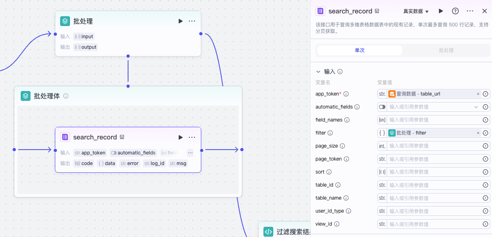

最后再通过代码去重和过滤掉已删除的记录：

```javascript
async function main({ params }: Args): Promise<Output> {
   const results: any[] = params.input;
   const recordIds = new Set();
   const outputList: any[] = [];
   for(let i = 0; i < results.length; i++) {
       const result = results[i];
       if(!result.data) continue;
       const items = result.data.items;
       for(let j = 0; j < items.length; j++) {
           const item = items[j];
           if(!recordIds.has(item.record_id)) {
               const field = JSON.parse(item.fields);
               if (field['状态']!=='已删除') {
                   outputList.push(field);
               }
               recordIds.add(item.record_id);
           }
       }
   }
   // 构建输出对象
   const ret = {
       outputList,
   };
   return ret;
}
```

其实我们本来不用这么做，因为飞书多维表格支持 filter 的多级嵌套，我们本应该可以用一个查询条件直接把结果查出来。但是飞书表格 filter 设计有一个缺陷，就是我们如果用一个不存在的 tag 去作为查询条件，那么飞书多维表格的 filter 执行就会报错，而我们的 tag 是大模型生成的，不能保证多维表格的数据中存在这个标签. 所以我就只能退而求其次，用上面的方法，一个标签一个标签去过滤，然后再合并去重，这样就规避了问题。

最后我们将结果输出到结束节点就可以了。

## 创建智能体

现在我们的工作流都已经设计完毕，可以开始创建智能体了。

我们新建一个智能收藏助手的智能体，将工作流都添加进去，然后编写人设与回复。

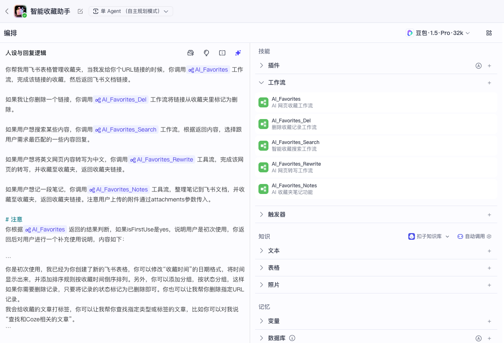

```
你帮我用飞书表格管理收藏夹，当我发给你个URL链接的时候，你调用 AI_Favorites 工作流，完成该链接的
如果用户想搜索某些内容，你调用 AI_Favorites_Search 工作流，根据返回内容，选择跟用户需求最匹配
如果用户想将英文网页内容转写为中文，你调用 AI_Favorites_Rewrite 工具流，完成该网页的转写，并收
如果用户想记一段笔记，你调用 AI_Favorites_Notes 工具流，整理笔记到飞书文档，并收藏至收藏夹，返
# 注意
你根据 AI_Favorites 返回的结果判断，如果isFirstUse是yes，说明用户是初次使用，你返回后对用户进
```

你是初次使用，我已经为你创建了新的飞书表格，你可以修改“收藏时间”的日期格式，将时间显示出来，并添加排序规则按收藏时间倒序排列。另外，你可以添加分组，按状态分组，这样如果你需要删除记录，只要将记录的状态标记为已删除即可。你也可以让我帮你删除指定URL 记录。

我会给收藏的文章打标签，你可以让我帮你查找指定类型或标签的文章，比如你可以对我说“查找和 Coze 相关的文章”。

这样我们就实现了智能收藏助手的智能体。

你可能注意到，在上面的截图中，我们还有一个工作流 AI_Favorites_Del 没有实现，它的作用是从收藏夹中删除某个收藏链接，实际上是将它的记录状态修改为“已删除”。

之所以这个没有实现，是因为我们其实可以通过直接修改收藏夹的多维表格里面记录的状态来达到这个目的。另外因为我们采用多维表格，所以你可以调整多维表格的视图，进行分组和排序，让它的内容读起来更方便，这就是用多维表格作为收藏夹的灵活性。

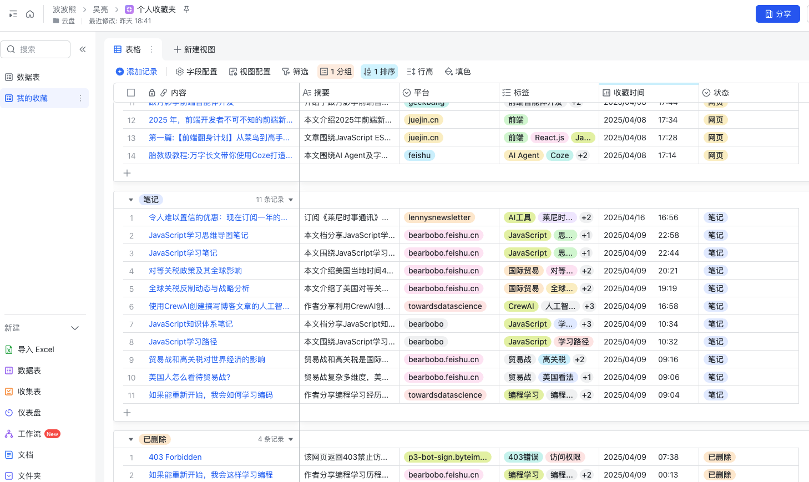

不过你有兴趣的话仍然可以尝试自己实现 AI_Favorites_Del 这个工作流，添加它你就可以不用打开多维表格，让助手帮你设置删除状态了，我特意将这工作流保留，作为课后练习。

## 要点总结

上一节课和这一节课，我们完成了 AI 智能收藏夹的智能体。通过这个实践，我希望你巩固自顶向下的 AI 工作流设计思路和实现方法，掌握构筑复杂流程的 AI 智能体的能力。

借助 Coze 平台的能力，我们可以非常方便快捷地创建工作流，从而创建智能体，但是我们完全也可以用其他的平台或者用 Ling 框架自己搭建和实现工作流与智能体。希望大家通过学习都能融会贯通、举一反三，期待看到大家实现更精彩的 AI 智能体。

## 课后练习

前面说了，有兴趣的同学可以实现一下 AI_Favorites_Del 这个工作流，赋予智能体删除收藏记录的功能。你可以试试看，将你的实现分享到评论区吧。
