# 29 | 如何用BunnyCDN结合Coze智能体管理静态资源

你好，我是月影。

对于前端来说，不论在工作还是在个人学习中，很多同学都经常有保存资源文件到网上的需求。AI 生成的内容、用于分享的屏幕录制视频、自己撰写的 PPT、学习和工作中开发网站时用到的文件资源，这些东西我们都经常需要上传到网上保存。

在 AI 时代，为了更好地解决这类问题，我们可以借助智能体帮我们完成内容的上传。

在前面的部分课程里，我们都使用阿里云 OSS 插件来保存静态资源，比如上一节课我们的笔记图片就通过阿里云 OSS 存储，还有更早之前我们的加餐 1，保存星盘 svg 图片时，我们也用了阿里云 OSS 插件。

虽然阿里云 OSS 很好用，但它的部署成本还是挺高的，你必须准备阿里云账号、已备案域名，如果要支持 HTTPS，还需要准备域名证书，这个条件不是一个初学者或者一个刚起步的独立开发者容易做到的。

因此也有些同学问我是否有更简单的替代阿里云 OSS 的存储资源方法，同时又可以被智能体使用。答案当然是有的，我们可以用一些海外的 SaaS 平台来做到。在这里我推荐一个非常好用的平台 Bunny.net。

## 使用 Bunny.net 创建文件存储和 CDN

Bunny.net 是一个为全球用户提供高性能、低成本的内容分发网络（CDN）和边缘云服务的平台，注册和使用它非常简单，而且价格很实惠。


你可以在官网直接注册登录，它有 14 天免费体验，体验期过后，实际上付费使用成本也是很低的，正常情况下个人用，每个月也就几块钱。

我们完成注册后，登录到管理面板，它有很丰富的功能，我们目前主要用到的就是两块功能，在左侧菜单 Delivery 目录中，前两项，也就是 CDN 和 Storage。

首先我们选择 Storage > Add Storage Zone。

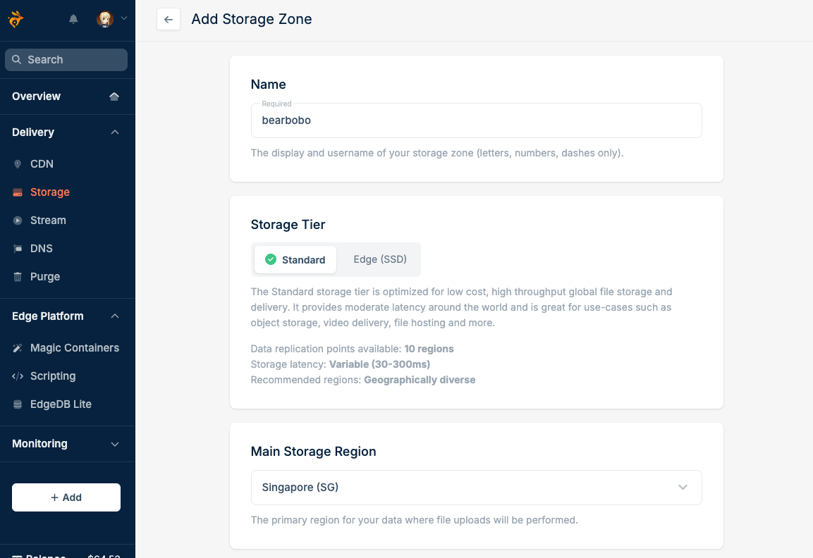

首先给 Storage 起一个名字，这个名字是全系统唯一的，它会被用于生成 Storage 存储域名。

Main Storage Region 选择存储区域，我们可以选择新加坡，物理上离我们近，速度会快一些。

接着可以选择其他的全球存储节点：

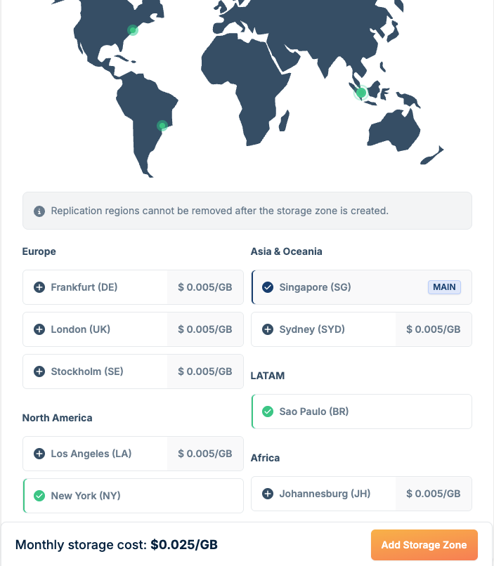

包括欧洲、北美、拉丁美洲、非洲等，默认会选中一些节点，这样如果存储资源的请求发生在相应的区域，会就近存储，能提高资源的读写效率，相应需要一些额外的存储费用。如果我们不需要，可以将这些默认勾选的节点去掉，这样可以节省费用。

接着我们点击底部 Add Storage Zone 按钮，创建实例就可以了。

Storage 创建完成后，我们点击 CDN 菜单，再点击右上角 Add Pull Zone 按钮，进入 CDN 配置界面。

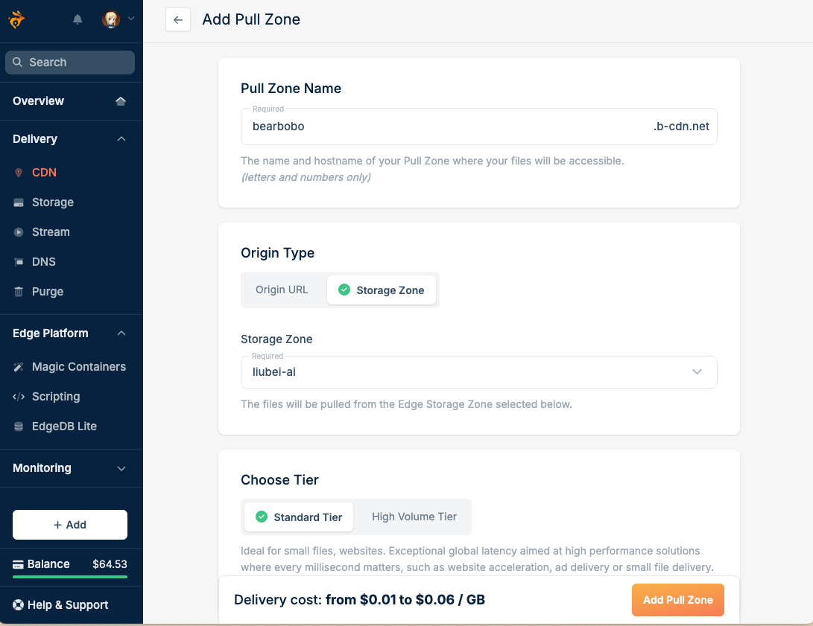

```
同样给 CDN 起一个名字， 名字.b-cdn-net 就是默认的 CDN 域名，Origin Type 选择
```

Storage Zone，下拉菜单里选择刚才创建的那个 Storage。

下方 Pricing Zones 这里把不需要服务的区域勾掉，可以省钱。

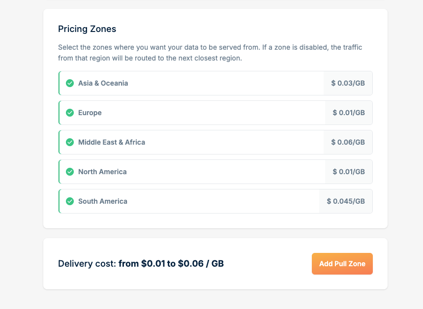

创建好之后，进入 CDN 配置面板，可以配置我们自定义的域名，如果你手里有域名，你可以参考它的文档进行配置。

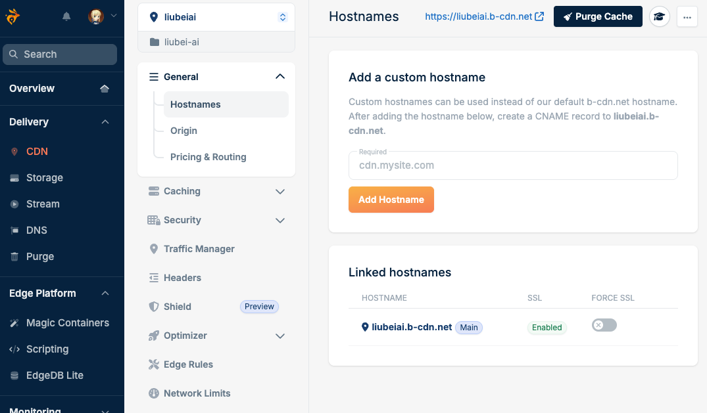

这里我们不配置，用默认的域名也没什么问题。这样我们就配好了 Bunny.net 的存储和CDN。

## 在 Coze 中实现文件上传插件

接下来，我们登录 Coze，选择“工作空间 > 资源库 > 新建插件”。

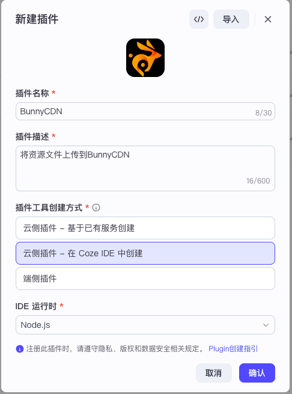

在插件的 IDE 中，工具列表里创建工具 upload，编写代码如下：

```bash
import { Args } from '@/runtime';
import { Input, Output } from "@/typings/upload/upload";
interface UploadFileResponse {
 HttpCode: number;
 Message: string;
 url?: string;
}
interface BunnyConfig {
 PASSWORD: string,
 STORAGE_ZONE_NAME: string,
 CDN_URL: string,
 REGION: string,
}
// 上传文件 buffer 到 BunnyCDN
async function uploadFile(
 bunnyConfig: BunnyConfig,
 buffer: Buffer,
 filename: string
): Promise<UploadFileResponse> {
 const accessKey = bunnyConfig.PASSWORD;
 const storageZoneName = bunnyConfig.STORAGE_ZONE_NAME;
 const cdnDomain = bunnyConfig.CDN_URL;
 const hostUrl = `https://${bunnyConfig.REGION}.storage.bunnycdn.com`;
 const dir = `resource/${Math.random().toString(36).slice(2, 12)}`;
 const api = `${hostUrl}/${storageZoneName}/${dir}/${filename}`;
 const options: RequestInit = {
   method: 'PUT',
   headers: {
     'Content-Type': 'application/json',
     AccessKey: accessKey ?? '',
   },
   body: buffer,
 };
 try {
   const res = await fetch(api, options);
   const data = (await res.json()) as UploadFileResponse;
   if (data.HttpCode === 201) {
     data.url = `${cdnDomain}/${dir}/${filename}`;
   }
   return data;
 } catch (ex) {
   console.error(ex);
   return { HttpCode: 500, Message: '上传失败' };
 }
}
function detectFileType(arrayBuffer: ArrayBuffer): { type: string; extension: str
 const bytes = new Uint8Array(arrayBuffer);
 // 图片
 if (bytes[0] === 0x89 && bytes[1] === 0x50) return { type: 'image', extension:
 if (bytes[0] === 0xFF && bytes[1] === 0xD8) return { type: 'image', extension:
 if (bytes[0] === 0x47 && bytes[1] === 0x49) return { type: 'image', extension:
 if (
   bytes[0] === 0x52 && bytes[1] === 0x49 && bytes[2] === 0x46 && bytes[3] === 0
   bytes[8] === 0x57 && bytes[9] === 0x45 && bytes[10] === 0x42 && bytes[11] ===
 ) return { type: 'image', extension: 'webp' };
 if (bytes[0] === 0x42 && bytes[1] === 0x4D) return { type: 'image', extension:
 if (
   (bytes[0] === 0x49 && bytes[1] === 0x49 && bytes[2] === 0x2A && bytes[3] ===
   (bytes[0] === 0x4D && bytes[1] === 0x4D && bytes[2] === 0x00 && bytes[3] ===
 ) return { type: 'image', extension: 'tiff' };
 if (
   bytes[0] === 0x00 && bytes[1] === 0x00 && bytes[2] === 0x01 && bytes[3] === 0
 ) return { type: 'image', extension: 'ico' };
 // 音频
 if ((bytes[0] === 0x49 && bytes[1] === 0x44 && bytes[2] === 0x33) || (bytes[0]
   return { type: 'audio', extension: 'mp3' };
 if (bytes[0] === 0x66 && bytes[1] === 0x4C && bytes[2] === 0x61 && bytes[3] ===
   return { type: 'audio', extension: 'flac' };
 if (bytes[0] === 0x4F && bytes[1] === 0x67 && bytes[2] === 0x67 && bytes[3] ===
   return { type: 'audio', extension: 'ogg' };
 if (
   bytes[0] === 0x52 && bytes[1] === 0x49 && bytes[2] === 0x46 && bytes[3] === 0
   bytes[8] === 0x57 && bytes[9] === 0x41 && bytes[10] === 0x56 && bytes[11] ===
 ) return { type: 'audio', extension: 'wav' };
 // 视频
 if (
   bytes[4] === 0x66 && bytes[5] === 0x74 && bytes[6] === 0x79 && bytes[7] === 0
 ) return { type: 'video', extension: 'mp4' };
 if (
   bytes[0] === 0x1A && bytes[1] === 0x45 && bytes[2] === 0xDF && bytes[3] === 0
 ) return { type: 'video', extension: 'mkv' };
 if (
   bytes[0] === 0x52 && bytes[1] === 0x49 && bytes[2] === 0x46 && bytes[3] === 0
   bytes[8] === 0x41 && bytes[9] === 0x56 && bytes[10] === 0x49 && bytes[11] ===
 ) return { type: 'video', extension: 'avi' };
 return { type: 'unknown', extension: 'bin' };
}
// 通过 URL 上传文件
async function uploadFromURL(
 bunnyConfig: BunnyConfig,
 file: string
): Promise<UploadFileResponse> {
 const res = await fetch(file);
 const arrayBuffer = await res.arrayBuffer();
 const match = file.match(/file_name=(.*)?$/);
 let filename = match?.[1];
 if (!filename) {
   const {type, extension} = detectFileType(arrayBuffer);
   filename = `${Math.random().toString(36).slice(2, 10)}.${extension}`;
 }
 const buffer = Buffer.from(arrayBuffer);
 return await uploadFile(bunnyConfig, buffer, filename);
}
/**
 * Each file needs to export a function named `handler`. This function is the en
 * @param {Object} args.input - input parameters, you can get test input value b
 * @param {Object} args.logger - logger instance used to print logs, injected by
 * @returns {*} The return data of the function, which should match the declared
 *
 * Remember to fill in input/output in Metadata, it helps LLM to recognize and u
 */
export async function handler({ input, logger }: Args<Input>): Promise<Output> {
 const config:BunnyConfig = {
   PASSWORD: input.PASSWORD,
   STORAGE_ZONE_NAME: input.STORAGE_ZONE_NAME,
   CDN_URL: input.CDN_URL,
   REGION: input.REGION
 };
 const res = await uploadFromURL(config, input.file)
 return res;
};
```

上面的代码并不复杂，主要有几个函数：

- uploadFile 将文件数据 buffer 内容以 filename 作为文件名，上传到 CDN。

- detectFileType 根据文件具体数据内容判断文件的类型，之所以要这个方法，是因为 Coze的 AI 生成的内容，临时文件的 URL 有时候并不带有文件扩展名信息，所以我们就要通过文件内容来识别它究竟是什么问题，以设置正确的文件扩展名。

- uploadFromURL 根据文件 URL 上传到 CDN。我们主要用到的就是这个接口，因为 Coze的机制是，当我们上传临时文件，或者 AI 生成的多模态输出（图片、语音等），文件会被Coze 上传到临时存放处，并给出临时的文件链接的。所以我们需要通过这个链接去获取文件本身的数据，然后再进行存储。

在 uploadFile 函数里面，我们通过在 header 中设置 accessKey 的方式来鉴权，通过REGION 和 STORAGE_ZONE_NAME 拼接生成 API 请求的 URL，通过 API 调用 HTTP 请求将文件内容上传。

注意一个细节，我们用随机的图片路径

```
resource/${Math.random().toString(36).slice(2, 12)} 来存储图片，这样就可
```

以上传同名文件的时候就会自动生成新版本，避免修改一个已存在的资源。

在 uploadFromURL 函数里，我们从 file 中提取 Coze 存放临时文件的 URL，并从中获得文件名，再读取文件内容，将内容和文件名发送给 uploadFile 进行处理。

好了，那么这样整体的插件逻辑就实现完成了，最后我们在 handler 函数里调用uploadFromURL 就可以了。

```bash
export async function handler({ input, logger }: Args<Input>): Promise<Output> {
 const config:BunnyConfig = {
   PASSWORD: input.PASSWORD,
   STORAGE_ZONE_NAME: input.STORAGE_ZONE_NAME,
   CDN_URL: input.CDN_URL,
   REGION: input.REGION
 };
 const res = await uploadFromURL(config, input.file)
 return res;
};
```

接着我们切换到元数据，将输入参数类型声明正确。

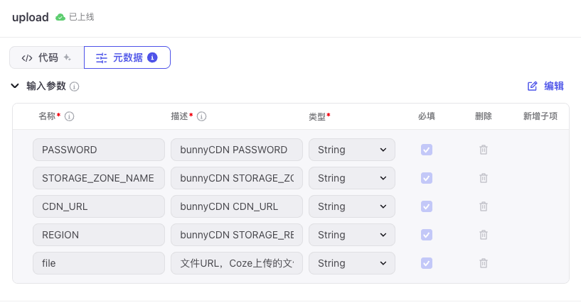

然后我们来测试一下，测试代码里输入相应的配置，点击运行，查看输出结果。

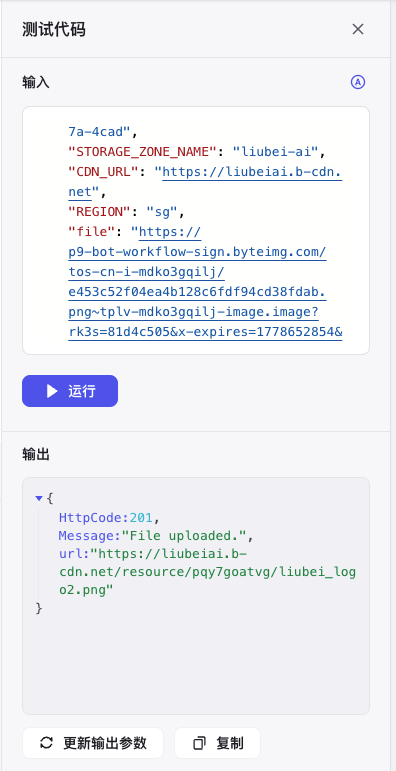

注意，PASSWORD 参数的值在 Bunny.net 管理后台的 “Storage > FTP & API Access“ 的Password 选项卡里，将它复制出来，用于插件测试，注意这个密码不要泄漏。

另外，运行完毕，获得输出结果后，别忘了点击下方“更新输出参数”按钮，将输出参数更新到元数据中。

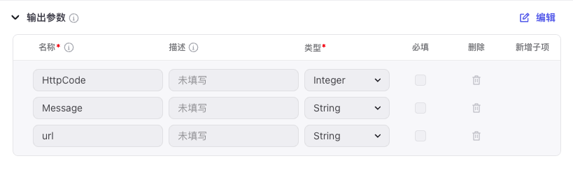

## 创建静态资源上传工作流

插件写好了，我们将它发布，接着就可以创建工作流了。

我们创建一个 Upload_To_Bunny 的工作流，这个工作流比较简单。

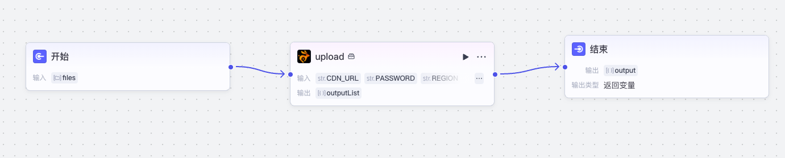

在开始节点上，我们设置一个变量 files，它的类型是一个文件数组，这样我们就能同时上传多个附件让 AI 处理。

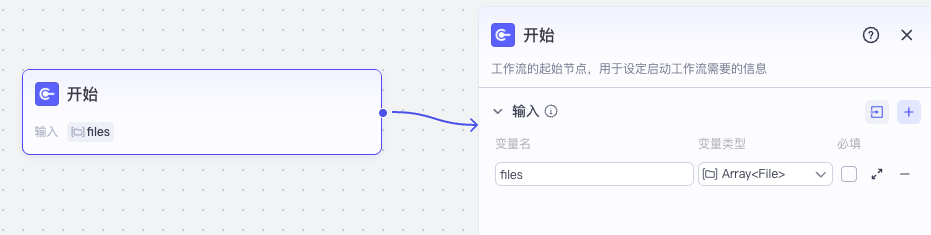

接着我们添加插件 upload，注意选择批处理，这样它会针对 files 数组内的每一个文件进行并行上传。

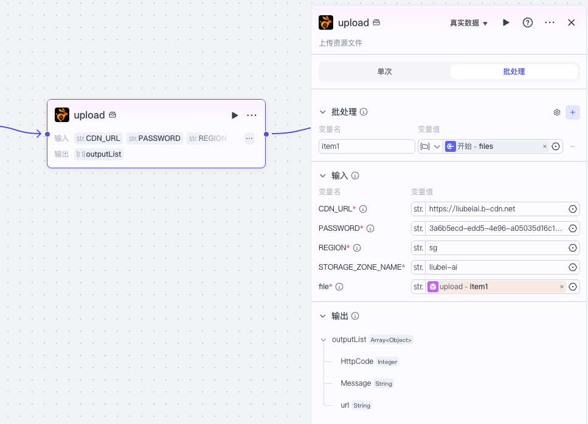

最后我们将 upload 插件处理的结果传结束节点，这样就完成了工作流。

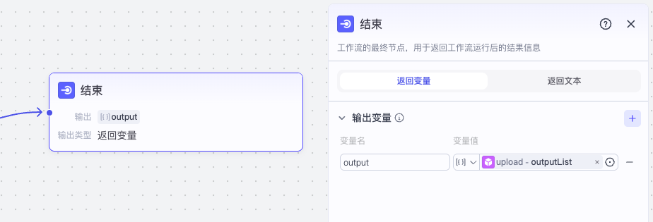

我们将工作流发布，就进入最后一个步骤 —— 创建智能体。

## 创建“静态资源管理助手”智能体

我们在工作空间中切换菜单，进入到“项目开发”，点击创建智能体。

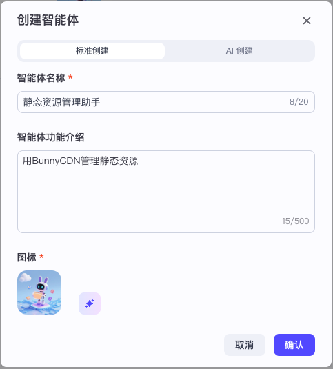

智能体创建完成后，我们在编辑面板里给智能体设置“人设与逻辑回复”，内容如下：

- 当我让你保存附件或链接内容时。

```
你将它们通过Upload_To_Bunny上传到CDN。
将上传返回的文件展示出来，如果类型是图片，用Markdown直接展示。
```

为了让智能体更好用，我们可以给它添加一些其他的插件，这样它能够更好用，比如我们添加图像大模型，就可以让它生成图片后，将图片自动传到 CDN。

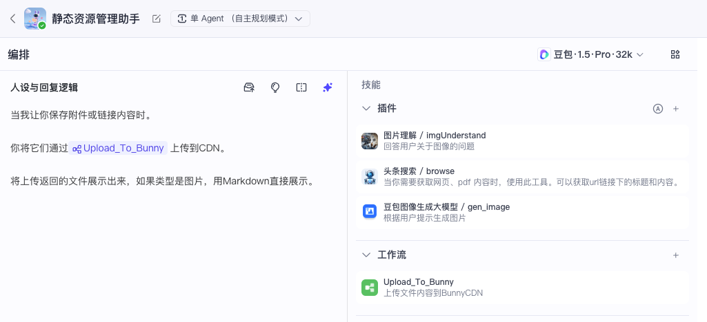

最后我们设置一下开场白：

```
你好，我是你的CDN文件管理助手，将需要上传到CDN的文件发给我，我会为你上传。
```

这样我们就完成了“静态资源管理助手”这个智能体的全部功能。

## 要点总结

这一讲，我们实现了一个通过智能体来上传静态资源文件进行管理的功能。资源存储和分发的部分，在之前的课程里我们需要通过阿里云的 OSS 来实现，但是阿里云的配置部署成本较高，不适合初学者，所以我们采用了另一个 SaaS 平台 Bunny.net 来配置实现。

在没有 AI 的时代，我们有了资源存储的 Storage 和分发的 CDN，大概还需要自己构建一个UI 界面来更方便进行文件操作，例如之前波波熊早期，我就自己写了一个管理后台来操作文件。

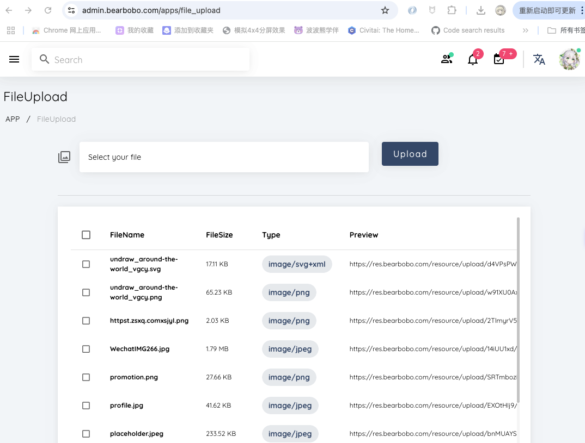

但是现在，因为有了 AI，我们可以直接很方便地创建智能体，通过智能体来实现 UI 交互，像之前的这种管理后台界面就不需要了。

我们直接通过 Bunny.net 提供的 API，实现 Coze 里的文件上传插件，再利用插件实现工作流，最后通过工作流实现智能体，这样就通过低代码方式快速实现了静态资源管理的应用界面，效率比过去自己开发后台功能要高得多。

而这也属于 AI 颠覆传统产品开发底层逻辑的一个具体实践例子，在学习这门课的同时，我也希望大家能牢记 AI 必然对我们传统产品研发范式带来根本性改变，因此任何时候遇到需求和问题时都应该要多思考，想一想在 AI 时代有没有更好的问题解决方案。

## 课后练习

如果你没有购买和部署阿里云 OSS，可能前面课程的阿里云插件没法使用，你可以试着用Bunny.net 的插件替代阿里云 OSS 插件，这样就可以将之前欠缺的例子运行起来啦。如果你通过替换插件将问题解决了，或者你还遇到任何新问题，欢迎分享到评论区。
