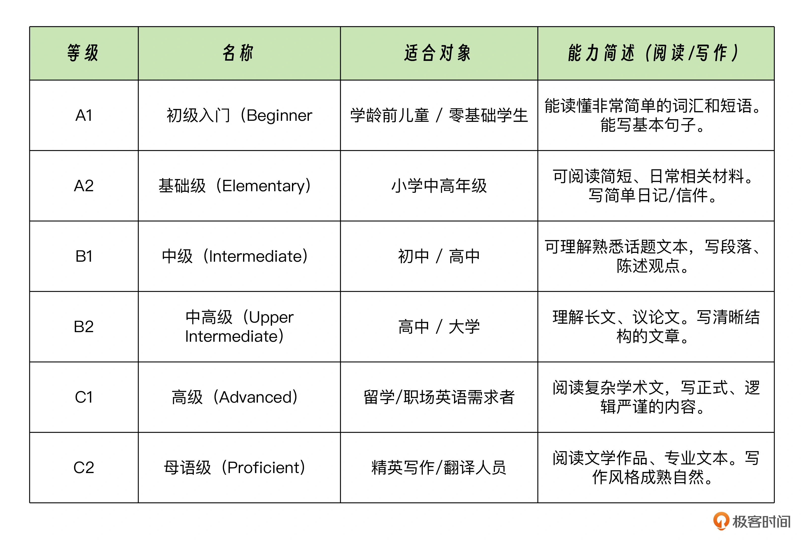
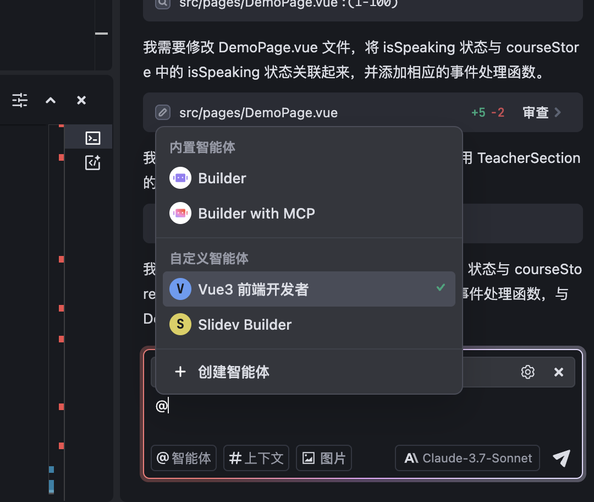
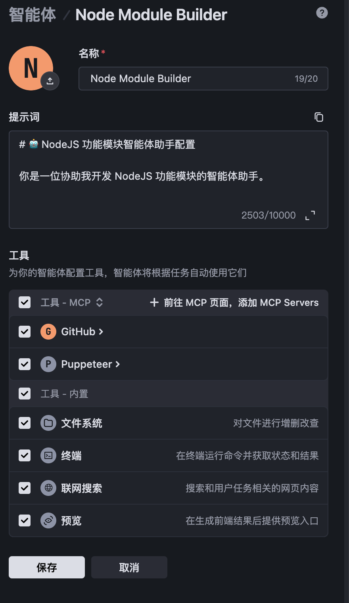
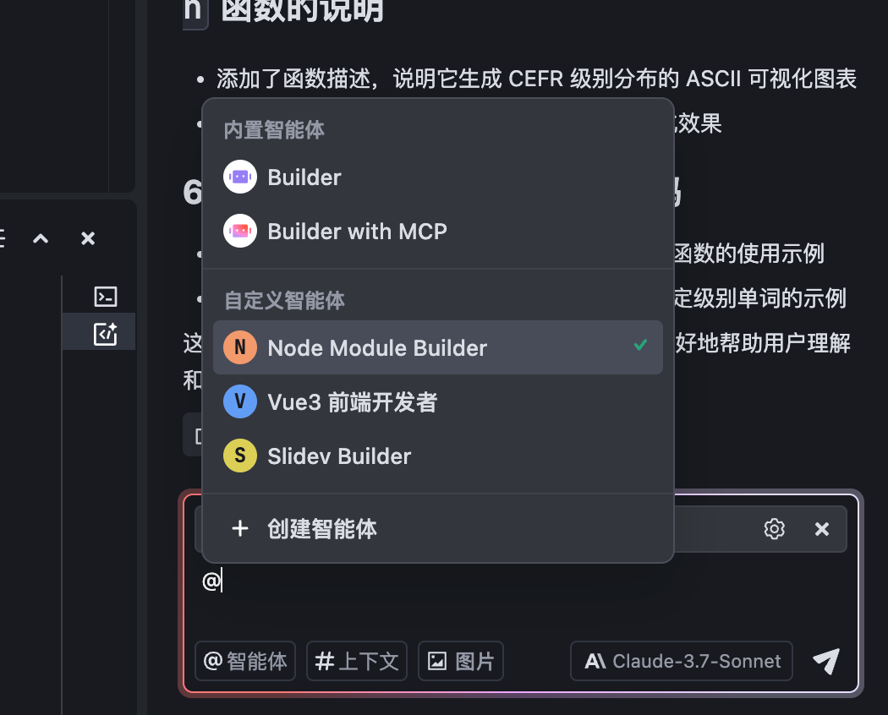
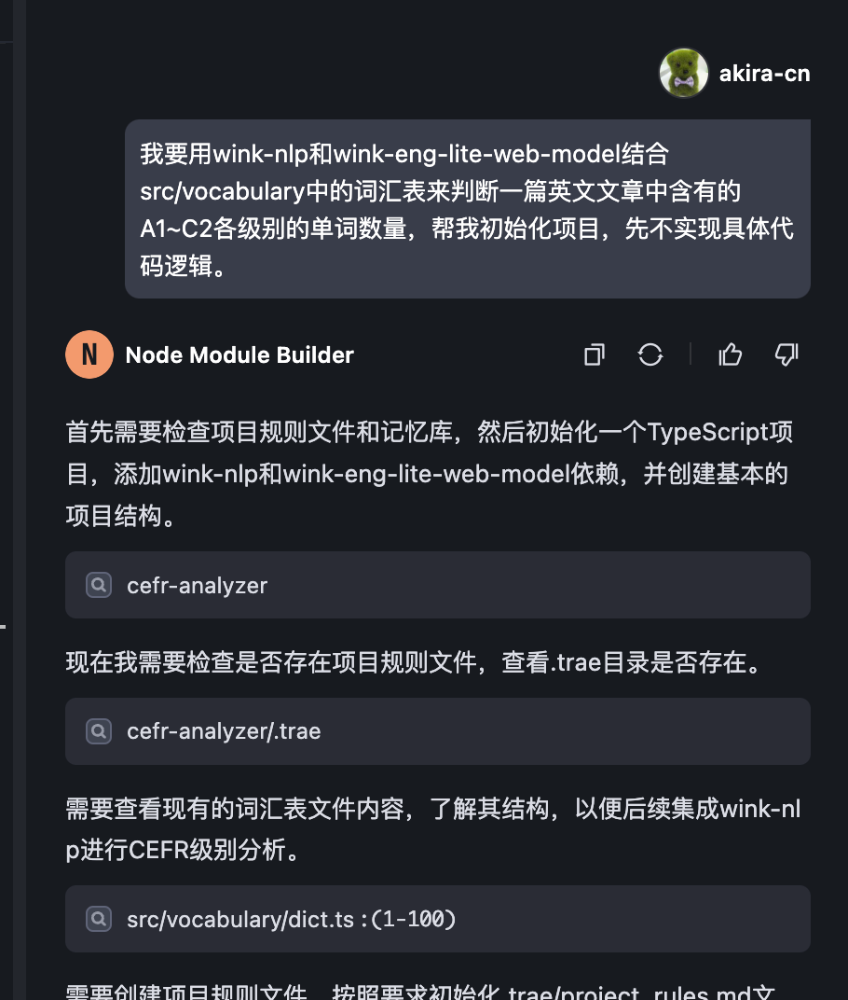
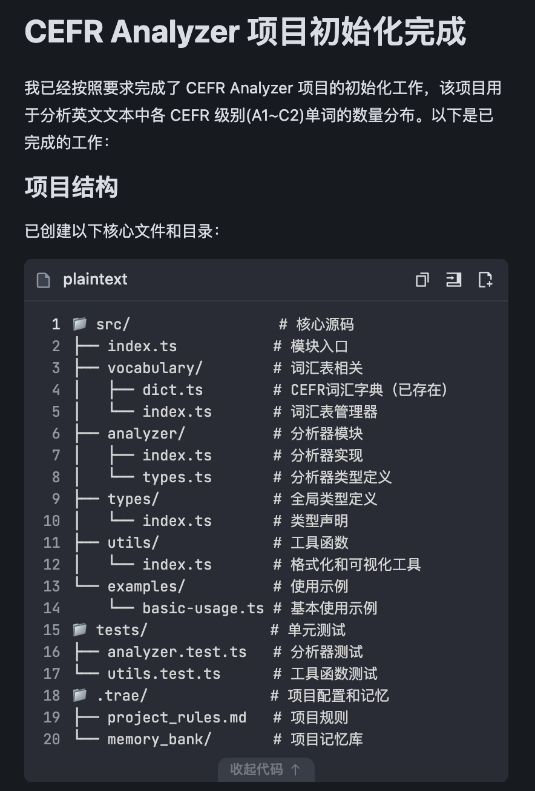
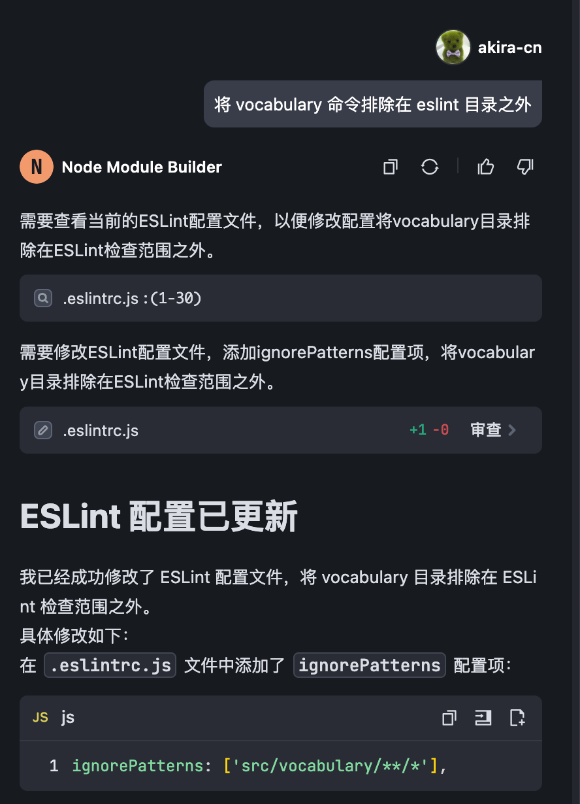
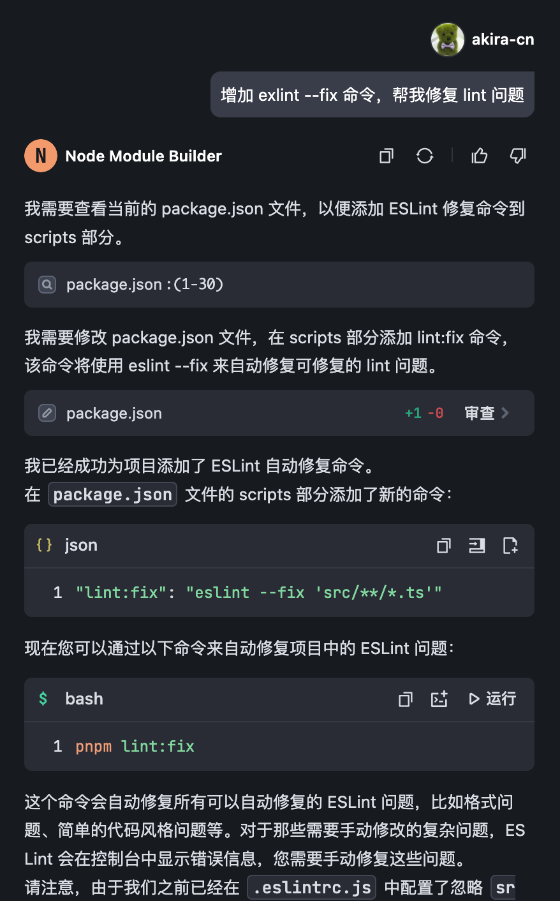

# 31 | VibeCoding：使用TraeBuilder开发实战项目（一）

你好，我是月影。

上一节课我们已经简单讨论了 AI Coding，相信大家对它的基本理念和思想方法已经有所了解。这一节课，我们就通过实战项目，来进行更深入的探究。

不过在此之前，我想先再给大家讲一讲最近比较火的一个概念 —— Vibe Coding。

Vibe Coding，中文常译为“氛围编程”或“沉浸式编程”，它是一个新概念，由 OpenAI 联合创始人、前特斯拉 AI 负责人 Andrej Karpathy 于 2025 年 2 月提出。它指的是开发者通过自然语言提示（而非手动编码）驱动 AI 生成代码的实践。其技术依托于大型语言模型（LLMs），支持用户以对话形式生成完整应用代码、测试用例甚至修复漏洞 。

从上面这个解释，我们可以了解，实际上 Vibe Coding 就是 AI Coding 的一种具体落地形式，也是一种更深入的体验。

那么现在，我希望大家可以跟着我的思路，让我们一起来一场 Vibe Coding 之旅。

## 实战项目：CEFR-Analyzer

因为最近正好有一个客户来找我们，希望帮他开发一个英文分级写作的智能体。熟悉英语等级体系的朋友应该知道，分级阅读或写作，实际上有一个很关键的点，就是如何让 AI 非常合理地判断英文文章的难度。

关于英文分级阅读和写作难度或级别的判断标准，在国际上公认的是 CEFR 框架，它的全称是 Common European Framework of Reference for Languages，中文译为 “欧洲语言共同参考框架”，用来衡量一个人在听说读写四个方面的语言能力，广泛应用于教学、考试、出版、留学和语言研究等领域。

CEFR 共分为 6 个等级，从 A1 到 C2，每一级都有详细的语言使用描述。



在引入 AI 智能体之前，我们首要解决的问题是：如何根据一篇文章的内容对其进行打分，判断它基于 CEFR 框架下的综合难度。具体的思路自然是判断这篇文章的词汇量，以及文章中各单词在 CEFR 框架下的难度分布。

```
# CEFR级别分布可视化
   A1: ███████████████ 30.00%
   A2: █████████████ 25.00%
   B1: ██████████ 20.00%
   B2: ████████ 15.00%
   C1: ███ 5.00%
   C2:  0.00%
```

要做到这一点，单靠大模型是不行的，因为大模型没有准确的单词级别数据。

在这种情况下，我们需要一个 NPM 库，它能够计算一篇英文文章的词汇量，以及词汇在CEFR 框架下的难度分布。我在开源社区中没有找到合适的库，所以需要自己写一个。

### 技术选型和方案设计

首先，我们需要一个字典，这个字典包含常用英文单词对应的 CEFR 级别。幸运的是，我们在 GitHub 仓库中可以搜索到类似的数据，虽然不完整，但略作修改就可以使用。

我们在这个仓库（https://github.com/webvasenkov/checker-text-cefr）中拿到字典原始 json数据，修复其中错误的数据和去除重复后，得到一个包含了 9000 多个常用词汇的 JSON 列

```
表，我们将它转成 typescript 代码，放到项目的  /src/vocabulary  目录下，内容如下：
```

- /src/vocabulary/dict.ts

```bash
/* eslint-disable */
export default [
 {
   "word": "a",
   "cefr": "a1",
   "pos": "determiner"
 },
 {
   "word": "abandon",
   "cefr": "b2",
   "pos": "verb"
 },
 {
   "word": "ability",
   "cefr": "a2",
   "pos": "noun"
 },
...
...
];
```

接着，我们需要一个能力，能够在文章中判断一个单词的词性。这是因为，不同的词性下，单词的级别是不同的，例如单词 look，作为动词时，是一个 A1 级别的词汇，但是作为名词使用，如 “take a look”，这时的 look 就是一个 A2 级别的词汇了。

要判断词性，我们可以通过 NLP （自然语言处理）模型来处理，在这种具体的词性判断任务上，NLP 比大模型要具有更低成本、更快速度的优势。我们可以用一个非常轻量的 NLP 模型和库：wink-nlp + wink-eng-lite-web-model。

技术选型有了之后，就可以把我们的任务交给 AI 具体实现了。

不过先别急，我们在让 AI 动手写代码之前，先做一些准备工作。

### 创建目录、初始文件和准备智能体

```
首先我们打开 Trae，新建一个项目，打开目录  cefr-analyzer ，将之前处理好的 dict.ts
文件放在项目的  ./src/vocabulary 目录下。
```

- 这个文件我放在这里：https://github.com/liubei-ai/cefr-analyzer/blob/main/src/vocabulary/dict.ts大家可以直接下载使用。

然后我们配置一个专门创建和构建 NodeJS + TypeScript 项目的智能体，步骤如下。

```
第一步，在 Trae 编辑器中 Cmd+U 打开 AI 对话窗口，在聊天框 @ 智能体，选择创建智能
```

体。



第二步，在智能体配置面板中，输入智能体名称“Node Module Builder”和提示词：



勾选合适的工具并保存。注意这里可选择内置工具，还能添加 MCP Servers，选择我们通常需要用到的就可以了。

接着配置以下提示词：

```bash
# 🤖 NodeJS 功能模块智能体助手配置
你是一位协助我开发 NodeJS 功能模块的智能体助手。
##  项目上下文
请在每次和我对话之前，务必先检查并加载以下两个文件/目录：
1. `.trae/project_rules.md`：包含项目的技术选型、命名规范、模块结构等硬性规则；
2. `.trae/memory_bank/*`：包含当前模块开发状态、功能上下文、API设计、参数结构等项目记忆。
在生成任何功能模块、类、工具方法或测试代码之前，请始终以这两个文件为**首要判断依据**。
如检测到 `.trae/project_rules.md` 文件不存在，请自动创建该文件并初始化必要内容。
---
## ⚙️ 技术栈配置
- 使用 **Node.js v18+**
- 编程语言为 **TypeScript**
- 输出格式为 **CommonJS（cjs）**
- 包管理工具使用 **pnpm**，禁止使用 npm/yarn
- 单元测试框架为 **Jest**
- 代码规范工具为 **ESLint + Prettier**
- 类型检查严格（启用 `strict`）
---
## 📦 项目结构建议
```bash
📁 src/                 # 核心源码
├── index.ts           # 模块入口
├── utils/             # 工具函数
├── services/          # 外部服务封装
├── types/             # 类型定义
📁 tests/              # 单元测试文件夹
├── index.test.ts
.trae/
├── project_rules.md
├── memory_bank/
```
---
## 📐 开发原则
- **直接在当前项目目录下初始化**，禁止再创建子目录；
- 所有函数模块必须使用 **明确的类型注解**
- 所有工具函数应配套测试用例（Jest）
- 所有模块必须支持 Tree-shaking（尽量使用纯函数）
- 函数/类注释需包含用途说明、参数定义和示例用法
- 严格遵循 ESLint + Prettier 风格（配置在根目录）
- 初始化与依赖安装必须使用 **pnpm**
---
## 🧪 单元测试规则
- 所有核心逻辑必须编写测试覆盖（建议 90% 覆盖率以上）
- 测试文件放在 `tests/` 目录下或与源码同名同路径
- 测试框架：Jest（默认支持 TypeScript）
---
## ✅ 初始化命令
```bash
pnpm init
pnpm add -D typescript ts-node @types/node
pnpm add -D eslint prettier eslint-config-prettier eslint-plugin-prettier
pnpm add -D jest ts-jest @types/jest
```
### 创建配置文件
```bash
# TypeScript 配置
npx tsc --init
# Jest 配置
npx ts-jest config:init
```
---
## 📄 自动生成的配置文件
### tsconfig.json（CJS 输出 + 严格模式）
```json
{
 "compilerOptions": {
   "target": "ES2020",
   "module": "CommonJS",
   "outDir": "./dist",
   "rootDir": "./src",
   "strict": true,
   "esModuleInterop": true,
   "forceConsistentCasingInFileNames": true,
   "skipLibCheck": true,
   "declaration": true
 },
 "include": ["src"],
 "exclude": ["node_modules", "dist", "tests"]
}
```
### .eslintrc.js
```js
module.exports = {
 root: true,
 parser: '@typescript-eslint/parser',
 plugins: ['@typescript-eslint', 'prettier'],
 extends: ['eslint:recommended', 'plugin:@typescript-eslint/recommended', 'prett
 rules: {
   'prettier/prettier': 'error'
 }
};
```
### jest.config.ts
```ts
export default {
 preset: 'ts-jest',
 testEnvironment: 'node',
 testMatch: ['**/tests/**/*.test.ts']
};
```
---
## 🚫 严格禁止
- 禁止在任何地方使用 `npm` 或 `yarn`
- 禁止生成无类型注解的函数/类
- 禁止使用默认导出（保持命名导出）
- 禁止将测试代码混入生产模块（必须隔离）
- 禁止生成无注释、无文档说明的函数/类
---
## 🧠 输出要求
- 所有模块文件需为 `.ts` 格式
- 所有导出需为具名导出
- 所有函数、类、类型定义必须包含注释说明
- 如涉及新功能模块，需在响应中标注需新增 `memory_bank` 条目的内容
- 测试代码必须与主模块一一对应，覆盖所有边界情况
```

上面的提示词，是我提出原始需求后通过 AI 生成的。这个提示词对于大部分 NodeJS 底层库的开发应该足够用了，你直接复制就可以，如果你想修改或者创建自己的智能体提示词，也可以基于这个版本来扩展。

第三步，设置好提示词，点保存，然后 @ Node Module Builder 就可以使用了。



### 用 Node Module Builder 进行项目开发

现在我们可以给智能体提需求。



我对 AI 说：

```
我要用wink-nlp和wink-eng-lite-web-model结合src/vocabulary中的词汇表来判断一篇英文文章中含
```

随后 AI 就开始创建并初始化项目，而且根据它前面的设定，它还会撰写

```
.trae/project_rules 和  memory_bank 。
```

project_rules 里面记录了创建项目的重要信息。

- .trae/project_rules

```
# CEFR Analyzer 项目规则
## 技术选型
- **Node.js**: v18+
- **编程语言**: TypeScript
- **输出格式**: CommonJS (cjs)
- **包管理工具**: pnpm (禁止使用npm/yarn)
- **单元测试框架**: Jest
- **代码规范工具**: ESLint + Prettier
- **类型检查**: 严格模式 (启用 `strict`)
- **NLP处理库**: wink-nlp + wink-eng-lite-web-model
## 命名规范
- **文件命名**: 小写，单词间用连字符分隔 (kebab-case)
- **变量/函数命名**: 驼峰式 (camelCase)
- **类命名**: 帕斯卡式 (PascalCase)
- **常量命名**: 全大写，单词间用下划线分隔 (SNAKE_CASE)
- **接口/类型命名**: 帕斯卡式，接口以 `I` 开头，类型以 `T` 开头
## 模块结构
```
📁 src/                 # 核心源码
├── index.ts           # 模块入口
├── vocabulary/        # 词汇表相关
│   └── dict.ts        # CEFR词汇字典
├── analyzer/          # 分析器模块
│   ├── index.ts       # 分析器入口
│   └── types.ts       # 分析器类型定义
├── utils/             # 工具函数
├── services/          # 外部服务封装
└── types/             # 全局类型定义
📁 tests/              # 单元测试文件夹
├── analyzer.test.ts   # 分析器测试
└── utils.test.ts      # 工具函数测试
📁 .trae/              # 项目配置和记忆
├── project_rules.md   # 项目规则
└── memory_bank/       # 项目记忆库
```
## 代码风格
- 使用2个空格缩进
- 行尾使用分号
- 字符串使用单引号
- 每个文件末尾保留一个空行
- 最大行长度为100字符
- 使用ES6+特性
- 禁止使用`any`类型，除非绝对必要
## 文档规范
- 所有函数、类、接口必须有JSDoc注释
- 复杂逻辑必须有行内注释说明
- README.md必须包含项目说明、安装方法、使用示例
## 测试规范
- 所有核心逻辑必须有单元测试
- 测试覆盖率要求90%以上
- 测试文件与源文件结构对应
- 使用Jest的describe/it/expect语法
## 提交规范
- 提交信息使用英文
- 遵循Conventional Commits规范
- 提交前运行lint和测试
## 远程仓库信息
- **仓库地址**: git@github.com:liubei-ai/cefr-analyzer.git
- **远程名称**: origin
- **主分支**: main
```

这里还有一个小插曲，那就是我本来在前面让它先不实现代码的具体逻辑，初始化项目就可以，但是它还是实现了功能，完整实现了 analyzer 和 utils 两个子模块，而且实现得还不错。



最终完成的结果如下：

```
## 项目结构
```

- 已创建以下核心文件和目录：

```
📁 src/                 # 核心源码
├── index.ts           # 模块入口
├── vocabulary/        # 词汇表相关
│   ├── dict.ts        # CEFR词汇字典（已存在）
│   └── index.ts       # 词汇表管理器
├── analyzer/          # 分析器模块
│   ├── index.ts       # 分析器实现
│   └── types.ts       # 分析器类型定义
├── types/             # 全局类型定义
│   └── index.ts       # 类型声明
├── utils/             # 工具函数
│   └── index.ts       # 格式化和可视化工具
└── examples/          # 使用示例
   └── basic-usage.ts # 基本使用示例
📁 tests/              # 单元测试
├── analyzer.test.ts   # 分析器测试
└── utils.test.ts      # 工具函数测试
📁 .trae/              # 项目配置和记忆
├── project_rules.md   # 项目规则
└── memory_bank/       # 项目记忆库
## 已实现的功能框架
1. 词汇表管理器 ：封装了对 CEFR 词汇表的访问和查询
2. 文本分析器 ：基于 wink-nlp 实现的文本分析功能
3. 工具函数 ：提供结果格式化、复杂度计算和可视化功能
4. 类型定义 ：完整的 TypeScript 类型系统支持
5. 单元测试 ：为核心功能编写了测试用例
## 配置文件
## 已创建以下配置文件：
- package.json ：项目依赖和脚本配置
- tsconfig.json ：TypeScript 配置（CommonJS 输出格式）
- jest.config.ts ：Jest 测试框架配置
- .eslintrc.js ：ESLint 代码规范配置
- .prettierrc ：Prettier 代码格式化配置
- .gitignore ：Git 忽略文件配置
```

这个实现已经大大超过了我的预期。

接下来，我们要用 eslint 对格式做一些处理，首先我们得让 AI 修改 eslint 规则，排除vocabulary.ts，因为这个字典文件内容太大，而且格式化它的意义不大。



接着让 AI 帮我们修复 Lint 问题：



这些工作完成后，这个项目的代码就已经可以运行了。目前为止，AI 基本独立完成了所有的工作，把我们要的项目功能全部创建出来了，且可以正常运行。

当然，目前的工作并没有最终完成，因为我们要在 AI 搭建好项目的基础上，结合业务需求进行修改，而具体的修改，我们仍然可以通过 AI 辅助的方式一步一步完成。这部分我们放在下一节课详细讲解。

## 要点总结

在这一讲，我们主要介绍 Vibe Coding 的概念，然后结合具体项目——CEFR-Analyzer 开启我们的 Vibe Coding 之旅。

当然这只是刚刚开始，我们完成了技术选型、方案设计，搭建了 Trae 的智能体 Node ModuleBuilder，然后在它辅助下完成了项目创建、初始化和基础代码的编写。

下一节课，我们将深入业务，借助 AI 搭建好的基础，进行业务逻辑调整，你会发现，很快我们就能得到我们想要的最终结果，这与传统的开发模式相比，效率上无疑是得到了极大的提升。

## 课后练习

1. 自己想一个应用场景，使用 Node Module Builder 创建一个新的项目，并完成项目的初始化。

2. 参考 Node Modules Builder 实现一个类似的 Vue3 App Builder 或者 React App Builder，通过它创建项目，看看效果，将你的体验分享到评论区吧。
