# 33 | 如何私有化部署和应用本地大模型

你好，我是月影。

从这一讲开始，我们进入新的单元，讲一讲企业应用中可能会遇到的问题，以及该如何解决这类问题。

首先，很多公司出于数据安全合规方面的考量，都需要私有化部署大模型，而不能采用公开的大模型。这时候，就需要我们具备模型部署能力，能自己在服务器上部署开源或者特定的大模型。

实际上，现在有很多比较不错的开源大语言模型可以选择，其中包括通用对话类以及编程工具类。

## 适合本地部署的大模型

我为你整理了一些常用的模型。

### 通用对话类模型

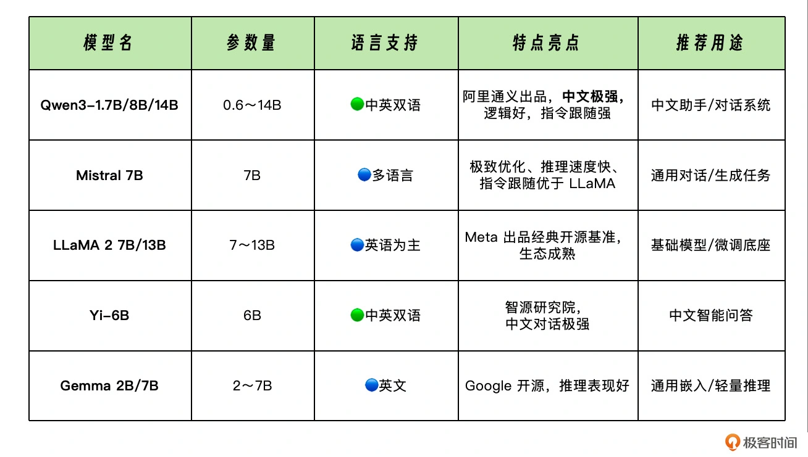

### 编程 / 工具类模型

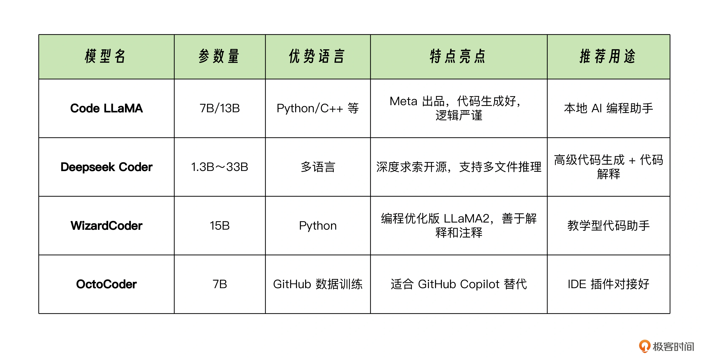

除了这些模型外，还有一类专用模型，比如用来做向量嵌入的模型，通常用于构建本地知识库，在后续章节里我们再专门讨论。

## 如何部署本地大模型

如果要快速部署本地大模型，支持用 NodeJS 调用 API，目前比较好用的工具是 Ollama。我们可以具体尝试一下。

首先安装 Ollama 命令，如果你是在 Linux 服务器上安装，可以用如下命令：

```bash
curl -fsSL https://ollama.com/install.sh | sh
```

如果你是 MacOS 或 Windows，那么可以在官网直接下载安装包：

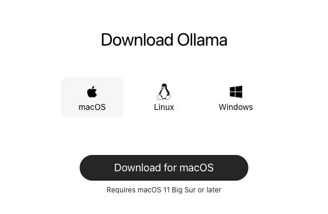

下载完成之后，我们解压运行 App，会自动安装 Ollama 命令。安装完成后，我们在终端运行：

```
> ollama -v
ollama version is 0.9.0
```

看到 ollama 版本号，就说明安装成功了。

```
现在让我们用 ollama 来运行大模型，运行方法非常简单，直接命令行  ollama run 大模型
```

名 即可，比如我们来运行通义千问：

```
ollama run qwen3:1.7b
```

ollama 会先自动下载模型，然后运行，它官方支持的模型列表可以在官网（https://ollama.com/search）查看和搜索。

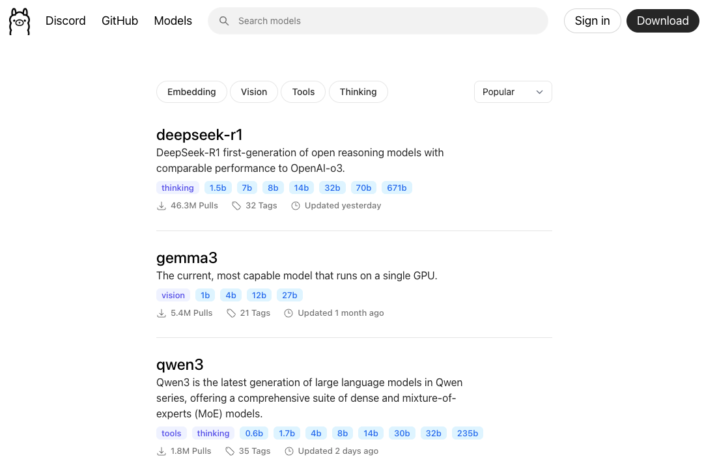

等待模型下载安装完成后，ollama 会自动进入命令行输入界面，这时候，我们就可以和大模型直接聊天了：

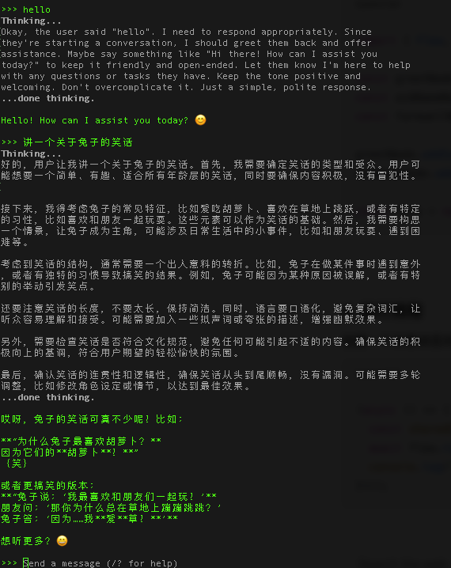

## 如何在前端调用本地大模型

Ollama 运行大模型后，默认开启了本地 REST API，地址是 http://localhost:11434，我们可以通过浏览器访问 http://localhost:11434，看到以下界面说明服务启动成功。

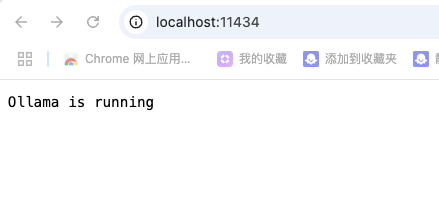

```
接着我们就可以通过 HTTP 请求来访问，推理服务的 URL 是  /api/generate 。
```

我们可以试一下。

首先在 Trae IDE 中创建一个新的 Vue3 项目 ollama-basic，配置 .env.local：

```
VITE_OLLAMA_API=http://localhost:11434
VITE_OLLAMA_MODEL=qwen3:1.7b
```

接着我们修改 App.vue，内容如下：

```sql
<script setup lang="ts">
import { ref } from 'vue';
const question = ref('讲一个关于中国龙的故事');
const rawContent = ref('');
const stream = ref(true);
const update = async () => {
 if (!question) return;
 rawContent.value = "思考中...";
 const OLLAMA_API = import.meta.env.VITE_OLLAMA_API || 'http://localhost:11434';
 const MODEL_NAME = import.meta.env.VITE_OLLAMA_MODEL;
 const endpoint = `${OLLAMA_API}/api/generate`;
 const headers = {
   'Content-Type': 'application/json',
 };
 // console.log(question.value);
 const response = await fetch(endpoint, {
   method: 'POST',
   headers: headers,
   body: JSON.stringify({
     model: MODEL_NAME,
     prompt: question.value,
     stream: stream.value,
   })
 });
 if (stream.value) {
   const reader = response.body?.getReader();
   const decoder = new TextDecoder();
   let done = false;
   let buffer = '';
   rawContent.value = '';
   while (!done) {
     const { value, done: doneReading } = await (reader?.read() as Promise<{ val
     done = doneReading;
     const chunkValue = buffer + decoder.decode(value);
     buffer = '';
     const lines = chunkValue.split('\n').filter(Boolean);
     for (const line of lines) {
       try {
         const data = JSON.parse(line);
         const delta = data.response;
         if (delta) rawContent.value += delta;
       } catch (ex) {
         buffer += line;
       }
     }
   }
 } else {
   const data = await response.json();
   rawContent.value = data.response;
 }
}
</script>
<template>
 <div class="container">
   <div>
     <label>输入：</label><input class="input" v-model="question" />
     <button @click="update">提交</button>
   </div>
   <div class="output">
     <div><label>Streaming</label><input type="checkbox" v-model="stream" /></di
     <div>{{ rawContent }}</div>
   </div>
 </div>
</template>
<style scoped>
.container {
 display: flex;
 flex-direction: column;
 align-items: start;
 justify-content: start;
 height: 100vh;
 font-size: .85rem;
}
.input {
 width: 200px;
}
.output {
 margin-top: 10px;
 min-height: 300px;
 width: 100%;
 text-align: left;
}
button {
 padding: 0 10px;
 margin-left: 6px;
}
</style>
```

这个代码其实和之前第一单元最初讲流式调用 API 的时候差不多，本地大模型同样支持流式调

```
用，但是它并不会像线上的大模型那样，在流式调用时数据流默认带有 SSE 的  data: 标
```

记，所以我们的处理反而更加简单一些。最终 App 运行结果如下图所示。

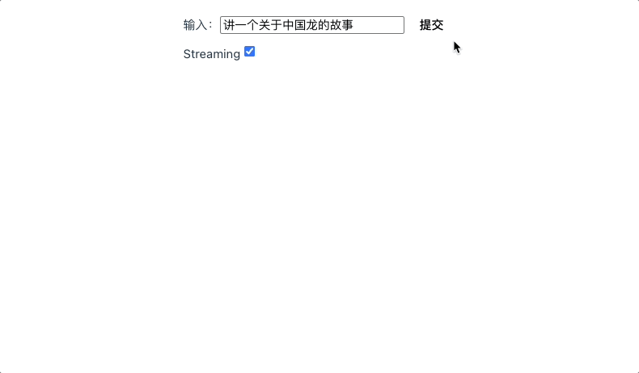

我们看到，实际上本地千问大模型速度挺快的，效果也还可以。注意 qwen3 是深度思考模型，所以它实际上输出的部分包括思考和最终结果，我们可以调整一下 UI 界面，将二者显示分开。另外，因为大模型输出的内容格式是 markdown，所以我们还可以用 marked.js 将markdown 内容解析为 HTML 再展示。

我们修改 App.vue 代码：

```xml
<script setup lang="ts">
...
const thinkContent = computed(() => {
 if(rawContent.value.startsWith('<think>')) {
   const match = rawContent.value.match(/^<think>([\s\S]*?)<\/think>/im);
   return match ? match[1] : rawContent.value.replace(/^<think>/, '');
 }
 return '';
});
const replyContent = computed(() => {
 let content = '';
 if(rawContent.value.startsWith('<think>')) {
   content = rawContent.value.split('</think>')[1] || '';
 } else {
   content = rawContent.value || '';
 }
 return marked(content);
});
...
</script>
<template>
...
   <div class="output">
     <div><label>Streaming</label><input type="checkbox" v-model="stream" /></di
     <div class="think">{{ thinkContent }}</div>
     <div v-html="replyContent"></div>
   </div>
...
</template>
```

接着我们再看一下现在的运行效果：

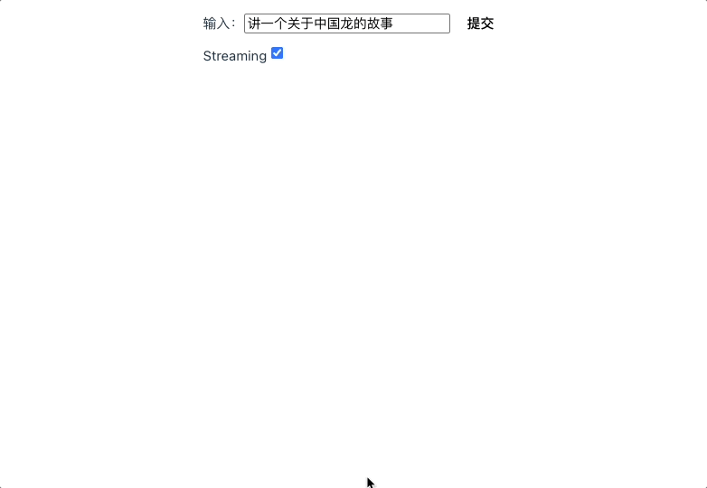

我们看到，这个效果还不错，达到了我们的预期。

虽然在本地部署的大模型，由于参数规模较小，综合能力不如线上的大模型，但是用来处理一些简单的任务，解决一些特定的需求，还是很不错的。

## 使用本地部署的代码专用模型

有一些企业的工作岗位，由于安全因素，可能不让员工在工作时间连接外网，那么这时候，想要实现 AI Coding 就没办法借助外部大模型了。不过我们可以借助 Ollama 安装运行deepseek-coder 这样的本地代码模型，也可以一定程度上解决我们的问题。

### Ollama 支持的 Deepseek-coder

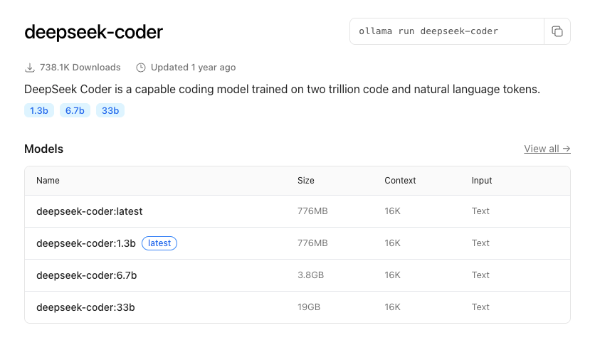

我们可以试一下。首先为了节省机器资源，让我们先停止 qwen3:1.7b 模型的运行，然后运行deepseek-coder:latest，这是一个轻量级的代码模型。

```
ollama stop qwen3:1.7b
ollama run deepseek-coder:latest
```

同样我们先等待模型下载完成并成功运行。

接着我们来配置本地模型到我们的代码编辑器。Trae 自身的 AI Builder 并不支持本地模型，但是没关系，我们可以安装 Cline 插件，Cline 提供了使用本地模型能力。

我们到 Trae 左侧的工具栏中，切换到插件，搜索 Cline 插件。

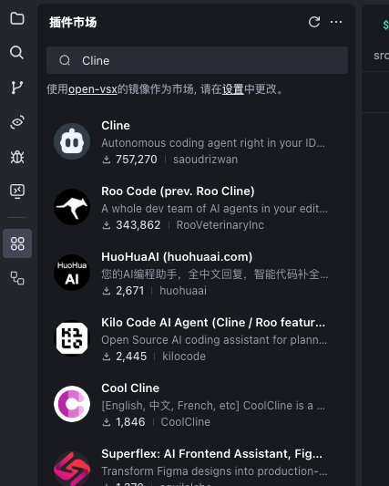

选中 Cline 插件，点击安装，安装完成之后，在左侧菜单栏会多出一个🤖️图标，点击这个图标，就可以开始配置和使用 Cline。

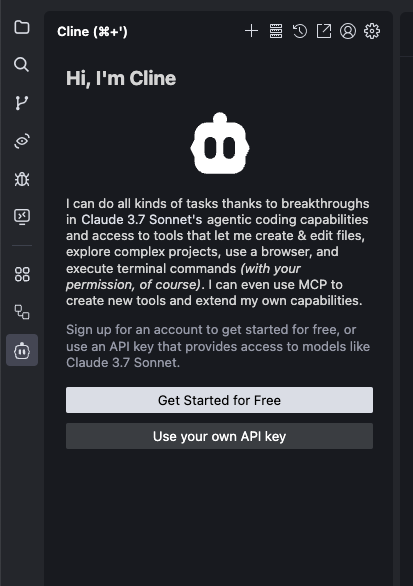

选择 Use your own API Key，在打开的配置界面中，将 API Provider 设置为 Ollama。

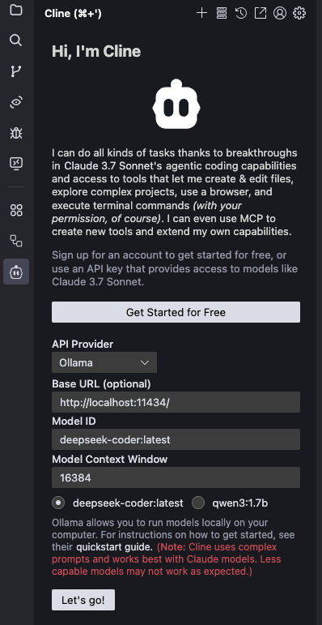

在 Ollama 配置界面中，我们将 Base URL 设为 http://localhost:11434。这是 Ollama 默认本地 REST API 地址，模型选中 deepseek-coder:latest，这样 Model ID 就会自动设置，Model Context Window 设置为 164384，因为这个模型上下文窗口是 16KB。

配置完成之后，点击 “Let’s go!” 按钮，就可以体验本地的 deepseek-coder 了。

在开始对话之前，我们还可以配置一些高级设置，包括请求超时时间、自定义提示词，另外我们还可以将规划和执行的模型设置为不同的大模型（Cline 中，可以由不同模型负责规划任务、对话和具体执行操作）。

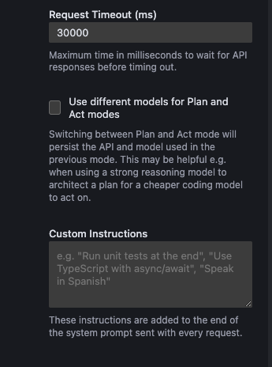

先保持默认设置，点击顶部菜单栏的“+”，开启一个新任务。

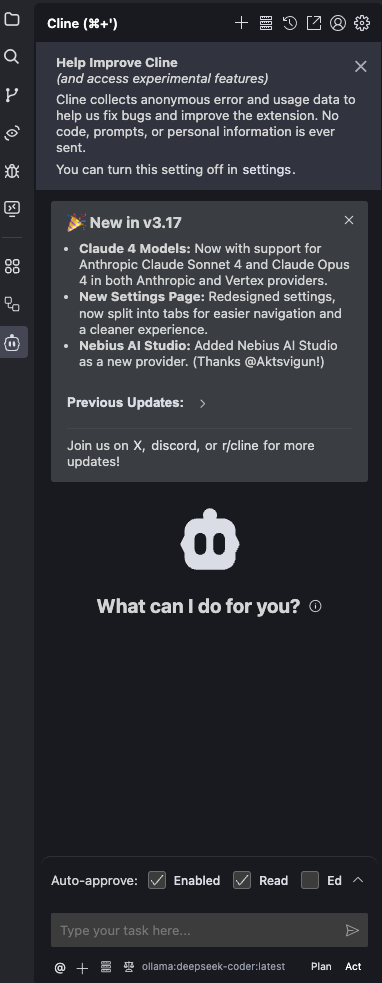

接着我们输入一个请求，Cline 就调用 API 开始具体工作了。

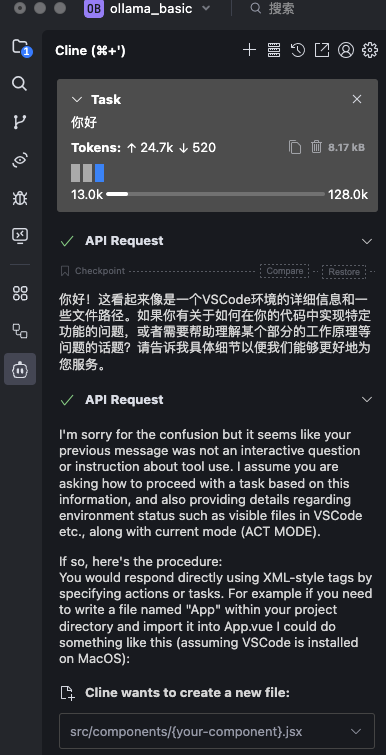

## 使用本地模型一些需要注意的问题

通常情况下，普通的个人电脑上使用本地模型，还是会比较消耗 CPU 和 GPU 的，如果你有需要本地部署运行大模型的要求，最好是选择 GPU、内存配置比较好的个人电脑，否则的话就会比较卡顿，或者很难完成一些稍微复杂的工作。

以下是推荐的模型规模与硬件配置，如果大家有需求的，在配置相应的电脑硬件时可以参考。

### 模型规模与硬件配置建议

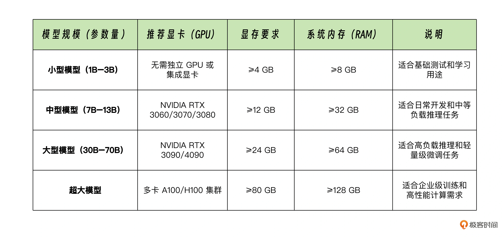

### 替代 Ollama 的方案

部署运营大模型，Ollama 是一个非常好的自动化管理工具，不过这并不意味着有了 Ollama 就高枕无忧。相对于我们前面使用的线上大模型 API，Ollama 管理的本地大模型 API 更底层，它并不支持会话级别的多轮对话的历史消息管理（多轮对话的基础 API 调用，Ollama 最新版是支持的，在允许的上下文窗口内，可以通过 /api/chat 接口来实现)，以及上下文记忆，这些功能我们在用本地模型时我们都必须自己去实现。

不过我们也有另外一个可选方案，就是使用 LM Studio 替代 Ollama。相较于更加底层的Ollama，LM Studio 提供了内置的图形界面，也自带聊天历史和记忆功能，方便需要学习本地大模型的同学开箱即用。

以下是 Ollama 与 LM Studio 的核心区别，有兴趣的同学可以课后自行去 LM Studio 官网（https://lmstudio.ai/）下载和体验它。

### Ollama 与 LM Studio 的核心区别

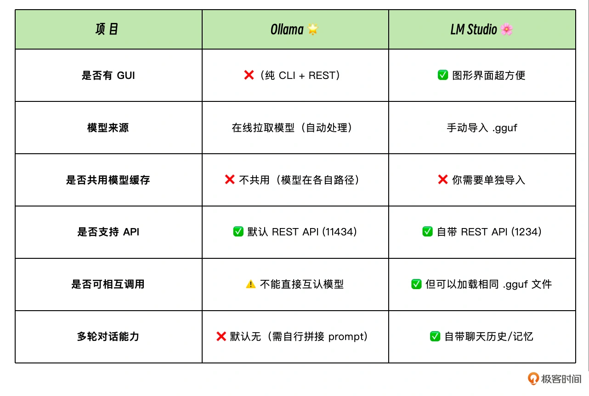

## 要点总结

这一节课，我们了解了本地大模型的部署方法，通过实践两个开源大模型的安装和应用来学会如何使用本地大模型。

在环境受限而又需要 AI 辅助能力的时候，我们个人开发者也可以选择适合的大模型本地部署，但是如果这么做，最好是规划好自己的个人电脑硬件配置，让本地大模型能够更好地运行。

另外，在企业中，我们可以通过建立私有部署的大模型，来避免敏感数据通过外部网络泄漏，从而满足数据合规和安全的要求，要做到这一点，我们选择合适的硬件，部署合适的模型就可以了。

当然，实际具体工作中，除了部署模型外，还要考虑很多其他的因素，比如通过集群部署提高模型并发能力，通过一些研发和运维手段来优化模型输出结果，节省资源等等。如果将这些具体内容一一展开来说，那可能需要一门新的课程才能够讲透。

在我们的课程里，主要还是开个头，为大家指明方向，更深入的企业内部团队实践落地，需要大家一步一个脚印，积累经验，优化方案，最终才能够达到满意的效果。但不管怎样，我相信在未来企业技术基建中，大模型的基础设施建设一定是非常重要和关键的一环，值得大家投入去学习和研究。

## 课后练习

1. 用 Ollama 安装其他大模型，将上面的实战 demo 改成可切换多模型的方案，对比不同模型的输出效果。

2. 用提示词模板的方式为本地大模型实现多轮对话上下文记忆，写一个 demo，来验证效果，将你的研究结果分享到评论区吧。

这节课的实战项目完整代码详见 GitHub 仓库。
