# 34 | 如何私有化部署AI工作流平台

你好，我是月影。

上一讲，我们介绍了用 Ollama 私有化部署大模型，那么有同学也会问，如果我要用大模型实现比较复杂的 AI 工作流，有没有配套的可以私有化部署的方案呢？

答案肯定是有的。

## 私有化部署 Dify 平台

一般企业级应用，目前比较成熟的平台首选是 Dify（https://dify.ai/），它是一个支持工作流编排的开源应用开发平台，功能上类似于 Coze，又支持本地部署。

要部署 Dify 非常简单，不过我们需要 Docker 支持。要安装 Docker，我们只要在 Docker官网下载适合的安装程序，按照官网的指南进行安装即可。

### 安装前准备

Docker 安装完成之后，我们还需要检查一下系统的 Python 环境：

```
python --version
```

如果 Python 的版本低于 3.12，我们最好升级一下。首先安装 pyenv，以 macOS 为例：

```
brew install pyenv
```

安装完成后，配置 shell 环境：

```bash
echo 'export PYENV_ROOT="$HOME/.pyenv"' >> ~/.zshrc
echo 'export PATH="$PYENV_ROOT/bin:$PATH"' >> ~/.zshrc
echo 'eval "$(pyenv init --path)"' >> ~/.zshrc
echo 'eval "$(pyenv init -)"' >> ~/.zshrc
source ~/.zshrc
```

接着用 pyenv 安装 Python 3.12。

```
pyenv install 3.12.10
```

然后修改全局默认的 Python 版本为 3.12.10。

```
pyenv global 3.12.10
```

### 安装和配置 Dify

要安装 Dify，首先我们要从 Github 克隆 Dify 仓库。

```bash
git clone https://github.com/langgenius/dify.git
cd dify
```

然后进入 docker 目录将 middleware.env.example 复制到 middleware.env，并通过 dockercompose 启动中间件服务。

```bash
cd docker
cp middleware.env.example middleware.env
docker compose -f docker-compose.middleware.yaml up -d
```

第一次启动，Docker 需要拉取一些服务，这需要一些时间。

耐心中间件服务启动完成后，接着进入 api 目录，我们将 .env.example 复制为 .env，生成 ssl密钥，配置 evn，启动后端服务。

```bash
cd api
cp .env.example .env
# 生成随机密钥并替换 .env 文件中的 SECRET_KEY 值
openssl rand -base64 42
uv sync
uv run flask db upgrade
uv run flask run --host 0.0.0.0 --port=5001 --debug
在  uv sync 过程中如果报错，可以尝试安装一下 postgresql，以 MacOS 为例：
brew install postgresql
```

后端服务启动成功后，我们到 web 目录下启动前端服务。

```bash
cd ../web
pnpm install
pnpm dev
```

注意，Dify 对 Node 版本要求比较高，要求的版本要高于 22.11.0，所以有可能你还需要安装NodeJS 的新版本，这里以 Node 管理工具 n 为例：

```bash
sudo n install lts
安装了最新的 NodeJS 后，通过 n 命令切换到最新版本，再运行  pnpm dev 命令。
```

这样我们就可以通过浏览器访问 http://localhost:3000，使用 Dify 的 Web 界面了。

注意，第一次访问会比较慢，因为要编译一些模块，如 middleware 和 apps。等到编译完成之后，就会看到 Dify 初始配置的界面。

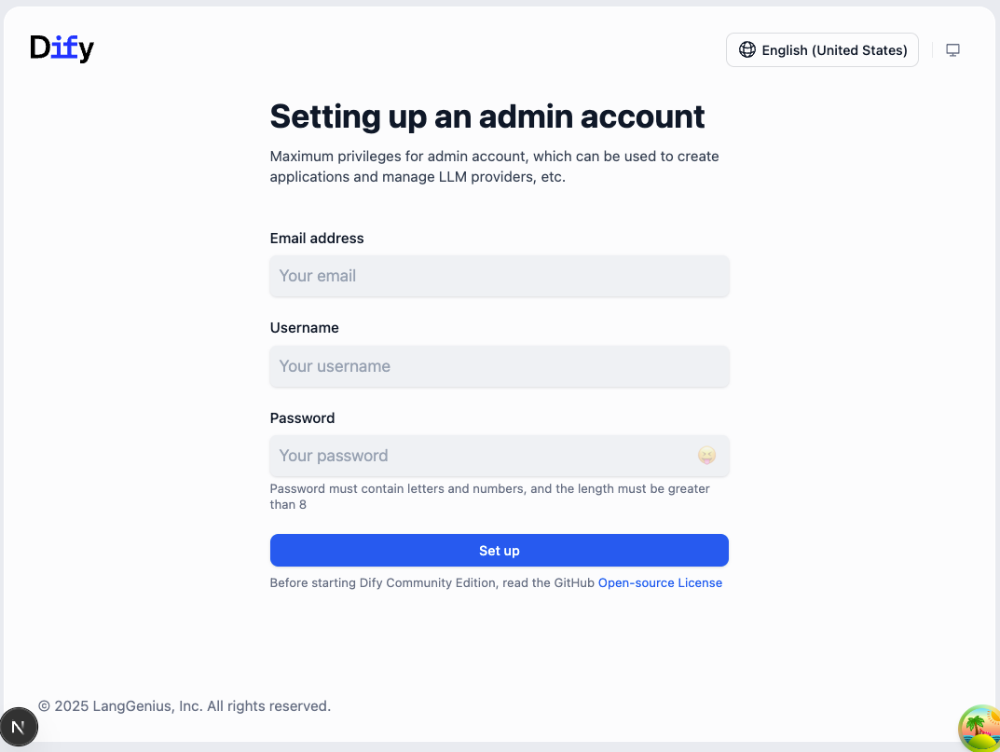

我们可以把界面切换成中文，设置管理员邮箱账号和密码，然后登录系统，看到如下界面就大功告成了。

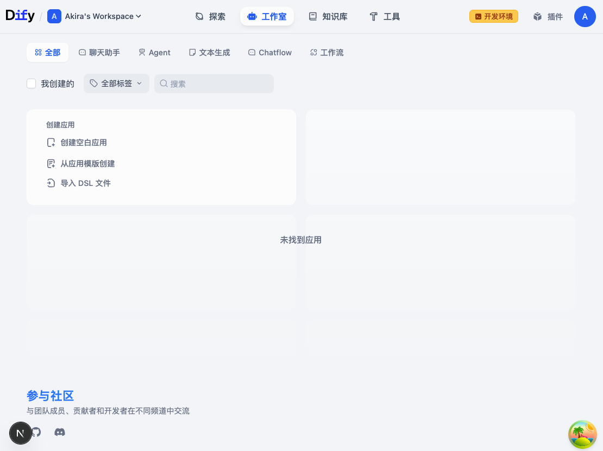

```
注意，Dify 使用 Next.js，开发环境中 SSR 动态编译，对机器环境要求略高，如果  pnpm
dev 速度太慢，也可以直接用 Docker 启动生产环境的服务。
```

在终端切换到项目的 docker 目录下，运行后面的代码。

```bash
cd docker
docker compose pull
docker compose up -d
```

稍等片刻，等待所有的 Docker 服务启动完成。

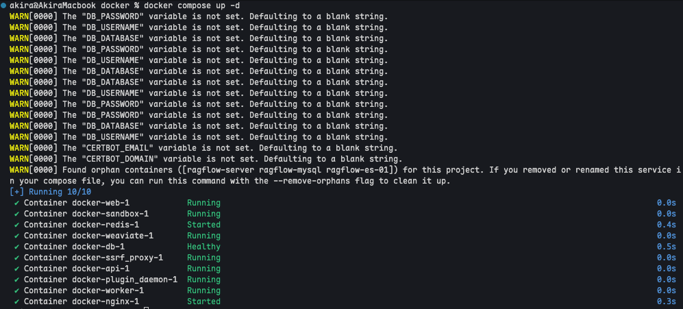

此时，直接通过 http://127.0.0.1 （80 端口）访问，就可以了。

### Dify 配置使用 Ollama 本地大模型

接下来，我们需要给 Dify 配置模型。我们可以配置线上模型，也可以配置本地模型。我们先来看一下怎么配置本地模型。

首先，我们确保按照上一节课的方法安装好 Ollama，并运行本地模型：

```
ollama run qwen3:1.7b
```

然后我们点击 Dify 主界面右上角用户头像，下拉菜单中点击【设置】，进入设置面板。

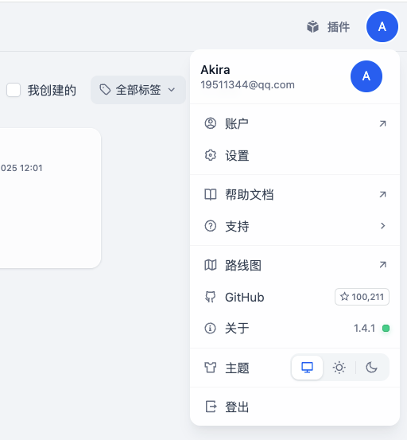

设置面板左侧工作空间，切换到【模型供应商】菜单。

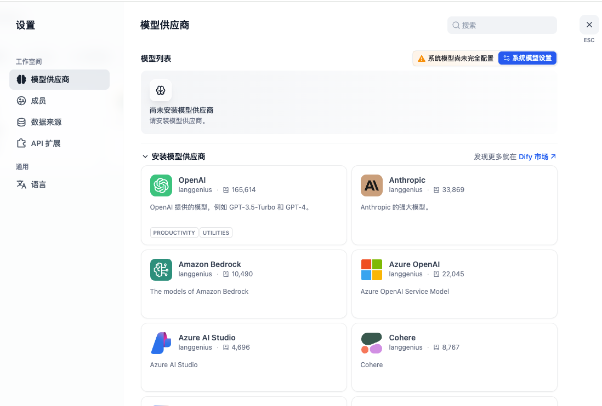

搜索 Ollama，找到后安装插件：

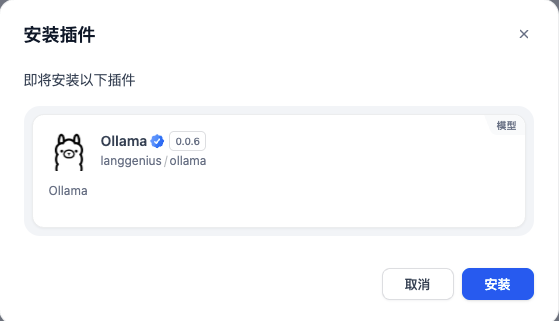

安装完成后，选择 Ollama，点击添加模型，进行配置：

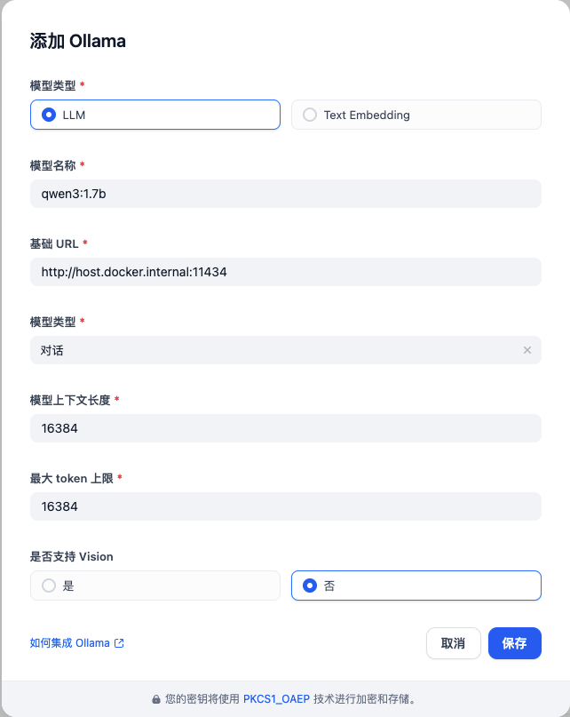

这里需要注意，我们一定要将 Ollama 的 HTTP 服务设置为**http://host.docker.internal:11434，而不能用 127.0.0.1，** 因为我们要通过 Docker 访问宿主机，而不是 Docker 自己本机的 127.0.0.1。

设置大模型完成后，我们就可以回到控制台首页，“创建空白应用 > 工作流”，创建工作流了。

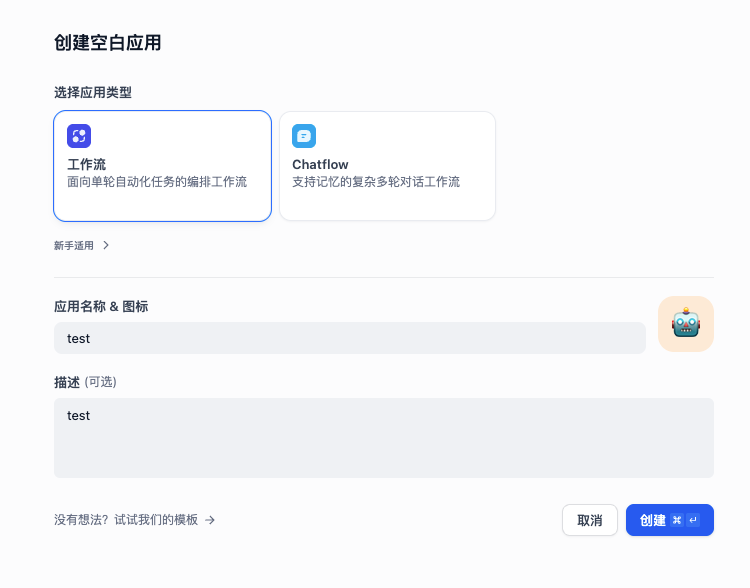

工作流创建后，进入编排界面，整个编排过程和 Coze 的工作流编排大同小异，相信已经熟悉了 Coze 的同学应该能很快掌握。

### 用 Dify 编排工作流

我用一个最简单的例子讲一下。

首先我们选中开始节点，在右侧配置面板点击输入字段右侧的“+”，添加变量。

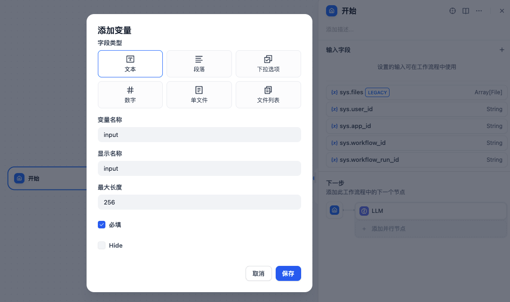

变量类型就选择文本，变量名为 input。

接着，我们在开始节点后添加一个 LLM 节点，对应于 Coze 中的大模型节点。

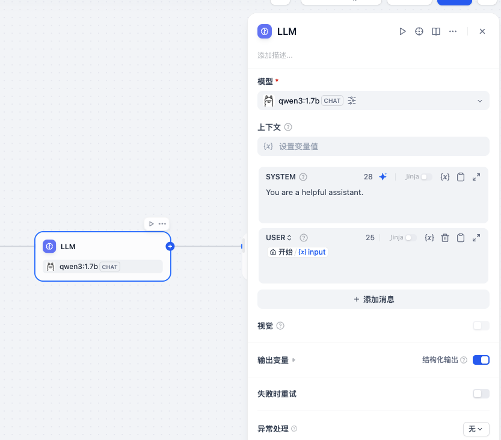

模型选择 qwen3:1.7b，系统提示词配置 You are a helpful assistant. 用户提示词配置为 LLM中创建的 input 变量。

下方输出变量处，勾选结构化输出。

最后添加结束节点，输出变量选择 LLM 输出的 text 字段。

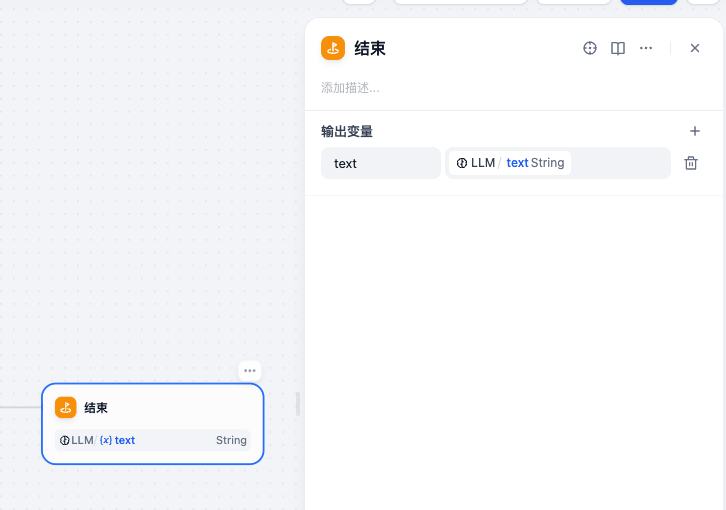

现在我们可以点击右上方运行按钮，对工作流进行测试。

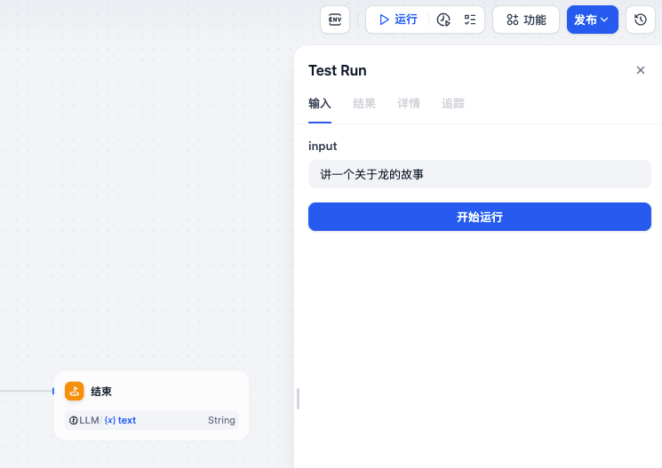

点击开始运行，等待测试结果的返回即可。最后在运行结果的详情中看到详细的输出结果。

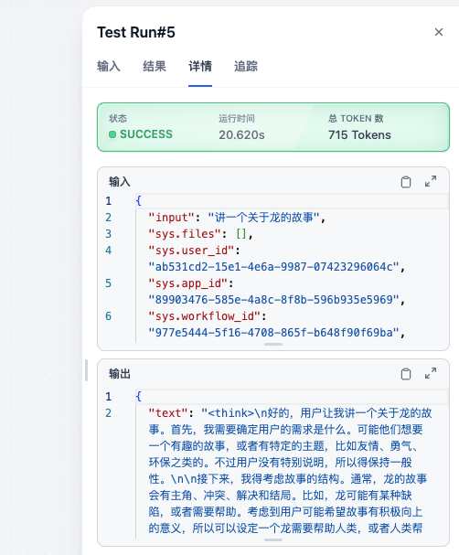

这样我们就用 Dify 实现了一个简单的工作流，它和 Coze 的用法非常相似。

## 使用 API 调用 Dify 工作流

工作流运行成功，经过测试后，我们可以点击右上角按钮将其发布。

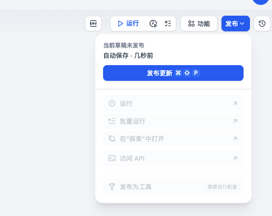

接下来，我们可以通过 API 调用这个工作流。

首先我们在 Dify 控制台首页，点击左侧菜单中的“访问 API”，然后点击右上角 API 密钥。

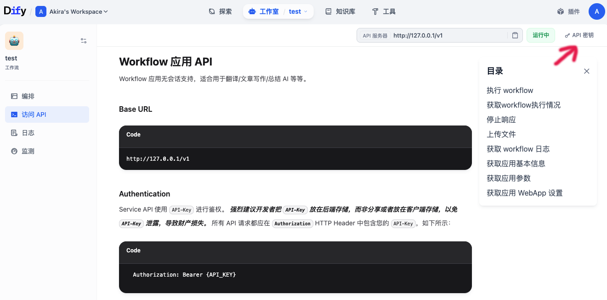

在弹出窗口中点击“创建密钥”。

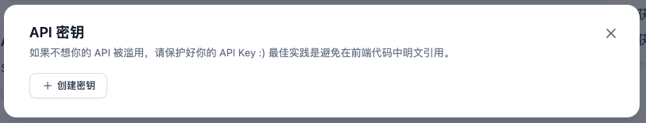

记得将此密钥保存下来，作为 API 调用的凭证。

接着我们用 Trae IDE 创建一个新的 Vue3 项目 ollama-dify。

```
创建  .env.local 文件，内容如下：
VITE_DIFY_API_KEY=app-fvxp**********KjqVbr
VITE_DIFY_API_URL=http://127.0.0.1/v1
VITE_DIFY_WORKFLOW_ID=89903476-585e-4a8c-8f8b-596b935e5969
```

其中 VITE_DIFY_API_KEY 就是刚才创建的 API 密钥，而 VITE_DIFY_WORKFLOW_ID 是发布的工作流的 ID，在工作流的 URL 上可以查看到。

Dify 支持的流式传输默认采用 SSE，我们可以在前端更简单地处理流式数据。但是由于工作流 API 是 POST 请求接口，原生的 SSE 不支持 POST 请求，因此我们还需要一个 polyfill。

```
pnpm i @microsoft/fetch-event-source
```

接着修改 App.vue，内容如下：

```sql
<script setup lang="ts">
import { ref, computed } from 'vue';
import { marked } from 'marked';
import { fetchEventSource } from '@microsoft/fetch-event-source';
const question = ref('讲一个关于中国龙的故事');
const rawContent = ref('');
const stream = ref(true);
const thinkContent = computed(() => {
 if(rawContent.value.startsWith('<think>')) {
   const match = rawContent.value.match(/^<think>([\s\S]*?)<\/think>/im);
   return match ? match[1] : rawContent.value.replace(/^<think>/, '');
 }
 return '';
});
const replyContent = computed(() => {
 let content = '';
 if(rawContent.value.startsWith('<think>')) {
   content = rawContent.value.split('</think>')[1] || '';
 } else {
   content = rawContent.value || '';
 }
 return marked(content);
});
const update = async () => {
 if (!question) return;
 rawContent.value = "思考中...";
 const DIFY_API = import.meta.env.VITE_DIFY_API_URL || 'http://127.0.0.1/v1';
 const API_KEY = import.meta.env.VITE_DIFY_API_KEY;
 const WORKFLOW_ID = import.meta.env.VITE_DIFY_WORKFLOW_ID;
 const endpoint = `${DIFY_API}/workflows/run`;
 const headers = {
   'Content-Type': 'application/json',
   'Authorization': `Bearer ${API_KEY}`,
 };
 const body = JSON.stringify({
   workflow_id: WORKFLOW_ID,
   inputs: {
     input: question.value,
   },
   response_mode: stream.value ? 'streaming' : 'blocking',
   user: 'bearbobo',
 });
 // console.log(question.value);
 if (stream.value) {
   rawContent.value = '';
   fetchEventSource(endpoint, {
     method: 'POST',
     headers,
     body,
     onmessage: (event) => {
       try {
         if(!event.data) return;
         const data = JSON.parse(event.data);
         if(data.event === 'text_chunk') {
           rawContent.value += data.data.text;
         }
       } catch (e) {
         console.error(e, event.data);
       }
     },
   });
 } else {
   const response = await fetch(endpoint, {
     method: 'POST',
     headers,
     body,
   });
   const { data } = await response.json();
   rawContent.value = data.outputs.text;
 }
}
</script>
<template>
 <div class="container">
   <div>
     <label>输入：</label><input class="input" v-model="question" />
     <button @click="update">提交</button>
   </div>
   <div class="output">
     <div><label>Streaming</label><input type="checkbox" v-model="stream" /></di
     <div class="think">{{ thinkContent }}</div>
     <div v-html="replyContent"></div>
   </div>
 </div>
</template>
<style scoped>
.container {
 display: flex;
 flex-direction: column;
 align-items: start;
 justify-content: start;
 height: 100vh;
 font-size: .85rem;
}
.input {
 width: 200px;
}
.output {
 margin-top: 10px;
 min-height: 300px;
 width: 100%;
 text-align: left;
}
button {
 padding: 0 10px;
 margin-left: 6px;
}
.think {
 margin-top: 10px;
 color: gray;
 max-height: 300px;
 overflow-y:auto;
 font-size: x-small;
}
</style>
```

这段代码，和上一节课的代码差不多，只是把调用 ollama 的 REST 接口请求，改成了调用Dify 的工作流，具体调用参数如下：

```
{
   workflow_id: WORKFLOW_ID,
   inputs: {
     input: question.value,
   },
   response_mode: stream.value ? 'streaming' : 'blocking',
   user: 'bearbobo',
}
```

稍微不一样的是，Dify 流式接口数据默认是 SSE 格式，所以我们直接用 fetchEventSource 来处理更加方便了。

这样，我们就完成了应用调用 Dify 工作流 API，它的具体效果如下图。

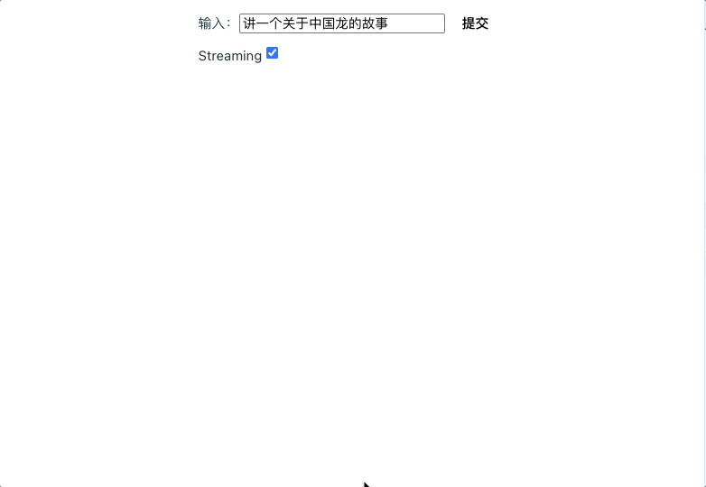

## Dify 的替代方案

我们看到 Dify 是一个功能强大的支持私有化部署的 AI 工作流和应用开发平台，它非常适合作为企业级 AI 应用的中台，为企业提供工作流的快速定制和原型开发。

不过除了 Dify，也还有一些其他的选择，比如更轻量级的 Flowise。

相比 Dify 而言，Flowise 安装及其简单，只需要使用 npx 命令：

```
npx flowise start
```

运行完成后，访问 http://localhost:3000 就可以使用了。

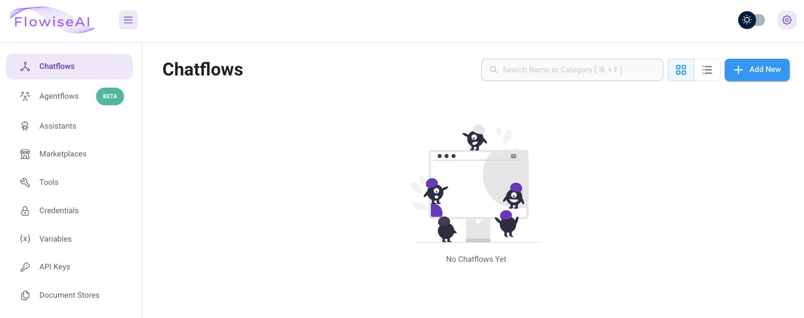

接下来，我们配置 ollama 节点。点击右上角的 “Add New” 按钮，创建一个新的 ChatFlow。

在左侧节点菜单中，展开 “Chat Models”，选择 ChatOllama，将它拖拽到右侧画布上。

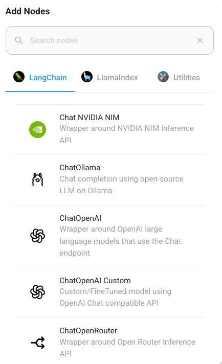

接着我们进行配置，将 Model Name 设置为 qwen3:1.7b。Flowise 和 Dify 与 Coze 不同，它的节点模块更加底层，是依照 Langchain 的规范来的，所以 ChatOllama 并不是完整的 LLM节点，只是配置。我们还需要提示词模板节点和 LLM Chain 节点，从左侧节点菜单中可以分别找到它们，最终将这三个节点分别配置后连接起来：

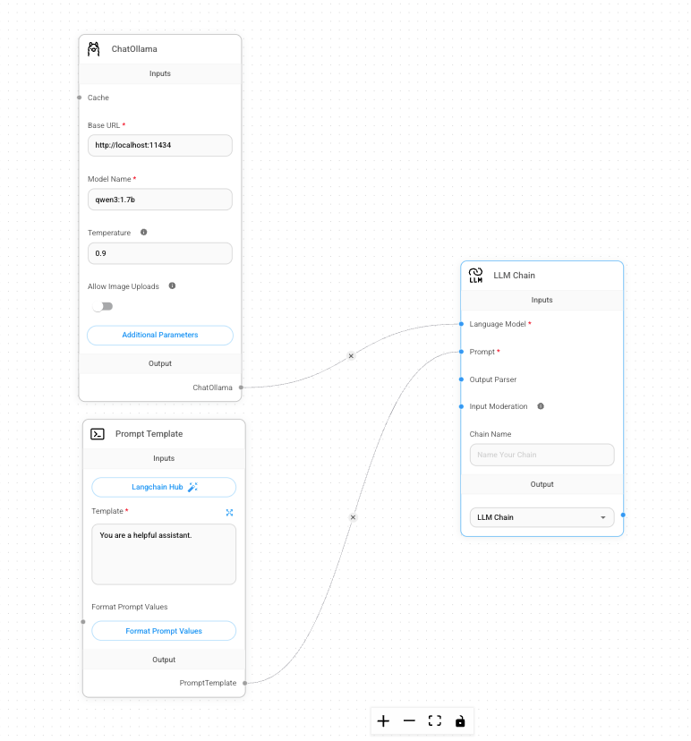

```
注意，Prompt Template 节点我们用模板变量  {question} 表示用户输入的问题，这是
```

Flowise 的约定。

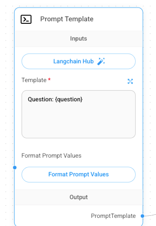

完成配置，然后再打开右边聊天按钮，输入问题就可以进行测试了。

我们看一下效果：

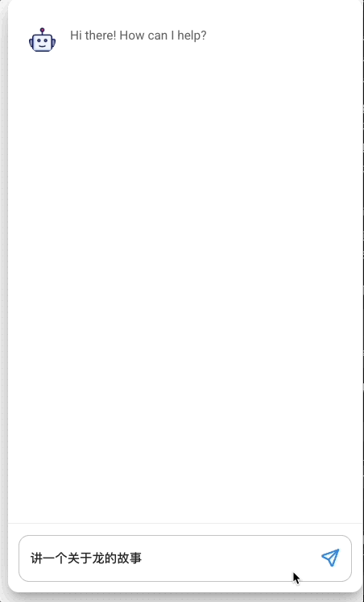

我们看到，和 Dify 类似，Flowise 也可以通过可视化的方式搭建工作流。不过它相比 Dify 要简陋许多此外，当然相应地安装配置也更简单。

此外，Flowise 也默认支持 REST API，调用方式和 Dify 差不多，这里就不详细展开了，有兴趣的同学可以自己查看 Flowise 官方文档。

## 要点总结

在这一讲，我们主要介绍了私有化部署工作流的平台。一般来说，企业级应用首选 Dify，因为它功能比较全面，除了最基础的大模型推理外，还有其他类型的节点支持，比如 RAG、知识库等都能通过 Dify 实现，而且还支持插件扩展，有比较完善的生态社区，基本上是类似一个支持本地部署的 Coze。

而如果想要一个更简单一些的工作流搭建平台，那么 Flowise 也是不错的选择，相对于 Dify，Flowise 更简单轻量，安装和配置都更方便。

下面我用一张表格，简单总结了一下二者的区别：

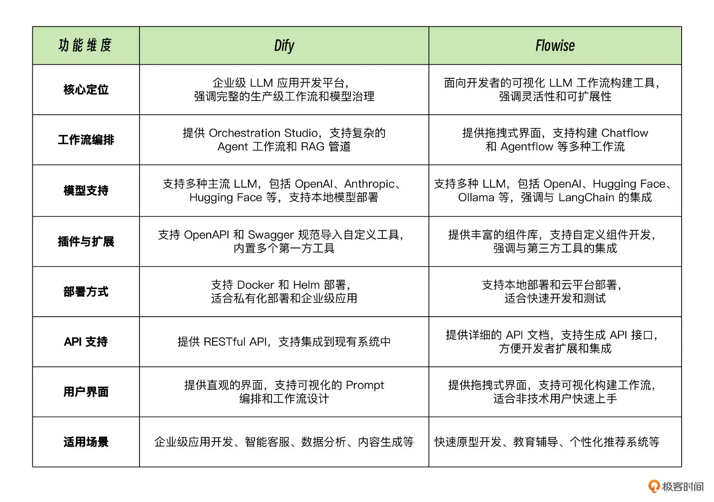

## 课后练习

今天我们课程中讲解了 Dify 和 Flowise 的基础用法，举了最简单例子来说明它们的用法。接下来你可以尝试使用 Dify 或 Flowise 搭建一个更加复杂的工作流，从我们之前几篇加餐中任选一节，将其中用 Coze 实现的工作流用 Dify 或 Flowise 实现吧。如果你实现了，请将你的收获分享到评论区。

这节课的实战项目完整代码详见 Github 仓库。
