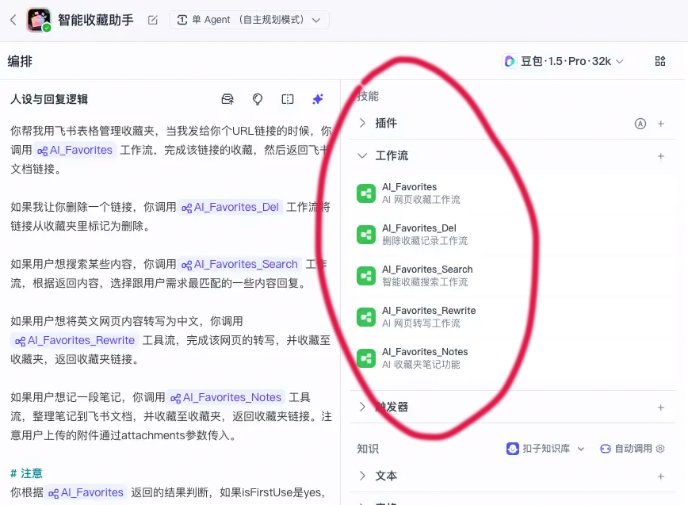
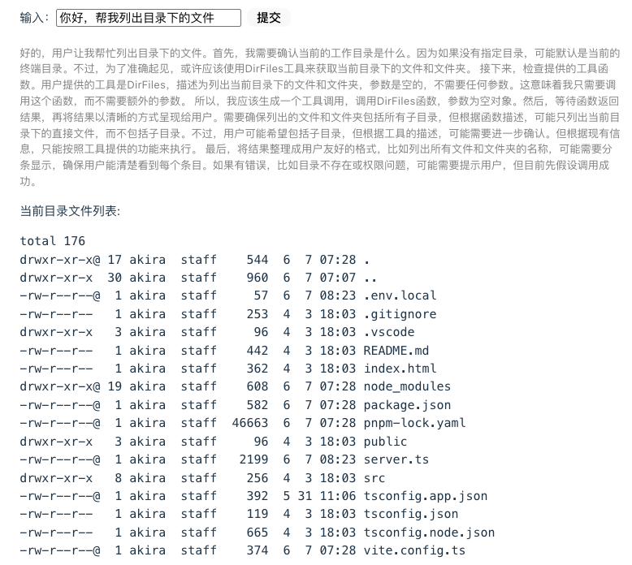
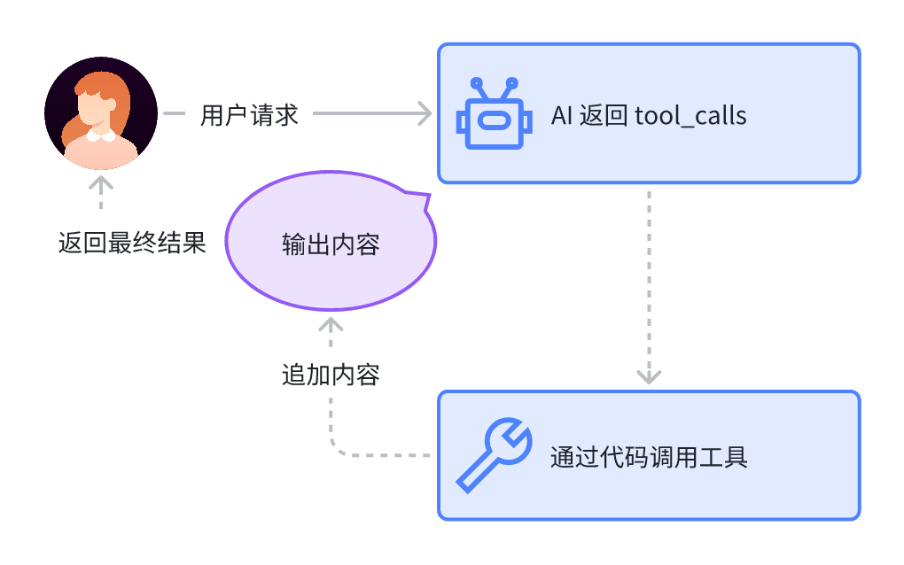
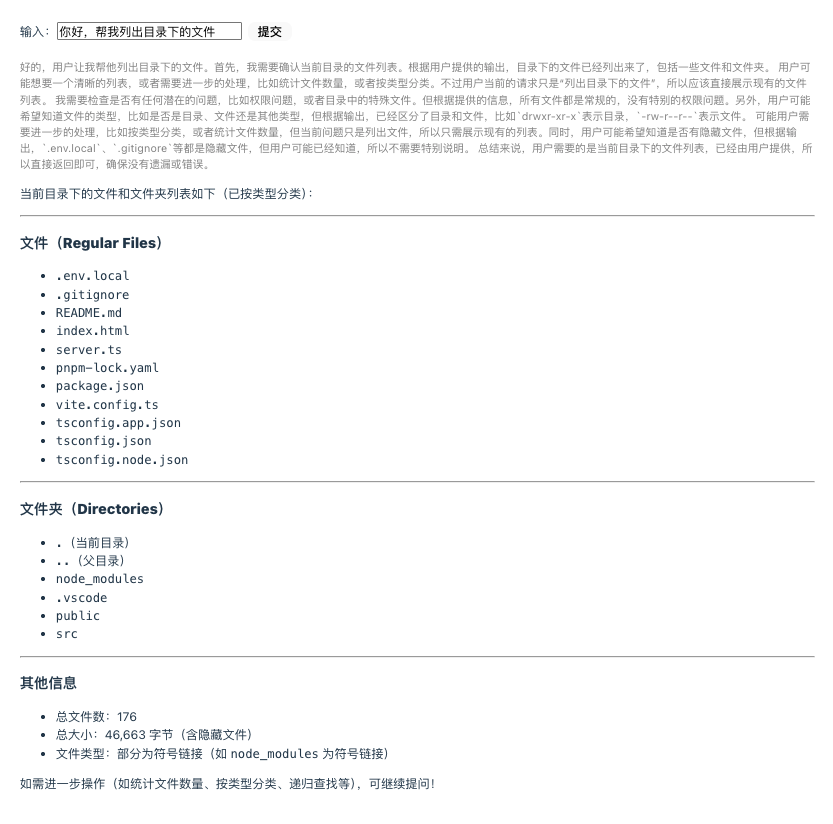
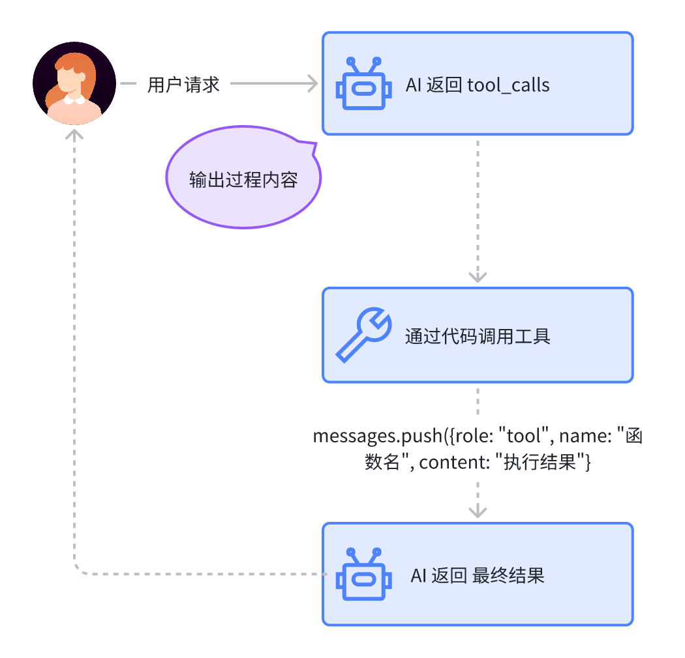
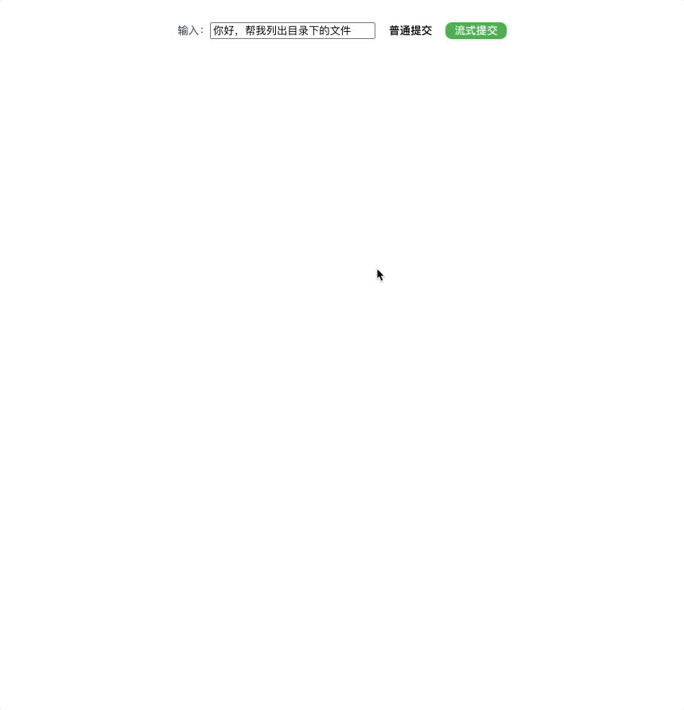
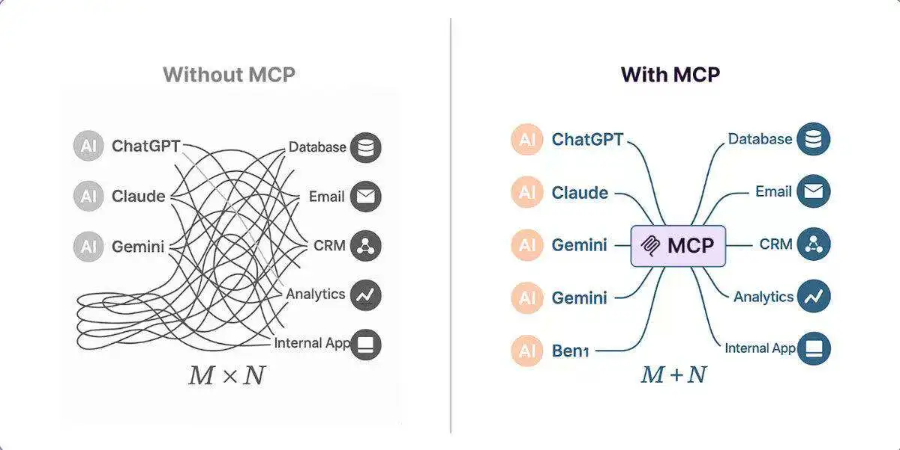

# 35 | 如何让大模型使用工具完成工作？

你好，我是月影。

我们在平时工作中使用大模型的时候，实际上不仅仅是让大模型输出文本、图片或者其他多模态内容，更重要的是，要使用大模型来解决我们工作中的实际问题。

这里就涉及到一个非常重要的基本概念，就是大模型不仅仅是根据我们的提示词完成推理，给出内容结果，而且还可以调用工具，来完成各种任务。

其实我们在前面的课程中，已经涉及到这部分内容，比如加餐中的 Coze 案例，很多时候，都会通过插件等方式，在工作流中调用工具，生成结果提供给 AI，而且最终我们真正对话的智能体也是通过调用工作流来完成最终的工作，同样相当于让智能体使用了工具。只不过我们之前并没有特意强调这一点。

- 前面介绍的 Coze、Dify 这些智能体开发平台，默认提供了配置和使用各类工具的能力



实际上，不只是 Coze、Dify 这样的平台，我们自己同样可以为大模型指定工具，不仅是在线的大模型，甚至前面介绍的本地大模型也一样可以。

```
这一节我们就通过实战例子，来看如何给通过 Ollama 部署的 qwen3:1.7b 配置和使用工
```

具。

## 为大模型配置 tools

大部分 OpenAI API 兼容的大模型，都可以通过在请求时传递 tools 参数来告诉大模型可以调用哪些工具。tools 的参数配置格式大部分大模型官网文档中都有，而且参数形式基本上都比较一致，比如 moonshot 调用 tools，我们可以直接在官网找到相关文档：https://platform.moonshot.cn/docs/api/tool_use。

通义千问（qwen3）的 API 接口和 moonshot 是基本一致的，所以我们直接用 moonshot 这个

```
方式来让 qwen3:1.7b调用工具。
```

我们试一下，首先在 Trae IDE 创建一个新的 Vue 项目 ollama_tools。

```
在项目下创建  env.local 文件，内容如下：
OLLAMA_API=http://localhost:11434
OLLAMA_MODEL=qwen3:1.7b
```

接着安装依赖：

```
pnpm i axios dotenv express marked
pnpm i -D @types/node
```

为了更方便使用 TypeScript 运行 NodeJS 的 server，我们可以在 package.json 中增加一个scripts：

```python
 "scripts": {
   ...
   "server": "npx tsx ./server.ts",
   ...
 },
接着创建 server.ts ，内容如下：
import * as dotenv from 'dotenv';
import express from 'express';
import axios from 'axios';
import { exec } from 'child_process';
dotenv.config({
 path: ['.env.local', '.env']
});
const app = express();
const PORT = 3300;
app.use(express.json());
app.post('/chat', async (req, res) => {
 const { message } = req.body
 const model = process.env.OLLAMA_MODEL || 'qwen3:1.7b';
 const base_url = process.env.OLLAMA_API || 'http://localhost:11434';
 try {
   const response = await axios.post(`${base_url}/api/chat`, {
     model,
     messages: [
       {
         role: 'system',
         content: '如有需要，你可以调用DirFiles工具查找当前目录下的文件和文件夹',
       },
       {
         role: 'user',
         content: message,
       },
     ],
     tools: [{
       type: "function",
       function: {
         "name": "DirFiles",
         "description": "列出当前目录下的文件和文件夹",
       }
     }],
     stream: false, // 如果你想用流式响应，可以设为 true
   });
   const reply = response.data.message.content
   // 检查是否有工具调用请求
   if (response.data.message.tool_calls &&
       response.data.message.tool_calls.length > 0 &&
       response.data.message.tool_calls[0].function?.name === 'DirFiles') {
     // 执行ls命令获取当前目录文件列表
     exec('ls -la', (error, stdout, stderr) => {
       if (error) {
         console.error(`执行命令出错: ${error}`);
         res.json({ reply: `${reply}\n\n执行命令出错: ${error.message}` });
         return;
       }
       if (stderr) {
         console.error(`命令stderr: ${stderr}`);
       }
       // 返回文件列表和AI的回复
       res.json({ reply: `${reply}\n\n当前目录文件列表:\n\`\`\`\n${stdout}\`\`\`` }
     });
   } else {
     res.json({ reply })
   }
 } catch (error: any) {
   console.error('Ollama API 错误:', error.message)
   res.status(500).json({ error: '无法连接 Ollama 模型' })
 }
});
app.listen(PORT, () => {
 console.log(`服务器运行在 http://localhost:${PORT}`)
});
```

这样我们就实现了服务端代码。

我们看一下代码细节，其实它和前面我们写过的 server 代码没太多区别，也就是通过 HTTP请求去调用本地 Ollama 的 REST 接口。但我们有两个地方需要注意。

首先，我们在请求大模型 API 接口的时候，传入了 tools 参数。

```javascript
     tools: [{
       type: "function",
       function: {
         "name": "DirFiles",
         "description": "列出当前目录下的文件和文件夹",
       }
     }],
```

这里我们指定了一个工具 DirFiles，它列出当前目录下的文件和文件夹。

接着我们在调用 API 返回结果时，查找结果中返回的 message 里是否包含有 tool_calls，如有，我们就根据 tool_calls 来执行下一步动作。

这里 AI 返回的 tools_calls 是这样的结构。

```javascript
[{function: {name: 'DirFile', arguments: {}}}]
```

表示要执行 DirFile 函数，参数为空。

所以我们判断需要执行 DirFile 函数时，进行相应的处理。

```javascript
   // 检查是否有工具调用请求
   if (response.data.message.tool_calls &&
       response.data.message.tool_calls.length > 0 &&
       response.data.message.tool_calls[0].function?.name === 'DirFiles') {
     // 执行ls命令获取当前目录文件列表
     exec('ls -la', (error, stdout, stderr) => {
       if (error) {
         console.error(`执行命令出错: ${error}`);
         res.json({ reply: `${reply}\n\n执行命令出错: ${error.message}` });
         return;
       }
       if (stderr) {
         console.error(`命令stderr: ${stderr}`);
       }
       // 返回文件列表和AI的回复
       res.json({ reply: `${reply}\n\n当前目录文件列表:\n\`\`\`\n${stdout}\`\`\`` }
     });
   }
这里我们调用系统的 exec，执行  ls -la 命令，将结果和大模型的回复一并返回给前端。
```

现在我们还要添加前端代码，先配置 vite 代理。

```bash
 server: {
   allowedHosts: true,
   port: 4399,
   proxy: {
     '/api': {
       target: 'http://localhost:3300',
       secure: false,
       rewrite: path => path.replace(/^\/api/, ''),
     },
   },
 },
```

然后我们修改 App.vue。

```sql
<script setup lang="ts">
import { ref, computed } from 'vue';
import { marked } from 'marked';
const question = ref('你好，帮我列出目录下的文件');
const rawContent = ref('');
const thinkContent = computed(() => {
 if(rawContent.value.startsWith('<think>')) {
   const match = rawContent.value.match(/^<think>([\s\S]*?)<\/think>/im);
   return match ? match[1] : rawContent.value.replace(/^<think>/, '');
 }
 return '';
});
const replyContent = computed(() => {
 let content = '';
 if(rawContent.value.startsWith('<think>')) {
   content = rawContent.value.split('</think>')[1] || '';
 } else {
   content = rawContent.value || '';
 }
 return marked(content);
});
const update = async () => {
 if (!question) return;
 rawContent.value = "思考中...";
 const headers = {
   'Content-Type': 'application/json',
 };
 // console.log(question.value);
 const response = await fetch('/api/chat', {
   method: 'POST',
   headers: headers,
   body: JSON.stringify({
     message: question.value,
   })
 });
 const data = await response.json();
 rawContent.value = data.reply;
}
</script>
<template>
 <div class="container">
   <div>
     <label>输入：</label><input class="input" v-model="question" />
     <button @click="update">提交</button>
   </div>
   <div class="output">
     <div class="think">{{ thinkContent }}</div>
     <div v-html="replyContent"></div>
   </div>
 </div>
</template>
<style scoped>
.container {
 display: flex;
 flex-direction: column;
 align-items: start;
 justify-content: start;
 height: 100vh;
 font-size: .85rem;
}
.input {
 width: 200px;
}
.output {
 margin-top: 10px;
 min-height: 300px;
 width: 100%;
 text-align: left;
}
button {
 padding: 0 10px;
 margin-left: 6px;
}
.think {
 margin-top: 10px;
 color: gray;
 max-height: 300px;
 overflow-y:auto;
 font-size: x-small;
}
</style>
```

这个代码和前面课程的前端代码差不多，这里就不细讲了，最终当我们让 AI 帮我们列出目录下的文件时，AI 会请求调用 DirFile，然后我们处理完，将结果返回给前端，最终结果如下图：



## 让大模型继续处理 tools 调用返回的结果

上面的例子是最简单的大模型调用工具返回结果的过程，我们可以用下面的图表示。



在这里，我们是直接将代码调用工具返回的内容附到输出内容之后返回给前端的，实际上，更通用一些的做法，是将内容回给 AI，进行下一步处理，由 AI 再返回给前端。

我们修改 server.ts 代码：

```javascript
app.post('/chat', async (req, res) => {
 const { message } = req.body
 const model = process.env.OLLAMA_MODEL || 'qwen3:1.7b';
 const base_url = process.env.OLLAMA_API || 'http://localhost:11434';
 const messages:IChatMessage[]  = [
   {
     role: 'system',
     content: '如有需要，你可以调用DirFiles工具查找当前目录下的文件和文件夹',
   },
   {
     role: 'user',
     content: message,
   },
 ];
 try {
   const response = await axios.post(`${base_url}/api/chat`, {
     model,
     messages,
     tools: [{
       type: "function",
       function: {
         "name": "DirFiles",
         "description": "列出当前目录下的文件和文件夹",
       }
     }],
     stream: false, // 如果你想用流式响应，可以设为 true
   });
   const reply = response.data.message.content
   // 检查是否有工具调用请求
   if (response.data.message.tool_calls &&
       response.data.message.tool_calls.length > 0 &&
       response.data.message.tool_calls[0].function?.name === 'DirFiles') {
     // 执行ls命令获取当前目录文件列表
     exec('ls -la', async (error, stdout, stderr) => {
       if (error) {
         console.error(`执行命令出错: ${error}`);
         res.json({ reply: `${reply}\n\n执行命令出错: ${error.message}` });
         return;
       }
       if (stderr) {
         console.error(`命令stderr: ${stderr}`);
       }
       // 返回文件列表和AI的回复
       // res.json({ reply: `${reply}\n\n当前目录文件列表:\n\`\`\`\n${stdout}\`\`\`
       // 调用API，将文件列表作为工具调用的输出
       messages.push({
         role: 'tool',
         name: 'DirFiles',
         content: `当前目录文件列表:\n\`\`\`\n${stdout}\`\`\`\n`
       });
       const response = await axios.post(`${base_url}/api/chat`, {
         model,
         messages,
         stream: false,
       });
       res.json({ reply: response.data.message.content });
     });
   } else {
     res.json({ reply })
   }
 } catch (error: any) {
   console.error('Ollama API 错误:', error.message)
   res.status(500).json({ error: '无法连接 Ollama 模型' })
 }
});
```

这里我们主要有几个改动，首先将 messages 数据定义到外部，然后我们在工具调用后，并不

```
是直接将 ls -la 的执行结果追加在输出内容的后面返回，而是将它以 role 为 tool 的
```

message 追加到 messages 后面。然后继续请求大模型 api，等待结果返回，这样大模型最终就对函数调用结果进行进一步的解读，输出的结果也更“人性化”。

最终结果如下：



这样我们就得到了经典的大模型工具调用过程，如下图所示：



## 在流式调用中使用 tools

我们用上面的方式让 AI 先调用工具，然后再将调用结果返回给 AI 继续输出。这样的过程虽然没有问题，但是实际上调用了两次 LLM 的接口，推理等待的时间就比较长，所以更适合用流式输出，以减少用户等待时间。

我们可以在 server.ts 中，再实现一个流式接口。

```javascript
app.post('/chat-stream', async (req, res) => {
 const { message } = req.body
 const model = process.env.OLLAMA_MODEL || 'qwen3:1.7b';
 const base_url = process.env.OLLAMA_API || 'http://localhost:11434';
 const messages:IChatMessage[]  = [
   {
     role: 'system',
     content: '如有需要，你可以调用DirFiles工具查找当前目录下的文件和文件夹',
   },
   {
     role: 'user',
     content: message,
   },
 ];
 // 设置SSE响应头
 res.setHeader('Content-Type', 'text/event-stream');
 res.setHeader('Cache-Control', 'no-cache');
 res.setHeader('Connection', 'keep-alive');
 try {
   // 创建一个流式请求
   const response = await axios.post(`${base_url}/api/chat`, {
     model,
     messages,
     tools: [{
       type: "function",
       function: {
         "name": "DirFiles",
         "description": "列出当前目录下的文件和文件夹",
       }
     }],
     stream: true, // 启用流式响应
   }, {
     responseType: 'stream'
   });
   let hasToolcall = false;
   // 处理流式响应
   response.data.on('data', (chunk: Buffer) => {
     try {
       const text = chunk.toString();
       const lines = text.split('\n').filter(line => line.trim() !== '');
       for (const line of lines) {
         try {
           const parsed = JSON.parse(line);
           // 检查是否有工具调用请求
           if (parsed.message?.tool_calls &&
               parsed.message.tool_calls.length > 0 &&
               parsed.message.tool_calls[0].function?.name === 'DirFiles') {
             hasToolcall = true;
             // 发送一个事件表示需要工具调用
             res.write(`event: tool_call\ndata: ${JSON.stringify({tool: 'DirFile
             // 执行ls命令获取当前目录文件列表
             exec('ls -la', async (error, stdout, stderr) => {
               if (error) {
                 console.error(`执行命令出错: ${error}`);
                 res.write(`event: error\ndata: ${JSON.stringify({error: error.m
                 res.end();
                 return;
               }
               if (stderr) {
                 console.error(`命令stderr: ${stderr}`);
               }
               // 将文件列表作为工具调用的输出
               messages.push({
                 role: 'tool',
                 name: 'DirFiles',
                 content: `当前目录文件列表:\n\`\`\`\n${stdout}\`\`\`\n`
               });
               // 发送工具调用结果
               res.write(`event: tool_result\ndata: ${JSON.stringify({result: st
               // 继续与模型对话
               const followUpResponse = await axios.post(`${base_url}/api/chat`,
                 model,
                 messages,
                 stream: true,
               }, {
                 responseType: 'stream'
               });
               // 处理后续响应
               followUpResponse.data.on('data', (chunk: Buffer) => {
                 try {
                   const text = chunk.toString();
                   const lines = text.split('\n').filter(line => line.trim() !==
                   for (const line of lines) {
                     try {
                       const parsed = JSON.parse(line);
                       if (parsed.message?.content) {
                         res.write(`event: message\ndata: ${JSON.stringify({cont
                       }
                     } catch (e) {
                       console.error('解析JSON出错:', e);
                     }
                   }
                 } catch (e) {
                   console.error('处理流数据出错:', e);
                 }
               });
               followUpResponse.data.on('end', () => {
                 res.write('event: done\ndata: {}\n\n');
                 res.end();
               });
               followUpResponse.data.on('error', (err: Error) => {
                 console.error('流错误:', err);
                 res.write(`event: error\ndata: ${JSON.stringify({error: err.mes
                 res.end();
               });
             });
             return; // 停止处理当前流，等待工具调用完成
           }
           // 正常消息内容
           if (parsed.message?.content) {
             res.write(`event: message\ndata: ${JSON.stringify({content: parsed.
           }
         } catch (e) {
           console.error('解析JSON出错:', e);
         }
       }
     } catch (e) {
       console.error('处理流数据出错:', e);
     }
   });
   response.data.on('end', () => {
     // 检查是否因为工具调用而提前结束了处理
     // 如果没有工具调用，则在这里结束响应
     if (!hasToolcall) {
       res.write('event: done\ndata: {}\n\n');
       res.end();
     }
   });
   response.data.on('error', (err: Error) => {
     console.error('流错误:', err);
     res.write(`event: error\ndata: ${JSON.stringify({error: err.message})}\n\n`
     res.end();
   });
 } catch (error: any) {
   console.error('Ollama API 错误:', error.message);
   res.write(`event: error\ndata: ${JSON.stringify({error: '无法连接 Ollama 模型'}
   res.end();
 }
});
上面的代码是  /chat 对应的流式响应代码，相对来说略微复杂一点，但也不难懂。关键之处
```

就是每次请求的分块数据返回的时候，判断一下是否有 tool_calls。如果有，那么对它进行处理，把结果再次发给大模型继续进行处理。

```javascript
   // 检查是否有工具调用请求
   if (parsed.message?.tool_calls &&
       parsed.message.tool_calls.length > 0 &&
       parsed.message.tool_calls[0].function?.name === 'DirFiles') {
     hasToolcall = true;
     // 发送一个事件表示需要工具调用
     res.write(`event: tool_call\ndata: ${JSON.stringify({tool: 'DirFiles'})}\n\
     // 执行ls命令获取当前目录文件列表
     exec('ls -la', async (error, stdout, stderr) => {
...
```

有个细节的地方需要注意，就是我们要设置一个 hasToolcall 标记，如果没有调用函数，该标记为 false，那么当调用 LLM 的流式请求结束，返回所有数据后，就要关闭 res 结束 HTTP 请求。否则就让函数调用之后的新的 LLM 请求对象来处理，在新请求结束后再关闭 res。

```
   response.data.on('end', () => {
     // 检查是否因为工具调用而提前结束了处理
     // 如果没有工具调用，则在这里结束响应
     if (!hasToolcall) {
       res.write('event: done\ndata: {}\n\n');
       res.end();
     }
   });
```

这样，我们对应修改前端代码，改写 App.vue。

```sql
<script setup lang="ts">
import { ref, computed, onUnmounted } from 'vue';
import { marked } from 'marked';
import { fetchEventSource } from '@microsoft/fetch-event-source';
const question = ref('你好，帮我列出目录下的文件');
const rawContent = ref('');
const status = ref('');
const thinkContent = computed(() => {
 if(rawContent.value.startsWith('<think>')) {
   const match = rawContent.value.match(/^<think>([\s\S]*?)<\/think>/im);
   return match ? match[1] : rawContent.value.replace(/^<think>/mg, '');
 }
 return '';
});
const replyContent = computed(() => {
 let content = '';
 if(rawContent.value.startsWith('<think>')) {
   content = rawContent.value.split('</think>')[1] || '';
 } else {
   content = rawContent.value || '';
 }
 return marked(content);
});
// 用于控制流式连接的中止控制器
const abortController = ref<AbortController | null>(null);
// 关闭流式连接
const closeConnection = () => {
 if (abortController.value) {
   abortController.value.abort();
   abortController.value = null;
 }
};
// 在组件卸载时关闭连接
onUnmounted(() => {
 closeConnection();
});
// 非流式更新
const update = async () => {
 if (!question.value) return;
 closeConnection(); // 确保关闭之前的连接
 status.value = "思考中...";
 const headers = {
   'Content-Type': 'application/json',
 };
 const response = await fetch('/api/chat', {
   method: 'POST',
   headers: headers,
   body: JSON.stringify({
     message: question.value,
   })
 });
 status.value = "";
 const data = await response.json();
 rawContent.value = data.reply;
};
// 流式更新
const updateStream = async () => {
 if (!question.value) return;
 closeConnection(); // 确保关闭之前的连接
 status.value = "思考中...";
 rawContent.value = '';
 // 创建新的AbortController用于控制请求
 abortController.value = new AbortController();
 try {
   await fetchEventSource('/api/chat-stream', {
     method: 'POST',
     headers: {
       'Content-Type': 'application/json',
     },
     body: JSON.stringify({
       message: question.value,
     }),
     signal: abortController.value.signal,
     // 处理不同类型的事件
     onmessage(event) {
       if(event.event === 'tool_call') {
         status.value = `调用工具: ${event.data}`;
         rawContent.value = rawContent.value.replace(/<\/think>/, '\n\n');
       } else {
         status.value = '';
       }
       try {
         const data = JSON.parse(event.data);
         if (data.content) {
           rawContent.value += data.content;
         }
       } catch (e) {
         console.error('解析消息出错:', e);
       }
     },
     // 根据事件类型处理不同的事件
     async onopen(response) {
       if (response.ok && response.headers.get('content-type')?.includes('text/e
         return; // 连接成功
       }
       throw new Error(`Failed to open SSE connection: ${response.status} ${resp
     },
     // 处理不同类型的事件
     onerror(err) {
       console.error('SSE错误:', err);
       rawContent.value += '\n\n*连接出错，请重试*';
       return; // 不重试，关闭连接
     },
   });
 } catch (e) {
   console.error('流式连接错误:', e);
   rawContent.value += '\n\n*连接出错，请重试*';
 } finally {
   status.value = "";
 }
}
</script>
<template>
 <div class="container">
   <div>
     <label>输入：</label><input class="input" v-model="question" />
     <button @click="update">普通提交</button>
     <button @click="updateStream" class="stream-btn">流式提交</button>
   </div>
   <div class="state-indicator">{{ status }}</div>
   <div class="output">
     <div class="think">{{ thinkContent }}</div>
     <div v-html="replyContent"></div>
   </div>
 </div>
</template>
<style scoped>
.container {
 display: flex;
 flex-direction: column;
 align-items: start;
 justify-content: start;
 height: 100vh;
 font-size: .85rem;
}
.input {
 width: 200px;
}
.output {
 margin-top: 10px;
 min-height: 300px;
 width: 100%;
 text-align: left;
}
button {
 padding: 0 10px;
 margin-left: 6px;
}
.stream-btn {
 background-color: #4CAF50;
 color: white;
}
.static-indicator {
 margin-top: 10px;
 font-size: 0.8rem;
 color: blue;
 font-weight: bold;
}
.think {
 margin-top: 10px;
 color: gray;
 max-height: 300px;
 overflow-y:auto;
 font-size: x-small;
}
</style>
```

在上面的代码里，我们最主要是实现了一个新的流式更新方法：

```javascript
// 流式更新
const updateStream = async () => {
 if (!question.value) return;
 closeConnection(); // 确保关闭之前的连接
 status.value = "思考中...";
 rawContent.value = '';
 // 创建新的AbortController用于控制请求
 abortController.value = new AbortController();
 try {
   await fetchEventSource('/api/chat-stream', {
     method: 'POST',
     headers: {
       'Content-Type': 'application/json',
     },
     body: JSON.stringify({
       message: question.value,
     }),
     signal: abortController.value.signal,
     // 处理不同类型的事件
     onmessage(event) {
       if(event.event === 'tool_call') {
         status.value = `调用工具: ${event.data}`;
         rawContent.value = rawContent.value.replace(/<\/think>/, '\n\n');
       } else {
         status.value = '';
       }
       try {
         const data = JSON.parse(event.data);
         if (data.content) {
           rawContent.value += data.content;
         }
       } catch (e) {
         console.error('解析消息出错:', e);
       }
     },
     // 根据事件类型处理不同的事件
     async onopen(response) {
       if (response.ok && response.headers.get('content-type')?.includes('text/e
         return; // 连接成功
       }
       throw new Error(`Failed to open SSE connection: ${response.status} ${resp
     },
     // 处理不同类型的事件
     onerror(err) {
       console.error('SSE错误:', err);
       rawContent.value += '\n\n*连接出错，请重试*';
       return; // 不重试，关闭连接
     },
   });
 } catch (e) {
   console.error('流式连接错误:', e);
   rawContent.value += '\n\n*连接出错，请重试*';
 } finally {
   status.value = "";
 }
}
```

在这里，我们还是用 fetchEventSource 来处理请求数据，所以要先安装依赖：

```
pnpm i "@microsoft/fetch-event-source"
```

在 onmessage 里，我们判断一下，如果 event 类型是 tool_call，那么提示正在调用函数。注意这里有个细节是函数调用前，上一轮思考过程结束，但是函数调用完，还有下一轮推理。所

```javascript
以我们把上一轮思考结束时输出的多余 </think> 标记删掉，并在 UI 中显示提示信息 调用
工具: ${event.data} 。
// 处理不同类型的事件
onmessage(event) {
 if(event.event === 'tool_call') {
   status.value = `调用工具: ${event.data}`;
   rawContent.value = rawContent.value.replace(/<\/think>/, '\n\n');
 } else {
   status.value = '';
 }
 try {
   const data = JSON.parse(event.data);
   if (data.content) {
     rawContent.value += data.content;
   }
 } catch (e) {
   console.error('解析消息出错:', e);
 }
},
```

这样我们就处理了前端流式响应，剩下一些修改小细节，如果对这些有兴趣的同学，可以从GitHub 仓库拉取代码自行研究。

最终代码运行结果如下：



这样我们就实现了流式请求中让大模型使用工具。

## 要点总结

这一节，我们从原理上掌握了如何让大模型调用工具。我们知道大模型和智能体 (Agent）的根本区别之一就在于智能体能够在需要时使用合适的工具完成工作。所以使用工具是大模型增强能力的基础。

我们看到，通过 LLM 本身提供的 Tool Call 能力，我们就可以简单实现大模型根据需要调用指定工具。

当然，这节课的实战例子是极简化的版本，旨在体会大模型工具调用的原理。实际上真正应用中的情况可能比这要复杂，比如大模型可能要根据不同情景同时调用好几个工具，另外还可能出现链式调用，比如先调用一个工具拿到一个结果，然后再根据这个结果调用另一个工具，像类似这样的一些情况我们代码中都没有处理。

另外代码本身也只是为了实现具体功能，设计的不是很通用，二次调用 LLM 的过程代码有点重复，实际上我们应该将调用过程统一封装起来，这样就可以递归地去调用它，从而简化代码的使用。我把这些问题作为课后练习留给同学们，有兴趣的同学可以去试一下。

工具调用是大模型的底层能力，大模型可以通过它与外部工具进行交互，比如我们这节课的例子就是 LLM 通过工具调用来与文件系统交互，但是工具调用是非标准的定义，并没有一个统一的原则和规范，工具的命名、参数类型以及如何描述都没有统一的标准。因此函数调用带来一个问题，就是各家大模型和工具厂商如果实现的规格相互不一致，将来就很难实现各种模型、应用之间的互通互联，所以在这个背景下，一个新的 MCP（Model Context Protocol) 协议就诞生了。

MCP 是由 Anthropic 推出的开放标准，旨在统一 LLM 与外部工具、数据源的交互方式。它采用客户端 - 服务器架构，模型通过 MCP 客户端与 MCP 服务器通信，支持动态发现、调用工具，并维护上下文信息。正如下图所示，它的出现是为了解决模型、工具之间数据交换的统一标准问题。关于 MCP 的问题，很多同学应该比较感兴趣，我们留待下一节课具体讨论。



## 课后练习

封装和改进 server.ts，实现以下两个功能其中一个，或者同时支持两个：

1. 让模型支持在对话时同时调用多个工具。

2. 让模型支持在对话时级联调用，比如先调用 DirFiles 查找文件，再调用 ReadFile 读取某个文件中的详细内容。

（小提示：你可以考虑将一次对话过程封装起来，通过递归来实现级联调用）

将你的思考和实现过程分享到评论区吧。这节课的实战代码详见 GitHub 代码仓库。
