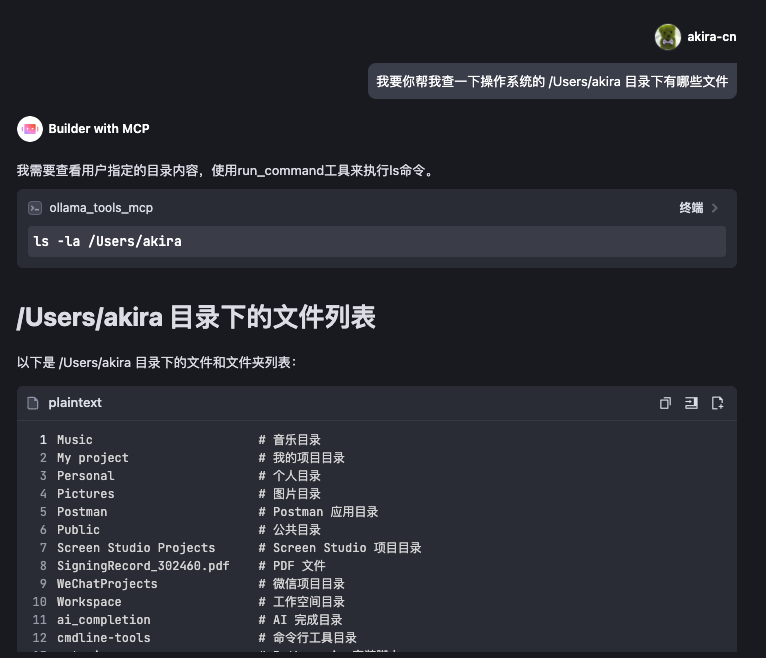
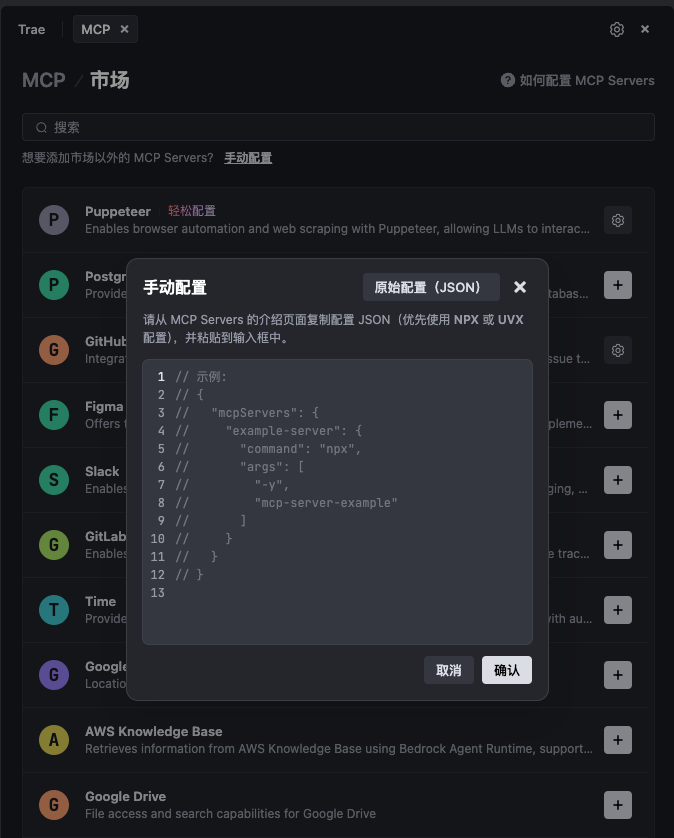
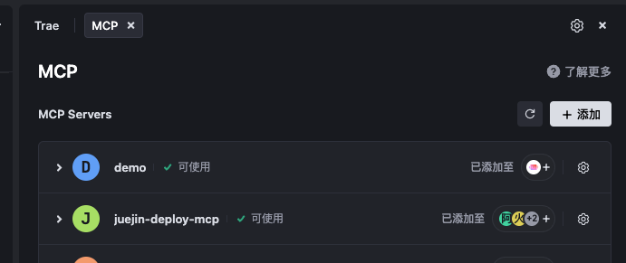
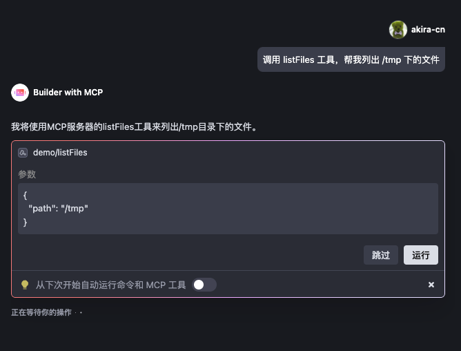

# 36 | 如何使用MCP开发智能体工具

你好，我是月影。

上一节课我们介绍了如何让大模型使用工具，实际上这也是一种规范，是 OpenAI 最先提出并实现的大模型工具调用（tool call）能力，其他大部分大模型厂商也纷纷跟进，所以现在大部分兼容 OpenAI API 的大模型都支持工具调用。

工具调用是一种很灵活的能力，但它过于灵活，不够标准化。因此 2025 年，由 Anthropic 公司推出开放标准 MCP。

MCP 是一个协议，全称是 Model Context Protocol，它旨在统一 LLM 与外部工具、系统和数据源的交互方式，从而让大模型可以与各种工具、系统、硬件设备以及数据低成本、自由地交互。在 MCP 中，工具被定义为服务器（MCPServer）上可执行的功能模块，通过 MCP 协议暴露给客户端，供 LLM 调用。MCP 的目标是提供一个通用的协议，使得 LLM 可以动态地发现和调用外部工具，从而增强其功能和使用范围。

用文字来描述 MCP 的意义和作用比较抽象，还是按照惯例，我们通过实战来体会 MCP 的作用。

## 创建 MCPServer 并通过 Client 调用

我们打开 Trae IDE，创建一个新的 Vue 项目 ollama_tools_mcp。

首先安装依赖：

```
pnpm i axios dotenv express marked
pnpm i -D @types/node
pnpm i @modelcontextprotocol/sdk zod
```

这里我们除了安装和上一节课一样的、项目必需的 axios dotenv express marked 之外，还增加了新的两个库 @modelcontextprotocol/sdk 和 zod。

其中 @modelcontextprotocol/sdk 是官方的 SDK，创建 Server 和 Client 都需要用到它。而zod 是一个非常重要的库，MCP 用它来定义参数类型，提供静态和运行时类型检查，并且Server 在注册工具时，zod 能够自动生成 JSON Schema，从而为大模型调用工具提供元数据（即让大模型知道工具都有哪些参数，应该传什么类型的数据）。

### 1. 创建 MCPServer

```
接着，我们创建 MCPServer，新建文件  ./mcp/server.ts 内容如下：
```

- ./mcp/server.ts

```python
import { McpServer } from '@modelcontextprotocol/sdk/server/mcp.js';
import { StdioServerTransport } from '@modelcontextprotocol/sdk/server/stdio.js';
import { z } from 'zod';
import { exec } from 'child_process';
// Create an MCP server
const server = new McpServer({
 name: 'Demo',
 version: '1.0.0',
});
// listFiles
server.tool('listFiles', '列出指定目录下的文件', { path: z.string() }, async ({ path
 return new Promise((resolve, _reject) => {
   exec(`ls -la ${path}`, async (error, stdout, stderr) => {
     if (error) {
       console.error(`执行命令出错: ${error}`);
       resolve({
         content: [{ type: 'text', text: `执行命令出错: ${error}` }],
       });
       return;
     }
     if (stderr) {
       console.error(`命令stderr: ${stderr}`);
     }
     resolve({
       content: [{ type: 'text', text: `已获取到目录 ${path} 文件列表:\n\`\`\`\n${s
     });
   })
 });
});
// Start receiving messages on stdin and sending messages on stdout
const transport = new StdioServerTransport();
await server.connect(transport);
console.log('Server started');
```

在这里，我们详细看一下代码。

首先，我们创建一个 MCPServer 对象，参数为名字和版本号。

```javascript
// Create an MCP server
const server = new McpServer({
 name: 'Demo',
 version: '1.0.0',
});
```

接着，我们在 MCPServer 上注册一个工具（tool）。

```
// listFiles
server.tool('listFiles', '列出指定目录下的文件', { path: z.string() }, async ({ path
 return new Promise((resolve, _reject) => {
   exec(`ls -la ${path}`, async (error, stdout, stderr) => {
     if (error) {
       console.error(`执行命令出错: ${error}`);
       resolve({
         content: [{ type: 'text', text: `执行命令出错: ${error}` }],
       });
       return;
     }
     if (stderr) {
       console.error(`命令stderr: ${stderr}`);
     }
     resolve({
       content: [{ type: 'text', text: `已获取到目录 ${path} 文件列表:\n\`\`\`\n${s
     });
   })
 });
});
```

注意，sever.tool 的参数包括工具名、描述、用 zod 定义的参数 Schema，以及具体调用方法（一个异步方法，参数必须匹配 Schema）。

```
在这里我们定义了一个 listFiles 工具，描述是“列出指定目录下的文件”，接受一个 path
参数，类型是 string，它的实现还是类似于上一节课的方法，通过 exec 调用命令  ls -la 来
```

获取文件列表信息。

然后我们创建一个传输层，因为我们这个方法通过命令行调用，以标准输入输出（stdio）来通

```
信，所以我们创建 StdioServerTransport，然后就可以通过  await
server.connect(transport); 启动 MCPServer。
```

这样我们就完成了 MCPServer。

### 2. 创建 MCPClient

光有 Server 还不行，还需要对应的 MCPClient 来使用 Server。所以我们再创建一个

```
./mcp/client.ts 文件，内容如下：
```

- ./mcp/client.ts

```bash
// src/client.js;
import { Client } from"@modelcontextprotocol/sdk/client/index.js";
import { StdioClientTransport } from"@modelcontextprotocol/sdk/client/stdio.js";
export async function createClient() {
 const client = new Client({
   name: "Demo",
   version: "1.0.0",
 });
 const transport = new StdioClientTransport({
   command: "npx",
   args: ["tsx", "mcp/server.ts"],
 });
 try {
   await client.connect(transport);
   console.log("Client connected successfully");
 } catch (err) {
   console.error("Client connection failed:", err);
   throw err;
 }
 // 可选：添加客户端方法调用后的调试
 return client;
}
```

```python
在上面的代码里，我们通过 StdioClientTransport 连接 server，具体的方法是通过命令行  npx
tsx mcp/server.ts 来调用 MCPServer。
我们可以写一个简单的  ./mcp/test.ts  来看具体如何使用。
import { createClient } from './client';
const client = await createClient();
const result = await client.callTool({
 name:'listFiles',
 arguments: { path: '.' }
});
console.log('Server 提供的 tools：');
console.log(JSON.stringify(await client.listTools(), null, 2));
console.log('\n\n调用 listFiles：');
console.log(result);
运行 npx tsx ./mcp/test.ts (如果你的 NodeJS 版本过低，可以用 ts-node 或者 jiti 替代
```

npx），之后控制台终端会得到如下结果。

```
Client connected successfully
Server 提供的 tools：
{
 "tools": [
   {
     "name": "listFiles",
     "description": "列出指定目录下的文件",
     "inputSchema": {
       "type": "object",
       "properties": {
         "path": {
           "type": "string"
         }
       },
       "required": [
         "path"
       ],
       "additionalProperties": false,
       "$schema": "http://json-schema.org/draft-07/schema#"
     }
   }
 ]
}
调用 listFiles：
{
 content: [
   {
     type: 'text',
     text: '已获取到目录 . 文件列表:\n' +
       '```\n' +
       'total 184\n' +
       'drwxr-xr-x@ 19 akira  staff    608 Jun  8 08:43 .\n' +
       'drwxr-xr-x  34 akira  staff   1088 Jun  7 20:26 ..\n' +
       '-rw-r--r--@  1 akira  staff     57 Jun  7 08:23 .env.local\n' +
       '-rw-r--r--   1 akira  staff    253 Apr  3 18:03 .gitignore\n' +
       'drwxr-xr-x   3 akira  staff     96 Apr  3 18:03 .vscode\n' +
       '-rw-r--r--   1 akira  staff    442 Apr  3 18:03 README.md\n' +
       '-rw-r--r--   1 akira  staff    362 Apr  3 18:03 index.html\n' +
       'drwxr-xr-x@  3 akira  staff     96 Jun  8 08:43 lib\n' +
       'drwxr-xr-x@  6 akira  staff    192 Jun  7 20:35 mcp\n' +
       'drwxr-xr-x@ 22 akira  staff    704 Jun  7 20:46 node_modules\n' +
       '-rw-r--r--@  1 akira  staff    737 Jun  7 20:46 package.json\n' +
       '-rw-r--r--@  1 akira  staff  51942 Jun  7 20:46 pnpm-lock.yaml\n' +
       'drwxr-xr-x   3 akira  staff     96 Apr  3 18:03 public\n' +
       '-rw-r--r--@  1 akira  staff   2029 Jun  8 10:27 server.ts\n' +
       'drwxr-xr-x   9 akira  staff    288 Jun  8 08:43 src\n' +
       '-rw-r--r--@  1 akira  staff    392 May 31 11:06 tsconfig.app.json\n' +
       '-rw-r--r--@  1 akira  staff    119 Jun  7 20:43 tsconfig.json\n' +
       '-rw-r--r--@  1 akira  staff    665 Jun  7 20:43 tsconfig.node.json\n' +
       '-rw-r--r--@  1 akira  staff    374 Jun  7 07:28 vite.config.ts\n' +
       '```\n'
   }
 ]
}
通过测试，我们看到在 MCPClient 中，可以用  await client.listTools() 来获取
```

MCPServer 注册的所有 tools，而通过 client.callTool 就可以调用指定名称的 tool。

这样我们的 MCPServer 和 MCPClient 就实现完成了。

### 3. 将 MCP 和 LLM 连接起来

接着我们要将 MCP 服务与大模型连接。

```
我们还是使用 Ollama 本地的  qwen3:1.7b ，创建配置文件  .env.local ，内容如下。
OLLAMA_API=http://localhost:11434
OLLAMA_MODEL=qwen3:1.7b
我们封装一个 LLM 类，创建文件  ./lib/llm ，内容如下。
```

- ./lib/llm

```bash
import { EventEmitter } from 'node:events';
import { createClient } from '../mcp/client';
import axios from 'axios';
export class LLM {
 private mcpClient = createClient();
 constructor(private model: string, private base_url: string, private api_key: s
 }
 get headers(): { [key: string]: string } {
   if (this.api_key) {
     return {
       // 'Content-Type': 'application/json',
       'Authorization': `Bearer ${this.api_key}`
     }
   } else {
     return {
       // 'Content-Type': 'application/json',
     }
   }
 }
 private async listTools() {
   return (await (await this.mcpClient).listTools()).tools.map((tool: any) => (
     {
       type: "function",
       function: {
         name: tool.name,
         description: tool.description,
         parameters: tool.inputSchema,
       }
     }
   ));
 }
 private async callTool(tool_name: string, tool_args: any) {
   const result = await (await this.mcpClient).callTool({
     name: tool_name,
     arguments: tool_args
   });
   return {
     role: 'tool',
     name: tool_name,
     content: (result.content as any)[0].text,
   }
 }
 async chat(messages: any[]) {
   const tools = await this.listTools();
   const response = await axios.post(`${this.base_url}/api/chat`, {
     model: this.model,
     messages,
     tools,
     stream: false,
   }, {
     headers: this.headers
   });
   const data = response.data;
   // if tool_calls is not empty, call too
   const reply = data.message.content;
   const tool_calls = data.message.tool_calls;
   if(tool_calls && tool_calls.length > 0) {
     const results = await Promise.all(tool_calls.map(async (tool_call: any) =>
       this.callTool(tool_call.function.name, tool_call.function.arguments)));
     return await this.chat([...messages, ...results]);
   }
   return reply;
 }
 async chatStream(messages: any[], emitter: EventEmitter = new EventEmitter()) {
   const response = await axios.post(`${this.base_url}/api/chat`, {
     model: this.model,
     messages,
     tools: await this.listTools(),
     stream: true,
   }, {
     responseType: 'stream',
     headers: this.headers
   });
   let hasToolcall = false;
   response.data.on('data', async (chunk: Buffer) => {
     try {
       const text = chunk.toString();
       const lines = text.split('\n').filter(line => line.trim() !== '');
       for (const line of lines) {
         try {
           const parsed = JSON.parse(line);
           const tool_calls = parsed.message?.tool_calls;
           if (tool_calls && tool_calls.length > 0) {
             hasToolcall = true;
             emitter.emit('tool_call', tool_calls.map((tool_call: any) => tool_c
             const results = await Promise.all(tool_calls.map(async (tool_call:
               this.callTool(tool_call.function.name, tool_call.function.argumen
             await this.chatStream([...messages,...results], emitter);
           } else {
             emitter.emit('data', parsed.message?.content);
           }
         } catch (error) {
           console.error('解析JSON出错:', error);
           emitter.emit('error', error);
         }
       }
     } catch (error) {
       console.error('处理流数据出错:', error);
       emitter.emit('error', error);
     }
   });
   response.data.on('end', () => {
     if (!hasToolcall) {
       emitter.emit('end');
     }
   });
   response.data.on('error', (error: any) => {
     emitter.emit('error', error);
   });
   return emitter;
 }
}
```

上面的代码封装了一个 LLM 类，它调用 MCPClient。

首先，我们需要对 LLM 处理 tool call 的形式与 MCPClient 返回格式做一个桥接（或者说适配）。

```javascript
 private async listTools() {
   return (await (await this.mcpClient).listTools()).tools.map((tool: any) => (
     {
       type: "function",
       function: {
         name: tool.name,
         description: tool.description,
         parameters: tool.inputSchema,
       }
     }
   ));
 }
 private async callTool(tool_name: string, tool_args: any) {
   const result = await (await this.mcpClient).callTool({
     name: tool_name,
     arguments: tool_args
   });
   return {
     role: 'tool',
     name: tool_name,
     content: (result.content as any)[0].text,
   }
 }
```

这个适配，是根据 OpenAI 兼容的 Tool Call 格式进行适配，规则直接参考大模型文档，比如Moonshot 文档 即可。

然后我们实现 chat 和 chatStream，实际上是将上一节课遗留的封装任务完成了。这里主要有三个关键点要留意一下。

```javascript
首先我们可以通过 const tools = await this.listTools(); 获得 MCPServer 上
```

- 所有可用的 tools，并做适配转换。

```
然后我们通过 data.message.tool_calls 在与大模型对话中得到要被调用的工具，通
```

- 过后面的代码来调用所有应当被调用的工具（由大模型自己在聊天中指定的）。

```javascript
     const results = await Promise.all(tool_calls.map(async (tool_call: any) =>
       this.callTool(tool_call.function.name, tool_call.function.arguments)));
之后将结果通过 await this.chat([...messages, ...results]); 追加到
```

messages 列表中，然后递归调用。

1. chatStream 是 chat 对应的流式调用接口，但我们 LLM 中并未使用流对象，而是通过EventEmitter 将消息发送出去，这样我们可以在 express 的 server 里通过监听事件进行处理。

### 4. 创建 HTTP Server

```
接下来，我们在项目中创建  ./server.ts 。
```

- ./server.ts

```python
import * as dotenv from 'dotenv';
import express from 'express';
import axios from 'axios';
import { exec } from 'child_process';
import { LLM } from './lib/llm';
interface IChatMessage {
 role: string;
 content: string;
 name?: string;
}
dotenv.config({
 path: ['.env.local', '.env']
});
const app = express();
const PORT = 3300;
const llm = new LLM(
 process.env.OLLAMA_MODEL || 'qwen3:1.7b',
 process.env.OLLAMA_API || 'http://localhost:11434'
);
app.use(express.json());
app.post('/chat', async (req, res) => {
 const { message } = req.body
 const messages:IChatMessage[]  = [
   {
     role: 'system',
     content: '如有需要，你可以调用listFiles工具查找指定目录下的文件和文件夹',
   },
   {
     role: 'user',
     content: message,
   },
 ];
 const reply = await llm.chat(messages);
 res.json({
   reply
 });
});
app.post('/chat-stream', async (req, res) => {
 const { message } = req.body
 const messages:IChatMessage[]  = [
   {
     role: 'system',
     content: '如有需要，你可以调用listFiles工具查找指定目录下的文件和文件夹',
   },
   {
     role: 'user',
     content: message,
   },
 ];
 // 设置SSE响应头
 res.setHeader('Content-Type', 'text/event-stream');
 res.setHeader('Cache-Control', 'no-cache');
 res.setHeader('Connection', 'keep-alive');
 const emitter = await llm.chatStream(messages);
 emitter.on('data', (chunk) => {
   res.write(`event: message\ndata: ${JSON.stringify({content: chunk})}\n\n`);
 });
 emitter.on('tool_call', (chunk) => {
   res.write(`event: tool_call\ndata: ${JSON.stringify({tool: chunk})}\n\n`);
 });
 emitter.on('end', () => {
   res.write('event: done\ndata: {}\n\n');
   res.end();
 });
 emitter.on('error', (err: Error) => {
   console.error('流错误:', err);
   res.write(`event: error\ndata: ${JSON.stringify({error: err.message})}\n\n`);
   res.end();
 });
});
app.listen(PORT, () => {
 console.log(`服务器运行在 http://localhost:${PORT}`)
});
```

与上一节课的项目相比，这个 server.ts 比较简单，通过 LLM 实例来实现与大模型通信。

非流式情况下直接调用。

```javascript
 const reply = await llm.chat(messages);
 res.json({
   reply
 });
```

流式下通过监听事件推流。

```javascript
 const emitter = await llm.chatStream(messages);
 emitter.on('data', (chunk) => {
   res.write(`event: message\ndata: ${JSON.stringify({content: chunk})}\n\n`);
 });
 emitter.on('tool_call', (chunk) => {
   res.write(`event: tool_call\ndata: ${JSON.stringify({tool: chunk})}\n\n`);
 });
 emitter.on('end', () => {
   res.write('event: done\ndata: {}\n\n');
   res.end();
 });
 emitter.on('error', (err: Error) => {
   console.error('流错误:', err);
   res.write(`event: error\ndata: ${JSON.stringify({error: err.message})}\n\n`);
   res.end();
 });
```

这样就实现了 HTTP Server，最后我们来搞定前端部分。

### 5. 实现前端 UI

先配置 vite 代理。

```bash
 server: {
   allowedHosts: true,
   port: 4399,
   proxy: {
     '/api': {
       target: 'http://localhost:3300',
       secure: false,
       rewrite: path => path.replace(/^\/api/, ''),
     },
   },
 },
```

然后我们修改 App.vue，内容如下。

```sql
<script setup lang="ts">
import { ref, computed, onUnmounted } from 'vue';
import { marked } from 'marked';
import { fetchEventSource } from '@microsoft/fetch-event-source';
const question = ref('你好，帮我列出当前目录下的文件');
const rawContent = ref('');
const status = ref('');
const thinkContent = computed(() => {
 if(rawContent.value.startsWith('<think>')) {
   const match = rawContent.value.match(/^<think>([\s\S]*?)<\/think>/im);
   return (match ? match[1] : rawContent.value).replace(/^<think>/mg, '');
 }
 return '';
});
const replyContent = computed(() => {
 let content = '';
 if(rawContent.value.startsWith('<think>')) {
   content = rawContent.value.split('</think>')[1] || '';
 } else {
   content = rawContent.value || '';
 }
 return marked(content);
});
// 用于控制流式连接的中止控制器
const abortController = ref<AbortController | null>(null);
// 关闭流式连接
const closeConnection = () => {
 if (abortController.value) {
   abortController.value.abort();
   abortController.value = null;
 }
};
// 在组件卸载时关闭连接
onUnmounted(() => {
 closeConnection();
});
// 非流式更新
const update = async () => {
 if (!question.value) return;
 closeConnection(); // 确保关闭之前的连接
 status.value = "思考中...";
 const headers = {
   'Content-Type': 'application/json',
 };
 const response = await fetch('/api/chat', {
   method: 'POST',
   headers: headers,
   body: JSON.stringify({
     message: question.value,
   })
 });
 status.value = "";
 const data = await response.json();
 rawContent.value = data.reply;
};
// 流式更新
const updateStream = async () => {
 if (!question.value) return;
 closeConnection(); // 确保关闭之前的连接
 status.value = "思考中...";
 rawContent.value = '';
 // 创建新的AbortController用于控制请求
 abortController.value = new AbortController();
 try {
   await fetchEventSource('/api/chat-stream', {
     method: 'POST',
     headers: {
       'Content-Type': 'application/json',
     },
     body: JSON.stringify({
       message: question.value,
     }),
     signal: abortController.value.signal,
     // 处理不同类型的事件
     onmessage(event) {
       if(event.event === 'tool_call') {
         status.value = `调用工具: ${event.data}`;
         rawContent.value = rawContent.value.replace(/<\/think>/, '\n\n');
       } else {
         status.value = '';
       }
       try {
         const data = JSON.parse(event.data);
         if (data.content) {
           rawContent.value += data.content;
         }
       } catch (e) {
         console.error('解析消息出错:', e);
       }
     },
     // 根据事件类型处理不同的事件
     async onopen(response) {
       if (response.ok && response.headers.get('content-type')?.includes('text/e
         return; // 连接成功
       }
       throw new Error(`Failed to open SSE connection: ${response.status} ${resp
     },
     // 处理不同类型的事件
     onerror(err) {
       console.error('SSE错误:', err);
       rawContent.value += '\n\n*连接出错，请重试*';
       return; // 不重试，关闭连接
     },
   });
 } catch (e) {
   console.error('流式连接错误:', e);
   rawContent.value += '\n\n*连接出错，请重试*';
 } finally {
   status.value = "";
 }
}
</script>
<template>
 <div class="container">
   <div>
     <label>输入：</label><input class="input" v-model="question" />
     <button @click="update">普通提交</button>
     <button @click="updateStream" class="stream-btn">流式提交</button>
   </div>
   <div class="state-indicator">{{ status }}</div>
   <div class="output">
     <div class="think">{{ thinkContent }}</div>
     <div v-html="replyContent"></div>
   </div>
 </div>
</template>
<style scoped>
.container {
 display: flex;
 flex-direction: column;
 align-items: start;
 justify-content: start;
 height: 100vh;
 font-size: .85rem;
}
.input {
 width: 200px;
}
.output {
 margin-top: 10px;
 min-height: 300px;
 width: 100%;
 text-align: left;
}
button {
 padding: 0 10px;
 margin-left: 6px;
}
.stream-btn {
 background-color: #4CAF50;
 color: white;
}
.static-indicator {
 margin-top: 10px;
 font-size: 0.8rem;
 color: blue;
 font-weight: bold;
}
.think {
 margin-top: 10px;
 color: gray;
 max-height: 300px;
 overflow-y:auto;
 font-size: x-small;
}
</style>
```

这个文件内容和上一节课的基本上是一样的，就不再赘述了，我们启动 server 和 vite，看一下效果：


与上一节课相比，我们的 listFiles 还增加了 path 参数，所以你可以和大模型说“列出~/Documents 下的文件” 之类，它会自动传入正确的参数。

这样我们就实现了一个完整的对接 ollama 的 MCP 应用。

## 通过其他工具集成使用 MCPServer

通过前面的实战，我们体会到了 MCP 与 LLM 的连接，但是你可能会问了，这么做，除了接口规范一些外，和直接使用 Tool Call 对于大模型来说又有什么本质区别呢？

其实，对于大模型来说，无论是通过 Tool Call 还是 MCPClient 调用工具，本质上都是一样的。实际上，我们也看到在封装的 llm.ts 里，我们还是把 MCPClient.listTools 和MCPClient.callTool 调用的结果转为大模型内置的 Tool Calls 机制。

但是，MCPServer 是一个通用协议，所以很多工具和平台是集成它的时候都很方便，不需要自己写 Client 代码，只需要一个简单配置。

实际上，像 Trae 和 Cursor 编辑器，它的 AI 智能体运行环境中是有内置工具和 MCP 服务的，比如我让 Trae 的智能体帮我查系统中的文件，它默认也会调用工具：



而我们可以注册自己的 MCPServer 到 Trae 下。

我们打开 Trae 的 MCP 配置，选择“添加 > 手动配置”。



然后我们输入以下 JSON 配置。

```json
{
 "mcpServers": {
   "demo": {
     "command": "npx",
     "args": ["tsx", "/path/to/ollama_tools_mcp/mcp/server.ts"]
   }
 }
}
这里的 /path/to 换成你本地的绝对路径，然后点击确认按钮，会看到列表中出现可用的名
```

为 demo 的 MCP 服务。



这样我们就可以在 Trae 中使用它。当我让 Trae 调用 listFiles 工具列出某个目录下的文件时，Trae 的智能体就会自动调用这个方法去获取文件信息了。



所以我们看到，MCPServer 的好处其实是一次实现，到处使用，既能用于我们自己的基于Ollama 的应用，也可以轻松集成到 Trae 这样的工具中，这就是遵守开放协议的好处和意义所在。

## 要点总结

这一讲我们通过实战详细介绍了创建 MCPServer 和 MCPClient，然后用 Ollama 来调用我们需要的工具。这么做的好处是因为 MCP 是一个开放协议，它能够被很多 AI 相关的工具和平台支持。

例如，我们实现的 listFiles 工具不仅能在我们自己的 Ollama 应用中使用，还能轻松安装到我们的 Trae 环境中，让 Trae 的 AI 智能体去使用它，因为 Trae 遵循了 MCP 协议，它自己能够用内置的 Client 去调用我们实现的合法的 MCPServer，这样就使得工具的使用范围更广了，也真正能基于这个协议基础上，实现智能体与各种 AI 工具的资源共享和互联互通。

MCP 除了今天讲解的内容外，其实还有很多值得深入的点，比如我们使用的StdioServerTransport 只是 MCP 应用协议下层的一种传输协议实现，除了StdioServerTransport 外，还有 Streamable HTTP Transport 传输协议。

如果使用 Streamable HTTP Transport，MCP Server 会启动一个 HTTP 服务，然后客户端通过 JSONRPC 与之通信，这种方式特别适合将服务远程部署在云端的主机或函数容器上，从而能够支持多客户端高并发连接、并通过身份验证等手段来提高安全性。

此外，今天我们也只讲了通过 MCPServer.tool 注册和使用工具，实际上 MCPServer 还支持注册 resources 和 prompts，它们都有自己的独特作用，有兴趣的同学，建议通过 MCP 开源官网进一步深入了解。

## 课后练习

参考课程中的例子，思考一下有什么对自己有用的服务，将它封装成 MCP 服务，实现通过大模型调用，同时能够用 Cursor 或 Trae 客户端安装和使用，将你的具体实现和心得体会分享到评论区吧。

这节课的完整代码详见 GitHub 代码仓库。
