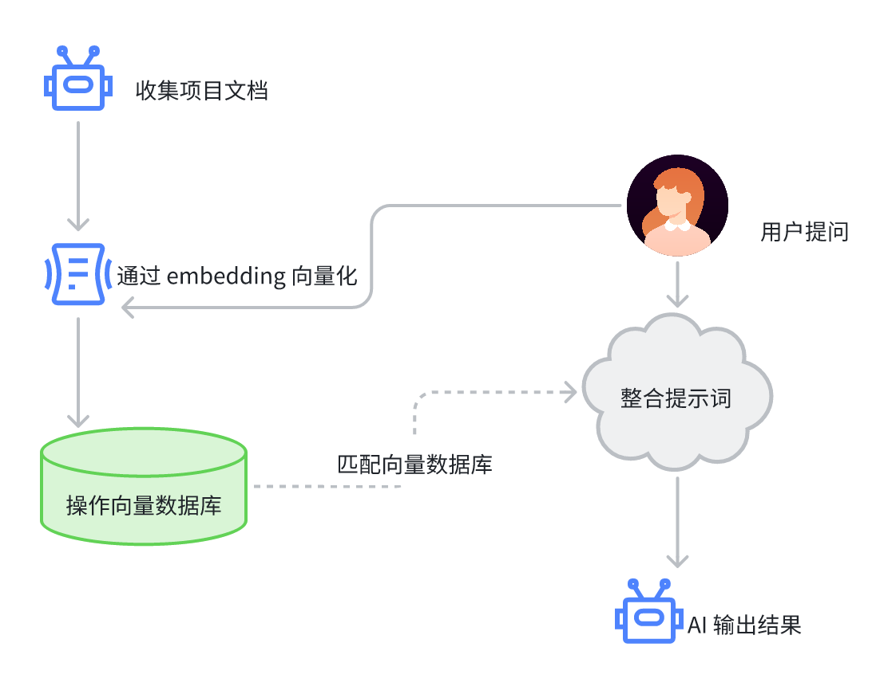
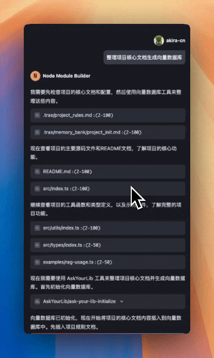

# 38 | 如何构建并使用RAG技术（二）

你好，我是月影。

上一节课，我们实现了一个基于简单的向量数据库的检索器（Retriever），这是实现 RAG 的第一步。

接下来我们将通过实战，把文档内容通过 SimpleRAG 写入到向量数据库，然后通过大模型进行对话。这正是一个标准的构建和使用 RAG 的过程，我们用如下的流程图来表示。



## 实现项目数据的向量化

在过去，传统的技术里面，要把一个项目的文档提取出来进行向量化，本身也不是很困难，无非就是根据规则遍历文件夹，找到文件夹中的特定格式文件，比如 markdown 文档，然后将文档中的文本内容写入到向量数据库。

这么做肯定是可以的，但这么做不够灵活。

首先它必须按照规则存放文档，AI 也没法判断文档的重要性。其次，如果项目代码更新了，文档没有及时整理，那么 AI 也无法获得最新的内容。第三，现在的 VibeCoding 工具本身分析文件目录的能力比较强，完全可以将整个项目的关键内容提取出来，可能甚至不需要文档。

所以我们可以首先实现这样的一个功能——通过 Trae 或 Cursor 的 AI 智能体，将任意开发项目的数据向量化，存储到 vectra 向量数据库中。

### 通过 MCP Server 来构建向量数据

要实现这个功能，我们可以构建一个 MCP Server：

```sql
#!/usr/bin/env node
/*
* MCP Server
*/
import { McpServer } from '@modelcontextprotocol/sdk/server/mcp.js';
import { StdioServerTransport } from '@modelcontextprotocol/sdk/server/stdio.js';
import { z } from 'zod';
import { loadPrompt } from './utils';
import { SimpleRag } from '../index';
import fs from 'fs/promises';
import path from 'path';
// Create an MCP server
const server = new McpServer({
 name: 'AskYourLib',
 version: '1.0.0',
});
// Global SimpleRag instance
let simpleRagInstance: SimpleRag | null = null;
server.tool(
 'ask-your-lib-initialize',
 `Initialize the vector database operations and clean up any existing .vectra di
 {
 },
 async () => {
   try {
     // Check if .vectra directory exists in project root and remove it
     const projectRoot = path.resolve(__dirname, '../../');
     const vectraPath = path.join(projectRoot, '.vectra');
     const generateMcpPrompt = await loadPrompt('generate');
     try {
       await fs.access(vectraPath);
       await fs.rm(vectraPath, { recursive: true, force: true });
       console.log('Removed existing .vectra directory');
     } catch (error) {
       // Directory doesn't exist, which is fine
       console.log('.vectra directory does not exist, skipping removal');
     }
     // Create new SimpleRag instance
     simpleRagInstance = new SimpleRag();
     return {
       content: [{
         type: 'text',
         text: `⚠️ The guide to follow: \n${generateMcpPrompt}\n\n`
       }],
     };
   } catch (error) {
     console.error(`Error initializing SimpleRag: ${error}`);
     return {
       content: [{
         type: 'text',
         text: `Error initializing SimpleRag: ${error}`
       }],
     };
   }
 }
)
server.tool(
 'ask-your-lib-insert',
 `Insert and vectorize text content into the vector database.`,
 {
   text: z.string(),
 },
 async ({ text }) => {
   try {
     if (!simpleRagInstance) {
       return {
         content: [{
           type: 'text',
           text: 'Database instance is not initialized. Please call ask-your-lib
         }],
       };
     }
     if (!simpleRagInstance.avaliable) {
       await simpleRagInstance.initialize();
     }
     const result = await simpleRagInstance.add(text);
     return {
       content: [{
         type: 'text',
         text: `Text inserted successfully. Inserted items: ${JSON.stringify(res
       }],
     };
   } catch (error) {
     console.error(`Error inserting text: ${error}`);
     return {
       content: [{
         type: 'text',
         text: `Error inserting text: ${error}`
       }],
     };
   }
 }
)
async function main() {
 // Start receiving messages on stdin and sending messages on stdout
 const transport = new StdioServerTransport();
 await server.connect(transport);
 console.log('Server started');
}
main();
```

这里面的内容稍微有点复杂，但没关系，我来给你解释一下你就理解了。

首先我们给 MCP Server 创建一个叫做 ask-your-lib-initialize 的工具，它的作用是初始化SimpleRag 实例，然后返回一段提示词，用于指导后续大模型的操作。

```
为了方便维护和修改，我们将这段提示词写入  src/mcp/prompts/generate.md 文件里：
```

- generate.md

```sql
#  Vectorizing a Node.js Project and Storing in Vectra
Follow the steps below to extract valuable content from your current Node.js proj
## 🔧 Step 1: Initialize the Vector Index
Run the following command in your project root directory to initialize the vector
``bash
ask-your-lib-initialize
``
---
This will create the vector index structure to support future insertions.
## 📄 Step 2: Extract Core Project Content
Traverse the entire project and extract the following key content for vectorizati
### ✅ Project Overview
- Project background and objectives
- Installation, configuration, and usage instructions
- Key features and functionality
- Technology stack and dependency list
- Author, contributors, and community support info
(Recommended to extract from `README.md`, `docs/`, `CHANGELOG.md`, etc.)
### ✅ Source Code Insights (`.js` / `.ts` files)
- Functional descriptions and structural logic of each module
- Core functions, classes, interfaces with comments
- Meaningful inline comments or JSDoc annotations
Ensure the extracted content retains **contextual completeness** for semantic use
### ✅ Additional Documentation (Markdown, config files, etc.)
- Development guides, API documentation, FAQs
- Descriptive fields from `package.json` (e.g., `description`, `scripts`, `depend
> 💡 **Tip**: Use glob patterns to collect `.ts`, `.js`, `.md`, `.json` files and
Organize the results into an array of strings, with each segment treated as a sin
---
## 🧬 Step 3: Vectorize and Insert into Database
Use the following command to vectorize and insert each extracted text segment:
``bash
ask-your-lib-insert --text "xxx"
``
Make sure that:
- Each segment is successfully vectorized
- Add metadata like filenames or module names if possible
- Inserted data is ordered to preserve semantic continuity
---
## ⚠️ Notes
- Avoid vectorizing trivial, empty, or duplicate content
- For long documents, consider chunking the text
- Maintain the original structure and semantics for better retrieval
---
```

上面这个提示词描述了 AI 接下来该怎么具体操作，为项目生成适合的向量数据。

TypeScript 不能直接 import Markdown 文本，为了加载这个提示词到代码里，我们需要一个

```
工具函数 loadPrompt 来从  prompts 目录下读取对应的 .md 文件，我们在
src/mcp/utils.ts  里创建这个函数。
```

- utils.ts

```bash
/**
* Load prompt content from markdown files
* @param promptName - The name of the prompt file (without extension)
* @returns Promise<string> - The content of the prompt file
*/
export async function loadPrompt(promptName: string): Promise<string> {
 try {
   // Get the current file's directory
   const currentDir = getCurrentDir();
   // Construct the path to the prompt file
   const promptPath = join(currentDir, 'prompts', `${promptName}.md`);
   // Read and return the file content
   const content = await fs.readFile(promptPath, 'utf-8');
   return content;
 } catch (error) {
   throw new Error(`Failed to load prompt '${promptName}': ${error instanceof Er
 }
}
还有一个细节，当我们构建项目的时候，我们需要把 prompts 下的 .md 文件也拷贝到 dist 目
```

录下，所以我们需要在 package.json 文件里修改 build 脚本如下：

```
 "scripts": {
   "build": "tsc && mkdir -p dist/llm/prompts && cp src/llm/prompts/*.md dist/ll
...
```

这样我们就可以读取 generate.md 的内容，并通过 ask-your-lib-initialize 这个工具返回给 AICoding 的大模型了。

ask-your-lib-initialize 除了负责调用 SimpleRAG 对象的 initial 方法来初始化实例之外，还负责将旧的数据库删除，因为我们现在还没有提供增量追加的功能，所以我们让 AI 每次生成数据时将旧数据删掉，重新生成新的数据。

接着我们创建另一个工具，叫做 ask-your-lib-insert，我们通过这个工具将内容写入向量数据库 vectra 中。

```
方法就是我们上一节课学过的 await simpleRagInstance.add(text) ，这个大家应
```

该不会陌生。

这样我们可以试着使用这个 MCP Server 了。

它的配置项如下：

```json
{
 "mcpServers": {
   "AskYourLib": {
     "command": "npx",
     "args": [
       "tsx",
       "/your/path/to/frontend-dev-large-model-era/rag_demo/src/mcp/server.ts"
     ]
   }
 }
}
```

- 注意将 /your/path/to/ 替换成你自己真实的文件系统目录

把这个 MCP 添加到 Trae 的配置中，别忘了给你当前使用的智能体添加这个 MCP 工具，然后就可以直接和它对话，生成向量数据了。



### 通过 ollama qwen3:1.7b  进行对话

现在有了向量数据，我们就可以对接 ollama 的 qwen3:1.7b 模型进行对话了。

在进行对话前，我们写一段代码测试一下向量数据库的效果。刚才我已经跑了一遍 MCP，生成了向量数据，现在写一个测试脚本：

- examples/ask-your-lib.ts

```python
import { SimpleRag } from '../src/index';
async function main() {
 const rag = new SimpleRag();
 await rag.initialize();
 const question = process.argv[process.argv.length - 1];
 const res = await rag.query(question);
 console.log(res);
}
main();
```

接着我们在控制台运行命令。

```
npx jsx examples/ask-your-lib.ts 'RAG Demo 是做什么的？'
```

可以看到返回如下结果。

```json
[
 {
   text: '# RAG Demo\n' +
     '\n' +
     '一个基于 TypeScript 的 Node.js 项目，实现了完整的 RAG（检索增强生成）功能演示。项目使
     '\n' +
     '## 🚀 核心特性\n' +
     '\n' +
     '### RAG 功能\n' +
     '- **文本嵌入**: 基于 Ollama 的 `nomic-embed-text` 模型\n' +
     '- **向量存储**: 使用 Vectra 进行本地文件系统存储\n' +
     '- **智能分块**: 自动将长文本分割为可处理的块\n' +
     '- **相似度检索**: 支持语义相似度查询\n' +
     '- **增删改查**: 完整的向量数据库操作\n' +
     '\n' +
     '### 技术栈',
   query: 'RAG Demo 是做什么的？',
   simularity: 0.7141837723769591,
   id: 'b18bac0d-404c-4e34-a992-374d817560ea'
 },
 {
   text: 'demo/\n' +
     '├── src/                    # 源代码目录\n' +
     '│   ├── index.ts           # SimpleRag 主类实现\n' +
     '│   ├── types/             # 类型定义\n' +
     '│   │   └── index.ts       # IEmbedding 接口定义\n' +
     '│   └── utils/             # 工具函数\n' +
     '│       └── index.ts       # 文本分块和嵌入工具\n' +
     '├── examples/              # 使用示例\n' +
     '│   └── rag-usage.ts      # ',
   query: 'RAG Demo 是做什么的？',
   simularity: 0.7123087710639455,
   id: '61312a0c-a1b1-46bb-959d-cb0329ae424d'
 },
 {
   text: '# Package.json 完整配置文档\n' +
     '\n' +
     '## 项目基本信息\n' +
     '```json\n' +
     '{\n' +
     '  "name": "rag_demo",\n' +
     '  "version": "1.0.0",\n' +
     '  "description": "A TypeScript Node.js project for RAG demo",\n' +
     '  "main": "dist/index.js",\n' +
     '  "types": "dist/index.d.ts",\n' +
     '  "author": "RAG Demo Project",\n' +
     '  "license": "ISC"\n' +
     '}\n' +
     '```\n' +
     '\n' +
     '## 可执行文件配置\n' +
     '```json\n' +
     '{\n' +
     '  "bin": {\n' +
     '    ',
   query: 'RAG Demo 是做什么的？',
   simularity: 0.6829199356959024,
   id: '64f17ffd-b799-4491-99f9-552790590861'
 },
 {
   text: '相似度检索**: 支持语义相似度查询\n' +
     '- **增删改查**: 完整的向量数据库操作\n' +
     '\n' +
     '### 技术栈\n' +
     '- **TypeScript**: 完整的类型支持和严格模式\n' +
     '- **CommonJS**: 兼容性输出格式\n' +
     '- **Jest**: 完整的单元测试框架\n' +
     '- **ESLint + Prettier**: 代码质量和格式化\n' +
     '- **pnpm**: 高效的包管理工具\n' +
     '- **Ollama**: AI 模型推理引擎\n' +
     '- **Vectra**: 本地向量数据库\n' +
     '\n' +
     '## 📦 项目结构\n' +
     '\n' +
     '```\n' +
     'rag_demo/\n' +
     '├── src/                    # 源代码目录\n' +
     '│   ├── ',
   query: 'RAG Demo 是做什么的？',
   simularity: 0.6614571294074207,
   id: '4e088b6c-80a2-4ae2-8531-84529c99d5b8'
 },
 {
   text: '/              # 使用示例\n' +
     '│   └── rag-usage.ts      # RAG 功能演示\n' +
     '├── tests/                 # 测试文件目录\n' +
     '│   ├── index.test.ts\n' +
     '│   └── utils.test.ts\n' +
     '├── .trae/                 # 项目配置和记忆库\n' +
     '│   ├── project_rules.md   # 项目开发规范\n' +
     '│   └── memory_bank/       # 项目记忆存储\n' +
     '├── .vectra/               # 向量数据库存储目录\n' +
     '├── dist/   ',
   query: 'RAG Demo 是做什么的？',
   simularity: 0.6591809430168598,
   id: '5ba4bcce-4cb8-4e5f-a46e-c6ea2c3df130'
 }
]
现在我们接入 ollama 的 qwen3:1.7b，修改  examples/ask-your-lib.ts ，先故意不引
```

入 RAG 搜索结果的数据：

```python
import { SimpleRag } from '../src/index';
import ollama from 'ollama';
async function main() {
 const rag = new SimpleRag();
 await rag.initialize();
 const question = process.argv[process.argv.length - 1];
 const res = await rag.query(question);
 const messages = [
   { role: 'user', content: 'RAG Demo 是做什么的？' }
 ];
 const response = await ollama.chat({
   model: 'qwen3:1.7b',
   messages,
   stream: true
 });
 for await (const part of response) {
   process.stdout.write(part.message.content);
 }
}
main();
```

这时候我们看大模型输出的结果：

```
RAG Demo（Retrieval-Augmented Generation Demo）是一种通过**检索外部知识**并结合**生成模型
---
### **RAG Demo 的核心功能**
1. **知识检索**
  - 从预定义的知识库（如文档、数据库、维基百科等）中检索与问题相关的具体信息。
  - 例如：用户提问“苹果公司的创始人是谁？”，系统会检索到“乔布斯”。
2. **生成答案**
  - 将检索到的信息与生成模型（如BERT、GPT等）结合，生成自然流畅的回答。
  - 例如：结合“乔布斯创立了苹果公司”和“苹果公司成立于1976年”，生成“乔布斯是苹果公司的创始人，该
3. **动态更新**
  - 支持实时更新知识库，确保答案的时效性和准确性。
---
### **RAG Demo 的典型应用场景**
1. **问答系统**
  - 为用户提供基于知识库的精准问答（如法律咨询、技术问题解答）。
2. **文档处理**
  - 从文档中提取关键信息并生成摘要或问答（如合同条款解析）。
3. **知识库问答**
  - 通过检索和生成结合，回答复杂问题（如历史事件、科学原理等）。
4. **多语言支持**
  - 支持多种语言的检索和生成，适用于国际化场景（如翻译问答、多语言客服）。
---
### **RAG Demo 的优势**
- **准确性**：通过检索最新或权威信息，避免生成错误。
- **灵活性**：可定制知识库内容，适应不同领域需求。
- **效率**：减少人工处理，提升问答效率。
---
### **注意事项**
- **依赖外部数据**：若知识库不完整或过时，可能影响回答质量。
- **复杂问题处理**：需结合多源信息和逻辑推理，避免单一检索导致的“信息孤岛”。
- **可解释性**：生成的回答需具备可解释性，便于用户验证信息来源。
---
### **示例流程**
1. **用户提问**：
  “如何制作蛋糕？”
2. **检索知识库**：
  - 提取“烘焙材料（面粉、鸡蛋、糖等）、步骤（混合、烘烤）、常见问题（温度控制）”等信息。
3. **生成回答**：
  “制作蛋糕需准备面粉、鸡蛋、糖等材料。步骤包括：1. 将材料混合；2. 烤箱预热；3. 烘烤15-20分钟
---
### **总结**
RAG Demo 是通过**检索知识增强生成能力**的实用工具，广泛应用于问答、文档处理、多语言支持等领域。
```

我们会看到，由于缺少必要的知识，模型给出的答案出现严重的幻觉。

```python
现在我们加入知识库，继续修改  examples/ask-your-lib.ts ：
import { SimpleRag } from '../src/index';
import ollama from 'ollama';
async function main() {
 const rag = new SimpleRag();
 await rag.initialize();
 const question = process.argv[process.argv.length - 1];
 const res = await rag.query(question);
 const messages = [
   {
     role: 'system',
     content: `You are a helpful assistant. Answer the question based on the con
   },
   { role: 'user', content: 'RAG Demo 是做什么的？' }
 ];
 const response = await ollama.chat({
   model: 'qwen3:1.7b',
   messages,
   stream: true
 });
 for await (const part of response) {
   process.stdout.write(part.message.content);
 }
}
main();
```

上面的代码我们实际上就修改了一处，我们直接将向量数据库返回的结果 JSON 序列化后作为 system prompt 传入，这样大模型就可以根据这个上下文进行回答了。

这次大模型回答的结果如下。

```
RAG Demo 是一个基于 TypeScript 的 Node.js 项目，实现了完整的 RAG（检索增强生成）功能演示。
```

这就达到了我们的期待。

### 修正一个细节

现在我们基本上实现了预期的功能，但是我们的 MCP 应该不仅能对于当前项目使用，对于其他项目也应该有效，但现在有个问题，那就是 SimpleRag 的 initialize 方法有个参数

```
indexPath，它默认是  path.join(__dirname, '..', indexPath) 。这样的话 MCP
```

每次生成 .vectra 都在 rag_demo 这个项目自己的目录下，显然不符合我们的要求，我们希望在别的项目使用时，生成在该项目的根目录下。

所以这里我们需要给 MCP Server 的 ask-your-lib-initialize 指定参数。

我们将 ask-xxxx 工具修改为后面这样。

```javascript
server.tool(
 'ask-your-lib-initialize',
 `Initialize the vector database operations and clean up any existing .vectra di
 {
   indexPath: z.string().describe('The path to the vector database index. If not
 },
 async ({ indexPath }) => {
   try {
     // Check if .vectra directory exists in project root and remove it
     const projectRoot = path.resolve(__dirname, '../../');
     const vectraPath = path.join(projectRoot, '.vectra');
     const generateMcpPrompt = await loadPrompt('generate');
     try {
       await fs.access(vectraPath);
       await fs.rm(vectraPath, { recursive: true, force: true });
       console.log('Removed existing .vectra directory');
     } catch (error) {
       // Directory doesn't exist, which is fine
       console.log('.vectra directory does not exist, skipping removal');
     }
     // Create new SimpleRag instance
     simpleRagInstance = new SimpleRag(indexPath);
     return {
       content: [{
         type: 'text',
         text: `⚠️ The guide to follow: \n${generateMcpPrompt}\n\n`
       }],
     };
   } catch (error) {
     console.error(`Error initializing SimpleRag: ${error}`);
     return {
       content: [{
         type: 'text',
         text: `Error initializing SimpleRag: ${error}`
       }],
     };
   }
 }
)
```

这里我们增加了一个 indexPath 参数，因为我们用 zod 描述了参数的元数据信息，让执行MCP 工具的 AI Coding 大模型自己知道该用什么路径去给 indexPath 传递正确的参数。

这样我们就可以让这个 MCP 在其他项目中正确构建向量数据了。

## 要点总结

这一讲，我们通过 AI Coding 工具的大模型，将项目文档摘要整理，构建向量数据库，然后通过 ollama 的本地大模型进行对话。

我们可以清楚地看到，经过 RAG 和没经过 RAG 的时候，大模型对问题的回答有很大的差别。对于特定知识的问题，我们通过 RAG 解决了大模型回答不出或者出现幻觉的问题。

所以 RAG 技术对于企业本地部署的 AI 应用有着非常重要的作用，我们作为开发者应该掌握其核心原理。

这两节课我们所实践的内容还比较简陋，实际用起来肯定还有很多细节问题有待完善，这些问题我就留在课后练习中，希望有兴趣的同学能够动手进一步深入研究。

## 课后练习

我们在实际使用过程中，发现对于一些复杂的库，大模型输出的向量数据不够，还是比较简陋，这应该是 generate.md 提示词的问题。你可以试着改写提示词，增加更明确的指示和步骤，让大模型能做得更好，生成更详尽的内容。

我们课程中的例子，检索内容和对话是通过 ollama 本地大模型完成的，事实上我们同样也可以增加 MCP 工具，让 AI Coding 的智能体通过 MCP 读取项目信息后进行回答。

实际上这也很实用，因为我们虽然能够在 AI Coding 中基于当前项目上下文与智能体对话，但我们不能让智能体默认获取我们安装于 node_modules 下的依赖模块的上下文。这时候如果我们发现有项目有生成 .vectra 向量数据库，我们就可以让智能体直接通过这个 MCP 工具获取内容，然后就可以拿到这个项目最新的第一手资料，这对 AI 运用这个项目生成代码很有帮助。

这也正好解决一个非常普遍的问题，即 AI Coding 时，有的依赖库 API 版本已经更新，但 AI还是用老版本 API 导致代码出 bug 的问题。你可以尝试实现让 AI Coding 智能体通过查找依赖包内的 .vectra 了解最新 API 的功能吗？将你的尝试方法和心得体会分享到评论区吧！

这节课的完整代码详见 GitHub 仓库。
