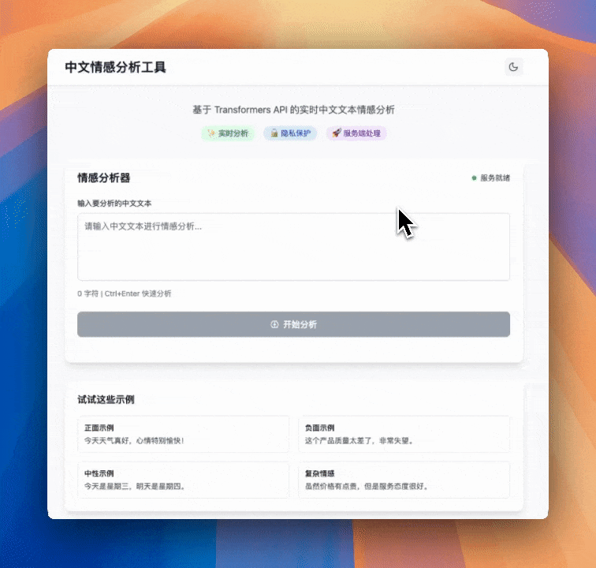

# 39 | Transformers.js：JavaScript的AI运行环境

你好，我是月影。

前面我们介绍的很多技术，都是需要通过调用大模型服务，通过 API 获取生成内容。业务本身的 AI 推理操作实际上是运行在封装好的 LLMs 服务之上的。

这一节课，我们将涉及部分更底层的技术 —— Transformers。

实际上，早在 2022 年底，开源社区开发者 Xenova（Joshua Lochner）就创建了Transformers.js 项目，旨在将 Hugging Face 的 Transformers Python 库的功能迁移到JavaScript 环境中，实现前端本地推理。

@xenova/transforms 库的第一个版本发布于 2022 年 12 月 27 日，此后该项目得到了Hugging Face 的支持，并在其组织下进行维护和更新。

到 2024 年 10 月，最新的 v3 版本（包名变更为@huggingface/transformers）发布，该版本引入对 WebGPU 的支持，利用浏览器的 GPU 进行高性能计算，性能比 WebAssembly 快了 100 倍。

目前，Transformers.js 支持超过 120 种模型架构，包括 GPT、BERT、T5、Phi-3、Gemma、LLaVa、Moondream、Florence-2、MusicGen 等，涵盖自然语言处理、计算机视觉、音频处理等多个领域。

在这一节课里，我们通过一些实战例子来了解 Transformers.js 的常见用法。

## 使用 Transforms.js 处理文本内容

第一个例子，我们实现一个网页应用，让 Transformers.js 使用 Hugging Face 上的开源模型来处理文本，做一个能够分析用户对产品和服务评论中的情感的小应用。

### 初始化项目并安装依赖

首先我们在 Trae IDE 下初始化一个 Vue3 项目。

然后安装依赖 @huggingface/transformers。

```
pnpm i @huggingface/transformers onnxruntime-web
```

安装完成后，我们安装并配置一下 unoCSS 和图标库组件，用来实现 UI 界面。

```
pnpm -D unocss @unocss/reset @iconify-json/lucide
```

之后创建 uno.config.ts。

```bash
import { defineConfig, presetUno, presetAttributify, presetIcons } from 'unocss'
export default defineConfig({
 presets: [
   presetUno(),
   presetAttributify(),
   presetIcons({
     collections: {
       heroicons: () => import('@iconify-json/heroicons/icons.json').then(i => i
       lucide: () => import('@iconify-json/lucide/icons.json').then(i => i.defau
     }
   })
 ],
 theme: {
   colors: {
     primary: {
       50: '#eff6ff',
       100: '#dbeafe',
       200: '#bfdbfe',
       300: '#93c5fd',
       400: '#60a5fa',
       500: '#3b82f6',
       600: '#2563eb',
       700: '#1d4ed8',
       800: '#1e40af',
       900: '#1e3a8a'
     },
     positive: {
       50: '#fef2f2',
       100: '#fee2e2',
       200: '#fecaca',
       300: '#fca5a5',
       400: '#f87171',
       500: '#ef4444',
       600: '#dc2626',
       700: '#b91c1c',
       800: '#991b1b',
       900: '#7f1d1d'
     },
     negative: {
       50: '#f0fdf4',
       100: '#dcfce7',
       200: '#bbf7d0',
       300: '#86efac',
       400: '#4ade80',
       500: '#22c55e',
       600: '#16a34a',
       700: '#15803d',
       800: '#166534',
       900: '#14532d'
     },
     neutral: {
       50: '#f9fafb',
       100: '#f3f4f6',
       200: '#e5e7eb',
       300: '#d1d5db',
       400: '#9ca3af',
       500: '#6b7280',
       600: '#4b5563',
       700: '#374151',
       800: '#1f2937',
       900: '#111827'
     }
   }
 },
 shortcuts: {
   'btn-primary': 'px-4 py-2 bg-primary-500 hover:bg-primary-600 text-white roun
   'btn-secondary': 'px-4 py-2 bg-neutral-100 hover:bg-neutral-200 dark:bg-neutr
   'card': 'bg-white dark:bg-neutral-800 rounded-lg shadow-sm border border-neut
   'input-field': 'w-full px-4 py-2 border border-neutral-300 dark:border-neutra
   'text-sentiment-positive': 'text-positive-500 bg-positive-50 dark:bg-positive
   'text-sentiment-negative': 'text-negative-500 bg-negative-50 dark:bg-negative
   'text-sentiment-neutral': 'text-neutral-500 bg-neutral-50 dark:bg-neutral-900
 },
 safelist: [
   'text-sentiment-positive',
   'text-sentiment-negative',
   'text-sentiment-neutral'
 ]
})
```

上面这一步如果觉得太复杂，可以让 Trae 或者 Cursor 的 AI 来帮你生成。

### 下载和处理模型

接着我们要从 Hugging Face 上选择并下载模型。

由于 transformers.js 内置 onnxruntime-web 和 onnxruntime-node 两个运行时，但并不具备PyTorch / TensorFlow 的运行时，所以它可以加载 ONNX 模型，不能直接处理 PyTorch 的.bin 或 TensorFlow 的 .ckpt 格式的模型。

如果要使用非 ONNX 模型，需要把模型从 PyTorch 格式转换为 ONNX，要安装 optimum：

```
pip install "optimum[exporters]" onnx onnxruntime accelerate
```

然后在项目目录下运行 optimum-cli export 命令导出 ONNX 格式的模型：

```
optimum-cli export onnx \
 --model uer/roberta-base-finetuned-jd-binary-chinese \
 --task sequence-classification \
 --opset 14 \
 --sequence_length 128 \
 ./onnx_model
```

在这里，我们导出了开源模型 uer/roberta-base-finetuned-jd-binary-chinese， 这是在京东数据集上对中文商品评论情感做的二分类微调，它对商品评价类内容的实际情感倾向（正面 /负面）有很好的识别效果。

使用 transformers.js 的时候，有两种方式。前面我们已经说了，它有两个运行时，一个是onnxruntime-web 可以运行在纯前端的网页上，另一个是 onnxruntime-node 可运行在Node.js 下。

到目前为止，实际上能通过 onnxruntime-web 直接运行于浏览器环境的模型还非常有限，很多模型不提供 ONNX，即使转换了，兼容浏览器运行时也有问题。而且还有一个更严重的问题，那就是通常模型文件还是比较大的，即使非常微小的模型文件大小也有超过百兆。如果我们放在浏览器上加载运行，就意味着需要下载如此大的文件到我们客户端，目前这种做法不太实际。所以，我们还是选择将模型放到 Node.js 的运行环境中去使用比较合适。

我们需要安装 server 的依赖：

```
pnpm i express
pnpm i -D @types/express
```

注意，我们要把前面下载到 ./onnx_model 的文件调整一下，把 model.onnx 文件放在./onnx_model/onnx 目录下，现在目录结构如下：

```
onnx_model
├── config.json
├── onnx
│   └── model.onnx
├── special_tokens_map.json
├── tokenizer.json
├── tokenizer_config.json
└── vocab.txt
```

然后我们创建 server.ts，内容如下：

```python
import express, { Request, Response } from 'express';
import { pipeline, env } from '@huggingface/transformers';
const app = express();
app.use(express.json());
//  启用本地模型
env.allowLocalModels = true;
//  初始化模型
let sentimentPipeline: any;
const initModel = async () => {
 console.log('🔄 正在加载模型...');
 sentimentPipeline = await pipeline(
   'sentiment-analysis',
   './onnx_model',  // 指向本地的模型目录
   {
     device: "gpu",
     dtype: "fp32", // 使用 fp16 提高性能
     revision: undefined,          // 避免从 HuggingFace Hub 下载
     local_files_only: true        // 强制只使用本地文件
   }
 );
 console.log(' 模型加载完成！');
};
//  提供API
app.post('/api/sentiment', async (req: Request, res: Response): Promise<any> => {
 try {
   const text = req.body.text;
   if (!text) return res.status(400).json({ error: 'Missing text' });
   const result = await sentimentPipeline(text);
   res.json(result);
 } catch (err) {
   console.error(err);
   res.status(500).json({ error: 'Inference failed' });
 }
});
//  启动服务器
const PORT = process.env.PORT || 3000;
app.listen(PORT, async () => {
 console.log(`🚀 服务已启动：http://localhost:${PORT}`);
 await initModel();
});
```

这样我们就能将模型运行于运行 Node.js 服务端了。

```
我们运行  jiti server  或者  ts-node server  或者  npx tsx server ，如果没问题
```

的话，可以看到 Node.js 服务正常启动：

```
akira@AkiraMacbook transforms_js_demo % jiti server.ts
🚀 服务已启动：http://localhost:3000
🔄 正在加载模型...
 模型加载完成！
```

### 实现 UI 界面

接下来我们就可以准备实现前端界面。

首先配置 vite.config.ts 的 server:

```bash
 server: {
   allowedHosts: true,
   port: 4399,
   proxy: {
     '/api': {
       target: 'http://localhost:3000',
       secure: false,
       rewrite: path => path.replace(/^\/api/, ''),
     },
   },
 },
```

然后我们修改 App.vue，内容如下。

```xml
<template>
 <div class="min-h-screen bg-gray-50 dark:bg-gray-900 transition-colors">
   <!-- 头部 -->
   <header class="bg-white dark:bg-gray-800 shadow-sm border-b border-gray-200 d
     <div class="max-w-4xl mx-auto px-4 py-4 flex justify-between items-center">
       <h1 class="text-2xl font-bold text-gray-900 dark:text-white">
         中文情感分析工具
       </h1>
       <button
         @click="toggleTheme"
         class="p-2 rounded-lg bg-gray-100 dark:bg-gray-700 hover:bg-gray-200 da
       >
         <IconLucideSun v-if="isDark" class="w-5 h-5 text-yellow-500" />
         <IconLucideMoon v-else class="w-5 h-5 text-gray-600" />
       </button>
     </div>
   </header>
   <!-- 主内容 -->
   <main class="max-w-4xl mx-auto px-4 py-8">
     <!-- 介绍 -->
     <div class="text-center mb-8">
       <p class="text-lg text-gray-600 dark:text-gray-300 mb-4">
         基于 Transformers API 的实时中文文本情感分析
       </p>
       <div class="flex justify-center gap-4 text-sm">
         <span class="px-3 py-1 bg-green-100 dark:bg-green-900 text-green-800 da
           ✨ 实时分析
         </span>
         <span class="px-3 py-1 bg-blue-100 dark:bg-blue-900 text-blue-800 dark:
           🔒 隐私保护
         </span>
         <span class="px-3 py-1 bg-purple-100 dark:bg-purple-900 text-purple-800
           🚀 服务端处理
         </span>
       </div>
     </div>
     <!-- 分析器 -->
     <div class="bg-white dark:bg-gray-800 rounded-xl shadow-lg p-6">
       <!-- 模型状态 -->
       <div class="flex items-center justify-between mb-6">
         <h2 class="text-xl font-semibold text-gray-900 dark:text-white">
           情感分析器
         </h2>
         <div class="flex items-center gap-2">
           <div class="flex items-center gap-2">
             <div
               class="w-2 h-2 rounded-full"
               :class="{
                 'bg-green-500': modelStatus === 'ready',
                 'bg-yellow-500': modelStatus === 'loading',
                 'bg-red-500': modelStatus === 'error',
                 'bg-gray-400': modelStatus === 'idle'
               }"
             ></div>
             <span class="text-sm text-gray-600 dark:text-gray-300">
               {{ modelStatusText }}
             </span>
           </div>
         </div>
       </div>
       <!-- 文本输入 -->
       <div class="mb-6">
         <label class="block text-sm font-medium text-gray-700 dark:text-gray-30
           输入要分析的中文文本
         </label>
         <textarea
           v-model="inputText"
           placeholder="请输入中文文本进行情感分析..."
           class="w-full h-32 p-3 border border-gray-300 dark:border-gray-600 ro
           @keydown.ctrl.enter="analyzeText"
         ></textarea>
         <div class="flex justify-between items-center mt-2">
           <span class="text-sm text-gray-500 dark:text-gray-400">
             {{ inputText.length }} 字符 | Ctrl+Enter 快速分析
           </span>
           <button
             v-if="inputText"
             @click="inputText = ''"
             class="text-sm text-gray-500 hover:text-gray-700 dark:text-gray-400
           >
             清空
           </button>
         </div>
       </div>
       <!-- 分析按钮 -->
       <div class="mb-6">
         <button
           @click="analyzeText"
           :disabled="!inputText.trim() || isAnalyzing"
           class="w-full py-3 px-4 bg-blue-600 hover:bg-blue-700 disabled:bg-gra
         >
           <IconLucideLoader2 v-if="isAnalyzing" class="w-4 h-4 animate-spin" />
           <IconLucideBrain v-else class="w-4 h-4" />
           {{ isAnalyzing ? '分析中...' : '开始分析' }}
         </button>
       </div>
       <!-- 分析结果 -->
       <div v-if="result" class="space-y-4">
         <h3 class="text-lg font-semibold text-gray-900 dark:text-white">
           分析结果
         </h3>
         <!-- 整体情感 -->
         <div class="p-4 rounded-lg border" :class="resultBorderClass">
           <div class="flex items-center gap-3 mb-2">
             <div class="text-2xl">
               {{ result.type === 'positive' ? '😊' : result.type === 'negative'
             </div>
             <div>
               <div class="font-semibold" :class="resultTextClass">
                 {{ result.type === 'positive' ? '正面情感' : result.type === 'ne
               </div>
               <div class="text-sm text-gray-600 dark:text-gray-400">
                 置信度: {{ (result.confidence * 100).toFixed(1) }}%
               </div>
             </div>
           </div>
           <div class="text-sm text-gray-600 dark:text-gray-400">
             原始标签: {{ result.label }}
           </div>
         </div>
       </div>
       <!-- 错误信息 -->
       <div v-if="error" class="p-4 bg-red-50 dark:bg-red-900/20 border border-r
         <div class="flex items-center gap-2 text-red-800 dark:text-red-200">
           <IconLucideAlertCircle class="w-5 h-5" />
           <span class="font-medium">分析失败</span>
         </div>
         <p class="text-sm text-red-600 dark:text-red-300 mt-1">{{ error }}</p>
       </div>
     </div>
     <!-- 示例文本 -->
     <div class="mt-8 bg-white dark:bg-gray-800 rounded-xl shadow-lg p-6">
       <h3 class="text-lg font-semibold text-gray-900 dark:text-white mb-4">
         试试这些示例
       </h3>
       <div class="grid grid-cols-1 md:grid-cols-2 gap-4">
         <button
           v-for="example in examples"
           :key="example.text"
           @click="inputText = example.text"
           class="p-3 text-left border border-gray-200 dark:border-gray-600 roun
         >
           <div class="text-sm font-medium text-gray-900 dark:text-white mb-1">
             {{ example.label }}
           </div>
           <div class="text-sm text-gray-600 dark:text-gray-400">
             {{ example.text }}
           </div>
         </button>
       </div>
     </div>
   </main>
 </div>
</template>
<script setup lang="ts">
import { ref, computed, onMounted } from 'vue'
// 图标
import IconLucideSun from '~icons/lucide/sun'
import IconLucideMoon from '~icons/lucide/moon'
import IconLucideBrain from '~icons/lucide/brain'
import IconLucideLoader2 from '~icons/lucide/loader-2'
import IconLucideAlertCircle from '~icons/lucide/alert-circle'
// 类型定义
interface SentimentResult {
 type: 'positive' | 'negative' | 'neutral'
 label: string
 confidence: number
}
// 响应式数据
const isDark = ref(false)
const inputText = ref('')
const isAnalyzing = ref(false)
const result = ref<SentimentResult | null>(null)
const error = ref('')
const modelStatus = ref<'idle' | 'loading' | 'ready' | 'error'>('ready')
// 示例文本
const examples = [
 { label: '正面示例', text: '今天天气真好，心情特别愉快！' },
 { label: '负面示例', text: '这个产品质量太差了，非常失望。' },
 { label: '中性示例', text: '今天是星期三，明天是星期四。' },
 { label: '复杂情感', text: '虽然价格有点贵，但是服务态度很好。' }
]
// 计算属性
const modelStatusText = computed(() => {
 switch (modelStatus.value) {
   case 'idle': return '未连接'
   case 'loading': return '连接中...'
   case 'ready': return '服务就绪'
   case 'error': return '连接失败'
   default: return '未知状态'
 }
})
const resultBorderClass = computed(() => {
 if (!result.value) return ''
 switch (result.value.type) {
   case 'positive': return 'border-green-200 dark:border-green-800 bg-green-50 d
   case 'negative': return 'border-red-200 dark:border-red-800 bg-red-50 dark:bg
   default: return 'border-gray-200 dark:border-gray-600 bg-gray-50 dark:bg-gray
 }
})
const resultTextClass = computed(() => {
 if (!result.value) return ''
 switch (result.value.type) {
   case 'positive': return 'text-green-800 dark:text-green-200'
   case 'negative': return 'text-red-800 dark:text-red-200'
   default: return 'text-gray-800 dark:text-gray-200'
 }
})
// 主题切换
const toggleTheme = () => {
 isDark.value = !isDark.value
 document.documentElement.classList.toggle('dark', isDark.value)
 localStorage.setItem('theme', isDark.value ? 'dark' : 'light')
}
// 初始化主题
const initTheme = () => {
 const savedTheme = localStorage.getItem('theme')
 const prefersDark = window.matchMedia('(prefers-color-scheme: dark)').matches
 isDark.value = savedTheme === 'dark' || (!savedTheme && prefersDark)
 document.documentElement.classList.toggle('dark', isDark.value)
}
// 检查服务器状态
const checkServerStatus = async () => {
 try {
   modelStatus.value = 'loading'
   error.value = ''
   // 简单的健康检查，可以发送一个测试请求
   const response = await fetch('/api/sentiment', {
     method: 'POST',
     headers: {
       'Content-Type': 'application/json'
     },
     body: JSON.stringify({ text: '测试' })
   })
   if (response.ok) {
     modelStatus.value = 'ready'
   } else {
     throw new Error('服务器响应异常')
   }
 } catch (err) {
   console.error('服务器连接失败:', err)
   modelStatus.value = 'error'
   error.value = '无法连接到分析服务，请确保服务器正在运行'
 }
}
// 映射标签到情感类型
const mapLabelToSentiment = (label: string): 'positive' | 'negative' | 'neutral'
 const lowerLabel = label.toLowerCase()
 if (label === '正面' || lowerLabel.includes('positive') || lowerLabel.includes('
   return 'positive'
 } else if (label === '负面' || lowerLabel.includes('negative') || lowerLabel.inc
   return 'negative'
 }
 return 'neutral'
}
// 分析文本
const analyzeText = async () => {
 if (!inputText.value.trim()) return
 try {
   isAnalyzing.value = true
   error.value = ''
   result.value = null
   // 调用后端 API
   const response = await fetch('/api/sentiment', {
     method: 'POST',
     headers: {
       'Content-Type': 'application/json'
     },
     body: JSON.stringify({ text: inputText.value.trim() })
   })
   if (!response.ok) {
     throw new Error(`HTTP ${response.status}: ${response.statusText}`)
   }
   const results = await response.json()
   const topResult = Array.isArray(results) ? results[0] : results
   console.log('API 响应:', results)
   // API 响应数据结构适配
   const label = topResult.label || 'unknown'
   const score = topResult.score || 0
   result.value = {
     type: mapLabelToSentiment(label),
     label: label,
     confidence: score
   }
 } catch (err) {
   console.error('分析失败:', err)
   error.value = `分析失败: ${err instanceof Error ? err.message : '未知错误'}`
 } finally {
   isAnalyzing.value = false
 }
}
// 生命周期
onMounted(() => {
 initTheme()
 checkServerStatus()
})
</script>
<style>
/* 基础样式重置 */
* {
 margin: 0;
 padding: 0;
 box-sizing: border-box;
}
body {
 font-family: -apple-system, BlinkMacSystemFont, 'Segoe UI', Roboto, sans-serif;
 line-height: 1.6;
}
/* 滚动条样式 */
::-webkit-scrollbar {
 width: 6px;
}
::-webkit-scrollbar-track {
 background: transparent;
}
::-webkit-scrollbar-thumb {
 background: #cbd5e1;
 border-radius: 3px;
}
.dark ::-webkit-scrollbar-thumb {
 background: #475569;
}
/* 动画 */
.animate-spin {
 animation: spin 1s linear infinite;
}
@keyframes spin {
 from {
   transform: rotate(0deg);
 }
 to {
   transform: rotate(360deg);
 }
}
/* 过渡效果 */
.transition-colors {
 transition: color 0.2s ease, background-color 0.2s ease, border-color 0.2s ease
}
</style>
```

虽然代码比较多，但 HTML 和 CSS 主要是 UI 界面相关的，这里就展开不细讲了。我们主要来看一下 JS 的部分：

```python
import { ref, computed, onMounted } from 'vue'
// 图标
import IconLucideSun from '~icons/lucide/sun'
import IconLucideMoon from '~icons/lucide/moon'
import IconLucideBrain from '~icons/lucide/brain'
import IconLucideLoader2 from '~icons/lucide/loader-2'
import IconLucideAlertCircle from '~icons/lucide/alert-circle'
// 类型定义
interface SentimentResult {
 type: 'positive' | 'negative' | 'neutral'
 label: string
 confidence: number
}
// 响应式数据
const isDark = ref(false)
const inputText = ref('')
const isAnalyzing = ref(false)
const result = ref<SentimentResult | null>(null)
const error = ref('')
const modelStatus = ref<'idle' | 'loading' | 'ready' | 'error'>('ready')
// 示例文本
const examples = [
 { label: '正面示例', text: '今天天气真好，心情特别愉快！' },
 { label: '负面示例', text: '这个产品质量太差了，非常失望。' },
 { label: '中性示例', text: '今天是星期三，明天是星期四。' },
 { label: '复杂情感', text: '虽然价格有点贵，但是服务态度很好。' }
]
// 计算属性
const modelStatusText = computed(() => {
 switch (modelStatus.value) {
   case 'idle': return '未连接'
   case 'loading': return '连接中...'
   case 'ready': return '服务就绪'
   case 'error': return '连接失败'
   default: return '未知状态'
 }
})
const resultBorderClass = computed(() => {
 if (!result.value) return ''
 switch (result.value.type) {
   case 'positive': return 'border-green-200 dark:border-green-800 bg-green-50 d
   case 'negative': return 'border-red-200 dark:border-red-800 bg-red-50 dark:bg
   default: return 'border-gray-200 dark:border-gray-600 bg-gray-50 dark:bg-gray
 }
})
const resultTextClass = computed(() => {
 if (!result.value) return ''
 switch (result.value.type) {
   case 'positive': return 'text-green-800 dark:text-green-200'
   case 'negative': return 'text-red-800 dark:text-red-200'
   default: return 'text-gray-800 dark:text-gray-200'
 }
})
// 主题切换
const toggleTheme = () => {
 isDark.value = !isDark.value
 document.documentElement.classList.toggle('dark', isDark.value)
 localStorage.setItem('theme', isDark.value ? 'dark' : 'light')
}
// 初始化主题
const initTheme = () => {
 const savedTheme = localStorage.getItem('theme')
 const prefersDark = window.matchMedia('(prefers-color-scheme: dark)').matches
 isDark.value = savedTheme === 'dark' || (!savedTheme && prefersDark)
 document.documentElement.classList.toggle('dark', isDark.value)
}
// 检查服务器状态
const checkServerStatus = async () => {
 try {
   modelStatus.value = 'loading'
   error.value = ''
   // 简单的健康检查，可以发送一个测试请求
   const response = await fetch('/api/sentiment', {
     method: 'POST',
     headers: {
       'Content-Type': 'application/json'
     },
     body: JSON.stringify({ text: '测试' })
   })
   if (response.ok) {
     modelStatus.value = 'ready'
   } else {
     throw new Error('服务器响应异常')
   }
 } catch (err) {
   console.error('服务器连接失败:', err)
   modelStatus.value = 'error'
   error.value = '无法连接到分析服务，请确保服务器正在运行'
 }
}
// 映射标签到情感类型
const mapLabelToSentiment = (label: string): 'positive' | 'negative' | 'neutral'
 const lowerLabel = label.toLowerCase()
 if (label === '正面' || lowerLabel.includes('positive') || lowerLabel.includes('
   return 'positive'
 } else if (label === '负面' || lowerLabel.includes('negative') || lowerLabel.inc
   return 'negative'
 }
 return 'neutral'
}
// 分析文本
const analyzeText = async () => {
 if (!inputText.value.trim()) return
 try {
   isAnalyzing.value = true
   error.value = ''
   result.value = null
   // 调用后端 API
   const response = await fetch('/api/sentiment', {
     method: 'POST',
     headers: {
       'Content-Type': 'application/json'
     },
     body: JSON.stringify({ text: inputText.value.trim() })
   })
   if (!response.ok) {
     throw new Error(`HTTP ${response.status}: ${response.statusText}`)
   }
   const results = await response.json()
   const topResult = Array.isArray(results) ? results[0] : results
   console.log('API 响应:', results)
   // API 响应数据结构适配
   const label = topResult.label || 'unknown'
   const score = topResult.score || 0
   result.value = {
     type: mapLabelToSentiment(label),
     label: label,
     confidence: score
   }
 } catch (err) {
   console.error('分析失败:', err)
   error.value = `分析失败: ${err instanceof Error ? err.message : '未知错误'}`
 } finally {
   isAnalyzing.value = false
 }
}
// 生命周期
onMounted(() => {
 initTheme()
 checkServerStatus()
})
```

在上面的代码里，最核心的部分其实就是通过调用 Node.js 的 API 来分析文本。

```javascript
// 分析文本
const analyzeText = async () => {
 if (!inputText.value.trim()) return
 try {
   isAnalyzing.value = true
   error.value = ''
   result.value = null
   // 调用后端 API
   const response = await fetch('/api/sentiment', {
     method: 'POST',
     headers: {
       'Content-Type': 'application/json'
     },
     body: JSON.stringify({ text: inputText.value.trim() })
   })
   if (!response.ok) {
     throw new Error(`HTTP ${response.status}: ${response.statusText}`)
   }
   const results = await response.json()
   const topResult = Array.isArray(results) ? results[0] : results
   console.log('API 响应:', results)
   // API 响应数据结构适配
   const label = topResult.label || 'unknown'
   const score = topResult.score || 0
   result.value = {
     type: mapLabelToSentiment(label),
     label: label,
     confidence: score
   }
 } catch (err) {
   console.error('分析失败:', err)
   error.value = `分析失败: ${err instanceof Error ? err.message : '未知错误'}`
 } finally {
   isAnalyzing.value = false
 }
}
```

在这里，我们调用了 server.ts 的 /api/sentiment，而在 server.ts 中，我们通过sentimentPipeline 来调用模型。

```javascript
//  提供API
app.post('/api/sentiment', async (req: Request, res: Response): Promise<any> => {
 try {
   const text = req.body.text;
   if (!text) return res.status(400).json({ error: 'Missing text' });
   const result = await sentimentPipeline(text);
   res.json(result);
 } catch (err) {
   console.error(err);
   res.status(500).json({ error: 'Inference failed' });
 }
});
```

而模型在启动 server 的时候就完成了初始化：

```javascript
//  初始化模型
let sentimentPipeline: any;
const initModel = async () => {
 console.log('🔄 正在加载模型...');
 sentimentPipeline = await pipeline(
   'sentiment-analysis',
   './onnx_model',  // 指向本地的模型目录
   {
     device: "gpu",
     dtype: "fp32", // 使用 fp16 提高性能
     revision: undefined,          // 避免从 HuggingFace Hub 下载
     local_files_only: true        // 强制只使用本地文件
   }
 );
 console.log(' 模型加载完成！');
};
```

这样呢，我们就完成了整个应用的主体，我们可以启动 server 和 vite，看一下具体的效果。

运行结果如下：



## 要点总结

在这一节课，我们简单介绍了比较底层的 Transformers，它是生成式 AI 的基本架构。通过transformers.js，我们可以用 JavaScript 来操作大模型基座，从而完成我们的应用。

标准的做法是，在开源社区寻找适合的模型，将它转换为 transformers.js 可以支持的 ONNX格式，然后通过 Node Server 或者浏览器端加载调用（这里应优先考虑 NodeJS)。这样我们的业务就可以调用这些底层大模型基座来完成工作了。

Transforms.js 是前端在 AI 时代发展的前沿方向之一，它的核心使命是把 Hugging Facetransformers 的能力搬到前端，让我们在浏览器或 Node.js 里直接加载模型、做推理，而不再需要 Python 和后端服务器。

这意味着：

- 用户输入完全在本地处理不上传到云端，从而更加安全和保护隐私。

- 不需要给模型推理额外搭服务器，从而降低部署成本。

- 模型通信不依赖网络，甚至可以做离线 AI，离线网页就能用 AI 模型。

当然 Transforms.js 想要真正达到商用，还有很多困难需要克服，比如 runtime 的稳定性和兼容性、支持更多模型格式，解决在浏览器端模型大小太大、下载慢的问题等等。

但不管怎么样，我们可以期待一下，在火速发展的 AI 时代，总是拥抱变化的前端必然不会缺席，相信未来 Transforms.js 会更加成熟，成为前端在后 AI 时代不可缺少的关键应用技术。

让我们拭目以待吧。

## 课后练习

这节课里，我们实现了在 Node 下运行 Transformers.js，有些模型其实是可以直接运行在前端页面上的，甚至都不需要 Node.js Server。你可以试一下，找一两个能运行在 Web 端的模型，实现一些具体功能，然后将思考和收获分享到评论区。

本节课的具体代码详见 GitHub 代码仓库。
