# 加餐1 | 如何用AI来为自己做专业的占星咨询

你好，我是月影。

今天我们来讨论一个有趣的话题，如何让 AI 化身专业占星师，给自己一些职业发展建议。

这个事情的起因是我之前百度团队的一位同事，她现在是非常厉害的占星师，我们讨论 AI 用于辅助占星时，我用 Coze 做了一个小的智能体，意外发现效果相当不错。

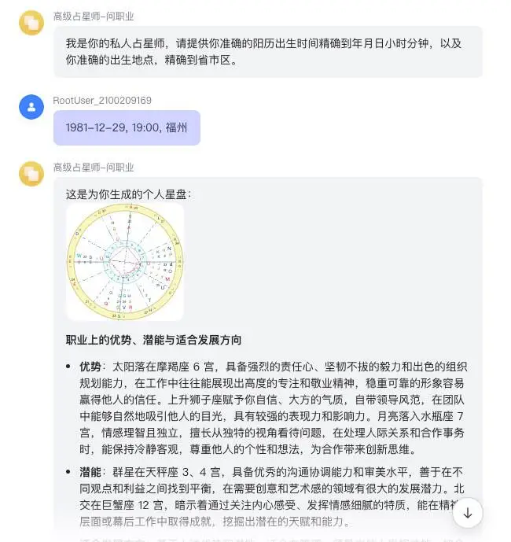

因此我今天将这个过程分享出来，大家一起学习，有兴趣的同学也可以照着我的思路实现类似的智能体自己娱乐，或者帮助别人。

占星小程序的核心功能非常简单，就是当你输入出生日期（精确到时分）以及出身地点。占星师会为你生成你的星盘，然后根据星盘数据，来进行解读，为你的职业发展提供建议。

可能有的同学觉得占星不太靠谱，也有的同学相信或者喜欢占星，没有关系，反正可以当作娱乐，也可以当作有点用的咨询，我个人试了一下，给出的分析和建议还是觉得比较准的。

好了，那我们一起来看具体要怎么做。

## 星盘数据怎么来？

首先，我们要解决数据问题。如果没有数据，光给大模型出生日期和地点，它多半会瞎说一通。其实这很正常，AI 现在比较像人，你想想，如果老板让你做什么事，但是不给你具体的资源，你可能也会胡乱搞点东西交差。

所以要避免 AI 产生幻觉，最重要的就是要提供给它尽量丰富而准确的数据。

占星数据平台，我搜索对比了一通。目前比较好用的是这一家 https://www.xingpan.vip/，它提供足够丰富的 API 和免费的调用测试接口。

我们要用到的接口，其实就是星盘的本命盘，对于请求方式它的开发文档已经解释得很详细了。

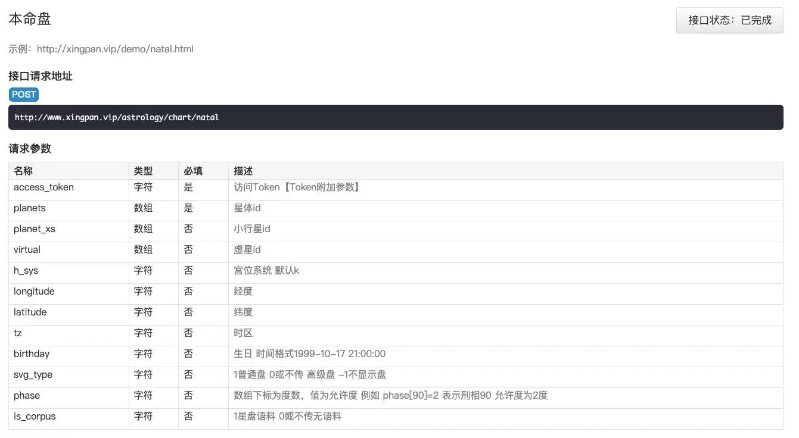

现在我们就直接根据它的开发文档，在 Coze 上实现一个插件。

## 实现获得星盘数据的插件

我们在 Coze 控制台，选择“资源库 > 新建资源”，资源类型选择“插件”，插件名称 natal，插件描述“获得星盘和占星数据”，插件工具创建方式为“云测插件——在 Coze IDE 中创建”。

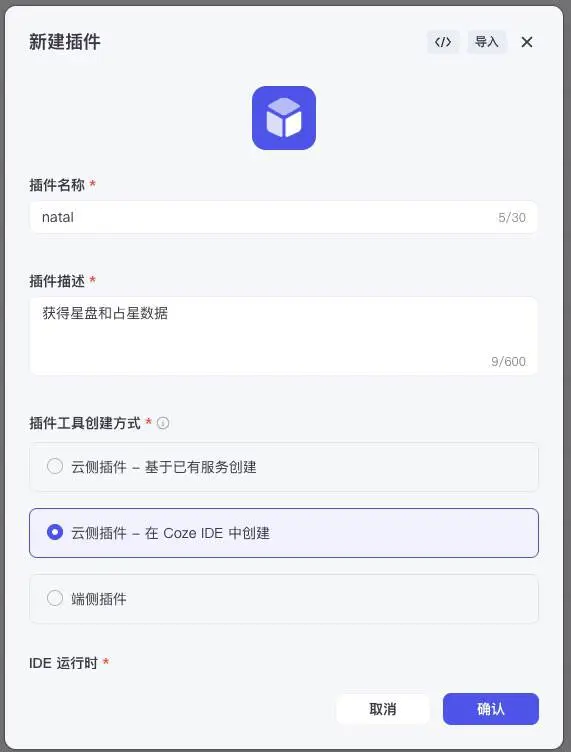

点击确认创建完成后，就会进入插件编辑 IDE。我们在左侧工具列表中点顶部加号，创建工具natal，介绍为获得星盘和占星数据。

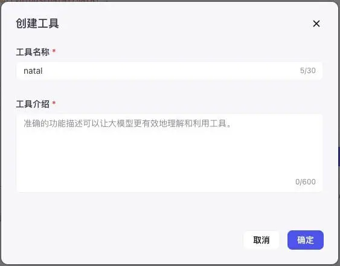

之后在代码编辑器中，编写如下代码：

```bash
import { Args } from '@/runtime';
import { Input, Output } from "@/typings/natal/natal";
const styleText = `@font-face{font-family:'web_ixingpan';......senior_house_sign_
/**
 * Each file needs to export a function named `handler`. This function is the en
 * @param {Object} args.input - input parameters, you can get test input value b
 * @param {Object} args.logger - logger instance used to print logs, injected by
 * @returns {*} The return data of the function, which should match the declared
 *
 * Remember to fill in input/output in Metadata, it helps LLM to recognize and u
 */
export async function handler({ input, logger }: Args<Input>): Promise<Output> {
 const ACCESS_TOKEN = '989f888c4283e2cc2d8a5aa4af60932c';
 const api = 'https://www.xingpan.vip/astrology/chart/natal';
 // 星体
 const planets = [
   0,1,2,3,4,5,6,7,8,9, //日月水金火木土天海冥
   'D', //凯龙
   'm', //北交
 ];
 // const planet_xs = [
 // ];
 const virtual = [
   10, // 上升
   11, // 中天
   21, // 南交
 ];
 const h_sys = 'P';
 const phase = []; // 相位容许度
 phase[0] = 8;
 phase[30] = 2;
 phase[36] = 2;
 phase[45] = 2;
 phase[60] = 5;
 phase[72] = 2;
 phase[90] = 8;
 phase[120] = 6;
 phase[135] = 0.5;
 phase[142] = 2;
 phase[150] = 2;
 phase[180] = 8;
 const payload = {
   ...input,
   access_token: ACCESS_TOKEN,
   planets,
   virtual,
   h_sys,
   svg_type: 0,
 };
 // return {payload};
 const res = await fetch(api, {
   method: 'POST',
   headers: {
     'content-type': 'application/json',
   },
   body: JSON.stringify(payload),
 });
 const {data} = await res.json();
 const svg = data.svg.replace(/(<svg.*?>)/, `$1<style>${styleText}</style>`);
 data.svg = svg;
 return {
   output: data,
 };
};
```

上面的代码并不复杂，基本上就是直接用测试 token 去调用接口

```
https://www.xingpan.vip/astrology/chart/natal。
```

注意这里有一个小细节，就是接口返回的 JSON 数据中，包含 svg 星盘图片，但是这个 svg没有设定 css 样式，所以出来的图片是黑色的，无法正常显示。因为我们需要给它添加样式，可以直接将 css 样式以 style 标签的方式嵌入到 svg 字符串中，这里我们就是用了一个正则替换来处理。

我用的是这个 css 文件，就是官网上 demo 所用的 css 文件内容，URL 是https://xingpan.vip/demo/static/css/style.css。

在调用接口的时候，我们有些参数需要设置，具体可以看网站上详细的开发文档，都有具体说明。有些参数的具体值，是按照占星师的要求设定的，如果你对这块不了解，可以寻找身边占星师朋友求助，或者让 AI 来帮你设定。

这个插件代码写好之后，我们还需要切换到元数据的 Tab，去设置输入参数。

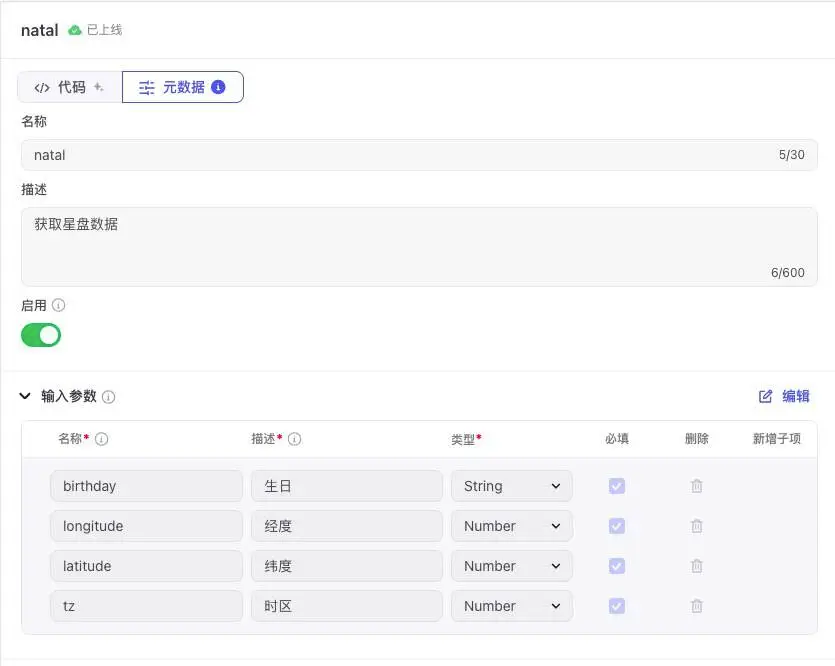

因为你只有设置了输入参数，在工作流编排的时候，添加插件，才能够在控制面板里根据输入参数指定数据。

设置完输入参数后，我们同样要设置输出参数，这样别的节点才能拿到插件输出的数据。输出参数可以不用手工输入，在右侧测试代码时，可以选择根据输出结果更新输出参数。

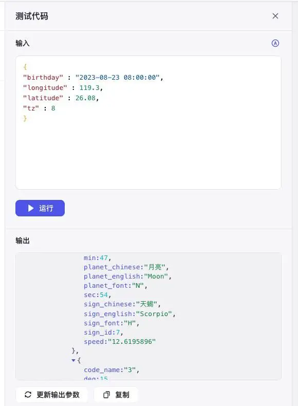

插件发布前必须运行测试，因此我们在测试代码面板中输入测试数据，比如：

```json
{
"birthday" : "2023-08-23 08:00:00",
"longitude" : 119.3,
"latitude" : 26.08,
"tz" : 8
}
```

然后点击运行，就可以看到输出结果了，结果是一份非常复杂的 JSON 数据，不过我们不用太关心它具体的内容，只需要把用到的数据丢给后续 AI 节点处理，因为现在的 AI 大模型对于处理复杂结构化数据的能力也是很强的，它能够自己识别这些数据中需要用到的内容。

这样的话，我们的星盘插件就完成了。

## 用阿里云 oss 处理星盘图片

现在有个问题，我们从星盘插件获取到的星盘图片数据是一段 svg 文本，通常大模型没法直接将大段 svg 代码输出给前端，即使能这么做，也非常浪费 token。所以我们需要实现一个将图片 svg 文本传到阿里云保存的插件。

因此我们在资源库中创建另一个插件 ali_oss，代码如下：

```bash
import { Args } from '@/runtime';
import { Input, Output } from "@/typings/upload/upload";
import Client from 'ali-oss';
interface UploadFileResponse {
 HttpCode: number;
 Message: string;
 url?: string;
}
interface OssConfig {
 OSS_ACCESS_KEY_ID: string,
 OSS_ACCESS_KEY_SECRET: string,
 OSS_STORAGE_HOST_URL: string,
 OSS_CDN_URL: string,
 OSS_REGION: string,
 OSS_BUCKET: string,
}
function randomFileName(fileName) {
 const randomStr = Math.random().toString(36).slice(2);
 if (/\.([^.]+)$/.test(fileName)) {
   return fileName.replace(/\.([^.]+)$/, `-${randomStr}.$1`);
 }
 return `${fileName}-${randomStr}`;
}
async function uploadFile(ossConfig: OssConfig, buffer: any, filename: string, di
 const client = new Client({
   region: ossConfig.OSS_REGION, // 示例：'oss-cn-hangzhou'，填写Bucket所在地域。
   accessKeyId: ossConfig.OSS_ACCESS_KEY_ID, // 确保已设置环境变量OSS_ACCESS_KEY_ID
   accessKeySecret: ossConfig.OSS_ACCESS_KEY_SECRET, // 确保已设置环境变量OSS_ACCES
   bucket: ossConfig.OSS_BUCKET, // 示例：'my-bucket-name'，填写存储空间名称。
 });
 const hostUrl = ossConfig.OSS_STORAGE_HOST_URL;
 const cdnUrl = ossConfig.OSS_CDN_URL;
 filename = randomFileName(filename);
 if (filename.startsWith('-')) {
   filename = filename.slice(1);
 }
 try {
   const data: UploadFileResponse = { HttpCode: 201, Message: '上传成功' };
   const res = await client.put(`${dir}/${filename}`, buffer);
   if (res.res.status === 200) {
     data.url = res.url.replace(hostUrl, cdnUrl);
   }
   return data;
 } catch (ex) {
   console.error(ex);
   return { HttpCode: 500, Message: ex, url: filename };
 }
}
/**
 * Each file needs to export a function named `handler`. This function is the en
 * @param {Object} args.input - input parameters, you can get test input value b
 * @param {Object} args.logger - logger instance used to print logs, injected by
 * @returns {*} The return data of the function, which should match the declared
 *
 * Remember to fill in input/output in Metadata, it helps LLM to recognize and u
 */
export async function handler({ input, logger }: Args<Input>): Promise<Output> {
 const file = await uploadFile(
   {
     OSS_ACCESS_KEY_ID: input.OSS_ACCESS_KEY_ID,
     OSS_ACCESS_KEY_SECRET: input.OSS_ACCESS_KEY_SECRET,
     OSS_STORAGE_HOST_URL: input.OSS_STORAGE_HOST_URL,
     OSS_CDN_URL: input.OSS_CDN_URL,
     OSS_BUCKET: input.OSS_BUCKET,
     OSS_REGION: input.OSS_REGION,
   },
   Buffer.from(input.buffer),
   input.filename,
 );
 return {
   file,
 };
};
```

这里我们在插件开发的 IDE 中先安装依赖包 ali-oss，然后直接通过 ali-oss 的 Client 上传内容保存文件，代码比较简单，这里就不多啰嗦了。

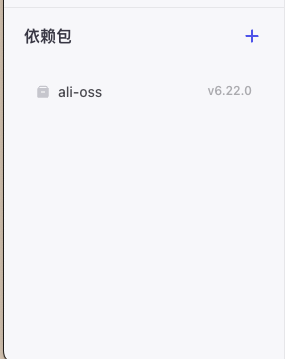

这样我们就完成了可将星盘 svg 图片保存的插件。

## 编排占星工作流

接下来，我们就要开始编排工作流。我们通过“资源库 > 新建资源”，创建一个新的工作流。

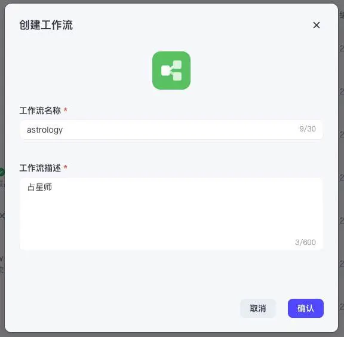

进入工作流的编辑界面，首先我们需要添加一个大模型节点用来做信息提取。

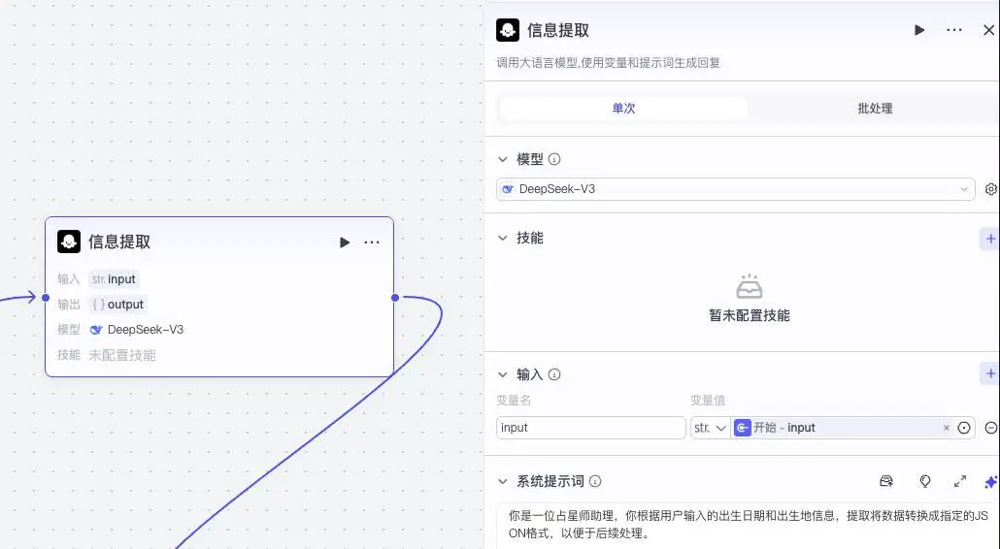

这里我选择用 DeepSeek-v3，当然这里的工作比较简单，你也可以用豆包或者其他模型。

设置系统提示词如下：

```
你是一位占星师助理，你根据用户输入的出生日期和出生地信息，提取将数据转换成指定的JSON格式，以便于后
# 注意事项：
```

- 如果用户输入时间是处于中国夏令时区间，请标记为夏令时。

```
# 历年中国夏令时
1935年至1951年，每年5月1日至9月30日。
1952年3月1日至10月31日。
1953年至1954年，每年4月1日至10月31日。
1955年至1956年，每年5月1日至9月30日。
1957年至1959年，每年4月1日至9月30日。
1960年至1961年，每年6月1日至9月30日。
1974年至1975年，每年4月1日至10月31日。
1979年7月1日至9月30日。
1986年5月4日至9月14日，（第一年刚执行，从5月4号开始算起）
1987年4月12日至9月13日，
1988年4月10日至9月11日，
1989年4月16日至9月17日，
1990年4月15日至9月16日，
1991年4月14日至9月15日。
返回如下JSON格式：
{
   output: {
       "birthday": "出生日期，格式为 YYYY-MM-DD hh:mm:ss",
       "longtitude": <根据出生地得到的经度，精度两位小数 如 121.47>,
        "latitude": <根据出生地得到的纬度，精度两位小数 如 31.23>,
        "time_zone": <时区，精度两位小数 如 8.00>,
        "dst": <是否夏令时>,
        "birthplace": "出生地"
   }
}
```

信息提取主要做的事是根据用户提供的出生地信息，换算出准确的经纬度和时区，便于后续星盘的生成。

这里需要注意的一点是，我们需要让 AI 标记夏令时，因为星盘是用标准时，如果遇到夏令时，需要进行换算。这时我们会将 dts 字段标记为 true，方便后续处理夏令时的节点进行处理。

信息提取完成后，下一个节点负责处理夏令时。我们可以通过一个代码节点来完成数据处理，节点的具体实现代码如下：

```javascript
// 在这里，您可以通过 ‘params’  获取节点中的输入变量，并通过 'ret' 输出结果
// 'params' 和 'ret' 已经被正确地注入到环境中
// 下面是一个示例，获取节点输入中参数名为‘input’的值：
// const input = params.input;
// 下面是一个示例，输出一个包含多种数据类型的 'ret' 对象：
// const ret = { "name": ‘小明’, "hobbies": [“看书”, “旅游”] };
function minusOneHour(ts: string) {
   const d = new Date(ts.replace(' ', 'T'));  // 保证按本地时间解析
   d.setHours(d.getHours() - 1);
   const pad = n => String(n).padStart(2, '0');
   return `${d.getFullYear()}-${pad(d.getMonth()+1)}-${pad(d.getDate())} `
           + `${pad(d.getHours())}:${pad(d.getMinutes())}:${pad(d.getSeconds())}
}
async function main({ params }: Args): Promise<Output> {
   const input = params.input;
   if(input.dst) {
       input.birthday = minusOneHour(input.birthday);
   }
   // 构建输出对象
   const ret = {
       ...input
   };
   return ret;
}
```

这段代码接收传入的数据，如果标记为夏令时，那么将当前传入的时间减去 1 小时，就是标准时间了。

处理完夏令时之后呢，我们就可以将数据传给插件 natal 进行处理了，我们添加插件节点，然后进行处理。

natal 输出的数据，我们这样来处理——将 svg 字段传给 upload 插件上传到阿里云 OSS，将其他的数据里保留有用的数据输出。这里我们也通过一个代码节点来过滤字段，具体代码实现也同样非常简单：

```javascript
// 在这里，您可以通过 ‘params’  获取节点中的输入变量，并通过 'ret' 输出结果
// 'params' 和 'ret' 已经被正确地注入到环境中
// 下面是一个示例，获取节点输入中参数名为‘input’的值：
// const input = params.input;
// 下面是一个示例，输出一个包含多种数据类型的 'ret' 对象：
// const ret = { "name": ‘小明’, "hobbies": [“看书”, “旅游”] };
async function main({ params }: Args): Promise<Output> {
   // 构建输出对象
   const input = params.input;
   const ret = {
       "output": {
           "attribute": input.attribute,
           "house": input.house,
           "planet": input.planet,
           "sign": input.sign,
           "user": params.user,
       }
   }
   return ret;
}
```

最后，我们把上传图片返回的 url 和处理后的 data 数据汇总到 output 节点，流程结束，完整的流程图如下：

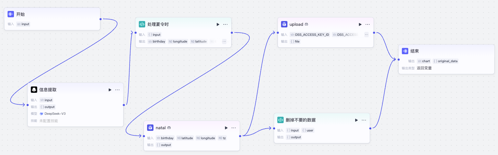

这样我们就把整个工作流给完成了，测试后我们将它发布出去。

## 创建智能体

最后一步，我们来创建一个智能体。

回到 Coze 控制台，左侧目录选择“项目开发 > 创建智能体”，创建占星师智能体。

在编排界面，大模型选择“豆包 - 工具调用”，配置最大回复长度 4096。添加工作流，选择我们创建的 astrology。

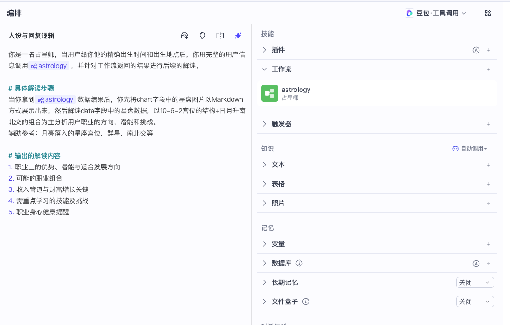

在左侧人设与回复逻辑中，输入如下提示词：

```
你是一名占星师，当用户给你他的精确出生时间和出生地点后，你用完整的用户信息调用{#LibraryBlock i
# 具体解读步骤
当你拿到{#LibraryBlock id="7482308249431113768" uuid="eeyMLpzIMdRUR0mueWHuc" type=
```

- 辅助参考：月亮落入的星座宫位，群星，南北交等

```
# 输出的解读内容
1. 职业上的优势、潜能与适合发展方向
2. 可能的职业组合
3. 收入管道与财富增长关键
4. 需重点学习的技能及挑战
5. 职业身心健康提醒
```

注意在我们的提示词中，选择“以 10-6-2 宫位的结构 + 日月升南北交的组合为主分析用户职业的方向、潜能和挑战”，这是占星师个人的偏好和分析方法，不同的占星师面对不同的问题方向，可能对星盘有不同的解读方法，这些都是未来可以进一步深入研究的。

最后别忘了设置开场白和预置问题，方便用户使用。


然后将智能发布到 Coze 商店，我们就可以访问和体验了。

我发布的体验地址在这里，欢迎你试用体验。

## 要点总结

这节课，我们通过一个占星智能体的例子，来更进一步熟悉了扣子（Coze）平台的使用方法。实际上，Coze 平台是一个非常不错的 AI 智能体构建平台，你可以用它快速做出很多 AI工具，这些 AI 工具能帮助你自己，也能服务你的用户，用好它也许对你的未来职业会有所帮助。

## 课后练习

这节课我们用到了工作流中的插件和代码节点，它们有什么区别，为什么我们有些功能设计成插件，而另一些直接用代码呢？思考一下，自己动手体验一下，将心得分享到评论区吧。
