# 加餐3 | 如何使用Coze工作流封装API

你好，我是月影。

最近有一个客户提了一个需求，让我们封装一个 API 给他们的小程序端调用，来实现一个图片合成的功能。要实现这个功能，有很多做法，但综合考虑开发成本和效率，用 Coze 是一个不错的选择。

无论你是独立开发者，还是业余时间想要做点有趣的 AI 产品，都可以试试借助类似 Coze 的平台能力来实现低成本快速交付。

首先我们来看一下客户的需求是什么样的。

客户是一个组织少年冰球运动的机构，他们有自己的社群和小程序平台。现在客户想要在他的小程序平台中加入一个需求。当用户（主要是家长和孩子）将家里的宠物照片上传到小程序后，调用 AI 合成照片，生成一张以宠物拟人的冰球运动员照片，例如：

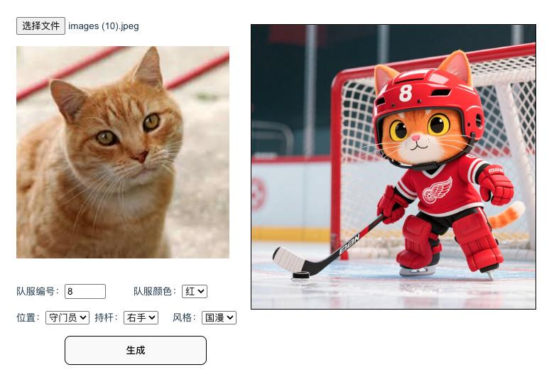

这个需求和我们上一堂课介绍的 Coze 应用“KidsCareer”比较像，但是上一节课我们是直接拿Coze 搭建了完整的应用，而我们这一节课，客户的需求是将服务封装成 API 供客户调用。实际上不管是搭建完整应用还是 API，Coze 都是能够做到的。

接下来我们看具体怎么做。

## 工作流设计

宠物冰球员的工作流，相对比较简单：

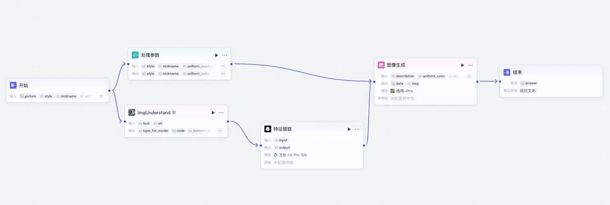

我们来分别看一下其中各个节点。

首先是开始节点，我们根据需求定制参数，如下：

- picture：用户上传图像，必填。

- style：照片风格，默认值为“写实”。

- uniform_number：球衣号码，默认为 10。

- uniform_color：球衣颜色，默认为“红”。

- position：整数枚举 0、1、2，分别为守门员、前锋、后卫，默认随机。

- shooting_hand：持杆手，整数枚举 0、1，分别为左手、右手，默认随机。

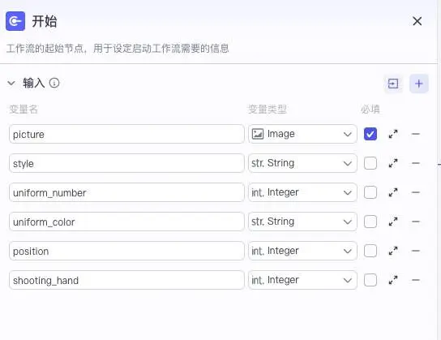

由于 Coze 工作流不支持设置参数默认值，所以我们需要一个代码节点来处理参数，具体代码内容如下：

```javascript
const random = (start: number, end: number) => {
   const p = Math.random();
   return Math.floor(start * (1 - p) + end * p);
}
async function main({ params }: Args): Promise<Output> {
   if (params.position == null) params.position = random(0, 3);
   if (params.shooting_hand == null) params.shooting_hand = random(0, 2);
   const style = params.style || '写实';
   const uniform_number:string = (params.uniform_number || 10).toString();
   const uniform_color = params.uniform_color || '红';
   const position = params.position  == 0 ? '守门员': (params.position == 1 ? '前锋
   const shooting_hand = params.shooting_hand == 0 ? '左手': '右手';
   const empty_hand = params.shooting_hand ? '左手': '右手';
   // 构建输出对象
   const ret = {
       style,
       uniform_number,
       uniform_color,
       position,
       shooting_hand,
   };
   return ret;
}
```

在上面的代码中，我们给参数设置好默认值，然后再次输出。

接着，我们调用图片理解节点，设置好文本提示词“这应该是一张宠物图片，请详细描述该宠物的形象外貌特征，包括品种、毛色、花纹、神态”，并将图片 url 传入该节点。

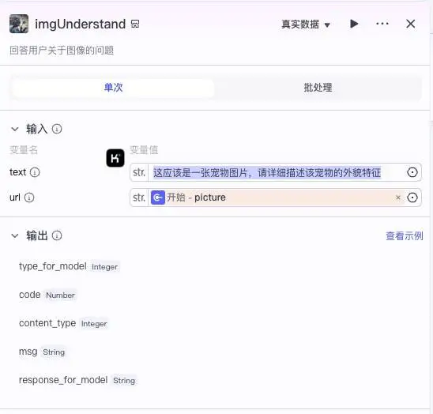

这样我们就能提取出宠物的形象外貌特征。这个节点提取出来的数据大致如下。

原始照片：

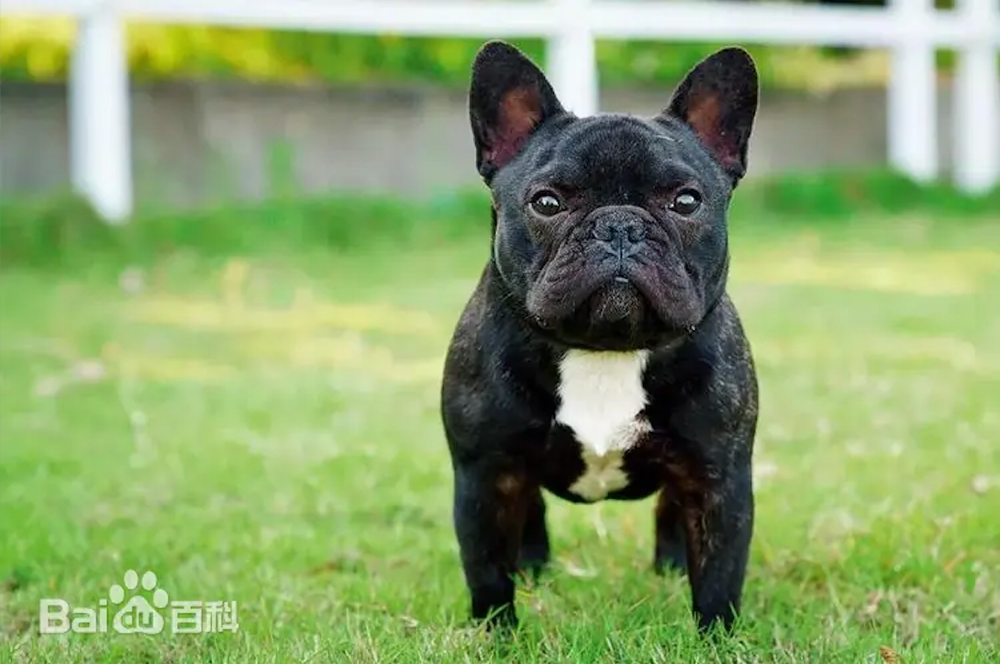

提取结果：

```json
{
 "type_for_model": 1,
 "code": 0,
 "content_type": 1,
 "msg": "success",
 "response_for_model": "这是一只法国斗牛犬。它的毛色为黑色，胸前有一块白色的毛。它耳朵竖立，
}
```

接着，我们通过一个后续大模型节点来提取动物的独特外貌特征，这是一种通用技巧，这样在后续照片合成中，就能通过强化动物外貌特征来提升辨识度。

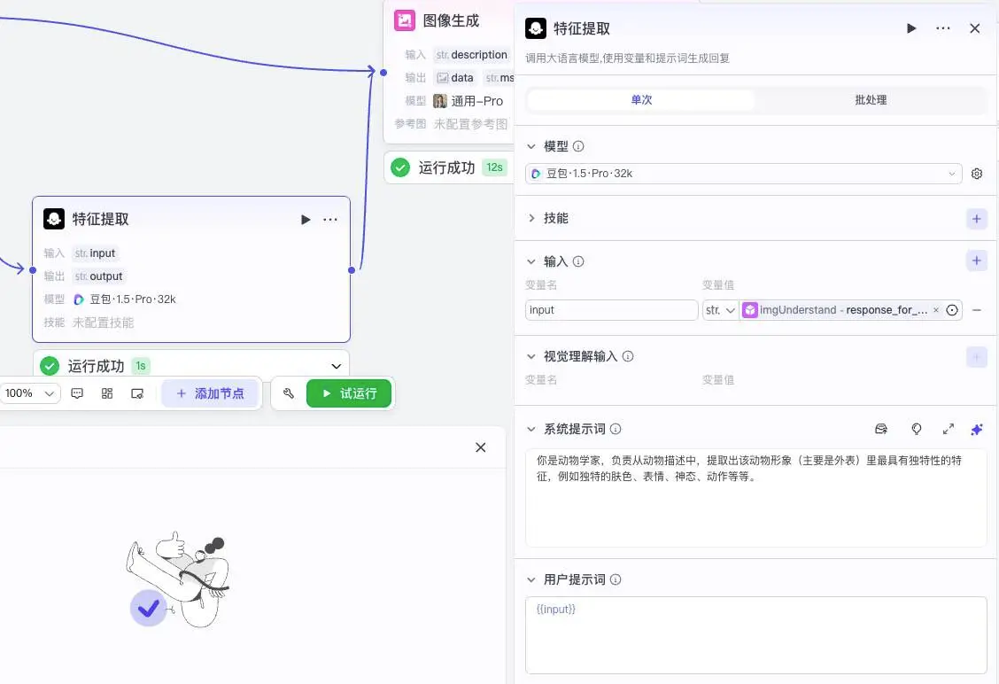

我们创建了一个特征提取节点，它是一个大模型节点，采用“豆包 1.5 Pro-32K”，系统提示词如下：

- 你是动物学家，负责从动物描述中，提取出该动物形象（主要是外表）里最具有独特性的特征，例如独特的肤色

这样，经过这个节点的运行，动物特征被提取出来：

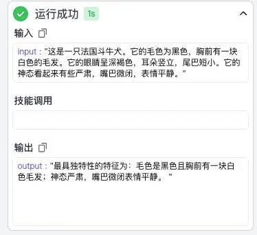

接着，我们将图像识别和特证提取处理结果，以及其它参数，传给图像生成节点：

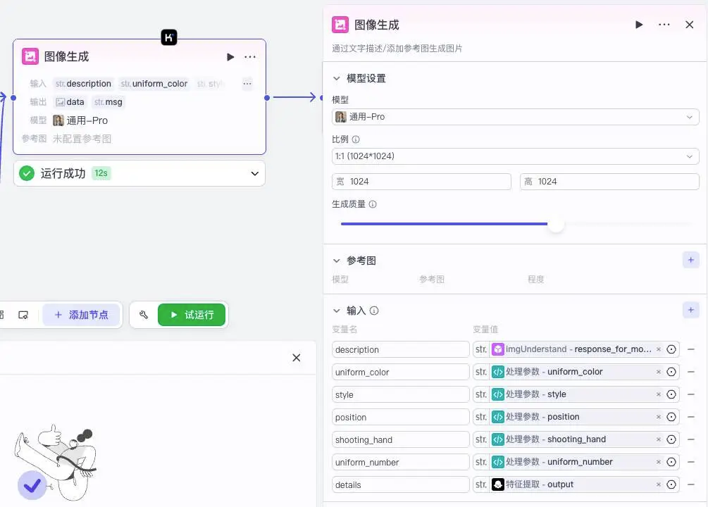

这里我们使用了“通用 -Pro”图像大模型，给出下面的提示词：

```
用动物的形象和特征，将该动物**拟人**为一名宠物儿童冰球员，生成{{style}}风格的冰球球员照片，球员
# 动物形象描述
{{description}}
# 独特外貌特征
{{details}}
# 注意
- 照片中应强化动物独特的外貌特征，以增加辨识度
- 如果球员位置是守门员，画面中应该有冰球球门
```

除了可以设置正向提示词，图像大模型还可以设置负向提示词，我们根据测试的 badcase，设置如下负向提示词。

- 球员双手各握一根球杆球员未佩戴头盔球员吃东西画面中出现除了冰球之外的其他球类地点不在冰球赛场球员四足站立

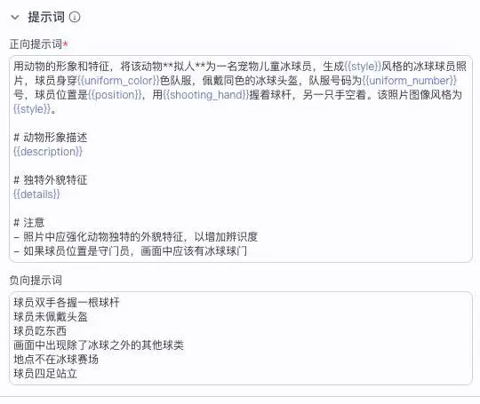

最后我们将输出结果传给结束节点。

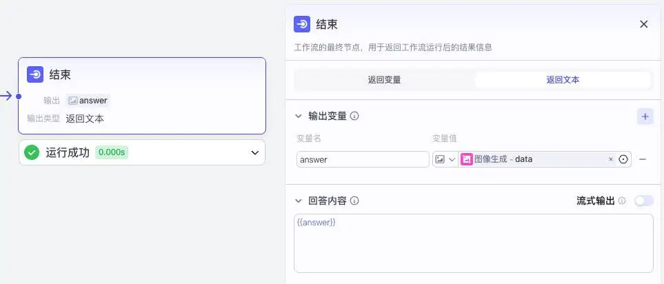

到此为止，我们完成了基本工作流的搭建，现在可以用测试数据运行这个工作流，刚才那张法斗的图，生成的照片如下：


## API 调用

我们将这工作流发布之后，就可以通过 API 来调用。

Coze 提供了两种 API 鉴权方式，一种是简单的 PAT（Personal Access Token）鉴权方式，也就是说，通过生成一个个人访问令牌，然后通过该令牌进行授权。

另一种方式是通过 OAuth 应用来进行授权。

第一种方式最简单，我们可以在 Coze 控制台左侧选择“扣子 API”，在右侧标签页选择“个人访问令牌”，点击添加新令牌，设置令牌名称、过期时间，勾选权限以及访问工作空间权限，点击确定，就能创建一个新的 PAT 令牌。

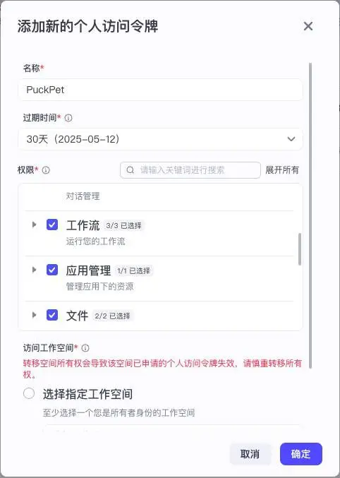

注意创建 PAT 令牌最长有效时间为一个月，也就是说，新创建的令牌最多一个月后将失效，要继续使用的话，必须创建新的令牌。另外，创建生成的令牌数据不会保存在控制台中，所以必须要自己保管。

使用 PAT 令牌的好处是简单，我们直接将令牌放在请求 Header 的 Authorization 字段中即可。但是 PAT 令牌安全系数不高，因为用户自己保管，如果泄密了，对方就可以用这个令牌任意调用接口。所以 Coze 不鼓励在正式生产环境中使用 PAT 令牌。建议大家在生产环境中使用 OAuth。

在课程里，为了简单起见，我们还是使用 PAT 令牌。

## 创建应用 Demo

我们在 Trae AI 创建新的 Vue 项目 Coze Puck Pet。

```
先配置 .env.local ：
VITE_PAT_TOKEN=pat_z79F**********T9VX
```

接着我们修改 App.vue，内容如下：

```sql
<script setup lang="ts">
import { ref } from 'vue';
const imgPreview = ref('https://res.bearbobo.com/resource/upload/W44yyxvl/upload-
const status = ref('');
const imgUrl = ref('');
const uploadImage = ref(null);
const updateImageData = () => {
 const input = uploadImage.value! as HTMLInputElement;
 if (!input.files || input.files.length === 0) {
   return;
 }
 const file = input.files[0];
 const reader = new FileReader();
 reader.readAsDataURL(file);
 reader.onload = (e) => {
   imgPreview.value = e.target?.result as string;
 };
}
const patToken = import.meta.env.VITE_PAT_TOKEN;
const uploadUrl = 'https://api.coze.cn/v1/files/upload';
const workflowUrl = 'https://api.coze.cn/v1/workflow/run';
const workflow_id = '7485923184769646603';
const uploadFile = async () => {
 const formData = new FormData();
 const input = uploadImage.value! as HTMLInputElement;
 if (!input.files || input.files.length <= 0) return;
 formData.append('file', input.files[0]);
 const res = await fetch(uploadUrl, {
   method: 'POST',
   headers: {
     'Authorization': `Bearer ${patToken}`,
   },
   body: formData,
 });
 const ret = await res.json();
 if (ret.code !== 0) {
   status.value = ret.msg;
   return;
 }
 return ret.data.id;
}
const style = ref('写实');
const uniform_number = ref(10);
const uniform_color = ref('红');
const position = ref(0);
const shooting_hand = ref(1);
const generate = async () => {
 status.value = '图片上传中...';
 const file_id = await uploadFile();
 if (!file_id) return;
 status.value = '图片上传成功，正在生成...'
 const parameters = {
   picture: JSON.stringify({
     file_id,
   }),
   style: style.value,
   uniform_number: uniform_number.value, //队服编号
   uniform_color: uniform_color.value, // 队服颜色
   position: position.value, // 0-守门员，1-前锋，2-后卫
   shooting_hand: shooting_hand.value, // 0-左手，1-右手
 };
 const res = await fetch(workflowUrl, {
   method: 'POST',
   headers: {
     Authorization: `Bearer ${patToken}`,
     'Content-Type': 'application/json',
   },
   body: JSON.stringify({
     workflow_id,
     parameters,
   }),
 });
 const ret = await res.json();
 console.log(ret);
 if (ret.code !== 0) {
   status.value = ret.msg;
   return;
 }
 const data = JSON.parse(ret.data);
 status.value = '';
 imgUrl.value = data.data;
}
</script>
<template>
 <div class="container">
   <div class="input">
     <div class="file-input">
       <input ref="uploadImage" type="file" id="image" name="image" accept="imag
         @change="updateImageData" />
     </div>
     
     <div class="settings">
       <div class="selection">
         <label>队服编号：</label>
         <input v-model="uniform_number" type="number" value="10" />
       </div>
       <div class="selection">
         <label>队服颜色：</label>
         <select v-model="uniform_color">
           <option value="红">红</option>
           <option value="蓝">蓝</option>
           <option value="绿">绿</option>
           <option value="白">白</option>
           <option value="黑">黑</option>
         </select>
       </div>
     </div>
     <div class="settings">
       <div class="selection">
         <label>位置：</label>
         <select v-model="position">
           <option value="0">守门员</option>
           <option value="1">前锋</option>
           <option value="2">后卫</option>
         </select>
       </div>
       <div class="selection">
         <label>持杆：</label>
         <select v-model="shooting_hand">
           <option value="0">左手</option>
           <option value="1">右手</option>
         </select>
       </div>
       <div class="selection">
         <label>风格：</label>
         <select v-model="style">
           <option value="写实">写实</option>
           <option value="乐高">乐高</option>
           <option value="国漫">国漫</option>
           <option value="日漫">日漫</option>
           <option value="油画">油画</option>
           <option value="涂鸦">涂鸦</option>
           <option value="素描">素描</option>
         </select>
       </div>
     </div>
     <div class="generate"><button @click="generate">生成</button></div>
   </div>
   <div class="output">
     <div class="generated">
       
       <div v-if="status">{{ status }}</div>
     </div>
   </div>
 </div>
</template>
<style scoped>
.container {
 display: flex;
 flex-direction: row;
 align-items: start;
 justify-content: start;
 height: 100vh;
 font-size: .85rem;
}
.preview {
 max-width: 300px;
 margin-bottom: 20px;
}
.settings {
 display: flex;
 flex-direction: row;
 align-items: start;
 justify-content: start;
 margin-top: 1rem;
}
.selection {
 width: 100%;
 text-align: left;
}
.selection input {
 width: 50px;
}
.input {
 display: flex;
 flex-direction: column;
 min-width: 330px;
}
.file-input {
 display: flex;
 margin-bottom: 16px;
}
.output {
 margin-top: 10px;
 min-height: 300px;
 width: 100%;
 text-align: left;
}
button {
 padding: 10px;
 min-width: 200px;
 margin-left: 6px;
 border: solid 1px black;
}
.generate {
 width: 100%;
 margin-top: 16px;
}
.generated {
 width: 400px;
 height: 400px;
 border: solid 1px black;
 position: relative;
 display: flex;
 justify-content: center;
 /* 水平居中 */
 align-items: center;
 /* 垂直居中 */
}
.output img {
 width: 100%;
}
</style>
```

在上面的代码中，我们调用了两个 Coze API，一个是照片上传，另一个是我们刚才搭建的工作流。

首先是上传照片，因为 Coze 的工作流要处理图片，需要先将图片上传到 Coze 自己的服务器拿到文件 ID。

```
我们可以通过 POST https://api.coze.cn/v1/files/upload 方式将图片上传到服务
```

器。

所以我们在 App.vue 代码里实现了一个 uploadFile 方法：

```javascript
const uploadUrl = 'https://api.coze.cn/v1/files/upload';
const uploadFile = async () => {
 const formData = new FormData();
 const input = uploadImage.value! as HTMLInputElement;
 if (!input.files || input.files.length <= 0) return;
 formData.append('file', input.files[0]);
 const res = await fetch(uploadUrl, {
   method: 'POST',
   headers: {
     'Authorization': `Bearer ${patToken}`,
   },
   body: formData,
 });
 const ret = await res.json();
 if (ret.code !== 0) {
   status.value = ret.msg;
   return;
 }
 return ret.data.id;
}
```

这个方法以 FormData 的数据格式将数据 Post 到 Coze 图片上传的 API，即

```
https://api.coze.cn/v1/files/upload，授权采用 PAT 鉴权的方式，将
.evn.local 中配置的 AccessToken 放到 HTTP Header 的 Authorization 字段中即可。
```

接着我们可以通过返回结果拿到上传图片的文件 ID，返回结果的数据格式如下：

```json
{
   "code": 0,  // 错误码，0表示正确
   "msg" : "Success", // 状态信息，有错误信息会显示在这里
   "data": {
       "id": "xxxxxx" // 文件ID
   }
}
拿到文件 AI 后，我们通过 POST https://api.coze.cn/v1/workflow/run 来执行工作
```

流。

```javascript
const workflowUrl = 'https://api.coze.cn/v1/workflow/run';
const workflow_id = '7485923184769646603';
const generate = async () => {
 status.value = '图片上传中...';
 const file_id = await uploadFile();
 if (!file_id) return;
 status.value = '图片上传成功，正在生成...'
 const parameters = {
   picture: JSON.stringify({
     file_id,
   }),
   style: style.value,
   uniform_number: uniform_number.value, //队服编号
   uniform_color: uniform_color.value, // 队服颜色
   position: position.value, // 0-守门员，1-前锋，2-后卫
   shooting_hand: shooting_hand.value, // 0-左手，1-右手
 };
 const res = await fetch(workflowUrl, {
   method: 'POST',
   headers: {
     Authorization: `Bearer ${patToken}`,
     'Content-Type': 'application/json',
   },
   body: JSON.stringify({
     workflow_id,
     parameters,
   }),
 });
 const ret = await res.json();
 console.log(ret);
 if (ret.code !== 0) {
   status.value = ret.msg;
   return;
 }
 const data = JSON.parse(ret.data);
 status.value = '';
 imgUrl.value = data.data;
}
```

```
我们在代码里请求 https://api.coze.cn/v1/workflow/run ，传入 workflow_id 和
```

parameters 两个参数。 workflow_id 就是我们创建的工作流的 ID，在我们编辑工作流的时

```
候，浏览器地址栏内  workflow_id=7485923184769646603 这样的参数就是我们的
```

workflow_id。

parameters 参数是一个 JSON 对象，就是我们定义的工作流的输入节点的参数。不过需要注意的是，如果参数类型是 Image，我们就得先上传获得 file_id，然后将它以 {file_id} JSON 字符串的方式放在对应的参数字段中。

```
然后我们请求 https://api.coze.cn/v1/workflow/run 就可以获得我们想要的结果
```

了。响应的数据大致如下：

```json
{
   "code": 0,
   "cost": "0",
   "data": "{\"content_type\":1,\"data\":\"https://s.coze.cn/t/OAsY0FMQ4bw/\",\"
   "debug_url": "https://www.coze.cn/work_flow?execute_id=7485956186631929856\u0
   "msg": "Success",
   "token": 170
}
```

所以当接口正常返回时，code 字段是 0，data 字段的内容就是我们想要的结果。

最终实现的 UI 效果如下：

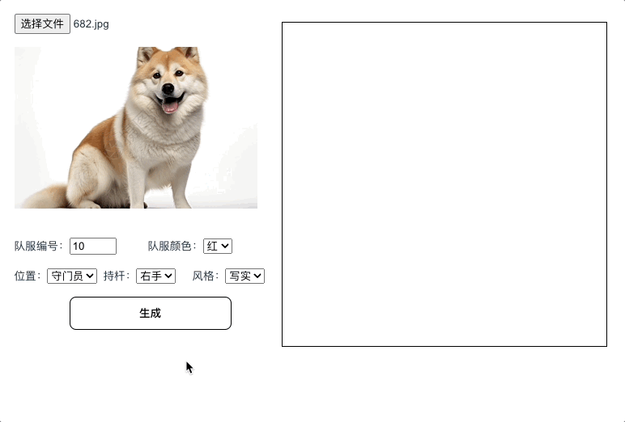

## 要点总结

Coze 工作流提供了 API 调用的能力，有两种鉴权方式，一种是 PAT（Personal AccessToken）方式，另一种是 OAuth 方式。虽然前者使用起来更简单，但不建议在生产环境使用，后者安全性更高。

Coze 工作流调用时，如果要传入图片，要先将图片上传到 Coze 自己的服务器，获得file_id，然后将 file_id 传给工作流。

Coze 工作流编排和 API 调用的便捷性，使得我们为客户提供封装的 API 能力的成本极大降低，大大提升了交付效率。

## 课后练习

Coze 编排工作流和封装 API 非常简单，从而让我们拥有了快速打造自己的个人 AI 工具的能力，你自己平时工作或者生活中有什么 AI 工具方面的需求？可以试着通过 Coze 工作流的方式实现，将你的想法和具体实现分享到评论区吧。
