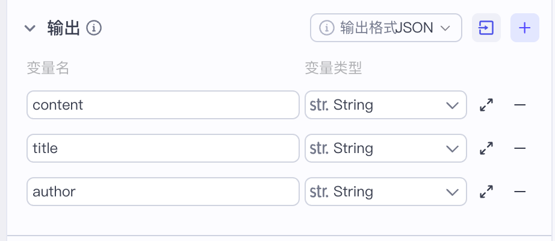
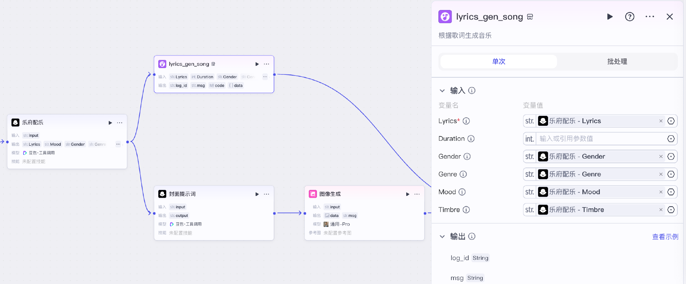
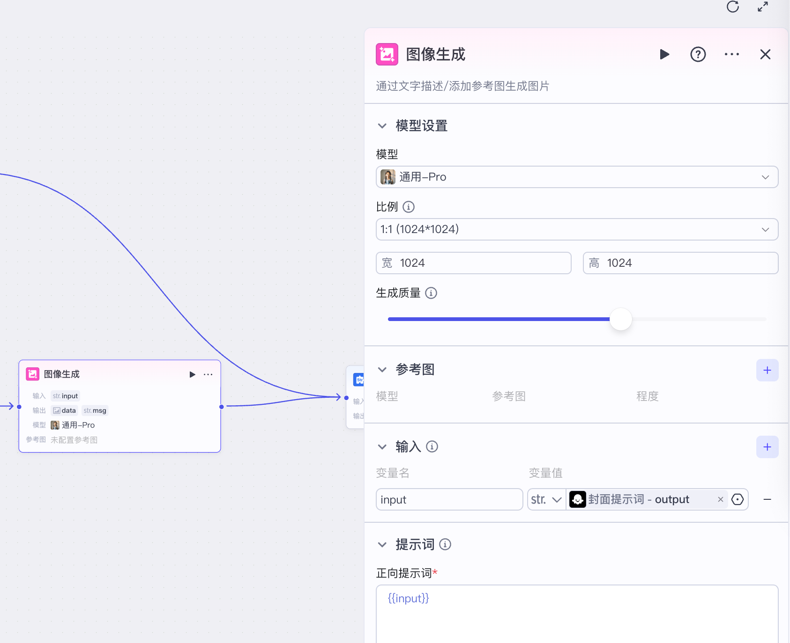
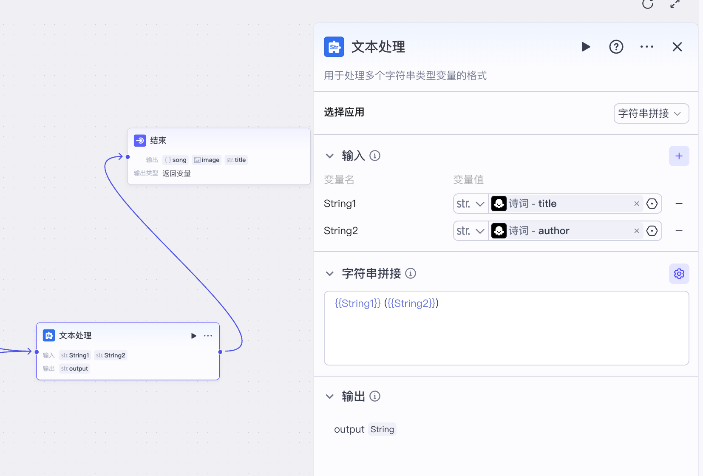
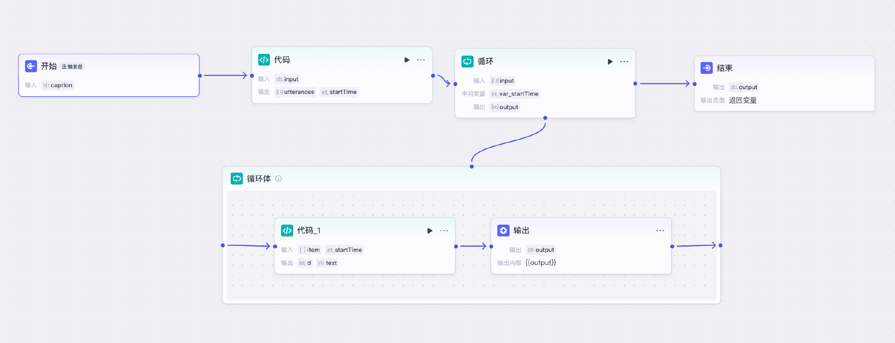
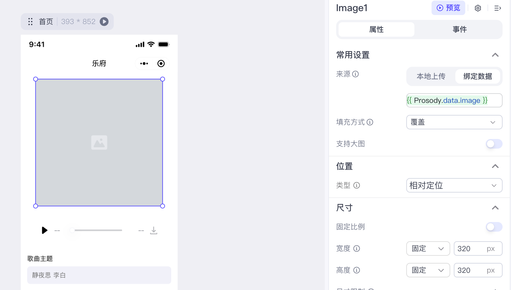
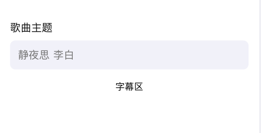
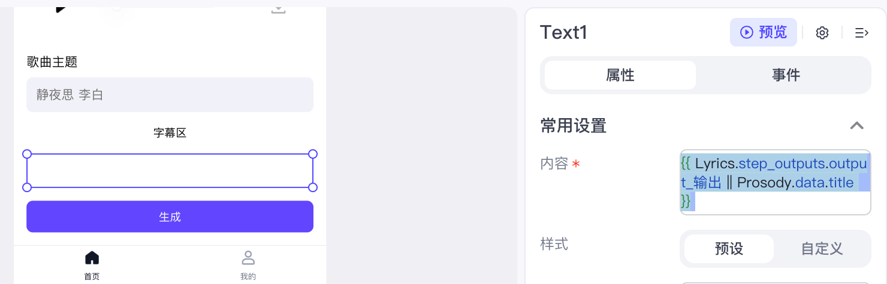
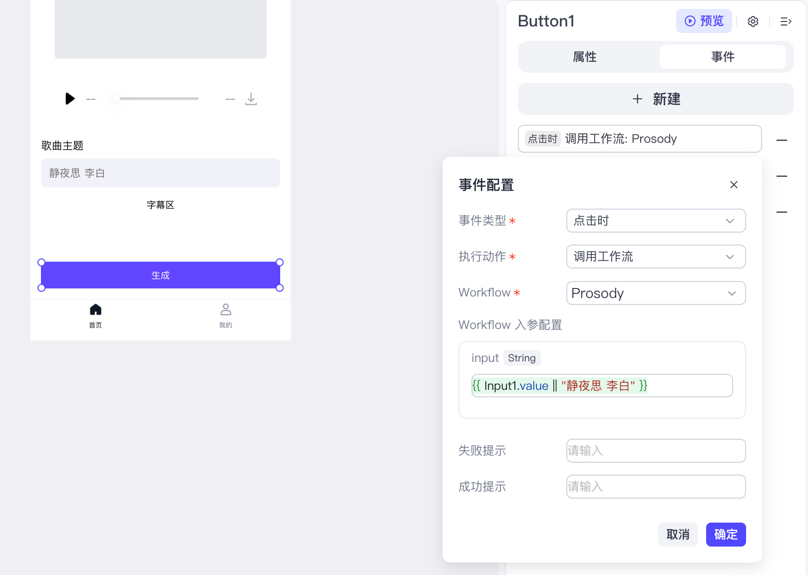

# 加餐4 | 如何用Coze实现听歌学古诗

你好，我是月影。

在前面的课程里，我们介绍了文本、图像和语音模型，这些都是在 AI 应用中最常用的模型。但实际上，除了这些之外，还有其他一些大模型也在 AI 应用中占有一席之地，这其中主要包括音乐和视频模型。因为有些同学在社群中询问过这类模型的具体应用，所以我特地准备了几篇加餐内容，来带大家实践语音和视觉模型的应用。

在这一篇里，我们通过一个具体的实战例子，来了解如何运用音乐模型，实现听歌学古诗。

我用 Coze 实现的这个听歌学古诗应用叫做“乐府”，用户可以输入一个古诗标题，大模型会自动匹配该古诗的诗词内容，然后二次创作音乐，生成歌曲和配图，完成播放，具体效果如以下视频所示：


这个应用用到了文本、图像和音乐大模型，我们来一步步看它是如何实现的。

首先我们在 Coze 中创建一个应用。


接着我们进入业务逻辑编辑面板，开始创建工作流。

在这里，我们有两个工作流要创建，一个是由诗歌生成音乐的主工作流 Prosody，另一个则是播放音频字幕的工作流 Lyrics。

为什么我们要拆成两个工作流呢？是因为 Coze 平台创建应用时，通过低代码编辑生成 UI 的能力十分有限，既没法处理类似于 JS 中 Timer 一类的需求，也不支持用户自定义的播放器。所以我们只好退而求其次，通过巧妙实现工作流的方式来实现歌词与音乐播放的同步。

好了，在这里我们先不多说，首先来看看主体工作流 Prosody 如何实现。

## 实现主体工作流 Prosody

首先我们在业务逻辑面板左侧资源菜单中添加工作流 Prosody，在开始节点后添加一个文本大模型节点“诗词”。


这里我们使用默认的豆包模型即可，系统提示词如下：

- 根据用户输入的内容，返回一首与之匹配的格律诗。

```
1. 如果用户输入的是具体的诗名，返回该诗全文
2. 如果用户输入的不是具体的诗名，返回与之接近的格律诗
## 要求
title 诗歌标题
author 诗人
content 仅返回诗歌内容全文，不包括标题和作者，也不要返回其他任何额外内容
```

另外别忘了输入用户提示词，不常用 Coze 的小伙伴经常遗漏这部分，我们直接输入模板变量

```
{{input}} 即可，这里我们将输入的变量 input 引用开始节点的同名变量。
{{input}}
```

可以看到，这个节点负责输出诗歌原文内容，包括标题 title、诗人 author 和诗歌原文content。对应地，我们要将节点的输出设置为三个 string 类型的同名变量。



接着我们添加第二个文本大模型节点“乐府配乐”。


这个大模型节点我们一样采用默认的豆包模型即可，它的输入是诗词输出的正文内容，即诗词节点 output 中的 conent 变量。

它的系统提示词如下：

- 你是一位拥有很强的古汉语文化素养的民乐专家，你擅长根据乐府诗内容给出建议的配乐。

```
如果乐府诗的句子较少，比如只有4句，你适当增加桥段和副歌，如果是8句，则不用增加。
```

- 副歌要有文化底蕴，最好是文言和风雅的表达方式，符合中国传统文化和民俗精髓，又带有一些现代的趣味和韵

```
## 重要
要确保至少有一段是没有任何改动的诗歌全文，主歌或副歌，其中**务必**有**完整的一段**是完全匹配**诗
---
```

- 你根据歌词表达的意境，配置一些歌词和旋律参数，如下：

```
- Lyrics: 歌词
- Mood：歌曲的情感风格，影响旋律和编曲的情绪表达。可选值Happy、Dynamic/Energetic、Sentimen
- Gender:  演唱者性别，影响生成歌曲的声音特征。可选值Male（男声）、Female（女声）
- Genre: 音乐曲风，决定生成歌曲的音乐风格。可选值Folk、Pop、Rock、Chinese Style、Hip Hop/
- Timbre: 生成歌曲的音色，可选值Warm、Bright、Husky、Electrified voice、Sweet_AUDIO_TI
```

注意，这里我们要求大模型对诗词内容进行二次创作，但在创建后，歌词里尽量保持诗歌全文，这样才能达到让人学习古诗词原文的目的。

另外，我们让大模型根据诗词表达的意境，配置一些参数，以生成符合该诗词意境的曲调。这里根据豆包音乐大模型插件所支持的参数，设置 Mood、Gender、Genre 和 Timbre 输出变量。

最后同样别忘了设置用户提示词，输入如下。

- 诗词原文

```
{{input}}
```

接下来，我们进入到一个分支环节，一边通过豆包音乐大模型插件生成音乐，一边通过大模型节点生成封面提示词，并通过图像大模型插件进一步生成封面图：



音乐大模型通过“添加插件 > 搜索‘音乐生成’”，即可添加，注意要选择 lyrics_gen_song，它是可以具体传入歌词，根据歌词生成音乐的一个插件。

- 注意，这个插件是收费的插件，大家可以根据情况具体选择是否购买扣子会员并开通付费。


添加这个插件后，我们只需要将对应的参数传给插件，即可生成歌曲了。

另外一个分支是生成封面图。生成封面提示词，也可以用默认的豆包模型，将输入参数设置为歌词正文，生成图片提示词。


它的系统提示词如下：

```
## 任务说明：
你是一个精通中国古典诗词与美术风格的AI画家，请根据以下诗歌改编的歌词内容，先分析其表达的意境和情感
## 提示词格式：
请用英文输出以下格式的AI绘画提示词（适用于Midjourney风格或DALL·E）：
- 风格建议（Art Style）： 如 ink painting, Chinese traditional landscape, realistic p
- 构图建议（Composition）： 例如“a lone figure standing atop a tall tower gazing at d
- 情感基调（Mood）： serene, majestic, philosophical, melancholic 等
- 色彩偏向（Color tone）： 如 warm golden tones, misty greys, cool blues and greens
- 元素关键词（Visual elements）： 如 high tower, river rushing to sea, sun setting be
## 🌿示范案例：以《登鹳雀楼》为例
```

- 最终提示词（英文）：

```
A majestic Chinese traditional landscape featuring a tall ancient tower on a moun
```

同样别忘了用户提示词：

```
{{input}}
```

接着选择图像大模型节点，模型设置为通用 -Pro，这是豆包最新的图像大模型，将封面提示词

```
节点输出的内容输入给图像生成节点，正向提示词设为输入变量  {{input}} 即可。
```



最后我们再用文本处理节点做一个文本处理，将诗词的标题和诗人信息拼接起来便于展示：



在结束节点分别输出生成的歌曲 song、封面图 image、拼接的诗歌标题和作者 title 这三个变量即可。


这样我们就完成了应用的主体工作流部分。我们可以试运行一下，比如我们输入“江雪 柳宗元”。


最终我们看到，“诗词”节点输出的是：

```json
{
 "content": "千山鸟飞绝，万径人踪灭。孤舟蓑笠翁，独钓寒江雪。",
 "title": "江雪",
 "author": "柳宗元"
}
```

“乐府配乐”节点的输出如下。

```json
{
 "Lyrics": "主歌1：寒冬的风在天地间肆虐\n鸟儿都已不见踪迹远飞\n条条道路难觅行人的影\n这世界仿
 "Mood": "Sentimental/Melancholic/Lonely",
 "Gender": "Male",
 "Genre": "Chinese Style",
 "Timbre": "Warm"
}
```

“lyrics_gen_song”节点的输出如下。

```json
{
 "log_id": "202504301359316B376B4979F6EAB92E76",
 "msg": "success",
 "code": 0,
 "data": {
   "FailureReason": {
     "Code": 0,
     "Msg": ""
   },
   "SongDetail": {
     "AudioUrl": "https://lf-bot-studio-plugin-resource.coze.cn/obj/bot-studio-p
     "Captions": "{\"attribute\":{\"extra\":{...]}]}",
     "Duration": 108,
     "Lyrics": "[intro]\n[verse]\n寒冬的风在天地间肆虐\n鸟儿都已不见踪迹远飞\n条条道路难
   },
   "Status": 2,
   "TaskID": "202504352709045617950721"
 }
}
```

“封面提示词”节点输出的是：

```json
{
 "output": "- Art Style: Chinese ink painting\n- Composition: \"A vast expanse o
}
```

“图像生成”节点输出的是：

```json
{
 "data": "https://s.coze.cn/t/op1eGlolE60/",
 "msg": "success"
}
```

最终的结束节点输出的是：

```json
{
 "image": "https://s.coze.cn/t/op1eGlolE60/",
 "song": {
   "AudioUrl": "https://lf-bot-studio-plugin-resource.coze.cn/obj/bot-studio-pla
   "Captions": "{\"attribute\":{\"extra\":{...}]}",
   "Duration": 108,
   "Lyrics": "[intro]\n[verse]\n寒冬的风在天地间肆虐\n鸟儿都已不见踪迹远飞\n条条道路难觅行
 },
 "title": "江雪 (柳宗元)"
}
```

这里需要注意，结束节点输出的信息中，song 字段里的 Captions 节点中包含有歌词的时间信息。上面的代码里我省略了其中的内容，它的内容大概是后面这样。

```json
{
   "attribute": {
       "extra": {
           "sta_use_batch_request": "False",
           "asr_service": "asr",
           "caption_type": "singing",
           "is_singing": "False",
           "language": "zh-CN"
       }
   },
   "code": 0,
   "duration": 108.0024375,
   "id": "cbd7edc2-3153-4640-a2d4-f65818630b80",
   "message": "Success",
   "utterances": [
       {
           "attribute": {},
           "end_time": 5322,
           "start_time": 2117,
           "text": "[intro]",
           "words": [
               {
                   "attribute": {},
                   "end_time": 2117,
                   "start_time": 2117,
                   "text": "["
               },
               {
                   "attribute": {},
                   "end_time": 3322,
                   "start_time": 2117,
                   "text": "intro"
               },
               {
                   "attribute": {},
                   "end_time": 5322,
                   "start_time": 3322,
                   "text": "]"
               }
           ]
       },
       {
           "attribute": {},
           "end_time": 13036,
           "start_time": 9397,
           "text": "[verse]",
           "words": [
               {
                   "attribute": {},
                   "end_time": 9397,
                   "start_time": 9397,
                   "text": "["
               },
               {
                   "attribute": {},
                   "end_time": 12602,
                   "start_time": 9397,
                   "text": "verse"
               },
               {
                   "attribute": {},
                   "end_time": 13036,
                   "start_time": 12602,
                   "text": "]"
               }
             ]
         },
         {
             "attribute": {},
             "end_time": 18916,
             "start_time": 13037,
             "text": "寒冬的风在天地间肆虐",
             "words": [
                 {
                     "attribute": {},
                     "end_time": 13260,
                     "start_time": 13037,
                     "text": "寒"
                 },
                 {
                     "attribute": {},
                     "end_time": 13482,
                     "start_time": 13260,
                     "text": "冬"
                 },
                 {
                     "attribute": {},
                     "end_time": 14520,
                     "start_time": 14157,
                     "text": "的"
                 },
                 {
                     "attribute": {},
                     "end_time": 14882,
                     "start_time": 14520,
                     "text": "风"
                 },
                 {
                     "attribute": {},
                     "end_time": 15642,
                     "start_time": 15237,
                     "text": "在"
                 },
                 {
                     "attribute": {},
                     "end_time": 16180,
                     "start_time": 15957,
                     "text": "天"
                 },
                 {
                     "attribute": {},
                     "end_time": 16402,
                     "start_time": 16180,
                     "text": "地"
                 },
                 {
                     "attribute": {},
                     "end_time": 17060,
                     "start_time": 16677,
                     "text": "间"
                 },
                 {
                     "attribute": {},
                     "end_time": 17260,
                     "start_time": 17060,
                     "text": "肆"
                 },
                 {
                     "attribute": {},
                     "end_time": 17482,
                     "start_time": 17260,
                     "text": "虐"
                 },
                 {
                     "attribute": {},
                     "end_time": 18916,
                     "start_time": 17482,
                     "text": ""
                 }
             ]
         },
       ......
   ]
}
```

那么我们就可以创建一个工作流来对应输出歌词。

## 实现歌词同步工作流 Lyrics

接着我们创建工作流 Lyrics，这个工作流没有 AI 节点，它的流程如下：



在开始节点中我们输入 caption，这是一个序列化的 JSON 字符串，所以我们先用一个代码节点进行解析，代码内容如下：

```javascript
async function main({ params }: Args): Promise<Output> {
   const {utterances} = JSON.parse(params.input);
   const startTime = Date.now();
   // 构建输出对象
   const ret = {
       utterances: utterances.filter(u => {
           return !/\[.*?\]/.test(u.text);
       }),
       startTime,
   };
   return ret;
}
```

在这里，我们将 Caption 对象中的 utterances 属性保留下来，并将非歌词的部分过滤掉（这部分内容以方括号开头，比如“[intro]”）。

然后我们将输出的 utterances 变量和一个表示当前时间的 startTime 变量放到循环节点中：

循环节点的循环体中，我们首先通过代码来处理每一句歌词。

```javascript
function sleep(ms) {
   return new Promise(resolve => setTimeout(resolve, ms));
}
async function main({ params }: Args): Promise<Output> {
   const item = params.item;
   const startTime = params.startTime;
   const text = item.text;
   const d = item.start_time - (Date.now() - startTime);
   await sleep(d);
   // 构建输出对象
   const ret = {
       text,
   };
   return ret;
}
```

这里我们根据歌词的 start_time 信息以及当前时间，来共同确认需要延迟多久来输出该句歌词，然后通过其后的“输出”节点将歌词输出。

输出节点是工作流输出执行过程中的消息的一个特殊节点，在这里我们巧妙利用它加上异步延迟来实现了类似定时器的功能。

这样我们就实现了完整的歌词同步。接下来我们就可以实现 UI 了。

## 实现应用界面

我们切换应用编辑器顶部的 Tab 到用户界面：


这个用户界面编辑就比较简单，首先我们放置一个图片，宽高设置为 320 x 320，绑定工作流

```
数据  {{ Prosody.data.image }} 用来展示封面图。
```



```
接着我们在下方放一个播放器组件，绑定工作流数据源 {{
Prosody.data.song.AudioUrl }} 。
```


注意，播放器组件不支持自动播放，也不支持播放开始时调用工作流，因此这里我们用一个hack 的小技巧，我们在播放器左侧绝对定位放置一个和播放按钮一模一样的三角形图标，这个在左侧菜单的“展示组件 > 图标”里可以找到。


默认的三角形图标是箭头向下的，我们可以通过“变换 > 旋转 -90 度”，将它变为向右。


然后我们设置它的触发事件，点击时播放音频，以及点击时调用工作流同步歌词：


```
并且我们设置它的可见性为  {{ Audio1.isPlaying }}这样如果音频开始播放，这个按钮
```

就会被隐藏起来，这样就不会遮挡住停止播放音频的按钮了。


然后我们添加一个歌曲主题输入框、一个固定高度的布局元素用以展示字幕。



```
字幕用一个绑定数据 {{ Lyrics.step_outputs.output_输出 ||
Prosody.data.title }} 的文本框展示。
```



最后我们在底部放一个“生成”按钮，将它的事件绑定为调用主工作流 Prosody：



这样我们就完成了应用的全部功能，我们可以预览应用、测试应用生成歌曲了。

比如我们输入“登鹳雀楼”，稍等片刻，音乐加载完毕，就可以点击播放，效果如下：


这个应用的链接是“乐府诗歌”，你可以跳转到链接去尝试看看。

## 要点总结

这一讲，我们利用文本大模型、图像大模型和豆包音乐大模型，通过 Coze 应用，快速搭建了一个听歌学古诗词的应用。

注意我们在主流程中通过对原古诗词二次创作，AI 作曲，配图的工作流，完成了需要生成的内容，同时通过延时输出的工作流巧妙地实现了歌词和乐曲的同步。

在此，我们又一次体会到，通过 Coze 应用搭建工作流，确实能够快速实现这样复杂的应用产品原型。

当然，这个产品原型实际上还有不少问题，比如因为我们用的是工作流的方式同步歌词和音乐，所以如果用户暂停了音乐播放，歌词工作流还会继续运行，就会导致歌曲和歌词不同步。这是通过 Coze 应用没法解决的，但是我们可以通过调用工作流 API，用自己实现的 UI 界面来解决这个问题。

## 课后练习

在这个应用中，我们只实现了生成和播放音乐功能，但并没有将生成的歌曲保存下来，你可以用 Coze 工作流的数据库节点增加一个存储历史生成歌曲的功能吗？你可以尝试一下，并增加查看历史生成歌曲的 UI 界面，然后将你的实现分享到评论区。

Coze 应用的界面能实现的功能确实有限，所以就如前面要点总结所说的，我们可以通过直接调用工作流 API 的方式，自己实现 UI 来解决问题。你可以发布应用，然后参考 Coze 官方文档通过 API 执行工作流，然后自己实现应用的 UI，我期待你实现的版本，你可以试试，然后将具体实现分享到评论区。
