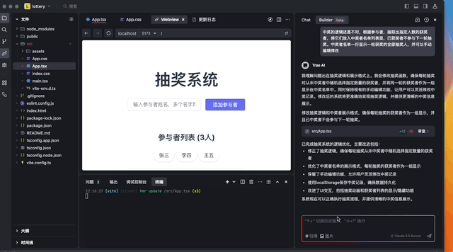
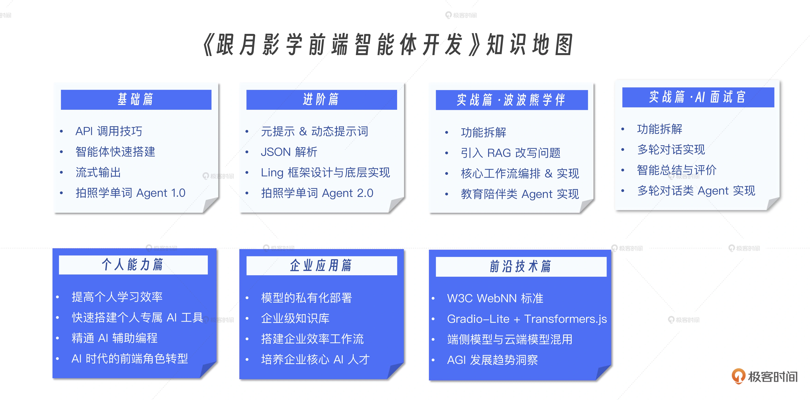
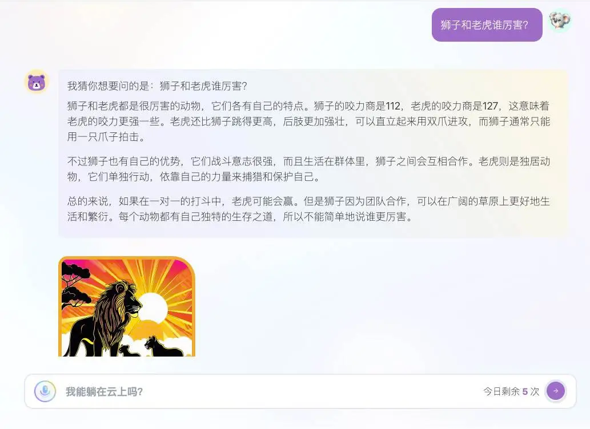
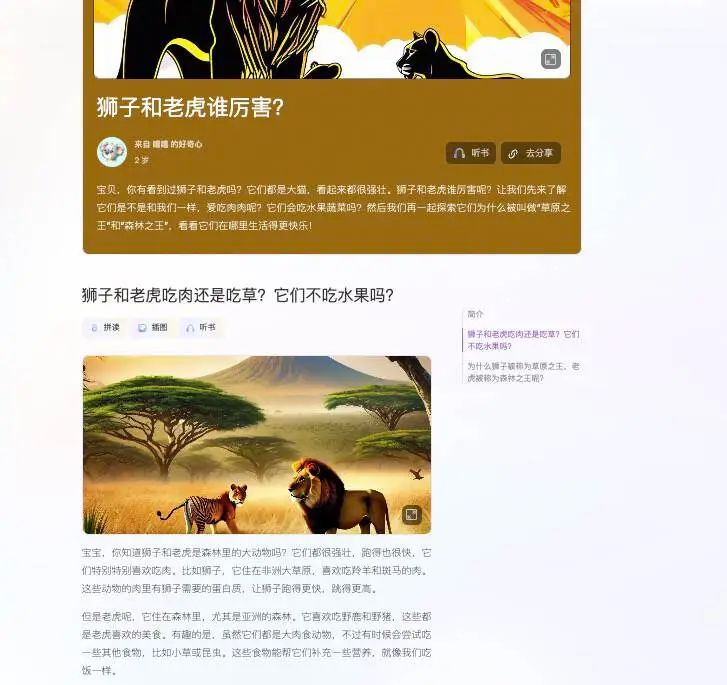
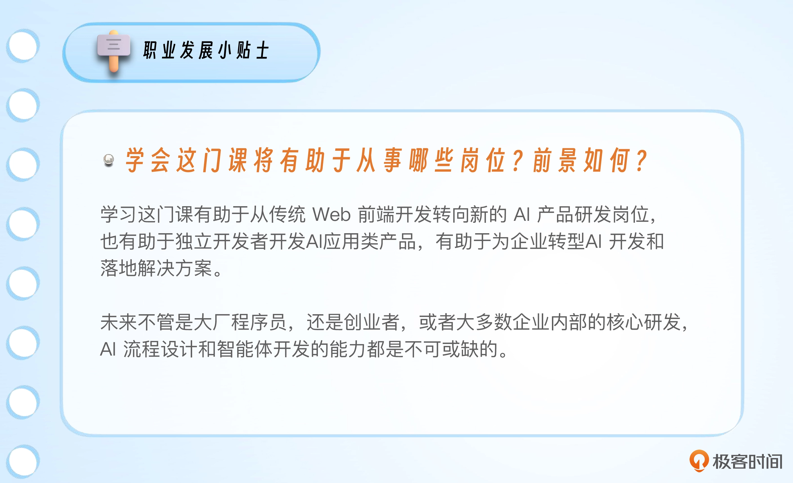

# 开篇词 | 前端在大模型时代的变革与机遇

你好，我是月影。

如果你是一位工作多年的前端工程师，可能你知道我。

我是一位从业超过 20 年的互联网老兵，从 05 年起开始就活跃在前端这个行业，见证了整个前端行业在过去 20 年里的高速发展历程：

- 前端角色从美工页面仔、重构工程师到专业的 FE 团队、全栈工程师再到跨端 / 大前端团队。

- 开发工具从网页三剑客、WebStorm、Sublime Text 再到如今的 VSCode、Cursor 和Trae。

- 浏览器从 IE6、IE8 到 Fixfox 到 Chrome/Edge 等现在的浏览器。

- JavaScript 从 ES3、ES5、ES6 再到如今的 ES2025，以及新兴且繁荣的 TypeScript 生态。

- 框架从 YUI 到 jQuery 再到 Angular/React/Vue，然后是 Svelte/Solid/Qwik 等新生代。

如果说软件开发这个行业里面，哪个方向最不缺变化，那无疑是前端。如果说程序员这个职业里面，哪个细分领域最不缺创新者，那无疑是前端工程师。

在我从业这 20 年里，我所接触的所有软件和互联网技术方向上，从来没有一个方向像前端这样，做到极致的开放、创新和拥抱变化。在我所知的所有编程领域里，前端是过去二十年里发展最快、变化最大的行业。

如果你不相信，我这里有一些数据。

2008 年 node.js 诞生时，npm 上的前端相关包仅有数万，而到了 2024 年，npm 包数量已超过 200 万。另外，无论是 JetBrains 《2024 开发者生态系统现状报告》还是 GitHub 上各项数据和报告，都显示 JavaScript 是使用者最多的编程语言，全球有超过 60% 的开发者使用 JavaScript 进行开发，而 JavaScript 毫无疑问是前端技术的核心。

从早期的简单 HTML/CSS，到 AJAX 推动动态网页，再到 MVC/MVVM 架构和 SPA/SSR 应用，再到近年涌现的 Vite、Webpack 5 以及越来越多的打包工具和构建方案，前端技术的迭代速度明显加快。框架更新周期由过去的 5～8 年，缩短到如今的 2～3 年，推动了整个行业的迅速革新。

我知道在 AI 快速发展的今天，很多前端工程师很焦虑，强大的大语言模型出来后，大家开始担心前端开发，甚至所有软件开发的岗位会不会被 AI 所取代。我很理解大家的担心和顾虑，而以我自己这两年 AI 领域创业的经历来看，我也充分意识到大模型正在颠覆传统开发流程。

- 大模型自动编程实现抽奖系统

那么我们是否要为了前端开发的出路而担忧呢？或者又是否如一些人所说的“前端已死”？

前面我说了这么多，其实就是想告诉大家，前端行业是最不怕变化，最喜欢拥抱创新的一个行业。既然前端工程师是最不墨守成规的一群人，那我们有什么理由对蓬勃发展的 AI 大模型技术如畏蛇蝎呢？

在我看来 AI 大模型不仅不会让前端“死”，反而会带着前端开发进入“人机协同”的新纪元。

甚至说，前端工程师对于大模型和 AI 应用的发展至关重要，这个行业作为用户交互的核心载体，天然会成为 AI 落地的“最后一公里”。

回想二十年前，世界上本没有前端开发这个行业，是互联网的诞生和高速发展，让“页面美工”“切图仔”逐渐成为了前端工程师，成为了互联网应用开发的主角之一。

而今天，站在 AI 高速发展的风口上，我们前端工程师将再次迎来巨大的变革机遇，把握它，必然会让前端行业再一次涅槃重生，迎来光明的前途。

## 大模型如何重构前端开发

有人可能要说月影老师在吹牛，空口无凭。那我就再具体展开来说一说，大模型可能给前端开发带来怎样的变化。

首先，大模型正在改变传统的开发范式，过去那种传统的需求→设计→编码→测试的线性瀑布流程由于有了 AI 的协同，发生了巨大的效率转变。

在我创业开发波波熊学伴的功能时，我们的产品经理能够利用 AI 快速生成交互原型，甚至能够在 AI 的协助下 1 比 1 地还原想要的 UI 动画效果，让我们在沟通产品细节时节省了非常多的时间。

我自己在开发项目时，原本一些创建项目、配置规则、管理文件目录，甚至变量和数据结构命名、API 接口字段设计之类流程化的机械劳动，都可以转化为可执行的 AI 指令，用自然语言交互让 AI 来完成。这极大地解放了我的生产力，让我能够将更多的时间专注于真正重要的创造性工作上。

其次，开发者角色的能力模型正在发生改变，对于前端开发来说，能力模型从传统的 CSS/JS能力、框架原理和性能优化，正在转移到 AI 指令工程、领域知识封装和人机协作策略上。

举一个例子，过去前端手动实现一个产品的瀑布流布局，可能需要花费几个小时的时间完成交互细节（比如图片加载、列宽计算、滚动事件监听等）。

而有了 AI 辅助，前端仅需要描述“移动端商品列表，图片等宽不等高，自动懒加载”，在 AI 辅助下，数秒就能生成响应式代码，还可以通过追问获得后续性能优化建议。这样前端的核心价值就从“写代码”转向“定义问题边界 + 验证 AI 输出质量”。

第三，互联网的产品形态也在发生改变，传统的 UI 开发逻辑是“固定界面 + 单一输入模态”，也就是说，过去我们的 Web 产品，不管是网页还是应用，界面一般是固定的，不同的只是数据，交互方式也是单一模态的，往往是键盘 + 鼠标 + 触屏输入，偶尔有语音视觉交互，也仅用于有限的领域，如无障碍设计上。

在有了 AI 后，通过 AI 来动态输出界面（例如智能营销系统根据用户实时行为，由 AI 动态生成界面模块组合，从而提升转化率）就成为了可能，而且多模态交互也会因为 AI 而被普及（例如通过 AI 客服语音完成平台账号的注册）。

第四，由于 AI 的发展，人机交互技术范式也必将迎来根本性的变革。换句话说，因为 AI 的强大，未来的交互方式会变得更加复杂。传统的前端从用户事件响应到网络响应，再通过 DOM操作更新状态的模式将会被彻底颠覆，交互不会仅限于二维平面，而是全面地三维化，甚至更高维化，输入从语音、视觉再到生物传感器信号，输出也将从传统的用鼠标、手指触屏交互的显示设备，变为物理设备控制和具身智能。

就像互联网技术发展，让前端技术从最初的简单静态网页到后来的动态交互，再到如今的单页应用（SPA）、服务端渲染（SSR）以及渐进式 Web 应用（PWA）一样，人机交互技术的根本变革，必然会把前端工程师推向一个全新的领域和行业高度。

## 前端如何拥抱 AI 潮流

说了这么多，那我们前端究竟该如何拥抱 AI 发展的技术潮流呢？

首先，我们要转变我们的认知，前端不只是和浏览器打交道的程序员，从第一性原理层面思考，前端的本质和内在核心价值是“实现人机信息交换”。所以我们基于这个核心价值，需要拥抱新的技术，建立我们的技术雷达，学习 AI 应用技术和 AI 类应用产品的开发。同时我们也要关注 Transformer.js、WebLLM 等前沿技术。

其次，AI 正在逐步重新定义互联网产品，我们应该通过 AI 应用项目实践，积累 AI 产品实际开发经验，了解以 AI 为核心的应用产品开发过程和技术挑战点，全面提升我们的技术能力，更新我们的技术栈，增加我们在业务逻辑架构、逻辑指令抽象和表达、AI 协同等领域的新能力，从而为 AI 时代的变革做好准备。

第三，我们需要建立我们个人能力转型策略，更新我们的工具和能力栈，构建个人 AI 工具和工作流，学会用 AI 全面重塑我们的个人能力栈，提升我们的个体价值。

最后，作为引领变化的前端工程师，我们要克服焦虑，不畏惧而是拥抱变化，以开放的心态对待任何新技术、新思想，不自我设限，随时准备好角色转变，就如同前端一直以来都从不缺少变化，我们没有理由在 AI 时代因为快速变化而畏首畏尾。

## 如何学习这门课

正如同前面所说，本课程的目的就是帮助前端工程师在 AI 时代自我重构，做好迎接未来的充分准备。

### 课程的七个单元

课程一共由七个相对独立的单元组成。

第一单元主要讲解大模型在应用方面的基础知识，主要是各类大模型的 API 调用方式、构建AI 智能体的方法，并通过一个实战例子来巩固认知和融会贯通，为前端工程师打好 AI 应用开发的基础。

第二单元是进阶篇，主要是从有到好，介绍如何通过提示词技巧、结构化数据来提升生成内容的效果，并通过动态 JSON 解析和 Ling 框架解决应用交互中的性能问题，提升用户体验。

第三单元和第四单元是两个综合项目实战，我们来挑战两个复杂一些的智能体开发。因为实战是最好的老师，这两个项目又各有特点，第一个项目是波波熊学伴，它的难点是高质量内容生成的复杂工作流编排；第二个项目是 AI 面试官，它的难点是复杂过程的多轮对话实现。这两个项目恰好代表目前 AI 智能体中两种典型而普遍的需求形态，掌握它们，你就掌握了目前绝大多数 AI 应用产品的开发技巧。

- 波波熊学伴对话界面

- 波波熊学伴深度阅读模式

第五单元我们转向个人工具方向，因为 AI 时代到来，我们有机会使用 AI 技术扩展我们的脑力，打造个人的效能工具。而身为前端开发者，我们懂技术，天然能够将不同的 AI 工具整合，打造属于我们自己的个人效率成长利器。比起不懂技术的普通人来说，我们有着更大的优势。

第六单元主要讲企业级 AI 方向，这也是未来一段时间内会非常火的领域，就如同二十年前的企业要做信息化转型一样，未来可以说几乎每家企业都要拥抱 AI，做好智能化转型。掌握企业智能化技术，能够让你在新的 AI 时代获得很大的竞争力。

最后的第七单元我会分享最近的一些前沿技术，包括 AI 相关的 Web 标准、端侧 AI 以及一些跨界跨语言的新技术探索，从中窥见未来的发展趋势，能够让你更好地拥抱未来。

### 必备的基础知识

我们的课程使用 TypeScript 作为首选开发语言，如果你对它不熟悉也没有关系，绝大部分情况下我们不会用到什么很高深的技巧，你将代码当作 JavaScript 理解应该问题不大。但你应该要熟练掌握 JavaScript，这个要求我想对于身为前端工程师的你来说并不过分。

我们课程中的实战开发，推荐采用字节跳动的 Trae IDE。它是国内首个 AI IDE。使用它的好处是，借助 AI Builder 的能力，我们不需要让大家预先去统一配置开发环境，而且它的用法和 VSCode 基本一致，自带有免费的 DeepSeek 和豆包 AI 大模型。当然这个环境并不是强制的，你完全可以使用你自己熟悉的 VSCode、Cursor、Windsurf 或者其他 IDE。

在项目实践中，我们有时候需要使用 Node.js 作为 server 实现服务端或者 BFF 层的一些逻辑，绝大多数情况下我们使用 Express 作为我们的 HTTP 服务，这里我假定你对于Express 一类的框架并不陌生。如果你不太熟悉这一块，你可以去 Express 官网学习一下基础，或者询问你熟悉的 AI 大模型，学会这些前置知识，它们应该不太难学。

在实战的前端部分中，除了最开始的一两节课，我们使用原生 JavaScript 来实现，绝大多数课程我们采用 Vue 框架。而所有的实战项目，不管是原生 JavaScript 项目还是 Vue 项目，我们通常都使用 Vite 来进行工程构建。所以一般情况下，我们的一个经典实战项目的架构是：Vite + Vue + TypeScript + Express（如有后端代码）。如果你对上述这些技术不太了解，建议先打好基础（你可以用 AI 来帮你快速掌握这些基础！），再来学习这门课。

我们课程中的所有代码都开源在 GitHub 仓库里，你可以自行克隆仓库进行研究，我也鼓励你在课后对每一节课的代码进行深入研究，这对你深入掌握课程内容会有很大的帮助。

## 总结

AI 大模型的发展，是一场意义深远而伟大的生产力变革，它不但会影响我们前端，也正在影响这个社会、各行各业的方方面面。

不管你喜欢或者不喜欢，不管是做好了准备还是没做好准备，不管你是对未来悲观还是对未来乐观，大模型都已经来了，而且将会继续快速发展，奔向未来。

就如同老话说的“历史的车轮滚滚向前，不可阻挡”，我们唯一能做的事情，也只有以开放的心态，积极拥抱未来。以我目前的判断，AI 的发展，对我们前端行业来说，机会远大于风险。

下一个十年甚至更长时间，必然是 AI 的时代，与 AI 相关的大部分岗位将来都会是发展非常迅速的，拥有美好的未来，AI 应用工程师也不例外，我们在这个时代交替的时候，应该抓住机会，做好转型的准备，迎接更美好的未来。
