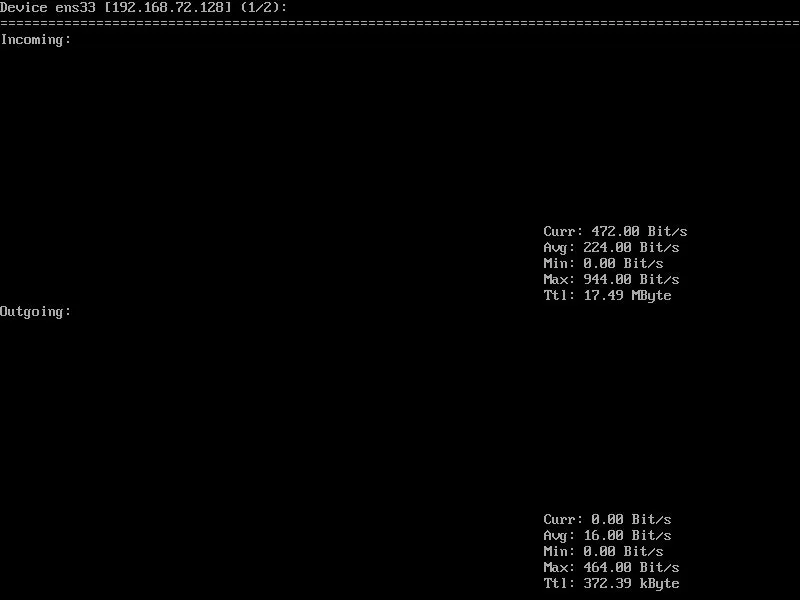

# 第13章Linux系统管理技巧(1)

## 第 13 章 Linux 系统管理技巧

阿铭在前面介绍的内容都是基础知识，如果你想成为一名合格的 Linux 系统管理员，要学的东西还有很多，后续章节会陆续介绍一些工作中常用的技能。只要你熟练掌握这些必备知识，那么绝对可以胜任初级管理员职位。然后你还需要继续在工作中充实自己，只要坚持学习，一两年就可以成为中高级工程师，月薪还是很可观的。

## 13.1 监控系统的状态

众所周知，生病了需要去医院看病，大夫首先要询问我们哪里不舒服，然后再通过观察和自己的经验，大体上就能判定我们得的是什么病。然而 Linux 不会说话，它不会主动告诉我们哪里出现了问题，需要我们自己去观察。那么如何评估系统运行状态是否良好呢？下面阿铭就介绍一些帮我们分析系统状态的工具。

### 13.1.1 使用w命令查看当前系统的负载

具体用法如下：

```
# w
22:07:15 up 74 days, 7:52, 1 user, load average: 0.00, 0.00, 0.00
USER TTY FROM LOGIN@ IDLE JCPU PCPU WHAT
root pts/0 192.168.18.1 22:07 1.00s 0.07s 0.01s w
相信所有 Linux 管理员最常用的命令就是这个w了，该命令显示的信息很丰富。第 1 行从左至
```

右显示的信息依次为：时间、系统运行时间、登录用户数、平均负载。从第 2 行开始的所有行则是告诉我们：当前登录的用户名及其登录地址等。其实在这些信息中，阿铭认为最应该关注

```
第 1 行中的load average:后面的 3 个数值。
```

第 1 个数值表示 1 分钟内系统的平均负载值，第 2 个数值表示 5 分钟内系统的平均负载值，第 3 个数值表示 15 分钟内系统的平均负载值。我们着重看第 1 个值，它表示单位时间段内使用 CPU 的活动进程数（在这里其实就是 1 分钟内），值越大就说明服务器压力越大。一般情况下，这个值只要不超过服务器的 CPU 数量就没有关系。如果服务器的 CPU 数量为 8，那么值小于 8 就说明当前服务器没有压力，否则就要关注一下了。查看服务器有几个 CPU 的方法如下所示：

```
# cat /proc/cpuinfo
processor : 0
vendor_id : GenuineIntel
cpu family : 6
model : 62
model name : Intel(R) Xeon(R) CPU E5-2650 v2 @ 2.60GHz
stepping : 4
microcode : 0x427
cpu MHz : 2600.039
cache size : 20480 KB
physical id : 0
siblings : 1
core id : 0
cpu cores : 1
apicid : 0
initial apicid : 0
fpu : yes
fpu_exception : yes
cpuid level : 13
wp : yes
flags : fpu vme de pse tsc msr pae mce cx8 apic sep mtrr pge mca cmov pat pse36 c
bugs : cpu_meltdown spectre_v1 spectre_v2 spec_store_bypass l1tf
bogomips : 5200.07
clflush size : 64
cache_alignment : 64
address sizes : 40 bits physical, 48 bits virtual
power management:
processor : 1
vendor_id : GenuineIntel
cpu family : 6
model : 62
model name : Intel(R) Xeon(R) CPU E5-2650 v2 @ 2.60GHz
stepping : 4
microcode : 0x427
cpu MHz : 2600.039
cache size : 20480 KB
physical id : 2
siblings : 1
core id : 0
cpu cores : 1
apicid : 2
initial apicid : 2
fpu : yes
fpu_exception : yes
cpuid level : 13
wp : yes
flags : fpu vme de pse tsc msr pae mce cx8 apic sep mtrr pge mca cmov pat pse36 c
bugs : cpu_meltdown spectre_v1 spectre_v2 spec_store_bypass l1tf
bogomips : 5200.07
clflush size : 64
cache_alignment : 64
address sizes : 40 bits physical, 48 bits virtual
power management:
```

上例中，/proc/cpuinfo 这个文件记录了 CPU 的详细信息。目前市面上的服务器有很多是 2 颗多核 CPU，在 Linux 看来，它就是 2×n个 CPU（这里的n为单颗物理 CPU 上有几核）。假如n

```
是 4，则查看这个文件时会显示 8 段类似的信息，而最后一段信息的processor :后面会显
示 7。所以查看当前系统有几个 CPU，我们可以使用命令grep -c 'processor'
/proc/cpuinfo。然而查看有几颗物理 CPU 时，则需要查看关键字physical id。
另外一个查看 CPU 信息的命令为lscpu，如下所示：
# lscpu
Architecture: x86_64
CPU op-mode(s): 32-bit, 64-bit
Byte Order: Little Endian
CPU(s): 2
On-line CPU(s) list: 0,1
Thread(s) per core: 1
Core(s) per socket: 1
Socket(s): 2
NUMA node(s): 1
Vendor ID: GenuineIntel
CPU family: 6
Model: 62
Model name: Intel(R) Xeon(R) CPU E5-2650 v2 @ 2.60GHz
Stepping: 4
CPU MHz: 2600.039
BogoMIPS: 5200.07
Hypervisor vendor: VMware
Virtualization type: full
L1d cache: 32K
L1i cache: 32K
L2 cache: 256K
L3 cache: 20480K
NUMA node0 CPU(s): 0,1
Flags: fpu vme de pse tsc msr pae mce cx8 apic sep mtrr pge mca cmov pat pse36 cl
```

### 13.1.2 用vmstat命令监控系统的状态

```
vmstat的具体用法如下：
# vmstat
procs -----------memory---------- ---swap-- -----io---- -system-- ------cpu-----
r b swpd free buff cache si so bi bo in cs us sy id wa st
3 0 0 938948 4184 645672 0 0 61 128 90 182 1 1 98 0 0
命令w查看的是系统整体上的负载，通过看那个数值可以知道当前系统有没有压力，但它无法
判断具体是哪里（CPU、内存、磁盘等）有压力，所以这就用到了vmstat。vmstat命令打
印的结果共分为 6 部分：procs、memory、swap、io、system和cpu。请重点关注一下
r、b、si、so、bi、bo这几列信息。
procs显示进程的相关信息。
```

- r（run）：表示运行或等待 CPU 时间片的进程数。大家不要误认为等待 CPU 时间片意味着进程没有运行，实际上某一时刻 1 个 CPU 只能有一个进程占用，其他进程只能排队等着，此时这些排队等待 CPU 资源的进程依然是运行状态。该数值如果长期大于服务器CPU 的个数，则说明 CPU 资源不够用了。

- b（block）：表示等待资源的进程数，这里的资源指的是 I/O、内存等。举个例子，当磁盘读写非常频繁时，写数据就会非常慢，此时 CPU 运算很快就结束了，但进程需要把计

- 算的结果写入磁盘，这样进程的任务才算完成，那此时这个进程只能慢慢地等待磁盘

```
了，这样这个进程就是这个b状态。该数值如果长时间大于1，则需要关注一下了。
memory显示内存的相关信息。
```

- swpd：表示切换到交换分区中的内存数量，单位为 KB。

- free：表示当前空闲的内存数量，单位为 KB。

- buff：表示（即将写入磁盘的）缓冲大小，单位为 KB。

- cache：表示（从磁盘中读取的）缓存大小，单位为 KB。

```
swap显示内存的交换情况。
```

- si：表示由交换区写入内存的数据量，单位为 KB。

- so：表示由内存写入交换区的数据量，单位为 KB。

```
io显示磁盘的使用情况。
```

- bi：表示从块设备读取数据的量（读磁盘），单位为 KB。

- bo：表示写入块设备的数据的量（写磁盘），单位为 KB。

```
system显示采集间隔内发生的中断次数。
```

- in：表示在某一时间间隔内观测到的设备每秒的中断次数。

- cs：表示每秒产生的上下文切换次数。

```
cpu显示 CPU 的使用状态。
```

- us：显示用户态下所花费 CPU 的时间百分比。

- sy：显示系统花费 CPU 的时间百分比。

- id：表示 CPU 处于空闲状态的时间百分比。

- wa：表示 I/O 等待所占用 CPU 的时间百分比。

```
st：表示被偷走的 CPU 所占百分比（一般都为0，不用关注）。
在以上所介绍的各个参数中，阿铭经常会关注r、b和wa这 3 列。io部分的bi和bo也是要经
常参考的对象，如果磁盘 IO 压力很大，则这两列的数值会比较高。另外，当si和so两列的
```

数值比较高并且不断变化时，就说明内存不够了，内存中的数据频繁交换到交换分区中，这往往对系统性能影响极大。

```
我们使用vmstat查看系统状态时，通常都是使用如下形式：
# vmstat 1 5
```

或者：

```
# vmstat 1
```

前一条命令表示每隔 1 秒输出一次状态，共输出 5 次；后一条命令表示每隔 1 秒输出一次状态且一直输出，除非按 Ctrl+C 键结束。

### 13.1.3 用top命令显示进程所占的系统资源

具体用法如下：

```
# top
top - 22:28:30 up 2 days, 8:14, 1 user, load average: 0.00, 0.00, 0.00
Tasks: 154 total, 2 running, 152 sleeping, 0 stopped, 0 zombie
%Cpu(s): 2.6 us, 7.7 sy, 0.0 ni, 87.2 id, 0.0 wa, 2.6 hi, 0.0 si, 0.0 st
MiB Mem : 3770.4 total, 2086.4 free, 437.3 used, 1246.8 buff/cache
MiB Swap: 4060.0 total, 4060.0 free, 0.0 used. 2893.2 avail Mem
PID USER PR NI VIRT RES SHR S %CPU %MEM TIME+ COMMAND
28123 root 20 0 60948 3948 3308 R 5.6 0.1 0:00.03 top
1 root 20 0 246944 14540 9144 S 0.0 0.4 3:42.49 systemd
2 root 20 0 0 0 0 S 0.0 0.0 0:04.89 kthreadd
3 root 0 -20 0 0 0 I 0.0 0.0 0:00.00 rcu_gp
4 root 0 -20 0 0 0 I 0.0 0.0 0:00.00 rcu_par_gp
6 root 0 -20 0 0 0 I 0.0 0.0 0:00.00 kworker/0:0H-kblockd
8 root 0 -20 0 0 0 I 0.0 0.0 0:00.00 mm_percpu_wq
9 root 20 0 0 0 0 S 0.0 0.0 31:45.82 ksoftirqd/0
10 root 20 0 0 0 0 R 0.0 0.0 34:36.15 rcu_sched
11 root rt 0 0 0 0 S 0.0 0.0 16:37.79 migration/0
12 root rt 0 0 0 0 S 0.0 0.0 0:45.63 watchdog/0
13 root 20 0 0 0 0 S 0.0 0.0 0:00.00 cpuhp/0
14 root 20 0 0 0 0 S 0.0 0.0 0:00.00 cpuhp/1
15 root rt 0 0 0 0 S 0.0 0.0 0:46.99 watchdog/1
16 root rt 0 0 0 0 S 0.0 0.0 14:44.19 migration/1
top命令用于动态监控进程所占的系统资源，结果每隔 3 秒变一次。它的特点是把占用系统资
源（CPU、内存、磁盘 I/O 等）最高的进程放到最前面。上例中，top命令打印出了很多信
息，包括系统负载（load average）、进程数（Tasks）、CPU 使用情况、内存使用情况以
及交换分区使用情况。这些内容其实可以通过其他命令来查看，用top重点查看的还是下面的
进程使用系统资源的详细状况，其中你需要关注%CPU、%MEM和COMMAND这几项所代表的意
义。RES这一项为进程所占的内存大小，而%MEM这一项为使用内存的百分比。在top状态
```

下，按 Shift+M 键可以按照内存使用大小排序。按数字 1 可以列出所有核 CPU 的使用状态，

```
按 Q 键可以退出top。
另外，阿铭经常用到命令top -bn1，它表示非动态打印系统资源的使用情况，可以用在
```

shell 脚本中。示例如下：

```
# top -bn1 |head
top - 22:29:37 up 2 days, 8:15, 1 user, load average: 0.00, 0.00, 0.00
Tasks: 155 total, 1 running, 154 sleeping, 0 stopped, 0 zombie
%Cpu(s): 0.0 us, 5.6 sy, 0.0 ni, 91.7 id, 0.0 wa, 2.8 hi, 0.0 si, 0.0 st
MiB Mem : 3770.4 total, 2086.1 free, 437.6 used, 1246.8 buff/cache
MiB Swap: 4060.0 total, 4060.0 free, 0.0 used. 2893.0 avail Mem
PID USER PR NI VIRT RES SHR S %CPU %MEM TIME+ COMMAND
28137 root 20 0 60944 3944 3392 R 6.2 0.1 0:00.02 top
1 root 20 0 246944 14540 9144 S 0.0 0.4 3:42.49 systemd
2 root 20 0 0 0 0 S 0.0 0.0 0:04.89 kthreadd
和top命令唯一的区别就是，它一次性输出所有信息而非动态显示。
```

### 13.1.4 用sar命令监控系统状态

```
sar命令很强大，它可以监控系统中几乎所有资源的状态，比如平均负载、网卡流量、磁盘状
```

态、内存使用等。与其他系统状态监控工具不同，它可以打印历史信息，可以显示当天从零点

```
开始到当前时刻的系统状态信息。如果你的系统没有安装这个命令，请使用命令yum
install -y sysstat安装。初次使用sar命令时会报错，是因为sar工具还没有生成相应
```

的数据库文件（无须实时监控，因为不用去查询那个库文件）。它的数据库文件在 /var/log/sa/目录下。因为这个命令太复杂，所以阿铭只介绍以下两个方面。

1. 查看网卡流量sar -n DEV具体用法如下：

```
# sar -n DEV 1 5
1
Linux 4.18.0-80.el8.x86_64 (localhost.localdomain) 03/03/20 _x86_64_ (2 CPU)
2
3
22:31:30 IFACE rxpck/s txpck/s rxkB/s txkB/s rxcmp/s txcmp/s rxmcst/s %ifutil
4
22:31:31 virbr0 0.00 0.00 0.00 0.00 0.00 0.00 0.00 0.00
5
22:31:31 lo 0.00 0.00 0.00 0.00 0.00 0.00 0.00 0.00
6
22:31:31 ens33 1.00 1.00 0.06 0.18 0.00 0.00 0.00 0.00
7
8
22:31:31 IFACE rxpck/s txpck/s rxkB/s txkB/s rxcmp/s txcmp/s rxmcst/s %ifutil
9
22:31:32 virbr0 0.00 0.00 0.00 0.00 0.00 0.00 0.00 0.00
10
22:31:32 lo 0.00 0.00 0.00 0.00 0.00 0.00 0.00 0.00
11
22:31:32 ens33 12.00 23.00 0.70 2.69 0.00 0.00 0.00 0.00
12
13
22:31:32 IFACE rxpck/s txpck/s rxkB/s txkB/s rxcmp/s txcmp/s rxmcst/s %ifutil
14
22:31:33 virbr0 0.00 0.00 0.00 0.00 0.00 0.00 0.00 0.00
15
22:31:33 lo 0.00 0.00 0.00 0.00 0.00 0.00 0.00 0.00
16
22:31:33 ens33 1.00 2.00 0.06 0.71 0.00 0.00 0.00 0.00
17
18
22:31:33 IFACE rxpck/s txpck/s rxkB/s txkB/s rxcmp/s txcmp/s rxmcst/s %ifutil
19
22:31:34 virbr0 0.00 0.00 0.00 0.00 0.00 0.00 0.00 0.00
20
22:31:34 lo 0.00 0.00 0.00 0.00 0.00 0.00 0.00 0.00
21
22:31:34 ens33 1.00 2.00 0.06 0.71 0.00 0.00 0.00 0.00
22
23
22:31:34 IFACE rxpck/s txpck/s rxkB/s txkB/s rxcmp/s txcmp/s rxmcst/s %ifutil
24
22:31:35 virbr0 0.00 0.00 0.00 0.00 0.00 0.00 0.00 0.00
25
22:31:35 lo 0.00 0.00 0.00 0.00 0.00 0.00 0.00 0.00
26
22:31:35 ens33 1.00 1.00 0.06 0.60 0.00 0.00 0.00 0.00
27
28
Average: IFACE rxpck/s txpck/s rxkB/s txkB/s rxcmp/s txcmp/s rxmcst/s %ifutil
29
Average: virbr0 0.00 0.00 0.00 0.00 0.00 0.00 0.00 0.00
30
Average: lo 0.00 0.00 0.00 0.00 0.00 0.00 0.00 0.00
31
Average: ens33 3.20 5.80 0.19 0.98 0.00 0.00 0.00 0.00
32
```

- 你的结果可能和阿铭的不一样，这是因为网卡名字不一样，总之这个命令会把网卡信息打印

```
出来，这里的1 5和vmstat用法一样，表示每隔 1 秒打印一次，共打印 5 次。IFACE这一
列表示设备名称，rxpck/s这一列表示每秒收取的包的数量，txpck/s这一列表示每秒发
送出去的包的数量，rxkB/s这一列表示每秒收取的数据量（单位为 KB），txkB/s这一列
```

- 表示每秒发送的数据量（后面几列不需要关注）。

- 如果有一天服务器丢包非常严重，那么你就应该查一下网卡流量是否异常了。如果

```
rxpck/s那一列的数值大于4000，或者rxkB/s那一列的数值大于5000000，则很有可能
```

- 是被攻击了。正常的服务器网卡流量不会这么高，除非是你自己在复制数据。

```javascript
另外也可以使用-f选项查看某一天的网卡流量历史，后面跟文件名。在 Red Hat 或者
CentOS 发行版中，sar的库文件一定在 /var/log/sa/ 目录下，如果你刚安装 syssta 包，该
```

- 目录下还未生成任何文件，其用法如下所示：

```javascript
# sar -n DEV -f /var/log/sa/sa03
1
```

2. 查看历史负载sar -q具体用法如下：

```javascript
# sar -q
1
Cannot open /var/log/sa/sa03: No such file or directory
2
如果报如上错误，可以重启 syssta 服务，命令为systemctl restart sysstat。即使
```

- 生成该库文件，但依然还不能正常显示结果，因为它每隔 10 分钟才会记录一次数据。这个

```
命令有助于我们查看服务器在过去某个时间的负载状况。其实阿铭介绍sar命令，只是为了
让你学会查看网卡流量（这是非常有用的）。如果你感兴趣可以man一下，它的用法还有很
```

- 多。

### 13.1.5 用nload命令查看网卡流量

```
sar虽然可以查看网卡流量，但是不够直观，还有一个更好用的工具，那就是nload。系统并
```

没有默认安装它，其安装方法如下：

```
# yum install –y epel-release; yum install –y nload
```

安装过程阿铭不再贴出来。关于上面的命令，也许你有疑问，为什么不直接写两个包呢？这是

```
因为要想安装nload，前提是先安装epel-release包，nload包是在epel这个扩展源里面
的。以后在工作中，你一定会经常使用epel扩展源安装一些软件包，非常方便。安装完之
后，直接运行nload命令，然后回车就会出现如图 13-1 所示的界面。
```



图 13-1 nload命令的运行结果

最上面一行是网卡名字以及 IP 地址，按向右箭头可以查看其他网卡的网络流量。输出结果分

```
为两部分，Incoming为进入网卡的流量，Outgoing为从网卡出去的流量，我们关注的当然
是Curr那行的数据，其单位也可以动态自动调整，非常人性化。按 Q 键退出该界面。
```

### 13.1.6 用free命令查看内存使用状况

具体用法如下：

```
total used free shared buff/cache available
Mem: 1849532 230972 1346700 8852 271860 1460708
Swap: 2097148 0 2097148
free命令可以查看当前系统的总内存大小以及内存使用的情况。
```

- total：内存总大小。

- used：真正使用的实际内存大小。

- free：剩余物理内存大小（没有被分配，纯剩余）。

- shared：共享内存大小，不用关注它。

```
buff/cache：分配给buffer和cache的内存总共有多大。关于buffer和cache大家也
```

- 许有一些疑惑，因为两者的字面意思很相近。阿铭教你一个容易区分这两者的方法，

```
buffer和cache都是一部分内存，内存的作用就是缓解 CPU 和 IO（如，磁盘）的速度差
距，你可以这样理解：数据经过 CPU 计算，即将要写入磁盘，这时用的内存为buffer；
```

- CPU 要计算时，需要把数据从磁盘中读出来，临时先放到内存中，这部分内存就是

```
cache。
available：系统可使用的内存有多大，它包含了free。Linux 系统为了让应用运行得更
快，会预先分配一部分内存（buffer/cache）给某些应用使用，虽然这部分内存并没有
```

- 真正被使用，但也已经分配出去了。然而，当另外一个服务要使用更多内存时，是可以把这

```
部分预先分配的内存拿来用的。所以还没有被占用的这部分buffer和cache再加上free
就是available。
这个free命令显示的结果中，其实有一个隐藏的公式：
total=used+free+buff/cache。另外，available是由free这部分内存和
buff/cache还未被占用的那部分内存组成。used那部分内存和buff/cache被占用的内存
```

是没有关系的。

```
free命令还可以加-m和-g选项（分别以 MB 和 GB 为单位）打印内存的使用状况，甚至还
支持-h选项。示例命令如下：
# free -m
total used free shared buff/cache available
Mem: 1806 225 1315 8 265 1426
Swap: 2047 0 2047
# free -g
total used free shared buff/cache available
Mem: 1 0 1 0 0 1
Swap: 1 0 1
# free -h
total used free shared buff/cache available
Mem: 1.8Gi 225Mi 1.3Gi 8.0Mi 265Mi 1.4Gi
Swap: 2.0Gi 0B 2.0Gi
```

### 13.1.7 用ps命令查看系统进程

系统管理员一定要知道你所管理的系统都有哪些进程在运行，在 Windows 下只要打开任务管

```
理器即可查看。那么在 Linux 下如何查看呢？其实使用前面介绍的top命令就可以，但是查看
起来没有ps命令方便，它是专门显示系统进程的命令，如下所示：
# ps aux
USER PID %CPU %MEM VSZ RSS TTY STAT START TIME COMMAND
root 1 0.1 0.7 178496 13248 ? Ss 20:32 0:01 /usr/lib/systemd/systemd --switched-r
root 2 0.0 0.0 0 0 ? S 20:32 0:00 [kthreadd]
root 3 0.0 0.0 0 0 ? I< 20:32 0:00 [rcu_gp]
root 4 0.0 0.0 0 0 ? I< 20:32 0:00 [rcu_par_gp]
root 6 0.0 0.0 0 0 ? I< 20:32 0:00 [kworker/0:0H-kblockd]
root 7 0.0 0.0 0 0 ? I 20:32 0:00 [kworker/u256:0-events_unbound]
root 8 0.0 0.0 0 0 ? I< 20:32 0:00 [mm_percpu_wq]
root 9 0.0 0.0 0 0 ? S 20:32 0:00 [ksoftirqd/0]
root 10 0.0 0.0 0 0 ? R 20:32 0:00 [rcu_sched]
root 11 0.0 0.0 0 0 ? S 20:32 0:00 [migration/0]
root 12 0.0 0.0 0 0 ? S 20:32 0:00 [watchdog/0]
root 13 0.0 0.0 0 0 ? S 20:32 0:00 [cpuhp/0]
root 15 0.0 0.0 0 0 ? S 20:32 0:00 [kdevtmpfs]
root 16 0.0 0.0 0 0 ? I< 20:32 0:00 [netns]
root 17 0.0 0.0 0 0 ? S 20:32 0:00 [kauditd]
root 18 0.0 0.0 0 0 ? S 20:32 0:00 [khungtaskd]
root 19 0.0 0.0 0 0 ? S 20:32 0:00 [oom_reaper]
root 20 0.0 0.0 0 0 ? I< 20:32 0:00 [writeback]
root 21 0.0 0.0 0 0 ? S 20:32 0:00 [kcompactd0]
root 22 0.0 0.0 0 0 ? SN 20:32 0:00 [ksmd]
root 23 0.0 0.0 0 0 ? SN 20:32 0:00 [khugepaged]
root 24 0.0 0.0 0 0 ? I< 20:32 0:00 [crypto]
root 25 0.0 0.0 0 0 ? I< 20:32 0:00 [kintegrityd]
```

```
阿铭也经常看到有人喜欢用命令ps -elf，但它们显示的信息基本上是一样的。ps命令还有
```

更多的用法，你只要会用这个命令就足够了。下面介绍几个系统进程的参数。

```
PID：表示进程的 ID，这个 ID 很有用。在 Linux 中，内核管理进程就得靠PID来识别和管
理某一个进程。比如我想终止某一个进程，则用命令“kill 进程的PID”。有时这样并不能
终止进程，需要加-9选项，即“kill -9 进程的PID”，但这样有点暴力，严重的时候会丢
```

- 数据，所以尽量还是别用。

- STAT：进程的状态。进程状态分为以下几种（不要求记住，但要了解）。

- D：不能中断的进程（通常为 IO）。

- R（run）：正在运行中的进程，其中包括等待 CPU 时间片的进程。

- S（sleep）：已经中断的进程。通常情况下，系统的大部分进程处于这个状态。

```
T：已经停止或者暂停的进程。如果我们正在运行一个命令，比如说sleep 10，我们按
一下 Ctrl+Z 暂停进程时，用ps命令查看就会显示T这个状态。
```

- W：（内核 2.6xx 以后不可用），没有足够的内存页分配给进程。

- X：已经死掉的进程（这个好像从来不会出现）。

- Z：僵尸进程，即杀不掉、打不死的垃圾进程，不过没有关系，因为一般只占用系统一点资源。如果占用太多（一般不会出现），就需要重视了。

- <：高优先级进程。

- N：低优先级进程。

- L：该进程有内存分页被锁。

```
s：主进程，后面阿铭讲到 Nginx 或者php-fpm服务的时候，你就能更好地理解它了。
```

- l：多线程进程。

```
+：在前台运行的进程，比如在当前终端执行的ps aux就是前台进程。
ps命令是阿铭在工作中用得非常多的一个命令，所以请记住它。阿铭经常会将ps连同管道符
```

一起使用，用来查看某个进程或者进程的数量。示例命令如下：

```
# ps aux |grep -c sshd
4
# ps aux |grep sshd
root 814 0.0 0.3 92304 6648 ? Ss 20:33 0:00 /usr/sbin/sshd -D -oCiphers=aes256-gc
root 1709 0.0 0.5 151200 9368 ? Ss 20:54 0:00 sshd: root [priv]
root 1713 0.0 0.2 151200 5300 ? S 20:54 0:00 sshd: root@pts/0
root 1745 0.0 0.0 12320 1080 pts/0 R+ 20:57 0:00 grep --color=auto sshd
上例中的4不准确，需要减掉1。因为使用grep命令时，grep命令本身也算一个进程。
```

### 13.1.8 用netstat命令查看网络状况

具体用法如下：

```javascript
# netstat -lnp
Active Internet connections (only servers)
Proto Recv-Q Send-Q Local Address Foreign Address State PID/Program name
tcp 0 0 0.0.0.0:22 0.0.0.0:* LISTEN 814/sshd
tcp6 0 0 :::22 :::* LISTEN 814/sshd
udp 0 0 0.0.0.0:68 0.0.0.0:* 1648/dhclient
udp 0 0 127.0.0.1:323 0.0.0.0:* 766/chronyd
udp6 0 0 ::1:323 :::* 766/chronyd
raw6 0 0 :::58 :::* 7 796/NetworkManager
Active UNIX domain sockets (only servers)
Proto RefCnt Flags Type State I-Node PID/Program name Path
unix 2 [ ACC ] SEQPACKET LISTENING 21770 1/systemd /run/systemd/coredump
unix 2 [ ACC ] STREAM LISTENING 25846 783/sssd_nss /var/lib/sss/pipes/nss
unix 2 [ ACC ] SEQPACKET LISTENING 21557 1/systemd /run/udev/control
unix 2 [ ACC ] STREAM LISTENING 24964 1/systemd /var/run/.heim_org.h5l.kcm-socket
unix 2 [ ACC ] STREAM LISTENING 24966 1/systemd /run/dbus/system_bus_socket
unix 2 [ ACC ] STREAM LISTENING 12679 1/systemd /run/systemd/journal/stdout
unix 2 [ ACC ] STREAM LISTENING 32410 1496/systemd /run/user/0/systemd/private
unix 2 [ ACC ] STREAM LISTENING 32419 1496/systemd /run/user/0/bus
unix 2 [ ACC ] STREAM LISTENING 25795 763/sssd /var/lib/sss/pipes/private/
sbus-monitor
unix 2 [ ACC ] STREAM LISTENING 25816 780/sssd_be /var/lib/sss/pipes/private/
sbus-dp_implicit_files.780
unix 2 [ ACC ] STREAM LISTENING 25804 761/VGAuthService /var/run/vmware/guestServ
unix 2 [ ACC ] STREAM LISTENING 21476 1/systemd /run/systemd/private
Active Bluetooth connections (only servers)
Proto Destination Source State PSM DCID SCID IMTU OMTU Security
Proto Destination Source State Channel
若没有此命令，请使用yum install net-tools安装。由于书本页面有限，显示的字符已
经换行，看起来有点乱。显示的结果中，上面那一部分是tcp/ip，下面一部分是监听的
socket（unix开头的行）。netstat命令用来打印网络连接状况、系统所开放端口、路由表
等信息。阿铭最常用的两种用法是netstat -lnp（打印当前系统启动有哪些端口）和
netstat -an（打印网络连接状况），它们非常有用，请一定要记住。示例如下：
# netstat -an |head -n 20 // 为了节省空间，只显示前20行
Active Internet connections (servers and established)
Proto Recv-Q Send-Q Local Address Foreign Address State
tcp 0 0 0.0.0.0:22 0.0.0.0:* LISTEN
tcp 0 52 192.168.72.128:22 192.168.72.1:52219 ESTABLISHED
tcp6 0 0 :::22 :::* LISTEN
udp 0 0 0.0.0.0:68 0.0.0.0:*
udp 0 0 127.0.0.1:323 0.0.0.0:*
udp6 0 0 ::1:323 :::*
raw6 0 0 :::58 :::* 7
Active UNIX domain sockets (servers and established)
Proto RefCnt Flags Type State I-Node Path
unix 2 [ ACC ] SEQPACKET LISTENING 21770 /run/systemd/coredump
unix 2 [ ACC ] STREAM LISTENING 25846 /var/lib/sss/pipes/nss
unix 2 [ ACC ] SEQPACKET LISTENING 21557 /run/udev/control
unix 3 [ ] DGRAM 12656 /run/systemd/notify
unix 2 [ ] DGRAM 12658 /run/systemd/cgroups-agent
unix 12 [ ] DGRAM 12670 /run/systemd/journal/dev-log
unix 2 [ ] DGRAM 25475 /var/run/chrony/chronyd.sock
unix 2 [ ACC ] STREAM LISTENING 24964 /var/run/.heim_org.h5l.kcm-socket
unix 2 [ ACC ] STREAM LISTENING 24966 /run/dbus/system_bus_socket
```

最右侧为网络连接的状态，如果你对 TCP 三次握手比较熟悉，那么应该不会对最后这一列的字符串感到陌生。如果你管理是一台提供 Web 服务（80 端口）的服务器，那么就可以使用命

```
令netstat -an |grep 80来查看当前连接 Web 服务的有哪些 IP 了。
```

## 13.2 抓包工具

有时你也许想看一下某个网卡上都有哪些数据包，尤其是当你初步判定服务器上有流量攻击时，使用抓包工具来抓取数据包就可以知道有哪些 IP 在攻击了。

### 13.2.1 tcpdump 工具

具体用法如下：

```
# tcpdump -nn -i ens33
tcpdump: verbose output suppressed, use -v or -vv for full protocol decode
listening on ens33, link-type EN10MB (Ethernet), capture size 262144 bytes
09:41:46.647812 IP 192.168.72.128.22 > 192.168.72.1.52219: Flags [P.], seq 364923
09:41:46.647976 IP 192.168.72.1.52219 > 192.168.72.128.22: Flags [.], ack 212, wi
09:41:46.648337 IP 192.168.72.128.22 > 192.168.72.1.52219: Flags [P.], seq 212:50
09:41:46.648493 IP 192.168.72.128.22 > 192.168.72.1.52219: Flags [P.], seq 504:66
09:41:46.648562 IP 192.168.72.1.52219 > 192.168.72.128.22: Flags [.], ack 668, wi
09:41:46.648651 IP 192.168.72.128.22 > 192.168.72.1.52219: Flags [P.], seq 668:92
09:41:46.648744 IP 192.168.72.128.22 > 192.168.72.1.52219: Flags [P.], seq 928:10
09:41:46.648800 IP 192.168.72.1.52219 > 192.168.72.128.22: Flags [.], ack 1092, w
09:41:46.648875 IP 192.168.72.128.22 > 192.168.72.1.52219: Flags [P.], seq 1092:1
09:41:46.648978 IP 192.168.72.128.22 > 192.168.72.1.52219: Flags [P.], seq 1368:1
09:41:46.649035 IP 192.168.72.1.52219 > 192.168.72.128.22: Flags [.], ack 1532, w
09:41:46.649128 IP 192.168.72.128.22 > 192.168.72.1.52219: Flags [P.], seq 1532:1
09:41:46.649206 IP 192.168.72.128.22 > 192.168.72.1.52219: Flags [P.], seq 1808:1
09:41:46.649297 IP 192.168.72.1.52219 > 192.168.72.128.22: Flags [.], ack 1972, w
09:41:46.649433 IP 192.168.72.128.22 > 192.168.72.1.52219: Flags [P.], seq 1972:2
09:41:46.649531 IP 192.168.72.128.22 > 192.168.72.1.52219: Flags [P.], seq 2248:2
09:41:46.649591 IP 192.168.72.1.52219 > 192.168.72.128.22: Flags [.], ack 2412, w
09:41:46.649675 IP 192.168.72.128.22 > 192.168.72.1.52219: Flags [P.], seq 2412:2
09:41:46.649760 IP 192.168.72.128.22 > 192.168.72.1.52219: Flags [P.], seq 2688:2
09:41:46.649809 IP 192.168.72.1.52219 > 192.168.72.128.22: Flags [.], ack 2852, w
```

回车后会出现密密麻麻的一堆字符串，在按 Ctrl+C 组合键之前，这些字符串一直在刷屏，刷

```
屏越快说明网卡上的数据包越多。如果没有tcpdump命令，需要使用命令yum install -y
tcpdump安装。上例中，我们只需要关注第 3 列和第 4 列，它们显示的信息是哪一个 IP+ 端
```

口号在连接哪一个 IP+ 端口号。后面的信息是该数据包的相关信息，如果不懂也没有关系。

```
-i选项后面跟设备名称，如果想抓取其他网卡的数据包，后面则要跟其他网卡的名字。-nn
选项的作用是让第 3 列和第 4 列显示成“IP+ 端口号”的形式，如果不加-nn选项则显示 “主机
```

名 + 服务名称”。

```
阿铭在 shell 脚本中也经常会用到tcpdump命令。你可能会问，shell 脚本是自动执行的，那
我们如何按快捷键 Ctrl+C 结束抓包呢？tcpdump还有其他的选项可以使用。
# tcpdump -nn -i ens33 -c 100
-c的作用是指定抓包数量，抓够了就自动退出，不用我们人为取消。阿铭再给大家列几个常
```

用的示例：

```
# tcpdump -nn -i ens33 port 22 // 这样指定只抓22端口的包
# tcpdump –nn –i ens33 tcp and not port 22 // 指定抓tcp的包，但是不要22端口的
# tcpdump –nn –i ens33 port 22 and port 53 // 只抓22和53端口的包
```

### 13.2.2 wireshark 工具

也许你在 Windows 下使用过 wireshark 这个抓包工具，它的功能非常强大。在 Linux 平台我们同样也可以使用它，只不过是以命令行的形式。wireshark 的具体选项阿铭不再详细介绍，

```
在日常工作中，tcpdump其实就已经够我们使用了。下面的用法是阿铭在工作中使用比较多
```

的，希望你能掌握这些用法：

```
# tshark -n -t a -R http.request -T fields -e "frame.time" -e "ip.src" -e "http.h
我们要执行的命令是tshark，你的 CentOS 默认是没有这个命令的，请使用如下命令安装：
```

```
# yum install -y wireshark
然后再看看上面的抓包命令tshark，这条命令用于 Web 服务器，可以显示如下信息：
Jun 26, 2020 09:11:44.017592529 CST" 116.179.32.105 ask.apelearn.com
GET /question/96924473532
```

这类似于 Web 访问日志。若服务器没有配置访问日志，可以临时使用该命令查看一下当前服务器上的 Web 请求。在这里要注意的是，如果你的机器上没有开启 Web 服务，是不会显示任何内容的。

```
# tshark -n -i eth1 -R 'mysql.query' -T fields -e "ip.src" -e "mysql.query"
上面的命令会抓取 eth1 网卡mysql的查询都有哪些，不过这种方法仅仅适用于mysql的端口
```

为 3306 的情况，如果不是 3306，请使用下面的方法：

```
// 这是一行命令，并非换行
# tshark -i eth1 port 3307 -d tcp.port==3307,mysql -z "proto,colinfo,mysql.query,
```

## 13.3 Linux 网络相关

其实，Linux 的网络知识挺多的，阿铭在本节只把常用的一些技能教给大家。比如，如何设置IP、如何设置主机名、如何设置 DNS 等。

### 13.3.1 用ifconfig命令查看网卡 IP

```
前面阿铭曾用ip addr这个命令来查看过系统的 IP 地址。其实在 CentOS 7 之前，我们使用
最多的命令是ifconfig，它类似于 Windows 的ipconfig命令，后面不加任何选项和参数
```

时，只打印当前网卡 IP 的相关信息（如子网掩码、网关等）。在 Windows 下设置 IP 非常简单，然而在命令窗口下如何设置呢？这就需要修改配置文件 /etc/sysconfig/network-

```
scripts/ifcfg-xxx 了，这里的 xxx 指的是网卡的名字，可以使用ip addr命令查看所有网卡。
如果你的系统里没有ifconfig命令，可以使用yum install -y net-tools安装。
```

如果 Linux 上有多个网卡，而你只想重启某一个网卡的话，可以使用如下命令：

```
# ifdown ens33; ifup ens33
ifdown即停用网卡，ifup即启动网卡。需要大家注意的是，如果我们远程登录服务器，当
使用命令ifdown ens33时，很有可能后面的命令ifup ens33并不会运行。这样会导致我
们断网而无法连接服务器，所以请尽量使用命令systemctl restart network来重启网
卡。或者使用nmcli也可以实现同样的效果：
# nmcli c down ens33; nmcli c up ens33
```

### 13.3.2 给一个网卡设定多个 IP

在 Linux 系统中，网卡是可以设定多重 IP 的，阿铭就曾经为一台服务器的网卡设定了 5 个IP。多重 IP 的设置过程如下：

```
# cd /etc/sysconfig/network-scripts/
# cp ifcfg-ens33 ifcfg-ens33:1
然后编辑 ifcfg-ens33:1 这个配置文件。一定要注意DEVICE要写成ens33:1，如下所示：
# vi ifcfg-ens33:1 // 编辑为类似如下内容
TYPE="Ethernet"
PROXY_METHOD="none"
BROWSER_ONLY="no"
BOOTPROTO="static"
DEFROUTE="yes"
IPV4_FAILURE_FATAL="no"
IPV6INIT="yes"
IPV6_AUTOCONF="yes"
IPV6_DEFROUTE="yes"
IPV6_FAILURE_FATAL="no"
IPV6_ADDR_GEN_MODE="stable-privacy"
NAME="ens33:1"
UUID="0f632d9e-f3a1-40f9-8116-3340e2db6074"
DEVICE="ens33:1"
ONBOOT="yes"
IPADDR=192.168.72.129
NETMASK=255.255.255.0
其实就是改一下NAME、DEVICE、IPADDR，另外DNS1和GATEWAY可以删除，设置完毕重启
```

网卡，如下所示：

```
# ifdown ens33 && ifup ens33
```

之后再查看网卡 IP，如下所示：

```
# ifconfig
ens33: flags=4163<UP,BROADCAST,RUNNING,MULTICAST> mtu 1500
inet 192.168.72.128 netmask 255.255.255.0 broadcast 192.168.72.255
inet6 fe80::454b:a2e5:64e5:67a3 prefixlen 64 scopeid 0x20<link>
ether 00:0c:29:15:7f:b9 txqueuelen 1000 (Ethernet)
RX packets 66415 bytes 76169910 (72.6 MiB)
RX errors 0 dropped 0 overruns 0 frame 0
TX packets 15584 bytes 2655575 (2.5 MiB)
TX errors 0 dropped 0 overruns 0 carrier 0 collisions 0
ens33:1: flags=4163<UP,BROADCAST,RUNNING,MULTICAST> mtu 1500
inet 192.168.72.129 netmask 255.255.255.0 broadcast 192.168.72.255
ether 00:0c:29:15:7f:b9 txqueuelen 1000 (Ethernet)
从上面可以看到，多了一个ens33:1。
```

### 13.3.3 查看网卡连接状态

示例命令如下：

```
# mii-tool ens33
ens33: negotiated 1000baseT-FD flow-control, link ok
这里显示link ok，就说明网卡为连接状态。如果显示no link，则说明网卡坏了或者没有
```

连接网线。还有一个命令也可以查看网卡的状态，如下：

```
# ethtool ens33
Settings for ens33:
Supported ports: [ TP ]
Supported link modes: 10baseT/Half 10baseT/Full
100baseT/Half 100baseT/Full
1000baseT/Full
Supported pause frame use: No
Supports auto-negotiation: Yes
Supported FEC modes: Not reported
Advertised link modes: 10baseT/Half 10baseT/Full
100baseT/Half 100baseT/Full
1000baseT/Full
Advertised pause frame use: No
Advertised auto-negotiation: Yes
Advertised FEC modes: Not reported
Speed: 1000Mb/s
Duplex: Full
Port: Twisted Pair
PHYAD: 0
Transceiver: internal
Auto-negotiation: on
MDI-X: off (auto)
Supports Wake-on: d
Wake-on: d
Current message level: 0x00000007 (7)
drv probe link
Link detected: yes
如果网卡没有连接，则最后一行Link detected显示为no。
```

### 13.3.4 更改主机名

在第 3 章的时候，阿铭就已经介绍过如何更改主机名。安装完系统后，主机名默认为

```
localhost.localdomain，使用hostname命令就可以查看 Linux 的主机名，如下所示：
# hostname
localhost.localdomain
使用hostname命令也可以更改主机名，如下所示：
# hostname Aming
# hostname
Aming
下次登录时，命令提示符[root@localhost ~]中的localhost就会更改成Aming。不过
```

这个修改只是保存在了内存中，之后重启，主机名还是会变成改动之前的名称。所以更改主机名的同时还需要更改相关的配置文件 /etc/hostname。下面阿铭再介绍一种更改主机名的方法，这种方法会自动更改文件内容，如下所示：

```
# hostnamectl set-hostname aminglinux-123
# hostname
aminglinux-123
# cat /etc/hostname
aminglinux-123
```

### 13.3.5 设置 DNS

DNS 是用来解析域名的。平时我们访问网站时都是直接输入一个网址，然后 DNS 把这个网址解析到一个 IP。关于 DNS 的概念，阿铭不再详细介绍，如果你感兴趣就去网上查一下。

在 Linux 下设置 DNS 非常简单，只要把 DNS 地址写到配置文件 /etc/resolv.conf 中即可。如下所示：

```
# cat /etc/resolv.conf
# Generated by NetworkManager
nameserver 119.29.29.29
第一行以#开头的行没有实际意义，仅仅是一个注释，它的意思是，这个配置文件中的 DNS
IP 地址是由NetworkManager服务生成的。那么为什么这个 DNS 由它生成呢？你是否还有
印象，我们在定义网卡配置文件的时候，就有一行DNS1=119.29.29.29，其实就是因为这
行配置，该配置文件里才有了nameserver的 IP 地址。resolv.conf 有它固有的格式，一定要
写成nameserver IP的格式。阿铭建议你写两个或多个namserver，系统默认会用第一个
namserver去解析域名，当第一个解析不成功时使用第二个。
```

说到这，你是否有疑惑：既然两个地方都可以定义 DNS 的 IP 地址，那么到底在哪里定义呢？阿铭给出的答案是：如果只是临时修改 DNS IP 地址，就直接修改 /etc/resolv.conf；如果是想永久生效的话，还是要修改网卡的配置文件。

在 Linux 下还有一个特殊文件 /etc/hosts 也能解析域名，不过需要我们在里面手动添加 IP 和域名这些内容。它的作用是临时解析某个域名，非常有用。该文件的内容如下：

```
# cat /etc/hosts
127.0.0.1 localhost localhost.localdomain localhost4 localhost4.localdomain4
::1 localhost localhost.localdomain localhost6 localhost6.localdomain6
请用 Vim 编辑该文件，增加一行192.168.72.1 www.baidu.com，保存文件后再 ping 一
```

下，www.baidu.com 就会连接到 192.168.72.1 了。如下所示：

```
# ping -c 2 www.baidu.com
PING www.baidu.com (192.168.72.1) 56(84) bytes of data.
64 bytes from www.baidu.com (192.168.72.1): icmp_seq=1 ttl=64 time=0.531 ms
64 bytes from www.baidu.com (192.168.72.1): icmp_seq=2 ttl=64 time=0.392 ms
--- www.baidu.com ping statistics ---
2 packets transmitted, 2 received, 0% packet loss, time 54ms
rtt min/avg/max/mdev = 0.392/0.461/0.531/0.072 ms
```

/etc/hosts 的格式很简单，每一行分别为一条记录，分成两部分，第一部分是 IP，第二部分是域名。关于 hosts 文件，有以下几点需要你注意：

- 一个 IP 后面可以跟多个域名，可以是几十个甚至上百个；

- 每一行只能有一个 IP，也就是说一个域名不能对应多个 IP；

- 如果有多行出现相同的域名（对应的 IP 不一样），那么会按最前面出现的记录来解析。
