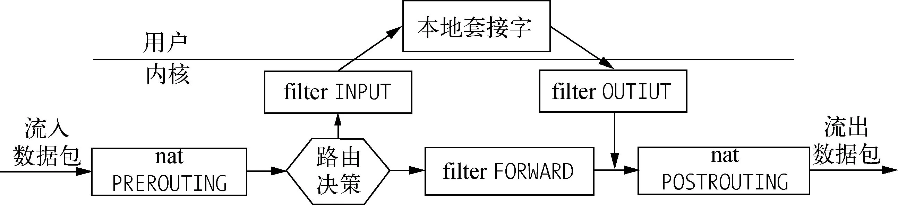
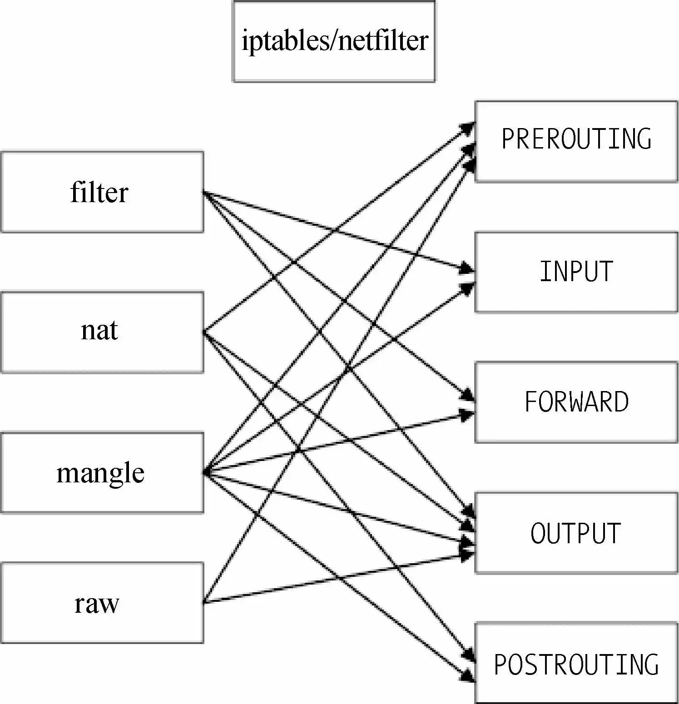

# 第13章Linux系统管理技巧(2)

## 13.4 Linux 的防火墙

Linux 下的防火墙功能非常丰富，但阿铭在日常的运维工作中，使用防火墙的情况并不多。接下来，阿铭打算把一些常用的知识点介绍给大家。

### 13.4.1 SELinux

SELinux 是 Linux 系统特有的安全机制。因为这种机制的限制太多，配置也特别烦琐，所以几乎没有人真正应用它。安装完系统，我们一般都要把 SELinux 关闭，以免引起不必要的麻烦。临时关闭 SELinux 的方法为：

```
# setenforce 0
但这仅仅是临时的，要想永久关闭，需要更改配置文件 /etc/selinux/config，需要把SELINUX=
enforcing改成SELINUX=disabled，更改后的配置文件如下所示：
```

```
# cat /etc/selinux/config
# This file controls the state of SELinux on the system.
# SELINUX= can take one of these three values:
# enforcing - SELinux security policy is enforced.
# permissive - SELinux prints warnings instead of enforcing.
# disabled - No SELinux policy is loaded.
SELINUX=disabled
# SELINUXTYPE= can take one of three two values:
# targeted - Targeted processes are protected,
# minimum - Modification of targeted policy. Only selected processes are protecte
# mls - Multi Level Security protection.
SELINUXTYPE=targeted
更改完该配置文件后，重启系统方可生效。可以使用getenforce命令获得当前 SELinux 的
```

状态，如下所示：

```
# getenforce
Disabled
阿铭的 SELinux 早就关闭了，所以会显示为Disabled，如果还没有关闭则会默认输出
enforcing。当使用setenforce 0这个命令后，再执行getenforce命令会输出
permissive。
```

### 13.4.2 netfilter

在之前的 CentOS 版本（比如 CentOS 6）中，防火墙为 netfilter，从 CentOS 7 开始，防火墙为 firewalld。很多朋友把 Linux 的防火墙叫作 iptables，其实这样叫并不太恰当，iptables仅仅是一个工具。对于 CentOS 7 或者 CentOS 8 上的 firewalld，阿铭目前在工作中使用得并不多。当然，即使是 firewalld，同样也支持之前版本的命令用法，也就是说它是向下兼容的。

关于这一节的内容，阿铭是这样安排的。首先大概讲一下之前版本 iptables 的常用用法，然后再介绍一下 firewalld 的一些用法。下面阿铭先教你如何把 firewalld 关闭，然后开启之前版本的 iptables。示例命令如下：

```
# systemctl stop firewalld // 关闭firewalld服务
# systemctl disable firewalld // 禁止firewalld服务开机启动，后面将会详细讲解
Removed symlink /etc/systemd/system/dbus-org.fedoraproject.FirewallD1.service.
Removed symlink /etc/systemd/system/basic.target.wants/firewalld.service.
# yum install -y iptables-services // 安装iptables-services，这样就可以使用之前版本的i
# systemctl enable iptables // 让它开机启动
Created symlink from /etc/systemd/system/basic.target.wants/iptables.service to /
# systemctl start iptables // 启动iptables服务
```

到此，咱们就可以使用之前版本的 iptables 了。CentOS 上默认设有 iptables 规则，这个规则虽然很安全，但对于我们来说不但没有用，还会造成某些影响，所以阿铭建议你先清除规则，然后把清除后的规则保存一下。示例命令如下：

```
# iptables -nvL
Chain INPUT (policy ACCEPT 0 packets, 0 bytes)
pkts bytes target prot opt in out source destination
21 1620 ACCEPT all -- * * 0.0.0.0/0 0.0.0.0/0 state RELATED,ESTABLISHED
0 0 ACCEPT icmp -- * * 0.0.0.0/0 0.0.0.0/0
0 0 ACCEPT all -- lo * 0.0.0.0/0 0.0.0.0/0
0 0 ACCEPT tcp -- * * 0.0.0.0/0 0.0.0.0/0 state NEW tcp dpt:22
0 0 REJECT all -- * * 0.0.0.0/0 0.0.0.0/0 reject-with icmp-host-prohibited
Chain FORWARD (policy ACCEPT 0 packets, 0 bytes)
pkts bytes target prot opt in out source destination
0 0 REJECT all -- * * 0.0.0.0/0 0.0.0.0/0 reject-with icmp-host-prohibited
Chain OUTPUT (policy ACCEPT 16 packets, 1536 bytes)
pkts bytes target prot opt in out source destination
# iptables –F
# service iptables save
iptables: Saving firewall rules to /etc/sysconfig/iptables:[ OK ]
上例中，-nvL选项表示查看规则，-F选项表示清除当前规则，但清除只是临时的，重启系统
或者重启iptalbes服务后还会加载已经保存的规则，所以需要使用service iptables
save保存一下规则。通过上面的命令输出，我们也可以看到，防火墙规则保存在
```

/etc/sysconfig/iptables 中，你可以查看一下这个文件。

1. netfilter 的 5 个表

```
filter表主要用于过滤包，是系统预设的表，这个表也是阿铭用得最多的表。该表内建 3
个链：INPUT、OUTPUT以及FORWARD。INPUT链作用于进入本机的包，OUTPUT链作用于
本机送出的包，FORWARD链作用于那些跟本机无关的包。
nat表主要用于网络地址转换，它也有 3 个链。PREROUTING链的作用是在包刚刚到达防
火墙时改变它的目的地址（如果需要的话），OUTPUT链的作用是改变本地产生的包的目的
地址，POSTROUTING链的作用是在包即将离开防火墙时改变其源地址。该表阿铭仅偶尔会
```

- 用到。

```
mangle表主要用于给数据包做标记，然后根据标记去操作相应的包。这个表阿铭几乎不怎
```

- 么用，除非你想成为一个高级网络工程师，否则不需要太关注。

```
raw表可以实现不追踪某些数据包。默认系统的数据包都会被追踪，但追踪势必消耗一定的
资源，所以可以用raw表来指定某些端口的包不被追踪。这个表，阿铭从来没用过。
security表在 CentOS 6 中是没有的，它用于强制访问控制（MAC）的网络规则。可以
```

- 说这个表阿铭都没有深入研究过，更别说使用了。所以，你暂时不用理会它。

2. netfilter 的 5 个链

```
5 个链分别为PREROUTING、INPUT、FORWARD、OUTPUT、POSTROUTING。
```

- PREROUTING：数据包进入路由表之前。

- INPUT：通过路由表后目的地为本机。

- FORWARDING：通过路由表后，目的地不为本机。

- OUTPUT：由本机产生，向外转发。

- POSTROUTIONG：发送到网卡接口之前。

- 具体的数据包流向，可以参考图 13-2。



- 图 13-2 数据包流向

- 表和链对应的关系图 13-3 所示。



- 图 13-3 表和链的对应关系

3. iptables 基本语法iptables 是一个非常复杂和功能丰富的工具，所以它的语法也是很有特点的。下面阿铭就给大家介绍几种常用的语法。

- (1) 查看规则以及清除规则，其用法如下：

```
# iptables -t nat -nvL
1
Chain PREROUTING (policy ACCEPT 0 packets, 0 bytes)
2
pkts bytes target prot opt in out source destination
3
4
Chain INPUT (policy ACCEPT 0 packets, 0 bytes)
5
pkts bytes target prot opt in out source destination
6
7
Chain POSTROUTING (policy ACCEPT 4 packets, 384 bytes)
8
pkts bytes target prot opt in out source destination
9
10
Chain OUTPUT (policy ACCEPT 4 packets, 384 bytes)
11
pkts bytes target prot opt in out source destination
12
-t选项后面跟表名。-nvL表示查看该表的规则，其中-n表示不针对 IP 反解析主机名，-L
表示列出，-v表示列出更加详细的信息。如果不加-t选项，则打印filter表的相关信
```

- 息，如下所示：

```
# iptables -nvL
1
Chain INPUT (policy ACCEPT 252 packets, 19329 bytes)
2
pkts bytes target prot opt in out source destination
3
4
Chain FORWARD (policy ACCEPT 0 packets, 0 bytes)
5
pkts bytes target prot opt in out source destination
6
7
Chain OUTPUT (policy ACCEPT 222 packets, 24340 bytes)
8
pkts bytes target prot opt in out source destination
9
上例和-t filter打印的信息是一样的。在清除规则的命令中，阿铭用得最多的就是下面
```

- 两个：

```
# iptables -F
1
# iptables -Z
2
```

```
这里-F表示把所有规则全部清除，如果不加-t指定表，则默认只清除filter表的规
则。-Z表示把包以及流量计数器置零（这个阿铭认为很有用）。
```

- (2) 增加 / 删除一条规则，其用法如下：

```
# iptables -A INPUT -s 192.168.72.1 -p tcp --sport 1234 -d 192.168.72.128 --dpo
1
这里没有加-t选项，所以针对的是filter表。这条规则中各个选项的作用如下。
```

- -A/-D：表示增加 / 删除一条规则。

```
-I：表示插入一条规则，其实效果跟-A一样。
-p：表示指定协议，可以是tcp、udp或者icmp。
--dport：跟-p一起使用，表示指定目标端口。
--sport：跟-p一起使用，表示指定源端口。
```

- -s：表示指定源 IP（可以是一个 IP 段）。

- -d：表示指定目的 IP（可以是一个 IP 段）。

```
-j：后面跟动作，其中ACCEPT表示允许包，DROP表示丢掉包，REJECT表示拒绝包。
```

- -i：表示指定网卡（不常用，但偶尔能用到）。

- 下面阿铭再多举几个例子来帮你理解这些概念：

```
# iptables -I INPUT -s 1.1.1.1 -j DROP
1
```

- 上例表示插入一条规则，把来自 1.1.1.1 的所有数据包丢掉。下例表示删除刚刚插入的规则：

```
# iptables -D INPUT -s 1.1.1.1 -j DROP
1
```

- 注意删除一条规则时，此规则必须和插入时的规则一致。也就是说，两条 iptables 命令，

```
除了-I和-D不一样外，其他地方都一样。
```

- 下例表示把来自 2.2.2.2 并且是使用 TCP 协议到本机 80 端口的数据包丢掉：

```
# iptables -I INPUT -s 2.2.2.2 -p tcp --dport 80 -j DROP
1
注意，--dport/--sport必须和-p选项一起使用，否则会出错。
```

- 下例表示把发送到 10.0.1.14 的 22 端口的数据包丢掉：

```
# iptables -I OUTPUT -p tcp --dport 22 -d 10.0.1.14 -j DROP
1
下例表示把来自 192.168.1.0/24 这个网段且作用在ens33上的包放行：
# iptables -A INPUT -s 192.168.1.0/24 -i ens33 -j ACCEPT
1
# iptables -nvL |grep '192.168.1.0/24'
2
0 0 ACCEPT all -- ens33 * 192.168.1.0/24 0.0.0.0/0
3
```

- 有时候当服务器上的 iptables 过多，你想删除某一条规则，但又不容易掌握创建时的规则。其实有一种比较简单的方法，先查看 iptables 规则，示例命令如下：

```
# iptables -nvL --line-numbers
12
Chain INPUT (policy ACCEPT 309 packets, 23689 bytes)
3
num pkts bytes target prot opt in out source destination
4
1 0 0 ACCEPT all -- ens33 * 192.168.1.0/24 0.0.0.0/0
```

- 然后删除某一条规则，使用如下命令：

```
# iptables -D INPUT 1
1
这里-D后面依次跟链名、规则num。这个num就是查看 iptables 规则时第 1 列的值。随后
```

- 再查看刚才的规则，会发现已经没有了，如下所示：

```
# iptables -nvL --line-numbers
1
iptables 还有一个选项经常用到，即-P（大写）选项，它表示预设策略。其用法如下：
# iptables -P INPUT DROP
1
-P后面跟链名，策略内容或为DROP，或为ACCEPT，默认是ACCEPT。注意：如果你在连
```

- 接远程服务器，千万不要随便执行这个命令，因为一旦输入命令并回车，远程连接就会断开。

```
这个策略一旦设定后，只有使用命令iptables -P INPUT ACCEPT才能恢复成原始状
```

- 态。下面阿铭针对一个小需求介绍一下如何设定 iptables 规则。

```
需求：只针对filter表，预设策略INPUT链DROP，其他两个链ACCEPT，然后针对
```

- 192.168.72.0/24 开通 22 端口，对所有网段开放 80 端口，对所有网段开放 21 端口。

- 这个需求不算复杂，但是因为有多条规则，所以最好写成脚本的形式。脚本内容如下：

```
# vi /usr/local/sbin/iptables.sh // 写入如下内容
1
#! /bin/bash
2
3
ipt="/usr/sbin/iptables"
4
$ipt -F
5
$ipt -P INPUT DROP
6
$ipt -P OUTPUT ACCEPT
7
$ipt -P FORWARD ACCEPT
8
$ipt -A INPUT -s 192.168.72.0/24 -p tcp --dport 22 -j ACCEPT
9
$ipt -A INPUT -p tcp --dport 80 -j ACCEPT
10
$ipt -A INPUT -p tcp --dport 21 -j ACCEPT
11
```

- 完成脚本的编写后，直接运行 /bin/bash /usr/local/sbin/iptables.sh 即可。如果想开机启动时初始化防火墙规则，则需要在 /etc/rc.d/rc.local 中添加一行 /bin/bash/usr/local/sbin/iptables.sh。执行过程如下：

```
# sh /usr/local/sbin/iptables.sh
1
# iptables -nvL
2
Chain INPUT (policy DROP 0 packets, 0 bytes)
3
pkts bytes target prot opt in out source destination
4
20 1580 ACCEPT tcp -- * * 192.168.72.0/24 0.0.0.0/0 tcp dpt:22
5
0 0 ACCEPT tcp -- * * 0.0.0.0/0 0.0.0.0/0 tcp dpt:80
6
0 0 ACCEPT tcp -- * * 0.0.0.0/0 0.0.0.0/0 tcp dpt:21
7
```

- 运行脚本后，查看规则就是这样的，这里可以看到阿铭的第一条规则中已经有 20 个包（第一列）被放行过了。

```
关于icmp的包有一个比较常见的应用，如下所示：
# iptables -I INPUT -p icmp --icmp-type 8 -j DROP
1
这里--icmp-type选项要跟-p icmp一起使用，后面指定类型编号。这个 8 指的是能在
```

- 本机 ping 通其他机器，而其他机器不能 ping 通本机，请牢记。

4. nat表的应用其实，Linux 的 iptables 功能是十分强大的。阿铭的一位老师曾经这样形容 Linux 的网络功能：只有想不到，没有做不到！也就是说，只要是你能够想到的关于网络的应用，Linux 都能帮你实现。你在日常生活中应该接触过路由器，它的功能就是分享上网。本来一根网线过来（其实只有一个公网 IP），通过路由器后，路由器分配一个网段（私网 IP），这样连此接路由器的多台 PC 都能连接因特网，而远端的设备认为你的 IP 就是那个连接路由器的公网

```
IP。这个路由器的功能其实就是由 Linux 的 iptables 实现的，而 iptables 又是通过nat表作
```

- 用而实现的。

- 在这里，阿铭举一个例子来说明 iptables 是如何实现这个功能的。假设你的机器上有两块网卡 eth0 和 eth1，其中 eth0 的 IP 为 10.0.2.68，eth1 的 IP 为 192.168.1.1。eth0 连接了因特网，但 eth1 没有连接。现在有另一台机器（192.168.1.2）和 eth1 是互通的，那么如何设置才能让连接 eth1 的这台机器连接因特网，和 10.0.2.68 互通呢？方法很简单，如下所示：

```
# echo "1" > /proc/sys/net/ipv4/ip_forward
1
# iptables -t nat -A POSTROUTING -s 192.168.1.0/24 -o eth0 -j MASQUERADE
2
```

- 这里，第一个命令涉及内核参数相关的配置文件，它的目的是打开路由转发功能，否则无法

```
实现我们的应用。第二个命令则是 iptables 对nat表做了一个 IP 转发的操作。-o选项后面
跟设备名，表示出口的网卡；MASQUERADE表示伪装。关于nat表，阿铭不想多讲，你只
```

- 要学会这个路由转发功能即可，其他的东西交给网络工程师去学习吧，毕竟你将来是要做Linux 系统工程师的。

5. 保存和备份 iptables 规则前面阿铭提到过，咱们设定的防火墙规则只保存在内存中，并没有保存到某一个文件中。也就是说，当系统重启后以前设定的规则就没有了，所以设定好规则后要先保存一下。命令如下：

```
# service iptables save
1
iptables: Saving firewall rules to /etc/sysconfig/iptables:[ ok ]
2
```

- 它会提示你防火墙规则保存在 /etc/sysconfig/iptables 文件内，这个文件就是 iptables 的配置文件。所以日后如果你遇到备份防火墙规则的任务，只要复制一份这个文件的副本即可。

```
有时我们需要清除防火墙的所有规则，使用命令iptables -F固然可以，但最好的办法还
```

- 是停止防火墙服务，如下所示：

```
# service iptables stop
1
Redirecting to /bin/systemctl stop iptables.service
2
```

- 这样防火墙就失效了，但是一旦重新设定规则（哪怕只有一条），防火墙服务会自动开启。下面阿铭介绍一个用来备份防火墙规则的命令，如下所示：

```
# sh /usr/local/sbin/iptables.sh
1
# iptables-save > myipt.rule
2
# cat myipt.rule
3
# Generated by xtables-save v1.8.2 on Fri Jun 26 15:27:41 2020
4
*security
5
:INPUT ACCEPT [809:137209]
6
:FORWARD ACCEPT [0:0]
7
:OUTPUT ACCEPT [682:88704]
8
COMMIT
9
# Completed on Fri Jun 26 15:27:41 2020
10
# Generated by xtables-save v1.8.2 on Fri Jun 26 15:27:41 2020
11
*raw
12
:PREROUTING ACCEPT [133:10536]
13
:OUTPUT ACCEPT [111:20700]
14
COMMIT
15
# Completed on Fri Jun 26 15:27:41 2020
16
# Generated by xtables-save v1.8.2 on Fri Jun 26 15:27:41 2020
17
*mangle
18
:PREROUTING ACCEPT [133:10536]
19
:INPUT ACCEPT [133:10536]
20
:FORWARD ACCEPT [0:0]
21
:OUTPUT ACCEPT [111:20700]
22
:POSTROUTING ACCEPT [111:20700]
23
COMMIT
24
# Completed on Fri Jun 26 15:27:41 2020
25
# Generated by xtables-save v1.8.2 on Fri Jun 26 15:27:41 2020
26
*nat
27
:PREROUTING ACCEPT [0:0]
28
:INPUT ACCEPT [0:0]
29
:POSTROUTING ACCEPT [0:0]
30
:OUTPUT ACCEPT [0:0]
31
COMMIT
32
# Completed on Fri Jun 26 15:27:41 2020
33
# Generated by xtables-save v1.8.2 on Fri Jun 26 15:27:41 2020
34
*filter
35
:INPUT DROP [108:8568]
36
:FORWARD ACCEPT [0:0]
37
:OUTPUT ACCEPT [111:20700]
38
-A INPUT -s 192.168.72.0/24 -p tcp -m tcp --dport 22 -j ACCEPT
39
-A INPUT -p tcp -m tcp --dport 80 -j ACCEPT
40
-A INPUT -p tcp -m tcp --dport 21 -j ACCEPT
41
COMMIT
42
# Completed on Fri Jun 26 15:27:41 2020
43
先执行一下刚才的 iptables 脚本，使用iptables-save命令重定向到一个文件里。若想要
```

- 恢复这些规则，使用下面的命令即可：

```
# iptables-restore < myipt.rule
1
```

### 13.4.3 firewalld

介绍完了 netfilter，阿铭觉得也有必要再说一下 firewalld，毕竟这个才是 CentOS 8 上默认的防火墙。在上一节中，阿铭把 firewalld 服务给禁掉了，打开了 iptables 服务，现在再反过来关闭 iptables 服务，打开 firewalld 服务。操作如下所示：

```
# iptables –P INPUT ACCEPT
# yum remove -y iptables
# systemctl enable firewalld
Created symlink /etc/systemd/system/dbus-org.fedoraproject.FirewallD1.service → /
Created symlink /etc/systemd/system/multi-user.target.wants/firewalld.service → /
# systemctl start firewalld
```

首先将 INPUT 链的默认策略设置为 ACCEPT，因为前面的实验中有将其设置为 DROP。在前面介绍的 iptables 相关的命令，其实也是可以继续使用的，只不过在 CentOS 8 中不用那么操作，而是有 firewalld 自己的命令。

firewalld 有两个基础概念，分别是 zone 和 service，每一个 zone 里面有不同的 iptables 规

```
则，默认一共有 9 个 zone，而默认的 zone 为public。获取系统所有的 zone，命令如下所
```

示：

```
# firewall-cmd --get-zones
block dmz drop external home internal public trusted work
```

如下命令可以查看系统默认的 zone：

```
# firewall-cmd --get-default-zone
public
```

下面阿铭简单介绍一下上面提到的 9 个 zone。

- drop（丢弃）：任何接收的网络数据包都被丢弃，没有任何回复。仅能有发送出去的网络连接。

```
block（限制）：任何接收的网络连接都被 IPv4 的icmp-host-prohibited信息和 IPv6
的icmp6-adm-prohibited信息所拒绝。
```

- public（公共）：在公共区域内使用，不能相信网络内的其他计算机不会对你的计算机造成危害，只能接收经过选取的连接。

- external（外部）：特别是为路由器启用了伪装功能的外部网。你不能信任来自网络的其他计算，不能相信它们不会对你的计算机造成危害，只能接收经过选择的连接。

- dmz（非军事区）：用于你的非军事区内的计算机，此区域内可公开访问，可以有限地进入你的内部网络，仅仅接收经过选择的连接。

- work（工作）：用于工作区。你可以基本相信网络内的其他计算机不会危害你的计算机。仅仅接收经过选择的连接。

- home（家庭）：用于家庭网络。你可以基本信任网络内的其他计算机不会危害你的计算机。仅仅接收经过选择的连接。

- internal（内部）：用于内部网络。你可以基本上信任网络内的其他计算机不会威胁你的计算机。仅仅接受经过选择的连接。

- trusted（信任）：可接受所有的网络连接。

对于以上 9 个 zone 简单了解即可，阿铭相信你在日常工作中使用它们的机会不会太多。下面介绍几个关于 zone 的命令：

```
# firewall-cmd --set-default-zone=work // 设定默认的zone为work
success
# firewall-cmd --get-zone-of-interface=ens33 // 查看指定网卡所在的zone
Work
# firewall-cmd --zone=public --add-interface=lo // 给指定网卡设置zone
success
# firewall-cmd --zone=dmz --change-interface=lo // 针对网卡更改zone
success
# firewall-cmd --zone=dmz --remove-interface=lo // 针对网卡删除zone
Success
# firewall-cmd --get-active-zones // 查看系统所有网卡所在的zone
Work
interfaces: ens33
```

阿铭觉得 firewalld 工具的开发者可能是想简化用户的使用过程，所以提供了这 9 种 zone，这9 种 zone 中，总有一个是适合我们的使用场景的。那到底 zone 是什么？每一种 zone 之间到底有什么区别呢？下面阿铭再给大家介绍一个概念——service。其实，之所以有 9 种 zone，是因为每一个 zone 里面都使用了不同的 service，而 service 就是针对一个服务（端口）做的iptables 规则。执行如下命令列出当前系统所有的 service：

```
# firewall-cmd --get-service
RH-Satellite-6 amanda-client amanda-k5-client amqp amqps apcupsd audit bacula bac
```

这些 service 都是由一个个配置文件定义的，配置文件的模板在 /usr/lib/firewalld/services/ 目录下，真正生效的配置在 /etc/firewalld/services 目录下面（默认为空）：

```
# ls /usr/lib/firewalld/services/
amanda-client.xml dhcpv6-client.xml git.xml kpasswd.xml murmur.xml prometheus.xml
amanda-k5-client.xml dhcpv6.xml grafana.xml kprop.xml mysql.xml proxy-dhcp.xml sl
amqps.xml dhcp.xml gre.xml kshell.xml nfs3.xml ptp.xml smtp-submission.xml tftp.x
amqp.xml distcc.xml high-availability.xml ldaps.xml nfs.xml pulseaudio.xml smtps.
apcupsd.xml dns-over-tls.xml https.xml ldap.xml nmea-0183.xml puppetmaster.xml sm
audit.xml dns.xml http.xml libvirt-tls.xml nrpe.xml quassel.xml snmptrap.xml tor-
bacula-client.xml docker-registry.xml imaps.xml libvirt.xml ntp.xml radius.xml sn
bacula.xml docker-swarm.xml imap.xml lightning-network.xml nut.xml rdp.xml spider
bb.xml dropbox-lansync.xml ipp-client.xml llmnr.xml openvpn.xml redis-sentinel.xm
bgp.xml elasticsearch.xml ipp.xml managesieve.xml ovirt-imageio.xml redis.xml squ
bitcoin-rpc.xml etcd-client.xml ipsec.xml matrix.xml ovirt-storageconsole.xml RH-
bitcoin-testnet-rpc.xml etcd-server.xml ircs.xml mdns.xml ovirt-vmconsole.xml rpc
bitcoin-testnet.xml finger.xml irc.xml memcache.xml plex.xml rsh.xml steam-stream
bitcoin.xml freeipa-4.xml iscsi-target.xml minidlna.xml pmcd.xml rsyncd.xml svdrp
bittorrent-lsd.xml freeipa-ldaps.xml isns.xml mongodb.xml pmproxy.xml rtsp.xml sv
ceph-mon.xml freeipa-ldap.xml jenkins.xml mosh.xml pmwebapis.xml salt-master.xml
ceph.xml freeipa-replication.xml kadmin.xml mountd.xml pmwebapi.xml samba-client.
cfengine.xml freeipa-trust.xml kdeconnect.xml mqtt-tls.xml pop3s.xml samba-dc.xml
cockpit.xml ftp.xml kerberos.xml mqtt.xml pop3.xml samba.xml syslog-tls.xml xmpp-
condor-collector.xml ganglia-client.xml kibana.xml mssql.xml postgresql.xml sane.
ctdb.xml ganglia-master.xml klogin.xml ms-wbt.xml privoxy.xml sips.xml telnet.xml
```

阿铭刚刚说过，每个 zone 里面都有不同的 service，那么如何查看一个 zone 下面有哪些service 呢？相关命令如下：

```
# firewall-cmd --list-services // 查看当前zone下有哪些service
cockpit dhcpv6-client ssh
# firewall-cmd --zone=public --list-services // 查看指定zone下有哪些service
```

一个 zone 下面有某个 service，意味着这个 service 是被信任的。比如，当前 zone 下面有ssh，那么 ssh 服务（也就是 22）端口是放行的。我们可以给一个 zone 添加一个 service，命令如下：

```
# firewall-cmd --zone=public --add-service=http // 把http增加到public zone下面
success
# firewall-cmd --zone=public --list-service
cockpit dhcpv6-client http ssh
```

对于每个 zone 来说，都有自己的配置文件，你可以查看目录 /usr/lib/firewalld/zones/ 下面对应的文件，这些就是 zone 的配置文件：

```
# ls /usr/lib/firewalld/zones/
block.xml dmz.xml drop.xml external.xml home.xml internal.xml public.xml trusted.
```

刚刚阿铭教给你一个命令，可在一个 zone 里面增加一个 service，但这种方法仅仅在内存中生效，并没有修改配置文件，如果想修改配置文件，需要加一个选项：

```
# firewall-cmd --zone=public --add-service=http --permanent
success
```

一旦更改了某个 zone 的配置文件，则会在 /etc/firewalld/zones/ 目录下面生成对应 zone 的配置文件（.xml 后缀的文件），其实这个目录下面的配置文件才是真正的配置文件。阿铭在上面介绍的目录，可以说是所有 zone 的模板配置文件。

下面阿铭举一个实际的例子，帮助你明白 zone 和 service 两个概念。需求：假如服务器上配置了一个 FTP 服务，但端口并非默认的 21，而是 1121，并且需要在 work zone 下面放行FTP。具体的做法如下：

```xml
# cp /usr/lib/firewalld/services/ftp.xml /etc/firewalld/services/ // 这个和上面阿铭提
# vi /etc/firewalld/services/ftp.xml // 把里面的21改为1121
# cp /usr/lib/firewalld/zones/work.xml /etc/firewalld/zones/
# vi /etc/firewalld/zones/work.xml // 在里面增加一行FTP相关的配置，内容如下
<?xml version="1.0" encoding="utf-8"?>
<zone>
<short>Work</short>
<description>For use in work areas. You mostly trust the other computers on netw
<service name="ssh"/>
<service name="ftp"/>
<service name="dhcpv6-client"/>
<service name="cockpit"/>
</zone>
# firewall-cmd --reload // 重新加载
```

再来验证一下 work zone 里面的 service 是否有 FTP：

```
# firewall-cmd --zone=work --list-services
cockpit dhcpv6-client ftp ssh
```

上面的方法还是有点啰唆，有没有像上一节中 iptables 命令那样简单的方式呢？当然有，下面阿铭再给大家找几个典型例子。

1）放行指定端口的命令如下：

```bash
# firewall-cmd --set-default-zone=public // 将默认zone设置为public
# firewall-cmd --zone=public --add-port 1000/tcp --permanent // 如果不指定--zone默认
success
# firewall-cmd --reload // 使其规则生效
# firewall-cmd --list-all // 列出当前具体规则，可以看到刚刚增加的1000端口
public (active)
target: default
icmp-block-inversion: no
interfaces: ens33
sources:
services: cockpit dhcpv6-client http ssh
ports: 1000/tcp
protocols:
masquerade: no
forward-ports:
source-ports:
icmp-blocks:
rich rules:
```

2）添加多个端口的命令如下：

```
# firewall-cmd --add-port 3000-3010/tcp --permanent // 3000-3010指定一个范围
success
# firewall-cmd --reload
# firewall-cmd --list-all |grep ports // 用grep过滤只含有ports字符的行
ports: 1000/tcp 3000-3010/tcp
forward-ports:
source-ports:
# firewall-cmd --add-port 80/tcp --add-port 8080/tcp --permanent // 如果要增加多个po
# firewall-cmd --reload
```

3）删除指定端口的命令如下：

```
# firewall-cmd --remove-port 8080/tcp --permanent
success
# firewall-cmd --reload
success
# firewall-cmd --list-all |grep ports
ports: 1000/tcp 3000-3010/tcp 80/tcp
forward-ports:
source-ports:
```

4）针对某个 IP 开放指定端口的命令如下：

```bash
# firewall-cmd --permanent --add-rich-rule="rule family="ipv4" source address="19
success
# firewall-cmd --reload
success
# firewall-cmd --list-all
public (active)
target: default
icmp-block-inversion: no
interfaces: ens33
sources:
services: cockpit dhcpv6-client http ssh
ports: 1000/tcp 3000-3010/tcp 80/tcp
protocols:
masquerade: no
forward-ports:
source-ports:
icmp-blocks:
rich rules:
rule family="ipv4" source address="192.168.72.166" port port="6379" protocol="tc
# firewall-cmd --permanent --add-rich-rule="rule family="ipv4" source address="19
success
# firewall-cmd --reload
success
# firewall-cmd --list-all
public (active)
target: default
icmp-block-inversion: no
interfaces: ens33
sources:
services: cockpit dhcpv6-client http ssh
ports: 1000/tcp 3000-3010/tcp 80/tcp
protocols:
masquerade: no
forward-ports:
source-ports:
icmp-blocks:
rich rules:
rule family="ipv4" source address="192.168.72.166" port port="6379" protocol="tc
rule family="ipv4" source address="192.168.0.0/24" accept
```

5）删除某条规则的命令如下：

```
# firewall-cmd --permanent --remove-rich-rule="rule family="ipv4" source address=
success
# firewall-cmd --reload
```

关于 firewalld，阿铭就介绍这些。这部分内容要是仔细研究还是蛮多的，但阿铭觉得毕竟在工作中使用得并不多，了解这些内容足够了。

## 13.5 Linux 系统的任务计划

其实大部分系统管理工作都是通过定期自动执行某个脚本来完成的，那么如何定期执行某个脚本呢？这就要借助 Linux 的 cron 功能了。这部分内容很重要，请大家牢记！

### 13.5.1 命令crontab

```
Linux 任务计划功能的操作都是通过crontab命令来完成的，其常用的选项有以下几个。
-u：表示指定某个用户，不加-u选项则为当前用户。
```

- -e：表示制定计划任务。

- -l：表示列出计划任务。

- -r：表示删除计划任务。

下面请跟着阿铭来创建第一个任务计划，如下所示：

```
# crontab -e
no crontab for root - using an empty one
这里使用crontab -e来编写任务计划，这实际上是使用 vim 工具打开了crontab的配置文
```

件，我们写下如下内容：

```
01 10 05 06 3 echo "ok" > /root/cron.log
```

这里每个字段的数字分别表示什么呢？从左到右依次为：分、时、日、月、周和命令行。上例

```javascript
表示在 6 月 5 日（这一天必须是星期三）的 10 点 01 分执行命令：echo "ok" >
/root/cron.log。
命令crontab -e实际上是打开了 /var/spool/cron/username 文件（如果用户是 root，则打开
```

的是 /var/spool/cron/root）。打开这个文件使用了 vim 编辑器，所以保存时在命令行模式下输

```
入:wq即可。但是请千万不要直接去编辑那个文件，否则会出错，所以一定要使用命令
crontab -e来编辑。
查看已经设定的任务计划使用crontab -l命令，如下所示：
# crontab -l
01 10 05 06 3 echo "ok" > /root/cron.log
删除任务计划要使用crontab -r命令，这个删除选项最好还是少用，因为它会一下子把全部
计划都删除掉。如果你想只删除一条计划，可以使用-e选项进入crontab进行编辑。-r选项
```

用法如下所示：

```
# crontab -r
# crontab -l
no crontab for root
```

### 13.5.2 cron 练习题

cron 的内容不算太难，但需要你牢固掌握。下面阿铭给出一些练习题，帮助你熟悉 cron 的应用。

(1) 每天凌晨 1 点 20 分清除 /var/log/slow.log 这个文件。

(2) 每周日 3 点执行 /bin/sh /usr/local/sbin/backup.sh。

(3) 每月 14 日 4 点 10 分执行 /bin/sh /usr/local/sbin/backup_month.sh。

```
(4) 每隔 8 小时执行ntpdate time.windows.com。
```

(5) 每天的 1 点、12 点和 18 点执行 /bin/sh /usr/local/sbin/test.sh。

(6) 每天的 9 点到 18 点执行 /bin/sh /usr/local/sbin/test2.sh。

下面是以上习题的答案，仅作参考。

```javascript
(1) 20 1 * * * echo "" >/var/log/slow.log
(2) 0 3 * * 0 /bin/sh /usr/local/sbin/backup.sh
(3) 10 4 14 * * /bin/sh /usr/local/sbin/backup_month.sh
(4) 0 */8 * * * ntpdate time.windows.com
(5) 0 1,12,18 * * * /bin/sh /usr/local/sbin/test.sh
(6) 0 9-18 * * * /bin/sh /usr/local/sbin/test2.sh
```

练习完上面的题目，你可能会有一些小疑问。这里要简单说明一下，每隔 8 小时就是用全部小时（0~23）去除以 8，结果算出来应该是 0、8 和 16 这 3 个数。当遇到多个数（分钟、小

```
时、月、周）时，则需要用逗号隔开，比如第 5 题中的1,12,18。时间段是可以用n-m的方
式表示的，比如第 6 题中的9-18。
设置好了所有的任务计划后，我们需要查看一下crond服务是否已经启动，如下所示：
# systemctl status crond
● crond.service - Command Scheduler
Loaded: loaded (/usr/lib/systemd/system/crond.service; enabled; vendor preset: e
Active: active (running) since Fri 2020-06-26 15:41:17 CST; 1h 22min ago
Main PID: 820 (crond)
Tasks: 1 (limit: 11353)
Memory: 1.9M
CGroup: /system.slice/crond.service
└─820 /usr/sbin/crond -n
6月 26 15:41:17 aminglinux-123 systemd[1]: Started Command Scheduler.
6月 26 15:41:17 aminglinux-123 crond[820]: (CRON) STARTUP (1.5.2)
6月 26 15:41:17 aminglinux-123 crond[820]: (CRON) INFO (Syslog will be used inste
6月 26 15:41:17 aminglinux-123 crond[820]: (CRON) INFO (RANDOM_DELAY will be scal
6月 26 15:41:17 aminglinux-123 crond[820]: (CRON) INFO (running with inotify suppo
6月 26 16:01:01 aminglinux-123 CROND[2042]: (root) CMD (run-parts /etc/cron.hourly
6月 26 17:01:01 aminglinux-123 CROND[4032]: (root) CMD (run-parts /etc/cron.hourly
看Active那行，如果是启动状态显示为active(running)，未启动则显示为inactive
(dead)。
```

## 13.6 Linux 系统服务管理

也许你配置过 Windows 开机启动的服务，其中有些服务在日常的管理工作中用不到，我们就要把它停止，一来可以节省资源，二来可以减少安全隐患。在 Linux 上同样也有相关的工具来管理系统的服务。

### 13.6.1 chkconfig 服务管理工具

CentOS 6 上的服务管理工具为 chkconfig，Linux 系统所有的预设服务都可以通过查看/etc/init.d/ 目录得到，如下所示：

```
# ls /etc/init.d/
functions README
```

只有屈指可数的几个文件，这是因为从 CentOS 7 起已经不再延续 CentOS 6 版本的服务管理

```
方案了。但是我们依然可以继续使用chkconfig这个命令。系统的预设服务都可以通过这样
的命令实现：service服务名start|stop|restart。这里的服务名就是 /etc/init.d/ 目录下
的这些文件了。使用 chkconfig 启动某服务除了可以使用命令service xxx start外，还可
以使用命令/etc/init.d/xxx start。
我们可以使用命令chkconfig --list列出所有的服务及其每个级别的开启状态，如下所
```

示：

```
# chkconfig --list
注：该输出结果只显示 SysV 服务，并不包含原生 systemd 服务。SysV 配置数据可能被原生 systemd 配
要列出 systemd 服务，请执行 'systemctl list-unit-files'。查看在具体 target 启用的服务请
'systemctl list-dependencies [target]'。
```

这里也会看到一个提示，它提示我们该命令输出的内容并没有包含 CentOS 8 的原生 systemd服务，而这里仅仅列出来 SysV 服务。这也是 /etc/init.d/ 目录下面只有一两个启动脚本的根本原因。也就是说，早期 CentOS 版本（7 之前）采用的服务管理都是 SysV，而从 7 开始换成了 systemd。

```
使用chkconfig命令列出来的服务有 7 个运行级别（数字 0~6），这为系统启动级别
```

（CentOS 7 之前版本的用法，而从 CentOS 7 开始已经不再严格区分级别的概念了）。其中 0作为 shutdown 动作，1 作为重启至单用户模式，6 为重启。在一般的 Linux 系统实现中，都使用了 2、3、4、5 几个级别。在 CentOS 系统中，2 表示无 NFS 支持的多用户模式，3 表示完全多用户模式（也是最常用的级别），4 保留给用户自定义，5 表示图形登录方式。现在我们只是看到了各服务在每个级别下的开启状态，那么如何去更改某级别下的开启状态呢？相关命令如下：

```
# chkconfig --level 3 xxx off
这里用--level指定级别，后面xxx是服务名，然后是off或者on。选项--level后面还可
```

以指定多个级别，如下所示：

```
# chkconfig --level 345 xxx off
```

另外还可以省略级别，默认是针对级别 2、3、4 和 5 操作的，如下所示：

```
# chkconfig xxx on
```

chkconfig 还有一个功能，就是可以把某个服务加入系统服务或者删除，即可以使

```
用“chkconfig --add服务名”或者“chkconfig --del服务名”这样的形式，并且可以在
chkconfig --list的结果中查找到。
# chkconfig --del xxx
# chkconfig --add xxx
```

这个功能常用于把自定义的启动脚本加入到系统服务当中。关于 chkconfig 工具，阿铭就先介绍这么多，毕竟 systemd 才是本书的主角。

### 13.6.2 systemd 服务管理

上一节阿铭提到过，从 CentOS 7 开始不使用 SysV 而改为 systemd 了，这是因为 systemd支持多个服务并发启动，而 SysV 只能一个一个地启动，这样最终导致的结果是 systemd 方式启动会快很多。但毕竟阿铭使用 CentOS 很多年，突然这样一变化还是有点不太习惯，接下来的知识点也会让你觉得 systemd 有点复杂。我们不妨对比着 chkconfig 工具来学习一下systemd。首先是列出系统所有的服务，如下所示：

```
# systemctl list-units --all --type=service
UNIT LOAD ACTIVE SUB DESCRIPTION
atd.service loaded active running Job spooling tools
auditd.service loaded active running Security Auditing Service
chronyd.service loaded active running NTP client/server
● cloud-init-local.service not-found inactive dead cloud-init-local.service
cpupower.service loaded inactive dead Configure CPU power relat>
crond.service loaded active running Command Scheduler
dbus.service loaded active running D-Bus System Message Bus
● display-manager.service not-found inactive dead display-manager.service
dnf-makecache.service loaded inactive dead dnf makecache
dracut-cmdline.service loaded inactive dead dracut cmdline hook
dracut-initqueue.service loaded inactive dead dracut initqueue hook
dracut-mount.service loaded inactive dead dracut mount hook
dracut-pre-mount.service loaded inactive dead dracut pre-mount hook
dracut-pre-pivot.service loaded inactive dead dracut pre-pivot and clea>
dracut-pre-trigger.service loaded inactive dead dracut pre-trigger hook
dracut-pre-udev.service loaded inactive dead dracut pre-udev hook
dracut-shutdown.service loaded active exited Restore /run/initramfs on>
ebtables.service loaded inactive dead Ethernet Bridge Filtering>
emergency.service loaded inactive dead Emergency Shell
firewalld.service loaded active running firewalld - dynamic firew>
getty@tty1.service loaded active running Getty on tty1
import-state.service loaded active exited Import network configurat>
initrd-cleanup.service loaded inactive dead Cleaning Up and Shutting >
initrd-parse-etc.service loaded inactive dead Reload Configuration from>
initrd-switch-root.service loaded inactive dead Switch Root
initrd-udevadm-cleanup-db.service loaded inactive dead Cleanup udevd DB
ip6tables.service loaded inactive dead IPv6 firewall with ip6tab>
```

太多了，阿铭仅仅列出来一部分。那这些服务对应的启动脚本文件在哪里呢？

```
# ls /usr/lib/systemd/system/
arp-ethers.service multi-user.target.wants sysinit.target.wants
atd.service NetworkManager-dispatcher.service sys-kernel-config.mount
auditd.service NetworkManager.service sys-kernel-debug.mount
autovt@.service NetworkManager-wait-online.service syslog.socket
basic.target network-online.target syslog.target.wants
basic.target.wants network-pre.target systemd-ask-password-console.path
bluetooth.target network.target systemd-ask-password-console.service
```

文件同样很多，阿铭仅仅列出来一部分。你会发现这个目录下面的文件有点奇怪，有的是目录，有的是文件，有的以 .service 为后缀，有的以 .target 为后缀，当然还有其他的格式，这些东西到底是什么？有没有不知所以的感觉？其实阿铭和你一样，有点晕晕的，还是先来看与服务相关的知识点吧，下面是阿铭整理的一些常用命令：

```
# systemctl enable crond.service // 让某个服务开机启动（.service可以省略）
# systemctl disable crond.service // 不让开机启动
# systemctl status crond.service // 查看服务状态
# systemctl start crond.service // 启动某个服务
# systemctl stop crond.service // 停止某个服务
# systemctl restart crond.service // 重启某个服务
# systemctl is-enabled crond // 查看某个服务是否开机启动
```

其实关于服务的用法还有不少，但阿铭认为有上面这些就够用了。下面再介绍两个概念，等你看完这部分内容，对于上面不知所以的文件就会有些眉目了。我们先来说一个很重要的概念——unit。刚刚阿铭执行命令 ls /usr/lib/systemd/system 的时候，下面有很多文件，其实可以把它们归类为下面这几大类。

- service：系统服务。

- target：多个 unit 组成的组。

- device：硬件设备。

- mount：文件系统挂载点。

- automount：自动挂载点。

- path：文件或路径。

- scope：不是由 systemd 启动的外部进程。

- slice：进程组。

- snapshot：systemd 快照。

- socket：进程间通信的套接字。

- swap：swap 文件。

- timer：定时器。

以上每种类型的文件都为一个 unit，正是这些 unit 才组成了系统的各个资源（各个服务、各个设备等）。下面阿铭给大家介绍几个和 unit 相关的命令：

```
# systemctl list-units // 列出正在运行（active）的unit
# systemctl list-units --all // 列出所有的unit（包括失败的、inactive的）
# systemctl list-units --all --state=inactive // 列出所有inactive的unit
# systemctl list-units --all --type=service // 列出所有状态的service
# systemctl list-units --type=service // 列出状态为active的service
# systemctl is-active crond.service // 查看某个unit是否active
```

关于 unit，阿铭不再多解释，毕竟我们平时在工作中几乎用不到它。下面再来看另外一个概念——target。target 类似于 CentOS 6 里面的启动级别，但 target 支持多个 target 同时启动。target 其实是多个 unit 的组合，系统启动说白了就是启动多个 unit，为了管理方便，就使用target 来管理这些 unit。查看当前系统的所有 target：

```
# systemctl list-unit-files --type=target // 注意和前面命令的区分
UNIT FILE STATE
basic.target static
bluetooth.target static
cryptsetup-pre.target static
cryptsetup.target static
ctrl-alt-del.target disabled
default.target indirect
emergency.target static
exit.target disabled
final.target static
getty-pre.target static
getty.target static
graphical.target static
halt.target disabled
hibernate.target static
hybrid-sleep.target static
initrd-fs.target static
```

查看一个 target 包含的所有 unit，如下所示：

```
# systemctl list-dependencies multi-user.target
multi-user.target
● ├─atd.service
● ├─auditd.service
● ├─chronyd.service
● ├─crond.service
● ├─dbus.service
● ├─dnf-makecache.timer
● ├─firewalld.service
● ├─irqbalance.service
● ├─kdump.service
● ├─NetworkManager.service
● ├─plymouth-quit-wait.service
● ├─plymouth-quit.service
● ├─rsyslog.service
● ├─sshd.service
● ├─sssd.service
```

因为内容太长，阿铭并没有全部列出来，你可以在自己的 CentOS 8 上全部列出来，显示效果还是很不错的，它以树形的方式列出来，一目了然。下面还有几个关于 target 的命令：

```
# systemctl get-default // 查看系统默认的target
multi-user.target
# systemctl set-default multi-user.target // 设置默认的target
上面提到的multi-user.target等同于 CentOS 6 的运行级别 3，其实还有其他几个 target
```

对应 0~6 运行级别，如表 13-1 所示。

表 13-1 运行级别和 target 的对比

- 运行级备注

介绍完了 unit 和 target，阿铭再带着你一起梳理一下 service、unit 以及 target 之间的联系：

(1) 一个 service 属于一种 unit；

(2) 多个 unit 一起组成了一个 target；

(3) 一个 target 里面包含了多个 service，你可以查看文件

```
/usr/lib/systemd/system/sshd.service 里面[install]部分的内容，它就定义了该 service 属
```

于哪一个 target。

## 13.7 Linux 下的数据备份工具 rsync

作为一个系统管理员，数据备份是非常重要的。阿铭有一次没有做好备份策略，结果磁盘坏了，数据全部丢失。所以在以后的系统维护工作中，你一定要时刻牢记给数据做备份。

```
在 Linux 系统下数据备份的工具很多，但阿铭只用一种，那就是rsync，从字面意思上可以理
解为 remote sync（远程同步）。rsync不仅可以远程同步数据（类似于scp），而且可以本地
同步数据（类似于cp），但不同于cp或scp的一点是，它不会覆盖以前的数据（如果数据已经
```

存在），而是先判断已经存在的数据和新数据的差异，只有数据不同时才会把不相同的部分覆

```
盖。如果你的 Linux 没有rsync命令，请使用命令yum install -y rsync安装。
下面阿铭先举一个例子，然后再详细讲解rsync的用法：
# rsync -av /etc/passwd /tmp/1.txt
sending incremental file list
passwd
sent 1,205 bytes received 35 bytes 2,480.00 bytes/sec
total size is 1,113 speedup is 0.90
```

上例将会把 /etc/passwd 同步到 /tmp/ 目录下，并改名为 1.txt。如果是远程复制，数据备份就

```
是这样的形式——IP:path，比如 192.168.72.128:/root/。具体用法如下：
# rsync -av /etc/passwd 192.168.72.128:/tmp/1.txt
The authenticity of host '192.168.72.128 (192.168.72.128)' can't be established.
ECDSA key fingerprint is SHA256:gFHUJnoZAjOcnG95pt7Zg9iaPZGDiOrbZyssZtRoQhA.
Are you sure you want to continue connecting (yes/no/[fingerprint])? yes
Warning: Permanently added '192.168.72.128' (ECDSA) to the list of known hosts.
root@192.168.72.128's password:
sending incremental file list
sent 45 bytes received 12 bytes 8.77 bytes/sec
total size is 1,113 speedup is 19.53
首次连接时会提示是否要继续连接，我们输入yes继续。当建立连接后，需要输入密码。如果
```

手动执行这些操作比较简单，但若是写在脚本中该怎么办呢？这就涉及添加信任关系了，该部分内容稍后会详细介绍。

### 13.7.1 rsync的命令格式

```
rsync的命令格式如下：
rsync [OPTION]... SRC DEST
rsync [OPTION]... SRC [USER@]HOST:DEST
rsync [OPTION]... [USER@]HOST:SRC DEST
rsync [OPTION]... [USER@]HOST::SRC DEST
rsync [OPTION]... SRC [USER@]HOST::DEST
```

在阿铭前面举的两个例子中，第一个例子为第一种格式，第二个例子为第二种格式。但不同的

```
是，阿铭并没有加user@host，如果不加默认指的是 root。第三种格式是从远程目录同步数
```

据到本地。第四种和第五种格式使用了两个冒号，这种格式和其他格式的验证方式不同。

### 13.7.2 rsync常用选项

```
rsync命令各选项的含义如下。
-a：这是归档模式，表示以递归方式传输文件，并保持所有属性，它等同于-rlptgoD。-
a选项后面可以跟一个--no-OPTION，表示关闭-rlptgoD中的某一个，比如-a--no-l
等同于-rptgoD。
```

- -r：表示以递归模式处理子目录。它主要是针对目录来说的，如果单独传一个文件不需要

```
加-r选项，但是传输目录时必须加。
```

- -v：表示打印一些信息，比如文件列表、文件数量等。

- -l：表示保留软连接。

- -L：表示像对待常规文件一样处理软连接。如果是 SRC 中有软连接文件，则加上该选项后，将会把软连接指向的目标文件复制到 DST。

- -p：表示保持文件权限。

- -o：表示保持文件属主信息。

- -g：表示保持文件属组信息。

- -D：表示保持设备文件信息。

- -t：表示保持文件时间信息。

- --delete：表示删除 DST 中 SRC 没有的文件。

- --exclude=PATTERN：表示指定排除不需要传输的文件，等号后面跟文件名，可以是万

```
用字符模式（如*.txt）。
```

- --progress：表示在同步的过程中可以看到同步的过程状态，比如统计要同步的文件数量、同步的文件传输速度等。

- -u：表示把 DST 中比 SRC 还新的文件排除掉，不会覆盖。

- -z：加上该选项，将会在传输过程中压缩

```
选项虽然多，但阿铭常用的选项也就-a、-v、-z、--delete和--exclude这几个，请牢
```

记它们！下面阿铭将会针对这些选项做一系列小试验。

1. 建立目录和文件过程如下所示：

```
# mkdir rsync
1
# cd rsync
2
# mkdir test1
3
# cd test1
4
# touch 1 2 3 /root/123.txt
5
# ln -s /root/123.txt ./123.txt
6
# ls -l
7
总用量 0
8
-rw-r--r-- 1 root root 0 6月 26 17:30 1
9
lrwxrwxrwx 1 root root 13 6月 26 17:30 123.txt -> /root/123.txt
10
-rw-r--r-- 1 root root 0 6月 26 17:30 2
11
-rw-r--r-- 1 root root 0 6月 26 17:30 3
12
# cd ..
13
```

- 阿铭建立这些文件的目的就是为后续试验做一些准备工作。

2. 使用-a选项

```
首先来看看-a选项的用法，如下所示：
# rsync -a test1 test2
1
# ls test2
2
test1
3
# ls test2/test1/
4
1 123.txt 2 3
5
这里有一个问题，就是本来想把 test1 目录直接复制成 test2 目录，可结果rsync却新建了
```

- test2 目录，然后把 test1 放到 test2 当中。为了避免这样的情况发生，可以这样做：

```
# rm -rf test2
1
2
# rsync -a test1/ test2/
3
# ls -l test2/
4
总用量 0
5
-rw-r--r-- 1 root root 0 6月 26 17:30 1
6
lrwxrwxrwx 1 root root 13 6月 26 17:30 123.txt -> /root/123.txt
7
-rw-r--r-- 1 root root 0 6月 26 17:30 2
8
-rw-r--r-- 1 root root 0 6月 26 17:30 3
这里加一个斜杠就好了，所以阿铭建议你在使用rsync备份目录时，要养成加斜杠的习
惯。前面已经讲了-a选项等同于-rlptgoD，且-a还可以和--no-OPTIN一并使用。下面
再来看看-l选项的作用，如下所示：
# rm -rf test2
1
# rsync -av --no-l test1/ test2/
2
sending incremental file list
3
created directory test2
4
skipping non-regular file "123.txt"
5
./
6
1
7
2
8
3
9
10
sent 234 bytes received 144 bytes 756.00 bytes/sec
11
total size is 13 speedup is 0.03
12
上例中使用了-v选项，跳过了非普通文件 123.txt。其实 123.txt 是一个软连接文件，如果
不使用-l选项，系统则不理会软连接文件。虽然加-l选项能复制软连接文件，但软连接的
```

- 目标文件却没有复制。有时我们需要复制软连接文件所指向的目标文件，这又该怎么办呢？

3. 使用-L选项具体用法如下：

```
# rm -rf test2
1
# rsync -avL test1/ test2/
2
sending incremental file list
3
created directory test2
4
./
5
1
6
123.txt
7
2
8
3
9
10
sent 265 bytes received 123 bytes 776.00 bytes/sec
11
total size is 0 speedup is 0.00
12
# ls -l test2/
13
总用量 0
14
-rw-r--r-- 1 root root 0 6月 26 17:30 1
15
-rw-r--r-- 1 root root 0 6月 26 17:30 123.txt
16
-rw-r--r-- 1 root root 0 6月 26 17:30 2
17
-rw-r--r-- 1 root root 0 6月 26 17:30 3
18
上例加上-L选项就可以把 SRC 中软连接的目标文件复制到 DST。
```

4. 使用-u选项

```
首先查看一下 test1/1 和 test2/1 的创建时间（肯定是一样的），然后使用touch修改一下
test2/1 的创建时间（此时 test2/1 要比 test1/1 的创建时间晚一些）。如果不加-u选项，会
```

- 把 test2/1 的创建时间变成和 test1/1 一样，如下所示：

```
# ll test1/1 test2/1
1
-rw-r--r-- 1 root root 0 6月 26 17:30 test1/1
2
-rw-r--r-- 1 root root 0 6月 26 17:30 test2/1
3
从上例可以看出二者的创建时间是一样的。下面修改 test2/1 的创建时间，然后不加-u同
```

- 步，如下所示：

```
# echo "1111" > test2/1
1
# ll test2/1
2
- rw-r--r-- 1 root root 5 6月 26 17:33 test2/1
3
# rsync -a test1/1 test2/
4
# ll test2/1
5
-rw-r--r-- 1 root root 0 6月 26 17:30 test2/1
6
这里 test2/1 的创建时间还是和 test1/1 一样。下面加上-u选项，如下所示：
# echo "1111" > test2/1
1
# ll test2/1
2
-rw-r--r-- 1 root root 5 6月 26 17:34 test2/1
3
# rsync -avu test1/ test2/
4
sending incremental file list
5
./
6
123.txt -> /root/123.txt
7
8
sent 134 bytes received 22 bytes 312.00 bytes/sec
9
total size is 13 speedup is 0.08
10
# ll test1/1 test2/1
11
-rw-r--r-- 1 root root 0 6月 26 17:30 test1/1
12
-rw-r--r-- 1 root root 5 6月 26 17:34 test2/1
13
加上-u选项后，不会再把 test1/1 同步为 test2/1 了。
```

5. 使用--delete选项首先删除 test1/123.txt，如下所示：

```
# rm -f test1/123.txt
1
# ls test1/
2
1 2 3
3
```

- 然后把 test1/ 目录同步到 test2/ 目录下，如下所示：

```sql
# rsync -av test1/ test2/
1
sending incremental file list
2
./
3
1
4
5
sent 130 bytes received 38 bytes 336.00 bytes/sec
6
total size is 0 speedup is 0.00
7
# ls test2/
8
1 123.txt 2 3
9
上例中，test2/ 目录并没有删除 123.txt。下面加上--delete选项，示例如下：
# rsync -av --delete test1/ test2/
1
sending incremental file list
2
deleting 123.txt
3
4
sent 84 bytes received 23 bytes 214.00 bytes/sec
5
total size is 0 speedup is 0.00
6
# ls test2/
7
1 2 3
8
```

- 这里 test2/ 目录下的 123.txt 也被删除了。

- 另外还有一种情况，就是如果在 DST 中增加文件了，而 SRC 当中没有这些文件，同步时

```sql
加上--delete选项后同样会删除新增的文件。如下所示：
# touch test2/4
1
# ls test1/
2
1 2 3
3
# ls test2/
4
1 2 3 4
5
# rsync -a --delete test1/ test2/
6
# ls test1/
7
1 2 3
8
# ls test2/
9
1 2 3
10
```

6. 使用--exclude选项具体用法如下：

```sql
# touch test1/4
1
# rsync -a --exclude="4" test1/ test2/
2
# ls test1/
3
1 2 3 4
4
# ls test2/
5
1 2 3
6
该选项还可以与匹配字符*一起使用，如下所示：
# touch test1/1.txt test1/2.txt
1
# ls test1/
2
1 1.txt 2 2.txt 3 4
3
# rsync -a --progress --exclude="*.txt" test1/ test2/
4
sending incremental file list
5
./
6
4
7
0 100% 0.00kB/s 0:00:00 (xfr#1, to-chk=0/5)
8
# ls test2/
9
1 2 3 4
10
上例中，阿铭也使用了--progress选项，它主要是用来观察rsync同步过程状态的。
总而言之，平时你使用rsync同步数据时，使用-a选项基本上就可以达到想要的效果了。
当有个别需求时，也会用到--no-OPTION、-u、-L、--delete、--exclude以及--
progress等选项。其他选项阿铭都没有介绍，如果在以后的工作中遇到特殊需求，可以查
一下rsync的 man 文档。
```

### 13.7.3 rsync应用实例

```
上面列举了许多小案例，都是为了让大家熟悉rsync各个选项的基本用法。本节正式介绍
rsync的实际应用，请大家认真学习。在正式试验前，你需要准备两台 Linux 机器，因为下面
```

的小案例都是从一台机器复制文件到另一台机器。前面阿铭也带着大家克隆过一台虚拟机，所以把那台克隆的虚拟机打开即可，阿铭的两台机器 IP 地址分别为 192.168.72.128 和192.168.72.129。

1. 通过ssh的方式

```
在之前介绍的rsync的 5 种命令格式中，第二种和第三种（一个冒号）就属于通过ssh的
方式备份数据。这种方式其实就是让用户登录到远程机器，然后执行rsync的任务：
# rsync -avL test1/ 192.168.72.129:/tmp/test2/
1
The authenticity of host '192.168.72.129 (192.168.72.129)' can't be established
2
ECDSA key fingerprint is SHA256:gFHUJnoZAjOcnG95pt7Zg9iaPZGDiOrbZyssZtRoQhA.
3
Are you sure you want to continue connecting (yes/no/[fingerprint])? yes
4
Warning: Permanently added '192.168.72.129' (ECDSA) to the list of known hosts
5
root@192.168.72.129's password:
6
sending incremental file list
7
created directory /tmp/test2
8
./
9
1
10
1.txt
11
2
12
2.txt
13
3
14
4
15
16
sent 377 bytes received 166 bytes 98.73 bytes/sec
17
total size is 0 speedup is 0.00
18
这种方式就是前面介绍的第二种方式了，是通过ssh复制的数据，需要输入
```

- 192.168.72.129 那台机器 root 用户的密码。

- 当然，也可以使用第三种方式复制，如下所示：

```
# rsync -avL 192.168.72.129:/tmp/test2/ ./test3/
1
root@192.168.72.129's password:
2
receiving incremental file list
3
created directory ./test3
4
./
5
1
6
1.txt
7
2
8
2.txt
9
3
10
4
11
12
sent 141 bytes received 389 bytes 117.78 bytes/sec
13
total size is 0 speedup is 0.00
14
```

- 以上两种方式如果写入脚本，做备份麻烦，要输入密码，但我们可以通过密钥（不设立密码）验证。下面阿铭具体介绍一下通过密钥登录远程主机的方法。

```
你可以根据 3.3.3 节，把 128 机器上的公钥内容放到 129 机器下的authorized_keys里
```

- 面，这样 128 机器登录 129 机器时不再输入密码，如下所示：

```
# ssh 192.168.72.129
1
Last login: Fri Jun 26 15:46:33 2020 from 192.168.72.1
2
```

- 现在不用输入密码也可以登录主机 129 了。下面先从 129 主机退出来，再从主机 128 上执

```
行一下rsync命令试试吧：
# rsync -avL test1/ 192.168.72.129:/tmp/test4/
1
sending incremental file list
2
created directory /tmp/test4
3
./
4
1
5
1.txt
6
2
7
2.txt
8
3
9
4
10
11
sent 377 bytes received 166 bytes 362.00 bytes/sec
12
total size is 0 speedup is 0.00
13
```

2. 通过后台服务的方式

```
这种方式可以理解为：在远程主机上建立一个rsync的服务器，在服务器上配置好rsync
的各种应用，然后将本机作为rsync的一个客户端连接远程的rsync服务器。下面阿铭就
介绍一下如何配置一台rsync服务器。
在 128 主机上建立并配置rsync的配置文件 /etc/rsyncd.conf，如下所示（请把你的
```

- rsyncd.conf 编辑成如下内容）：

```javascript
# vim /etc/rsyncd.conf
1
port=873
2
log file=/var/log/rsync.log
3
pid file=/var/run/rsyncd.pid
4
address=192.168.72.128
5
6
[test]
7
path=/root/rsync
8
use chroot=true
9
max connections=4
10
read only=no
11
list=true
12
uid=root
13
gid=root
14
auth users=test
15
secrets file=/etc/rsyncd.passwd
16
hosts allow=192.168.72.0/24
17
```

- 其中配置文件分为两部分：全局配置部分和模块配置部分。全局部分就是几个参数，比如阿

```
铭的 rsyncd.conf 中的port、log file、pid file和address都属于全局配置；而
[test]以下部分就是模块配置部分了。一个配置文件中可以有多个模块，模块名可自定
义，格式就像阿铭的 rsyncd.conf 中的这样。其实模块中的一些参数（如use chroot、
max connections、udi、gid、auth users、secrets file以及hosts allow
都可以配置成全局参数。当然阿铭并未给出所有的参数，你可以通过命令man
rsyncd.conf获得更多信息。
```

- 下面就简单解释一下这些参数的作用。

```
port：指定在哪个端口启动rsyncd服务，默认是 873 端口。
```

- log file：指定日志文件。

- pid file：指定 pid 文件，这个文件的作用涉及服务的启动、停止等进程管理操作。

```
address：指定启动rsyncd服务的 IP。假如你的机器有多个 IP，就可以指定由其中一
个启动rsyncd服务，如果不指定该参数，默认是在全部 IP 上启动。
```

- []：指定模块名，里面内容自定义。

- path：指定数据存放的路径。

```
use chroot true|false：表示在传输文件前，首先chroot到path参数所指定的
```

- 目录下。这样做的原因是实现额外的安全防护，但缺点是需要 roots 权限，并且不能备份

```
指向外部的符号连接所指向的目录文件。默认情况下chroot值为true，如果你的数据
当中有软连接文件，阿铭建议你设置成false。
max connections：指定最大的连接数，默认是0，即没有限制。
read only ture|false：如果为true，则不能上传到该模块指定的路径下。
list：表示当用户查询该服务器上的可用模块时，该模块是否被列出，设定为true则
列出，设定为false则隐藏。
```

- uid/gid：指定传输文件时以哪个用户 / 组的身份传输。

- auth users：指定传输时要使用的用户名。

- secrets file：指定密码文件，该参数连同上面的参数如果不指定，则不使用密码验证。注意，该密码文件的权限一定要是 600。

- hosts allow：表示被允许连接该模块的主机，可以是 IP 或者网段，如果是多个，中间用空格隔开。

```
编辑secrets file并保存后要赋予 600 权限，如果权限不对，则不能完成同步，如下所
```

- 示：

```
# vi /etc/rsyncd.passwd // 写入如下内容
1
test:test123
2
# chmod 600 /etc/rsyncd.passwd
3
启动rsyncd服务，如下所示：
# rsync --daemon --config=/etc/rsyncd.conf
1
```

- 启动后可以查看一下日志，并查看端口是否启动，如下所示：

```javascript
# cat /var/log/rsync.log
1
2020/06/26 17:43:11 [4680] rsyncd version 3.1.3 starting, listening on port 873
2
# netstat -lnp |grep rsync
3
tcp 0 0 192.168.72.128:873 0.0.0.0:* LISTEN 4680/rsync
4
如果想开机启动rsyncd服务，请把/usr/bin/rsync --daemon --
confg=/etc/rsyncd.conf写入 /etc/rc.d/rc.local 文件。
```

- 为了不影响实验过程，还需要把两台机器的 firewalld 服务关闭，并设置为不开机启动，操作过程如下所示：

```
# systemctl stop firewalld ; systemctl disable firewalld // 两台机器都执行
1
Removed /etc/systemd/system/multi-user.target.wants/firewalld.service.
2
Removed /etc/systemd/system/dbus-org.fedoraproject.FirewallD1.service.
3
# rsync -avL test@192.168.72.128::test/test1/ /tmp/test5/
4
Password:
5
receiving incremental file list
6
created directory /tmp/test5
7
./
8
1
9
1.txt
10
2
11
2.txt
12
3
13
4
14
15
sent 141 bytes received 377 bytes 8.56 bytes/sec
16
total size is 0 speedup is 0.00
17
阿铭刚刚提到了选项use chroot，默认为true。首先在主机 128 的 /root/rsync/test1/ 目
```

- 录下创建一个软连接文件，如下所示：

```
# ln -s /etc/passwd /root/rsync/test1/test.txt
1
# ls -l /root/rsync/test1/test.txt
2
lrwxrwxrwx 1 root root 11 6月 26 17:47 /root/rsync/test1/test.txt -> /etc/passw
3
```

- 然后再到主机 129 上执行同步，如下所示：

```
# rsync -avL test@192.168.72.128::test/test1/ /tmp/test6/
1
Password:
2
receiving incremental file list
3
symlink has no referent: "/test1/test.txt" (in test)
4
created directory /tmp/test6
5
./
6
1
7
1.txt
8
2
9
2.txt
10
3
11
4
12
13
sent 141 bytes received 436 bytes 42.74 bytes/sec
14
total size is 0 speedup is 0.00
15
rsync error: some files/attrs were not transferred (see previous errors) (code
16
从上例可以看出，如果设置use chroot为true，则同步软连接文件会有问题。下面阿铭
把主机 128 的rsync配置文件修改一下，把true改为false，如下所示：
# sed -i 's/use chroot=true/use chroot=false/' /etc/rsyncd.conf
1
# grep 'use chroot' /etc/rsyncd.conf
2
use chroot=false
3
```

- 然后再到主机 129 上再次执行同步，如下所示：

```
# rsync -avL test@192.168.72.128::test/test1/ /tmp/test7/
1
Password:
2
receiving incremental file list
3
created directory /tmp/test7
4
./
5
1
6
1.txt
7
2
8
2.txt
9
3
10
4
11
test.txt
12
13
sent 160 bytes received 1,556 bytes 137.28 bytes/sec
14
total size is 1,113 speedup is 0.65
15
这样问题就解决了。另外，修改完 rsyncd.conf 配置文件后不需要重启rsyncd服务，这是
rsync的一个特定机制，配置文件是即时生效的。
```

- 上面的例子中，阿铭都有输入密码，这意味着我们还是不能写入脚本中自动执行。其实这种方式可以不用手动输入密码，它有两种实现方式。

- (1) 指定密码文件

- 在客户端（即主机 129）上编辑一个密码文件：

```
# vim /etc/pass
1
加入test用户的密码：
# vim /etc/pass // 写入如下内容
1
test123
2
```

- 修改密码文件的权限：

```
# chmod 600 /etc/pass
1
```

- 在同步时指定密码文件，就可以省去输入密码的步骤，如下所示：

```
# rsync -avL test@192.168.72.128::test/test1/ /tmp/test8/ --password-file=/etc/
1
receiving incremental file list
2
created directory /tmp/test8
3
./
4
1
5
1.txt
6
2
7
2.txt
8
3
9
4
10
test.txt
11
12
sent 160 bytes received 1,556 bytes 149.22 bytes/sec
13
total size is 1,113 speedup is 0.65
14
```

- (2) 在rsync服务端不指定用户

```
在服务端（即主机 128）上修改配置文件 rsyncd.conf，删除关于认证用户的配置项（auth
user和secrets file这两行），如下所示：
# sed -i 's/auth users/#auth users/;s/secrets file/#secrets file/' /etc/rsyncd
1
上例是在auth users和secrets file这两行的最前面加一个#，这表示将这两行作为
注释，使其失去意义。在前面阿铭未曾讲过sed的这种用法，它是用分号把两个替换的子命
```

- 令块替换了。

- 然后我们再到客户端主机 129 上进行测试，如下所示：

```
# rsync -avL test@192.168.72.128::test/test1/ /tmp/test9/
1
receiving incremental file list
2
created directory /tmp/test9
3
./
4
1
5
1.txt
6
2
7
2.txt
8
3
9
4
10
test.txt
11
12
sent 160 bytes received 1,556 bytes 163.43 bytes/sec
13
total size is 1,113 speedup is 0.65
14
注意，这里不用再加test这个用户了，默认是以root的身份复制的。现在登录时已经不
```

- 需要输入密码了。
