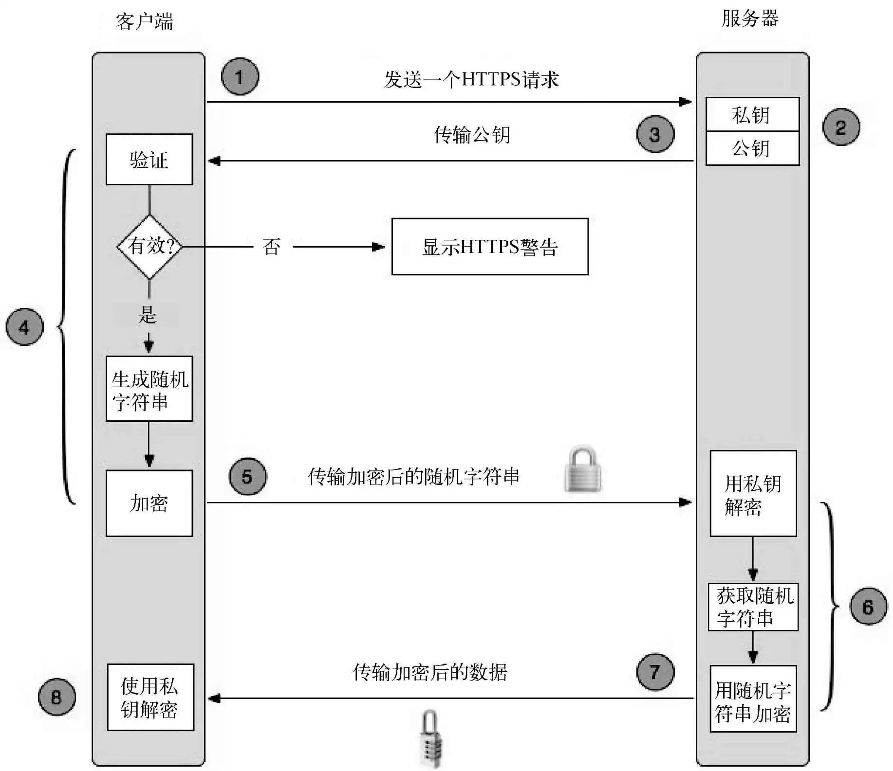
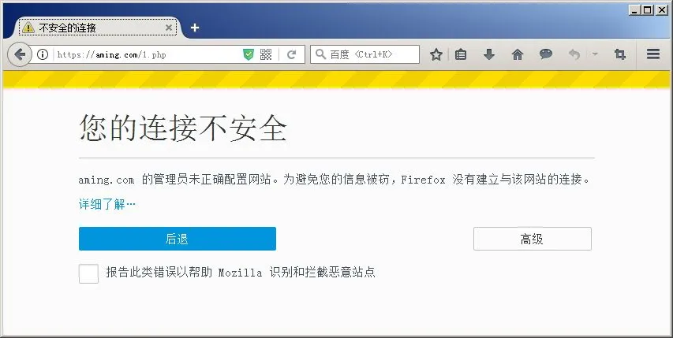

# 第14章LNMP环境配置(2)

## 14.4 Nginx 配置

这一节所讲述的内容为工作中使用较多的部分，你一开始学起来会比较吃力，因为不太明白很多概念是什么意思。阿铭的建议是，一定要跟着去动手操作，根据结果来理解需求的本质，只要理解了自然就明白了。

### 14.4.1 默认虚拟主机

先来解释“虚拟主机”。早期的 Linux 服务器上，一个服务器只能运行一个网站，也就是说只能跑一个域名。但随着技术的发展，一个服务器上可以跑多个域名，这样就帮我们节省了成本。其实，这里的服务器就叫作主机，早期一个主机对应一个站点。现在不同了，一个主机可以跑多个站点，所以就有了虚拟主机的概念。我们可以把一台服务器虚拟出多个主机出来，这样就实现了一台服务器跑多个站点。

既然一台服务器上可以有多个虚拟主机，每个虚拟主机都会定义一个域名（当然也可以定义多个），那么只要把这个域名解析指向到该台服务器，我们自然就可以访问这个站点了。说到这儿，你可能又有新的问题：什么叫解析指向？如果你会用浏览器访问一个站点，那么肯定不难理解下面阿铭的解释。咱们访问一个网站，需要先在浏览器里输入域名，然后就能访问到网站内容了。这个过程是需要浏览器和远程服务器通信的，网站内容就是从服务器上读取到的。而这个服务器在哪儿是由你访问的域名来决定的，而域名之所以能决定服务器在哪里，就是因为这个域名做了解析指向。对服务器的 IP 地址做域名解析，这个行为是由 DNS 服务器来完成的。

假如你访问的域名指向了你的服务器，而你又在这台服务器上做了配置标记了这个域名（接下来阿铭会讲解如何标记），这样这个域名就能被正常访问。但如果没有在服务器上给这个域名做标记，会发生什么呢？按理说，没有做标记的域名是不合法的，是不能正常返回结果的。

上面讲了那么多关于域名的东西，阿铭的目的就是让你更容易理解“默认虚拟主机”的概念。Nginx 是支持多个虚拟主机的，也就是说可以在一个服务器上运行多个站点，标记多个域名。但如果没有标记的域名也指向了这台服务器，那总得有处理这个域名的一个虚拟主机吧，这个虚拟主机就叫作“默认虚拟主机”。通俗点讲，你的服务器上有很多域名，很多站点，很多虚拟主机，这些域名是在 Nginx 的配置文件中做过标记的，是“名花有主”、一一对应的，每个域名都能对应着自己的虚拟主机。但是，有一个特殊的域名也指向了服务器，却没有跟它对应的虚拟主机。这时候，Nginx 就会把这个域名直接丢给一个特殊的虚拟主机来处理，这个特殊的虚拟主机就是“默认虚拟主机”。

在 Nginx 中第一个被加载的虚拟主机就是默认主机。当然，我们也可以用一个配置来标记默认虚拟主机。也就是说，如果没有这个标记，第一个虚拟主机就为默认虚拟主机。

```
修改主配置文件 nginx.conf，在结束符号}前面加入一行配置，修改内容如下：
include vhost/*.conf;
}
```

意思是会加载 /usr/local/nginx/conf/vhost/ 下面的所有以 .conf 结尾的文件，这样我们就可以把所有虚拟主机配置文件都放到 vhost 目录下面了。执行如下命令创建虚拟主机配置文件：

```
# mkdir /usr/local/nginx/conf/vhost
# cd /usr/local/nginx/conf/vhost
# vim default.conf // 写入如下内容
server
{
listen 80 default_server; # 有这个default_server标记的就是默认虚拟主机
server_name aaa.com;
index index.html index.htm index.php;
root /data/nginx/default;
}
# /usr/local/nginx/sbin/nginx -t
nginx: the configuration file /usr/local/nginx/conf/nginx.conf syntax is ok
nginx: configuration file /usr/local/nginx/conf/nginx.conf test is successful
# /usr/local/nginx/sbin/nginx -s reload // 更改配置文件后，重载
# mkdir -p /data/nginx/default
# echo "default_server" > /data/nginx/default/index.html // 创建索引页
# curl -x127.0.0.1:80 aaa.com // 访问aaa.com
default_server
# curl -x127.0.0.1:80 1212.com // 访问一个没有定义过的域名，也会访问到aaa.com
default_server
```

### 14.4.2 用户认证

再来创建一个新的虚拟主机：

```
# cd /usr/local/nginx/conf/vhost/
# vim test.com.conf // 加入如下内容
server
{
listen 80;
server_name test.com;
index index.html index.htm index.php;
root /data/nginx/test.com;
location /
{
auth_basic "Auth";
auth_basic_user_file /usr/local/nginx/conf/htpasswd;
}
}
# yum install -y httpd-tools // 安装httpd-tools，目的是为了安装下面的htpasswd命令
# htpasswd -cm /usr/local/nginx/conf/htpasswd aming // 创建aming用户
New password:
Re-type new password:
Adding password for user aming
// htpasswd命令为创建用户的工具，-c为create（创建），-m指定密码加密方式为MD5，
// / usr/local/nginx/conf/htpasswd为密码文件，aming为要创建的用户。第一次执行该命令需要加
// 第二次再创建新的用户时，就不用加-c了，否则密码文件会被重置，之前的用户被清空
# /usr/local/nginx/sbin/nginx -t
nginx: the configuration file /usr/local/nginx/conf/nginx.conf syntax is ok
nginx: configuration file /usr/local/nginx/conf/nginx.conf test is successful
# /usr/local/nginx/sbin/nginx -s reload
```

```
核心配置语句就两行，auth_basic打开认证，auth_basic_user_file指定用户密码文
```

件，当然前提是这个用户密码文件存在。而生成用户密码文件的工具需要借助 httpd 的

```
htpasswd，Nginx 不自带这个工具。下面可以使用curl命令来验证：
# mkdir /data/nginx/test.com
# echo "test.com" > /data/nginx/test.com/index.html
# curl -I -x127.0.0.1:80 test.com
HTTP/1.1 401 Unauthorized
Server: nginx/1.18.0
Date: Sat, 27 Jun 2020 02:07:38 GMT
Content-Type: text/html
Content-Length: 179
Connection: keep-alive
WWW-Authenticate: Basic realm="Auth"
说明：状态码为401说明，该网站需要验证。
# curl -uaming:lishiming -x127.0.0.1:80 test.com // 使用curl的-u指定用户名密码就可以正
test.com
```

下面我们在 Windows 上来访问并验证用户认证。首先打开 Windows 的 hosts 文件，该文件类似 Linux 上的 /etc/hosts。Windows 上的 hosts 文件所在路径为C:\Windows\System32\drivers\etc\hosts，第一次编辑它会提示用什么方式打开，选择“记事本”或者“写字板”都可以。在最下面增加一行：并加入一行（你的 IP 地址可能和阿铭的不一样，请自行更改）：

```
192.168.72.128 test.com
```

然后在浏览器中访问 test.com，出现如图 14-1 所示的验证对话框。


图 14-1 验证

输入用户名 aming 和其密码，就可以访问了。如果是针对某个目录做用户认证，需要修改

```
location后面的路径：
location /admin/
{
auth_basic "Auth";
auth_basic_user_file /usr/local/nginx/conf/htpasswd;
}
```

### 14.4.3 域名或链接重定向

重定向也可以叫作跳转，这个用法比较普遍，一个网站可能会有多个域名，比如小明公司的网站可以通过两个域名访问：域名 A 和域名 B。用域名 A 访问的时候，浏览器里面的网址直接变成了域名 B，这其实就是域名跳转的过程。域名跳转有什么作用呢？在阿铭看来主要有两方面：第一，一个站点有多个域名会对 SEO 有影响，说白了就是对百度搜索关键词的排名有影响，如果把多个域名全部跳转到一个指定的域名，这样以这个域名为中心，就可以把权重集中在这个域名上，搜索关键词的排名也就靠前了；第二，如果之前的某个域名不再使用了，但是搜索引擎还留着之前老域名的链接，这意味着用户可能会搜到我们的网站并且单击老的域名，故需要把老域名做个跳转跳到新域名，这样用户搜索的时候，也可以访问到网站。

下面阿铭将 test1.com 和 test2.com 重定向到 test.com，配置如下：

```
# vi test.com.conf // 更改为如下内容
server
{
listen 80;
server_name test.com test1.com test2.com;
index index.html index.htm index.php;
root /data/nginx/test.com;
if ($host != 'test.com' ) {
rewrite ^/(.*)$ http://test.com/$1 permanent;
}
}
在 Nginx 配置中，server_name后面可以跟多个域名，permanent为永久重定向，状态码
为 301。另外还有一个常用的redirect，叫作临时重定向，状态码为 302。那么什么时候使
```

用 301 或者 302 呢？阿铭给你一个简单的法则：如果跳转域名就用 301，如果仅跳转链接就用 302。测试过程如下：

```
# /usr/local/nginx/sbin/nginx -t
nginx: the configuration file /usr/local/nginx/conf/nginx.conf syntax is ok
nginx: configuration file /usr/local/nginx/conf/nginx.conf test is successful
# /usr/local/nginx/sbin/nginx -s reload
# curl -x127.0.0.1:80 test1.com/123.txt -I
HTTP/1.1 301 Moved Permanently
Server: nginx/1.18.0
Date: Sat, 27 Jun 2020 02:32:05 GMT
Content-Type: text/html
Content-Length: 169
Connection: keep-alive
Location: http://test.com/123.txt
```

下面再来看看链接跳转。有一个需求，需要将 http://test.com/a.html 跳转到http://test.com/b.html，看看如何实现吧。测试过程如下：

```
# vi test.com.conf // 更改为如下内容
server
{
listen 80;
server_name test.com;
index index.html index.htm index.php;
root /data/nginx/test.com;
rewrite /a.html /b.html redirect;
}
# /usr/local/nginx/sbin/nginx –t
nginx: the configuration file /usr/local/nginx/conf/nginx.conf syntax is ok
nginx: configuration file /usr/local/nginx/conf/nginx.conf test is successful
# /usr/local/nginx/sbin/nginx -s reload
# curl -I -x127.0.0.1:80 test.com/a.html
HTTP/1.1 302 Moved Temporarily
Server: nginx/1.18.0
Date: Sat, 27 Jun 2020 02:38:07 GMT
Content-Type: text/html
Content-Length: 145
Location: http://test.com/b.html
Connection: keep-alive
```

如果是相同域名的链接跳转，可以省略域名，只写链接，比如本例中阿铭只写了 /a.html 和

```
/b.html。最终测试出来状态码为 302，这是因为我们使用了临时重定向的控制flag
rediect。
```

### 14.4.4 Nginx 的访问日志

访问日志作用很大，不仅可以记录网站的访问情况，还可以在网站有异常发生时帮助我们定位问题，比如网站被攻击时，可以通过查看日志看到一些规律。先来看看 Nginx 的日志格式：

```
# grep -A2 log_format /usr/local/nginx/conf/nginx.conf
log_format combined_realip '$remote_addr $http_x_forwarded_for [$time_local]'
' $host "$request_uri" $status'
' "$http_referer" "$http_user_agent"';
```

Nginx 需要在主配置文件中定义日志格式，然后在虚拟主机里面调用。配置文件中的

```
combined_realip为日志格式的名字，后面可以调用它；$remote_addr为访问网站的用
户的出口 IP；$http_x_forwarded_for为代理服务器的 IP，如果使用了代理，则会记录代
理的 IP；$time_local为当前的时间；$host为访问的主机名；$request_uri为访问的
URL 地址；$status为状态码；$http_referer为referer地址；$http_user_agent
为user_agent。
```

然后再到虚拟主机配置文件中指定访问日志的路径：

```xml
# vi test.com.conf // 修改配置文件
server
{
listen 80;
server_name test.com test1.com test2.com;
index index.html index.htm index.php;
root /data/nginx/test.com;
if ($host != 'test.com' ) {
rewrite ^/(.*)$ http://test.com/$1 permanent;
}
access_log /tmp/1.log combined_realip;
}
使用access_log来指定日志的存储路径，最后面指定日志的格式名字，测试过程如下：
# /usr/local/nginx/sbin/nginx -t
nginx: the configuration file /usr/local/nginx/conf/nginx.conf syntax is ok
nginx: configuration file /usr/local/nginx/conf/nginx.conf test is successful
# /usr/local/nginx/sbin/nginx -s reload
# curl -x127.0.0.1:80 test.com/111
<html>
<head><title>404 Not Found</title></head>
<body>
<center><h1>404 Not Found</h1></center>
<hr><center>nginx/1.18.0</center>
</body>
</html>
# cat /tmp/1.log
127.0.0.1 - [27/Jun/2020:10:47:10 +0800] test.com "/111" 404 "-" "curl/7.61.1"
```

在 13.8.1 节中，阿铭介绍系统日志 /var/log/messages 时，提到过其支持日志切割，即每周一个日志，这样做的目的是为了防止日志无限制增大。同样地，Nginx 的日志也需要做切割，要想切割 Nginx 日志需要借助系统的切割工具或者自定义脚本。在这里，阿铭提供一个 Nginx的日志切割脚本：

```bash
# vim /usr/local/sbin/nginx_log_rotate.sh // 写入如下内容
#! /bin/bash
## 假设nginx的日志存放路径为/data/logs/
d=`date -d "-1 day" +%Y%m%d`
logdir="/data/logs"
nginx_pid="/usr/local/nginx/logs/nginx.pid"
cd $logdir
for log in `ls *.log`
do
mv $log $log-$d
done
/bin/kill -HUP `cat $nginx_pid`
```

写完脚本后，还需要增加任务计划：

```
0 0 * * * /bin/bash /usr/local/sbin/nginx_log_rotate.sh
```

该脚本会在 0 点 0 分执行，其大概的意思是：修改 /data/logs/ 下所有访问日志的名字，改为以昨天日期为后缀的名字，比如 test.com.log-20200530，改完名字后还要重新生成新的日志，这里使用 kill -HUP pid 来完成。

### 14.4.5 配置静态文件不记录日志并添加过期时间

一个网站会有很多元素，尤其是图片、JS、CSS 等静态的文件非常多，用户每请求一个页面就会访问诸多的图片、JS 等静态元素，这些元素的请求会被记录在日志中。如果一个站点访问量很大，那么访问日志文件增长会非常快，一天就可以达到几吉字节（GB）。这不仅会对服务器的磁盘空间造成影响，更重要的是会影响磁盘的读写速度。阿铭一开始也说了，访问日志很重要，我们又不能不记录。还好把这些巨量的静态元素请求记录到日志里的意义并不大，所以可以限制记录这些静态元素，并且把日志按天归档，一天一个日志，这样也可以防止单个日志文件过大。Nginx 的日志如果不记录静态文件，那么其配置并不复杂，虚拟主机配置文件改写如下：

```
vi
server
{
listen 80;
server_name test.com test1.com test2.com;
index index.html index.htm index.php;
root /data/nginx/test.com;
if ($host != 'test.com' ) {
rewrite ^/(.*)$ http://test.com/$1 permanent;
}
location ~ .*\.(gif|jpg|jpeg|png|bmp|swf)$
{
expires 7d;
access_log off;
}
location ~ .*\.(js|css)$
{
expires 12h;
access_log off;
}
access_log /tmp/1.log combined_realip;
}
使用location ~可以指定对应的静态文件，expires配置过期时间，而access_log配置
为off就可以不记录访问日志了。平时我们访问一个网站时，很多元素为静态的小图片，那这
```

些小图片完全可以缓存在咱们的计算机里，这样再次访问该站点时，速度就会很快。那到底能缓存多久呢？如果服务器上的某个图片更改了，那么应该访问新的图片才对。这就涉及一个静态文件缓存时长的问题，也叫作“缓存过期时间”。下面阿铭来模拟一下：

```
# /usr/local/nginx/sbin/nginx -t
nginx: the configuration file /usr/local/nginx/conf/nginx.conf syntax is ok
nginx: configuration file /usr/local/nginx/conf/nginx.conf test is successful
# echo "111111111111" > /data/nginx/test.com/1.js // 创建JS文件
# echo "2222222222222" > /data/nginx/test.com/2.jpg // 创建JPG文件
# touch /data/nginx/test.com/1.jss // 创建一个对比的文件
# curl -I -x127.0.0.1:80 test.com/1.js // 访问JS类型的文件，缓存过期时间为12小时
HTTP/1.1 200 OK
Server: nginx/1.18.0
Date: Sun, 28 Jun 2020 13:44:07 GMT
Content-Type: application/javascript
Content-Length: 13
Last-Modified: Sun, 28 Jun 2020 13:43:51 GMT
Connection: keep-alive
ETag: "5ef89e97-d"
Expires: Mon, 29 Jun 2020 01:44:07 GMT
Cache-Control: max-age=43200
Accept-Ranges: bytes
# curl -I -x127.0.0.1:80 test.com/2.jpg // 访问JPG类型的文件，缓存过期时间为7小时
HTTP/1.1 200 OK
Server: nginx/1.18.0
Date: Sun, 28 Jun 2020 13:44:21 GMT
Content-Type: image/jpeg
Content-Length: 14
Last-Modified: Sun, 28 Jun 2020 13:43:56 GMT
Connection: keep-alive
ETag: "5ef89e9c-e"
Expires: Sun, 05 Jul 2020 13:44:21 GMT
Cache-Control: max-age=604800
Accept-Ranges: bytes
# curl -I -x127.0.0.1:80 test.com/1.jss
HTTP/1.1 200 OK
Server: nginx/1.18.0
Date: Sun, 28 Jun 2020 13:44:38 GMT
Content-Type: application/octet-stream
Content-Length: 0
Last-Modified: Sun, 28 Jun 2020 13:44:01 GMT
Connection: keep-alive
ETag: "5ef89ea1-0"
Accept-Ranges: bytes
可以很清楚地看到Cache-control对应着缓存过期时间，另外也可以看一下访问日志：
```

```
# cat /tmp/1.log
127.0.0.1 - [27/Jun/2020:10:47:10 +0800] test.com "/111" 404 "-" "curl/7.61.1"
127.0.0.1 - [28/Jun/2020:21:44:38 +0800] test.com "/1.jss" 200 "-" "curl/7.61.1"
```

虽然阿铭访问了 JS 以及 JPG，但都没有记录到访问日志中，效果实现了。

### 14.4.6 Nginx 防盗链

我们先来聊一个案例。2009 年的时候，阿铭负责运维的一个业务 5d6d（早已经死翘翘了）为免费论坛，谁都可以申请，期间有一个站长申请了一个站点专门来存放图片。由于缺少经验，阿铭并没有给该业务做防盗链，导致这个网站的图片随便被别的网站借用，以致该网站访问量巨大，最终业务带宽在一个月内飙升了 300MB/s。当发现带宽异常时，我们通过抓包找到了对应的站点，随后给服务器做了防盗链，并且删除了有问题的图片，这样才把带宽恢复到正常值。但那个月的带宽费用确实让公司出血了。

通过这个真实案例，你可以体会到做防盗链是多么有价值。防盗链，通俗讲，就是不让别人盗用你网站上的资源。这个资源，通常指的是图片、视频、歌曲、文档等。讲解防盗链配置之前，阿铭再给你讲述一下 referer 的概念，上面讲解日志格式时曾提到过它。你通过 A 网站的一个页面 http://a.com/a.html 里面的链接去访问 B 网站的一个页面 http://b.com/b.html，那么这个 B 网站页面的 referer 就是 http://a.com/a.html。也就是说，一个 referer 其实就是一个网址。Nginx 配置防盗链由于和过期时间、不记录日志有部分重合，因此可以把两部分组合在一起：

```
location ~* ^.+\.(gif|jpg|png|swf|flv|rar|zip|doc|pdf|gz|bz2|jpeg|bmp|xls)$
{
expires 7d;
valid_referers none blocked server_names *.test.com ;
if ($invalid_referer) {
return 403;
}
access_log off;
}
```

测试过程如下：

```
# /usr/local/nginx/sbin/nginx -t
nginx: the configuration file /usr/local/nginx/conf/nginx.conf syntax is ok
nginx: configuration file /usr/local/nginx/conf/nginx.conf test is successful
# /usr/local/nginx/sbin/nginx -s reload
# curl -x127.0.0.1:80 -I -e "http://aaa.com/1.txt" test.com/2.jpg
HTTP/1.1 403 Forbidden
Server: nginx/1.18.0
Date: Sun, 28 Jun 2020 14:06:14 GMT
Content-Type: text/html
Content-Length: 153
Connection: keep-alive
// 使用-e来定义referer，这个referer一定要以http://开头，否则不管用
# curl -x127.0.0.1:80 -I -e "http://test.com/1.txt" test.com/2.jpg
HTTP/1.1 200 OK
Server: nginx/1.18.0
Date: Sun, 28 Jun 2020 14:06:30 GMT
Content-Type: image/jpeg
Content-Length: 14
Last-Modified: Sun, 28 Jun 2020 13:43:56 GMT
Connection: keep-alive
ETag: "5ef89e9c-e"
Expires: Sun, 05 Jul 2020 14:06:30 GMT
Cache-Control: max-age=604800
Accept-Ranges: bytes
```

可以看到不仅仅有过期时间，还有防盗链的功能。

### 14.4.7 访问控制

对于一些比较重要的网站内容，除了可以使用用户认证限制访问之外，还可以通过其他一些方

```
法做到限制，比如限制 IP，或者限制user_agent。限制 IP 指的是限制访问网站的来源 IP，
而限制user_agent通常用来限制恶意或者不正常的请求。
下面再来介绍一下user_agent。user_agent翻译为中文叫作“用户代理”，其实可以理解为
浏览器标识，当用curl访问时，user_agent为“curl/7.29.0”，用 Chrome 浏览器访问时，
user_agent为“Mozilla/5.0 (Windows NT 6.1; Win64; x64) AppleWebKit/537.36 (KHTML,
like Gecko) Chrome/83.0.4103.116 Safari/537.36”。阿铭在工作中经常针对user_agent来
```

限制一些访问，比如限制一些不太友好的搜索引擎“爬虫”，你之所以能在百度搜到阿铭的论坛，就是因为百度会派一些“蜘蛛爬虫”来抓取网站数据。“蜘蛛爬虫”抓取数据类似于用户用浏览器访问网站，当“蜘蛛爬虫”太多或者访问太频繁时，就会浪费服务器资源。另外，也可以限制恶意请求，这种恶意请求我们通常称作 cc 攻击，它的原理很简单，就是用很多用户的计算机同时访问同一个站点，当访问量或者频率达到一定层次，就会耗尽服务器资源，从而使之不

```
能正常提供服务。这种 cc 攻击其实有很明显的规律，其中发起这些恶意请求的user_agent
相同或者相似，那我们就可以通过限制user_agent来起到防攻击的作用。
```

Nginx 也需要限制某些 IP 不能访问或者只允许某些 IP 访问。比如，我们有个需求是只允许192.168.72.1 和 127.0.0.1 访问 admin 目录，配置文件如下：

```
location /admin/
{
allow 192.168.72.1;
allow 127.0.0.1;
deny all;
}
```

假如来源 IP 为 192.168.72.129，它会从上到下逐一去匹配，第一个 IP（192.168.72.1）不匹

```xml
配，第二个 IP（127.0.0.1）不匹配，直到第三行（all）的时候才匹配到，匹配的这条规则
为deny（也就是拒绝访问），所以最终会返回一个 403 的状态码。测试过程如下：
# mkdir /data/nginx/test.com/admin/
# echo "123" > /data/nginx/test.com/admin/1.html
# curl -x127.0.0.1:80 test.com/admin/1.html
123
# curl -x192.168.72.128:80 test.com/admin/1.html
<html>
<head><title>403 Forbidden</title></head>
<body>
<center><h1>403 Forbidden</h1></center>
<hr><center>nginx/1.18.0</center>
</body>
</html>
配置文件中的 IP 也可以为 IP 段，比如可以写成allow 192.168.72.0/24。如果只拒绝某
```

几个 IP，就可以写成这样了：

```
location /admin/
{
deny 192.168.72.1;
deny 127.0.0.1;
}
如果是黑名单的形式，就不需要写allow all了，因为默认就是允许所有。除了这种简单地
```

限制目录外，也可以根据正则匹配来限制。对于使用 PHP 语言编写的网站，有一些目录是有上传文件需求的，比如阿铭在前面列举的那个防盗链案例，因为服务器可以上传图片，并且没有做防盗链，所以被人家当成了一个图片存储服务器，并且盗用带宽流量。如果网站代码有漏洞，让黑客上传了一个用 PHP 代码写的木马，由于网站可以执行 PHP 程序，最终就会让黑客拿到服务器权限。为了避免这种情况发生，我们需要把能上传文件的目录直接禁止解析PHP 代码（不用担心会影响网站访问，若这种目录也需要解析 PHP，那说明程序员不合格），Nginx 禁止某个目录解析 PHP 的配置如下：

```
location ~ .*(abc|image)/.*\.php$
{
deny all;
}
```

小括号里面的竖线为分隔符，是“或者”的意思，把该分隔符放在 abc 和 image 之间就可以使

```
URL 中带有abc或者image字符串，并且是 PHP 的请求拒绝访问网站。
在 Nginx 配置里，也可以针对user_agent做一些限制，阿铭平时用得非常多。配置如下：
if ($http_user_agent ~ 'Spider/3.0|YoudaoBot|Tomato')
{
return 403;
}
其中~为匹配符号，只要user_agent中含有Spider/3.0、YoudaoBot、Tomato字符
串，都会被拒绝，return 403为直接返回 403 状态码，当然也可以把它替换为deny
all。
```

### 14.4.8 Nignx 解析 PHP

前面阿铭讲了很多 Nginx 的配置，一直都还没有提到和 PHP 相关的东西。在 LNMP 中，PHP

```
是以一个服务（php-fpm）的形式存在的，首先要启动php-fpm服务，然后 Nginx 再和
php-fpm通信。也就是说，处理 PHP 脚本解析的工作是由php-fpm来完成的，Nginx 仅仅是
一个“搬运工”，它把用户的请求传递给php-fpm，php-fpm处理完成后把结果传递给 Nginx，
```

Nginx 再把结果返回给用户。那么 Nginx 是如何和 PHP 联系起来的呢？其实，在上面阿铭给大家的 nginx.conf 中已经有所展示。下面是 test.com.conf 的内容，其中包含了 PHP 相关的配置：

```
server
{
listen 80;
server_name test.com test1.com test2.com;
index index.html index.htm index.php;
root /data/nginx/test.com;
if ($host != 'test.com' ) {
rewrite ^/(.*)$ http://test.com/$1 permanent;
}
location ~ \.php$
{
include fastcgi_params;
fastcgi_pass unix:/tmp/php-fcgi.sock;
fastcgi_index index.php;
fastcgi_param SCRIPT_FILENAME /data/nginx/test.com$fastcgi_script_name;
}
access_log /tmp/1.log combined_realip;
}
其中fastcgi_pass用来指定php-fpm的地址，如果php-fpm监听的是一个tcp:port的地
址（比如 127.0.0.1:9000），那么也需要在这里改成fastcgi_pass 127.0.0.1:9000。这
个地址一定要和php-fpm服务监听的地址匹配，否则会报 502 错误。
还有一个地方也需要注意，factcgi_param SCRIPT_FILENAME后面跟的路径为该站点的
```

根目录，和前面定义的 root 那个路径保持一致。如果这里配置不对，访问 PHP 页面会出现404 错误。

### 14.4.9 Nginx 代理

Nginx 的代理功能非常实用，这也是 Nginx 越来越受欢迎的一个原因。一家公司有很多台服务器，为了节省成本，不能为所有服务器都分配公网 IP，而如果一个没有公网 IP 的服务器要提供 Web 服务，就可以通过代理来实现，其代理过程如图 14-2 所示。


图 14-2 Nginx 代理

如果 Nginx 后面有多台 Web 服务器，并且 Nginx 同时代理这些服务器，那么 Nginx 就起到一个负载均衡的作用，这个功能在生产环境中用得也特别多。先来看一下如何配置 Nginx 的代理：

```
# cd /usr/local/nginx/conf/vhost
# vim proxy.conf // 写入如下内容
server
{
listen 80;
server_name ask.apelearn.com;
location /
{
proxy_pass http://47.104.7.242/;
proxy_set_header Host $host;
proxy_set_header X-Real-IP $remote_addr;
proxy_set_header X-Forwarded-For $proxy_add_x_forwarded_for;
}
}
前两行不用解释，和普通的虚拟主机是一样的，不同的是后面proxy相关的语句。
proxy_pass指定要代理的域名所在的服务器 IP，这里的 IP 就是阿铭的论坛所在服务器 IP。
```

后面的三行为定义发往后端 Web 服务器的请求头，第二行必须有，否则代理不成功，它表示

```
后端 Web 服务器的域名和当前配置文件中的server_name保持一致；第三行和第四行可以
```

省略，前面在讲述 Nginx 日志格式的时候介绍过这两个参数，表示的含义是一样的。配置文件保存后，重新加载 Nginx 服务并验证，命令如下：

```
# /usr/local/nginx/sbin/nginx -t
nginx: the configuration file /usr/local/nginx/conf/nginx.conf syntax is ok
nginx: configuration file /usr/local/nginx/conf/nginx.conf test is successful
# /usr/local/nginx/sbin/nginx -s reload
# curl -x127.0.0.1:80 ask.apelearn.com -I
HTTP/1.1 200 OK
Server: nginx/1.18.0
Date: Sun, 28 Jun 2020 14:20:43 GMT
Content-Type: text/html; charset=UTF-8
Connection: keep-alive
X-Powered-By: PHP/5.4.16
P3P: CP="CURa ADMa DEVa PSAo PSDo OUR BUS UNI PUR INT DEM STA PRE COM NAV OTC NOI
Set-Cookie: ape__Session=jio8hb84ods47012d88tviti27; expires=Sun, 28-Jun-2020 14:
Expires: Thu, 19 Nov 1981 08:52:00 GMT
Cache-Control: no-store, no-cache, must-revalidate, post-check=0, pre-check=0
Pragma: no-cache
Vary: Accept-Encoding
# curl ask.apelearn.com -I
HTTP/1.1 200 OK
Server: nginx
Date: Sun, 28 Jun 2020 14:19:31 GMT
Content-Type: text/html; charset=UTF-8
Connection: keep-alive
X-Powered-By: PHP/5.4.16
P3P: CP="CURa ADMa DEVa PSAo PSDo OUR BUS UNI PUR INT DEM STA PRE COM NAV OTC NOI
Set-Cookie: ape__Session=976hk1s873jdbdn8iq2v6jhge2; expires=Sun, 28-Jun-2020 14:
Expires: Thu, 19 Nov 1981 08:52:00 GMT
Cache-Control: no-store, no-cache, must-revalidate, post-check=0, pre-check=0
Pragma: no-cache
Vary: Accept-Encoding
```

这样看是没有问题的，阿铭虚拟机上的 Nginx 版本为 1.18.0，而阿铭论坛服务器上用的 Nginx版本并没有显示。把服务器上的环境版本暴露出来并不安全，因为这样别有用心的人会直接获取到服务器上的软件版本信息，如果正好该版本有漏洞，那么他就可以直接攻击了。关于如何关掉版本信息，阿铭不在本章描述。下面阿铭再提供一个负载均衡的示例，在编写 Nginx 虚拟

```
主机配置文件之前，先来查看一下 www.qq.com 域名对应的 IP，使用dig命令（使用yum
install bind-utils安装）：
# dig @8.8.8.8 www.qq.com
; <<>> DiG 9.11.13-RedHat-9.11.13-3.el8 <<>> @8.8.8.8 www.qq.com
; (1 server found)
;; global options: +cmd
;; Got answer:
;; ->>HEADER<<- opcode: QUERY, status: NOERROR, id: 59151
;; flags: qr rd ra; QUERY: 1, ANSWER: 4, AUTHORITY: 0, ADDITIONAL: 1
;; OPT PSEUDOSECTION:
; EDNS: version: 0, flags:; udp: 512
;; QUESTION SECTION:
;www.qq.com. IN A
;; ANSWER SECTION:
www.qq.com. 159 IN CNAME public-v6.sparta.mig.tencent-cloud.net.
public-v6.sparta.mig.tencent-cloud.net. 98 IN A 111.30.164.236
public-v6.sparta.mig.tencent-cloud.net. 98 IN A 111.30.171.191
public-v6.sparta.mig.tencent-cloud.net. 98 IN A 111.30.171.194
;; Query time: 147 msec
;; SERVER: 8.8.8.8#53(8.8.8.8)
;; WHEN: 日 6月 28 22:29:01 CST 2020
;; MSG SIZE rcvd: 139
```

可以看到有三个 IP，这三个 IP 都可以访问到 www.qq.com。先来验证一下：

```
# curl -x111.30.164.236:80 www.qq.com -I
HTTP/1.1 302 Moved Temporarily
Server: nginx
Date: Sun, 28 Jun 2020 14:30:26 GMT
Content-Type: text/html
Content-Length: 154
Connection: keep-alive
Location: https://www.qq.com/
# curl -x111.30.171.191:80 www.qq.com -I
HTTP/1.1 302 Moved Temporarily
Server: nginx
Date: Sun, 28 Jun 2020 14:30:42 GMT
Content-Type: text/html
Content-Length: 154
Connection: keep-alive
Location: https://www.qq.com/
# curl -x111.30.171.194:80 www.qq.com -I
HTTP/1.1 302 Moved Temporarily
Server: nginx
Date: Sun, 28 Jun 2020 14:30:53 GMT
Content-Type: text/html
Content-Length: 154
Connection: keep-alive
Location: https://www.qq.com/
```

可以看到三个 IP 返回的结果一样，它使用的 Web 服务器软件也是 nginx。有三个 IP 就可以做负载均衡了，配置过程如下：

```
# vim /usr/local/nginx/conf/vhost/load.conf // 写入如下内容
upstream qq_com
{
ip_hash;
server 111.30.171.194:80;
server 111.30.171.191:80;
server 111.30.164.236:80;
}
server
{
listen 80;
server_name www.qq.com;
location /
{
proxy_pass http://qq_com;
proxy_set_header Host $host;
proxy_set_header X-Real-IP $remote_addr;
proxy_set_header X-Forwarded-For $proxy_add_x_forwarded_for;
}
}
和简单的代理有所不同，负载均衡多了一个upstream，这里定义后端的 Web 服务器，可以
是一个，也可以是多个。其中ip_hash为负载均衡的算法，它表示根据 IP 地址把请求分发到
```

不同的服务器上。比如用户 A 的 IP 为 1.1.1.1，用户 B 的 IP 为 2.2.2.2，则 A 访问的时候会把请求转发到第一个 Web 服务器上，而 B 访问的时候会转发到第二个 Web Server 上。这种算法用在把 session 存到本机磁盘上的情况，至于什么是 session，阿铭大概说一下。你访问猿课看课程需要登录，那么你一旦登录，服务器上就会记录你的 session 信息，这个 session会保存一段时间。比如，你看了一个 10 分钟的课程，然后去开会了，过去半小时再打开网站，你依然是登录的状态，这就是因为 session 还存在这台服务器上。下面是测试结果：

```
# /usr/local/nginx/sbin/nginx -t
nginx: the configuration file /usr/local/nginx/conf/nginx.conf syntax is ok
nginx: configuration file /usr/local/nginx/conf/nginx.conf test is successful
# /usr/local/nginx/sbin/nginx -s reload
# curl -x127.0.0.1:80 www.qq.com -I
HTTP/1.1 302 Moved Temporarily
Server: nginx/1.18.0
Date: Sun, 28 Jun 2020 14:33:53 GMT
Content-Type: text/html
Content-Length: 154
Connection: keep-alive
Location: https://www.qq.com/
```

神奇吗？阿铭的虚拟机竟然也可以访问 www.qq.com 了，这其实就是代理的作用！

### 14.4.10 Nignx 配置 SSL

2016 年底苹果公司就开始要求各个企业的 iOS APP 必须使用 HTTPS 通信，原因很简单，就是保证安全。而目前 Chrome、Firefox 等各大浏览器，也开始针对 HTTPS 做调整。你有没有发现，使用百度搜问题时，百度的网址前面是 HTTPS。

这说明 HTTPS 已经成为一种趋势，阿铭相信过不了 10 年，整个互联网都会强制使用 HTTPS通信，而废弃目前主流的 HTTP。那到底什么是 HTTPS 呢？简单讲，它就是一种加密的HTTP 协议。如果 HTTP 通信的数据包在传输过程中被截获，那么截获者就可以破译这些数据包里面的信息，其中不乏用户名、密码、手机号等敏感信息。而如果使用 HTTPS 通信，即使数据包被截获，截获者也无法破译里面的内容。图 14-3 给出了 HTTPS 的通信过程。

其通信过程大致如下。

(1) 浏览器发送一个 HTTPS 请求给服务器。

(2) 服务器要有一套数字证书，这个证书可以自己制作（后面的操作就是阿铭自己制作的证书），也可以向组织申请，区别就是自己颁发的证书需要客户端验证通过后才可以继续访问，而使用受信任的公司申请的证书则不会弹出提示页面。这套证书其实就是一对公钥和私钥。

(3) 服务器会把公钥传输给客户端。

(4) 客户端（浏览器）收到公钥后，会验证其是否合法有效，若无效会有警告提醒，有效则会生成一串随机字符串，并用收到的公钥加密。

(5) 客户端把加密后的随机字符串传输给服务器。

(6) 服务器收到加密随机字符串后，先用私钥解密（公钥加密，私钥解密），获取到这一串随机字符串后，再用这串随机字符串加密传输的数据（该加密为“对称加密”；所谓对称加密，就是将数据和私钥，也就是这个随机字符串通过某种算法混合在一起，这样除非知道私钥，否则无法获取数据内容）。

(7) 服务器把加密后的数据传输给客户端。

(8) 客户端收到数据后，再用自己的私钥（也就是那个随机字符串）解密。



图 14-3 HTTPS 通信过程

通过上文的简要分析，我们可以确定服务器上必须有一对公钥和私钥，也就是后文提到的 SSL证书。如果是公司的网站对外提供服务，则需要购买被各大浏览器厂商认可的 SSL 证书。阿铭曾经在沃通购买过 SSL 证书，你可以做个参考。目前各大 SSL 证书服务商已经不再提供免费的 SSL 证书服务，所以做本实验的时候，阿铭只能在 Linux 机器上生成一对自定义的 SSL证书，这个证书只能我们自己用一下，不能使用在生产环境中。具体配置过程如下：

```
# cd /usr/local/nginx/conf
# openssl genrsa -des3 -out tmp.key 2048
Generating RSA private key, 2048 bit long modulus (2 primes)
...........................+++++
.......................................................+++++
e is 65537 (0x010001)
Enter pass phrase for tmp.key:
Verifying - Enter pass phrase for tmp.key:
// openssl命令如果没有，使用yum install –y openssl安装。这一步是生成key文件（通常称为“私钥
//为加密字符串长度，会让我们输入一个密码，密码不能太短，否则不成功
# openssl rsa -in tmp.key -out aminglinux.key
Enter pass phrase for tmp.key:
writing RSA key
// 这一步是把刚刚生成的tmp.key再转换成aminglinux.key，目的是删除刚才设置的密码，如果key文件有
// 则必须在Nginx加载它的时候输入它的密码，因此很不方便
# rm -f tmp.key
# openssl req -new -key aminglinux.key -out aminglinux.csr
You are about to be asked to enter information that will be incorporated
into your certificate request.
What you are about to enter is what is called a Distinguished Name or a DN.
There are quite a few fields but you can leave some blank
For some fields there will be a default value,
If you enter '.', the field will be left blank.
-----
Country Name (2 letter code) [XX]:
State or Province Name (full name) []:
Locality Name (eg, city) [Default City]:
Organization Name (eg, company) [Default Company Ltd]:
Organizational Unit Name (eg, section) []:
Common Name (eg, your name or your server's hostname) []:aming.com
Email Address []:
Please enter the following 'extra' attributes
to be sent with your certificate request
A challenge password []:123456
An optional company name []:
// 除了Common Name和Challenge password有设置外，其他都是直接按回车。
// 这一步是生成证书请求文件，这个并不是上文提到的公钥，但这个文件是必须要有的，我们要拿key文件和
// 个CSR文件一起生成最终的公钥文件。其中Common Name为后面配置Nginx配置文件的server_name
# openssl x509 -req -days 365 -in aminglinux.csr -signkey aminglinux.key -out ami
Signature ok
subject=/C=XX/L=Default City/O=Default Company Ltd/CN=aming.com
Getting Private key
// 说明：这样最终才生成了CRT证书文件，也就是图14-3中的公钥
```

以上操作的最终目的是生成 aminglinux.key 和 aminglinux.crt 两个文件。其实购买的 SSL 证书主要是得到这两个文件，有了这两个文件就可以配置 Nginx 了。配置过程如下：

```
# vim /usr/local/nginx/conf/vhost/ssl.conf // 写入如下内容
server
{
listen 443 ssl;
server_name aming.com;
index index.html index.php;
root /data/nginx/aming.com;
ssl on;
ssl_certificate aminglinux.crt;
ssl_certificate_key aminglinux.key;
ssl_protocols TLSv1 TLSv1.1 TLSv1.2;
location ~ \.php$
{
include fastcgi_params;
fastcgi_pass unix:/tmp/php-fcgi.sock;
fastcgi_index index.php;
fastcgi_param SCRIPT_FILENAME /data/nginx/aming.com$fastcgi_script_name;
}
access_log /tmp/1.log combined_realip;
}
```

保存配置文件后，检查配置是否有问题。阿铭在检查配置时，发现了问题：

```
# /usr/local/nginx/sbin/nginx -t
nginx: [emerg] unknown directive "ssl" in /usr/local/nginx/conf/vhost/ssl.conf:8
nginx: configuration file /usr/local/nginx/conf/nginx.conf test failed
```

这说明，当前的 Nginx 并不支持 SSL，这是因为阿铭在先前的 Nginx 编译时，并没有额外配置支持 SSL 的参数，要解决该问题只能重新编译一遍 Nginx。操作过程如下：

```
# cd /usr/local/src/nginx-1.18.0/
# ./configure --prefix=/usr/local/nginx --with-http_ssl_module
# make
# make install
```

编译完成后，再来检验一次：

```
# /usr/local/nginx/sbin/nginx –t
nginx: [warn] the "ssl" directive is deprecated, use the "listen ... ssl" directi
nginx: the configuration file /usr/local/nginx/conf/nginx.conf syntax is ok
nginx: configuration file /usr/local/nginx/conf/nginx.conf test is successful
有个warn的提示，这个倒不是错误，并不影响。要想去除此告警，可以将配置文件的第 8 行
```

删除掉。然后创建对应的目录和测试文件：

```
# mkdir /data/nginx/aming.com
# echo "<?php phpinfo(); ?>" > /data/nginx/aming.com/1.php
# systemctl restart nginx.service
```

再编辑 hosts 文件，写入一行：

```
192.168.72.128 aming.com
```

用浏览器访问 https://aming.com/1.php 会提示不安全，如图 14-4 所示。



图 14-4 不安全的连接

这是因为该证书为我们自己制作的，并没有得到浏览器的认可，如果想继续访问，可以单击“高级”按钮，然后单击“添加例外”，在弹出的对话框单击“确认安全例外”，然后就可以访问网站内容了。此时，你还可以看到浏览器的地址栏左侧有一个灰色的小锁，并且带有黄色三角形，这意味着该链接不安全。这是因为该站点的 SSL 证书是我们自己颁发的，因而不能被浏览器承认。

## 14.5 php-fpm配置

```
和 LAMP 不同的是，在 LNMP 架构中，php-fpm是作为一个独立的服务存在。既然是独立服
务，那么它必然有自己的配置文件。php-fpm的配置文件为 /usr/local/php-fpm/etc/php-
fpm.conf，该文件同样支持include语句，类似于 nginx.conf 里面的include。
```

### 14.5.1 php-fpm的pool

```
Nignx 可以配置多个虚拟主机，php-fpm也支持配置多个 pool，每一个 pool 可以监听一个端
```

口，也可以监听一个 socket，这个概念阿铭已经在前面已经有所阐述。阿铭把 php-fpm.conf做一个更改，内容如下：

```javascript
[global]
pid = /usr/local/php-fpm/var/run/php-fpm.pid
error_log = /usr/local/php-fpm/var/log/php-fpm.log
include = etc/php-fpm.d/*.conf
include的这一行比较特殊，请注意等号后面的路径，必须先写上etc目录，再写需要创建
```

的配置文件目录和子配置文件：

```
# mkdir /usr/local/php-fpm/etc/php-fpm.d
# cd /usr/local/php-fpm/etc/php-fpm.d
# vim www.conf // 内容如下
[www]
listen = /tmp/www.sock
listen.mode=666
user = php-fpm
group = php-fpm
pm = dynamic
pm.max_children = 50
pm.start_servers = 20
pm.min_spare_servers = 5
pm.max_spare_servers = 35
pm.max_requests = 500
rlimit_files = 1024
```

保存后，再编辑另外的配置文件：

```
# vim aming.conf // 写入如下内容
[aming]
listen = /tmp/aming.sock
listen.mode=666
user = php-fpm
group = php-fpm
pm = dynamic
pm.max_children = 50
pm.start_servers = 20
pm.min_spare_servers = 5
pm.max_spare_servers = 35
pm.max_requests = 500
rlimit_files = 1024
```

这样就有两个子配置文件，也就是说有两个 pool 了，第一个 pool 监听了 /tmp/www.sock，第二个 pool 监听了 /tmp/aming.sock。这样，就可以在 Nginx 不同的虚拟主机中调用不同的pool，从而达到相互隔离的目的，两个 pool 互不影响。下面来验证一下配置是否有问题：

```
# /usr/local/php-fpm/sbin/php-fpm -t
[28-Jun-2020 22:48:39] NOTICE: configuration file /usr/local/php-fpm/etc/php-fpm.
然后重启一下php-fpm服务：
# /etc/init.d/php-fpm restart
Gracefully shutting down php-fpm . done
Starting php-fpm done
```

再来查看 /tmp/ 目录下面的 sock 文件：

```
# ls /tmp/*.sock
/tmp/aming.sock /tmp/mysql.sock /tmp/php-fcgi.sock
```

### 14.5.2 php-fpm的慢执行日志

```
这一节非常重要，请务必认真看完并理解。php-fpm的慢执行日志阿铭用得非常多，它可以
帮助你快速地追踪到问题点。为了更容易理解php-fpm的慢执行日志，阿铭先来举一个小例
```

子。

小明是一个运维工程师，他维护的网站是用 PHP 语言编写的，运行环境为 LNMP，网站访问量不算大，一直都很稳定。但有一天，网站突然很卡，打开一个页面需要十几秒，小明发现问

```
题后，马上登录服务器排查问题。他做的操作有：使用w命令查看服务器负载，使用free命
令查看内存，使用top命令查看哪个进程占用 CPU，使用nload命令查看网卡流量……总之
小明做了很多操作，种种迹象表明php-fpm进程占用了很多资源。
但php-fpm进程究竟在干什么？为什么耗费了很多资源呢？小明很想知道，只有找到问题
点，才能解决php-fpm耗费资源的问题，然后网站自然就快了。小明的经验有限，不知道怎
么去查看php-fpm在干什么。在哪一步卡住了呢？小明开始到 Google 上去搜文档，找啊找，
```

找啊找，找了很久，也尝试了许多方法，终于“皇天不负有心人”，小明找到了一个很有效的方

```
法，其实就是阿铭要介绍的php-fpm慢执行日志。
通过php-fpm的慢执行日志，我们可以非常清晰地了解到 PHP 的脚本在哪里执行时间长，它
可以定位到具体的行。在上例中，小明就是通过查看php-fpm的慢执行日志最终得到结论：
```

是因为 PHP 调用了一个远程的网站接口，而这个接口网络出现故障，访问它需要十几秒的时

```javascript
间，所以php-fpm也会等十几秒，最终导致网站访问很卡。说了这么多，你肯定很想知道如
何开启和查看php-fpm的慢执行日志，操作步骤如下：
# vim /usr/local/php-fpm/etc/php-fpm.d/www.conf // 在最后面加入如下内容
request_slowlog_timeout = 1
slowlog = /usr/local/php-fpm/var/log/www-slow.log
```

第一行定义超时时间，即 PHP 的脚本执行时间只要超过 1 秒就会记录日志，第二行定义慢执行日志的路径和名字。以后，你遇到 PHP 网站访问卡顿的问题时，要记得去查看这个慢执行日志，一定会帮到你！

### 14.5.3 php-fpm定义open_basedir

```
open_basedir的作用是将网站限定在指定目录里，就算该站点被黑了，黑客只能在该目录
```

下面有所作为，而不能左右其他目录。如果你的服务器上只有一个站点，那么可以直接在

```
php.ini 中设置open_basedir参数。但如果服务器上运行的站点比较多，那在 php.ini 中设置
```

就不合适了，因为在 php.ini 中只能定义一次，也就是说所有站点都一起定义限定的目录，这

```
样似乎起不到隔离多个站点的作用。php-fpm可以针对不同的 pool 设置不同的
open_basedir：
# vim /usr/local/php-fpm/etc/php-fpm.d/aming.conf // 在最后面加入
php_admin_value[open_basedir]=/data/www/:/tmp/
只要在对应的 Nginx 虚拟主机配置文件中调用对应的 pool，就可以使用open_basedir来物
```

理隔离多个站点了，从而达到安全的目的。

### 14.5.4 php-fpm进程管理

来看这一段配置：

```
pm = dynamic
pm.max_children = 50
pm.start_servers = 20
pm.min_spare_servers = 5
pm.max_spare_servers = 35
pm.max_requests = 500
第一行，定义php-fpm的子进程启动模式，dynamic为动态模式；一开始只启动少量的子进
程，根据实际需求，动态地增加或者减少子进程，最多不会超过pm.max_children定义的数
值。另外一种模式为static，这种模式下子进程数量由pm.max_children决定，一次性启
```

动这么多，之后不会减少也不会增加。

```
pm.start_servers针对dynamic模式，定义php-fpm服务在启动时产生的子进程数量。
pm.min_spare_servers针对dynamic模式，定义在空闲时段子进程数的最少数量，如果
达到这个数值，php-fpm服务会自动派生新的子进程。pm.max_spare_servers也是针对
dynamic模式的，定义在空闲时段子进程数的最大值，如果高于这个数值就开始清理空闲的
子进程。pm.max_requests针对dynamic模式，定义一个子进程最多处理的请求数，也就
是说在一个php-fpm的子进程中最多可以处理pm.max_requests个请求，当达到这个数值
```

时，进程会自动退出。

## 14.6 课后习题

(1) 到 MySQL 官网下载一个源码包，尝试编译安装，编译参数可以参考我们已经安装过的MySQL 的编译参数。

(2) MySQL 的配置文件 my.cnf 是否可以放到 /etc/ 目录外的其他目录下？

```
(3) PHP 的配置文件是什么？php-fpm的配置文件是什么？
(4) 如何检测 Nginx 配置文件是否有错？如何检测php-fpm的配置文件是否有错？
(5) 本章中出现了两次chmod 755 /etc/init.d/xxx，其中xxx为mysql、php-fpm。为
```

什么要更改它们的权限？如果不改会有什么问题？

(6) Nginx 是如何做到解析 PHP 文件的？它是如何和 PHP 联系在一起的？

(7) 请配置 Nginx 的访问日志，并编写日志切割脚本（按天切割）。

(8) 请配置 Nginx 域名重定向，比如一个虚拟主机支持多个域名访问 abc.com 和 123.com，那么如何让 123.com 的访问跳转到 abc.com？

(9) 请配置 Nginx 的用户验证。

(10) 请针对 Nginx 站点，设置禁止某个目录下的 PHP 程序解析。

(11) 请使用 Nginx 代理一个站点。

(12) 请配置 Nginx，限制只让某个 IP 访问网站。

(13) 请设置 Nginx 防盗链，比如只让 A 域名的 referer 访问，其他站点不能访问。

```
(14) 请设置 Nginx 根据user_agent来限制访问，比如禁止百度的蜘蛛访问站点。
```

(15) 请配置 Nginx 的虚拟目录。

```
(16) php-fpm.conf 中配置有多个 pool，如何针对每一个 pool 配置open_basedir以及
slow_log？
```
