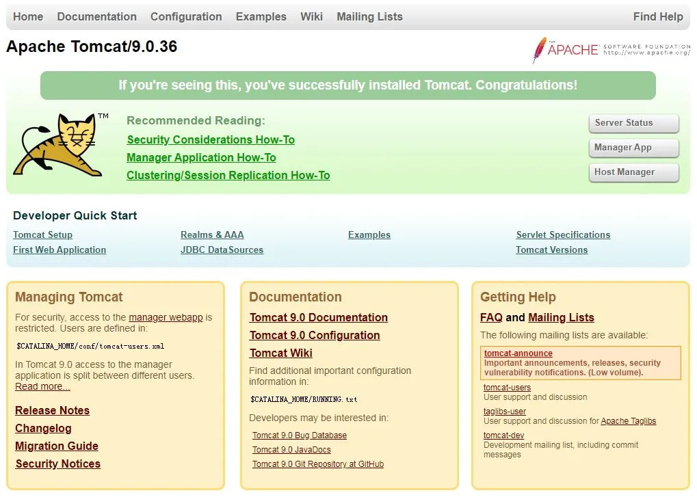
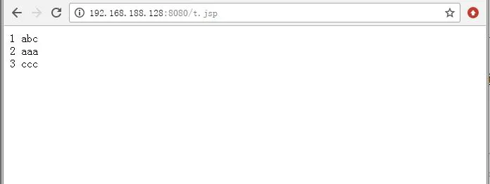

# 第18章配置Tomcat

目前有很多网站是用 Java 编写的，所以就必须有相关的软件来解析 Java 程序，Tomcat 就是其中之一。Tomcat 是 Apache 软件基金会（Apache Software Foundation）的 Jakarta 项目中的一个核心项目，由 Apache、Sun 和其他一些公司及个人共同开发而成。Tomcat 技术先进、性能稳定而且免费，因而深受 Java 爱好者的喜爱，并得到了部分软件开发商的认可，成为目前比较流行的 Web 应用服务器。

Tomcat 是一个轻量级应用服务器，在中小型系统和并发访问用户不是很多的场合下被普遍使用，在开发和调试 Java 程序时，首选 Tomcat。对于初学者来说，在一台机器上配置好Apache 服务器之后，可利用它响应对 HTML 页面的访问请求。实际上，Tomcat 部分是Apache 服务器的扩展，但它是独立运行的，所以当你运行 Tomcat 时，它是作为一个独立的进程运行的。

## 18.1 安装 Tomcat

Tomcat 的安装分为安装 JDK 和安装 Tomcat 两个步骤。JDK（Java Development Kit）是Sun Microsystems 针对 Java 开发的产品。自从 Java 推出以来，JDK 已经成为使用最广泛的Java SDK。JDK 是整个 Java 的核心，包括 Java 运行环境、Java 工具和 Java 基础的类库。所以要想运行 Java 程序必须要有 JDK 的支持，而 Tomcat 本身就是一种 Java 类型的程序，所以要正常运行 Tomcat 的前提也是先安装好 JDK。

### 18.1.1 安装 JDK

阿铭下载的 JDK 版本为 1.8，你根据实际需求选择合适的版本即可。因为 CentOS 8 是 64 位的操作系统，所以要选择 64 位的包，阿铭选择的是 jdk-8u251-linux-x64.tar.gz。浏览器下载完后，可以借助上一章已经搭建好的 FTP 服务，把 JDK 的包上传到 Linux 机器上。

上传完 JDK 的包之后，把它放到 /usr/local/src 目录下，然后解压，命令如下：

```
# cd /usr/local/src
# tar zxvf jdk-8u251-linux-x64.tar.gz
# mv jdk1.8.0_251 /usr/local/jdk1.8
```

然后设置环境变量，操作方法如下：

```
# vim /etc/profile // 在末尾输入以下内容
JAVA_HOME=/usr/local/jdk1.8/
JAVA_BIN=/usr/local/jdk1.8/bin
JRE_HOME=/usr/local/jdk1.8/jre
PATH=$PATH:/usr/local/jdk1.8/bin:/usr/local/jdk1.8/jre/bin
CLASSPATH=/usr/local/jdk1.8/jre/lib:/usr/local/jdk1.8/lib:/usr/local/jdk1.8/jre/l
```

保存文件后，执行如下命令使其生效：

```
# source /etc/profile
```

检测设置是否正确，命令如下：

```
# java -version
```

如果显示如下内容，则说明设置正确：

```
java version "1.8.0_251"
Java(TM) SE Runtime Environment (build 1.8.0_251-b08)
Java HotSpot(TM) 64-Bit Server VM (build 25.251-b08, mixed mode)
在这一步也许你的显示和阿铭的不一样，这可能是因为系统调用了rpm的openjdk，请按照
```

如下方法检测：

```
# which java
如果结果为 /usr/bin/java 则说明这是rpm的 JDK，而且执行java –version时会有
openjdk字样。其实我们也可以直接使用openjdk做后续试验，但为了和阿铭的试验结果保
```

持一致，你需要做一个临时处理：

```
# mv /usr/bin/java /usr/bin/java_bak
# source /etc/profile
再次执行java –version，显示结果就正常了。
```

### 18.1.2 安装 Tomcat

前面所做的工作都是在为安装 Tomcat 做准备，现在才是安装 Tomcat。首先下载软件包，请到阿铭提供的资源库找到最新的下载地址，阿铭在本试验中下载的是 Tomcat 9 版本，如下所示：

```
# cd /usr/local/src/
# wget https://mirrors.tuna.tsinghua.edu.cn/apache/tomcat/tomcat-9/v9.0.36/bin/ap
```

如果觉得这个版本不适合，可以到官方网站下载，安装过程如下：

```
# tar zxvf apache-tomcat-9.0.36.tar.gz
# mv apache-tomcat-9.0.36 /usr/local/tomcat
```

因为是二进制包，所以免去了编译的过程，启动 Tomcat，命令如下：

```
# /usr/local/tomcat/bin/startup.sh
Using CATALINA_BASE: /usr/local/tomcat
Using CATALINA_HOME: /usr/local/tomcat
Using CATALINA_TMPDIR: /usr/local/tomcat/temp
Using JRE_HOME: /usr/local/jdk1.8
Using CLASSPATH: /usr/local/tomcat/bin/bootstrap.jar:/usr/local/tomcat/bin/tomcat
Tomcat started.
```

查看是否启动成功，命令如下：

```
# ps aux |grep tomcat // 看是否有Java相关进程，也可以查看监听端口
# netstat -lntp |grep java // 正常会有两个端口8005和8080，其中8080为
// 提供Web服务的端口，8005为管理端口
```

若想开机启动，需要把启动命令放到 /etc/rc.d/rc.local 文件里。命令如下：

```
# echo "/usr/local/tomcat/bin/startup.sh" >> /etc/rc.d/rc.local
# chmod a+x /etc/rc.d/rc.local // 默认该文件没有x权限，所以需要加一下
```

然后在浏览器地址栏中输入 http://192.168.72.128:8080/（请注意，你的 Linux IP 地址和阿铭的可能不一样），你会看到 Tomcat 的默认页面，如图 18-1 所示。



图 18-1 Tomcat 默认页

## 18.2 配置 Tomcat

虽然 Tomcat 的安装过程非常简单，但我们还是需要学会如何配置 Tomcat。在生产环境中关于 Tomcat 的配置其实并不多，接下来阿铭会介绍几个常用的配置。

### 18.2.1 配置 Tomcat 服务的访问端口

Tomcat 默认的启动端口是 8080，如果你想修改为 80，则需要修改 server.xml 文件。打开server.xml 文件，命令如下：

```
# vim /usr/local/tomcat/conf/server.xml
```

```
找到Connector port="8080" protocol="HTTP/1.1"，修改为<Connector
port="80" protocol= "HTTP/1.1"。保存文件后重启 Tomcat，命令如下：
# /usr/local/tomcat/bin/shutdown.sh
Using CATALINA_BASE: /usr/local/tomcat
Using CATALINA_HOME: /usr/local/tomcat
Using CATALINA_TMPDIR: /usr/local/tomcat/temp
Using JRE_HOME: /usr/local/jdk1.8
Using CLASSPATH: /usr/local/tomcat/bin/bootstrap.jar:/usr/local/tomcat/bin/tomcat
# /usr/local/tomcat/bin/startup.sh
Using CATALINA_BASE: /usr/local/tomcat
Using CATALINA_HOME: /usr/local/tomcat
Using CATALINA_TMPDIR: /usr/local/tomcat/temp
Using JRE_HOME: /usr/local/jdk1.8
Using CLASSPATH: /usr/local/tomcat/bin/bootstrap.jar:/usr/local/tomcat/bin/tomcat
Tomcat started.
```

Tomcat 的关闭和启动有点特殊，需要使用它自带的脚本实现。其实在生产环境中，Tomcat 会使用 8080 端口，而 80 端口是留给 Nginx 的。也就是说要想访问 Tomcat，需要使用 Nginx 代理。关于如何代理，阿铭在 14.4.9 节已经介绍过，如果你没有印象了，就回头查一下吧。

### 18.2.2 Tomca 的虚拟主机

在之前介绍 httpd 或者 Nginx 的时候，阿铭曾提到过虚拟主机的概念，在 Tomcat 中也有这一

```xml
说。先来打开配置文件 /usr/local/tomcat/conf/server.xml 查看一下它的结构，其中<!--和--
>之间的内容为注释，可以不用关注。去除注释的内容后，剩下如下内容：
<?xml version="1.0" encoding="UTF-8"?>
<Server port="8005" shutdown="SHUTDOWN">
<Listener className="org.apache.catalina.startup.VersionLoggerListener" />
<Listener className="org.apache.catalina.core.AprLifecycleListener" SSLEngine="o
<Listener className="org.apache.catalina.core.JreMemoryLeakPreventionListener" /
<Listener className="org.apache.catalina.mbeans.GlobalResourcesLifecycleListener
<Listener className="org.apache.catalina.core.ThreadLocalLeakPreventionListener"
<GlobalNamingResources>
<Resource name="UserDatabase" auth="Container"
type="org.apache.catalina.UserDatabase"
description="User database that can be updated and saved"
factory="org.apache.catalina.users.MemoryUserDatabaseFactory"
pathname="conf/tomcat-users.xml" />
</GlobalNamingResources>
<Service name="Catalina">
<Connector port="8080" protocol="HTTP/1.1"
connectionTimeout="20000"
redirectPort="8443" />
<Engine name="Catalina" defaultHost="localhost">
<Realm className="org.apache.catalina.realm.LockOutRealm">
<Realm className="org.apache.catalina.realm.UserDatabaseRealm"
resourceName="UserDatabase"/>
</Realm>
<Host name="localhost" appBase="webapps"
unpackWARs="true" autoDeploy="true">
<Valve className="org.apache.catalina.valves.AccessLogValve" directory="logs"
prefix="localhost_access_log" suffix=".txt"
pattern="%h %l %u %t &quot;%r&quot; %s %b" />
</Host>
</Engine>
</Service>
</Server>
其中<Host>和</Host>之间的配置为虚拟主机配置部分，name定义域名，appBase定义应
```

用的目录。Java 的应用通常是一个 jar 的压缩包，将 jar 的压缩包放到 appBase 目录下面即可。刚刚阿铭访问的 Tomcat 默认页其实就是在 appBase 目录下面，不过是在它子目录ROOT 里：

```
# ls /usr/local/tomcat/webapps/ROOT/
asf-logo-wide.svg bg-middle.png bg-upper.png index.jsp tomcat.css tomcat.png tomc
其中 index.jsp 就是 Tomcat 的默认页面。你也可以用curl命令来访问一下 tomcat.gif 图片：
# curl localhost:8080/tomcat.gif -I
HTTP/1.1 200
Accept-Ranges: bytes
ETag: W/"2066-1591204289000"
Last-Modified: Wed, 03 Jun 2020 17:11:29 GMT
Content-Type: image/gif
Content-Length: 2066
Date: Sat, 04 Jul 2020 02:09:05 GMT
阿铭并没有修改默认监听的 8080 端口为 80，所以curl访问的时候依然是 8080 端口。在
```

appBase（/usr/local/tomcat/webapps）目录下面有很多子目录，每一个子目录都可以被访问，你可以把自定义的应用放到 webapps 目录里（假设应用名字为 aming，aming 为一个目录），然后可以通过 http://ip/aming/ 来访问这个应用。如果直接访问 IP，后面不加二级目录，则默认会访问 ROOT 目录下面的文件，加上二级目录会访问二级目录下面的文件。

```xml
下面阿铭再增加一个虚拟主机，并定义域名，编辑 server.xml，在</Host>下一行插入新的
<Host>，内容如下：
<Host name="www.123.cn" appBase="/data/tomcatweb/"
unpackWARs="false" autoDeploy="true"
xmlValidation="false" xmlNamespaceAware="false">
<Context path="" docBase="/data/tomcatweb/" debug="0" reloadable="true" crossCon
</Host>
其中多了一个docBase，这个参数用来定义网站的文件存放路径，如果不定义，默认是在
appBase/ROOT 下面的。定义了docBase就以该目录为主了，其中appBase和docBase可
以一样。在这一步操作过程中，很多同学遇到过访问 404 的问题，其实就是docBase没有定
```

义对。创建目录和测试文件并测试，过程如下：

```
# mkdir /data/tomcatweb
# echo "Tomcat test page." > /data/tomcatweb/1.html
```

修改完配置文件后，需要重启 Tomcat 服务：

```
# /usr/local/tomcat/bin/shutdown.sh
# /usr/local/tomcat/bin/startup.sh
然后我们用curl访问一下刚才创建的 1.html：
# curl -x127.0.0.1:8080 www.123.cn/1.html
Tomcat test page.
```

## 18.3 测试 Tomcat 解析 JSP

以上章节阿铭所演示的操作，仅仅是把 Tomcat 作为一个普通的 Web 服务器，其实 Tomcat 主要用来解析 JSP 页面。下面阿铭创建一个 JSP 的测试页面，如下所示：

```xml
# vim /data/tomcatweb/111.jsp // 加入如下内容
<html><body><center>
Now time is: <%=new java.util.Date()%>
</center></body></html>
保存文件后使用curl测试，命令如下：
```

```
# curl -x127.0.0.1:8080 www.123.cn/111.jsp
```

查看运行结果是否正确，如下所示：

```xml
<html><body><center>
Now time is: Sat Jul 04 10:13:02 CST 2020
</center></body></html>
```

可以看到，中间的那行代码被解析成当前系统的时间了。另外你也可以在你的物理机上绑定

```
hosts，用浏览器来测试。
```

## 18.4 Tomcat 日志

Tomcat 的日志目录为 /usr/local/tomcat/logs，主要有四大类日志：

```bash
# cd /usr/local/tomcat/logs
# ls
catalina.2020-07-04.log catalina.out host-manager.2020-07-04.log localhost.2020-0
其中catalina开头的日志为 Tomcat 的综合日志，它记录 Tomcat 服务的相关信息，也会记
录错误日志。其中，catalina.2020-07-04.log和catalina.out内容相同，前者会每
天生成一个新的日志。host-manager和manager为管理相关的日志，其中host-manager
为虚拟主机的管理日志。Localhost和localhost_access为虚拟主机相关日志，其中带
access字样的日志为访问日志，不带access字样的为默认虚拟主机的错误日志。默认不会
生成访问日志，需要在 server.xml 中配置一下。具体方法是在对应虚拟主机的<Host>
</Host>里面加入下面的配置（假如域名为 123.cn）：
```

```xml
<Valve className="org.apache.catalina.valves.AccessLogValve" directory="logs"
prefix="123.cn_access_log" suffix=".txt"
pattern="%h %l %u %t &quot;%r&quot; %s %b" />
其中prefix定义访问日志的前缀，suffix定义日志的后缀，pattern定义日志格式。新增
加的虚拟主机默认并不会生成类似默认虚拟主机的那个“localhost.日期.log”日志，错误
日志会统一记录到catalina.out中。关于 Tomcat 日志，你最需要关注catalina.out，
```

出现问题时应该首先想到去查看它。

## 18.5 Tomcat 连接 MySQL

Tomcat 连接 MySQL 是通过 JDBC 驱动实现的，需要下载 mysql-connector-java-xxx-bin.jar（其中 xxx 为版本号），并放到 Tomcat 的 lib 目录下面才可以。阿铭的操作步骤如下：

```sql
# cd /usr/local/src/
# wget https://cdn.mysql.com//archives/mysql-connector-java-5.1/mysql-connector-j
# tar zxf mysql-connector-java-5.1.41.tar.gz
# cd mysql-connector-java-5.1.41
# mv mysql-connector-java-5.1.41-bin.jar /usr/local/tomcat/lib/
然后需要配置mysql，创建试验用的库、表以及用户：
# mysql -uroot -p'aming123' // 你的密码也许不是这个，请使用你自己的密码
mysql> create database java_test;
mysql> use java_test
mysql> grant all on java_test.* to 'java'@'127.0.0.1' identified by 'aminglinux';
mysql> create table aminglinux (`id` int(4), `name` char(40));
mysql> insert into aminglinux values (1, 'abc');
mysql> insert into aminglinux values (2, 'aaa');
mysql> insert into aminglinux values (3, 'ccc');
创建完表以及用户后，退出mysql，并验证用户是否可用：
# mysql -ujava -paminglinux -h127.0.0.1
mysql: [Warning] Using a password on the command line interface can be insecure.
Welcome to the MySQL monitor. Commands end with ; or \g.
Your MySQL connection id is 9
Server version: 5.7.29-log MySQL Community Server (GPL)
Copyright (c) 2000, 2020, Oracle and/or its affiliates. All rights reserved.
Oracle is a registered trademark of Oracle Corporation and/or its
affiliates. Other names may be trademarks of their respective
owners.
Type 'help;' or '\h' for help. Type '\c' to clear the current input statement.
正常进入mysql，说明刚刚创建的 Java 用户没有问题。接着去配置 Tomcat 相关的配置文
```

件：

```xml
# vim /usr/local/tomcat/conf/context.xml // 在</Context>上面增加以下内容
<Resource name="jdbc/mytest"
auth="Container"
type="javax.sql.DataSource"
maxActive="100" maxIdle="30" maxWait="10000"
username="java" password="aminglinux"
driverClassName="com.mysql.jdbc.Driver"
url="jdbc:mysql://127.0.0.1:3306/java_test">
</Resource>
其中有几个地方需要你关注，name定义为jdbc/mytest，这里的mytest可以自定义，后面
还会用到它。username为mysql的用户，password为密码，url定义 MySQL 的 IP、端口
```

以及库名。保存该文件后，还需要更改另外一个配置文件：

```xml
# vim /usr/local/tomcat/webapps/ROOT/WEB-INF/web.xml // 在</web-app>上面增加
<resource-ref>
<description>DB Connection</description>
<res-ref-name>jdbc/mytest</res-ref-name>
<res-type>javax.sql.DataSource</res-type>
<res-auth>Container</res-auth>
</resource-ref>
```

其实每一个应用（上文提到的 webapps/ROOT、webapps/aming 等）目录下都应该有一个WEB-INF 目录，此目录里面会有对应的配置文件，比如 web.xml 就是用来定义 JDBC 相关资

```
源的，其中的res-ref-name和前面定义的Resource name保持一致。既然选择了
webapps/ROOT作为试验应用对象，就需要在 ROOT 目录下面创建测试 JSP 文件（用浏览器
```

访问的文件）：

```sql
# vim /usr/local/tomcat/webapps/ROOT/t.jsp // 写入如下内容
<%@page import="java.sql.*"%>
<%@page import="javax.sql.DataSource"%>
<%@page import="javax.naming.*"%>
<%
Context ctx = new InitialContext();
DataSource ds = (DataSource) ctx
.lookup("java:comp/env/jdbc/mytest");
Connection conn = ds.getConnection();
Statement state = conn.createStatement();
String sql = "select * from aminglinux";
ResultSet rs = state.executeQuery(sql);
while (rs.next()) {
out.println(rs.getString("id") +"<tr>");
out.println(rs.getString("name") +"<tr><br>");
}
rs.close();
state.close();
conn.close();
%>
```

这个 JSP 脚本对于你来说非常陌生，阿铭一样也不熟悉，因为这是 Java 语言写的程序代码。细节我们不用深究了，你只需要知道这个脚本会去连接 MySQL，并查询一个库、表的数据即可。保存后，重启一下 Tomcat：

```
# /usr/local/tomcat/bin/shutdown.sh
# /usr/local/tomcat/bin/startup.sh
然后在浏览器里访问 http://192.168.72.128:8080/t.jsp，它会查询java_test库的
aminglinux表，并列出具体数据来，结果如图 18-2 所示。
```



图 18-2 Tomcat 连接 MySQL

这和直接用 MySQL 命令行查询得到的结果是一致的：

```sql
# mysql -ujava -paminglinux -h127.0.0.1 java_test -e "select * from aminglinux"
Warning: Using a password on the command line interface can be insecure.
+------+------+
| id | name |
+------+------+
| 1 | abc |
| 2 | aaa |
| 3 | ccc |
+------+------+
```
