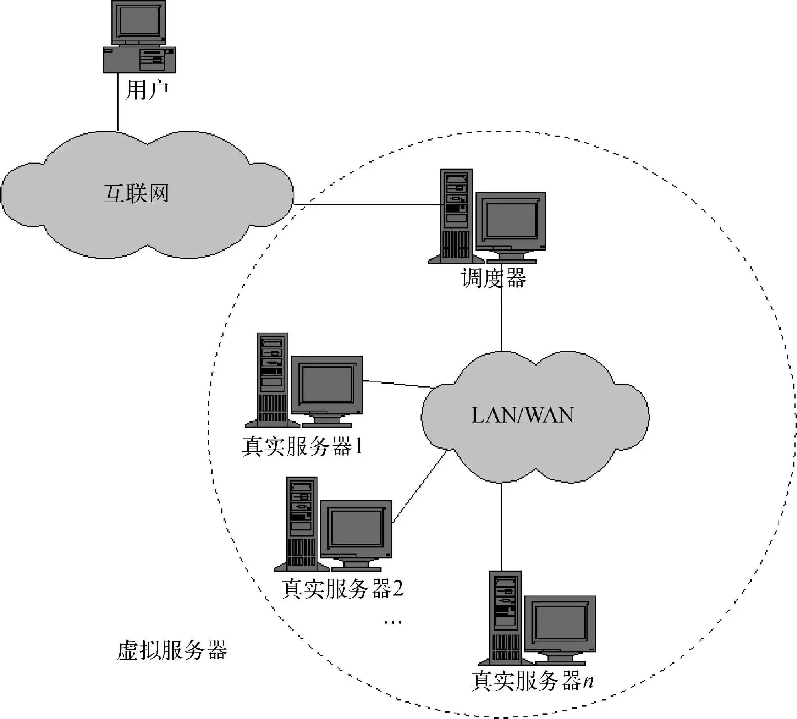
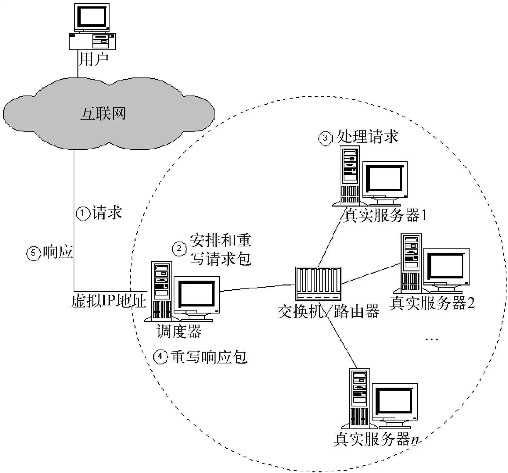
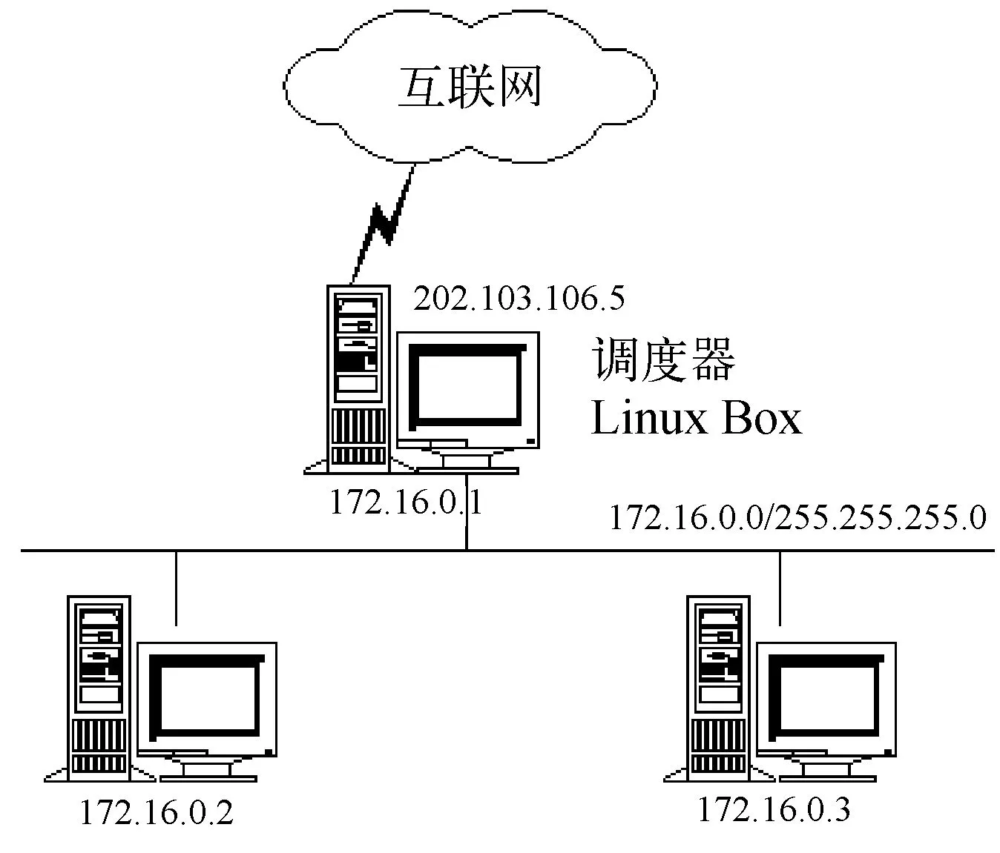
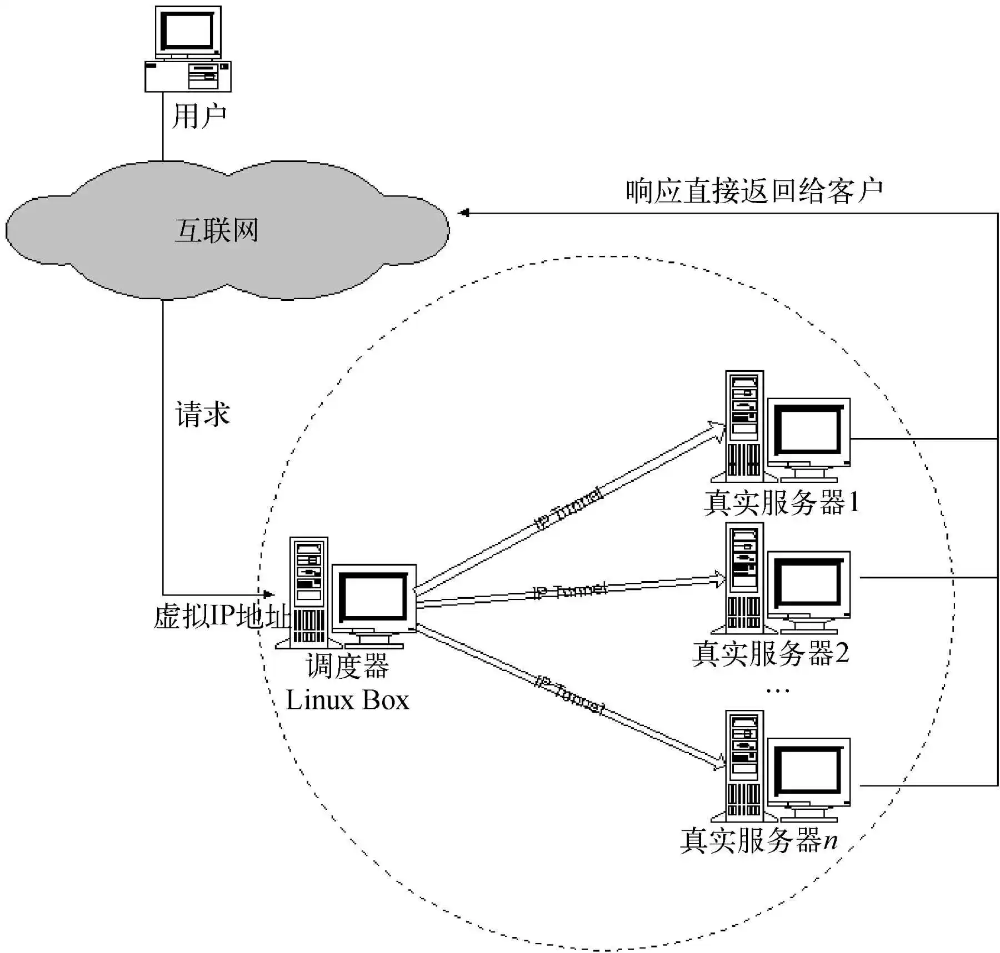
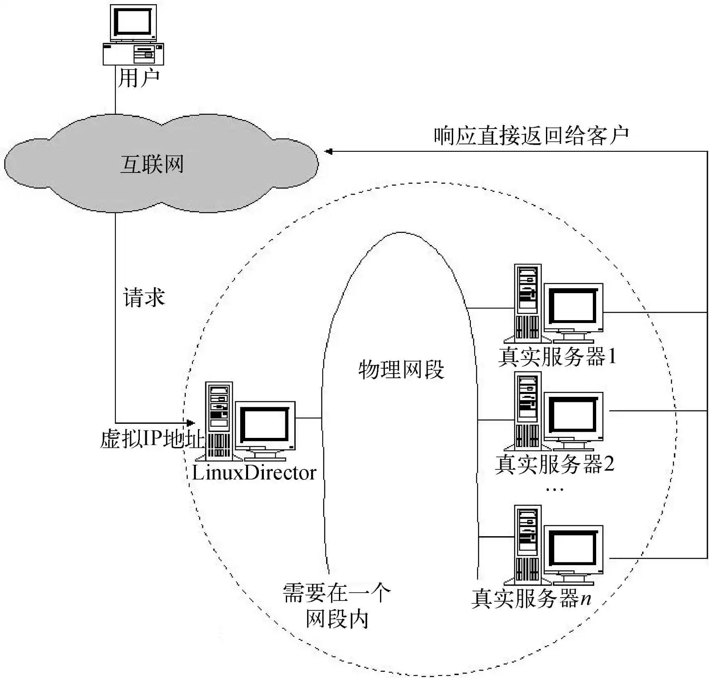

# 第20章Linux集群

一台服务器的硬件配置总是有限的，当服务器上运行的资源超过服务器的承载能力时，必将导致该服务器崩溃。在生产环境中，多数企业会使用多台服务器搭建成一个集群来运行应用程序，这样不仅可以避免单点故障，还能提升服务器的承载能力。

腾讯的微信软件在国内使用频繁，据腾讯官方提供的数据报告显示，2019 年月活跃用户数超过 11.5 亿。然而，我们很少发现它出现故障。这么大体量的应用，不可能在一台或者几台服务器上运行起来，事实上有数以万计的服务器在微信的后端支撑着。据不完全统计，仅微信这项业务，几乎每天都会有若干台服务器出现故障，但这并没有影响到微信的使用，背后的技术其实就是集群。

集群从功能实现上分为两种：高可用集群和负载均衡集群。高可用，顾名思义，当一台服务器死机不能提供服务了，还有另外的服务器顶替。就像阿铭刚刚提到的，微信所使用的服务器虽然每天都有死机的，但对于用户来讲是无感知的，并没有影响到使用。负载均衡集群，简单讲就是把用户的请求分摊到多台服务器上，微信那么多用户使用，它就是把众多用户分摊在了不同的服务器上，假如说一台服务器上可以承载一万用户，那么一万台服务器上就可以承载 1 亿用户。

## 20.1 搭建高可用集群

高可用集群，即“HA 集群”，也常称作“双机热备”，用于关键业务。常见实现高可用的开源软件有 heartbeat 和 keepalived，其中 keepalived 还有负载均衡的功能。这两个软件类似，核心原理都是通过心跳线连接两台服务器，正常情况下由一台服务器提供服务，当这台服务器死机时，由备用服务器顶替。

heartbeat 软件在 2010 年就停止了更新，所以在本节试验中阿铭将采用 keepalived 实现高可用集群。

### 20.1.1 keepalived 的工作原理

在讲述 keepalived 的工作原理之前，阿铭先介绍一个协议 VRRP（Virtual RouterRedundancy Protocol，虚拟路由冗余协议）。它是实现路由高可用的一种通信协议，在这个协议里会将多台功能相同的路由器组成一个小组，这个小组里会有 1 个 master（主）角色和N（N≥1）个 backup（备用）角色。工作时，master 会通过组播的形式向各个 backup 发送VRRP 协议的数据包，当 backup 收不到 master 发来的 VRRP 数据包时，就会认为 master死机了。此时就需要根据各个 backup 的优先级来决定谁成为新的 master。

而 keepalived 就是采用这种 VRRP 协议实现的高可用。keepalived 主要有三个模块，分别是core、check 和 vrrp。其中 core 模块为 keepalived 的核心，负责主进程的启动、维护以及全局配置文件的加载和解析；check 模块负责健康检查；vrrp 模块用来实现 VRRP 协议。

### 20.1.2 安装 keepalived

刚才提到 VRRP 协议有 1 个 master 角色和至少 1 个 backup 角色，所以做本试验需要准备至少两台 Linux 机器。阿铭拿两台 Linux 虚拟机 192.168.72.128（以下简称 128）和192.168.72.129（以下简称 129）来完成以下操作，其中 128 作为 master，129 作为backup。

在两台机器上执行如下操作：

```
# yum install –y keepalived
CentOS 默认的yum源里就有 keepalived 包，版本虽然有点老，但不影响使用，当前官方最新
版为 2.1.3，阿铭yum安装的版本为 2.0.10。安装 keepalived 虽然很简单，但重点在于配置，
```

阿铭将会拿一个实际案例来阐述 keepalived 的高可用功能。

### 20.1.3 keepalived＋Nginx 实现 Web 高可用

在生产环境中，诸多企业把 Nginx 作为负载均衡器来用，它的重要性很高，一旦死机会导致整个站点不能访问，所以有必要再准备一台备用 Nginx，keepalived 用在这种场景下非常合适。

阿铭管理的业务也是这样，用两台 Nginx 做负载均衡，每一台上面都安装了 keepalived，也就是说 keepalived 和 Nginx 安装在一起。在配置之前，阿铭先把两台机器的 IP、角色罗列一下，这样你理解起来应该会容易一些。

master：192.168.72.128 安装 keepalived＋Nginx

backup：192.168.72.129 安装 keepalived＋Nginx

VIP：192.168.72.100

VIP 对你来说是一个新概念，它的英文名字是“Virtual IP”，即“虚拟 IP”，也有人把它叫作“浮动IP”。因为这个 IP 是由 keepalived 给服务器配置的，服务器靠这个 VIP 对外提供服务，当master 机器死机，VIP 就被分配到 backup 上，这样用户看来是无感知的。

编辑 master（128）的 keepalived 配置文件：

```
# vim /etc/keepalived/keepalived.conf // 更改成如下内容
global_defs {
notification_email {
aming@aminglinux.com // 定义接收告警的人
}
notification_email_from root@aminglinux.com // 定义发邮件地址（实际上没用）
smtp_server 127.0.0.1 // 定义发邮件地址，若为127.0.0.1则使用本机自带邮件服务器发送
smtp_connect_timeout 30
router_id LVS_DEVEL
}
vrrp_script chk_nginx { // chk_nginx为自定义名字，后面还会用到它
script "/usr/local/sbin/check_ng.sh" // 自定义脚本，该脚本为监控Nginx服务的脚本
interval 3 // 每隔3s执行一次该脚本
}
vrrp_instance VI_1 {
state MASTER // 角色为master
interface ens33 // 针对哪个网卡监听VIP
virtual_router_id 51
priority 100 // 权重为100，master的权重要比backup大
advert_int 1
authentication {
auth_type PASS
auth_pass aminglinux>com // 定义密码，这个密码自定义
}
virtual_ipaddress {
192.168.72.100 // 定义VIP
}
track_script {
chk_nginx // 定义监控脚本，这里和上面vrr_script后面的字符串保持一致
}
}
```

keepalived 要实现高可用，监控 Nginx 服务自然是必不可少的，它本身没有这个功能，需要借助自定义脚本实现，所以我们还需要定义一个监控 Nginx 服务的脚本，如下：

```bash
# vim /usr/local/sbin/check_ng.sh // 内容如下
# 时间变量，用于记录日志
d=`date --date today +%Y%m%d_%H:%M:%S`
# 计算Nginx进程数量
n=`ps -C nginx --no-heading|wc -l`
# 如果进程数量为0，则启动Nginx，并且再次检测Nginx进程数量，
# 如果还为0，说明Nginx无法启动，此时需要关闭keepalived
if [ $n -eq "0" ]; then
systemctl start nginx
n2=`ps -C nginx --no-heading|wc -l`
if [ $n2 -eq "0" ]; then
echo "$d nginx down,keepalived will stop" >> /var/log/check_ng.log
systemctl stop keepalived
fi
fi
#####以上为脚本内容#####
# chmod a+x /usr/local/sbin/check_ng.sh // 需要给它x权限，否则无法被keepalived调用
```

做完上面所有操作后，就可以启动 master 上的 keepalived 了，如果没有启动 Nginx 服务，它会帮我们自动拉起来，并监听 VIP：

```
# systemctl start keepalived
# ip add
1: lo: <LOOPBACK,UP,LOWER_UP> mtu 65536 qdisc noqueue state UNKNOWN group default
link/loopback 00:00:00:00:00:00 brd 00:00:00:00:00:00
inet 127.0.0.1/8 scope host lo
valid_lft forever preferred_lft forever
inet6 ::1/128 scope host
valid_lft forever preferred_lft forever
2: ens33: <BROADCAST,MULTICAST,UP,LOWER_UP> mtu 1500 qdisc fq_codel state UP grou
link/ether 00:0c:29:15:7f:b9 brd ff:ff:ff:ff:ff:ff
inet 192.168.72.128/24 brd 192.168.72.255 scope global noprefixroute ens33
valid_lft forever preferred_lft forever
inet 192.168.72.100/32 scope global ens33
valid_lft forever preferred_lft forever
inet6 fe80::454b:a2e5:64e5:67a3/64 scope link noprefixroute
valid lft forever preferred lft forever
```

可以看到 master 上已经自动配置了 192.168.72.100 这个 IP。再来看看 Nginx 服务是否已经启动：

```
# ps aux |grep nginx
root 829 0.0 0.0 43056 996 ? Ss 11:29 0:00 nginx: master process /usr/local/nginx
nobody 831 0.0 0.3 76016 6668 ? S 11:29 0:00 nginx: worker process
nobody 832 0.0 0.3 76016 6668 ? S 11:29 0:00 nginx: worker process
```

master 上已经大功告成，下面继续配置 backup，首先编辑配置文件：

```
# vim /etc/keepalived/keepalived.conf // 内容和master大部分一致，state和priority有变化
global_defs {
notification_email {
aming@aminglinux.com
}
notification_email_from root@aminglinux.com
smtp_server 127.0.0.1
smtp_connect_timeout 30
router_id LVS_DEVEL
}
vrrp_script chk_nginx {
script "/usr/local/sbin/check_ng.sh"
interval 3
}
vrrp_instance VI_1 {
state BACKUP
interface ens33
virtual_router_id 51
priority 90
advert_int 1
authentication {
auth_type PASS
auth_pass aminglinux>com
}
virtual_ipaddress {
192.168.72.100
}
track_script {
chk_nginx
}
}
```

编辑监控脚本，如下：

```bash
# vim /usr/local/sbin/check_ng.sh // 内容如下
# 时间变量，用于记录日志
d=`date --date today +%Y%m%d_%H:%M:%S`
# 计算Nginx进程数量
n=`ps -C nginx --no-heading|wc -l`
# 如果进程数量为0，则启动Nginx，并且再次检测Nginx进程数量，
# 如果还为0，说明Nginx无法启动，此时需要关闭keepalived
if [ $n -eq "0" ]; then
systemctl start nginx
n2=`ps -C nginx --no-heading|wc -l`
if [ $n2 -eq "0" ]; then
echo "$d nginx down,keepalived will stop" >> /var/log/check_ng.log
systemctl stop keepalived
fi
fi
#####以上为脚本内容#####
# chmod a+x /usr/local/sbin/check_ng.sh
```

如果你的 backup（129）上还未安装 Nginx，暂时还不能启动 keepalived 服务，还需要做如下操作：

```
# yum install -y epel-release
# yum install –y nginx
```

Nginx 除了可以通过编译安装，也可以使用 yum 安装。然后，把 keepalived 服务启动：

```
# systemctl start keepalived
```

折腾了这么久，阿铭还未检验劳动成果，下面来跟着阿铭一起验证 keepalived 的高可用吧。

为了区分开 master 和 backup 两个角色，阿铭先把两台机器的 Nginx 做一个区分，为两个

```
Nginx 分别设置一个自定义 header，这样在执行curl的时候就可以看出差异来：
# 分别编辑128和129的nginx.conf
# vim /usr/local/nginx/conf/nginx.conf // 如果是yum安装的Nginx，配置文件为 /etc/nginx
# 在http {} 配置段里，增加如下内容
add_header myheader "128"; // 这是128的配置
add_header myheader "129"; // 这是129的配置
```

重载配置后，进行测试：

```
# systemctl reload nginx
# curl -I 192.168.72.128 // 可以看到myheader：128
HTTP/1.1 200 OK
Server: nginx/1.18.0
Date: Sun, 05 Jul 2020 03:58:37 GMT
Content-Type: text/html
Content-Length: 15
Last-Modified: Sat, 27 Jun 2020 01:59:46 GMT
Connection: keep-alive
ETag: "5ef6a812-f"
myheader: 128
Accept-Ranges: bytes
# curl -I 192.168.72.129 // 可以看到myheader：129
HTTP/1.1 200 OK
Server: nginx/1.18.0
Date: Sun, 05 Jul 2020 03:58:40 GMT
Content-Type: text/html
Content-Length: 15
Last-Modified: Sat, 27 Jun 2020 01:59:46 GMT
Connection: keep-alive
ETag: "5ef6a812-f"
myheader: 129
Accept-Ranges: bytes
```

有了标记之后，后续的操作就有意思了，先把 master 上的 Nginx 故意关掉：

```
# netstat -lntp |grep nginx
tcp 0 0 0.0.0.0:80 0.0.0.0:* LISTEN 829/nginx: master p
tcp 0 0 0.0.0.0:443 0.0.0.0:* LISTEN 829/nginx: master p
# systemctl stop nginx
Stopping nginx (via systemctl): [ 确定 ]
# netstat -lntp |grep nginx // 关掉之后，确实没有了Nginx服务
```

等了片刻，再来检测端口，发现服务又启动了：

```
# netstat -lntp |grep nginx
tcp 0 0 0.0.0.0:80 0.0.0.0:* LISTEN 829/nginx: master p
tcp 0 0 0.0.0.0:443 0.0.0.0:* LISTEN 829/nginx: master p
```

你也可以通过 /var/log/messages 日志看到 Nginx 被启动的信息：

```
Jul 5 12:02:07 aminglinux-123 systemd[1]: Stopping nginx - high performance web s
Jul 5 12:02:07 aminglinux-123 systemd[1]: Stopped nginx - high performance web se
Jul 5 12:02:10 aminglinux-123 systemd[1]: Starting nginx - high performance web s
Jul 5 12:02:10 aminglinux-123 systemd[1]: Started nginx - high performance web se
```

从时间上可以看出关闭 Nginx 服务后，大概 3 秒钟它就又被启动了。下面我们再模拟 master

```
死机，只需要在 master 加上一条iptables规则即可：
# iptables -I OUTPUT –p vrrp -j DROP
```

加完规则后，到 backup 上看是否被设置了 VIP：

```
# ip add
1: lo: <LOOPBACK,UP,LOWER_UP> mtu 65536 qdisc noqueue state UNKNOWN group default
link/loopback 00:00:00:00:00:00 brd 00:00:00:00:00:00
inet 127.0.0.1/8 scope host lo
valid_lft forever preferred_lft forever
inet6 ::1/128 scope host
valid_lft forever preferred_lft forever
2: ens33: <BROADCAST,MULTICAST,UP,LOWER_UP> mtu 1500 qdisc fq_codel state UP grou
link/ether 00:0c:29:58:a3:05 brd ff:ff:ff:ff:ff:ff
inet 192.168.72.129/24 brd 192.168.72.255 scope global noprefixroute ens33
valid_lft forever preferred_lft forever
inet 192.168.72.100/32 scope global ens33
valid_lft forever preferred_lft forever
inet6 fe80::a7de:e888:acdf:4c8c/64 scope link noprefixroute
valid_lft forever preferred_lft forever
```

确实已经有 192.168.72.100 这个 VIP 了，再来看 /var/log/messages：

```javascript
tail /var/log/messages
Jul 5 12:03:56 aminglinux-123 Keepalived_vrrp[2085]: Sending gratuitous ARP on en
Jul 5 12:03:56 aminglinux-123 Keepalived_vrrp[2085]: Sending gratuitous ARP on en
Jul 5 12:03:56 aminglinux-123 Keepalived_vrrp[2085]: Sending gratuitous ARP on en
Jul 5 12:03:56 aminglinux-123 Keepalived_vrrp[2085]: Sending gratuitous ARP on en
Jul 5 12:04:01 aminglinux-123 Keepalived_vrrp[2085]: Sending gratuitous ARP on en
Jul 5 12:04:01 aminglinux-123 Keepalived_vrrp[2085]: (VI_1) Sending/queueing grat
Jul 5 12:04:01 aminglinux-123 Keepalived_vrrp[2085]: Sending gratuitous ARP on en
Jul 5 12:04:01 aminglinux-123 Keepalived_vrrp[2085]: Sending gratuitous ARP on en
Jul 5 12:04:01 aminglinux-123 Keepalived_vrrp[2085]: Sending gratuitous ARP on en
Jul 5 12:04:01 aminglinux-123 Keepalived_vrrp[2085]: Sending gratuitous ARP on en
```

其中也有 VIP 的相关信息，但是这并不完美，因为在 master 上依旧有 VIP，master 上虽然被禁掉了 VRRP 协议，但它并不认为自己死机了，所以不会释放 VIP 资源。如果 master 和backup 都绑定了 VIP，那么对外提供服务时就会紊乱，这叫作“脑裂”，这种情况是不允许发生的。其实还有一种测试方案，就是直接把 master 上的 keepalived 服务关掉，在此之前先将前面增加的 iptables 规则去掉，运行下面命令：

```
# iptables -D OUTPUT -p VRRP –j DROP
# systemctl stop keepalived
```

然后我们直接访问 VIP 来判断 VIP 在哪里：

```
# curl -I 192.168.72.100
HTTP/1.1 200 OK
Server: nginx/1.18.0
Date: Sun, 05 Jul 2020 04:06:36 GMT
Content-Type: text/html
Content-Length: 15
Last-Modified: Sat, 27 Jun 2020 01:59:46 GMT
Connection: keep-alive
ETag: "5ef6a812-f"
myheader: 129
Accept-Ranges: bytes
```

可以判断 VIP 已经到了 129 上，再把 master 上的 keepalived 服务开启：

```bash
# systemctl start keepalived
# curl -I 192.168.72.100
curl -I 192.168.72.100
HTTP/1.1 200 OK
Server: nginx/1.18.0
Date: Sun, 05 Jul 2020 04:10:17 GMT
Content-Type: text/html
Content-Length: 15
Last-Modified: Sat, 27 Jun 2020 01:59:46 GMT
Connection: keep-alive
ETag: "5ef6a812-f"
myheader: 128
Accept-Ranges: bytes
```

此时 VIP 又回到了 master 上。试想，如果一台机器死机，keepalived 服务必然会停掉，所以这样去验证 keepalived 的高可用是没有任何问题的。另外, 希望你多看一看/var/log/messages 日志，在阿铭试验过程中产生了很多 keepalived 的日志，以后遇到问题时也可以有一个参考。

如果把 Nginx 换成其他服务，比如说 MySQL，如何做呢？配置思路是一样的，唯一不同的是对 MySQL 的监控脚本不一样。

## 20.2 搭建负载均衡集群

负载均衡集群不难理解，从字面上也能猜到，简单说就是让多台服务器均衡地去承载压力。实现负载均衡集群的开源软件有 LVS、keepalived、haproxy、Nginx 等，当然也有优秀的商业负载均衡设备，比如 F5、NetScaler 等。商业的负载均衡解决方案稳定性没话说，但是成本非常昂贵，所以阿铭不多介绍，本节以开源的 LVS 为主。

### 20.2.1 介绍 LVS

LVS（Linux Virtual Server）是由国内大牛章文嵩开发的，这款软件的流行度不亚于 Apache的 httpd，它是一款四层的负载均衡软件，是针对 TCP/IP 做的转发和路由，所以稳定性和效率相当高。不过 LVS 最新的版本是基于 Linux 2.6 内核的，这意味着它已经有多年没有更新了。虽然目前越来越多的企业选择使用 Nginx 实现负载均衡，但 LVS 依然被诸多企业应用在核心的架构当中。LVS 的架构如图 20-1 所示，在该架构中有一个核心的角色叫作调度器（Load Balancer），用来分发用户的请求；还有诸多的真实服务器（Real Server），也就是处理用户请求的服务器。



图 20-1 LVS 架构

LVS 根据实现方式的不同，主要分为三种类型：NAT 模式、IP Tunnel（IP 隧道）模式、DR模式。

(1) NAT 模式

```
前面阿铭介绍 iptables 时，有介绍过nat表，和这里的 NAT 其实是一个意思。这种模式的实
```

现原理很简单，调度器会把用户的请求通过预设的 iptables 规则转发给后端的真实服务器。其中调度器有两个 IP，一个是公网 IP，一个是内网 IP，而真实服务器只有内网 IP。用户访问的时候请求的是调度器的公网 IP，它会把用户的请求转发到真实服务器的内网 IP 上。这种模式的好处是节省公网 IP，但是调度器会成为一个瓶颈。NAT 模式架构如图 20-2 和图 20-3 所示。



图 20-2 NAT 模式



图 20-3 NAT 模式 2

(2) IP Tunnel 模式

IP 隧道是将一个 IP 报文封装在另一个 IP 报文中的技术，这可以使目标为一个 IP 地址的数据报文能被封装和转发到另一个 IP 地址。像大家熟知的 VPN 技术其实就是 IP 隧道。在 LVS 的IP Tunnel 架构中，后端服务器有一组而非一个，所以不可能静态地建立一一对应的隧道，而是动态地选择一台服务器，将请求报文封装和转发给选出的服务器。这样我们可以利用 IP 隧道的原理，将一组服务器上的网络服务组成在一个 IP 地址上的虚拟网络服务。IP Tunnel 模式架构如图 20-4 所示。



图 20-4 IP Tunnel 模式

调度器（Load Balancer）将请求报文封装在另一个 IP 报文中，再将封装后的 IP 报文转发给真实服务器。真实服务器收到报文后，先将报文解封获得原来目标地址为 VIP 的报文，服务器发现 VIP 地址被配置在本地的 IP 隧道设备上，所以就处理这个请求，然后根据路由表将响应报文直接返回给客户。这种模式下，需要给调度器和所有的真实服务器全部分配公网 IP，所以比较浪费公网 IP。

(3) DR 模式和 IP Tunnel 模式方法相同，用户的请求被调度器动态地分配到真实服务器上，真实服务器响应请求把结果直接返回给用户。不过，在这种模式下不会封装 IP，而是将数据帧的 MAC 地址改为真实服务器的 MAC 地址。DR 模式架构如图 20-5 所示。



图 20-5 DR 模式

LVS 的官方网站给出了三种模式的比较，如表 20-1 所示。

表 20-1 LVS 模式比较_

- VS/NATVS/TUNVS/DR

server

- anyTunnelingNon-arp device

server network

- privateLAN/WANLAN

server number

- low (10~20)High (100)High (100)

server gateway

- load balancerown routerown router

以上三种方法所能支持最大服务器数的估值是假设调度器使用 100 MB 网卡，调度器的硬件配置与后端服务器的硬件配置相同，而且是针对一般 Web 服务的。使用更高的硬件配置（如千兆网卡和更快的处理器）作为调度器，调度器所能调度的服务器数量会相应增加。当应用不同时，服务器的数目也会相应地改变。所以，以上数据估计主要是为三种方法的伸缩性进行量化比较。

根据表 20-1 的比较可以看出，NAT 模式适合小型的集群，机器数量不多，它的优势是节省公网 IP。TUN 和 DR 相差不大，都能支撑较大规模的集群，但缺点是浪费公网 IP。

### 20.2.2 LVS 的调度算法

调度器把客户端发来的请求均衡地分发给后端的真实服务器，这是依靠预先设定好的调度算法实现的，在 LVS 中支持的调度算法主要有以下 8 种。

1. 轮询调度这种算法简称 RR（Round-Robin），是非常简单的一种调度算法，它按顺序把请求依次发送给后端的服务器，不管后端服务器的处理速度和响应时间怎样。当后端服务器性能不一致时，用这种调度算法就不合适了。

2. 带权重的轮询调度这种算法简称 WRR（Weighted Round-Robin），比第一种算法多了一个权重的设置，权重越高的服务器被分配到的请求就越多，这样后端服务器性能不一致时，就可以给配置低的服

- 务器较小的权重。

3. 最小连接调度这种算法简称 LC（Least-Connection），会根据各真实服务器上的连接数来决定把新的请求分配给谁，连接数少说明服务器是空闲的，这样把新的请求分配到空闲服务器上才更加合理。

4. 带权重最小连接调度这种算法简称 WLC（Weight Least-Connection），是在最小连接调度的基础上再增加一个权重设置，这样就可以人为地去控制哪些服务器上多分配请求，哪些少分配请求。

5. 基于局部性的最少连接调度这种算法简称 LBLC（Locality-Based Least Connection），是针对请求报文的目标 IP 地址的负载均衡调度，目前主要用于 Cache 集群系统，因为在 Cache 集群中客户请求报文的目标 IP 地址是变化的。算法的设计目标是在服务器的负载基本平衡的情况下，将具有相同目标 IP 地址的请求调度到同一台服务器，来提高各台服务器的访问局部性和主存 Cache 命中率。

6. 带复制的基于局部性最少连接调度该算法简称 LBLCR（Locality-Based Least Connections with Replication），也是针对目标IP 地址的负载均衡，它与 LBLC 算法的不同之处是：它要维护从一个目标 IP 地址到一组服务器的映射，而 LBLC 算法是维护从一个目标 IP 地址到一台服务器的映射。LBLCR 算法先根据请求的目标 IP 地址找出该目标 IP 地址对应的服务器组，按“最小连接”原则从该服务器组中选出一台服务器，若服务器没有超载，则将请求发送到该服务器；若服务器超载，则

- 按“最小连接”原则从整个集群中选出一台服务器，将该服务器加入到服务器组中，将请求发送到该服务器。同时，当该服务器组有一段时间没有被修改，将最忙的服务器从服务器组中删除，以降低复制的程度。

7. 目标地址散列调度该算法（Destination Hashing）也是针对目标 IP 地址的负载均衡，但它是一种静态映射算法，通过一个散列（hash）函数将一个目标 IP 地址映射到一台服务器。目标地址散列调度算法先将请求的目标 IP 地址作为散列键（hash key）从静态分配的散列表找出对应的服务器，若该服务器是可用的且未超载，则将请求发送到该服务器，否则返回空。

8. 源地址散列调度该算法（Source Hashing）正好与目标地址散列调度算法相反，它将请求的源 IP 地址作为散列键从静态分配的散列表找出对应的服务器，若该服务器是可用的且未超载，就将请求发送到该服务器，否则返回空。它的算法流程与目标地址散列调度算法的流程基本相似，只不过将请求的目标 IP 地址换成了请求的源 IP 地址。

对于以上 8 种调度算法，阿铭认为前 4 种用得最多，也最容易理解，它们基本上能满足绝大多数的应用场景。关于 LVS 的介绍内容还是蛮多的，请不要觉得啰唆，这部分内容在面试的时候经常会被问到，建议你耐心地读一读，理解了自然就掌握了。

在阿铭 10 多年的职业生涯里，生产环境中使用 LVS 的场景几乎没有，所以关于 LVS 的相关试验，阿铭就省略了，但是 keepalived＋LVS 还是要给大家验证一下的。

### 20.2.3 使用 keepalived＋LVS DR 模式实现负载均衡

完整的 keepalived+LVS 架构需要有两台调度器实现高可用，其中提供调度服务的只需要一台，另外一台作为备用。为了节省资源，阿铭只设置一台主 keepalived，备用的暂时就省略掉了。以下试验需要准备三台机器。阿铭原来就有两台虚拟机，还需再克隆一台。三台机器的IP 分配如下。

- 主 keepalived（调度器）：192.168.72.128

- 真实服务器 rs1：192.168.72.129

- 真实服务器 rs2：192.168.72.130

- VIP：192.168.72.110

```
如果你的机器上还未安装过 keepalived，则需要先安装，直接运行yum install
keepalived即可。由于阿铭的 128 机器之前安装过 keepalived，所以这一步就省略了。下
```

面编辑 keepalived 的配置文件：

```
vim /etc/keepalived/keepalived.conf // 更改成如下内容
vrrp_instance VI_1 {
# 备用服务器上为 BACKUP
state MASTER
# 绑定VIP的网卡为ens33，你的网卡和阿铭的可能不一样，这里需要你改一下
interface ens33
virtual_router_id 51
# 备用服务器上为90
priority 100
advert_int 1
authentication {
auth_type PASS
auth_pass aminglinux
}
virtual_ipaddress {
192.168.72.110
}
}
virtual_server 192.168.72.110 80 {
#(每隔10秒查询一次真实服务器的状态)
delay_loop 10
#(lvs 算法，rr为轮询算法，wrr为带权重的轮询算法)
lb_algo rr
#(DR模式)
lb_kind DR
#(同一IP的连接60秒内被分配到同一台真实服务器，为了方便试验，这里将该参数注释了，生产环境建议开启
#persistence_timeout 60
#(用TCP协议检查真实服务器状态)
protocol TCP
real_server 192.168.72.129 80 {
#(权重)
weight 100
TCP_CHECK {
#(10秒无响应即超时)
connect_timeout 10
nb_get_retry 3
delay_before_retry 3
connect_port 80
}
}
real_server 192.168.72.130 80 {
weight 100
TCP_CHECK {
connect_timeout 10
nb_get_retry 3
delay_before_retry 3
connect_port 80
}
}
}
# systemctl restart keepalived
```

两台 rs（129 和 130）上需要编写脚本（内容一样）：

```bash
# vim /usr/local/sbin/lvs_dr_rs.sh // 内容如下
#/bin/bash
vip=192.168.72.110
# 把vip绑定在lo上，是为了rs能直接把结果返回给客户端
ifconfig lo:0 $vip broadcast $vip netmask 255.255.255.255 up
route add -host $vip lo:0
# 以下操作为更改ARP内核参数，目的是让rs顺利发送MAC地址给客户端
echo "1" >/proc/sys/net/ipv4/conf/lo/arp_ignore
echo "2" >/proc/sys/net/ipv4/conf/lo/arp_announce
echo "1" >/proc/sys/net/ipv4/conf/all/arp_ignore
echo "2" >/proc/sys/net/ipv4/conf/all/arp_announce
```

分别在两台机器上执行各自的脚本：

```
# bash /usr/local/sbin/lvs_dr_rs.sh // 129和130上执行
```

为了便于区分开 129 和 130，阿铭将其虚拟主机默认网页修改了一下：

```bash
# echo "default_server 129" > /data/nginx/default/index.html // 修改129的默认网页
# echo "default_server 130" > /data/nginx/default/index.html // 修改130的默认网页
# curl 192.168.72.129
default_server 129
# curl 192.168.72.130
default_server 130
下面看测试效果，但这次就不能用curl命令测试了，因为 VIP 在三台机器上都有设置，直接
curl去访问 VIP 的话不成功，如果要 curl 测试，还需要再搞一台同网段的虚拟机才可以。所
```

以只能用浏览器来测试效果，直接在浏览器里访问 http://192.168.72.110 即可。测试过程阿铭

```
不再详细介绍，最终达到的效果是：第一次访问结果为default_server 129，然后刷新一
下就变为default_server 130，再刷新又变为default_server 129，依此类推。
```

### 20.2.4 使用 Nginx 实现负载均衡

Nginx 作为一款优秀的 Web 服务器，不仅能实现七层负载均衡，还能实现四层负载均衡。这里的七层、四层指的是网络 OSI 七层模型中的应用层和传输层，对应到 Nginx 的负载均衡，可以这样理解：七层即可以实现 HTTP/HTTPS 的负载均衡，四层即可以实现 TCP 的负载均衡，比如用 Nginx 对 MySQL 进行负载均衡。

先来看七层的负载均衡示例，机器规划如下。

- 负载均衡器：192.168.72.128

- 服务器 1：192.168.72.129

- 服务器 2：192.168.72.130

在 128 上，编辑配置文件：

```
vim /usr/local/nginx/conf/vhost/ld7.conf // 更改成如下内容
upstream ld_7
{
server 192.168.72.129:80;
server 192.168.72.130:80;
}
server
{
listen 80;
server_name www.ld7.com;
location /
{
proxy_pass http://ld_7;
proxy_set_header Host $host;
proxy_set_header X-Real-IP $remote_addr;
proxy_set_header X-Forwarded-For $proxy_add_x_forwarded_for;
}
}
重载配置文件后，使用curl命令测试效果：
# /usr/local/nginx/sbin/nginx -s reload
# curl -x192.168.72.128:80 www.ld7.com
default_server 129
# curl -x192.168.72.128:80 www.ld7.com
default_server 130
# curl -x192.168.72.128:80 www.ld7.com
default_server 129
# curl -x192.168.72.128:80 www.ld7.com
default_server 130
```

可以看到，每次请求得到的结果不一样。

下面再来看看四层的负载均衡，首先要修改配置文件 nginx.conf，如下：

```
# vim /usr/local/nginx/conf/nginx.conf // 在文件最后面，也就是}的下一行增加如下内容
stream
{
include vhost/tcp/*.conf;
}
// 说明：这里的stream {}是和http {}配置段同级别的，stream {}里面的配置为tcp相关配置
```

然后创建四层负载均衡的配置文件，如下：

```
# mkdir /usr/local/nginx/conf/vhost/tcp // 创建tcp目录
upstream lb_4
{
server 192.168.72.129:80;
server 192.168.72.130:80;
}
server
{
listen 81;
proxy_timeout 3s;
proxy_pass lb_4;
}
// 说明：这里监听81端口，区别于七层的80端口
```

配置完，检查配置文件是否有问题，结果发现错误：

```
# /usr/local/nginx/sbin/nginx -t
nginx: [emerg] unknown directive "stream" in /usr/local/nginx/conf/nginx.conf:68
nginx: configuration file /usr/local/nginx/conf/nginx.conf test failed
```

这是因为我们在编译 Nginx 时，并没有指定让 Nginx 支持四层的代理，这就需要重新编译

```
Nginx，增加--with-stream参数：
# cd /usr/local/src/nginx-1.18.0
# ./configure --prefix=/usr/local/nginx --with-http_ssl_module --with-stream
# make
# make install
```

再一次检查配置文件，就可以了：

```
# /usr/local/nginx/sbin/nginx -t
nginx: the configuration file /usr/local/nginx/conf/nginx.conf syntax is ok
nginx: configuration file /usr/local/nginx/conf/nginx.conf test is successful
# systemctl restart nginx // 必须要重启一下nginx，81端口才会开启哦
```

下面来看看 81 端口的效果：

```
# curl -x192.168.72.128:81 www.abc.com
default_server 129
# curl -x192.168.72.128:81 www.abc.com
default_server 130
# curl -x192.168.72.128:81 www.abc.com
default_server 129
# curl -x192.168.72.128:81 www.abc.com
default_server 130
```

这里使用了一个临时域名 www.abc.com，其实你无论使用什么域名都可以，这是因为它访问到 129 和 130 时都会去访问默认虚拟主机。

## 20.3 课后习题

(1) 常见的集群架构有哪些？

(2) 请列举出可以实现负载均衡集群的开源软件？

(3) LVS 有哪几种工作模式？

(4) LVS 可以支持哪些调度算法？

(5) 要实现负载均衡集群，至少需要几台机器？

(6) 对比 Nginx 和 LVS 负载均衡，它们两者有什么区别？

(7) 自己动手用 keepalived 实现 MySQL 的高可用集群（要考虑到两台 MySQL 数据的一致性）。
