# 第21章配置监控服务器

监控的重要性不言而喻，一个企业即使架构再不成熟，都必须要有监控。监控不管用什么方式实现，开源软件也好，商业的监控服务也好，或者是简陋的 shell 脚本，在业务上线时都首先要做到位。在腾讯，监控平台非常健全，有一个团队专门维护监控中心，可见它的重要性。当然，并不是所有企业都像腾讯这么专业，还好有诸多开源免费的监控软件来供我们使用。当前，流行的开源监控软件有 Cacti、Nagios 和 Zabbix。

这三款软件都可以监控服务器的基础指标，比如 CPU、内存、硬盘、网络等，其中 Cacti 更擅长监控网络流量，很多 IDC 机房的网络设备流量用 Cacti 来监控，因为它成图更专业。Cacti、Nagios 以及 Zabbix 都是 C/S 架构，需要安装一个服务端，然后还需要在被监控的机器上安装客户端。这三款监控软件都需要有 PHP 的环境（LNMP）支持，其中 Nagios 不需要数据库，Cacti 和 Zabbix 都需要 MySQL 的支持，用来存储数据。

Nagios 最大的特点是监控一目了然，它监控某个指标并不会返回具体的数值，而是只返回一个状态，告诉我们该指标正常或者不正常。所以，Nagios 也不需要历史数据，这也是 Nagios不需要数据库支持的原因。当它发现某个指标不正常时，就直接发出告警邮件或者短信。

Nagios 在许多年前很受欢迎，但近些年不如 Zabbix 了，这里阿铭也推荐你使用 Zabbix，因为 Zabbix 可以存储数据，很方便画图，并且支持查询历史数据。还有一个阿铭非常喜欢的特性，Zabbix 可以非常方便地自定义监控项目。你可以定制化监控业务的某个指标（比如，每分钟订单数量），这个监控项目不可能在 Zabbix 的自带模板中找到，所以只能自定义。另外，Zabbix 还为我们提供了易用的二次开发接口，方便扩展。

## 21.1 Zabbix 监控介绍

Zabbix 不仅适合中小型企业，也适合大型企业，它是 C/S 架构，分为服务端（server）和客户端（client），单个服务端节点可以支持上万台客户端。在硬件和网络足够强悍的情况下，单台服务器理论上可以支持 5 万个客户端。阿铭在写这本书时，其最新版本为 5.0。其实 Zabbix更新的速度还是蛮快的。之所以版本更新速度很快，就是因为它太受欢迎了。学习 Zabbix 是非常有必要的，因为将来你找工作或者换工作的时候，超过 60% 的企业可能都在使用它。

如果你英文水平还可以，那看官方文档是学习 Zabbix 最好的路径，这里有各个主流版本的文档（2.2、2.4、3.0、3.2、3.4、4.0、4.2），因为 5.0 才刚刚出来，所以文档暂时还没有。Zabbix 的知识体系非常庞大，要研究透彻需要花费大量的时间和精力，阿铭建议一开始学习只需要搞清楚大概的架构，然后搭建一个测试环境，加一些基础的和自定义的监控，配置告警就可以了。也就是说，首先要把配置的流程搞明白，然后再去深入研究。在本节中，阿铭正是采用这样的方式介绍 Zabbix 的，相信等你学完这一章，就可以上手了。

### 21.1.1 Zabbix 组件

Zabbix 整个体系架构中有下面几个主要的角色。

1. zabbix-serverzabbix-server 是整个监控体系中最核心的组件，它负责接收客户端发送的报告信息，所有配置、统计数据及操作数据都由它组织。

2. 数据存储所有的收集信息都存储在这里。

3. Web 界面Web 界面即 GUI，这是 Zabbix 监控简单易用的原因之一，因为我们可以在 Web 界面中配置、管理各个客户端。运行 Web 界面需要有 PHP 环境支持。

4. zabbix-proxy

- zabbix-proxy 为可选组件，用在监控节点非常多的分布式环境中，它可以代理 zabbix-server 的功能，减轻 zabbix-server 的压力。

5. zabbix-agentzabbix-agent 为部署在各客户端上的组件，用于采集各监控项目的数据，并把采集的数据传输给 zabbix-proxy 或者 zabbix-server。

### 21.1.2 Zabbix 架构

介绍完各个组件后，再来通过一张图了解各组件的关系，如图 21-1 所示。

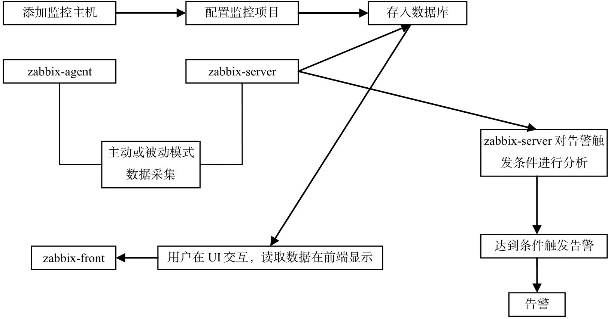

图 21-1 Zabbix 运行流程

## 21.2 Zabbix 监控安装和部署

通过图 21-1 大致了解了 Zabbix 的架构和工作流程后，你可能对 Zabbix 还是很陌生，下面阿铭会搭建一套 Zabbix 监控系统，让你更加直观地去了解它。其实做本试验准备一台虚拟机即可，也就是说你可以在一台机器上安装 Zabbix 所有的组件。但为了更加接近生产环境，阿铭拿两台机器来做本试验，其中 128 作为 Zabbix 服务端，129 作为客户端。

### 21.2.1 用yum安装 Zabbix

```
阿铭将在本试验中采用 5.0 版本。首先需要安装 Zabbix 的yum扩展源，然后利用yum安装
```

Zabbix 即可，在 128 上执行如下命令：

```
# wget repo.zabbix.com/zabbix/5.0/rhel/8/x86_64/zabbix-release-5.0-1.el8.noarch.r
# rpm –ivh zabbix-release-5.0-1.el8.noarch.rpm
# yum list |awk '$NF=="zabbix"'
zabbix-agent.x86_64 5.0.1-1.el8 zabbix
zabbix-agent2.x86_64 5.0.1-1.el8 zabbix
zabbix-apache-conf.noarch 5.0.1-1.el8 zabbix
zabbix-get.x86_64 5.0.1-1.el8 zabbix
zabbix-java-gateway.x86_64 5.0.1-1.el8 zabbix
zabbix-js.x86_64 5.0.1-1.el8 zabbix
zabbix-nginx-conf.noarch 5.0.1-1.el8 zabbix
zabbix-proxy-mysql.x86_64 5.0.1-1.el8 zabbix
zabbix-proxy-pgsql.x86_64 5.0.1-1.el8 zabbix
zabbix-proxy-sqlite3.x86_64 5.0.1-1.el8 zabbix
zabbix-sender.x86_64 5.0.1-1.el8 zabbix
zabbix-server-mysql.x86_64 5.0.1-1.el8 zabbix
zabbix-server-pgsql.x86_64 5.0.1-1.el8 zabbix
zabbix-web.noarch 5.0.1-1.el8 zabbix
zabbix-web-japanese.noarch 5.0.1-1.el8 zabbix
zabbix-web-mysql.noarch 5.0.1-1.el8 zabbix
zabbix-web-pgsql.noarch 5.0.1-1.el8 zabbix
使用yum list命令可以列出可用的 Zabbix 相关的包，其中有 4.0 版本的包属于epel扩展
```

源，阿铭并没有列出来，但在这里我们要安装的是 5.0 版本。下面安装 Zabbix，其中需要安

```
装的包有zabbix-agent、zabbix-get、zabbix-server-mysql、zabbix-web、
zabbix-nginx-conf和zabbix-web-mysql。各 RPM 包的作用分别如下。
```

- zabbix-agent：客户端程序。

- zabbix-get：服务器端上命令行获取客户端检测项目的工具。

- zabbix-server-mysql：zabbix-server MySQL 版。

- zabbix-web：Web 界面。

- zabbix-nginx-conf：Zabbix 的 Nginx 相关配置文件。

- zabbix-web-mysql：Web 界面 MySQL 相关。

在 128 上安装以上所有的包，命令为：

```
# yum install -y zabbix-agent zabbix-get zabbix-server-mysql zabbix-web zabbix-we
```

阿铭在使用 yum 安装 Zabbix，速度非常慢，而且时不时还中断，提示“下载元数据失败”，这是因为国内网络访问 Zabbix 官网比较慢。我们可以更换一个镜像站，配置如下：

```
# vim /etc/yum.repos.d/zabbix.repo // 修改为如下内容
[zabbix]
name=Zabbix Official Repository - $basearch
baseurl=https://mirrors.aliyun.com/zabbix/zabbix/5.0/rhel/8/x86_64/
enabled=1
gpgcheck=0
gpgkey=file:///etc/pki/rpm-gpg/RPM-GPG-KEY-ZABBIX-A14FE591
[zabbix-non-supported]
name=Zabbix Official Repository non-supported - $basearch
baseurl=https://mirrors.aliyun.com/zabbix/non-supported/rhel/8/x86_64/
enabled=1
gpgkey=file:///etc/pki/rpm-gpg/RPM-GPG-KEY-ZABBIX
gpgcheck=0
```

然后再次通过 yum 命令安装即可成功，它会自动安装上 nginx-1.14。

### 21.2.2 配置 MySQL

Zabbix 需要 MySQL 的支持，如果你的机器上还未安装 MySQL，请先根据 14.1 节的方法安装。阿铭在 128 机器上已经安装过，所以省略安装的步骤。下面是关于 MySQL 的一些操作：

```
# vim /etc/my.cnf // 编辑MySQL配置文件，在[mysqld]模块下面修改或增加如下内容
character_set_server = utf8
# /etc/init.d/mysqld restart //重启MySQL服务
# mysql -uroot -S /tmp/mysql.sock -paming123 //进入MySQL命令行
mysql> create database zabbix character set utf8 collate utf8_bin; //创建zabbix库，
Query OK, 1 row affected (0.01 sec)
//创建zabbix用户
mysql> grant all on zabbix.* to 'zabbix'@'127.0.0.1' identified by 'aming-zabbix'
Query OK, 0 rows affected (0.00 sec)
mysql> quit
```

然后导入 Zabbix 相关的数据：

```
# cd /usr/share/doc/zabbix-server-mysql
# gzip -d create.sql.gz
# mysql -uroot -S /tmp/mysql.sock -paming123 zabbix < create.sql // 导入SQL
```

修改 zabbix-server 的配置文件，并启动 zabbix-server 服务：

```
# vim /etc/zabbix/zabbix_server.conf // 修改或增加如下内容
DBHost=127.0.0.1 // 在DBName=zabbix上面增加
DBPassword=aming-zabbix // 在DBuser下面增加
# systemctl start zabbix-server // 启动zabbix-server服务
# systemctl enable zabbix-server // 开机启动
# netstat -lnpt |grep zabbix // zabbix-server监听10051端口
tcp 0 0 0.0.0.0:10051 0.0.0.0:* LISTEN 4364/zabbix_server
tcp6 0 0 :::10051 :::* LISTEN 4364/zabbix_server
```

如果在启动 zabbix-server 时遇到问题（比如启动不了，或者监听不到 10051 端口），请查看日志 /var/log/messages，或者查看日志 /var/log/zabbix/zabbix_server.log。

### 21.2.3 配置 Web 界面

由于 128 上已经安装过 Nginx，现在又安装了一个 1.14 版本的 Nginx，所以需要先把之前安装的 Nginx 停掉，命令为：

```
# pkill nginx // pkill命令可以直接将nginx进程杀死
```

编辑 Zabbix 的 Nginx 配置文件，如下：

```
# vim /etc/nginx/conf.d/zabbix.conf // 删除#，并定义server_name
listen 80;
server_name zabbix.aminglinux.com;
```

编辑 Zabbix 的 php-fpm 配置文件，如下：

```
# vim /etc/php-fpm.d/zabbix.conf // 修改时区
php_value[date.timezone] = Asia/Shanghai
```

重启服务，如下：

```
# systemctl restart nginx php-fpm zabbix-server zabbix-agent
# systemctl enable nginx php-fpm zabbix-server zabbix-agent // 设置为开机自启
```

首先将域名 zabbix.aminglinux.com 解析到 192.168.72.128（可以通过修改 Windows 的hosts 文件实现），然后在浏览器中输入 http://zabbix.aminglinux.com，会出现如图 21-2 所示的界面。

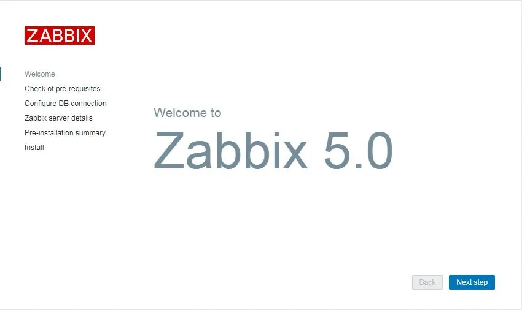

图 21-2 安装 Zabbix

单击右下角的 Next step，会出现前置检查的页面，如图 21-3 所示。

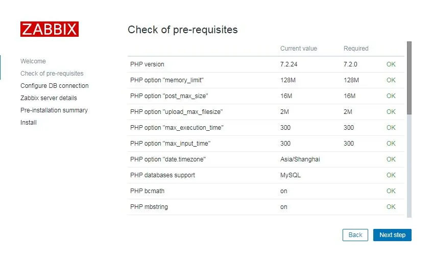

图 21-3 前置检查

如果右侧不显示绿色的 OK，则需要先解决后才可以继续下一步，继续单击右下角的 Nextstep 按钮，此时会出现 MySQL 相关配置页面，根据前面定义的用户名和密码来填写，如图21-4 所示。

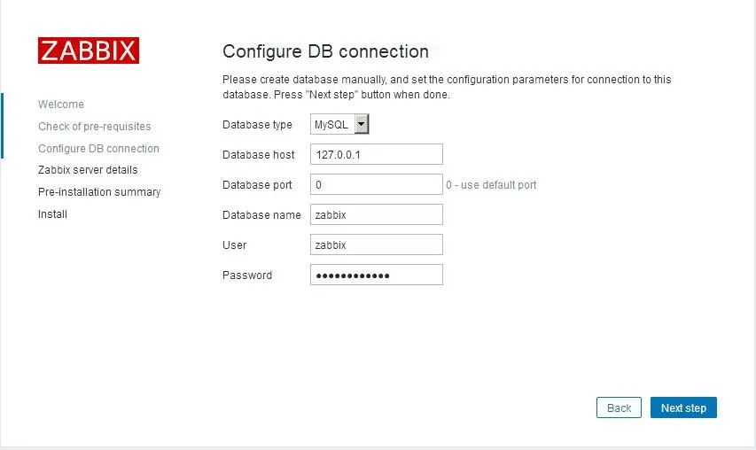

图 21-4 设置 MySQL 相关内容

继续单击 Next step 按钮，此时会出现 Zabbix server details 对话框，这一步是让我们填写Zabbix server 本机的相关信息，目的是要监控它。因为还没有配置并启动 zabbix-agent，所以这一步跳过，直接点 Next step 按钮，然后会出现 Zabbix 的汇总页面，如图 21-5 所示。

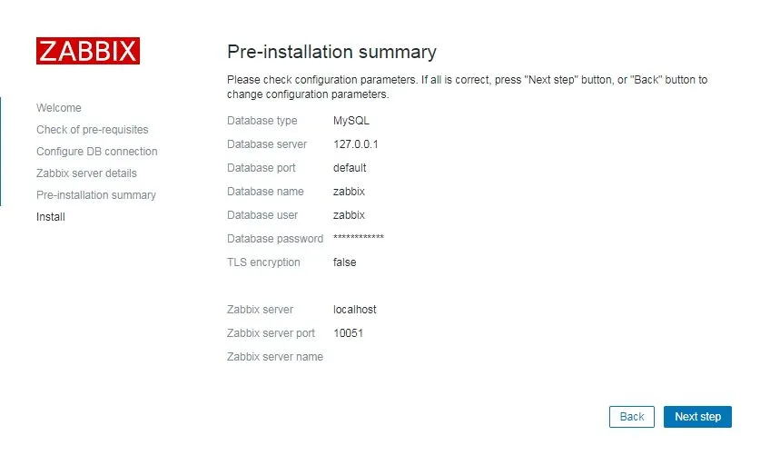

图 21-5 Zabbix 信息汇总

最后出现 Congratulations! You have successfully installed Zabbix frontend. 提示，说明安装完成。单击 Finish 按钮完成安装，出现登录页，如图 21-6 所示，在其中输入用户名 Admin，密码 zabbix，进入 Zabbix 管理控制台。

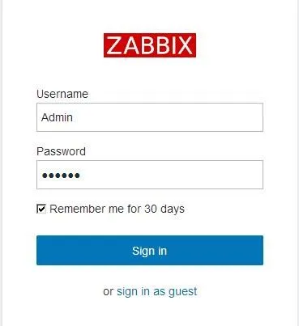

图 21-6 登录 Zabbix

登录进来后，第一件事情就是修改管理员密码，因为这个默认密码谁都知道，很危险。在这里阿铭顺便再提一下，Zabbix 监控是公司内部站点，应该做一下访问控制，你是否还记得如何用 Nginx 做访问控制？密码也要设置得很复杂，如果担心忘记密码，可以借助 KeePass 工具来记录密码。

### 21.2.4 部署 Zabbix 客户端

前面阿铭就介绍了 Zabbix 监控为 C/S（客户端 / 服务端）架构。刚刚已经配置好了服务端程序，我们还需要配置客户端程序。在 129 上执行如下命令：

```
# vim /etc/yum.repos.d/zabbix.repo // 修改为如下内容
[zabbix]
name=Zabbix Official Repository - $basearch
baseurl=https://mirrors.aliyun.com/zabbix/zabbix/5.0/rhel/8/x86_64/
enabled=1
gpgcheck=0
gpgkey=file:///etc/pki/rpm-gpg/RPM-GPG-KEY-ZABBIX-A14FE591
[zabbix-non-supported]
name=Zabbix Official Repository non-supported - $basearch
baseurl=https://mirrors.aliyun.com/zabbix/non-supported/rhel/8/x86_64/
enabled=1
gpgkey=file:///etc/pki/rpm-gpg/RPM-GPG-KEY-ZABBIX
gpgcheck=0
# yum install –y zabbix-agent
在 129 上可以直接编辑 Zabbix 的 yum 源，然后使用yum安装 zabbix-agent 即可。安装完
```

zabbix-agent 后，还需要修改它的配置文件：

```
# vim /etc/zabbix/zabbix_agentd.conf // 修改如下配置
Server=127.0.0.1修改为Server=192.168.72.128 // 定义服务端的IP（被动模式）
ServerActive=127.0.0.1修改为ServerActive=192.168.72.128 // 定义服务端的IP（主动模式）
Hostname=Zabbix server修改为Hostname=aming-123 // 这是自定义的主机名，
// 一会儿还需要在Web界面下设置同样的主机名
```

主动模式和被动模式在前面的运行流程图中已经出现过，阿铭故意放在这里来解释。主动或者被动是相对于客户端来讲的。如果是被动模式，服务端会主动连接客户端获取监控项目数据，客户端被动地接受连接，并把监控信息传递给服务端；如果是主动模式，客户端会主动把监控数据汇报给服务端，服务端只负责接收即可。当客户端数量非常多时，建议使用主动模式，这样可以降低服务端的压力。如何配置主动模式和被动模式呢？一会儿阿铭给大家介绍。配置文件只需修改这些参数，然后启动 zabbix-agent 服务：

```
# systemctl start zabbix-agent // 启动服务
# systemctl enable zabbix-agent // 让它开机启动
# netstat -lnp |grep zabbix // zabbix-agent监听10050端口
tcp 0 0 0.0.0.0:10050 0.0.0.0:* LISTEN 8803/zabbix_agentd
tcp6 0 0 :::10050 :::* LISTEN 8803/zabbix_agentd
```

## 21.3 Zabbix 配置和使用

客户端也安装完成了，接下来该到 Web 界面的管理后台去配置 Zabbix 了，目前还是光秃秃地没有任何数据。Zabbix 比较给力，因为它是支持中文的。阿铭比较喜欢原汁原味的英文界面，使用久了也就习惯了，如果你英文不是很好的话，请按如下方法设置。

依次选择菜单栏最右侧的 Administration→Users→Admin 用户→Language→Chinese(zh_CN)，最后单击蓝色的 Update 按钮。操作完以上步骤，再刷新一下，就显示中文了。

### 21.3.1 忘记 Admin 密码

Zabbix 管理员用户默认为 Admin，密码默认为 zabbix，阿铭建议你修改一个复杂的密码，当然时间久了你难免会忘记。如果忘记了，你可以按照下面的方法重置密码。

进入 MySQL 命令行，选择 Zabbix 库：

```sql
# mysql -uroot –p 'aming123' zabbix
mysql> update zabbix.users set passwd=md5('aminglinux') where alias='Admin';
Query OK, 1 row affected (0.02 sec)
Rows matched: 1 Changed: 1 Warnings: 0
```

这样就可以把 Admin 用户的密码改为 aminglinux 了。

### 21.3.2 添加主机

添加主机即把被监控的主机加入监控中心，这样就可以监控它的一些项目了，比如监控CPU、内存、磁盘以及网络等。在添加主机之前，需要先添加一个主机组，依次单击：“配置”→“主机群组”→“创建主机群组”→“设置组名”，如图 21-7 和图 21-8 所示。

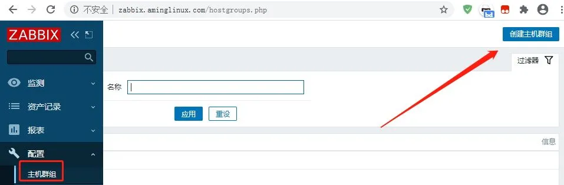

图 21-7 创建主机组


图 21-8 组名

添加完主机组后，就可以添加主机了，依次单击“配置”→“主机”→“创建主机”，“主机名称”填写aming-129，“可见的名称”也是 aming-129，“群组”选择 aming-test（单击向左箭头即可），IP地址填写 192.168.72.129，如图 21-9 所示。

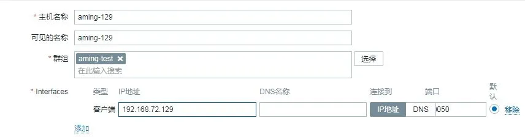

图 21-9 添加主机

单击最下面的“添加”按钮后，主机被成功添加，然后在主机列表页里会看到刚才添加的主机aming-129，状态为“已启用”，并且字体显示为绿色。当不想监控该主机时，可以单击绿色的“已启用”三个字，就会变为红色的“停用的”。主机虽然已添加，但此时还没有任何的监控项目，可以对比一下第二行的 Zabbix server（如图 21-10 所示），它的监控项有 112 项。

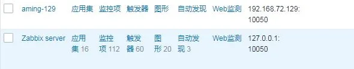

图 21-10 主机

这里出现了几个概念：应用集、监控项、触发器、图形、自动发现、Web 监测，其中监控项就是要监控的项目，比如内存使用、CPU 使用等。应用集就是多个监控项的组合，比如 CPU相关的应用集、内存相关的应用集，应用集里面有具体的监控项。触发器是针对某个监控项做的告警规则，比如磁盘使用量超过 80% 就触发了告警规则，然后就告警。图形这个并不难理解，监控没有图形还叫监控吗？自动发现是 Zabbix 特有的一个机制，它会自动去发现服务器上的监控项目，比如网卡浏览就可以自动发现网卡设备并监控起来。Web 监测可以去监控指定网站的某个 URL 访问是否正常，比如状态码是否为 200，或者访问时间是否超过某个设定的时间段。

### 21.3.3 添加模板

依次单击“配置”→“模板”，就可以看到 Zabbix 自带的模板了，这些模板其实就是多个应用集、监控项、触发器、图形、聚合图形、自动发现、Web 监测的组合。比如 FTP 模板，其实就是针对 FTP 这个服务设置的一个监控模板，里面的应用集、监控项、触发器等全都是针对 FTP服务的。在这儿又出现了一个聚合图形的概念，它其实就是多个图形的组合。

你可以先自定义一个模板，然后在各个模板里面选择需要的应用集或者监控项，把它们复制到自定义模板里，这样就算添加了一个模板。下面阿铭定义一个名字为 aming 的模板，单击右上角的“创建模板”，“模板名称”写 aming，“可见的名称”也写 aming，“群组”这里选择Templates，单击向左黑色三角块，最后单击下面的“添加”按钮。此时，模板列表页的最上面会出现刚刚创建的 aming 模板。

接下来，再从其他模板中选几个监控项复制到 aming 模板里。阿铭选择的是 Template OSLinux by Zabbix agent 模板，找到该模板单击“监控项”，在 Available memory、Checksum of/etc/passwd、CPU user time 和 Processor load（1 min average per core）左侧的方框里打对钩，然后单击下面的“复制”按钮，目标类型选择“模板”，它会列出所有的模板来，在 aming模板前面打对钩，再单击下面的“复制”按钮。

依次单击“配置”→“模板”，可以看到 aming 模板的“监控项”里已经有了 4 项，点进去看一下，就是刚刚阿铭添加的那几项。其中 Available memory 监控的是剩余内存大小，CheckSum of/etc/passwd 监控的是 /etc/password 文件是否被修改，CPU user time 监控的是 CPU 的 user（用户态）使用率，Processor load（1 min average per core）监控的是 1 分钟每个核 CPU的负载是多少。

我们还可以在模板中设置触发器，也就是告警规则。当前已经在 aming 模板中单击“监控项”右侧的“触发器”，它会提示“未发现数据”，因为阿铭还未添加任何告警规则。下面阿铭添加一个告警规则，假如系统 1 分钟负载值超过 2（每核），就告警。首先单击右上角的“创建触发器”按钮，名称填写“1 分钟负载 (每核)”，其中“”为 Zabbix 内置变量，它其实就是主机名。严重性根据实际需求选择，从左到右级别越来越高，阿铭在这里选择的是“警告”。表达式就是具体的告警规则，单击“添加”按钮，然后弹出“条件”对话框，监控项需要我们选择针对哪个监控项目告警。单击“选择”按钮，又弹出“监控项”对话框，群组要选择 Templates，主机选择 aming，在列出来的监控项里面请选择 Processor load (1 min average per core)。

“功能”这一栏保持默认设置，“最后一个（T）”和“间隔（秒）”留空，“结果”选择 >，后面的值设置为 2，因为阿铭的本意是当负载大于 2 时告警，如图 21-11 所示。

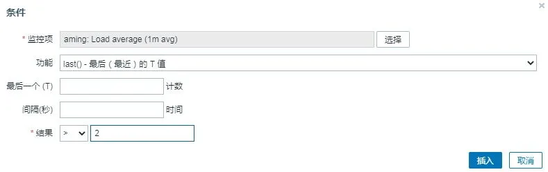

图 21-11 触发器条件

单击“插入”按钮后回到“触发器”界面，其他选项保持默认设置即可，最后单击“添加”按钮。最终第一个触发器添加成功，如图 21-12 所示。


图 21-12 触发器

在模板里，还可以添加“图形”，图形是查看指标历史数据或趋势必不可少的手段。单击“图形”，显示“未发现数据”，因为还未添加，所以单击右上角的“创建图形”。名称填写“1 分钟负载”，除了监控项外的其他参数都保持默认设置，在“监控项”右侧单击“添加”（注意，不是最下面的“添加”按钮），在弹出的“监控项”对话框中选择 Processor load (1 min average per core)，单击“选择”按钮，最后再单击“添加”按钮。

下面再来看一下“自动发现”的功能，目前我们依然在 aming 模板里，单击“自动发现规则”，也会提示“未发现数据”。阿铭决定再从其他模板里面“偷”两个“自动发现规则”过来，依次单击“配置”→“模板”，找到 Template OS Linux by Zabbix agent，单击它右侧的“自动发现”，我们会看到 Block devices discovery、Mounted filesystem discovery 和 Network interface discovery 三项内容，单击查看它们的设置，然后参考这些配置项再创建两个一模一样的规则。当然，阿铭还有更好的方案，其实这个自动发现的三个规则也是独立的模板，我们直接将这些模板链接到aming 这个模板即可。

依次单击“配置”→“模板”，找到 aming 模板，单击 aming，进入到模板里面，单击“链接的模板”，在右侧单击“选择”，主机群组这里选择 Template/Modules，找到 Template Module Linuxfilesystems by Zabbix agent 和 Template Module Linux network interfaces by Zabbix agent并在其前面打对钩，再单击右下角的“选择”按钮，最后单击左下角的“更新”按钮，最终给aming 模板增加了两个自动发现的规则。

### 21.3.4 主机链接模板

监控的主机如果有很多，对每个主机都去配置一遍监控项、触发器、图形等，这样相当于做了多次重复工作，其实模板就是为了解决该问题而出现的。阿铭在上一节教你如何去添加监控项、触发器、图形以及自动发现，其目的就是让你先学会配置模板，当你添加主机的时候，只要链接一下对应的模板即可完成监控。下面阿铭使主机 aming-129 链接刚刚添加的模板aming。

依次单击“配置”→“主机”，单击 aming-129，再单击“模板”，在 Link new template 那一栏，单击右侧的“选择”，弹出“模板”对话框，主机群组需要选择 Templates，然后选择 aming，再单击下面的“选择”按钮，然后单击“更新”按钮，会回到主机列表页，此时看到主机 aming-129 对应的“监控项”“触发器”“图形”和“自动发现”都有数据了，如图 21-13 所示。


图 21-13 主机 aming-129

### 21.3.5 图形中的中文乱码

很多读者朋友会遇到一个问题，一旦把 Zabbix 设置为中文，图形里面的中文就会显示为小方块。依次单击“监测”→“主机”，再单击主机 aming-129 那行的“图形”，结果如图 21-14 所示。

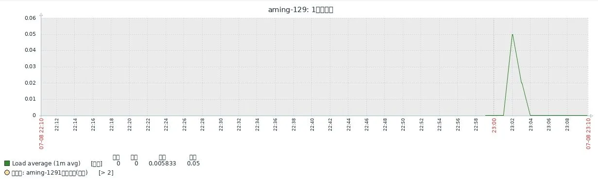

图 21-14 图形乱码

这是因为没有中文字体导致，解决这个问题很容易，找到一个合适的中文字体并放到 Zabbix的对应目录下就可以了。首先确定字体所在目录在哪里。编辑 Zabbix Web 界面的配置文件，命令如下：

```
# vim /usr/share/zabbix/include/defines.inc.php // 搜索ZBX_FONTPATH
```

可以看到，它定义的路径是 assets/fonts，它是一个相对路径，绝对路径为/usr/share/zabbix/assets/fonts/，而字体文件为 ZBX_GRAPH_FONT_NAME 所定义的graphfont，它是一个文件，绝对路径为 /usr/share/zabbix/assets/fonts/graphfont。然后，我们从 Windows 下面去找一个合适的字体，Windows 字体路径为 C:\Windows\Fonts\，找到simfang.ttf（其实就是“仿宋简体”），先把它复制到桌面上。然后使用 FTP 工具或者 SFTP 工具（之前阿铭介绍的 Filezilla 都支持）将 simfang.ttf 文件上传到 128 的 /root/ 目录下，阿铭使用的是 Filezilla 的 SFTP 工具。

再到 Linux 机器上，即 128 执行如下命令：

```
# mv /root/simfang.ttf /usr/share/zabbix/assets/fonts/
# cd /usr/share/zabbix/assets/fonts/
# mv graphfont.ttf graphfont.ttf.bak
# mv simfang.ttf graphfont.ttf
```

再次刷新刚才的图形，已经能正常显示中文，如图 21-15 所示。

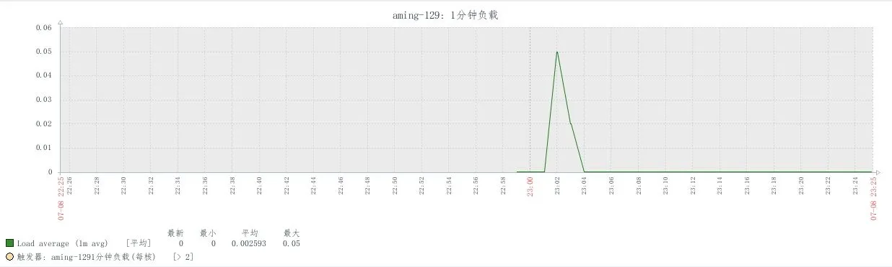

图 21-15 图形显示中文

### 21.3.6 添加自定义监控项目

阿铭在前面提到过 Zabbix 的优势，其中之一就是很方便地添加自定义监控项目，它虽然提供了丰富的模板，但依然不能满足各种各样的特殊需求。比如，阿铭想要监控 Nginx 的访问日志条数，此类个性化需求在 Zabbix 的模板中是没有的。下面阿铭抛砖引玉，举一个实际的例子来教你添加自定义的监控项目，这涉及编写 shell 脚本。阿铭的需求是：监控某台 Web 服务器 80 端口的并发连接数，并设置图形。

先来分析一下该需求，有两步，第一步是创建自定义监控项，第二步是针对该监控项设置成图形。而该监控项不能在 Zabbix 自带模板中找到，只能自己手动创建，监控项目有一个核心的元素就是数据源，有了数据源就可以创建监控项了，并且也很容易成图形。所以，问题的焦点在于：如何获取服务器 80 端口的并发连接数。

```
在 13.1.8 节中，阿铭曾经介绍过一个命令netstat，其中它有一个用法nestat -an可以查
看系统 TCP 连接状态情况，在各个状态中有一个ESTABLISHED，它表示正在连接中。由
```

此，就可以获取 80 端口的并发连接数，具体命令为：

```
# netstat -ant |grep ':80 ' |grep -c ESTABLISHED
```

80 后面多了一个空格，这是为了更加精准，如果不加空格，8080 这样的端口也会包含在内了。有了这条命令，脚本就有了，然后就是如何在 zabbix-server 端获取到 zabbix-agent 端的该数值。具体操作步骤还是挺复杂的，首先要在 zabbix-agent 端（129）上编辑自定义脚本，如下：

```
# vim /usr/local/sbin/estab.sh // 加入如下内容
#!/bin/bash
## 获取80端口并发连接数
netstat -ant |grep ':80 ' |grep -c ESTABLISHED
```

保存后，需要修改该脚本的权限：

```
# chmod 777 /usr/local/sbin/estab.sh
```

此时虽然有了获取并发连接数的脚本，但是服务端并不晓得该脚本在哪里，还需要编辑zabbix- agent 的配置文件，定义监控项的 key，如下（依然在 129 上）：

```
# vim /etc/zabbix/zabbix_agentd.conf // 增加两行
UnsafeUserParameters=1 // 表示使用自定义脚本
UserParameter=my.estab.count[*],/usr/local/sbin/estab.sh
// 自定义监控项的key为my.estab.count，后面的[*]里面写脚本的参数，
// 如果没有参数则可以省略，脚本为/usr/local/sbin/estab.sh
```

保存配置文件后，需要重启一下 zabbix-agent 服务，如下：

```
# systemctl restart zabbix-agent
```

然后先到服务端做一个验证，看刚刚的配置是否正确，在服务端（128）上执行命令：

```
# zabbix_get -s 192.168.72.129 -p 10050 -k 'my.estab.count'
```

由于阿铭的 129 服务器上并没有任何 80 端口的访问，所以结果为 0。只要这里能正常获取到客户端上的数据，就已经成功了大半，接下来还需要在 Web 界面配置一下。依次单击“配置”→“主机”，找到 aming-129 主机，然后单击“监控项”，再单击右上角的“添加监控项”，名称写“80 端口并发连接数”，键值写 my.estab.count，类型保持默认设置，即被动模式，如果选择“Zabbix 客户端（主动式）”，则为主动模式。其他项保持默认设置，单击最下面的“添加”按钮。

目前还不确定是否正确添加监控项，依次单击“监测”→“最新数据”，主机那一栏选择 aming-129，名称填写“80 端口”，然后单击“应用”按钮，则会过滤出刚刚添加的“80 端口并发连接数”监控项，可以看一下最新数据是什么。阿铭的最新数据为 0，这说明没有问题。

接下来就是设置图形了，有了监控项，也有了数据源，图形就不是问题了。依次单击“配置”→“主机”，再单击 aming-129 的“图形”，再单击“创建图形”按钮，名称写“80 端口并发连接数”，“监控项”这一栏单击“添加”（是两个字，不是最下面的那个按钮），在弹出的“监控项”对话框里选择“80 端口并发连接数”，再单击下面的“选择”按钮，返回到刚才的图形界面，再单击最下面的“添加”按钮，完成图形的创建。

至此，刚才的需求终于完成了，真是不容易啊。Zabbix 看似容易，实际配置起来步骤超级繁杂，需要我们多动手方能掌握。

### 21.3.7 配置告警

监控系统没有告警，那就没有啥意义了。Zabbix 的告警通常为邮件、短信、微信，由于目前智能手机的普及和方便性，配置邮件告警就可以达到很好的提醒效果，因为手机邮箱的提醒和短信类似，而且内容显示更加丰富。早在 10 年前智能手机刚刚兴起时，阿铭想了一个办法是发 139 的邮箱，因为 139 邮箱还带有短信提醒的功能，目前来看没有必要了。

在本节中，阿铭将使用 QQ 邮箱发送告警邮件，这样接收和发送效率会很高。首先，需要开启QQ 邮箱的“POP3/SMTP 服务”。方法是，在浏览器中打开 QQ 邮箱，然后登录你的 QQ 账号，进入后单击最上面的“设置”按钮，再单击“账户”，下拉页面到“POP3/IMAP/SMTP/Exchange/ CardDAV/CalDAV 服务”，把前两项服务开启，如图 21-16所示。


图 21-16 QQ 邮箱开启服务

在开启过程中会有一个授权码，先把这个授权码记下来，一会儿会用到。如果忘记也没有关系，关闭并再次开启即可。下面再到 Zabbix 的 Web 管理后台去配置告警。

依次单击“管理”→“报警媒介类型”，单击 Email，“SMTP 服务器”这里设置为 smtp.qq.com，SMTP HELLO 填写 qq.com，“SMTP 电邮”写你的 QQ 邮箱地址，“认证”这里单击右侧的“用户名和密码”，“用户名称”填写你的 QQ 邮箱地址，密码写上面获取到的授权码。Messagetemplates 和“选项”这里保持默认设置即可。最后单击“更新”按钮，然后单击右侧的“测试”，填写收件人为你的 QQ 邮箱，然后单击“测试”，稍等一两秒就可以收到邮件，如果收不到，那说明你设置的邮箱有问题。

接收告警需要有一个邮件账户，而邮件账户需要在 Zabbix 的用户里设置。依次单击“管理“→“用户”，再单击右上角的蓝色的“创建用户”按钮，会出现创建用户的页面。这个页面有三个属性需要设置，第一个是“用户”属性，涉及名字、所属组、密码、语言等，根据你自己的需求去设置，别名阿铭填写 aming，用户名第一部分 aming，姓氏 Li，群组选择了 ZabbixAdministrators。如果是一个普通用户，则需要先创建一个合适的用户组，针对组去分配权限，然后再把用户加入到那个组里。

第二部分“报警媒介”才是我们最关心的部分，接收报警的邮箱就是在这里设置的。单击“添加”两个字，弹出报警媒介的对话框页面，“类型”选择 Email，“收件人”填写接收告警邮件的邮箱，阿铭建议你设置成和发邮件的地址一样，这样它自己给自己发一定不会有问题，其他保持默认设置，单击蓝色的“添加”按钮，回到用户界面，再单击“权限”，这里需要显示为“所有组 读写”才可以，如果不是这个权限，需要按后面阿铭提供的方法进行配置，最后单击蓝色的“添加”按钮。

如果权限那里显示并不是“所有组 读写”，你可以这样设置：依次单击“管理”→“用户群组”，找到 Zabbix Administrators，单击“权限”，单击“选择”，出现“主机群组”对话框，然后在“名称”前面的小方框里打对钩，这样就选择了所有组，单击右下角的“选择”按钮，返回到刚才的权限界面，再单击“读写”按钮，把下面的“包括子组”也打上对钩，单击“添加”蓝色字，最后单击“更新”按钮。

设置完用户后，就有了接收告警的邮件，这还没有完，还需要有一个“动作”来完成发邮件的功能。依次单击“配置”→“动作”→右上角的“创建动作”。“动作”页里同样有两个属性页，分别为“动作”和“操作”。首先在“动作”页中，“名称”填写 sendmail，这个名称自定义，没有特殊要求，“条件”这一栏保持默认设置。然后切换到“操作”页面，单击下面的“操作”栏内的“添加”，会出现“操作细节”相关的内容，其中可以选择要发送的用户或者用户组，这里阿铭选择的是用户，并选择 aming，仅送到选择 Email，继续单击“添加”（两个字，不是最下面的蓝色的“添加”按钮）。按照同样的方法设置下面的“恢复操作”以及“更新操作”。最终效果如图 21-17 所示。


图 21-17 最终效果

完成以上操作，最后单击蓝色的“添加”按钮。

为了测试告警，需要为主机 aming-129 新链接一个模板，依次单击“配置”→“主机”，然后直接单击 aming-129 蓝色字符进入主机页面，单击“模板”，单击 Link new templates 右侧方框右边的“选择”，弹出模板对话框，找到 Template Module ICMP Ping 并打对钩，再单击蓝色的“选择”按钮。最后单击蓝色的“更新”按钮。

现在可以测试告警了，在 129 机器上执行如下命令：

```
# iptables -I INPUT -p icmp -j DROP
```

这样会把 ICMP 协议给禁掉，然后服务端也就无法 ping 通客户端 129 了，稍等 1 分钟多点，就会收到告警邮件。内容类似如下：

```
Problem started at 22:00:02 on 2020.07.11
Problem name: Unavailable by ICMP ping
Host: aming-129
Severity: High
Operational data: Down (0)
Original problem ID: 122
再把iptables规则删除，此时需要执行如下命令：
# iptables –D INPUT -p icmp -j DROP
```

同样也会收到故障恢复的邮件，内容类似如下：

```
Problem has been resolved at 22:04:02 on 2020.07.11
Problem name: Unavailable by ICMP ping
Problem duration: 4m
Host: aming-129
Severity: High
Original problem ID: 122
```

好了，关于 Zabbix 的内容阿铭就介绍这么多了，这些仅仅是教大家如何搭建和简单使用Zabbix，这些内容可以让你入门，但是要想用好 Zabbix，还需要你不断地实践。
