# 第2章安装CentOS

目前，我们安装 Linux 操作系统主要是为了更好地了解和学习它。如果条件允许，最好把Linux 操作系统安装在一台 PC 机上；如果条件不允许，也没有关系，阿铭会教你如何使用虚拟机来安装 Linux 操作系统。

大多数读者朋友更习惯使用 Windows 操作系统，所以建议用虚拟机来学习 Linux。阿铭相信，在 Windows 系统里安装一个虚拟机，然后在虚拟机上安装 Linux，学习起来会更加方便。也许你会问：“现在我们使用虚拟机学习和练习，将来换成服务器能一样吗？”阿铭可以肯定地告诉你，除了几个小区别，它们几乎是一模一样的。至于是什么区别，阿铭之后会进一步说明。

## 2.1 安装虚拟机

虚拟机技术在近几年非常流行，它可以模拟物理计算机的各种资源（如 CPU、内存、硬盘等），所以，我们可以非常快捷地在 Windows 系统上安装多个 Linux 操作系统。虚拟机既可以在 Windows 平台上实现，也可以在 Linux 平台上实现。目前可以实现虚拟化技术的软件有很多，这里阿铭先介绍两种——VMware 和 VirtualBox。因为这两种软件比较适合我们来做实验，前者是收费的，后者是完全免费的。网上也有许多 VMware 的免费资源可以供大家下载，但这些免费资源是破解版本（即盗版），如果在生产环境中使用，请购买正版授权。

阿铭不强求你非要用什么虚拟机程序来安装 Linux，我们的目的不是学习如何使用虚拟机，而是学会如何使用虚拟机里面的 Linux 操作系统。

### 2.1.1 下载虚拟机软件

不管你使用的虚拟机是 VMware 还是 VirtualBox，都可以很好地安装 Linux，后者是免费的，请从官方下载地址自行下载。VirtualBox 有多个平台的支持版本，如果你使用的是 Windows系统，请下载带 for Windows hosts 字样的版本。其实 VMware 虚拟机有好几个产品，而我们使用的是 VMware Workstation，企业使用 VMware ESXi 比较多。至于 VMware Workstation的下载地址，大家既可以自行搜索，也可以在前言的反馈及服务中找到阿铭提供的下载方式。在接下来的内容中，将采用 VMware 14 来给大家演示。

### 2.1.2 安装虚拟机

首先，下载 VMware Workstation 软件，下载完后进行安装。

(1) 双击 VMware-workstation-full-14.1.1-7528167.exe 后，首先出现的是欢迎界面，如图 2-1所示。

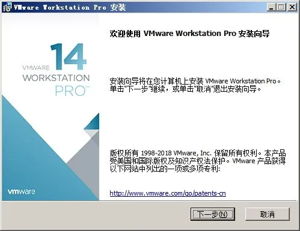

图 2-1 欢迎界面

(2) 单击“下一步”按钮，会弹出许可协议，这一步需要单击“我接受许可协议中的条款”，继续单击“下一步”按钮。

(3) 此时出现“自定义安装”界面，可以自定义安装位置，默认在 C:\Program Files(x86)\VMware\VMware Workstation\，这里采用默认值。增强型键盘驱动程序这里也不用打钩。然后单击“下一步”按钮。

(4) 此时它会提示我们启动时是否需要检查产品更新，如图 2-2 所示。这里，阿铭是把对钩取消的，毕竟我们使用的是老版本，并不想自动更新，另外也不需要加入 VMware 客户体验改进计划。接着，单击“下一步”按钮。

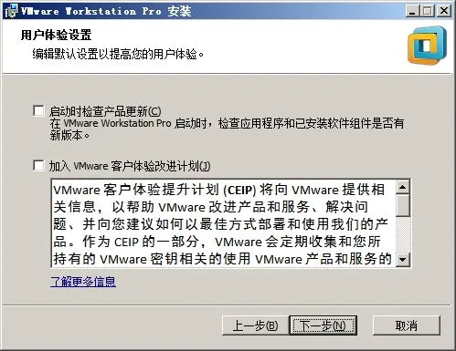

图 2-2 软件更新

(5) 在快捷方式里，阿铭保留了两个对钩，这样方便我们每次打开 VMware Workstation，继续单击“下一步”按钮。再单击“安装”开始安装 VMware Workstation。

(6) 等待几分钟后，会弹出“安装向导已完成”的提示，如图 2-3 所示。单击“完成”按钮，则完成了安装，但此时的 VMware Workstation 还不能正常使用，因为我们还未输入许可密钥。单击“许可证”可以输入许可密钥，如图 2-4 所示。

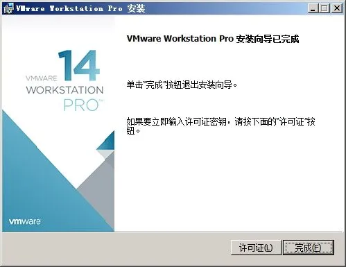

图 2-3 安装向导完成

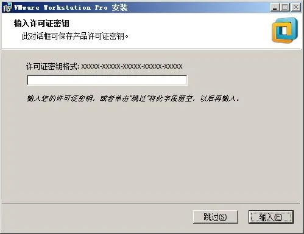

图 2-4 输入许可密钥

### 2.1.3 新建一个虚拟机

输入正确的产品密钥后，就可以正式使用 VMware Workstation 了。下面阿铭就教你如何在VMware Workstation（后面简称 VMware）上创建一个 Linux 虚拟机。

(1) 运行 VMware 后，将会看到它的主页，如图 2-5 所示。

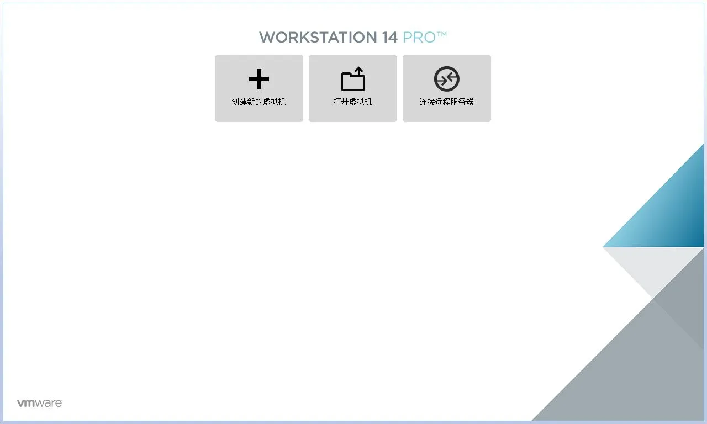

图 2-5 VMware 主页

可以看到，VMware 有 3 个功能，我们需要的是第一个功能“创建新的虚拟机”，单击这个按钮，会弹出“新建虚拟机向导”界面，如图 2-6 所示，从中选择“典型”配置项，然后单击“下一步”按钮。

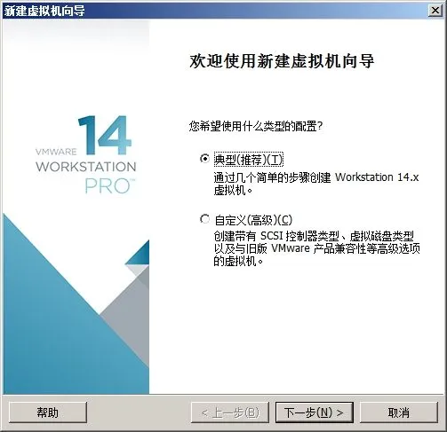

图 2-6 新建虚拟机向导

(2) 此时会提示如何安装客户机操作系统，如图 2-7 所示。这里所谓的“客户机”，其实就是后面要安装 Linux 操作系统的虚拟机。请大家选择“稍后安装操作系统”，这是因为当前还没有Linux 操作系统的安装镜像文件。单击“下一步”按钮继续。

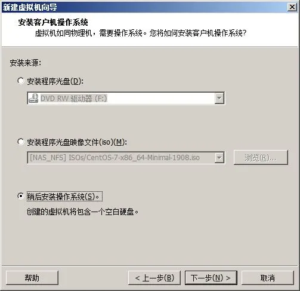

图 2-7 安装来源

(3) 选择要安装的操作系统类型。这里 VMware 已经给大家列出来几种常见的操作系统类型，此处选择 Linux，版本为“CentOS 7 64 位”，如图 2-8 所示。这里理应选择 CentOS 8 64 位，但是由于 CentOS 8 才发布不久，VMware 还未适配，因此这里还没有关于 CentOS 8 的选项，我们选择 CentOS 7 也是没问题的。

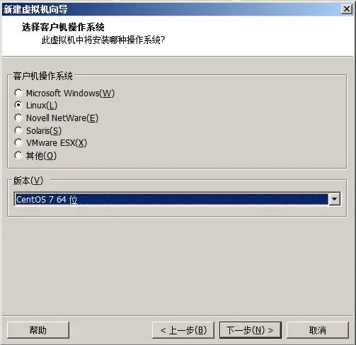

图 2-8 客户机操作系统

- 小知识 所有的操作系统都分 32 位和 64 位，这个指标取决于计算机的 CPU 标准，目前的计算机已经普遍支持 64 位了。那么，如何区分使用 32 位和 64 位的操作系统呢？其中一个重要的指标就是内存大小。32 位操作系统最多支持 4GB 内存，要想使用超过 4GB 内存的计算机，就必须使用 64 位操作系统。

(4) 单击“下一步”按钮，将出现如图 2-9 所示的“命名虚拟机”对话框。你可以给自己的虚拟机起一个自定义的名字，如 aminglinux01-CentOS8。“位置”这里需要定义到一个大的分区中，因为这台虚拟机将会占用较大的空间。

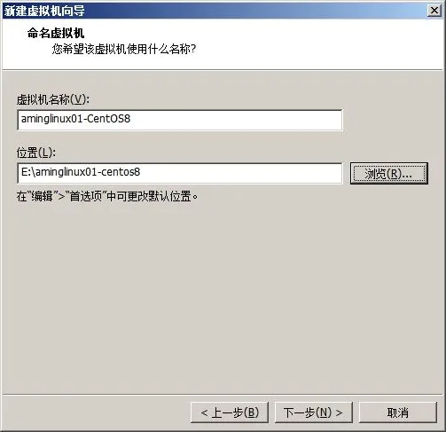

图 2-9 命名虚拟机

(5) 继续单击“下一步”按钮，此时会让我们指定磁盘容量，如图 2-10 所示，这里采用默认值即可，因为 20 GB 足以支持我们后续的实验。

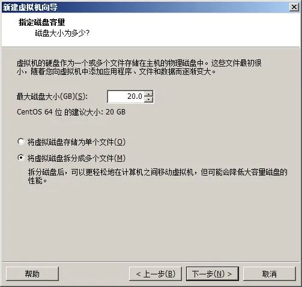

图 2-10 指定磁盘容量

(6) 单击“下一步”按钮后，单击“自定义硬件”，以进一步定义 CPU、内存等硬件指标，如图 2-11 所示。内存建议至少 1 GB，这里阿铭为了让虚拟机更加高效，分配了 2 GB。而你需要根据自己的计算机配置来分配内存，如果你的物理机内存低于或等于 4 GB，请设置 1 GB，否则会影响到你的物理机速度。处理器数量选择 1，每个处理器的核心数量选择 2，这样相当于 1个物理 CPU，2 个逻辑 CPU。目前，市面上的计算机配置并不低，几乎所有的计算机都是支持这样分配的。“新 CD/DVD”这一项暂时先保持默认设置，后续我们安装操作系统之前再来设置它。“网络适配器”这一项请大家选择 NAT 模式，因为这种网络模式是兼容性最好的，其他项采用默认值即可。

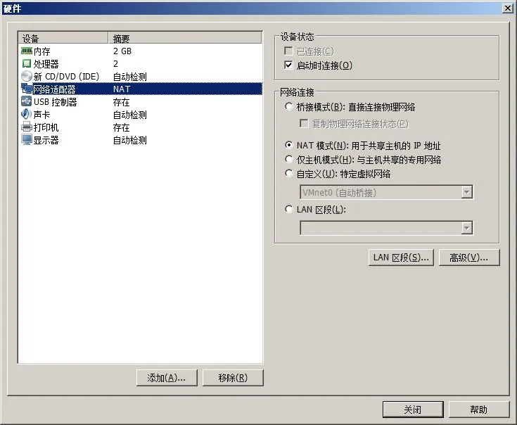

图 2-11 自定义硬件

之后单击“关闭”按钮，再单击“完成”按钮。这样就创建完了第一台虚拟机。下面是在创建的虚拟机里安装 Linux 操作系统。

- 小知识 这里阿铭要向大家介绍一下 VMware 虚拟机中涉及的 3 种常见网络模式。桥接模式。在这种模式下，虚拟机和物理机连接的是同一个网络，虚拟机和物理机是并列关系，地位是相当的。比如，家里如果用路由器，那么当计算机和手机同时连接这个路由器提供的 Wi-Fi 时，它们的关系就是桥接模式。

- NAT 模式。在这种模式下，物理机会充当一个“路由器”的角色，虚拟机要想上网，必须经过物理机，意味着物理机如果不能上网，虚拟机也就不能上网了。之所以说这种模式兼容性最好，是因为当物理机的网络环境发生变化时，虚拟机的网络并不会受影响。比

- 如，上班时物理机连接在公司的网络环境中，下班后物理机又连接在家里的路由器上，公司的网段和家里的网段很有可能是不同的。在桥接模式下，虚拟机和物理机一样，都要自动获取 IP 地址后才可以上网，而我们做实验的时候，是需要把虚拟机设置为静态 IP的，这样就导致虚拟机网络不稳定。而设置为 NAT 模式，虚拟机的网络并不需要依赖公司的网络环境或者家里的网络环境。

- 仅主机模式。这个就很容易理解了，在这种模式下，相当于拿一根网线直连了物理机和虚拟机。

## 2.2 安装 Linux 操作系统

创建虚拟机之后，便可安装 Linux 操作系统，其安装过程与 Windows 系统极为相似。如果你之前安装过 Windows 系统，那接下来的操作就不难了。在安装 CentOS 之前，我们还需要做一件事情——下载一个 CentOS 镜像文件。

### 2.2.1 下载 CentOS 镜像文件

什么是镜像文件？镜像文件是用来制作系统安装光盘的。相信你一定了解系统安装光盘，只不过这几年光盘已逐渐被 U 盘所取代。安装光盘里面的内容其实就是镜像文件，而且虚拟机可以直接把镜像文件放到虚拟光驱中，因此，我们不需要放入系统安装光盘也可以安装CentOS。

虽然 CentOS 当前的主流版本为 CentOS 7，但随着 CentOS 8 的成熟，会有越来越多的企业使用 CentOS 8，CentOS 8 使用了 4.18 版本的内核，后续的章节都是基于 CentOS 8 来展开讲解的。

可以从官方下载 CentOS 的镜像文件，但下载速度太慢。阿铭建议大家到本书前言的反馈及服务中找到阿铭提供的下载方式（这里提供的下载地址是网易提供的一个国内镜像地址，下载速度很快）来下载，请选择对应的 CentOS 8 下载地址。阿铭在写本书时，最新的 CentOS 8 版本为 8.0（1905），所以本书中的实验也基于该版本。

CentOS 8 提供了两种镜像，分别为 dvd 和 boot。

- CentOS-8-x86_64-1905-dvd1.iso：该文件很大，有 7 GB，它包含了几乎所有功能组件，如果网络环境较差，建议下载下面的 boot 版本。

- CentOS-8-x86_64-1905-boot.iso：只有 500 MB 多一点，它仅提供必要的安装引导程序，并不包含功能组件，适合作为问题故障修复盘。要想使用此镜像安装 CentOS 8，需要保证网络联网，因为它需要联网下载安装源。

这里阿铭选择下载 boot 版的镜像。

### 2.2.2 设置虚拟光驱

下载镜像文件后，我们先来设置虚拟光驱，具体的操作方法如下。

(1) 当创建完第一台虚拟机后，VMware 将多出来一个页面，如图 2-12 所示。

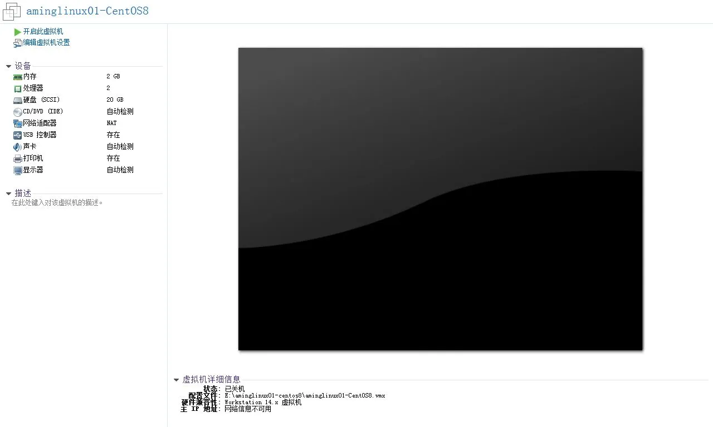

图 2-12 虚拟机页面

(2) 单击“编辑虚拟机设置”按钮，然后选择 CD/DVD（IDE），在右侧选择“使用 ISO 映像文件”，再单击“浏览”按钮，找到刚刚下载好的 CentOS 8 的镜像文件，如图 2-13 所示

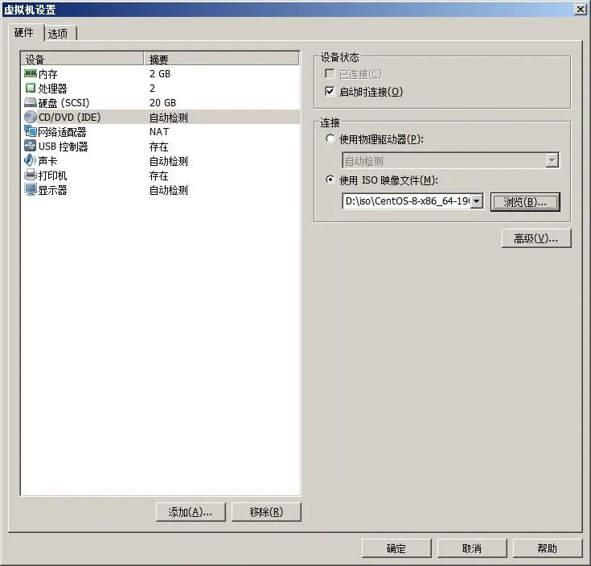

图 2-13 设置 ISO 镜像文件

(3) 单击“确定”按钮返回刚才的虚拟机页面。单击“开启此虚拟机”按钮，开始启动虚拟机。

### 2.2.3 安装 CentOS

安装页面终于出现了，下面就跟着阿铭一步一步来安装 CentOS 8 吧。

(1) 首先出现的是黑底白字的欢迎页面，如图 2-14 所示。在这里阿铭要提醒大家：要想在虚拟机里面单击鼠标，必须先在虚拟机的页面里单击鼠标；要想退出来，需要同时按下 Ctrl 和 Alt这两个键。

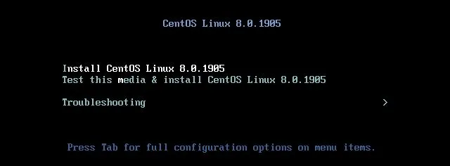

图 2-14 开始安装

(2) 单击鼠标后，通过按键盘上的上下方向键选择对应的项。其中，第一行 Install CentOSLinux 8.0.1905 的作用是直接安装 CentOS 8 系统。第二行 Test this media & install CentOSLinux 8.0.1905 的作用是先检测所安装镜像文件的可用性，然后再安装 CentOS 8 系统。第三行 Troubleshooting 用于处理一些故障问题，选择这一项，会进入一个内存操作系统，然后可以把磁盘上的系统挂载到这个内存操作系统上，这样方便我们去处理一些问题。这里阿铭选择第一项，然后按回车。

(3) 等待几秒后，会出现一个安装界面。首先选择使用的语言，这里需要选择“中文”和“简体中文”。

(4) 单击“继续”按钮后，会弹出如图 2-15 所示的“安装信息摘要”页面。

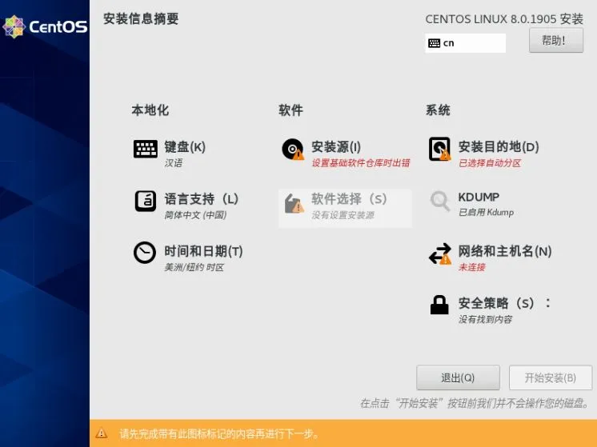

图 2-15 安装信息摘要

在图 2-15 中有红色提示的项都是有问题的，前面阿铭提到过使用 boot 版的镜像安装 CentOS需要机器联网，它需要通过网络去下载安装源。所以我们先单击“网络和主机名”，然后单击右侧的“关闭”按钮。它会自动获取 IP 地址。如果你的机器所在的网络环境无法自动获取 IP 地址，则需要手动设置。“主机名”保持默认设置即可，然后单击“完成”按钮回到安装信息摘要界面。稍等几秒钟后，单击“安装源”，弹出的页面如图 2-16 所示，“在网络上”这里填http://mirrors.163.com/centos/8/BaseOS/x86_64/os/，然后单击“完成”按钮。

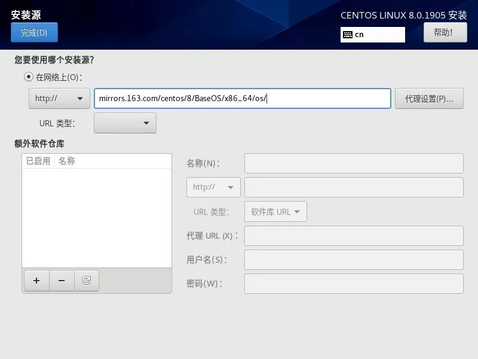

图 2-16 安装源

(5) 等待几秒后，安装源那里不再显示红色。单击“软件选择”，如图 2-17 所示，在左侧选择“最小安装”，在右侧不需要选择任何项，然后单击“完成”按钮即可。

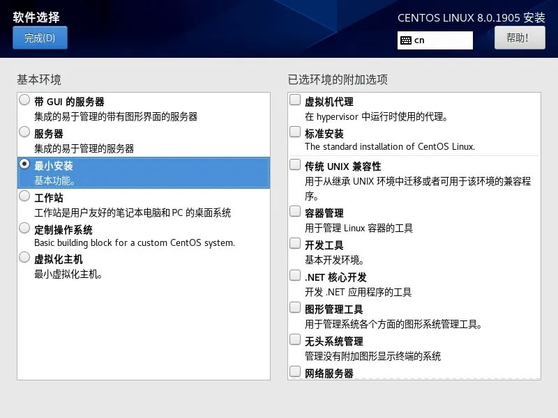

图 2-17 软件选择

(6) 单击“安装目的地”按钮，出现“安装目标位置”主界面，选择“自定义”，如图 2-18 所示。

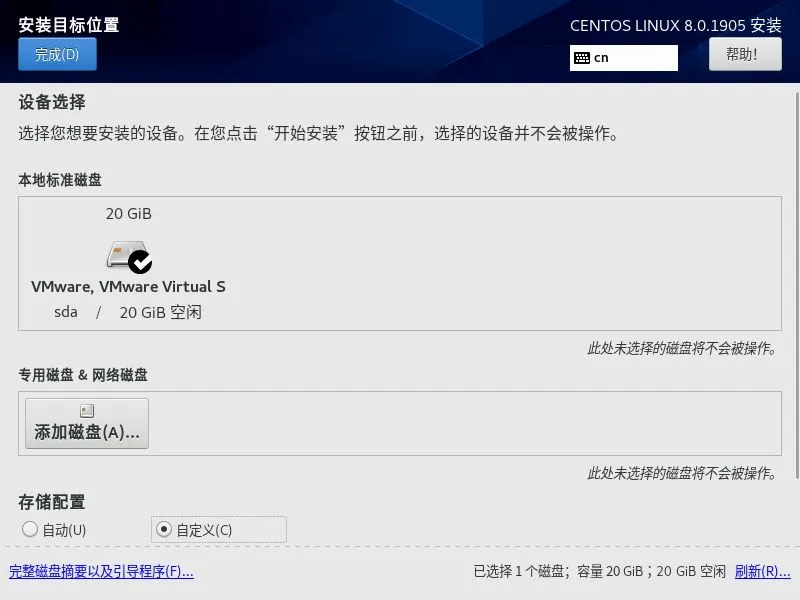

图 2-18 安装目标位置

单击“完成”按钮后，弹出“手动分区”界面，单击 LVM，选择“标准分区”，然后单击左下角的“+”按钮，在弹出的“添加新挂载点”对话框中，如图 2-19 所示，设置“挂载点”为 /boot，“期望容量”为 200 MB（简写为 200 M），然后单击“添加挂载点”按钮。

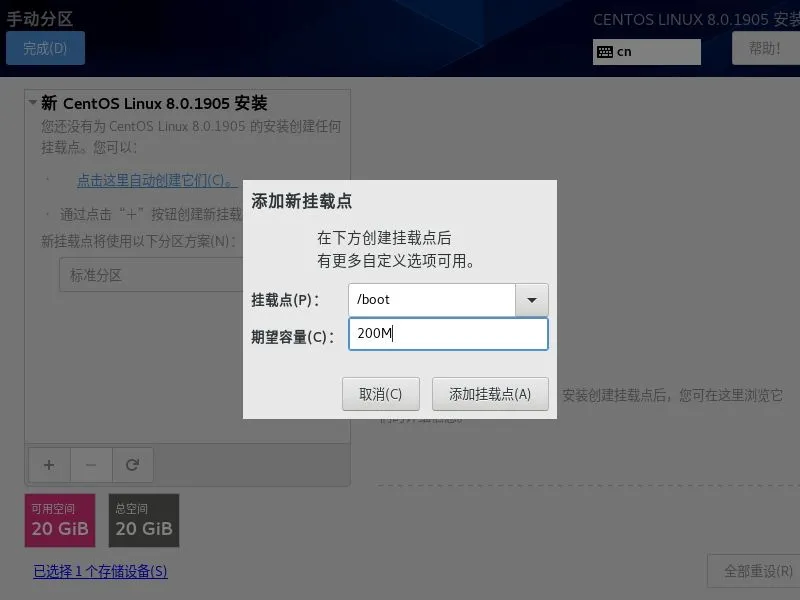

图 2-19 设置 /boot 分区

继续单击“+”按钮，再增加 swap 分区，大小为 4 GB，如图 2-20 所示。

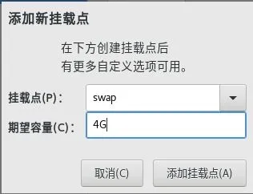

图 2-20 添加 swap 分区继续单击“+”按钮，“挂载点”选择 /，“期望容量”留空，如图 2-21 所示，然后单击“添加挂载点”按钮，这样就把剩余空间全部给了 / 分区。

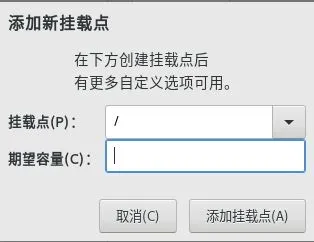

图 2-21 添加根分区

- 小知识 这里阿铭要向大家介绍一下划分磁盘分区的规则。如果你在一家企业工作，那么安装 CentOS 操作系统时，分区要按照公司领导的要求来，如果领导没有要求，就按照阿铭的方法来。具体是这样的：(1) /boot 分区分 200 MB；(2) swap 分区分内存的 2 倍（如果内存大于等于 4 GB，那么 swap 分区分 8 GB 即可，因为分多了也是浪费磁盘空间）；(3)/ 分区分 20 GB；(4) 剩余的空间给 /data 分区。在本书中，阿铭并没有单独分 /data 分区，这是因为阿铭的虚拟机一共就 20 GB 的空间，毕竟是做实验用，就不再单独分了。

(7) 最终完成分区，如图 2-22 所示。

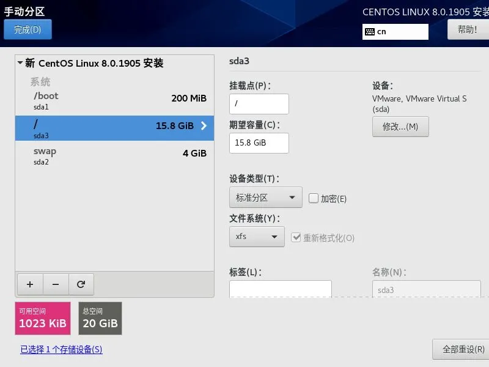

图 2-22 分区完成

单击左上角的“完成”按钮后，将弹出如图 2-23 所示的“更改摘要”提醒。

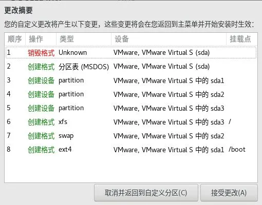

图 2-23 更改摘要

单击“接受更改”按钮，返回最初的“安装信息摘要”界面，此时单击右下角的“开始安装”按钮，开始安装操作系统，如图 2-24 所示。

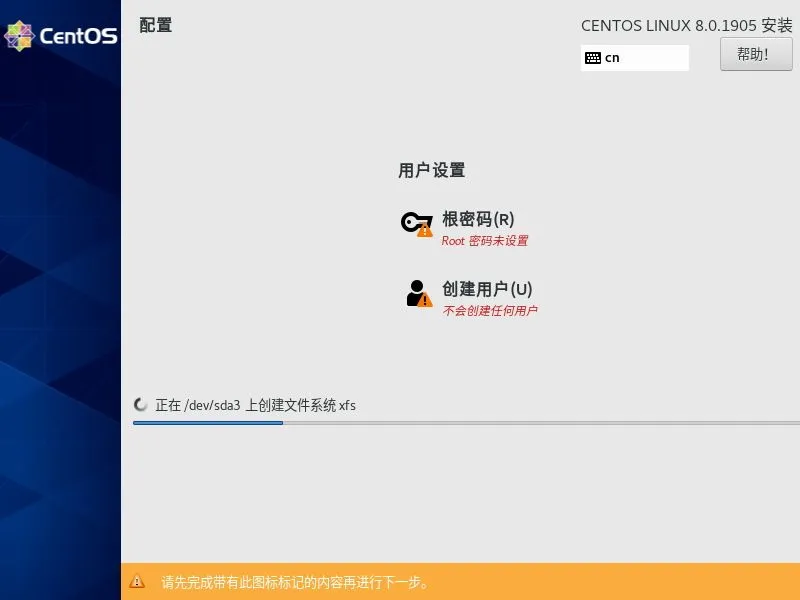

图 2-24 配置

这时你会发现该页面还有两个感叹号，这是因为我们还没有设置 root 用户的密码，root 用户就是 CentOS 操作系统的超级管理员用户，它的密码是必须要设置的。所以，单击它，进入设置 root 用户密码的界面，如图 2-25 所示。

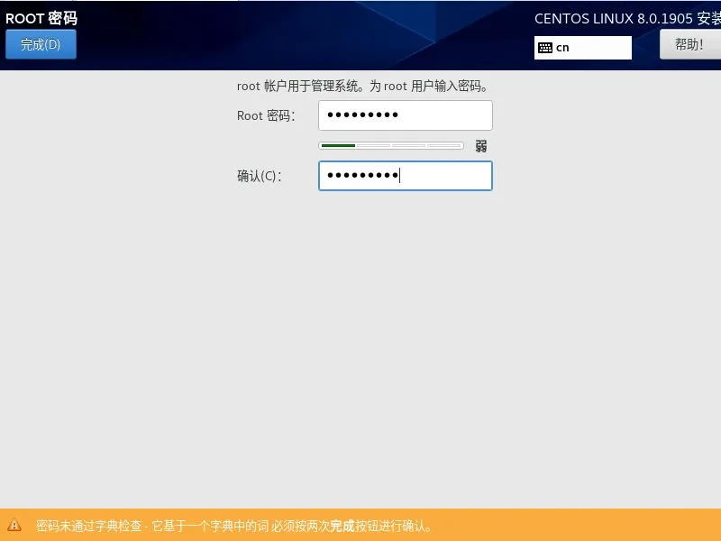

图 2-25 设置 root 用户的密码

root 用户的密码尽量要复杂（最好是大小写字母和数字的组合），否则很容易被暴力破解。设置完 root 用户的密码后，单击“完成”按钮返回刚才的配置界面，会发现两个叹号已经消失。当然，还可以继续设置一个普通用户，但这里我们并没有设置。等待几分钟之后，系统安装完成，它会提示让我们重启，如图 2-26 所示。

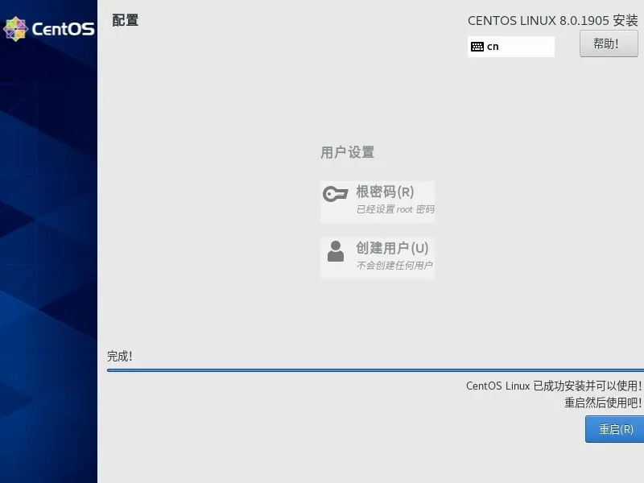

图 2-26 安装完成

单击“重启”按钮，就可以进入 CentOS 8 操作系统了。

## 2.3 第一次亲密接触

重启 CentOS 后，会出现如图 2-27 所示的黑框，提示我们登录。这个登录界面没有出现任何图形，因为我们没有安装与图形相关的程序包。如果你想使用图形界面，可以在进入系统后安装图形套件，然后切换到图形界面就可以了。

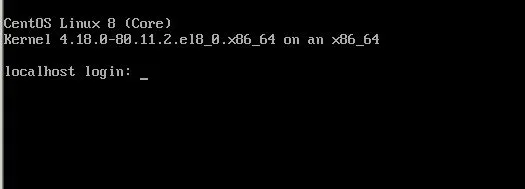

图 2-27 登录

### 2.3.1 初次使用命令行登录

```
在如图 2-27 所示的黑框里单击鼠标，在localhost login:后面输入root并按回车，然后
```

输入先前设置的 root 密码，进入 CentOS 系统，如图 2-28 所示。

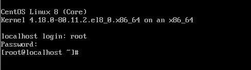

图 2-28 进入 CentOS 系统

### 2.3.2 设置网络

由于在安装系统时需要联网下载安装源，所以 CentOS 8 当前已经可以联网了，只不过当前的IP 地址是自动获取到的。由于前面创建虚拟机时，我们已经将这台机器设置成 NAT 网络模式，因此后续的操作都是基于 NAT 模式，如果是桥接模式，则操作基本类似。

请运行如下命令：

```
# ip add
```

此时将返回如图 2-29 所示的信息。

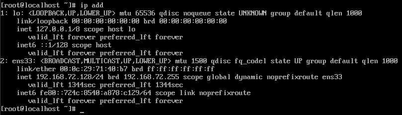

图 2-29 查看 IP 地址

```
ip add命令就是用来查看 IP 地址的。这里请大家注意英文字母的大小写，因为 Linux 操作系
```

统是区分大小写的。从图 2-29 中可以看出，这台机器有两个 IP 地址。第一个地址 127.0.0.1是回环地址，网卡名字叫作 lo，Windows 操作系统也有该地址，用于自己和自己通信。第二个地址 192.168.72.128 就是它自动获取到的 IP 地址，其中 ens33 就是网卡的名字。你获取到的 IP 地址和阿铭的可能不一样，这是因为 VMware 分配的地址段不一样，请大家放心，这并不是你没有配置对。另外，你的网卡名字也不一定是 ens33，这个不一样也是没有关系的。下面阿铭教你怎么看 VMware NAT 网络模式的网段是多少。

首先同时按下 Ctrl 和 Alt 这两个键，释放鼠标，然后单击 VMware 虚拟机左上角菜单栏中的“编辑”，选择“虚拟网络编辑器”，此时会弹出如图 2-30 所示的界面。

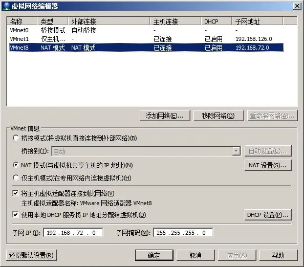

图 2-30 虚拟网络编辑器

选中 VMnet8（NAT 模式），此时下面就可以看到子网 IP 为 192.168.72.0，子网掩码为255.255.255.0，我们获取到的那个 IP 就在这个子网里面。然后单击右侧的“NAT 设置”按钮，此时会出现如图 2-31 所示的界面。

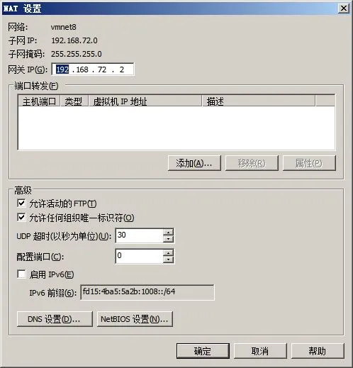

图 2-31 NAT 设置

在这个界面中，我们会看到网关 IP 为 192.168.72.2。请大家记住这个网关地址，因为接下来还会用到它。

我们先来测试一下 CentOS 8 是否可以联网。请大家注意，你的 CentOS 8 能联网的前提是你的物理机可以联网。输入如下命令进行测试：

```
# ping -c 4 www.aminglinux.com
```

运行结果如图 2-32 所示。

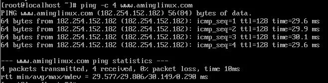

图 2-32 测试网络

```
ping命令很多朋友用过，它是用来检测网络连通性的工具。图 2-32 所示的结果表示本机是可
```

以联网的。如果你的结果和阿铭的不同，那说明你的设置很有可能有问题，请添加阿铭微信获取帮助。

虽然 CentOS 8 已经可以联网，但阿铭觉得这还不够，因为你还不会手动给 CentOS 8 设置 IP地址。在日常的运维工作中，我们是需要手动给 Linux 系统设置 IP 地址的。下面阿铭教你如何手动设置。输入如下命令：

```
# vi /etc/sysconfig/network-scripts/ifcfg-ens33
请大家注意，在 Linux 系统下，命令后面是需要带空格的，这个命令里的vi是一个用来编辑
```

文本的命令，第 7 章会详细介绍它。它后面先是一个空格（当然跟多个空格也没错），再是一个文件的存储路径。这个文件是网卡的配置文件，要想修改 IP 地址，就得编辑它。你的网卡配置文件的名字和阿铭的（ifcfg-ens33）可能不一样，这个主要由你的网卡名字决定。按回车后，进入如图 2-33 所示的界面。

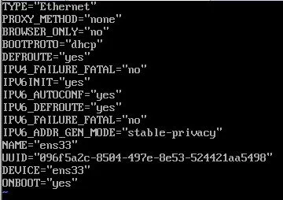

图 2-33 网卡配置文件

进入网卡配置文件后，可以使用上、下、左、右方向键去移动光标，但不能直接修改文件内

```
容。要想修改文件内容，需按字母 I 键。我们需要修改的内容有，将BOOTPROTO="dhcp"改
为BOOTPROTO="static"，并增加如下几行字符：
IPADDR=192.168.72.128
NETMASK=255.255.255.0
GATEWAY=192.168.72.2
DNS1=119.29.29.29
这里需要说明的是，BOOTPROTO用于设置网卡的启动类型，其值为dhcp表示自动获取 IP 地
址，为static表示手动设置静态 IP 地址。添加字符中的IPADDR指定 IP 地址（请不要设置
和阿铭一样的 IP 地址，因为你的 IP 地址取决于前面自动获取到的地址），NETMASK指定子网
掩码，GATEWAY指定网关（这个网关就是刚刚阿铭让大家记住的网关地址），DNS1指定上网
```

用的 DNS IP 地址，这个 119.29.29.29 是国内 DNSpod 公司提供的一个公共 DNS IP 地址。完成以上修改后，按一下 Esc 键，紧接着输入“:wq”并按回车，退出刚才的网卡配置文档。然后重启网卡，运行如下两条命令：

```
# nmcli c reload ens33
# nmcli d reapply ens33
```

其中，第一条命令的作用是重新加载网卡配置文件，但它并不会马上生效，第二条命令的作用是使第一条命令马上生效。然后查看一下 IP 地址：

```
# ip add
```

如果正确的话，你看到的结果依然如图 2-29 所示。当然，还需要再测试一下网络连通性，此时输入如下命令进行测试：

```
# ping -c 4 www.aminglinux.com
```

### 2.3.3 学会使用快捷键

在日常运维管理工作中，快捷键可以大大提高我们的工作效率。在 Linux 系统中，常用的快捷键如下。

- Ctrl+C：结束（终止）当前命令。假如你输入了一大串字符，但不想运行，则可以按

```
Ctrl+C 组合键，此时光标将跳入下一行，而刚刚的光标处会留下一个^C的标记，如图 2-34
```

- 所示。

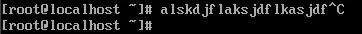

- 图 2-34 结束命令

- Tab：实现自动补全功能。这个键比较重要，使用频率也很高。当你输入命令、文件或目录的前几个字符时，它会自动帮你补全。比如，前面阿铭教大家编辑网卡配置文件时的文件路

- 径很长，这时结合 Tab 键就会很轻松。

```
Ctrl+D：退出当前终端。同样，你也可以输入命令exit实现该功能。
Ctrl+Z：暂停当前进程。这和 Ctrl+C 是有区别的，暂停后，使用fg命令恢复该进程，该知
```

- 识点会在第 10 章中介绍到。

- Ctrl+L：清屏，使光标移动到屏幕的第一行。当命令和显示的结果占满整个屏幕后，我们每再运行一个命令，都会显示在最后一行，这样看起来极不方便，此时就可以使用这个快捷键，让光标移动到屏幕第一行，也就是所谓的清屏。

- Ctrl+A：可以让光标移动到命令的最前面。有时候一条命令很长，快敲完时发现前面某个字母不对，此时可以直接用这个快捷键把光标定位到行首，然后再用左右方向键微调光标的位置。

- Ctrl+E：可以让光标移动到命令的最后面，作用同上一个。

### 2.3.4 学会查询帮助文档——man命令

```
man命令用于查看命令的帮助文档，其格式为“man [命令]”。例如，输入如下命令：
# man ls
就可以查看ls命令的帮助文档，如图 2-35 所示。
```

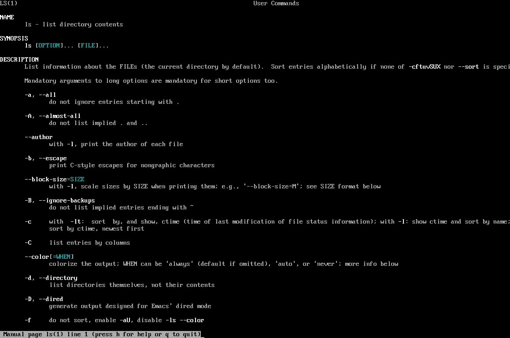

图 2-35 man命令

如果屏幕不能完整显示整个帮助文档，可以按空格键下翻，或者按上下方向键前后移动文本。若想退出帮助文档，则按字母键 Q。当然，要想看明白这个文档，还需要有一定的英文阅读能

```
力。man命令非常实用，尤其是对于初学者，在我们新学一个命令，总是记不住或记不清它的
各个选项的用法时，随手运行一下man命令，就可以找到了，非常方便！同时，阿铭相信经常
```

查看英文的文档也会提升你的英文阅读能力。

### 2.3.5 Linux 系统目录结构

登录 Linux 系统后，在当前命令窗口下输入如下命令：

```
# ls /
```

此时将会出现如图 2-36 所示的界面。

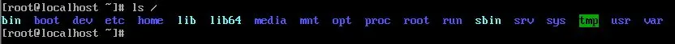

图 2-36 列出根目录

你的结果可能和阿铭的有所不同，不要紧，目前我们探讨的不是差异，而是相同的地方。其

```
中，ls是 list 的缩写，该命令用于列出指定目录或者文件。/是 Linux 操作系统里面最核心的
```

一个目录，所有的文件和目录全部在它下面，所以称它为“根目录”。前面讲磁盘分区时，阿铭也是单独给它分了一个区的。大家要逐渐适应 Linux 系统的特性，毕竟它和 Windows 有太多的差异。

```
通过 2.3.4 节中提到的命令man ls，可以了解ls命令的具体用法。对于ls这个最常用的命
```

令，阿铭在这里举几个简单的例子帮你快速掌握其用法：

```javascript
# ls
anaconda-ks.cfg
# ls -a
. .. anaconda-ks.cfg .bash_logout .bash_profile .bashrc .cshrc .tcshrcy
# ls -l
总用量 4
-rw-------. 1 root root 1435 12月 26 08:10 anaconda-ks.cfg
# ls anaconda-ks.cfg
anaconda-ks.cfg
# ls /var/
adm crash empty games kerberos local log nis preserve spool yp
cache db ftp gopher lib lock mail opt run tmp
说明 其中以#开头的行都是运行的命令，#下面的内容是命令运行后的结果。你的结果可能
```

- 和阿铭的有所不同，但不要紧，这是因为你的系统和阿铭的系统是存在一些差异的。如果有任何异议，请联系阿铭获取帮助。下面阿铭来讲解一下以上几个小案例的含义。

- 后面不加任何选项也不跟目录名或者文件名：会列出当前目录下的文件和目录，不包含隐藏文件。

- 后面加-a选项、不加目录名或者文件名：会列出当前目录下所有文件和目录，含有隐藏文件。

- 后面加-l选项、不加目录名或者文件名：会列出当前目录下除隐藏文件外的所有文件和目录的详细信息，包含其权限、所属主、所属组以及文件创建日期和时间。

```
后面不加选项、只跟文件名：会列出该文件，通常在使用时都会加上-l选项，以查看该
```

- 文件的详细信息。

- 后面不加选项、只跟目录名：会列出指定目录下的文件和目录。

```
其实，ls命令的可用项还有很多，阿铭只是介绍了最常用的选项。因为在日常工作和学习
中，这些已经足够。如果实在遇到不懂的选项，可以用man命令来查看帮助文档。
```

下面我们接着来讨论 Linux 的目录结构。

- /bin：bin 是 Binary 的缩写，该目录下存放的是最常用的命令。

- /boot：该目录下存放的是启动 Linux 时使用的一些核心文件，包括一些连接文件以及镜像文件。

- /dev：dev 是 Device（设备）的缩写。该目录下存放的是 Linux 的外部设备。在 Linux中，访问设备的方式和访问文件的方式是相同的。

- /etc：该目录下存放的是所有系统管理所需要的配置文件和子目录。

- /home：这是用户的家目录。在 Linux 中，每个用户都有一个自己的目录，一般该目录名是以用户的账号命名的。

- /lib 和 /lib64：这两个目录下存放的是系统最基本的动态链接共享库，其作用类似于Windows 里的 DLL 文件，几乎所有的应用程序都需要用到这些共享库。其中 /lib64 为 64位的软件包的库文件所在目录。

- /media：系统会自动识别一些设备（如 U 盘、光驱等），当识别后，Linux 会把识别的设备挂载到该目录下。

- /mnt：系统提供该目录是为了让用户临时挂载别的文件系统。我们可以将光驱挂载到 /mnt/上，然后进入该目录查看光驱里的内容。

- /opt：这是给主机额外安装软件所设置的目录，该目录默认为空。比如，你要安装一个Oracle 数据库，可以放到该目录下。

- /proc：该目录是一个虚拟目录，是系统内存的映射，可以直接访问它来获取系统信息。该目录的内容在内存里，我们可以直接修改里面的某些文件。比如可以通过下面的命令来屏蔽

```
主机的ping命令，使其他人无法ping你的机器。在日常工作中，你会经常用到类似的用
```

- 法：

```
# echo 1 > /proc/sys/net/ipv4/icmp_echo_ignore_all`
1
```

- /root：该目录是系统管理员的用户家目录。

- /run：这个目录和 /var/run 其实是同一个目录，里面存放的是一些服务的 pid。一个服务启动完后，是有一个 pid 文件的。至于为什么说是同一个目录，Linux 是如何做到的，4.9 节会详细介绍。

- /sbin：s 就是 Super User（超级用户）的意思，该目录存放的是系统管理员使用的系统管理程序。

- /srv：该目录存放的是一些服务启动之后需要提取的数据。

- /sys：该目录存放的是与硬件驱动程序相关的信息。

- /tmp：该目录用来存放一些临时文件。

- /usr：这是一个非常重要的目录，类似于 Windows 下的 Program Files 目录，用户的很多应用程序和文件存放在该目录下。在后面的章节中，我们会多次用到这个目录。

- /usr/bin：该目录存放的是系统用户使用的应用程序。

- /usr/sbin：该目录存放的是 Super User 使用的比较高级的管理程序和系统守护程序。

- /usr/src ：该目录是内核源代码的默认放置目录。

- /var：该目录存放的是不断扩充且经常修改的目录，包括各种日志文件或者 pid 文件，刚刚提到的 /var/run 就在这个目录下面。

这些目录中有几个重要的需要大家注意，不要误删除或者随意更改其内部文件。下面阿铭再简单对它们总结一下。

- /etc 目录下是系统的配置文件，如果更改了该目录下的某个文件，可能会导致系统无法正常启动。

- /bin、/sbin、/usr/bin 和 /usr/sbin 目录是系统预设的执行文件的放置目录，其中 /bin 和/usr/bin 目录下是供系统用户（除 root 外的通用账户）使用的命令，而 /sbin 和 /usr/sbin 目

```
录下则是供 root 用户使用的命令。比如，ls命令就存放在 /bin/ 目录下。
```

- /var 也是一个非常重要的目录，系统上运行各个程序时所产生的日志都被记录在该目录下

```javascript
（即 /var/log 目录中）。另外，mail命令的预设也放置在这里。
```

### 2.3.6 如何正确关机、重启

Linux 主要用在服务器领域，而在服务器上执行一项服务是永无止境的，除非遇到特殊情况，否则不会关机。和 Windows 不同，在 Linux 系统下，很多进程是在后台执行的。在屏幕背后，可能有很多人同时在工作。如果直接按下电源开关关机，其他人的数据可能就此中断。更严重的是，若不正常关机，严重时可能会造成文件系统损坏，从而导致数据丢失。

```
如果要关机，必须要保证当前系统中没有其他用户在登录系统。可以使用who命令查看当前是
否还有其他人在登录，或者使用命令ps -aux查看是否还有后台进程在运行。shutdown、
halt、poweroff都为关机的命令，我们可以使用命令man shutdown查看其帮助文档。例
如，可以运行如下命令关机（//符号后面的内容为注释）：
# shutdown -h 10 // 计算机将在10分钟后关机，且会显示在登录用户的当前屏幕中
# shutdown -h now // 立即关机
# shutdown -h 20:25 // 系统会在20:25关机
# shutdown -h +10 // 10分钟后关机
# shutdown -r now // 立即重启
# shutdown -r +10 // 10分钟后重启
# reboot // 重启，等同于shutdown -r now
# halt // 关闭系统，等同于shutdown -h now和poweroff
```

```
不管是重启系统还是关闭系统，首先要运行sync命令，该命令可以把当前内存中的数据写入
```

磁盘中，防止数据丢失。

```
再来总结一下，关机的命令有shutdown -h now、halt、poweroff和init 0，重启系
统的命令有shutdown -r now、reboot和init 6。
```

### 2.3.7 忘记 root 密码怎么办

以前阿铭忘记了 Windows 的管理员密码，当时不会用光盘清除密码，最后只能重装系统。现在想来那是多么愚笨的一件事情。同样，如果你忘记了 Linux 系统的 root 密码，该怎么办呢？重新安装系统吗？当然不用！你只需要进入紧急模式（emergency mode）更改 root 密码即可。在 CentOS 6 中，我们是进入单用户模式修改 root 密码的，但在 CentOS 7 和 CentOS8 中已经没有单用户模式了，而是这个紧急模式，具体操作步骤如下。

1. 重启系统按 3 秒钟向下的方向键，目的是不让它进入系统，而是停留在开机界面，如图 2-37 所示。

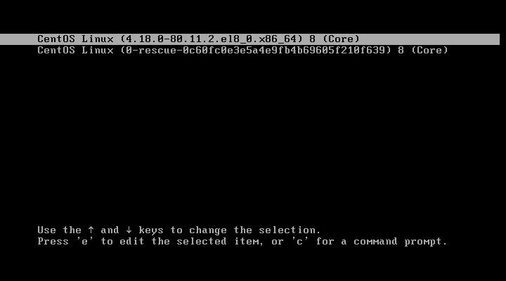

- 图 2-37 开机界面

- 按方向键移动光标，定位在第一行，按字母 E 键编辑它，然后进入另外一个界面，此时会出来很多字符，这些是 CentOS 8 启动选项，那么这些字符有什么用呢？我们暂时先放一放，不用太过关心。移动向下的方向键，把光标定位到 linux 开头的行。

2. 进入紧急模式

```
按向右的方向键，将光标移动到ro这里，把ro改成rw init=/sysroot/bin/sh，如图
```

- 2-38 所示。

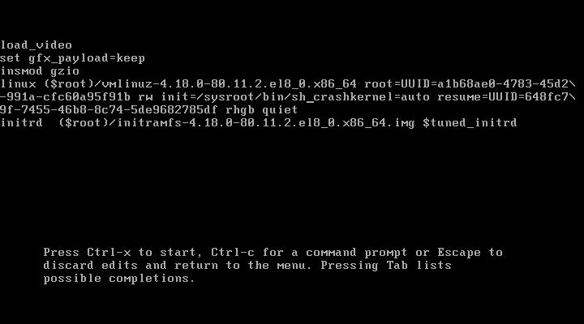

- 图 2-38 修改ro

- 然后同时按 Ctrl 和 X 这两个键，系统就会进入如图 2-39 所示的界面，这样就正式进入了紧急模式。

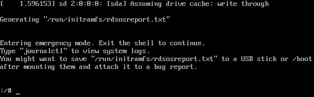

- 图 2-39 紧急模式

3. 修改 root 密码首先切换到原始系统，然后修改密码，操作过程如图 2-40 所示。

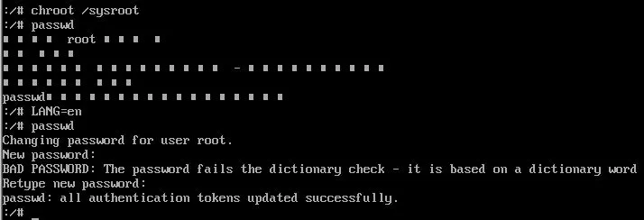

- 图 2-40 修改密码

```
其中chroot命令用来切换系统，后面的 /sysroot 目录就是原始系统（也就是我们的
CentOS 8 系统），在这个下面才可以修改 root 密码。passwd命令就是修改 root 密码的命
```

- 令，5.3.1 节还会介绍它。但运行命令后，返回的结果很奇怪，出现了很多小方块，俗称乱

```
码。其实这些小方块本来是汉字，但是 VMware 并不支持中文。如果大家知道passwd命令
```

- 的用法，此时连续输入两次新密码就可以了。但作为新用户，第一次看到乱码肯定会不知所

```
措，请跟着阿铭一起输入LANG=en，这个命令就是把当前终端的语言设置为英文。再次运
行passwd命令，就可以正常显示字符了。
```

- 密码虽然修改完了，但是还需要一个额外的操作，相关命令如下：

```
# touch /.autorelabel
1
```

- 注意，这个文件名字一定要写对，否则修改的密码将不能生效。执行这一步的作用是让SELinux 生效，如果不执行，则之前修改的密码是不会生效的。也就是说，即使你之后输

```
对了密码，也无法登录系统。至于 SELinux 是什么，13.4.1 节会详细介绍。执行完touch
命令后，同时按 Ctrl 和 D 这两个键，再输入命令reboot，这样系统会重启，等待几秒
```

- 后，出现登录界面，此时使用我们新设置的密码登录即可。

### 2.3.8 学会使用救援模式

救援模式即 rescue 模式，这个模式主要应用于无法进入系统的情况，比如 grub 损坏或者某一个配置文件修改出错。那么，如何使用救援模式呢？具体的操作方法如下。

1. 启动光驱首先检查你的光驱是否是开机启动。具体方法是把鼠标挪到 VMware 右下角的小光盘图标处，单击它，此时会出现两个选项，选择“设置”选项，会弹出“虚拟机设置”对话框，看一下右侧的“设备状态”，要保证这两个对钩都是打上的，如图 2-41 所示。

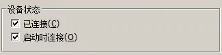

- 图 2-41 设备状态

- 但此时，重启系统并不会进入光驱启动界面，这还需要我们设置一个 VMware 的 BIOS。由于 VMware 启动很快，往往我们还没有来得及按 F2 键（要进入 BIOS，需要按 F2 键），它就已经进入系统的启动界面了。这里有一个技巧，首先把 CentOS 8 关机，然后在 VMware左侧选中这台虚拟机并右击，从中选择“电源”→“启动时进入固件”，如图 2-42 所示。

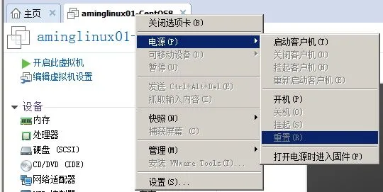

- 图 2-42 进入 BIOS

- 进入 BIOS 后，按向右方向键，选择 Boot，然后按“－”或者“+”键调节各个启动对象，其中有硬盘、光驱、网卡等，总之结果是要让 CD-ROM Drive 在最前面，也就是让它第一个启动。最终的结果如图 2-43 所示。

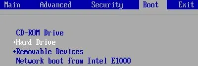

- 图 2-43 BIOS

- 设置完这步之后，直接按 F10 键保存设置并退出。

2. 进入救援模式随后进入光驱启动界面，使用上下方向键选择 Troubleshooting，如图 2-44 所示。

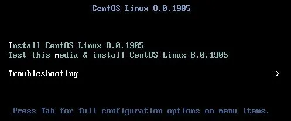

- 图 2-44 选择 Troubleshooting

- 按回车后，又出现如图 2-45 所示的界面，使用向下方向键选择 Rescue a CentOS Linuxsystem。

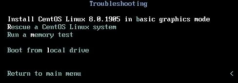

- 图 2-45 选择 Rescue a CentOS Linux system

- 按回车后，会出现如图 2-46 所示的界面。

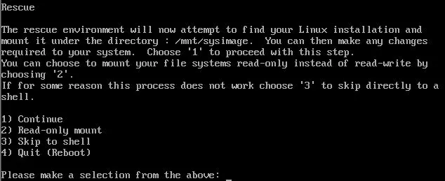

- 图 2-46 救援选项

- 图 2-47 中有一些提示，它告诉我们，初始系统在 /mnt/sysimage 目录下面，其实这和上一节的 /sysroot 类似。这里有 4 个选项：选择第 1) 项，将会继续往下走；选择第 2) 项，将会把初始的系统挂载为只读模式，我们不能写磁盘，也就意味着不能再修改配置文件，也不能修改 root 密码；选择第 3) 项，会直接出现一个 shell；而选择第 4) 项，则会重启。

- 这里选择第 1) 项，所以输入数字 1 并回车，如图 2-47 所示。它又告诉我们：初始系统已

```
经挂载到了 /mnt/sysimage 目录下面，要想进入初始系统下面，需要执行chroot
/mnt/sysimage命令，请再次按回车获取到 shell。
```

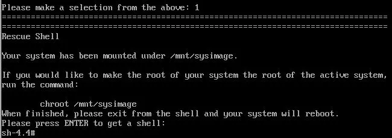

- 图 2-47 获取 shell

```
进入初始系统后，执行修改 root 密码的命令passwd，如图 2-48 所示。
```

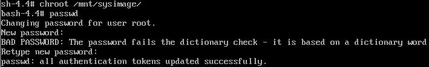

- 图 2-48 修改 root 密码

```
其实，执行完chroot命令之后，会发现命令行的前后有一处变化，即原来的sh-4.4变成
了bash-4.4，这就是因为环境变量发生了变化，第 10 章再讨论这个知识点。当然，救援
```

- 模式并非只有修改 root 密码这么简单的作用，我们还可以在救援模式下处理一些故障、修复数据等。要想退出救援模式，也很简单，先使用 Ctrl+D 组合键退出原始系统，然后执行

```
reboot命令即可。但是重启后你会发现，它进入的依然是光驱启动界面。所以，我们还需
```

- 要再设置一遍 BIOS，让硬盘第一个启动。这里还有一种方法，设置 VMware，关闭光驱即可。

## 2.4 课后习题

(1) 32 位和 64 位操作系统有什么区别？什么时候安装 32 位或 64 位操作系统？如何查看Linux 系统是 32 位的还是 64 位的？

(2) swap 分区的作用是什么？如何决定 swap 分区的大小？

(3) 查资料了解 bootloader、grub 的概念，并理解它们的作用。

(4) 如何在安装系统时给 grub 设置密码？

(5) 在安装 Linux 时，你是如何分区的？
