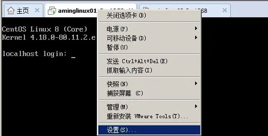
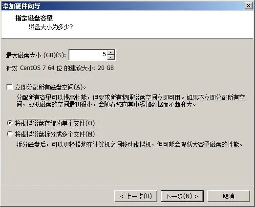

# 第6章Linux磁盘管理

在 Windows 下，我们可以非常直观地看到系统有多少个分区，每个分区使用多少、还剩多少。那么在 Linux 命令行下，如何进行这些操作呢？在 Linux 下的磁盘里面写数据也是有讲究的。如何分区？如何格式化？如何挂载？如何卸载？下面阿铭一一为大家解答这些问题。

## 6.1 查看磁盘或者目录的容量

监控磁盘的使用率在日常监控工作中是必须要做的，磁盘被写满是很要命的，严重时会导致磁盘损坏。那么，如何查看磁盘使用率呢？

### 6.1.1 命令df

```
命令df（disk filesystem 的简写）用于查看已挂载磁盘的总容量、使用容量、剩余容量等，其
```

后可以不加任何参数，显示数据默认以 KB 为单位。示例命令如下：

```
# df
文件系统 1K-块 已用 可用 已用% 挂载点
devtmpfs 910288 0 910288 0% /dev
tmpfs 924728 0 924728 0% /dev/shm
tmpfs 924728 8868 915860 1% /run
tmpfs 924728 0 924728 0% /sys/fs/cgroup
/dev/sda3 16561152 1472276 15088876 9% /
/dev/sda1 194235 121419 58480 68% /boot
tmpfs 184944 0 184944 0% /run/user/0
tmpfs 184944 0 184944 0% /run/user/1006
```

在上例的结果中，/、/boot 是我们在安装系统时划分出来的。/dev、/dev/shm 为内存分区，其大小默认是内存大小的 1/2，如果我们把文件存到此分区下，就相当于存到了内存中，这样的好处是读写非常快，坏处是当系统重启时文件会丢失。后面的 /run、/sys/fs/cgroup 等分区都

```
是tmpfs，跟 /dev/shm 类似，是临时文件系统，我们不要碰它们。df命令的常用选项有-
i、-h、-k和-m，下面介绍这 4 个选项的用法。为了能更加简洁明了地让大家看到磁盘分
区，在下面的示例中阿铭直接把与tmpfs相关的分区全部过滤掉了。
-i：表示查看inode的使用状况，如果已使用 100%，那么即使磁盘空间有剩余，也会提
```

- 示磁盘空间已满。示例命令如下：

```
# df -i |grep -v tmpfs // grep -v的作用是过滤掉包含tmpfs字符串的行
1
文件系统 Inode 已用(I) 可用(I) 已用(I)% 挂载点
2
/dev/sda3 8285696 32458 8253238 1% /
3
/dev/sda1 51200 309 50891 1% /boot
4
```

- -h：表示使用合适的单位显示数据，例如 GB。示例命令如下：

```
# df -h |grep -v tmpfs
1
文件系统 容量 已用 可用 已用% 挂载点
2
/dev/sda3 16G 1.5G 15G 9% /
3
/dev/sda1 190M 119M 58M 68% /boot
4
```

- -k、-m：分别表示以 KB 和 MB 为单位显示数据。示例命令如下：

```
# df -k |grep -v tmpfs
1
文件系统 1K-块 已用 可用 已用% 挂载点
2
/dev/sda3 16561152 1472276 15088876 9% /
3
/dev/sda1 194235 121419 58480 68% /boot
4
# df -m |grep -v tmpfs
5
文件系统 1M-块 已用 可用 已用% 挂载点
6
/dev/sda3 16173 1438 14736 9% /
7
/dev/sda1 190 119 58 68% /boot
8
```

简单介绍一下上述信息中各列所表示的含义。如果你的 Linux 和阿铭的虚拟机一样，也是中文显示，那么看字面意思就可以明白了。第 1 列为分区的名字，第 2 列为该分区的总容量，第 3列为已使用的容量，第 4 列为剩余容量，第 5 列为使用容量的百分比（如果这个数值达到90% 以上，那么就应该引起关注了。因为磁盘分区满了会引起系统崩溃），最后一列为挂载点，阿铭在安装系统时提到过这个词。

### 6.1.2 命令du

```
命令du（disk useage）用来查看某个目录或文件所占空间的大小，其格式为du [-
abckmsh] [文件或者目录名]。该命令常用的参数有如下几个。
-a：表示把全部文件和目录的大小都列出来。如果命令du后面不加任何选项和参数，则只
会列出目录（包含子目录）的大小。如果du命令不指定单位，则默认显示单位为 KB。示例
```

- 命令如下：

```
# du /root/
1
8 /root/.ssh
2
0 /root/123
3
0 /root/456
4
36 /root/
5
# du -a /root/
6
4 /root/.bash_logout
7
4 /root/.bash_profile
8
4 /root/.bashrc
9
4 /root/.cshrc
10
4 /root/.tcshrc
11
4 /root/anaconda-ks.cfg
12
4 /root/.bash_history
13
4 /root/.ssh/authorized_keys
14
4 /root/.ssh/known_hosts
15
8 /root/.ssh
16
0 /root/123
17
0 /root/456
18
36 /root/
19
```

- -b：表示列出的值以 B 为单位输出。

- -k：表示以 KB 为单位输出，这和默认不加任何选项的输出值是一样的。

- -m：表示以 MB 为单位输出。

- -h：表示由系统自动调节输出单位。例如，如果文件太小，可能就几千字节，那么就以 KB为单位显示；如果文件大到兆字节，就以 GB 为单位显示。若一个文件小于 4KB，那么当

```
使用-k选项时，也会显示 4KB（后面阿铭再给大家解释原因）。同理，使用-m选项时，也
```

- 会有类似问题。示例命令如下：

```
# du -b /etc/passwd
1
1209 /etc/passwd
2
# du -k /etc/passwd
3
4 /etc/passwd
4
# du -m /etc/passwd
5
1 /etc/passwd
6
# du -h /etc/passwd
7
4.0K /etc/passwd
8
```

- -c：表示最后加总。这个选项阿铭不常用，示例命令如下：

```
# du -c /root/
1
8 /root/.ssh
2
0 /root/123
3
0 /root/456
4
36 /root/
5
36 总用量
6
```

- -s：表示只列出总和。这个选项阿铭用得最多，示例命令如下：

```
# du -s /root/
1
36 /root/
2
此外，阿铭习惯用du -sh filename这样的形式。
```

## 6.2 磁盘的分区和格式化

阿铭经常做的一件事就是拿一个全新的磁盘来分区并格式化。作为一个 Linux 系统管理员，对磁盘的操作必须熟练，所以请认真学习该部分内容。

### 6.2.1 增加虚拟磁盘

在正式介绍 Linux 分区工具之前，阿铭需要先给虚拟机添加一块磁盘，以便我们做后续的试验。给虚拟机添加虚拟磁盘的具体操作步骤如下（软件版本为 VMware Workstation 14）。

(1) 在当前的虚拟机选项卡上单击鼠标右键，选择“设置”，如图 6-1 所示。



图 6-1 打开设置

(2) 此时会弹出“虚拟机设置”对话框。单击下方的“添加”按钮，选择“硬盘”，再单击“下一步”，此时会弹出“添加硬件向导”对话框。

(3)“选择磁盘类型”这里保持默认设置，不用更改任何指标，直接单击“下一步”按钮。

(4)“选择磁盘”对话框里也保持默认设置，直接单击“下一步”按钮。

(5)“指定磁盘容量”这里需要修改一下，设定“最大磁盘大小”为 5GB，然后选择“将虚拟磁盘存储为单个文件”单选按钮，如图 6-2 所示。



图 6-2 指定磁盘容量

(6) 继续单击“下一步”按钮，然后单击“完成”按钮，最终成功添加新的虚拟磁盘。虽然磁盘已经添加，但暂时还不能被系统识别，需要重启系统才可以。

### 6.2.2 命令fdisk

```
fdisk是 Linux 下硬盘的分区工具，是一个非常实用的命令，但是此命令只能划分小于 2TB
的分区。该命令的格式为fdisk [-l ] [设备名称]，其选项只有-l。选项-l后面如果不加
```

设备名称，就会直接列出系统中所有的磁盘设备以及分区表；如果加上设备名称，则会列出该设备的分区表。示例命令如下：

```
# fdisk -l
Disk /dev/sda：20 GiB，21474836480 字节，41943040 个扇区
单元：扇区 / 1 * 512 = 512 字节
扇区大小(逻辑/物理)：512 字节 / 512 字节
I/O 大小(最小/最佳)：512 字节 / 512 字节
磁盘标签类型：dos
磁盘标识符：0x1d6231bc
设备 启动 起点 末尾 扇区 大小 Id 类型
/dev/sda1 * 2048 411647 409600 200M 83 Linux
/dev/sda2 411648 8800255 8388608 4G 82 Linux swap / Solaris
/dev/sda3 8800256 41943039 33142784 15.8G 83 Linux
Disk /dev/sdb：5 GiB，5368709120 字节，10485760 个扇区
单元：扇区 / 1 * 512 = 512 字节
扇区大小(逻辑/物理)：512 字节 / 512 字节
I/O 大小(最小/最佳)：512 字节 / 512 字节
# fdisk -l /dev/sdb
Disk /dev/sdb：5 GiB，5368709120 字节，10485760 个扇区
单元：扇区 / 1 * 512 = 512 字节
扇区大小(逻辑/物理)：512 字节 / 512 字节
I/O 大小(最小/最佳)：512 字节 / 512 字节
```

从上例中可以看到阿铭新增的磁盘 /dev/sdb 的信息。

```
fdisk命令如果不加-l选项，则会进入另一个模式，在该模式下，可以对磁盘进行分区操
```

作。示例命令如下：

```
# fdisk /dev/sdb
欢迎使用 fdisk (util-linux 2.32.1)。
```

- 更改将停留在内存中，直到您决定将更改写入磁盘。使用写入命令前请三思。

- 设备不包含可识别的分区表。

```
创建了一个磁盘标识符为 0xea205440 的新 DOS 磁盘标签。
命令(输入 m 获取帮助)：
此时如果输入m，就会列出常用的命令，如下所示：
命令(输入 m 获取帮助)：m
```

- 帮助：

```
DOS (MBR)
a 开关可启动标志
b 编辑嵌套的 BSD 磁盘标签
c 开关 dos 兼容性标志
```

- 常规

```
d 删除分区
F 列出未分区的空闲区
l 列出已知分区类型
n 添加新分区
p 打印分区表
t 更改分区类型
v 检查分区表
i 打印某个分区的相关信息
```

- 杂项

```
m 打印此菜单
u 更改 显示/记录 单位
x 更多功能(仅限专业人员)
```

- 脚本

```
I 从 sfdisk 脚本文件加载磁盘布局
O 将磁盘布局转储为 sfdisk 脚本文件
```

- 保存并退出

```
w 将分区表写入磁盘并退出
q 退出而不保存更改
```

- 新建空磁盘标签

```
g 新建一份 GPT 分区表
G 新建一份空 GPT (IRIX) 分区表
o 新建一份空 DOS 分区表
s 新建一份空 Sun 分区表
```

下面介绍其中几个阿铭常用的命令。

```
p：表示打印当前磁盘的分区情况。示例命令如下：
命令(输入 m 获取帮助)：p
1
2
Disk /dev/sdb：5 GiB，5368709120 字节，10485760 个扇区
3
单元：扇区 / 1 * 512 = 512 字节
4
扇区大小(逻辑/物理)：512 字节 / 512 字节
5
I/O 大小(最小/最佳)：512 字节 / 512 字节
6
磁盘标签类型：dos
7
磁盘标识符：0xea205440
8
9
// 说明：由于还未对/dev/sdb进行分区，所以并没有显示任何分区信息，你也可以针对/dev/sda进行演
10
n：表示新建一个分区。
w：表示保存。
q：表示退出。
d：表示删除一个分区。
```

下面阿铭将对新增的磁盘 /dev/sdb 进行分区操作。阿铭先给它建立第 1 个分区，命令如下所示：

```
命令(输入 m 获取帮助)：n
```

- 分区类型

```
p 主分区 (0个主分区，0个扩展分区，4空闲)
e 扩展分区 (逻辑分区容器)
选择 (默认 p)：
使用n命令新建分区，它会提示我们是要新建 e（扩展分区）还是 p（主分区）。阿铭的选择是
```

p，于是输入 p，然后回车，命令如下所示：

```sql
Select (default p): p
分区号 (1-4, 默认 1): 1
第一个扇区 (2048-10485759, 默认 2048): 2048
上个扇区，+sectors 或 +size (2048-10485759, 默认 10485759): +1000M
创建了一个新分区 1，类型为“Linux”，大小为 1000 MiB。
```

输入 p 后，会提示输入分区数，这里阿铭写 1，因为是第 1 个分区（当然，你也可以写 2 或3，最多为 4），此时如果你直接回车，那么会继续提示你必须输入一个数字。输入分区数后紧接着又提示你起始扇区从哪里开始，默认是 2048，可以写 2048 或者直接回车（这里你也可以写大于 2048 的其他数字，不过这样就会造成空间浪费）。然后提示你输入最后一个扇区的数值，即需要给这个分区划分多大空间。关于扇区是多大，不必再细究，你只需要掌握阿铭教

```
给你的方法即可，即写+1000M，这样既方便又不容易出错。用p命令查看，得知已经多出了
```

一个分区，命令如下所示：

```
命令(输入 m 获取帮助)：p
Disk /dev/sdb：5 GiB，5368709120 字节，10485760 个扇区
单元：扇区 / 1 * 512 = 512 字节
扇区大小(逻辑/物理)：512 字节 / 512 字节
I/O 大小(最小/最佳)：512 字节 / 512 字节
磁盘标签类型：dos
磁盘标识符：0xea205440
设备 启动 起点 末尾 扇区 大小 Id 类型
/dev/sdb1 2048 2050047 2048000 1000M 83 Linux
```

按照上面的步骤继续操作，一直创建到主分区 4。如下所示：

```
命令(输入 m 获取帮助)：n
```

- 分区类型

```
p 主分区 (1个主分区，0个扩展分区，3空闲)
e 扩展分区 (逻辑分区容器)
选择 (默认 p)：p
分区号 (2-4, 默认 2): 2
第一个扇区 (2050048-10485759, 默认 2050048):
上个扇区，+sectors 或 +size (2050048-10485759, 默认 10485759): +1000M
创建了一个新分区 2，类型为“Linux”，大小为 1000 MiB。
命令(输入 m 获取帮助)：n
```

- 分区类型

```
p 主分区 (2个主分区，0个扩展分区，2空闲)
e 扩展分区 (逻辑分区容器)
选择 (默认 p)：p
分区号 (3,4, 默认 3):
第一个扇区 (4098048-10485759, 默认 4098048):
上个扇区，+sectors 或 +size (4098048-10485759, 默认 10485759): +1000M
创建了一个新分区 3，类型为“Linux”，大小为 1000 MiB。
命令(输入 m 获取帮助)：n
```

- 分区类型

```
p 主分区 (3个主分区，0个扩展分区，1空闲)
e 扩展分区 (逻辑分区容器)
选择 (默认 e)：p
已选择分区 4
第一个扇区 (6146048-10485759, 默认 6146048):
上个扇区，+sectors 或 +size (6146048-10485759, 默认 10485759): +1000M
创建了一个新分区 4，类型为“Linux”，大小为 1000 MiB。
命令(输入 m 获取帮助)：n
```

- 要创建更多分区，请先将一个主分区替换为扩展分区。

当创建完 4 个主分区后，如果再想创建新分区，就会出问题，这是因为在 Linux 系统中最多只能创建 4 个主分区。那么如果你想多创建几个分区，该怎么做呢？方法很简单，就是在创建完第 3 个主分区后、创建第 4 个分区时选择扩展分区。我们首先删除掉第 4 个分区，然后再新建分区，命令如下所示：

```
命令(输入 m 获取帮助)：d
分区号 (1-4, 默认 4): 4
分区 4 已删除。
命令(输入 m 获取帮助)：n
```

- 分区类型

```
p 主分区 (3个主分区，0个扩展分区，1空闲)
e 扩展分区 (逻辑分区容器)
选择 (默认 e)：e
已选择分区 4
第一个扇区 (6146048-10485759, 默认 6146048):
上个扇区，+sectors 或 +size (6146048-10485759, 默认 10485759): +2000M
创建了一个新分区 4，类型为“Extended”，大小为 2 GiB。
命令(输入 m 获取帮助)：p
Disk /dev/sdb：5 GiB，5368709120 字节，10485760 个扇区
单元：扇区 / 1 * 512 = 512 字节
扇区大小(逻辑/物理)：512 字节 / 512 字节
I/O 大小(最小/最佳)：512 字节 / 512 字节
磁盘标签类型：dos
磁盘标识符：0xea205440
设备 启动 起点 末尾 扇区 大小 Id 类型
/dev/sdb1 2048 2050047 2048000 1000M 83 Linux
/dev/sdb2 2050048 4098047 2048000 1000M 83 Linux
/dev/sdb3 4098048 6146047 2048000 1000M 83 Linux
/dev/sdb4 6146048 10242047 4096000 2G 5 扩展
扩展分区在最后一列显示为Extended，接下来继续创建分区，如下所示：
命令(输入 m 获取帮助)：n
```

- 所有主分区都在使用中。

```
添加逻辑分区 5
第一个扇区 (6148096-10242047, 默认 6148096):
上个扇区，+sectors 或 +size (6148096-10242047, 默认 10242047): +500M
创建了一个新分区 5，类型为“Linux”，大小为 500 MiB。
命令(输入 m 获取帮助)：p
Disk /dev/sdb：5 GiB，5368709120 字节，10485760 个扇区
单元：扇区 / 1 * 512 = 512 字节
扇区大小(逻辑/物理)：512 字节 / 512 字节
I/O 大小(最小/最佳)：512 字节 / 512 字节
磁盘标签类型：dos
磁盘标识符：0xea205440
设备 启动 起点 末尾 扇区 大小 Id 类型
/dev/sdb1 2048 2050047 2048000 1000M 83 Linux
/dev/sdb2 2050048 4098047 2048000 1000M 83 Linux
/dev/sdb3 4098048 6146047 2048000 1000M 83 Linux
/dev/sdb4 6146048 10242047 4096000 2G 5 扩展
/dev/sdb5 6148096 7172095 1024000 500M 83 Linux
```

会发现此时再分区就和之前不一样了，你不再需要选择是新建主分区还是扩展分区，而是直接定义分区大小。值得注意的是，当创建完前 3 个主分区后，理应把剩余的磁盘空间全部划分给第 4 个扩展分区，不然剩余的空间就会浪费（在上面的示例中，阿铭其实并没有把剩余的磁盘空间完全划分给扩展分区）。因为创建完扩展分区后，再划分新的分区时，是在已经划分的扩展分区里来分的。

上例中，/dev/sdb4 为扩展分区，这个分区是不可以格式化的。你可以把它看成一个空壳子，能使用的分区为 /dev/sdb5，这是 /dev/sdb4 的子分区，这个子分区称为逻辑分区。如果你发

```
现分区不合理，想删除某个分区，那该怎么办呢？这就用到了d命令，刚刚阿铭已经用到过。
```

下面阿铭再继续演示一下：

```
命令(输入 m 获取帮助)：d
分区号 (1-5, 默认 5): 1
分区 1 已删除。
命令(输入 m 获取帮助)：p
Disk /dev/sdb：5 GiB，5368709120 字节，10485760 个扇区
单元：扇区 / 1 * 512 = 512 字节
扇区大小(逻辑/物理)：512 字节 / 512 字节
I/O 大小(最小/最佳)：512 字节 / 512 字节
磁盘标签类型：dos
磁盘标识符：0xea205440
设备 启动 起点 末尾 扇区 大小 Id 类型
/dev/sdb2 2050048 4098047 2048000 1000M 83 Linux
/dev/sdb3 4098048 6146047 2048000 1000M 83 Linux
/dev/sdb4 6146048 10242047 4096000 2G 5 扩展
/dev/sdb5 6148096 7172095 1024000 500M 83 Linux
命令(输入 m 获取帮助)：d
分区号 (2-5, 默认 5): 5
分区 5 已删除。
命令(输入 m 获取帮助)：p
Disk /dev/sdb：5 GiB，5368709120 字节，10485760 个扇区
单元：扇区 / 1 * 512 = 512 字节
扇区大小(逻辑/物理)：512 字节 / 512 字节
I/O 大小(最小/最佳)：512 字节 / 512 字节
磁盘标签类型：dos
磁盘标识符：0xea205440
设备 启动 起点 末尾 扇区 大小 Id 类型
/dev/sdb2 2050048 4098047 2048000 1000M 83 Linux
/dev/sdb3 4098048 6146047 2048000 1000M 83 Linux
/dev/sdb4 6146048 10242047 4096000 2G 5 扩展
命令(输入 m 获取帮助)：n
```

- 分区类型

```
p 主分区 (2个主分区，1个扩展分区，1空闲)
l 逻辑分区 (从 5 开始编号)
选择 (默认 p)：l
添加逻辑分区 5
第一个扇区 (6148096-10242047, 默认 6148096):
上个扇区，+sectors 或 +size (6148096-10242047, 默认 10242047): +500M
创建了一个新分区 5，类型为“Linux”，大小为 500 MiB。
命令(输入 m 获取帮助)：p
Disk /dev/sdb：5 GiB，5368709120 字节，10485760 个扇区
单元：扇区 / 1 * 512 = 512 字节
扇区大小(逻辑/物理)：512 字节 / 512 字节
I/O 大小(最小/最佳)：512 字节 / 512 字节
磁盘标签类型：dos
磁盘标识符：0xea205440
设备 启动 起点 末尾 扇区 大小 Id 类型
/dev/sdb2 2050048 4098047 2048000 1000M 83 Linux
/dev/sdb3 4098048 6146047 2048000 1000M 83 Linux
/dev/sdb4 6146048 10242047 4096000 2G 5 扩展
/dev/sdb5 6148096 7172095 1024000 500M 83 Linux
命令(输入 m 获取帮助)：d
分区号 (2-5, 默认 5): 4
分区 4 已删除。
命令(输入 m 获取帮助)：p
Disk /dev/sdb：5 GiB，5368709120 字节，10485760 个扇区
单元：扇区 / 1 * 512 = 512 字节
扇区大小(逻辑/物理)：512 字节 / 512 字节
I/O 大小(最小/最佳)：512 字节 / 512 字节
磁盘标签类型：dos
磁盘标识符：0xea205440
设备 启动 起点 末尾 扇区 大小 Id 类型
/dev/sdb2 2050048 4098047 2048000 1000M 83 Linux
/dev/sdb3 4098048 6146047 2048000 1000M 83 Linux
```

输入 d，会提示要删除哪个分区，你可以选择 1 到 5 之间的任意一个分区。其中，1-3 是主分区（sdb1、sdb2 和 sdb3），4 是扩展分区（sdb4），5 是逻辑分区（sdb5）。如果输入 5，则直接删除逻辑分区 sdb5；但如果输入 4，则会删除整个扩展分区 sdb4，当然也包含 sdb4 里面的逻辑分区 sdb5。在刚才的分区界面中，直接按 Ctrl＋C 键退出，这样刚划分的分区便全部取消了，咱们来重新做分区，命令如下所示：

```
命令(输入 m 获取帮助)：^C
您确实要退出吗？Y
fdisk /dev/sdb
欢迎使用 fdisk (util-linux 2.32.1)。
```

- 更改将停留在内存中，直到您决定将更改写入磁盘。使用写入命令前请三思。

- 设备不包含可识别的分区表。

```
创建了一个磁盘标识符为 0xf6cc0d7a 的新 DOS 磁盘标签。
命令(输入 m 获取帮助)：p
Disk /dev/sdb：5 GiB，5368709120 字节，10485760 个扇区
单元：扇区 / 1 * 512 = 512 字节
扇区大小(逻辑/物理)：512 字节 / 512 字节
I/O 大小(最小/最佳)：512 字节 / 512 字节
磁盘标签类型：dos
磁盘标识符：0xf6cc0d7a
命令(输入 m 获取帮助)：n
```

- 分区类型

```
p 主分区 (0个主分区，0个扩展分区，4空闲)
e 扩展分区 (逻辑分区容器)
选择 (默认 p)：e
分区号 (1-4, 默认 1): 1
第一个扇区 (2048-10485759, 默认 2048):
上个扇区，+sectors 或 +size (2048-10485759, 默认 10485759):
创建了一个新分区 1，类型为“Extended”，大小为 5 GiB。
命令(输入 m 获取帮助)：p
Disk /dev/sdb：5 GiB，5368709120 字节，10485760 个扇区
单元：扇区 / 1 * 512 = 512 字节
扇区大小(逻辑/物理)：512 字节 / 512 字节
I/O 大小(最小/最佳)：512 字节 / 512 字节
磁盘标签类型：dos
磁盘标识符：0xf6cc0d7a
设备 启动 起点 末尾 扇区 大小 Id 类型
/dev/sdb1 2048 10485759 10483712 5G 5 扩展
命令(输入 m 获取帮助)：n
Partition type:
p primary (0 primary, 1 extended, 3 free)
l logical (numbered from 5)
```

由上例可知，如果把第 1 个分区定为扩展分区，并且把全部空间都划分给该分区，那么再继续分区时，就会默认为添加逻辑分区，如下所示：

```
命令(输入 m 获取帮助)：n
```

- 所有主分区的空间都在使用中。

```
添加逻辑分区 5
第一个扇区 (4096-10485759, 默认 4096):
```

我们来连续添加两个 1000MB 的分区，命令如下所示：

```
第一个扇区 (4096-10485759, 默认 4096):
上个扇区，+sectors 或 +size (4096-10485759, 默认 10485759): +1000M
创建了一个新分区 5，类型为“Linux”，大小为 1000 MiB。
命令(输入 m 获取帮助)：n
```

- 所有主分区的空间都在使用中。

```
添加逻辑分区 6
第一个扇区 (2054144-10485759, 默认 2054144):
上个扇区，+sectors 或 +size (2054144-10485759, 默认 10485759): +1000M
创建了一个新分区 6，类型为“Linux”，大小为 1000 MiB。
命令(输入 m 获取帮助)：p
Disk /dev/sdb：5 GiB，5368709120 字节，10485760 个扇区
单元：扇区 / 1 * 512 = 512 字节
扇区大小(逻辑/物理)：512 字节 / 512 字节
I/O 大小(最小/最佳)：512 字节 / 512 字节
磁盘标签类型：dos
磁盘标识符：0xf6cc0d7a
设备 启动 起点 末尾 扇区 大小 Id 类型
/dev/sdb1 2048 10485759 10483712 5G 5 扩展
/dev/sdb5 4096 2052095 2048000 1000M 83 Linux
/dev/sdb6 2054144 4102143 2048000 1000M 83 Linux
分区完成后，需要输入w命令来保存我们的配置，命令如下所示：
```

- 分区表已调整。

```
将调用 ioctl() 来重新读分区表。
```

- 正在同步磁盘。

```
然后使用命令fdisk -l /dev/sdb查看分区情况，命令如下所示：
# fdisk -l /dev/sdb
Disk /dev/sdb：5 GiB，5368709120 字节，10485760 个扇区
单元：扇区 / 1 * 512 = 512 字节
扇区大小(逻辑/物理)：512 字节 / 512 字节
I/O 大小(最小/最佳)：512 字节 / 512 字节
磁盘标签类型：dos
磁盘标识符：0xf6cc0d7a
设备 启动 起点 末尾 扇区 大小 Id 类型
/dev/sdb1 2048 10485759 10483712 5G 5 扩展
/dev/sdb5 4096 2052095 2048000 1000M 83 Linux
/dev/sdb6 2054144 4102143 2048000 1000M 83 Linux
```

通过以上操作，相信你已经学会如何分区了。但阿铭要提醒你，一定不要随意分区，因为这非常危险，一不留神就把服务器上的数据全部给分没了。所以，在执行分区操作的时候，请保持百分之二百的细心！

## 6.3 格式化磁盘分区

虽然分好区了，但磁盘分区暂时还不能用，我们还须对每一个分区进行格式化。所谓格式化，其实就是安装文件系统，Windows 下的文件系统有 FAT32 和 NTFS。前面章节中，阿铭介绍过 CentOS 8 以 XFS 作为默认的文件系统，但我们依然可以给它指定 ext3 或者 ext4 格式。

### 6.3.1 命令mke2fs、mkfs.ext2、mkfs.ext3、mkfs.ext4和mkfs.xfs

```
当用man命令查询前 4 个命令的帮助文档时，你会发现看到的是同一个帮助文档，这说明这 4
个命令是一样的。下面我们以mke2fs命令为例进行介绍。
mke2fs命令常用的选项如下所示。
-b：表示分区时为每个数据区块设定所占用的空间大小。目前，每个数据区块的大小支持
```

- 1024B、2048B 以及 4096B。

```
-i：表示设定inode的大小。
-N：表示设定inode的数量。有时默认的inode数量不够用，所以要自定义inode的数
```

- 量。

```
-c：表示在格式化前先检测一下磁盘是否有问题。加上这个选项后，运行速度会非常慢。
-L：表示预设该分区的标签（label）。
-j：表示建立 ext3 格式的分区。如果使用mkfs.ext3格式，就不用加这个选项了。
-t：用来指定文件系统的类型，可以是 ext2、ext3，也可以是 ext4。示例命令如下：
# mke2fs -t ext4 /dev/sdb5
1
mke2fs 1.44.3 (10-July-2018)
2
创建含有 256000 个块（每块 4k）和 64000 个inode的文件系统
3
文件系统UUID：ee707477-3db3-4368-8b86-252acbc18a81
4
5
```

- 超级块的备份存储于下列块：

```
32768, 98304, 163840, 229376
6
7
正在分配组表： 完成
8
正在写入inode表： 完成
9
创建日志（4096 个块）完成
10
写入超级块和文件系统用户统计信息： 已完成
11
```

指定文件系统格式为 ext4 时，命令 mke2fs -t ext4 /dev/sdb5 等同于 mkfs.ext4 /dev/sdb5。然而，mke2fs 并不支持把分区格式化成 XFS 类型，而只能使用 mkfs.xfs，示例命令如下：

```
# mke2fs -t xfs /dev/sdb6
mke2fs 1.44.3 (10-July-2018)
你的mke2fs.conf文件中没有定义类型为 xfs 的文件系统。
正在终止……
# mkfs.xfs /dev/sdb6
meta-data=/dev/sdb6 isize=512 agcount=4, agsize=64000 blks
= sectsz=512 attr=2, projid32bit=1
= crc=1 finobt=1, sparse=1, rmapbt=0
= reflink=1
data = bsize=4096 blocks=256000, imaxpct=25
= sunit=0 swidth=0 blks
naming =version 2 bsize=4096 ascii-ci=0, ftype=1
log =internal log bsize=4096 blocks=1566, version=2
= sectsz=512 sunit=0 blks, lazy-count=1
realtime =none extsz=4096 blocks=0, rtextents=0
在上例中，你是否注意到“块大小=4096”或者bsize=4096这项指标呢？这里涉及“块”的概
```

念。磁盘在格式化的时候，会预先规定好每一个块的大小，然后再把所有的空间分割成一个一个的小块。存数据的时候，也是一个块一个块地写入。如果你的磁盘里存储的都是特别小的文件，比如说 1KB 或者 2KB，阿铭建议你在格式化磁盘时把块数值指定得小一点。ext4 文件系统的默认块大小为 4096B（即 4KB）。在格式化时，可以指定块大小为 1024B、2048B 或者4096B（它们是成倍增加的）。虽然格式化时可以指定块大小超过 4096B，但一旦超过4096B，就不能正常挂载了。那么，如何指定块大小呢？下面阿铭演示一下具体的操作方法，命令如下所示：

```
# mke2fs -t ext4 -b 8192 /dev/sdb5
警告：块大小 8192 在很多系统中不可用。
mke2fs 1.44.3 (10-July-2018)
/dev/sdb5 有一个 ext4 文件系统
创建于 Sat Jan 11 00:47:05 2020
Proceed anyway? (y,N) y
mke2fs: 8192字节的块对于系统来说太大（最大为 4096）
Proceed anyway? (y,N) y
警告：8192字节的块对于系统来说太大（最大为 4096），但仍然强制进行操作
创建含有 128000 个块（每块 8k）和 64000 个inode的文件系统
文件系统UUID：48a24828-56d2-45fc-b3bf-1cb09f00c896
```

- 超级块的备份存储于下列块：

```
65528
正在分配组表： 完成
正在写入inode表： 完成
创建日志（4096 个块）完成
写入超级块和文件系统用户统计信息： 已完成
# mkfs.xfs -b size=8192 /dev/sdb6 // 重新格式化sdb6时，会提示这个分区已经格式化过
mkfs.xfs: /dev/sdb6 appears to contain an existing filesystem (xfs).
mkfs.xfs: Use the -f option to force overwrite.
# mkfs.xfs -f -b size=8192 /dev/sdb6 // 加-f选项就可以了
meta-data=/dev/sdb6 isize=512 agcount=4, agsize=32000 blks
= sectsz=512 attr=2, projid32bit=1
= crc=1 finobt=1, sparse=1, rmapbt=0
= reflink=1
data = bsize=8192 blocks=128000, imaxpct=25
= sunit=0 swidth=0 blks
naming =version 2 bsize=8192 ascii-ci=0, ftype=1
log =internal log bsize=8192 blocks=1128, version=2
= sectsz=512 sunit=0 blks, lazy-count=1
realtime =none extsz=8192 blocks=0, rtextents=0
```

通过上面的小试验可以发现，如果指定块大小为 8192B，就会提示设置的块大小值太大了，我们可以直接输入 y 强制格式化。你还可以尝试指定其他数字，但需要是 1024 的整数倍

```
（1024、2048、4096 或者 8192）。其中，mkfs.xfs用法有点特殊，你需要注意区分它和
mke2fs。另外，还可以给分区指定标签，命令如下所示：
# mke2fs -L TEST -t ext4 /dev/sdb5
mke2fs 1.44.3 (10-July-2018)
/dev/sdb5 有一个 ext4 文件系统
创建于 Sat Jan 11 00:48:58 2020
Proceed anyway? (y,N) y
创建含有 256000 个块（每块 4k）和 64000 个inode的文件系统
文件系统UUID：e584a0dc-46b9-4d16-ad4d-78bc69786781
```

- 超级块的备份存储于下列块：

```
32768, 98304, 163840, 229376
正在分配组表： 完成
正在写入inode表： 完成
创建日志（4096 个块）完成
写入超级块和文件系统用户统计信息： 已完成
这里我们可以使用-L选项来指定标签，标签会在挂载磁盘时使用，也可以把标签写入配置文
```

件，这个阿铭稍后介绍。

关于格式化的这部分内容，阿铭建议你，除非有需求，否则不需要指定块大小。也就是说，你

```
只需要记住-t和-L这两个选项即可。
```

### 6.3.2 命令e2label

该命令用于查看或修改分区的标签，它只支持 ext 格式的文件系统，而不支持 XFS 文件系统。这个命令阿铭很少使用，你只要了解一下即可。示例命令如下：

```
# e2label /dev/sdb5
TEST
# e2label /dev/sdb5 TEST123
# e2label /dev/sdb5
TEST123
```

## 6.4 挂载 / 卸载磁盘

前面我们讲到了磁盘的分区和格式化，那么格式化完成后，如何使用这些磁盘呢？这就涉及挂载磁盘了。格式化后的磁盘其实是一个块设备文件，类型为 b。也许你会想，既然这个块文件就是那个分区，那么直接在那个文件中写数据不就相当于写入那个分区了吗？这当然不是。

在挂载某个分区前，需要先建立一个挂载点，这个挂载点是以目录的形式出现的。一旦把某个分区挂载到这个挂载点（目录）下，之后再往这个目录写数据，就都会写到该分区中。所以，在挂载该分区前，挂载点（目录）下必须是个空目录。其实目录不为空并不影响所挂载分区的使用，但一旦挂载上了，该目录下以前的数据就看不到了（数据并没有丢失），除非卸载该分区。

### 6.4.1 命令mount

```
如果不加任何选项，直接运行mount命令，会显示如下信息：
# mount
sysfs on /sys type sysfs (rw,nosuid,nodev,noexec,relatime)
proc on /proc type proc (rw,nosuid,nodev,noexec,relatime)
devtmpfs on /dev type devtmpfs (rw,nosuid,size=910288k,nr_inodes=227572,mode=755)
securityfs on /sys/kernel/security type securityfs (rw,nosuid,nodev,noexec,relati
tmpfs on /dev/shm type tmpfs (rw,nosuid,nodev)
devpts on /dev/pts type devpts (rw,nosuid,noexec,relatime,gid=5,mode=620,ptmxmode
tmpfs on /run type tmpfs (rw,nosuid,nodev,mode=755)
tmpfs on /sys/fs/cgroup type tmpfs (ro,nosuid,nodev,noexec,mode=755)
cgroup on /sys/fs/cgroup/systemd type cgroup (rw,nosuid,nodev,noexec,relatime,xat
usr/lib/systemd/systemd-cgroups-agent,name=systemd)
pstore on /sys/fs/pstore type pstore (rw,nosuid,nodev,noexec,relatime)
bpf on /sys/fs/bpf type bpf (rw,nosuid,nodev,noexec,relatime,mode=700)
cgroup on /sys/fs/cgroup/net_cls,net_prio type cgroup (rw,nosuid,nodev,noexec,rel
cgroup on /sys/fs/cgroup/cpu,cpuacct type cgroup (rw,nosuid,nodev,noexec,relatime
cgroup on /sys/fs/cgroup/perf_event type cgroup (rw,nosuid,nodev,noexec,relatime,
cgroup on /sys/fs/cgroup/freezer type cgroup (rw,nosuid,nodev,noexec,relatime,fre
cgroup on /sys/fs/cgroup/rdma type cgroup (rw,nosuid,nodev,noexec,relatime,rdma)
cgroup on /sys/fs/cgroup/devices type cgroup (rw,nosuid,nodev,noexec,relatime,dev
cgroup on /sys/fs/cgroup/hugetlb type cgroup (rw,nosuid,nodev,noexec,relatime,hug
cgroup on /sys/fs/cgroup/cpuset type cgroup (rw,nosuid,nodev,noexec,relatime,cpus
cgroup on /sys/fs/cgroup/memory type cgroup (rw,nosuid,nodev,noexec,relatime,memo
cgroup on /sys/fs/cgroup/pids type cgroup (rw,nosuid,nodev,noexec,relatime,pids)
cgroup on /sys/fs/cgroup/blkio type cgroup (rw,nosuid,nodev,noexec,relatime,blkio
configfs on /sys/kernel/config type configfs (rw,relatime)
/dev/sda3 on / type xfs (rw,relatime,attr2,inode64,noquota)
systemd-1 on /proc/sys/fs/binfmt_misc type autofs (rw,relatime,fd=30,pgrp=1,timeo
maxproto=5,direct,pipe_ino=21502)
mqueue on /dev/mqueue type mqueue (rw,relatime)
hugetlbfs on /dev/hugepages type hugetlbfs (rw,relatime,pagesize=2M)
debugfs on /sys/kernel/debug type debugfs (rw,relatime)
/dev/sda1 on /boot type ext4 (rw,relatime)
tmpfs on /run/user/0 type tmpfs (rw,nosuid,nodev,relatime,size=184944k,mode=700)
```

上述输出的信息量有点大，大家先不用关心这些内容的含义。使用这个命令，可以查看当前系统已经挂载的所有分区、分区文件系统的类型、挂载点及一些选项等信息。如果想知道某个已

```
挂载分区的文件系统类型，直接用mount命令查看即可。那么未挂载的分区，该怎么看呢，大
家可以使用blkid命令查看，6.4.3 节会讲到它。下面我们先建立一个空目录，然后在此目录
```

里新建一个空白文档。示例命令如下：

```
# mkdir /newdir
# touch /newdir/newfile.txt
# ls /newdir/
newfile.txt
```

然后把刚才格式化的 /dev/sdb5 挂载到新建的目录 /newdir 上，命令如下所示：

```
# mount /dev/sdb5 /newdir/
# ls /newdir/
lost+found
# df -h |grep -v tmpfs
文件系统 1K-块 已用 可用 已用% 挂载点
/dev/sda3 16G 1.4G 15G 9% /
/dev/sda1 190M 119M 58M 68% /boot
/dev/sdb5 969M 2.5M 900M 1% /newdir
```

把 /dev/sdb5 挂载到 /newdir 后，原来在 /newdir 下的 newfile.txt 文档就看不到了，通过命令

```
df -h命令可以查看刚刚挂载的分区。
```

我们也可以使用 LABEL 的方式挂载分区，命令如下所示：

```
# umount /newdir/
# df -h |grep -v tmpfs
文件系统 1K-块 已用 可用 已用% 挂载点
/dev/sda3 16G 1.4G 15G 9% /
/dev/sda1 190M 119M 58M 68% /boot
# mount LABEL=TEST123 /newdir
# df -h |grep -v tmpfs
文件系统 1K-块 已用 可用 已用% 挂载点
/dev/sda3 16G 1.4G 15G 9% /
/dev/sda1 190M 119M 58M 68% /boot
/dev/sdb5 969M 2.5M 900M 1% /newdir
本例中用到了umount命令，这个命令是用来卸载磁盘分区的，阿铭稍后介绍。
mount命令常用的选项有-a、-t和-o。在介绍-a选项前，我们需要先了解一下 /etc/fstab 这
```

个配置文件。

### 6.4.2 /etc/fstab 配置文件

我们先来查看一下 /etc/fstab 文件的内容，命令如下所示：

```sql
# cat /etc/fstab
#
# /etc/fstab
# Created by anaconda on Thu Dec 26 08:06:21 2019
#
# Accessible filesystems, by reference, are maintained under '/dev/disk/'.
# See man pages fstab(5), findfs(8), mount(8) and/or blkid(8) for more info.
#
# After editing this file, run 'systemctl daemon-reload' to update systemd
# units generated from this file.
#
UUID=a1b68ae0-4783-45d2-991a-cfc60a95f91b / xfs defaults 0 0
UUID=35b3ebc3-77aa-431c-a0ed-83c4994e95e0 /boot ext4 defaults 1 2
UUID=648fc79f-7455-46b8-8c74-5de9682785df swap swap defaults 0 0
```

这个文件中显示了系统启动时需要挂载的各个分区，下面阿铭简单描述一下其中各列的含义。

```
第 1 列是分区的标识，可以是分区的LABEL、分区的UUID（在 6.4.3 节中阿铭会着重讲一
```

- 下这个概念），也可以是分区名（/dev/sda1）。

- 第 2 列是挂载点。

- 第 3 列是分区的格式。

```
第 4 列是mount命令的一些挂载参数。一般情况下，直接写defaults即可。
```

- 第 5 列的数字表示是否被 dump 备份。1 表示备份，0 表示不备份。

- 第 6 列的数字表示开机时是否自检磁盘。1 和 2 都表示检测，0 表示不检测。自检时，1 比2 优先级高，所以先检测 1，再检测 2。如果有多个分区需要开机检测，就都设置成 2，1检测完后会同时检测 2。在 CentOS 7/CentOS 8 系统里，所有分区中该列的值都是 0。

下面阿铭着重介绍第 4 列的常用选项。

```
async/sync：async表示磁盘和内存不同步，系统会每隔一段时间把内存数据写入磁盘
中，而sync则会时时同步内存和磁盘中的数据。
```

- auto/noauto：表示开机自动挂载 / 不自动挂载。

```
defaults：表示按照大多数永久文件系统的默认值设置挂载定义，它包含了rw、suid、
dev、exec、auto、nouser和async。
```

- ro：表示按只读权限挂载。

- rw：表示按可读可写权限挂载。

- exec/noexec：表示允许 / 不允许可执行文件执行，但千万不要把根分区挂载为

```
noexec，否则将无法使用系统，甚至连mount命令都无法使用。
```

- user/nouser：表示允许 / 不允许 root 以外的其他用户挂载分区。为了安全，请用

```
nouser。
suid/nosuid：表示允许 / 不允许分区有suid属性，一般设置nosuid。
```

- usrquota：表示启动用户的磁盘配额模式。磁盘配额会针对用户限定他们使用的磁盘额度。

- grquota：表示启动群组的磁盘配额模式。

学完了 /etc/fstab 的内容，我们就可以自己修改这个文件，增加一行内容来挂载新增分区。例如，阿铭增加了这样一行：

```
LABEL=TEST123 /newdir ext4 defaults 0 0
```

然后卸载之前已经挂载的 /dev/sdb5，如下所示：

```
# umount /dev/sdb5
# df -h |grep -v tmpfs
文件系统 1K-块 已用 可用 已用% 挂载点
/dev/sda3 16G 1.4G 15G 9% /
/dev/sda1 190M 119M 58M 68% /boot
使用命令df -h查看，会发现已经成功卸载 /dev/sdb5。下面执行命令mount –a：
# mount -a
# df -h |grep -v tmpfs
文件系统 1K-块 已用 可用 已用% 挂载点
/dev/sda3 16G 1.4G 15G 9% /
/dev/sda1 190M 119M 58M 68% /boot
/dev/sdb5 969M 2.5M 900M 1% /newdir
使用命令df -h查看，会发现多出一个文件 /dev/sdb5 挂载到了 /newdir 下，这就是mount -
a命令执行的结果。这个-a选项会把 /etc/fstab 中出现的所有磁盘分区挂载上。除了-a选项
```

外，还有两个常用的选项。

- -t选项：用来指定挂载的分区类型，默认不指定，会自动识别。

- -o选项：用来指定挂载的分区有哪些特性，即上面 /etc/fstab 配置文件中第 4 列的那些。这个选项阿铭经常使用，示例命令如下：

```bash
# mkdir /newdir/dir1
1
# mount -o remount,ro,sync /dev/sdb5 /newdir
2
# mkdir /newdir/dir2
3
mkdir: 无法创建目录"/newdir/dir2": 只读文件系统
4
```

```
由于-o选项指定了ro参数，所以该分区是只读的。通过mount命令可以看到，/dev/sdb5
也有ro参数，示例命令如下：
# mount |grep sdb5
1
/dev/sdb5 on /newdir type ext4 (ro,relatime,sync)
2
```

- 下面阿铭重新挂载，让它恢复读写，如下所示：

```
# mount -o remount /newdir // 这里可以省略掉磁盘分区，只写挂载点
1
# mkdir /newdir/dir2
2
# ls /newdir/
3
dir1 dir2 lost+found
4
```

### 6.4.3 命令blkid

阿铭在日常的运维工作中遇到过这样的情况，一台服务器上新装了两块磁盘：磁盘 a（在服务器上显示为 sdc）和磁盘 b（在服务器上显示为 sdd）。有一次阿铭把这两块磁盘都拔掉了，之后再重新插上，重启机器，结果两块磁盘的编号被调换了，即磁盘 a 显示为 sdd，磁盘 b 显示为 sdc（这是因为阿铭把磁盘插错了插槽）。

我们知道挂载磁盘是通过 /dev/sdb1 这样的分区名字来挂载的，如果某分区先前已加入到/etc/fstab 中，那么系统启动后就会挂载错分区。那么，怎样避免这样的情况发生呢？这就用

```
到了UUID。我们可以通过blkid命令获取各分区的UUID，如下所示：
```

```
# blkid
/dev/sdb5: LABEL="TEST123" UUID="e584a0dc-46b9-4d16-ad4d-78bc69786781" TYPE="ext4
"f6cc0d7a-05"
/dev/sda1: UUID="35b3ebc3-77aa-431c-a0ed-83c4994e95e0" TYPE="ext4" PARTUUID="1d62
/dev/sda2: UUID="648fc79f-7455-46b8-8c74-5de9682785df" TYPE="swap" PARTUUID="1d62
/dev/sda3: UUID="a1b68ae0-4783-45d2-991a-cfc60a95f91b" TYPE="xfs" PARTUUID="1d623
/dev/sdb6: UUID="2c55aa65-813f-458a-b68c-df0d74127de4" TYPE="xfs" PARTUUID="f6cc0
这样可以获得全部磁盘分区的UUID。如果格式化时指定了LABEL，则该命令会显示LABEL
```

值，文件系统的类型也会显示。当然，这个命令后面可以指定查询哪个分区，示例命令如下：

```
# blkid /dev/sdb5
/dev/sdb5: LABEL="TEST123" UUID="e584a0dc-46b9-4d16-ad4d-78bc69786781" TYPE="ext4
获得UUID后，我们如何使用它呢？用法如下所示：
# umount /newdir
# mount UUID="e584a0dc-46b9-4d16-ad4d-78bc69786781" /newdir/
UUID也是支持写入到 /etc/fstab 中的，示例命令如下：
# tail -1 /etc/fstab
UUID="e584a0dc-46b9-4d16-ad4d-78bc69786781" /newdir ext4 defaults 0 0
```

如果想让某个分区在开机后自动挂载，有两个办法可以实现：一是在 /etc/fstab 中添加一行，如上例中那行；二是把挂载命令写到 /etc/rc.d/rc.local 文件中，系统启动后会执行这个文件中的命令。只要你把想要开机启动的命令统统放到这个文件的最后即可。阿铭经常把挂载的命令放到该文件的最后一行，示例命令如下：

```javascript
# cat /etc/rc.d/rc.local
#!/bin/bash
# THIS FILE IS ADDED FOR COMPATIBILITY PURPOSES
#
# It is highly advisable to create own systemd services or udev rules
# to run scripts during boot instead of using this file.
#
# In contrast to previous versions due to parallel execution during boot
# this script will NOT be run after all other services.
#
# Please note that you must run 'chmod +x /etc/rc.d/rc.local' to ensure
# that this script will be executed during boot.
touch /var/lock/subsys/local
/usr/bin/mount UUID="e584a0dc-46b9-4d16-ad4d-78bc69786781" /newdir
```

有的朋友可能会遇到这样的情况，把命令写入 /etc/rc.d/rc.local 文件里，并没有开机执行，这很有可能是因为系统并没有找到那个命令。所以，为了避免出现此类问题，阿铭建议，对于以

```
后要写入到该文件的命令，应使用绝对路径，比如本例中的mount应该写
成/usr/bin/mount。更改完 /etc/rc.d/rc.local 文件后，还需要一步操作：
# chmod a+x /etc/rc.d/rc.local
```

这是因为，在 CentOS 8 系统，该文件默认没有执行权限。以上两种方法任选其一，阿铭介绍第 2 种方法其实也是告诉你：如何让一些操作行为随系统启动而自动执行。另外，阿铭建议你

```
在挂载磁盘分区时，尽量使用UUID或者LABEL这两种方法。
```

### 6.4.4 命令umount

```
在上面的小试验中，阿铭多次用到umount命令。这个命令后面可以跟挂载点，也可以跟分区
名（如 /dev/sdb1），但是不可以跟LABEL和UUID。示例命令如下：
# umount /dev/sdb5
# mount UUID="e584a0dc-46b9-4d16-ad4d-78bc69786781" /newdir
# umount /newdir
# mount UUID="e584a0dc-46b9-4d16-ad4d-78bc69786781" /newdir
umount命令的-l选项非常有用。因为有时候你会遇到不能卸载的情况，如下所示：
# umount /newdir
umount: /newdir：目标忙。
(有些情况下通过 lsof(8) 或 fuser(1) 可以
找到有关使用该设备的进程的有用信息)
```

不能卸载是因为当前目录还在卸载的分区上。解决这个问题的办法有两种：一是进入到其他目

```
录；二是使用umount命令的-l选项，示例命令如下：
# umount -l /newdir
# df -h |grep -v tmpfs
文件系统 1K-块 已用 可用 已用% 挂载点
/dev/sda3 16561152 1436184 15124968 9% /
/dev/sda1 194235 121419 58480 68% /boot
```

## 6.5 建立一个 swap 文件增加虚拟内存

```
在安装系统时我们就接触了swap命令，它类似于 Windows 的虚拟内存，分区时一般指定虚拟
```

内存的大小为实际内存的 2 倍。如果你的实际内存超过 4GB，那么划分 8GB 给虚拟内存就足够日常交换了。如果真遇到了虚拟内存不够用的情况，就必须增加一个虚拟磁盘，因为我们不可能重新给磁盘分区。增加虚拟磁盘的基本思路是：建立 swapfile→格式化为 swap 格式→启用该虚拟磁盘。

首先，建立 swapfile，如下所示：

```
# dd if=/dev/zero of=/tmp/newdisk bs=1M count=1024
记录了1024+0 的读入
记录了1024+0 的写出
1073741824字节(1.1 GB)已复制，6.36177 秒，169 MB/秒
阿铭经常用到dd命令，所以也要请你掌握它的使用方法：用if指定源文件（一般是写
/dev/zero，它是 UNIX 系统特有的一个文件，它可以源源不断地提供 0），of指定目标文件，
bs定义块的大小，count定义块的数量。bs和count这两个参数决定了目标文件的大小，即
目标文件大小为这两个参数的乘积。在上面的示例中，阿铭用dd命令建立了一个大小为
```

1.1GB 的文件，下面将此文件格式化为 swap 格式，命令如下：

```
# mkswap -f /tmp/newdisk
mkswap: /tmp/newdisk：不安全的权限 0644，建议使用 0600。
正在设置交换空间版本 1，大小 = 1024 MiB (1073737728 个字节)
无标签，UUID=df739399-cb11-4a92-b8db-9e94e257b815
```

文件格式化后，就可以挂载使用了，如下所示：

```
# free -m
total used free shared buff/cache available
Mem: 1806 235 293 8 1276 1413
Swap: 4095 0 4095
# swapon /tmp/newdisk
swapon: /tmp/newdisk：不安全的权限 0644，建议使用 0600。 // 虽然提示不安全，但实际已经挂载上
# free -m
total used free shared buff/cache available
Mem: 1806 236 293 8 1276 1412
Swap: 5119 0 5119
对比一下前后的 swap 分区，我们发现多了 1024MB 的空间。其中，free命令用来查看内存
的使用情况，-m选项表示以 MB 为单位显示，阿铭会在第 13 章中详细介绍该命令。
```

## 6.6 课后习题

(1) 请查资料了解这些术语并说出它们之间的区别：/dev/hda、/dev/hdb、/dev/sda 和/dev/sdb。

```
(2) 为什么命令du -b /etc/passwd和命令du -k /etc/passwd执行后的结果不一致呢？
```

（提示：通常情况下，1024B=1KB，阿铭的 /etc/passwd 文件的大小为 1181B，以 KB 为单位表示时竟然是 4KB。）

(3) 请查资料了解磁盘的这些概念：heads、sectors 和 cylinders。

(4) 磁盘分区时每一个扇区空间是多大？

(5) 请查资料了解：ide 和 scsi 接口的磁盘有什么区别，scsi 磁盘（sda、sdb）最多可以分多少个逻辑分区。

(6) 把磁盘格式化为 ext4 文件系统时，如果指定块大小不是 1024B、2048B 或 4096B，会发生什么？指定块大小最小是多少，最大又是多少？

(7) 如何查看当前系统里各个分区的文件系统类型？

(8) /dev/zero 和 /dev/null 在 Linux 系统中是什么文件？它们有什么作用？

```
(9) 在 Linux 系统下，命令df和命令du主要用来做什么？
```

(10) 在 Linux 系统下，用什么命令为一个新磁盘分区呢？又用什么命令格式化磁盘？

```
(11) 如果不能使用mount命令挂载磁盘，我们需要使用什么命令获取相关错误信息？
```

(12) 当卸载某个磁盘或者分区，报错 umount: /newdir: device is busy 时，我们该如何做？

```
(13) 如何获取某个分区的UUID？
(14) 如何使用dd命令生成一个大小为 500MB 的文件？
```

(15) 查看内存大小的命令是什么？如何以 MB 为单位显示？

```
(16) 如何查看各文件系统inode的使用情况？
```

(17) 请使用 VMware 虚拟机分配一块 1GB 的虚拟磁盘，并用 fdisk 分区工具给新增磁盘分 3个 200MB 的主分区，然后再分 3 个 100MB 的逻辑分区。

(18) 给磁盘分区时，最多可以分几个主分区？最多可以分几个扩展分区？扩展分区和逻辑分区是什么关系？

```
(19) 阿铭使用命令fdisk -l /dev/sdb查看磁盘分区状况时发现有这么几个分区：sdb1、
```

sdb3、sdb5、sdb6 和 sdb7。请你推算一下这个磁盘共有几个主分区和几个逻辑分区？

(20) 如何查看某个分区格式化时指定的块大小（1024B、2048B 或 4096B）？
