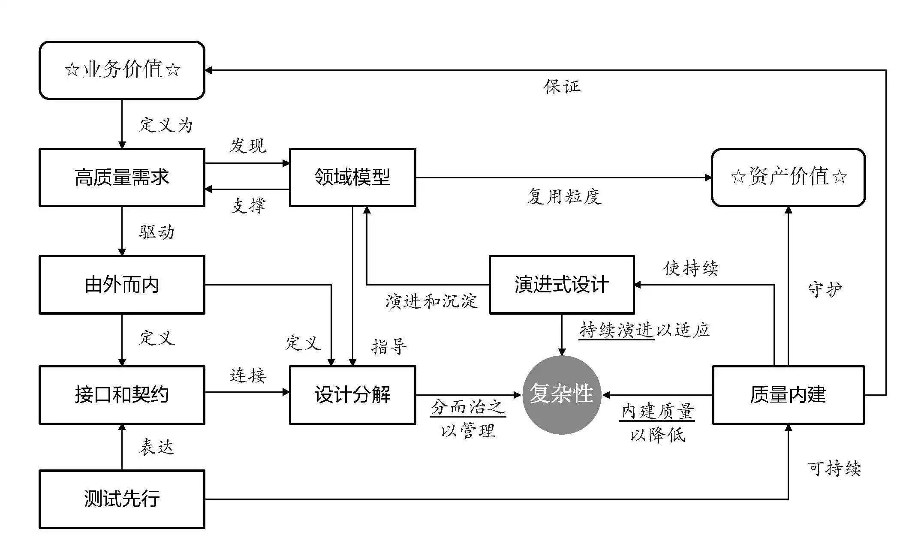

# 前言

每一位真正的软件工程师都希望自己变得更加卓越和高效。但是，有相当数量的一线工程师和大学高年级同学在掌握了基本的语言和编程框架之后，很难再上一个台阶，在能力和编程效率方面取得更大的突破。他们虽然也会去学习或了解领域驱动设计、测试驱动开发、重构、微服务等技术，但是往往会感觉这些知识入门容易、精通很难，更不要说把它们顺畅地应用在实际工作中。

产生这些阻碍的原因在于：单一的技术背后往往隐含着对软件设计能力的综合要求。例如，如果仅仅掌握了测试驱动开发的步骤，但是对软件设计的基本原则缺乏了解，就不可能做好测试驱动开发；如果仅仅掌握了领域驱动设计的概念，但是不具备良好的需求分析技能，领域模型就没有基础；如果没有掌握由外而内的编程技术，就很难做到高效。以上这些构成了撰写本书的首要目标：

- 基于现代软件工程实践，建立一个系统化的能力体系，为已经有一定编程经验，且期望提升效率的软件工程师提供一套完整的进阶指南。

## 本书的结构

本书共 12 章，按照软件工程师技能提升的顺序，分为品味篇、专业篇和卓越篇。这三部分分别覆盖了认知和技能提升的 3 个层次：辨别什么是好的设计，提升专业素养，以及掌握卓越开发实践。

- 品味篇分别从价值和特征角度，定义了什么是好的设计。只有就什么是好的设计达成共识，开发团队才能更加顺畅地协作。这一共识也是后面两部分讨论的基础。

- 专业篇讲解了现代编程实践的基本技能，包括提炼高质量需求、建立领域模型，以及实现高质量模块化设计的两个要素：高质量完成设计分解和高质量管理依赖。

- 卓越篇是本书的核心内容，也是高效编程的关键。这部分讲解了测试先行、由外而内、演进式设计等现代软件设计实践。熟练掌握这些实践可以大幅提升编程效率和质量。

本书各篇包含的章节如下。

品味篇包含 2 章。它们关注如何评判好的设计。

- 第 1 章：优质代码的外部特征，介绍如何从最终价值的角度评判好的设计。

- 第 2 章：优质代码的内在特征，介绍如何从专业人员的视角评判好的设计。

这两章的标题使用了“优质代码”这个词，而没有使用“优质设计”，这是刻意为之。在编程这个领域，真正的最终制品是代码——代码是设计的结果。唯有关心真正的结果，才可以避免纸上谈兵。当然，也唯有关心设计，代码才能具有灵魂，成为真正的高质量代码。

专业篇包含 4 章。它们聚焦设计高质量软件应具备的基本而又重要的能力。

- 第 3 章：高质量的需求。软件工程师需要关心“需求从哪里来”“系统应该做成什么样”这类基础问题。只有把需求说清楚，开发的软件才有价值。同时，需求是现代软件设计的真正灵魂——领域模型的源泉。这一章介绍了需求分析金字塔、需求分析和建模、事件驱动分析、实例化需求等实践。

- 第 4 章：领域建模。没有高质量的领域模型，设计出的软件就很难拥有易理解、易复用和易扩展等特征，业务能力也无处沉淀。这一章介绍了领域模型和统一语言等重要概念，以及发现、表达高质量领域模型的方法。

- 第 5 章：设计分解和责任分配。设计的本质就是分解和抽象。这一章的核心目标是实现好的分解，好的分解需要遵循高内聚、低耦合的设计原则。

- 第 6 章：依赖、接口和契约。分解必然意味着依赖。良好的依赖会加强设计的内聚性、可复用性和稳定性。如果缺失良好的依赖则相反。这一章介绍了依赖设计的原则、需求方接口和提供方接口等基础概念，以及提升依赖设计质量的设计契约和降低依赖强度的事件机制。

卓越篇包含 6 章。这 6 章占用了本书近一半的篇幅，重点介绍了现代软件设计的关键实践。

- 第 7 章：用测试描述需求和契约。“测试”不再是简单的测试。它是更精确地沟通需求和设计要求的手段。这一章介绍了测试先行的核心价值，给设计带来的关键变化，以及测试先行的实践，也介绍了行为测试驱动开发的框架。

- 第 8 章：用领域模型指导实现。领域模型不仅仅是问题分析和认知的工具，它还是软件实现的指引。这一章介绍了如何使用领域驱动设计的模式来指导编码，包括了基本构造块、聚合、限界上下文及上下文映射等重要实践。

- 第 9 章：由外而内的设计。由外而内、从价值出发渐进完成设计和编码。由外而内是高效软件开发的重要技能。这一章介绍了由外而内、意图导向、测试替身等重要实践。

- 第 10 章：设计质量贯穿始终。质量是可持续发展的最重要因素。没有好的设计质量，可持续就是一句空话。这一章介绍了质量内建的概念以及契约式设计、防御式编程、自动化测试、设计评审等实用方法和技术。

- 第 11 章：让设计持续演进。演进是设计的本质特性，也只有演进，才能赋予软件长久的生命力。这一章从演进式设计的视角，介绍极限编程方法的卓越实践：简单设计、重构、测试驱动开发和持续集成。

- 第 12 章：精益思想和高效编程。这一章不介绍实践性的内容，而是从精益思想的视角，对由外而内、设计质量、设计演进等实践进行了思考和分析。

## 实践之间的联系

本书列出的编程实践是互为支撑的，它们背后有着清晰的理论主线。图 1 总结了本书将要介绍的主要编程实践和这些实践之间的联系。为了便于记忆，我把它们概括为一个根本挑战、两大核心价值、三大设计原则和对应的软件设计实践。

其中，一个根本挑战指的是软件与生俱来的复杂性，两大核心价值指的是软件开发的当前业务价值（满足业务需求）和长期资产价值（复用和演进），三大设计原则指的是分而治之、持续演进和质量内建。在此基础上，图 1 列出的互为支撑的软件设计实践分别为高质量需求、领域模型、由外而内的设计开发、设计分解、接口和契约、测试先行，以及演进式设计中包含的系列软件实践。第 12 章会更详细地介绍上述概念之间的关系。

## 如何阅读本书

### 作为进阶指南

读者可以按顺序阅读本书的各章节。本书的初始目标是：支持已经掌握了基本的语言和编程框架的一线开发者，通过学习更系统的软件设计实践，成长为专业、高效的开发者。本书各章节的内容是循序渐进的，从第 1 章开始按序阅读有助于建立一个完整的体系。

当然，你也可以根据需要在各章节之间跳转。由于每一位开发者都或多或少地接触过某些知识点，所以本书的各章节尽量做到了彼此独立。如果你已经对一个话题比较了解，就可以跳过对应的章节，直接阅读感兴趣的部分。此外，书末包含索引，在其中可以找到各主要概念在本书中出现的位置。

### 作为藏宝图

本书被设计为一张藏宝图。它提供一个路线图，引导读者找到所需的宝藏。

卓越的软件设计涉及非常丰富的实践。本书追求全面而系统，所以不得不在细节上有所放弃，这也可以避免书太厚。尽管可以大幅展开任何一个章节，但是，把书变得更厚不但不会创造新的价值，还会徒增阅读难度。

在理解了根本性的原则之后，我希望读者通过阅读更多的经典书籍和大量练习加深理解。因此，在保证每个部分介绍的内容是完整的基础上，我刻意控制了每章的篇幅，把更具体的内容和做法指引到该领域的经典参考文献。读者可以通过参考文献的线索，自主进行知识检索，深入了解其中的关键实践。

### 形成团队设计共识

软件开发是集体活动。团队如果缺乏设计共识，设计出的代码就不可能易于扩展、易于维护，可能还会在具体的解决方案设计上产生不必要的摩擦。

本书介绍的设计实践特别关注了知识的全面性和系统性。它可以作为想要提升效率的研发团队集体学习和讨论的素材，希望大家可以在本书介绍的实践基础上，结合实际，形成和加深设计共识。
