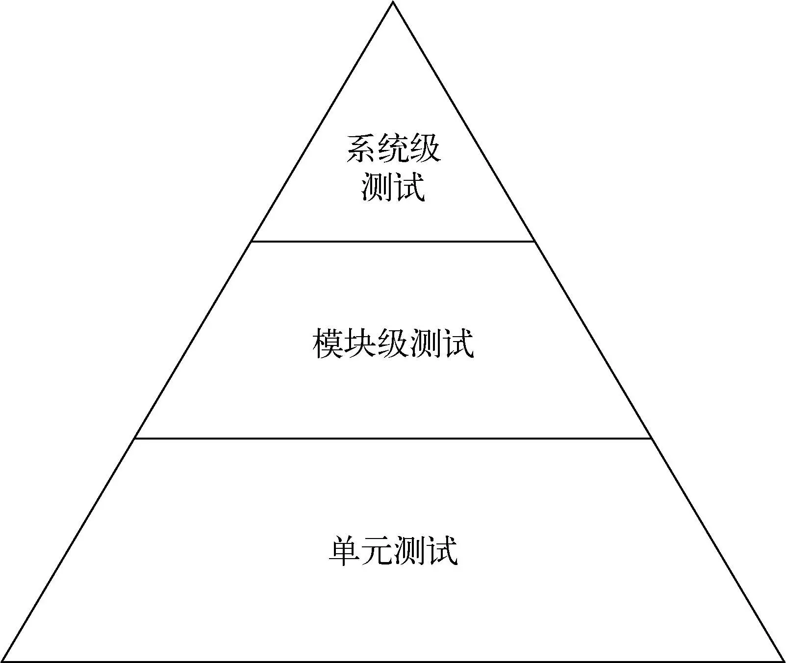
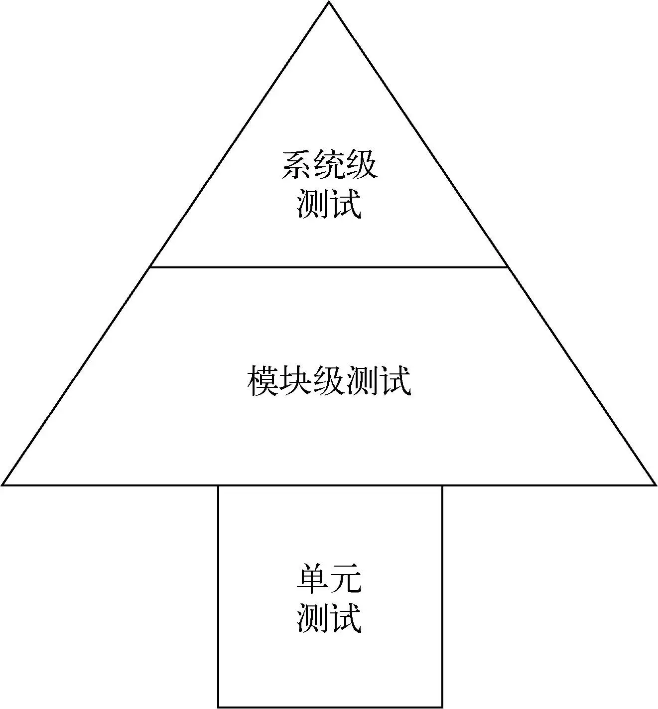

# 第10章设计质量贯穿始终(1)

没有人会认为质量不重要——但是落实到具体行动上就不尽然了。在项目进度的压力之下，牺牲质量，特别是牺牲外部看不到的可理解、可演进和可复用能力，是不少开发者和开发团队下意识的选择。这种做法本质上是饮鸩止渴，也是没有深入理解软件开发的一种表现。

质量免费。对软件开发来说，质量不仅免费，还是持续发展的源泉。质量是软件资产必须满足的特征，质量有问题的软件资产不叫资产。只有真正意识到质量价值的人和团队，才会真正注重质量的投入。

如何最有效地达成质量目标呢？仅仅是做更多的测试吗？并不是。高质量源自优秀的设计实践，包括合理的开发过程、良好的编程习惯、有效的工具等。本章将首先介绍质量内建的概念，然后分别介绍各种主要的质量保障实践。

## 10.1　质量内建

- [44]

质量管理的一代宗师戴明博士曾经提出过非常著名的“戴明质量管理十四条”

- ，其中有一条论

断是：不能依靠检验来达到质量标准。换句话说，如果一个企业需要依赖检验达成质量目标，就等于它已经接受了“生产的东西一定会包含次品”这个假设。检验有成本，检验出的次品无论是抛弃还是修复也都意味着成本。更好的做法应该是改良生产过程，尽量少生产次品。

- 质量内建意味着质量来自持续改进的生产过程，而不是检验。

第 1 章曾经介绍了缺陷成本递增曲线（图 1.2），其形象地解释了质量内建的价值。质量内建使得缺陷在注入时刻就被发现，从而降低了由缺陷导致的成本。

### 10.1.1　质量内建意味着过程模型的变化

在具体做法上，软件开发从 V 模型（图 7.1）到 I 模型（图 7.2）的转变，让质量内建成为了可能。V 模型是传统方法，是典型的通过检验来保障质量的做法。诚然，通过后置的测试活动也确实能发现软件开发的质量问题，但是由于质量的延迟成本非常高，软件的复杂性也特别高，因此在后置的测试活动中，无论是缺陷发现成本，还是缺陷修复成本都很昂贵，是不合算的。在完全采纳 V 模型的团队中，一般需要配备和开发人数差不多，甚至更多人数的测试团队，才能基本保障软件的质量。

I 模型的本质就是质量内建。由于质量保证活动和自动化测试贯穿了需求、架构、设计和编码的各个阶段，所以问题会在注入的第一时间就被发现，大幅降低了缺陷的发现成本和修复成本，更是降低了由缺陷发现延迟带来的额外成本。

### 10.1.2　质量内建意味着组织和职能的变革

I 模型意味着建设性活动（需求分析、架构、设计和编码）和质量保证活动的合二为一，这对组织和职能的设计提出了要求。传统上，测试往往由一个独立的部门负责，该部门承担集成测试、系统测试和用户接收测试等活动。独立的部门固然有技能共享方面的便利，但是容易形成职责的边界，影响合作的顺畅度。

I 模型意味着开发者测试成为趋势。首先，单元测试本来就应该是开发者测试。因为单元测试有非常多的细节，而且在演进过程中的变更也很频繁，它不可能由分离的测试部门执行。其次，对于系统级的测试，可以通过实例化需求等实践，更好地融合需求分析活动和测试活动，并让需求人员、开发人员和测试人员在同一个时空中密切协作，而不是分别进行需求分析、软件设计和测试用例设计及执行，这也重塑了各个角色所承担的职责和他们之间的协作模式。

当然，倡导 I 模型和开发者测试，并不意味着测试技能和测试活动不重要，它们反而更重要。有经验的测试人员往往具备把视角从正向的功能讨论放大到全局的能力，也具备更多的逆向思考能力和风险关注能力。测试人员在项目早期就参与讨论，有助于更早发现问题，更好地发挥测试人员的专业技能。

此外，强调质量内建，不提倡过多地依赖后置测试，不代表后置测试可以完全消失，最起码在

- [45]

当前的技术水平下，探索性测试

- 等活动仍然有着重要意义。探索性测试的优势在于它可以

脱离预设的功能范畴，拓宽思维边界，在更大的范围内发现潜在的质量问题。探索性测试建立在可以完整运行的软件的基础上，所以尽量做到质量内建不意味着全面消除后置的测试环节。

除此之外，还有一些“功能测试”之外的特殊测试类型，如安全性测试、稳定性测试、负载测试、兼容性测试等，往往需要专门的测试设施或测试技术，所要求的开发团队成员的常用技能差异较大，因此往往需要专门的测试团队来完成。

### 10.1.3　质量内建对自动化测试有很高的要求

如果软件开发的最终交付物只有代码，那么肯定谈不上“质量内建”。软件是持续演进的，如果没有自动化测试作为保障，那么后续迭代时的质量保障就无以为继。所以，无论团队中是否有专职的测试人员，质量内建的首要任务都不是执行手工测试，而是尽量把测试在第一时间自动化，从而为后续开发活动提供持续的质量保障。

### 10.1.4　质量内建意味着开发方法的升级

质量内建是一种能力。在工程能力不足的情况下讨论质量内建往往显得有心无力。本书的全部章节几乎都在服务质量内建这个目标。本章的标题“设计质量贯穿始终”，既说明了质量是一个全面内建的活动，也说明了每个阶段的活动都需要更好的实践作为支撑。例如，第 4 章介绍的领域建模，是保证软件业务认知正确性的方法；第 5 章介绍的设计分解和职责分配，是保障软件结构设计正确性的方法；第 6 章和第 7 章尤其重要，它们强调了设计契约和测试先行，把软件开发的 V 模型变为了 I 模型，带来了即时的质量反馈。对于优秀的软件开发者来说，对软件设计质量的关注覆盖了软件开发的全生命周期，从需求分析到代码实现，始终让软件的开发活动置于质量保障之下。

## 10.2　契约式设计和防御式编程

软件运行需要复杂的协作，包括系统间的协作、模块间的协作，甚至类之间的协作。为了做到更好的协作，我们在第 6 章中引入了设计契约的概念。契约是高质量软件设计的基础。可以说，不重视契约的系统肯定无法高效协作，也就更无法做到高质量。那么，契约的定义应该如何加以保障呢？

本节将要介绍的契约式设计和防御式编程，以及 10.3 节将要介绍的自动化测试，就是保障和检验契约的手段。我们先来看契约式设计和防御式编程。

契约式设计和防御式编程是面向契约的两个互补的概念，它们分别聚焦于高可靠性设计的两个不同但相关的方面。

- 契约式设计：解决的是在可控的边界内，基于契约协作的双方是否享有应得的权利，是否履行各自的义务的问题。

- 防御式编程：解决的是在不可控的边界上，如何避免外部世界的复杂性侵入系统边界的问题。

### 10.2.1　契约式设计

契约式设计的核心是契约。正是因为有了契约，协作才变得更加有效，代码也变得更加简单，系统也因此变得更加健壮。

严格遵守设计契约

契约式设计是以契约为核心关注点的设计，它强调权利和义务的对等。设计契约明确定义了各个设计单元的权利和义务。以接口的方法为例：从契约视角看，该方法只有在前置条件得到满足的情况下才提供服务，这是提供方的权利，同时也是调用方的义务；只要前置条件得到满足，那提供方必须提供相应的服务，并达成后置条件承诺的结果，这是提供方需要履行的义务，同时也是调用方可获得的权利。

契约式设计如何在软件设计中发挥作用呢？我们先来看一个例子。假如有一个短信发送模块，它接收 11 位的手机号，并向这个手机号发送一条短信。在调试过程中发生了一件奇怪的事情——接收到的调用请求中包含一个 13 位的手机号，而且前两位是 86（中国的国际区号）。问题所在显而易见，这个手机号其实是合法的。当遇到这种情况时，该如何处理呢？

有些程序员非常负责。虽然原来定义的是 11 位，但现在既然是 13 位，那不妨截取后 11 位吧。我们暂且不讨论这种做法是否合理，而是先想一下在现实世界中，你和合作方是怎么履行合同的。如果你购买了一批螺母，收到的货中有一些瑕疵，你会用丝锥加工一下，然后开始用吗？

在现实世界中，我们非常重视契约，在约定了权利和义务后，就一定会遵守约定。这很重要，为什么呢？道理很朴素：我既然履行了义务，就应该享有约定的权利。回到螺母的例子，即使抛开经济上的考量，你为供货方修补瑕疵也不是那么合适。第一，收到的货中出现次品，意味着供货方的生产线可能已经出现了某些问题，你悄悄进行了修补，供货方可能就失去了及时纠正问题的机会，会继续生产出更多的次品。第二，供货方作为专业的螺母生产厂商，应该会用更多、更专业的手段来修补瑕疵，比你用丝锥加工便利得多。

现在回到短信发送模块的例子。为什么接收到的调用请求中会包含 13 位手机号，而不是约定的 11 位？可能是前端页面忘记了做校验；可能是现在的业务已经扩展到了海外，需要通过国际区号区分不同国家的手机号；可能是在数据迁移过程中增加了区号，而你不知道确切的原因。在不知道原因的情况下，直接截取后 11 位是有很高风险的。如果真的是业务扩展到了海外，那你这个系统具不具备向海外手机发送短信的能力？费用该如何计算？这会涉及一系列问题。如果是忘记了做校验，那接收到一个 15 位的手机号时该怎么办？还是截取后 11 位吗？万一后 4 位代表的是分机呢？

要在最合适的地方处理问题。最合适的地方，是职责约定的地方。不是本模块该承担的职责，不要越俎代庖。下游模块距离问题的成因处更远，一般没法知道造成问题的根本原因，试图修复逻辑往往是典型的好心办坏事。同时，由于试图修复的逻辑本质上属于其他模块，因此很容易造成职责膨胀和知识耦合。

契约式设计的精髓就是：“有限承诺、使命必达”。在契约形成阶段，要和合作方厘清责任，定义清晰的契约。在系统运行阶段，则要严格检查合作方是否满足了前置条件，只要它没能满足，就应该拒绝服务。当然，权利和义务是对等的，我们在确保对方满足要求的情况下，应该提供正确的服务。

早崩溃，越早越好

当调用方未能满足约定的前置条件时，提供方应该如何抱怨呢？由于在开发阶段测试数据量有限，一般也不是真实数据，因此契约违反的问题往往在系统运行中才能被发现。断言（或类似断言的机制，如异常）是发现这类问题的好办法。

不过，这会引入一种让很多人担忧的问题：断言可是会导致系统崩溃的啊。抛出异常如果没有被恰当地捕获，系统就会出现严重的问题。记录一条错误日志和抛出异常相比，是不是能让系统更为稳定呢？

现在我们来了解契约式设计中的早崩溃这一概念。

- 早崩溃指的是在契约违反的第一时刻就暴露问题，并且采取严厉的措施。

早崩溃是一种优秀的软件设计实践。崩溃越多，系统越稳定，这句话听起来似乎反直觉，却是事实。与早崩溃对立的实践是尽量弥补、试图修复错误、静悄悄地忽略，或者采取不容易引起注意的记录手段。这些看起来很温和、很好心的策略，往往却会危害系统的稳定性。这是为什么呢？

第一，早崩溃最大程度地保证了上下文的精确。由于问题是在第一时刻暴露的，引起问题的原因往往和问题暴露的地方较近，这时候定位问题相对容易，修复也会比较快速。相反，如果只是在出错的地方记录了一条日志，系统继续保持运行，一个不正确的状态必然导致其他地方也出错，这会使问题更多、更严重、更难修复。

第二，由于抛出异常，特别是诸如断言的崩溃措施，后果比较严厉，它会让问题得到立即的处理，避免问题蔓延到更多的场景下。如果只是温和地记录一条日志，那么察觉时，问题往往已经蔓延到了许多地方。

- 通过早崩溃提升系统稳定性我曾经为电信系统开发过一个比较重要的模块。系统中的其他所有模块几乎都依赖这个模块，所以如果这个模块出错，问题必然会非常严重。这个模块有大约 1 万行代码，逻辑也比较复杂。怎么保证可靠性呢？好在这个模块的设计广泛应用了早崩溃的概念：在每个输入和输出关键点都加入了断言。最终，1 万行代码总共包括 150 多个断言。在开发这个模块时，持续集成的概念还没有流行，是开发完成后才对它和其他模块进行集成的。在开始集成的时候，系统几乎运行不起来，每隔几分钟就崩溃一次。对早崩溃的概念不了解的开发者一定会觉得：这个系统的稳定性太差了！事实恰恰相反。正是由于系统在早期频繁崩溃，使得每个问题都立即得到了解决。随着解决的问题越来越多，系统开始变得越来越稳定。最终，当这个系统离开实验室，被部署在生产环境的时候，变得异常稳定，从未出现过逻辑方面的缺陷。具备如此高的稳定性，背后的实现逻辑就是“早崩溃”：一切可能发现的错误，都已经通过早崩溃机制暴露并且修复了。试想一下，要是没有在测试环境中发现这些问题，那它们早晚会在生产环境中暴露出来，彼时问题的暴露点和产生根源之间应该距离很远，系统的可靠性以及修复速度自然也好不到哪里。

无论怎么解释，还是会有很多人对“崩溃”非常担心。其实不必如此。早崩溃的核心不是纠结“要不要崩溃”，只要把握好下面两个最关键的因素，那么即使系统不真地崩溃，也能达到类似的效果。第一，错误报告必须及时。第二，错误报告必须严厉。倘若系统的情况比较特别，一旦崩溃就将面临重大经济损失，那么这时候的关键思考点就变成了：在你当前的环境中，最严厉的措施是什么？用什么措施才会让问题得到立即处理？

使用不变性约束发现问题

不变性约束（invariant）是形式化方法中的一个术语，它指的是在任何情况下都为真的逻辑。

```
例如，当调用 Stack 对象的 size 方法时，如果返回值是 -1，那么无须再做任何判断，就
```

可以笃定有些地方出错了。

在契约式设计中，不变性约束是前置条件和后置条件之外的一个非常重要的内容。软件的状态是非常复杂的，软件的规模越大，可能出现的状态组合就越多。无论是在调用某个对象的方法之前检查一下是否非空，还是在某些关键的节点上检查一下必然为真的逻辑，都是利用早崩溃技术尽早发现问题的有效手段。

- 利用不变性约束发现需求遗漏我曾经参与开发过一个试卷的出题和批改系统。在分数逻辑中，有一个不变性约束是“分数不可能小于 0”（该系统没有倒扣分数的逻辑）。但在实际场景中，确实发现了分数为负的情况。于是我们对系统进行了问题排查。问题定位下来比较简单：在生成试卷之后，由于需求分析和方案设计的疏忽，没有锁定已生成试卷的题目分数。在试卷印刷出来，批改之前，试题管理员不小心更改了系统中某些题目的分数，就导致实际计算分数时出现了错误。正是因为系统会对不变性约束进行检查，所以才会在学生看到分数之前，自行发现该问题，并及时完成修复，避免严重伤害用户体验。

和契约式设计相关的语言特性

需要注意，契约式设计首先是一种设计思想，而不是语言特性。不过，契约式设计的思想最终还是要通过编程来实现。了解利用语言特性实现契约式设计的方法，有助于编写更易于维护的代码，在一定程度上还可以加强对契约式设计的理解。

(1) 使用内建的语言特性。

有些语言内建了契约式设计的特性。对契约式设计最好的支持来自 Eiffel 语言，它也是后续许多其他语言扩展契约式设计时的仿照对象。这其实并不意外，毕竟提出契约式设计的人和发明Eiffel 语言的人是一个人——Bertrand Meyer。下面我们就以 Eiffel 语言为例，介绍如何使用语言特性支持契约式设计。

契约式设计的重点在于通过断言检验契约。如前所述，有三种重要的断言：前置条件、后置条

```
件和不变性约束。Eiffel 语言相应地定义了三个关键字，即 require、ensure 和
```

- 1

```
invariant，用于支持这三种断言
```

- 。

- [46]

```
下面以前述的 Stack 为例
```

- 。

```python
class interface
   STACK[G]
feature
   count: INTEGER -- 获取栈中元素的数量
   item_at(i: INTEGER): G -- 获取某个位置的元素
       require  -- 前置条件
           i_not_overflow:
               i <= count
           i_large_than_zero:
               i >= 1
   push(item: G) -- 把一个元素压栈
       ensure  -- 后置条件
           count_increased:
               count = old count + 1;
           g_on_top:
               item_at(count) = item
invariant  -- 不变性约束
   count_should_never_negative: count >= 0
end
```

代码清单 10.1　Eiffel 语言内建了对契约式设计的支持

```
在本例中，我们看到 item_at 方法中具有前置条件。如果输入的 i 不满足条件，则程序运行
将会失败。push 方法中则具有后置条件，调用完该方法之后，count 值会增加 1，并且栈顶
的元素就是新压入栈的元素 item。此外，整个类具有一个不变性约束：在任何时刻，count
```

的值都不可能小于 0。

后续其他语言的发展基本上继承了 Eiffel 语言的机制，如在 .NET 语言中，分别通过

```
System.Diagnostics.Contracts 的 Requires、Ensures、
[ContractInvariantMethod] 支持契约式设计的三种断言。有些语言本身没有内建的断
```

言，程序员就开发了扩展机制，来完善契约式设计的断言能力。例如，Contracts for Java

- 2

（Cofoja）

- 就是一个适用于 Java 语言的契约式设计断言增强。

(2) 断言。

大多数语言拥有内建的断言机制，契约式设计的断言也是断言的一种，所以直接使用语言的断言机制来实现契约式设计也是一种可行的方案。在前面讲早崩溃时提到的电信系统的例子，就直接使用了 C/C++ 语言的 assert 机制。

和内建的语言特性相比，直接使用断言在可读性上确实有所削弱，如果涉及继承关系，也无法做到像内建的语言机制那样智能，但是由于断言极为方便，所以在多数场景下是一个可以考虑的选择。

(3) 异常。

异常对契约式设计的支持能力和断言比较相仿。无论是前置条件、后置条件，还是不变性约束，在违反了契约的情况下都可以抛出异常，并且在外部捕获异常加以处理。

(4) 基于 AOP 的校验机制。

在许多情况下，函数调用会有约定的前置条件。如果把前置条件的检查逻辑放到各个函数的调用入口处，那在一定程度上会削弱人们对主要逻辑的关注，降低它的可理解性。此外，在各处分散的逻辑也不利于管理。在 Java 等支持面向切面编程（AOP）的语言中，人们引入了更为丰富的校验机制，如 JSR380 定义的 Java Bean 校验。

下面是用 Java 语言描述的对用户数据的一个校验策略。

```java
import javax.validation.constraints.NotNull;
import javax.validation.constraints.Size;
import javax.validation.constraints.Email;
public class User {
   @NotNull(message = "姓名不可为空")
   private String name;
   @Size(max = 100, message = "描述至多允许 100 个字符")
   private String description;
   @Email(message = "Email 地址格式需要为 a@b.c"格式)
   private String email;
}
代码清单 10.2　使用 javax.validation 定义数据约束
其中，@NotNull、@Size、@Email 就是对用户的姓名、描述、Email 地址字段的校验。如
果使用 Spring，就可以在 Controller 层简单地通过 @Valid 自动校验数据的有效性。如果不
使用 Spring，则可以通过手工校验机制，如 ValidatorFactory，来对数据有效性进行校
```

验。

(5) 用单元测试支持设计契约。

单元测试是用来描述设计契约的非常有效的手段。我们已经在第 7 章详细讨论了这部分内容，在本节再次提及它，是为了强调单元测试对于契约的重要性。当然，单元测试不会在系统运行时执行，这一点和上述几种机制有所不同。也就是说，单元测试对于契约的主要价值体现在清晰的契约描述上，对于系统在运行时的契约违反的检验则无能为力。

### 10.2.2　防御式编程

契约式设计和早崩溃技术属于积极的错误处理策略，通过严格检查模块之间的依赖，能够让系统保持简单和稳定。但这种方法只是在可控的系统边界内部运作良好，在系统的边界上则不然。

在系统的边界上，情况是不一样的。假如用户只是输入了一个非法数值，系统就因此崩溃了，这显然是不可接受的。一个高质量的系统，无论外部环境如何变化、用户输入怎样的数据，甚至在遭遇刻意的攻击数据时，都会始终保持可靠和健壮。

防御式编程就是用于确保系统在边界上也可靠的方法，这意味着要始终为最坏情况做打算，防范一切需要防范的问题。例如：

- 用户给出不正确的输入；

- 消息不能及时送达；

- 服务器的响应可能超时；

- 恶意用户的攻击等。

根据具体的问题域和边界情况的不同，防御式编程的解决方案也有所不同。例如，对于第一个例子，可以给用户返回友好的提示，告知其输入的数据有错；对于第二个例子，可以采取重试的策略，以尽可能保证消息送达。此外，还可能需要使用降级策略，以避免最重要和最核心的功能受到影响。或者使用某种近似策略，如当传感器暂时不能返回数据时，使用最近一次收到的数据。虽然具体的做法不同，但目的都是一样的，就是尽量优雅地处理边界上的错误，提升系统的可用性和可靠性。

防御式编程是契约式设计得以实施的保证。图 10.1 展示了二者的关系。真实的系统面对的是一个不可信的世界——正是因为防御式编程在系统的边界上做好了防护，内部的模块之间才可简洁地定义设计契约，并基于清楚的契约进行协作。防御式编程就好比网络世界中的防火墙：内部网络之间之所以可以简单协作，恰恰是因为防火墙严格隔离了外部世界的不可信数据。


在手机号码的有效性检验这种场景中，在安全区域内应该使用契约式设计，如果经检验无效就拒绝提供服务。在边界上，则采取防御式编程。具体如何做呢？

第一步是定义安全的边界究竟在哪里。是选择用户界面作为安全边界？还是选择接口层作为边界？系统架构不同，选择也会所不同。对于前后端分离的架构，选择接口层作为边界更为合理，因为在这种情况下，用户界面和接口层之间是松耦合的协作关系，形成的是不可靠的边界。对于传统的富客户端应用，用户界面层也可以是正确的选择。

第二步是通过防御式编程的设计手段建立更好的防护，提升稳定性和易用性等用户体验。可以在用户界面上通过合适的设计以降低出错概率，如分离国家的选择和手机号的输入，提供即时的号码有效性反馈等。此外，需要在接口实现中返回友好的出错信息。最后，还要确保将错误的数据拒之门外，避免影响后续环节。

## 10.3　高质量的自动化测试

自动化测试是在本书中不断出现的话题。在第 2 章中，我们明确把自动化测试定义为了高质量代码的内部特征之一。在第 7 章中，自动化测试是一种有效的契约定义手段。在本节，自动化测试再度出现。这从侧面反映了测试和质量、契约、软件资产的演进之间具有密切的关系。在软件开发过程中编写优质的自动化测试是可持续的软件开发的根本保证，也是程序员基本素养的重要表现。

自动化测试的一个基本逻辑是低成本、高收益。当然，如果组织和编写它的方式不恰当，结果也很可能是高成本、低收益，导致自动化测试难以落地实施。如何用最低的成本获取最高的收益呢？如下是几个非常重要的实践。

- 在合适的粒度上做合适的测试。

- 编写高质量的测试。

- 关注外部契约而非内部实现。

### 10.3.1　测试粒度和测试分布

图 10.2 是测试的金字塔模型。它形象地反映了在不同测试粒度上的自动化测试的数量分布。



自动化测试按照测试粒度可以分为不同的类型，如系统级测试、模块级测试、单元测试等。之所以有这么多类型，是因为设计本质上是一个分形结构，处在各个层次上的设计单元都有其清晰定义的职责。

在每一个设计层次上的测试都是有价值的。系统级测试反映了系统在边界上的承诺，模块级测试和单元测试则分别反映了宏观设计单元和微观设计单元的责任等。任何一个层次上测试的缺失，都会导致对应层次上的责任无法得到保证。这正如建造一座房子，首先每个小的部件，如钢梁、窗户等，在各自出厂前都是经过检验的；在房子的建造过程中，又需要就整体结构进行检验；在验收阶段，还需要就最终的成品进行检验。

不过，在软件开发实践中，细粒度的检验常常得不到足够的重视。许多开发团队要么是没有自动化的单元测试和模块级测试，要么是虽然曾经有自动化测试，但随着设计演化，自动化测试已经变得过时，不再那么可信，总之最终仅仅保留了系统最外围的接口测试，甚至只保留了用户界面测试。这是不合适的。

图 10.2 是自动化测试的理想分布图。金字塔的各个层次仅仅是示意，它也可以是四层甚至更多层，或者可以把系统级测试替换成接口测试和界面测试。不过最本质的是测试金字塔所表达的核心概念，即下面这段。

- 尽可能在细粒度的设计单元上提供充分的自动化测试，从而在大粒度的设计单元上主要聚焦于本层次的设计正确性。

在实际工作中，非常多的团队出于种种原因不编写自动化的单元测试和模块级测试用例，而把系统级测试作为质量保障的主要手段。这是非常有害的。如果细粒度测试的质量没有保障，那在系统级别上进行测试时，就会发现很多单元设计和实现层次的问题，从而需要付出更多的调试成本和修复成本，并且延长系统级测试的时间——细粒度的问题，应该在细粒度发现。

想要实现测试金字塔期望的测试分布，不仅仅是改变意识这么简单。越是细粒度的测试，数量就越多。方法要是不当，成本就会更高。同时，细粒度的测试更容易随着设计职责的变化被破坏。第 7 章已经介绍的测试先行是保障测试金字塔的重要手段。

图 10.2 并不适用于已经存在多年的遗留系统。对遗留系统来说，设计职责往往划分得不是那么清晰，甚至很难清晰说出“单元”的概念，贸然通过补充单元测试去满足测试金字塔的要求，在大多数场景下是不值得的。当探讨测试粒度和分布的时候，要注意成本和收益才是真正的评估标准。面向遗留系统，可以更加强调较大粒度的设计单元的资产价值，仅仅在条件具备且必要的地方加入少量的单元测试。图 10.3 展示了一个在遗留系统中更务实的测试分布图。



### 10.3.2　编写高质量的自动化测试

用正确的方法编写高质量的自动化测试，才能让自动化测试持续地发挥作用。我们首先介绍编写自动化测试时遵循的 FIRST 原则，然后介绍测试的四阶段模式和测试夹具的概念。

FIRST 原则在自动化测试中，常常会出现一些不期望的反模式，如测试运行缓慢、测试运行结果不可靠、模块彼此之间存在依赖等。针对这些反模式，人们在实践基础上总结了若干自动化测试的原则，其中比较有名的是 FIRST 原则。

FIRST 由 Fast、Independent、Repeatable、Self Validating 和 Timely 这 5 个单词的首字母组成。下面分别介绍这五条原则。

(1) 运行必须快速——Fast。

自动化测试的核心价值就是可以反复运行以提供质量保障。最好是系统一有修改，就立即运行测试以发现问题。

但是，有些自动化测试运行得实在是太慢了，以至于开发者不得不在下班前才开始运行测试，等第二天上班后再查看结果。如果结果是正确的还好，如果是错误的，或者是在运行过程中出了某些问题导致运行中断，那一个晚上就白白浪费掉了。

快速执行是自动化测试能够有效的核心。如果测试运行得缓慢（有时虽然单个用例不算慢，可当测试集相当庞大时，运行一次完整的测试往往需要相当长的时间），就阻碍了测试的及时反馈。

究竟多快才算快呢？根据测试类型的不同，运行频率的不同，对“快”的定义也有所不同。在测试金字塔中，越靠近底层，测试数量越多，运行越频繁，要求的速度也就越快。相应地，处在测试金字塔顶部的测试类型，由于用例数量相对较少，运行也不那么频繁，对速度的容忍度就稍微高一些。一般来说，单元测试的运行速度如果超出十毫秒这个量级，就算比较缓慢了。而对于系统级测试，即使运行速度稍微慢一些，也仍然可以接受。

要编写运行速度快的自动化测试并不困难。在大多数时候，测试的计算逻辑不会很复杂，被测试系统的响应速度也不会真的特别慢，最关键的问题是如何解耦外部依赖。

过多或者过深的外部依赖是导致测试缓慢的首要因素。如果测试还依赖数据库、网络等本身就比较缓慢的设施，那问题就更严重了。单元测试尤其应该减少外部依赖，首选的技术手段是使用测试仿冒工具（如 Mockito）来仿冒依赖（见 9.3 节），如果这在特定场景下确实不可行或者会增加测试的复杂度，那么可以使用更快的替代品，如内存数据库或一个虚拟的本地网络环境也是可能的选择。

(2) 让每个测试尽量保持独立——Independent。

独立性指的是一个测试的成功运行不应该依赖于其他测试的成功运行。经验不足的开发者很喜欢按顺序编写测试。例如下面这样。

- 第 1 个用例创建了一个用户账户。

- 第 2 个用例创建了一个菜品。

- 第 3 个用例选择了该菜品，创建了一个订单。

- 第 4 个用例基于上一个用例创建的订单完成了支付。

- ……

这样来设计测试用例，一定程度上是受传统手工测试的执行方式影响——用尽量少的步骤完成尽可能多的场景测试。但是，在自动化测试场景中，这种测试用例的设计方式会带来以下几个不良后果。

- 如果前序测试失败，那之后的测试也必然失败。此时再去分析究竟是哪几个测试失败了就很困难了——到底是测试真的失败了，还是由于测试的前置条件没有被满足而失败了。

- 测试运行的成功与否依赖于测试用例的运行顺序。有些自动化测试框架并不能保证用例运行的顺序就是编写的顺序。如果测试不独立，就很容易出现问题。

- 由于存在运行顺序的依赖，因此如果试图在软件演进过程中更改某些用例，或者重新组织测试用例，就会受到约束。

上述分析针对的是测试用例之间彼此不独立的情况。还有一种更糟糕的“不独立”的做法是：把上述的几个用例要测试的内容全部写到一个用例里面。这样做，在用例这个级别确实是独立了，但是用例内部变得非常复杂，违反了一个功能一个测试的原则。这是一种更加不可取的做法。

自动化测试是为质量保障而生，简单和可靠是对其的基本要求。所以，必须保持测试用例的独立性：测试用例应该自己负责创建初始条件、自己负责清理环境，而不是依赖于其他测试用例的执行结果。我们即将介绍的四阶段模式，就是保持测试用例独立性的基本手段。

(3) 可重复的测试——Repeatable。

可重复指的是对同一个版本的被测试系统运行同一个测试，总是能确定地返回成功或者失败。

测试用例需要可重复，是一个看起来比较容易，实际上很容易违反的要求。有一定经验的开发者想必都曾有这样的经历：某个测试用例运行失败了，可如果重新运行一次或者换一个测试环境运行，又运行成功了。这种“一会儿成功、一会儿失败”的测试，比持续失败的测试还要糟糕很多。

首先，运行结果具有不确定性会让测试用例失去它的根本价值：提供可靠的反馈。由于存在不可信的测试，所以不得不多次运行，以得到一个相对可信的结果。这是我们不期望的。此外，一会儿成功、一会儿失败的测试还会给调试带来烦恼。

为什么测试用例会不可重复呢？有时候人们会想当然地把问题归结为被测试系统不可靠。固然这样是会导致测试用例不可重复，但它并非主要原因。最常见的原因是采用了不正确的测试策略，例如下面这几种情况。

- 包含网络通信且假定网络是可靠的：如果被测试系统在测试场景中包含网络通信，那么由于网络可能存在不可靠行为，因此测试有可能失败。

- 依赖于同一个数据库且测试不独立：当不同的被测试用例都依赖于同一个数据库时，若是有些前序的测试用例在拆除部分没有被处理干净，就有可能对后续测试造成影响。

- 依赖于同一个资源且造成竞争：如果测试用例需要用到较多的资源，如内存或文件，那么当多个用例并行运行时，就可能出现资源征用或资源不足的情况。

- 依赖于预定义的数据，而数据被无意更改了：测试用例依赖的数据不是在测试上下文中创建出来的，而是预先写进数据库的数据。这些数据在某些场景下会被其他用例或者人为更改。

- 测试运行依赖于特定的环境：测试用例使用了操作系统相关的数据。如 Windows 和 Linux中的换行符及文件分隔符、路径设定、临时目录等都不相同，如果测试用例中包含这些数

- 据，那么从一个运行环境切换到另外一个运行环境时，测试就会运行失败。

下面是一些可以应对这些问题的测试策略。

- 尽量对不可控的外部环境进行隔离。如果实在没法隔离，就把场景替换为更可控的，如把网络数据库替换为本地内存数据库、把网络通信替换为本地通信等。

- 保持测试用例的独立性和完整性。尽量在测试用例或测试套件中设置需要用到的测试数据，而不是把测试数据和测试用例放置到不同的位置。

- 约定标准的测试运行环境。如果不现实，就考虑不同测试环境的兼容性，如使用与操作系统无关的测试数据生产方法。（举例：临时文件系统和文件分隔符。）

此外，测试中包含外部资源不仅容易造成测试用例不可重复，同时也是测试运行缓慢的常见原因。消除不必要的外部依赖，往往能提升测试运行的效率。

(4) 自动化测试意味着自我验证——Self Validating。

自我验证是自动化测试的基本要求。经验不足的程序员在编写测试用例时，有时候只是把自动化测试当作了自动运行测试的手段，并未让自动化测试进行自我验证。

例如，在运行了自动化测试之后，由于测试的结果是写在数据库的，所以还需要测试人员登录数据库控制台，查看期望的数据是否写入了数据库表。这是一种非常典型的不能进行自我验证的自动化测试。毫无疑问，运行这种测试的成本非常高昂。

如果发现测试用例的验证环节居然是外部不可验证的，那这往往反映了测试用例在设计上的问题：是不是应该进行黑盒测试却做成了白盒测试？是不是系统缺乏了某些必要的查询机制？是不是设定了不正确的测试范围？在任何情况下，都不能牺牲测试的自我验证特征。如果一个测试不能自己判断是运行成功了还是失败了，需要人工的介入，那么这种测试就不是真正的自动化测试。即将介绍的四阶段模式，其中的第三个阶段就是“验证环节”。

(5) 自动化测试必须及时编写——Timely。

几乎没有人会否定自动化测试的重要性。但是到了实际的开发活动中，大家总是会自觉不自觉地要给予产品代码更高的优先级。特别是当项目压力紧张的时候，就变成了这样：“先完成产品代码，以后再去补充自动化测试”。这个说法在大多数时候只是一种自我安慰，无数事实证明这些以后补齐自动化测试的承诺往往是兑现不了的。这是为什么呢？这不仅是因为还有后续项目的压力，还有后补测试根本就是一种不现实的想法。

背后的原因非常简单：自动化测试脱离当时的上下文后，在以后补充测试时就不得不回忆原来的需求的各种场景和分支、原来的模块职责和种种异常、原来的设计思路。这些内容充斥了大量细节，一般是没有办法回忆得清清楚楚的。所以，即使勉强补充了一些自动化测试，也会有大量遗漏。总而言之，在自动化测试领域，一个规律屡试不爽：在当下没有做的事情，在未来大概率也不会做。

及时是让自动化测试发挥最大价值的做法，而测试先行是及时的极致。如果当你写完代码时，发现自动化测试早已准备好，无须任何手工测试，一键运行即可，你一定会很开心、很快乐。

及时还在一定程度上改变了自动化测试代码的维护主体。在传统团队中，往往会设一个专门的自动化测试团队，负责编写系统级测试或者模块级测试，甚至还要负责编写单元测试。但是，当考虑到及时性时，如果这个专门的自动化测试团队不参与需求分析、架构设计和编码活动，那么自然不可能做到及时。所以，强调及时不仅能够保证单元测试成为真正的开发者测试，还能促进专职测试人员参与到需求和架构阶段的活动中。

四阶段模式

执行测试的四个基本步骤分别是建立、执行、验证和拆除。在编写自动化测试时应该非常显式地表达这四步。具体如下。

- 建立意味着为要执行的测试做好准备，如初始化数据、初始化依赖关系、创建被测试对象或被测试系统等。

- 执行和验证是真正的测试过程。其中，执行是对被测试系统发出指令，可以通过命令行、API 接口，或者调用类中的方法等。验证是检查被测试系统是否做出了正确的响应，如返回了正确的数值、达到了特定的状态、发出了特定的指令等。

- 拆除是一个可选的阶段。它适用于测试产生的数据或所做的状态更改可能影响后续测试执行的情况。请读者注意，大多数情况下，应该尽量避免测试之间彼此影响，即减少共享的数据和状态。这时，拆除动作就可以省略。当不得不共享某些数据或状态时，拆除动作就是必须的。通过拆除动作，将系统恢复到测试执行之前的状态，避免对后续测试造成影响。

请看下面的测试代码。

```java
public class OrderApplicationTest {
   @Test
   public void createOrderShouldBeSuccess() {
       /* 1. 建立 */
       OrderApplicaton orderApplicaton = new OrderApplicaton(null);
       List<OrderItemDTO> selectedItems =
           Arrays.asList(OrderItemDTO.build(FoodId.of("food_1"), 1),
                         OrderItemDTO.build(FoodId.of("food_2"), 1));
       /* 2. 执行 */
       OrderDTO order = orderApplicaton
           .create(new OrderDTO().userId("user-1").items(selectedItems));
       /* 3. 验证 */
       assertEquals(OrderStatus.SUBMITTED.name(), order.getStatus());
       assertEquals(2, order.itemCount());
       /* 4. 拆除（仅为示例，本例中可省略）*/
       orderApplicaton.delete(order.getId());
   }
}
```

代码清单 10.3　测试的四阶段模式示例

```
以上测试代码由代码清单 9.27 改编而来，把四个测试阶段集中到了一起，将 setUp 方法中的
内容放入测试方法 createOrderShouldBeSuccess 中，并且显式地清除了测试过程中创
```

建的新订单。为了便于理解四阶段模式，我在代码清单 10.3 中添加了注释，大家在实际工作中也可以通过空行布局，显式地体现四阶段模式，以便于测试代码阅读。

当然，四阶段模式并不总是出现在同一个方法中，甚至在代码中呈现的顺序也有可能变化，但是执行的时候，一定是严格遵循四阶段顺序的。如果我们分析代码清单 9.27，会发现它也是

- 3

```
严格遵循了四阶段模式，只不过它的建立动作位于被 @BeforeEach 修饰
的 setUp 方法
中，由于 setUp 方法总是可以重新创建 orderApplicaton 对象，自然消除了
createOrderShouldBeSuccess 方法带来的系统状态影响，从而可以省略掉拆除阶段的代
```

码。

我们再来看一个新的自动化测试。

```java
public class OrderApplicationTest {
   @Test
   public void shouldNotExistMoreThanOneActiveOrderPerUser() {
       /* 1. 建立 */
       String userId = "user-1";
       OrderDTO order = createOrder(userId);
       /* 3. 验证 */
       assertThrows(ActiveOrderAlreadyExistedException.class, () -> {
           /* 2. 执行 */
           createOrder(userId);
       });
   }
   private OrderDTO createOrder(String userId) {
       List<OrderItemDTO> selectedItems =
           Arrays.asList(OrderItemDTO.build(FoodId.of("food_1"), 1),
                         OrderItemDTO.build(FoodId.of("food_2"), 1));
       OrderDTO order = orderApplicaton
           .create(new OrderDTO().userId(userId).items(selectedItems));
       return order;
   }
}
```

代码清单 10.4　测试的四阶段模式示例：测试异常情况

```
让我们把注意力集中在 shouldNotExistMoreThanOneActiveOrderPerUser 这个测试
方法上。在代码清单 10.4 中，我们提取了 createOrder 方法和 deleteOrder 方法，以简
```

化测试代码的编写，也让测试代码更易读。本例测试的是一个异常场景。如前所述，这段测试代码从布局上看，执行阶段和验证阶段好像是反的，但是从实际执行顺序上，肯定还是首先进

```
行了 createOrder 的尝试，然后发现该异常并检查，它也同样遵循建立 - 执行 - 验证 - 拆除
```

的步骤。

和代码清单 10.3 相比，代码清单 10.4 展示了一个对异常行为的测试。验证的预期可以分为三类，分别是查询、异常和命令。查询类的预期指的是被测试系统给出了期望的结果或者进入了期望的状态，测试代码通过调用查询接口获取数据，然后执行断言。这类测试的验证方法如代码清单 10.3 所示。异常类的预期，往往通过测试框架提供的异常验证能力完成验证，如代码清单 10.4 所示。还有一类是对命令的验证，即被测单元是否对外发出了所期望的指令。这类预期一般需要通过 mock 工具验证被测试系统对外发出的命令。代码清单 10.5 就是一个命令类型的预期验证示例。

```java
   @Test
   public void createOrderShouldTriggerOrderCreatedEvent() {
       EventNotifier eventNotifier = mock(EventNotifier.class);
       OrderApplicaton orderApplicaton = new OrderApplicaton(eventNotifier);
       List<OrderItemDTO> selectedItems =
           Arrays.asList(OrderItemDTO.build(FoodId.of("food_1"), 1),
                         OrderItemDTO.build(FoodId.of("food_2"), 1));
       OrderDTO order = orderApplicaton
           .create(new OrderDTO().userId("user-1").items(selectedItems));
       verify(eventNotifier).notifyEvent(any(OrderCreatedEvent.class));
   }
```

代码清单 10.5　测试的四阶段模式示例：验证对外命令

良好地组织测试用例——测试套件和测试夹具

测试用例是最小的自动化测试的粒度。在大多数情况下，它测试的是系统的一个单一职责下的某一个场景。例如，对于用户注册这个功能来说，我们可以设计出如下的测试用例。

- 成功注册用户。

- 如果用户名字符长度超出限定的字符长度，注册失败。

- 如果用户名已经存在，注册失败。

- 如果用户的初始密码不符合规则，注册失败。

我们希望这些密切相关的测试用例被组织到一起，而且最好不要和其他的功能混在一起。这就是测试组（Test Group）或者测试套件（Test Suite）的概念。

- 测试组和测试套件代表了紧密相关的一组测试用例。

在 JUnit 中，测试套件是通过把测试用例写在一个 Test 中实现的，代码如下所示。

```java
public class UserRegistrationTest {
   @Test
   public void registrationShouldBeSuccessful(){}
   @Test
   public void registrationShouldBeFailedIfUserNameTooLong(){}
   @Test
   public void registrationShouldBeFailedIfUserNameExisted(){}
   @Test
   public void registrationShouldBeFailedIfPasswordNotMatchRule(){}
}
```

代码清单 10.6　使用测试套件组织测试用例

测试夹具（Test Fixture）是和测试套件相关但不同的概念。夹具是来自机械加工行业的隐喻，其作用是固定加工工件，从而方便后续的处理。所以，一般来说，把具有相同的建立动作的测试用例集中在一起，可以简化测试用例的编写。在测试工具中，有些有单独的 Test Fixture 能力，更多时候则是把具有相同的建立动作的测试用例集中在一起，形成一个测试组。

例如，在创建订单的各种测试用例中，都需要在建立阶段创建一个用户。虽然分别在每个测试用例中执行这个动作也是可以的，不过会显得重复。这时候就可以写一个通用的建立动作，并把这些测试用例放到一起，这样就形成了如下代码。

```java
public class OrderCreationTest {
   String userId;
   @BeforeEach
   void setup() {
       userId = createUser("zhangsan");
   }
   @Test
   public void createOrderShouldBeSuccess() {
       /* 直接使用 userId 创建订单 */
       createOrder(userId);
       /* 其他代码略 */
   }
   @Test
   public void createOrderShouldTriggerOrderCreatedEvent() {
       /* 直接使用 userId 创建订单 */
       createOrder(userId);
       /* 其他代码略 */
   }
}
```

代码清单 10.7　使用测试夹具统一管理建立和拆除动作

```
其中，@BeforeEach 是 JUnit 定义的注解，它表示自动化测试框架在运行每个测试用例之前
都要运行 setup。同理，也可以使用自动化测试框架管理测试用例之后必须运行的动作，这
类动作对应的注解是 @AfterEach。
```

对比代码清单 10.6 和代码清单 .7，会发现测试夹具中包含的测试用例很可能也是相关的。在这种场景下，测试组和测试夹具的概念确实有所重叠。在实际应用中，只要明白这两个概念之间的区别，在编写和组织测试代码时就可以更加灵活。

让每个测试用例的责任明确，清晰易懂

测试代码和产品代码一样，都是重要的软件资产。因此和产品代码一样，易于理解和易于维护对测试代码而言也是非常重要的。

一致的编码风格、清晰的命名、简洁的实现、声明式的表达、单一职责等适用于产品代码的手段，也都是提升测试代码质量的手段。例如，在代码清单 10.7 中，

```
createOrderShouldBePersistent 和
createOrderShouldTriggerOrderCreatedEvent 这两个名字很明确地表达了测试的目
的，createOrder 则是对具体如何创建订单做的方法封装，提升了测试代码的表达力。
```

### 10.3.3　关注外部契约而非内部实现

这里我们来谈两个关键的测试概念——黑盒测试和白盒测试，以及它们和自动化测试的关系。

根据是否需要了解被测试对象的内部结构，测试理论把测试分为了黑盒测试和白盒测试。

- 黑盒测试又称为行为测试，它关心的是被测试系统是否做出了期望的行为。

- 白盒测试又称为结构测试，它关心的是测试动作是否完全覆盖了被测试系统的所有内部结构（如语句、分支等）。

这两种测试各有其价值，但是在实践中经常被误解。例如，单元测试是白盒测试，因为单元测

- 4

试需要了解内部结构。

- 这种说法非常普遍，甚至很多教科书和参考书也是这样定义的。这其

实是对“被测试系统”这个概念的误解。

“被测试系统”其实就是当前测试所关注的对象。在系统粒度上，它当然是一个系统。而在单元粒度上，它就只是一个被测单元。所以，只要关注的是被测试系统的外部契约，那么就是黑盒测试。只有当关心的是被测试系统的内部实现时，才是白盒测试。按照这样的定义，我们以测试先行的方式编写出的测试，究竟是黑盒测试还是白盒测试呢？

以测试先行方式编写出的测试，无论是系统级测试、模块级测试，还是单元测试，统统都是黑盒测试——因为它们反映的都是被测试系统的行为，而不关注被测试系统的内部结构。现在我们就面临一个新的问题：既然测试理论包含了黑盒测试和白盒测试，那么是否还需要为白盒测试编写自动化测试用例呢？

- 没有特殊理由，不需要编写自动化的白盒测试。

白盒测试当然是有价值的，但在很多时候它是被误解和被误用的。我们首先给出结论。

- 黑盒测试是关于价值的，白盒测试是关于风险的。

- 作为测试先行的自动化测试，仅仅应该实现黑盒测试。

白盒测试可以帮助发现风险

白盒测试作为结构测试，关心的是代码的内部结构。测试理论认为：白盒测试属于知己知彼，熟悉内部结构可设计出更好的测试，也有助于发现潜在的安全隐患或者优化机会。例如下面两点。

- 如果某些代码行没有被测试覆盖，那很可能是有缺失的测试用例或者冗余的代码。

- 分析功能的实现可以发现系统上的薄弱点。

避免自动化白盒测试

尽管白盒测试可以帮助发现风险。但是，如果把白盒测试直接以白盒的形式自动化，会带来显然且致命的危害。

软件会持续演进。如果白盒测试追求的目标是代码行覆盖、分支覆盖等，那当在演进过程中添加了新代码、删除了旧代码、调整了业务逻辑时怎么办呢？这些白盒测试很可能就被破坏了。所以，尽管功能依然正确，测试却失败了，这无疑降低了测试的权威性。

正确对待白盒测试的态度是：在基于契约进行测试的基础上，结合覆盖率、内部结构等，以发现额外的风险，并把这些风险实现为自动化测试。但是，自动化测试仍然需要以外部契约的形式进行测试，不允许测试和被测试系统的内部结构相关，更不允许读取被测试系统的内部数据和状态。

[1]：Eiffel 语法可参见 。

[2]：。[3]：是 JUnit 中和测试夹具相关的一个注解，10.4 节有详细的介绍。[4]：注意：这是错误的说法。
