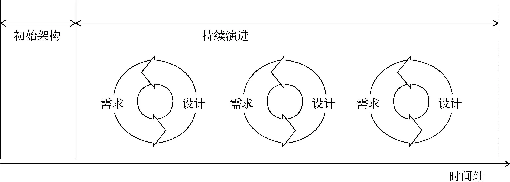
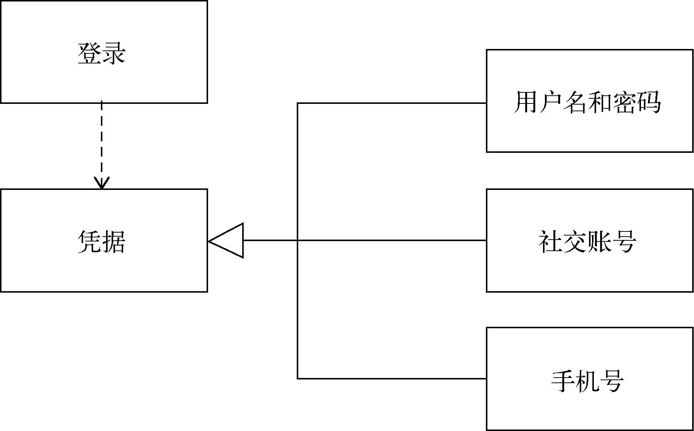
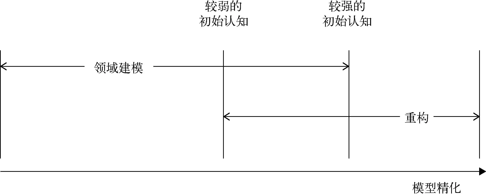
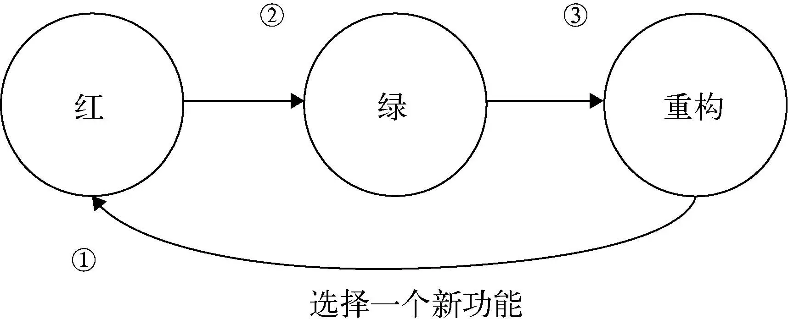
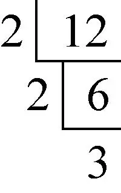
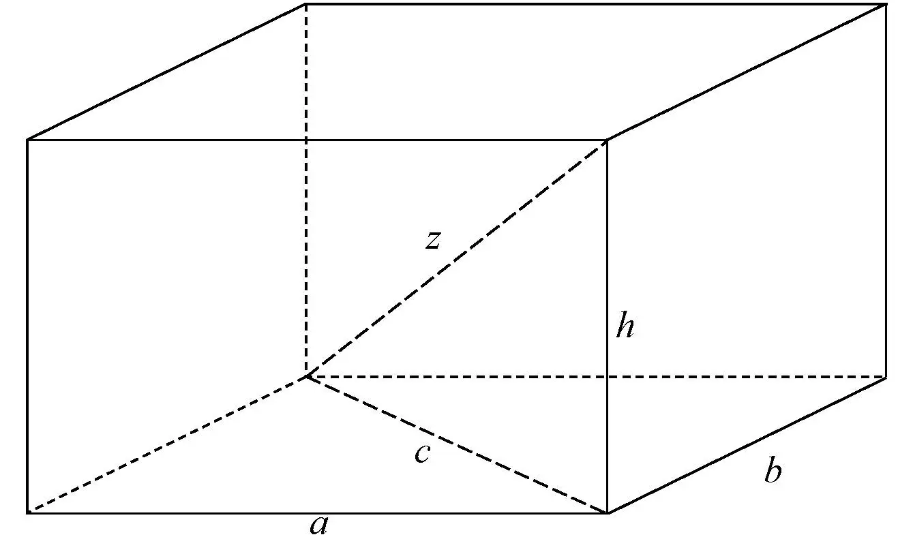
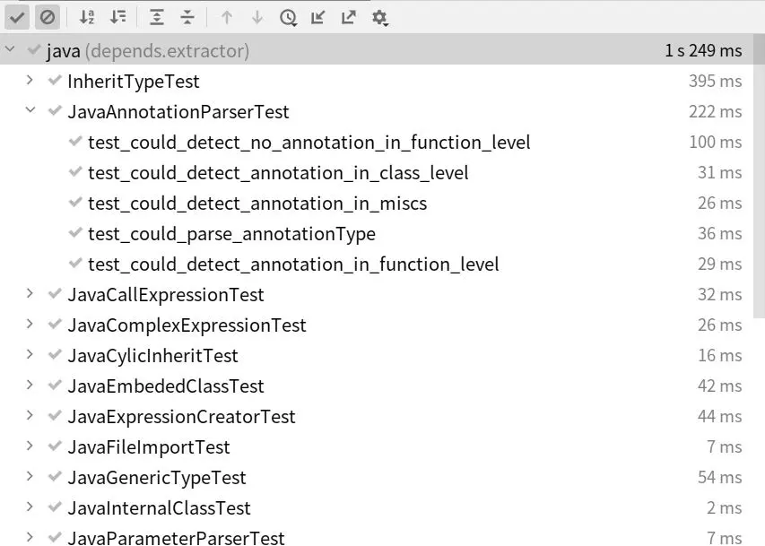
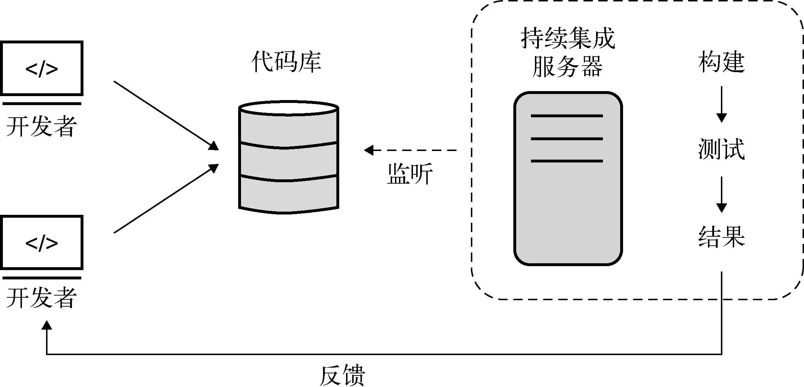
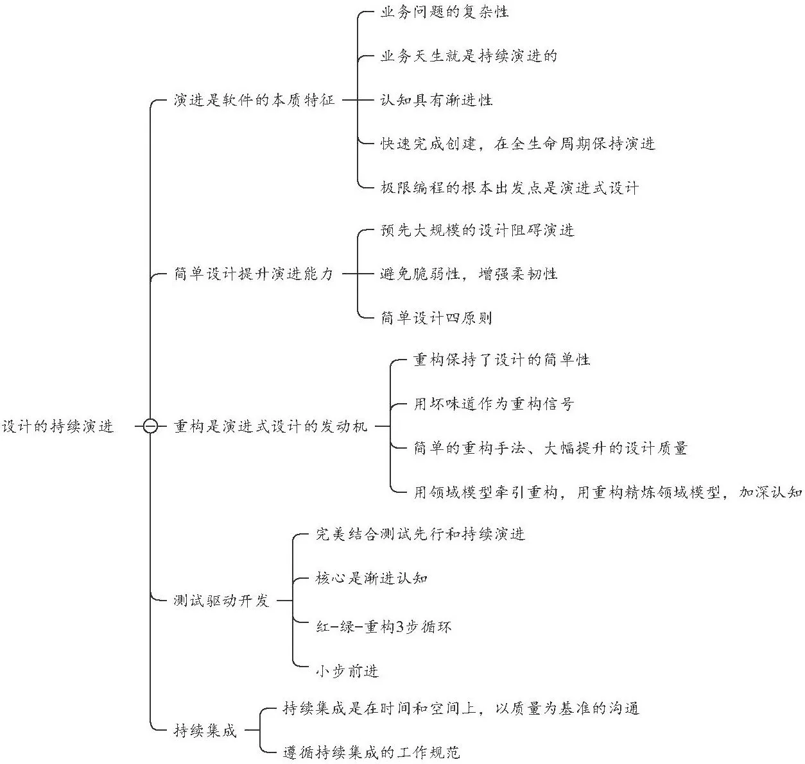

# 第11章让设计持续演进

演进是软件的本质特征。在人类通过智力劳动创造的一切事物中，软件大概是最为独特的了。这不仅是因为软件很复杂，更重要的是软件具有可变更和可演进特征。“软件”这个名字本身，已经充分凸显了这一点——软件应该是“软”的。

不过，如果设计方法不当，软件就可能一点也不“软”，面对纷至沓来的变更需求，往往很难轻松适应。而且随着软件的持续“生长”，一些在初期看起来写得很好的代码，很快变成了人见人厌的“遗留代码”，变得难以理解、维护和扩展。

持续演进必须成为软件内建的能力。为了达成这个目标，本章将从如下三个方面讨论演进式设计。

- 软件设计的演进本质：为什么必须用演进式思维来设计软件？在 11.1 节，我们将讨论用“生长”思维开发软件的重要性。

- 简单的设计才是易于演进的设计：什么样的软件特别适于演进呢？或许和有些读者想的不一样——一个系统如果做了很多预先设计，那么它在面临新的场景时反而非常脆弱。在 11.2节，我们将介绍简单设计，并把它和大规模预先设计比较。

- 演进式设计的思维方法和实践：演进式设计本质上是一种思维方法，是一种持续的探索过程和适应过程。11.3 节要介绍的重构和 11.4 节将要介绍的测试驱动开发都是重要的演进式设计技能。

- [7]

熟悉极限编程

- 的读者应该已经发现，简单设计、重构、持续集成、测试驱动开发、代码集体1

所有制都是来自极限编程的实践，确实如此。从技术实践

- 角度看，极限编程的根本出发点就

是演进式设计。

## 11.1　软件设计的演进本质

软件设计的本质是演进，不过最开始人们并不是这样认为的。软件工程之所以被命名为工程，很大程度上是因为向成熟的工程领域学习。工程是按照严格的步骤执行的一系列活动。比如，我们可以把软件设计类比为建筑设计，那么很自然地就会想到：首先进行需求分析，然后进行架构设计，接下来严格按照设计开始建造，建造完成后进行项目验收，之后就进入了维护阶段，整个工程过程也就完成了。

两个领域在许多方面具有一致性，如要了解用户需求、要有高质量的架构等。但是在建筑领域，很少出现在大楼建造完工之后进行大幅修改的需求，用户即使有什么不满意，也只是在充分考虑可行性的基础上适当地调整。

软件开发则完全不是这样。可以说，根本不存在一次写就，此后再也不需要变更的软件。大多数软件解决的是现实世界的业务问题。业务问题往往很复杂，导致认知不能一步到位，需要通过软件演进来持续地实现认知升级。同时业务自身也在不停地演进，这就更需要软件持续演进，来适配业务要求的变化。持续演进是对软件的根本性要求。

### 11.1.1　业务问题的复杂性要求持续演进

有些业务问题看起来很简单，但只要一深究，就会表现出它的复杂性。

有经验的开发者都有这样的体会，一些对软件开发缺乏理解的用户，往往很难理解为什么一个功能实现起来会如此复杂。“不就是增加一个功能吗？”他们经常会发出此类疑问。以一个外卖订餐系统为例，订单项中应该有一个送货地址，这个功能乍一看不算复杂，可只要结合真实场景多想一下，就会挖掘出非常多的业务逻辑。

- 地址要按照什么样的层级划分？是按行政区，还是商圈？

- 为了避免让用户重复输入，是否需要某种“常用地址”机制？

- 如何提升用户的输入效率？哪些常用地址应该出现在前面？

- 是否可以基于用户定位信息推荐地址？

- 地址可能涉及用户隐私，如何平衡便利性和保护机制？

- ……

诸如此类的细节实在太多了。关键是，如果想把一切都想清楚后再开始实现，几乎是不可能的。只有选一些比较确定的需求先实现起来，甚至在这个基础上再开展一些业务，后续的认知才能逐渐加深。压根不踏入一个领域，就想成为这个领域的专家几乎是不可能的。

这种“边做边升级”的模式会让自己对业务的理解逐步加深，逐渐发现业务中关于种种细节的合理选择，也逐渐接近问题域的本质，让软件获得持续演进。

### 11.1.2　业务自身会持续演进，导致软件必然演进

业务在空间上就已经很复杂了，再引入时间维度，复杂性就会更高。业务除了在不停地演进，演进方向往往也很难预测。

例如，在一个社区订餐系统中，肯定会有一个菜品的展示页面，用于说明菜品的名称、价格等信息。但是，需不需要增加折扣功能呢？这完全取决于业务的发展需求。如果业务模式非常受欢迎，每天的菜品总是供不应求，那折扣这个功能似乎就是浪费。

与此同时，一些原来未曾想到的功能，如更精准的备货预测、更丰富的货源信息，反倒可能出现在模型中。在快速变化的商业时代，想要完美地开发，甚至预测恐怕是完全做不到的，提升适应性、做到灵活应变才是根本。

### 11.1.3　用园艺而不是建筑来隐喻软件设计

人们对于软件设计的本质的认识经历了漫长的过程。从最初尝试“控制变化”到敏捷方法推荐的“适应变化”，经历了几十年的时间。直到 2000 年左右，敏捷运动兴起，人们才充分意识到变化不是偶然现象，而是软件问题的本质。

敏捷方法强调快速迭代，这首先需要有软件工程实践作为支撑。如果每次增加一个很小的功能就会带来高昂的成本，那快速迭代自然没法完成。

从这个视角看，对设计软件更合适的隐喻不是建造大楼，而是建造园林。大楼的建造可以说是一次性的，建完之后的大楼整体结构几乎无法更改。园林就不一样了。一个园林在造好之后，新增几座假山、把树移栽一下，甚至开辟一条小河都不会造成“伤筋动骨”的影响，反而会让园子更有生机。

这么说来，软件工程师应该把自己当成园丁，提高自己的审美能力和柔性设计能力。在园林规划中，迪士尼乐园曾经创造性地使用了演进式设计的思维，并获得了巨大成功。设计师当时所采用的方法，已经是当今园林设计的标准实践。

- 迪士尼乐园的路径设计在园林设计中，如何设计游园路径，从而让各景点之间的连接最方便又与众不同，是非常考验智慧的。如果设计不合理，就很可能会导致这样的结果：游客不走设计好的路径，而那些整整齐齐的草坪上却被踩出了一条条光秃秃的小路。像迪士尼乐园这种游客数量多、规模大的园区，更是对路径设计的巨大挑战。但是，当 1971 年奥兰多迪士尼乐园开门迎客的时候，人们发现路径设计得非常合理，这个设计后来还获得了伦敦国际建筑艺术研讨会授予的“世界最佳设计”奖。这样的优秀设计是如何做到的呢？主持设计的格罗培斯事后解释，他发现无论怎样设计，都很难找到最佳的路径。在苦苦思索之后，他采取了一种完全不同的策略：当乐园主体工程完工后，在乐园撒下草种并提前开放。五个月后，草长成了，草地上也自然出现了不少宽窄不一、幽雅自然的小径。然后，格罗培斯让工人们在这些踩出的小径上铺设人行道，这些小径也就理所当然地成了最合理的设计。迪士尼乐园路径设计的成功，是演进式设计的智慧成果。在复杂系统中，柔性往往比刚性更有竞争力，“无为而治”“因时而动”“以柔克刚”这些古老的智慧，若是应用得好，往往会收到意想不到的效果。

### 11.1.4　快速完成创建，在全生命周期中演进

迪士尼乐园的路径设计真的是“没有设计”吗？其实并不是，它本质上构建的是一种设计机制，是“设计的设计”。在软件开发中也是类似的，构建一个“柔性”的设计才是最重要的。图 11.1 比较形象地展示了在软件的生命周期中，大多数时间在演进。



演进和建造的根本区别在于，建造会有一个较为明确的终点，而演进其实是没有终点的。在演进式设计中，初始阶段的设计理念自然很重要，但是更重要的是支持演进的机制和基础设施。也就是说，如果没有坚实的技术实践作为支撑，易于演进的软件只是空中楼阁。本章的后续各节将介绍支持演进式设计的思维模式和技术实践。

## 11.2　简单设计

和许多人想象的不同，易于演进的设计并不是那种深谋远虑、对未来做了大量预测、预留了大量扩展点的设计。本节首先会分析为什么不可能通过大规模预先设计获得演进能力，然后介绍“柔性”设计的基础技能：简单设计。

### 11.2.1　大规模预先设计并不会增强演进能力

软件开发总是会面临变化。当我们遇到一些很难应对的变化时，总是会下意识地觉得肯定是“以前的考虑不够周全”，下一次设计时要考虑得更周全才行。

但是你常常会发现，“周全的设计”似乎永远没法达到。无论考虑得多么周全，好像总是会有那么一些“漏网之鱼”。正是这些没被考虑到的点，让你精心设计的结构再一次变得千疮百孔。

这并不是因为你的设计不够精巧。最根本的原因是：当你试图把一切未来的变化考虑在内时，其实是在和软件的复杂性做对抗。软件的复杂性是由其业务领域的复杂性决定的，对抗并不会有好的结果，关键是要去适应。

- “大规模预先设计”是一种反模式，指的是在开始编码之前花费较长时间试图一次性完成设计的行为。大规模预先设计希望精准地预测未来，提前做好设计，或者预留充分的扩展点。

没有办法精准地预测未来

在 11.1 节中，我们已经讨论过，商业世界中的演进往往是很难预测的。它受到业务发展阶段、竞争环境、当前认知局限等多个方面的影响。有时候，如果不开始，我们就永远学不会。

有时候不仅预测未来很难，连预先知道要在哪个地方做扩展都是不容易的。例如，在移动互联网和社交网络兴起之前，登录认证方式只有一种：通过用户名和密码登录。但在今天，登录方式非常丰富：可以通过用户名和密码登录，也可以通过手机号认证登录，还可以通过社交账号登录。

这样看来，登录确实是一个扩展点，它应该有一个抽象的概念，叫作凭据。无论是通过用户名和密码登录，还是通过社交账户登录，都是一种认证凭据，如图 11.2 所示。



问题是，现在把时间退回到我们觉得应该预留扩展点的那个年代，你能想到今后还可以用手机号登录吗？那时候还没出现社交账号，你又怎么可能想到能够用社交账号作为一种登录方式呢？在设计世界里，“一”和“二”是有本质区别的。如果只见过一种方式，就不可能做出合理的抽象。

- 抽象和扩展都源自场景激励，不可能在见到多种场景之前就设计出合理的扩展点。

预留的设计影响可理解性

预测未来很难。退一步讲，即使你真的具有穿越的本领，能够成功地预测未来，你还是要面对一个艰难的问题，就是如何让人们理解这些“超前”的设计。

例如，就算你成功地在出现多种登录方式之前，通过深思熟虑提取到了“凭据”这个概念，你也很可能会被不断质疑：“这不就是用户名和密码吗？为什么搞这么复杂呢？”此外，抽象和扩展一定都意味着成本。超前的设计不但不会被人理解，在短期内也不会带来回报，因此在实践中非常难以得到支持。

还有一些预留的设计不是类似于“凭据”的抽象概念，它们的扩展设计很“朴素”，看起来你一下子就能明白这是个扩展点。例如，有一种数据库表或数据库模型的设计方案，是把一些字段命

```
名为 reserved_1、reserved_2，以备将来的不时之需。可当你看到下面的代码时，会是
```

什么感受呢？

```java
public class User {
   private String name;
   private String description;
   private String email;
   private String reserved_1;  // 为将来保留，字段 1
   private Integer reserved_2; // 为将来保留，字段 2
}
```

代码清单 11.　不合理的保留字段这种保留字段对于未来的代码理解来说是一种负担。每次读到这种地方，阅读者都不得不去了解：这个字段被用过了吗？它代表什么意义？对于想使用这个字段的人，更是不轻松：如何避免语义冲突，例如当两个人把一个保留字段分别用于两种用途时怎么办？究竟预留几个字段才够？它们应该是什么类型？这些做法本质上都是非常脆弱的，一旦发生了稍微剧烈一点的变化，就很难适应。

为未来编写的功能很容易被破坏，而且无法测试

预先设计带来的一个很大的问题就是“当前的设计暂时用不上”。这种“暂时用不上”的设计是非常尴尬的，由于这些代码没有办法和实际的业务联系起来，所以无法确认功能是否正确实现。

再有，考虑到在长期的演进过程中，存在那么一块代码一直没有人用，终于有一天出现了一个类似的场景，这块代码派得上用场了。但是，原来设计它的人和今天使用它的人不是一个，原来的许多契约也已经模糊了——更常见的是根本就没有明确的契约。这段代码是否真的可以如预期那样正常工作？有很大概率是需要花费一定代价的。对比成本和收益后，很难说这种预留的设计是合算的。

根本问题在于脆弱性

我们总是尝试“尽可能提前做好设计”，这些时候内心已经假设了“设计在未来变化起来会非常困难”。如果设计可以随时随地变化，那么“预先设计”还有那么重要吗？

软件行业在早期参照的行业，如建筑行业，适应变化的能力并不强。如果那会儿就参照园艺行业，就可以以较低的成本变化，预先设计的重要性也就没有那么大了。这就是柔性设计。

- 柔性设计是通过增强根本能力来降低变化成本的方法。

自然界中的生命是柔性设计的典范。无论自然环境如何变化，生命总能找到它存活和繁衍的方式。相对于“强壮”带来的“刚性”，“柔性”是更有竞争力的。对于刚性的系统，一旦防线被突破，造成的问题就是灾难性的。柔性设计则不同，它看起来并没有一个清晰的边界，却能够以柔克刚，具有很强的生命力。

那么，如何让软件设计也如此具有柔性呢？这就是极限编程所推崇的简单设计。

### 11.2.2　通过简单设计增强设计的柔性

简单设计的理念来自极限编程。简单设计是大规模预先设计的反面，它不尝试预测未来，而是始终保持设计的简洁性以随时应对未来的变化。

- 简单设计仅保留必需的设计元素，以此来保证代码和概念清晰。

究竟怎样才算“必需的”设计元素？怎样才是“保持代码和概念清晰”呢？Kent Beck 给出了以下四条简单的设计原则。

- 实现了期望的功能。

- 易于沟通和理解。

- 没有重复。

- 最少的代码元素。

实现了期望的功能

这条原则无须过多解释，功能正确性是软件设计质量的首要外部特性。

为了让软件能做到“实现了期望的功能”，要满足一个隐含的设计要求——自动化测试。这是由于代码始终在演进，靠无休止的手工回归测试来保证代码始终实现了期望的功能是根本不现实的。自动化测试必不可少。

易于沟通和理解

演进意味着代码可以在过去的基础上持续“生长”。如果代码的可理解性出现了问题，那持续“生长”自然也无从谈起。合理的命名、清晰的结构、简洁的实现、基于领域模型的统一语言等，都是支持代码易于沟通、易于理解的手段。在本书的第 2 章中，我们介绍了许多用于支持代码的可理解性的技术。

没有重复

本书在 2.5 节中介绍了“没有重复”的设计原则。重复不仅会影响代码的可理解性和可维护性，更关键的是，它是设计得以改善的驱动因素。

正如 2.5 节所讨论的，重复往往意味着隐含的关注点。如果能在设计中消除重复，就可以更好地分离关注点。例如，在代码清单 2.16 中，通过消除重复，分离了“如何遍历文件”和“遍历文件之后需要做什么”这两个关注点。

在任何时刻都保持关注点分离，是代码持续演进的基础。根据单一职责原则，职责的定义就是变化方向的识别。由于在长期的演进过程中，职责都被分离了，所以在今后出现新的变化时，它要么是在过去变化方向上的一个扩展，即开放 - 封闭原则的一个具体实例，要么是新出现的一个变化方向，即新增加了一个关注点。

如果没有及时分离关注点，那么会造成多个关注点叠加，形成网状结构，只要有那么几个关注点耦合在了一起，后续的演进就会很困难。

最少的代码元素

这一条原则是简单设计的精髓。如果只是满足了前三条，那只能算是“好的”设计，还不能算“简单”的设计。“如无必要，勿增实体”这一条原则保证了不会出现过度设计。

最少的代码元素当然不是说把所有的东西都写到一个长长的函数中，因为那样会影响第二条原则：易于沟通和理解。Kent Beck 刻意对这四条原则进行了排序，它们是有优先级的。也就是说，如果除了重复之外，没有更好的办法能够获得可理解性，那么这种重复是可以允许的。同样，增加可理解性和消除重复往往意味着增加一些必需的代码元素——概念封装或者关注点分离，这时候也不会违背最少的代码元素这一原则。

在实现了期望的功能、易于沟通和理解、没有重复的基础上，应该尽一切可能减少类的数量、方法的数量、代码的数量。尽管为了关注点分离、为了易于理解，提取方法、分离类等都是好的，但如果只是为了在未来某个时刻“可能用得上”的功能，就不满足第四条原则了。

简单设计是“以不变应万变”这一古老智慧的具体实践。当然，要做到“简单设计”，一点都不“简单”，这正如“大道至简”一样，需要对设计原则烂熟于心、运用自如。

### 11.2.3　简单设计不是没有设计

简单设计的根本出发点是为演进而设计。为了便于演进，当前设计必须更清晰、更简洁。简单设计不鼓励过度预测未来，更不提倡在代码中为未来留下所谓的扩展点——未来有许多不可知因素，“预测的没发生，没预测的发生了”是常事。预测未来，结局往往适得其反。

此外，简单设计也绝非没有设计，更不是拙劣设计的借口。例如，一个常见的困惑是：简单设计是不是不需要领域建模？不是，领域建模是对问题域的深入洞察和认知，缺少了领域建模这一过程的代码，不可能有好的可理解性。基于当前的需求进行领域建模，并且基于一些潜在的变化方向检验领域模型的正确性，恰恰是有助于产生稳定的高质量代码的。

同时，领域模型也需要遵循简单设计的原则。领域模型不是一蹴而就的，它也需要持续演进，所以和代码元素一样，领域模型也需要简单设计：保证每个业务概念清晰、关注点分离，并且不添加多余的元素。

## 11.3　重构

重构对于演进式设计的重要性可能超出许多人的想象。如果说正是简单设计让代码可以随时随地演进，那么重构就是演进式设计的发动机，它能让简单设计始终保持简单，并且随时随地都在演进。

- 重构是演进式设计的发动机，能够驱动设计演进的进程。

这其实不是重构的原始目标，重构的本意只是避免设计腐化。下面是 Martin Fowler 给出的定义。

- 重构指的是在保持外部行为不变的前提下对内部设计进行改进。

重构的这个定义确实是正确的。不过，如果一个系统已经腐化了 10 年以上，把它全部重写一遍，同时保持“外部行为不变”，这算不算是重构呢？这种做法或许仍然叫作“重构”，或者更精确一点叫作“大规模重构”，不过和极限编程最早提出重构概念的动机相去甚远。真正的重构，指的是在编码过程中每当看到代码有重复、有命名不规范、有一定复杂性的时候，就立即进行设计改善的活动。

### 11.3.1　重构保持了设计的简单性

要用“生长”的思维开发软件。软件会“生长”，同时也会趋于无序，这和自然界非常类似。如果一个草坪长期没有人修剪，那过不了多久，就会杂草丛生。同理，如果对于一段代码，只是一直在里面增加自己需要的特性，没有人付出额外的努力维护它的质量，那这段代码很快也会变得“杂草丛生”。图 10.10 就是这一现象的形象示例。

最合适的时机是在代码质量还不错的时候

保持房间整洁的要诀是经常整理。如果你平常善于观察，那一定会发现，经常整理的房间，其中的布置始终整整齐齐，各种东西找起来也非常迅速。而平常不整理，等到乱成一团再来一次大扫除的房间，往往很让人费力气而且充满挫败感。代码的重构与此类似。“经常整理”建立的是机制，“大扫除”建立的则只是一种临时的结果。最好的重构时机是代码看起来还不错的时候，这时候腐化趋势刚刚冒头，把它打压下去丝毫不费力气。

警惕破窗效应

“年久失修”的代码会加速腐化，这是“破窗效应”在软件实现中的表现。

- 破窗效应是一种很有趣的心智，它本质上和人的心理活动相关。破窗效应是指：如果环境中[56]的不良现象被放任存在，就会诱使人们仿效，甚至变本加厉。比如有一幢非常漂亮的街边房子，里面没有住人，东西一直保持整齐、完好无损。直到某一天，一个小孩在踢球时不小心踢破了一扇窗户。虽然一开始房子的变化不明显，但是渐渐地，第二扇、第三扇窗户也被打破了。人们逐渐意识到这幢房子没人维护，于是纷纷更加放肆，最终这幢房子变得破败不堪。这一切的发生，都源自最早被不小心打碎的一扇窗户。

破窗效应在各个行业都极为普遍。对软件开发来说，当你去维护一段别人的代码时，如果那段代码本身结构清晰，设计优美，你自然也会小心翼翼，肯定不愿意破坏原来的优雅设计。即使有时间压力，或者技能不足，你也会想尽办法保持代码原来的质量。

相反，如果那段代码本身就乱糟糟的，那这种小心翼翼就会少很多：反正代码已经很乱了，我再添加一点不太好的代码也没啥吧？很多时候，这种微妙的心态是造成代码质量越来越差的根本原因。

重构如何驱动设计演进

重构具有强大的力量。如果你已经有了一定的重构经验，自然知道我说的是什么意思。如果还没有系统地尝试过持续重构，那么你会发现，重构为设计质量带来的提升可能超出想象。除了重构，再也找不到一个仅通过简单的原则，就可以大幅提升设计质量和程序员抽象能力的实践了。

我们仍然使用第 2 章用过的例子——杨辉三角（代码清单 2.1），来说明重构是如何驱动设计演进的。为了阅读方便，我把那段代码搬到了这里。

```java
public class Yhsj {
   public int[][] yanghui(int r) {
       int a[][] = new int[r][];
       for (int i = 0; i < r; i++)
           a[i] = new int[i + 1];
       for (int i = 0; i < r; i++) {
           for (int j = 0; j < a[i].length; j++) {
               if (i == 0 || j == 0 || j == a[i].length - 1)
                   a[i][j] = 1;
               else
                   a[i][j] = a[i - 1][j - 1] + a[i - 1][j];
           }
       }
       return a;
   }
}
```

代码清单 11.2　一个不好的杨辉三角实现这段代码写得不怎么好，它就是个复杂的算法，既没有领域概念，算法的意图也不明显。接下来，大家将会看到，如何仅通过基本的重构，就让这段代码一步一步变成代码清单 2.2 的样子。在这个过程中，概念和算法会慢慢浮现，代码的可读性会越来越好。

```
首先观察第 3 行至第 5 行和第 14 行，可以看出 a 是杨辉三角的输出结果。把它作为 Yhsj
这个类的成员变量，看起来更符合面向对象的逻辑。当然，Yhsj 这个类名也不合适，我们在
```

第 2 章已经讨论过这个问题。我们把几个关键的标识符名字修改一下，就得到了下面的代码。

```java
public class PascalTriangle {
   int data[][];
   public PascalTriangle(int rows) {
       data = new int[rows][];
       for (int i = 0; i < rows; i++)
           data[i] = new int[i + 1];
       for (int i = 0; i < rows; i++) {
           for (int j = 0; j < data[i].length; j++) {
               if (i == 0 || j == 0 || j == data[i].length - 1)
                   data[i][j] = 1;
               else
                   data[i][j] = data[i - 1][j - 1] + data[i - 1][j];
           }
       }
   }
   public int[][] data() {
       return data;
   }
}
```

代码清单 11.3　重命名和调整代码结构

注意这一步的变化和重构要求的外部行为是不变的关系。从严格意义上说，这一步的外部行为是改变了的。虽然语义并未真正改变，不过它还是重新定义了类名和函数名，并重新定义了使用方式。

这是值得的，因为从此以后的新客户端都能以一种更有意义的方式来获取服务，例如以下代码。

```java
public class Client {
   public void foo(){
       int data[][] = new PascalTriangle(5).data();
   }
}
```

代码清单 11.4　语义更清晰的 API

当然，是否要调整旧客户端呢？此时有两种选择，一种是继续提供兼容旧版本的接口，如下所示。

```java
public class Yhsj {
   public int[][] yanghui(int r) {
       return new PascalTriangle(r).data();
   }
}
```

代码清单 11.5　提供兼容旧版本的接口

代码清单 11.5 确实保证了最狭义意义上的“外部行为不变”。如果客户端的调用并不复杂，那么选择直接替换当然也是一种更便捷的方式。可从系统行为上看，我们并没有增加新的功能，因此这是系统级别的“外部行为不变”。

在经历了关于外部行为不变的思考之后，我们重新回到代码清单 11.3，继续重构进程。

观察第 4 行和第 6 行的循环体。这两个循环体共同完成了一件事，就是构建杨辉三角中某一行的数据。下面把它们修改为更有语义的代码。

```java
public PascalTriangle(int rows) {
   for (int row = 0; row < rows; row++)
       buildDataOfRow(row);
}
private void buildDataOfRow(int row) {
   int[] dataOfRow = new int[row + 1];
   for (int col = 0; col < dataOfRow.length; col++) {
       if (row == 0 || col == 0 || col == data[row].length - 1)
           dataOfRow[col] = 1;
       else
           dataOfRow[col] = data[row - 1][col - 1] + data[row - 1][col];
   }
   data[row] = dataOfRow;
}
```

代码清单 11.6　提取方法并重命名

继续观察代码清单 11.6 的第 8 行至第 13 行，这部分代码的意义就是为当前行的每个元素赋

```java
值。下面按照这个语义将赋值策略提取到方法 elementOf 中。
public PascalTriangle(int rows) {
   for (int row = 0; row < rows; row++)
       buildDataOfRow(row);
}
private void buildDataOfRow(int row) {
   int[] dataOfRow = new int[row + 1];
   for (int col = 0; col <= row; col++) {
       dataOfRow[col] = elementOf(row,col);
   }
   data[row] = dataOfRow;
}
private int elementOf(int row, int col) {
   if (row == 0 || col == 0 || col == row)
       return  1;
   else
       return data[row - 1][col - 1] + data[row - 1][col];
}
```

代码清单 11.7　继续提取方法并重命名

```
现在的代码看起来已经比较清晰了，每一步是做什么的全都一目了然。elementOf 方法还可
```

以继续精化（参见代码清单 11.8）。

最终让我们看一下重构完成之后的杨辉三角实现。

```java
public class PascalTriangle {
   int data[][] = new int[r][];
   public PascalTriangle(int rows) {
       for (int row = 0; row < rows; row++)
           buildDataOfRow(row);
   }
   private void buildDataOfRow(int row) {
       int[] dataOfRow = new int[row + 1];
       for (int col = 0; col <= row; col++) {
           dataOfRow[col] = elementOf(row,col);
       }
       data[row] = dataOfRow;
   }
   private int elementOf(int row, int col) {
       if (isFirstOrLastElement(row, col))
           return  1;
       else
           return upperLeftOf(row, col) + upperOf(row, col);
   }
   private int upperOf(int row, int col) {
       return data[row - 1][col];
   }
   private int upperLeftOf(int row, int col) {
       return data[row - 1][col - 1];
   }
   private boolean isFirstOrLastElement(int row, int col) {
       return col == 0 || col == row;
   }
   public int[][] data() {
       return data;
   }
}
```

代码清单 11.8　重构完成之后的杨辉三角实现

几乎所有重构过程都是这样的：思考代码的可理解性及结构问题，并运用一些重构手法如重命名、提取方法等，让代码的结构得到改善，意义得到提升。重构后的代码不仅比原来的代码更清晰，更重要的是，领域概念得以凸显。重构对代码的演进具有强大的推进力量：只要持续重构，代码的质量一定会持续提高。

### 11.3.2　用代码坏味道作为重构信号

在修剪园子里的杂草前，需要看得到杂草。对代码进行重构前，也需要看得到代码中的问题。代码坏味道是一组有助于看到设计问题的反模式。一旦识别到代码坏味道，就可以意识到又有些代码需要重构了。

- [8]

Martin Fowler 在《重构》

- 一书中介绍了 22 种代码坏味道。概括一下，可以把它们分为五

类，见表 11.1。

表 11.1　22 种代码坏味道

分类

- 影响代码坏味道

膨胀

- 意味着关注点没有分离，可理解性遭到了破坏过长的方法、过大的

- 特性依恋、狎昵关系

耦合

- 意味着在设计单元之间引入了不必要的耦合关系库

- 注释、重复代码、冗

冗余

- 意味着违反了简单设计原则，存在重复、过度设计谈未来性

- 意味着违反了单一职责原则。一个关注点分布在若干

修改困难

- 发散式变化、散弹式处，或者若干个关注点分布在同一处

```
switch 语句、临时
```

- 该抽象的没有抽象、该封装的没有封装、不合适的继

面向对象的误用

- 承等对面向对象的利用不足和误用的类

我们没必要在此重复这些代码坏味道的定义，从名字中大家就能明白其中一部分代码坏味道的意思，对于一些不那么直观的，则可以从参考文献 [8] 中检索。

表 11.1 给出的这些代码坏味道，恰好是一系列优秀软件设计原则的反面。例如，重复代码直接违反了简单设计的第三条原则；过长的方法、过大的类等是本书 2.3 节中简洁设计的反面；散弹式修改、中间人等则是本书 2.4 节中高内聚、低耦合原则的反面。

### 11.3.3　熟悉重构手法

重构是有套路的，这些套路大幅降低了做出高质量设计的门槛。例如，我们都知道单一职责原则，都知道要分离关注点，但是究竟怎样才是单一职责，设计是一个关注点还是多个关注点，这些往往是模糊的。职责分离得太细碎了就是过度设计，分离得不足则会影响内聚性。

重构降低了定义单一职责、分离关注点的门槛。如果是先看到两段代码只有某个局部不同，那大概率这个局部就是一个变化方向，需要被提取为一个关注点。而那些不变的部分，暂时可以被视为一个关注点。以后如果发现了不变部分的差异，那么继续分离就是了。

单独看这些重构手法，都是非常简单的。例如下面几个。

- 重命名：重命名只是简单地给对象起一个更合适的名字。显然它提升了可理解性，此外重命名能让代码的概念和领域模型保持一致，符合统一语言的原则。

- 提取方法：提取方法是把一段代码语句转换为一个方法。因为这段代码里的内容都是相关的，所以把它们从原来的方法中分离出来必然会提升内聚性。此外，提取的方法必然要有一个名字，这个名字需要表达清晰的概念，提升可理解性。如果不是提取方法，那么原来的代码大概率要通过注释来说明自己实现的是什么功能。

- 替换魔数（Magic Number）：替换魔数是把数字替换为常量，这不仅能提升可理解性，还能在这些常量发生变化的时候保证一致性。

参考文献 [8] 中系统描述了这类重构手法，读者可以进一步学习。如果你还没有太多的重构经验，我建议你从重命名、减小膨胀、消除重复开始尝试。有时候仅通过一些极简单的重构手法，就可以让代码质量得到大幅提升。例如，在本节杨辉三角的例子中，就仅使用了重命名和提取方法这两个重构手法。

### 11.3.4　使用领域模型牵引重构，在重构中精化领域模型

从面向对象的视角看，重构的本质是概念的精化、分离、抽象和重组。例如，当你执行重命名动作时，必然会考虑更精确的名字究竟是什么。当你执行提取方法、提取类动作时，必然会考虑提取出来的方法或者类的意义是什么。当执行方法上移动作时，就是把这个方法的责任交给了其父类。当执行消除中间人动作时，往往这个中间类在问题域中已经没有价值。

这些重构方法背后的牵引力量，都是领域模型，所以重构本质上是在领域模型的指导下发生的；同时，那些新发现的代码坏味道又会迫使我们进一步精化领域模型。

在早期进行领域建模和在后期进行代码重构之间，有一个天然的平衡点。图 11.3 是一个关于领域建模和重构如何作用于问题域认知的示意图。如果对问题有更好的洞察，那在一定程度上就能在早期逼近问题域的本质，重构发生的频率就较低。但是，即使你对问题的洞察没那么深刻，也不太要紧，因为重构降低了对问题洞察的要求。即使在早期没有做出较好的领域模型，只要坚持重构，一个高质量的领域模型仍然可以自然地浮现出来。



## 11.4　测试驱动开发

测试驱动开发（TDD，Test-Driven Development）完美结合了测试先行和持续演进的思想，集二者的优势于一身，是卓越的编程实践。

### 11.4.1　基本步骤

测试驱动开发是以测试作为驱动手段，让设计逐渐浮现的开发方式。在测试驱动开发的方式下，测试扮演了两个角色。

- 测试定义了应该实现的契约。本书第 7 章中已经介绍过这部分内容。

- 测试和设计的迭代循环形成了设计演进。软件是复杂的，通过快速地迭代，降低认知门槛，控制复杂性，可以让演进成为设计的内在基因。

在有良好的设计背景的基础上，测试驱动开发是很容易掌握的。下面介绍它的两个基本要求：“红 - 绿 - 重构”三步法和小步前进的策略。

“红 - 绿 - 重构”三步法

测试驱动开发的本质就是小步骤的测试先行和持续重构，它由以下三个基本步骤构成。

1. 编写一个测试，描述一个将要实现的功能或存在的错误。运行测试，证明系统中确实存在这个功能或错误。

2. 编写产品代码来修复这个失败的测试。

3. 审查产品代码和测试代码中有没有出现代码坏味道。如果有，就对代码及时重构，并运行测试进行检验。然后回到步骤 1，进入下一循环。

由于在整个过程中，一直都在使用自动化测试工具，而大多数自动化测试工具使用红色代表测试失败，使用绿色代表测试通过，所以上述工作步骤也被形象地称为“红 - 绿 - 重构”三步法。图 11.4 是对测试驱动循环的一个示意。



事实上，在本书前面的章节中，我们已经使用过测试驱动开发的思想，只不过没有特别强调它和演进式设计的关系。第 7 章中的先编写测试再编写代码，本质上就是一个从红到绿的循环，只不过那时候没有限定一次循环的粒度。我们刚介绍了重构，并且要求是持续的重构，本质上就是图 11.4 中的步骤 ③。代码坏味道是系统开始腐化的征兆，及时消除代码坏味道才能保证代码持续演进。

小步前进

如果测试驱动开发只是叠加了测试先行和重构，那么它还不足以成为一个独立的实践。测试驱动开发的真正魅力，来自小步前进的能力。小步前进是和复杂性做斗争的能力，是支持分而治之、渐进认知的手段。

- [57]

Robert C. Martin 把这种小步前进的策略进一步总结为了更具指导性的三条法则

- 。

- 法则 1：除非是为了通过测试，否则不要编写产品代码。

- 法则 2：写尽量少的测试来证明产品代码中存在一个错误。

- 法则 3：写尽量少的产品代码来通过这个测试。

其中法则 1 确保了所有的代码都是通过测试驱动出来的，法则 2 保证了每一步都是小步，法则 3 强调了避免产生过度设计。小步非常重要：过大的功能可能需要编写很久的产品代码才能进入第二次循环，在一定程度上会削弱测试驱动开发的快速演进收益。熟练掌握技巧的开发者会谨慎地选择一个最小的功能，把设计向前推进一小步即可。

### 11.4.2　一个极简案例

我们使用一个极简案例来说明测试驱动开发的过程。这是一个很有名的编程练习，它叫作“质因数分解”。

质因数分解的意思是：给出任意自然数，把它分解为质数的积。例如，12 是一个自然数，因

```
，所以给出输入值 12 后，应该输出结果 [2,2,3]。
```

为


编写第一个测试

测试驱动开发从编写一个测试开始。选择哪一个自然数做测试呢？12 肯定不是一个好的输入，它太复杂了，我们选择的第一个输入是 1，这样会返回空。这个测试看起来足够简单。下面是测试代码。

```java
public class TestPrimeDecomposer {
   @Test
   public void oneShouldReturnEmpty() {
       PrimeDecomposer decomposer = new PrimeDecomposer();
       List<Integer> result = decomposer.decompose(1);
       assertThat(result.size(), is(0));
   }
}
```

代码清单 11.9　质因数分解：编写第一个测试

毫无疑问，这是一个不能成功运行的测试，甚至都不能通过编译器的编译。

```
PrimeDecomposer 类还没有创建，名为 decompose 的方法也还没有。使用 IDE 的自动修
```

复错误功能，可以快速得到如下的代码实现。

```java
public class PrimeDecomposer {
   public List<Integer> decompose(int input) {
       return null;
   }
}
```

代码清单 11.10　质因数分解：修复编译错误后

修复实现的错误

这个实现显然是错误的。运行自动化测试，它告诉我们，应该返回一个空的数组，而不是

```
null。快速把代码清单 11.10 中的第 3 行替换为 return new ArrayList<>()，然后再
次运行测试，oneShouldReturnEmpty 通过。
```

由于当前代码看起来比较清晰，没有需要重构的内容，所以第一个循环结束。现在开始编写第二个测试。

编写一个新的测试

按照图 11.4 的要求，我们开始编写一个新的测试。同样，选择一个比较容易的用例，输入 2看起来是一个比较好的选择。编写自动化测试如下。

```java
   @Test
   public void twoShouldReturnArraysOf_2() {
       PrimeDecomposer decomposer = new PrimeDecomposer();
       List<Integer> result = decomposer.decompose(2);
       assertThat(result, is(Arrays.asList(2)));
   }
```

代码清单 11.11　质因数分解：新增一个测试运行测试，这个测试如预期那样失败了——因为还没有编写代码。我们可以在控制台上看到如下输出。

```
java.lang.AssertionError:
Expected: is <[2]>
    but: was <[]>
```

代码清单 11.12　自动化测试报告了一个错误

编写尽量少的代码，让测试通过

现在我们需要修复这个错误。要点来了，根据 Robert C. Martin 的法则 3，修复这个错误的最小代价是什么？答案或许有些出乎你的意料，代价最小的错误修复方法是硬编码。也就是说，既然需要返回 2，不妨我就返回一个 2。让我们基于这个“尽量少的代码”的假设，编码如下。

```java
public class PrimeDecomposer {
   public List<Integer> decompose(int input) {
       ArrayList<Integer> result = new ArrayList<>();
       if (input == 2)
           result.add(2);
       return result;
   }
}
```

代码清单 11.13　用最少的代码修复错误

这段代码看起来很不专业。魔数和硬编码显然是违背设计原则的，不过很快我们将会讲到，在测试驱动开发的循环中，编码阶段并不是真正的设计阶段，重构才是。这段代码看起来需要重构，但是重构的理由暂时还不明显。我们继续下一个测试驱动开发循环。

新一轮测试驱动开发循环：失败、修复和重构现在我们需要用一个新的测试来“证明代码中存在一个错误”。这很容易，输入 3 就可以了。不过，我们注意到前两个测试的编写方式非常一致，为了方便后续的测试编写，我们首先用JUnit5 的参数化测试来对测试进行一下重构。为了节省篇幅，我们直接给出重构且加入新用例的测试代码，如下所示。

```java
public class TestPrimeDecomposerParameterized {
   @ParameterizedTest
   @MethodSource("dataProvider")
   public void testPrimeDecomposer(String caseName, Integer input,
       List<Integer> expectedResult) {
       PrimeDecomposer decomposer = new PrimeDecomposer();
       List<Integer> result = decomposer.decompose(input);
       assertThat(result, is(expectedResult));
   }
   private static Stream<Arguments> dataProvider() {
       return Stream.of(
           Arguments.of("1 应该返回空", 1, new ArrayList<>()),
           Arguments.of("2 返回 2", 2, Arrays.asList(2)),
           Arguments.of("3 返回 3", 3, Arrays.asList(3))
       );
   }
}
```

代码清单 11.14　重构测试并加入新的测试用例

运行测试，继续失败。进入修复步骤。当然，在这一步，最简单的修复方式仍然是硬编码。

```java
public class PrimeDecomposer {
   public List<Integer> decompose(int input) {
       ArrayList<Integer> result = new ArrayList<>();
       if (input == 2)
           result.add(2);
       if (input == 3)
           result.add(3);
       return result;
   }
}
```

代码清单 11.15　用最小的代价通过测试

测试是通过了，但代码也变得非常糟糕。让这样的代码进入下一次测试驱动开发循环是不允许的，因此迫切需要进行重构。对比前面三个测试场景，我们发现，2 和 3 有一个共同的规律，

- 2

即它们都大于 1

- 。所以只要把代码简单改成代码清单 11.16 的样子，就可以通过测试，继续

进入下一个循环。

```
public List<Integer> decompose(int input) {
   ArrayList<Integer> result = new ArrayList<>();
   if (input > 1)
       result.add(input);
   return result;
}
```

代码清单 11.16　寻找规律，消除重复

继续测试驱动开发循环

在代码清单 11. 中新增一条：

```
　Arguments.of("4 返回 2,2", 4, Arrays.asList(2, 2)),
```

测试失败并予以修复。

```
   public List<Integer> decompose(int input) {
       ArrayList<Integer> result = new ArrayList<>();
       if (input % 2 == 0) {
           result.add(2);
           input /= 2;
       }
       if (input > 1)
           result.add(input);
       return result;
   }
```

代码清单 11.17　处理以 2 为因子的合数的情况

针对 4 这种可以被 2 整除的情况，新增了第 3 行至第 6 行的代码。显然这段代码中再次出现了魔数 2，且是硬编码逻辑，只需一个新测试就可以轻松证明这种设计有问题：

```
Arguments.of("9 返回 3,3", 9, Arrays.asList(3, 3))。这个错误的修复也很简
```

单。继续保持先实现再优化的策略。

```
   public List<Integer> decompose(int input) {
       ArrayList<Integer> result = new ArrayList<>();
       if (input % 2 == 0) {
           result.add(2);
           input /= 2;
       }
       if (input % 3 == 0) {
           result.add(3);
           input /= 3;
       }
       if (input > 1)
           result.add(input);
       return result;
   }
}
```

代码清单 11.18　处理以 3 为因子的合数的情况，先实现，再优化

第 3 行至第 10 行是显然的代码坏味道。如何修复呢？从重复的模式中可以看出来，需要用大于 1 的各个自然数去尝试整除，我们可以如下编码。

```
for (int factor = 2; factor < input; factor++) {
   if (input % factor == 0) {
       result.add(factor);
       input /= factor;
   }
}
```

代码清单 11.19　根据重复发现规律，重构代码

现在系统中还有没有错误呢？8 看起来似乎是一个反例。继续在代码清单 11.14 中新增测试

```
Arguments.of("8 返回 2,2,2", 8, Arrays.asList(2, 2, 2)) 来验证，测试果然
失败了。原因很简单：if 语句不能处理相同的质因子，这个错误很容易修复，只要把 if
(input % factor == 0) 改成 while (input % factor == 0) 就可以了。现在我们
```

看一下最终完成的代码。

```java
public class PrimeDecomposer {
   public List<Integer> decompose(int input) {
       ArrayList<Integer> result = new ArrayList<>();
       for (int factor = 2; factor < input; factor++) {
           while (input % factor == 0) {
               result.add(factor);
               input /= factor;
           }
       }
       if (input > 1)
           result.add(input);
       return result;
   }
}
```

代码清单 11.20　最终完成的质因数分解代码

案例分析：在迭代循环中发生了什么

代码清单 11.20 虽然是测试驱动的结果，但它也是一个标准的质因数分解算法：短除法。以自然数 12 为例，短除法的过程如图 11.5 所示。



为什么看起来没有特意琢磨算法，却还是导出了正确的算法呢？不管你有没有意识到，每个测试用例都在解决一个特别的场景，见表 11.2。

表 11.2　测试用例描述了不同的场景

测试用例

- 对应的场景

```
input=1
```

- 1 不是质数，所以不应该包含在返回的结果中

- 如果最后剩下的是大于 1 的数（整除后的，或本来就是），该

```
input=2 和 input=3
```

- 数应该加入到结果中

```
input=4 和 input=9
```

- 从 2 开始试除，如果能被某个数整除，应该先整除该数

```
input=8
```

- 如果包含多个相等的质因子，应该循环整除该质因子

在上述测试驱动开发的过程中，使用的一个个具体案例恰恰是一个从简单到复杂、从特殊到普遍的质因数分解算法的推导过程。当然，在这个过程中我们还有别的收益，例如，通过这样的过程，天然获得了 100% 的测试覆盖率。

必须小步，还是小步前进的能力

尽管确实通过一步一步地测试也推导出了短除法，不过或许你会有些疑惑：如果我已经知道短除法，为什么不直接实现呢？是的，如果你确实知道短除法，请不要这样一步一步推导，直接实现就可以了。但是，如果你遇到一个更复杂或者更烦琐的问题，例如，当你面临许多功能需求，你没法同时记住它们，以及分析清楚它们之间的关系时，或者面临一个你暂时不知道如何求解的问题时，你仍然可以试着把步子放慢，让测试、具体的案例帮助你整理思维、记忆各种情况，从而支持你渐进地实现需求。

“小步前进”的步子应该有多小，是因问题的复杂程度和解决问题的人的认知程度的差异而不同

- [58]

的。Kent Beck 很早就针对这个问题给出了明确的洞见

- 。

- 测试驱动开发并不必然要求每一步都很小，但是它给了你小步前进的能力。

### 11.4.3　测试驱动开发的价值和困难

测试驱动开发并不像它看起来那样容易。能够小步前进，确实是降低了认知的门槛。但是，测试驱动开发的本质仍然是设计。深厚的设计功底对高效应用测试驱动开发有巨大的作用。当然，通过刻意的学习和训练，测试驱动开发的学习过程自身也是增强设计功力的过程。

核心是渐进认知

测试驱动开发本质上解决的是一个渐进认知的问题。尽管在现实的软件开发中，算法不是问题的主流，但是业务逻辑也往往有着复杂的规则，甚至业务规则之间彼此冲突、互相缠绕。

人类的大脑在解决这类复杂问题方面并没有优势。如果能有一种巧妙的手段来降低逻辑方面的难度，那么可以极大地提高大脑的处理效率。测试驱动开发就是这样的实践。

- [59]

数学家波利亚曾经写过一本很有名的书：《怎样解题》

- 。这本书中提到了一个重要的解题技

巧：如果一个问题很难，那么首先应思考的是，是不是可以把它简化为一个更简单的问题？作者还用一个长方体体对角线的问题作为示例，对这个思路进行了讲解，见图 11.6。



图 11.6 中有一个长方体。已知长方体的长、宽、高分别为

- 、、，如何求长方体的体对角的长度呢？当然，你肯定学过立体几何，知道正确的解题思路。但是，如何让一个没有学

线过立体几何的学生明白这个问题呢？这就用到了前述的思路：能先解决一个简单的问题吗？

尽管长方体的体对角线的长度不能直接得到，但是可以找到一个已经知道如何解的问题，即可


- 的长度。这只是一个平面几何的知识：的基础

以先求底面中对角线

- 。在求得


- 的求解问题也就变成了一个平面几何的问题，于是可以求得

上，

- 。

测试驱动开发之所以有效，渐进认知是核心。正因为有了这个能力，所以减小了程序员必须思考的深度，让复杂的编码问题得以分解，从而降低了设计难度，提升了实现效率。

测试驱动开发仍然需要设计能力

尽管测试驱动开发降低了设计难度，但它绝对不是“无脑式编程”。能把测试驱动开发方法运用娴熟的程序员，往往设计功底也是比较深厚的。只是理解表面上的“红 - 绿 - 重构”循环，很难把测试驱动开发做好。

如果程序员对于什么是好的设计没有感觉，对于代码坏味道不敏感，对于问题分解的方法缺少逻辑，那测试驱动开发也帮不了他太多。例如，如果看不到如代码清单 11.18 中出现的重复模式，就没法重构。测试驱动开发只不过是遵循了“先实现，再优化”的策略。尽管在实现过程中可以比较“无脑”，但是优化部分的本质就是设计。所以，如果想发挥测试驱动开发的能力，熟练掌握设计原则和重构手段是程序员的必修课。

### 11.4.4　应用在实际场景中

测试驱动开发结合由外而内、测试先行，构成了高效率软件实现的实践组合。本小节我们分别从算法、烦琐的细节以及一般应用类项目的典型场景出发，探讨测试驱动开发的应用。

编写俄罗斯方块的碰撞检测

在第 9 章中，我们使用由外而内的方式编写了一个俄罗斯方块游戏。其中有一个碰撞检测的算法，即检测两个区块在指定的方向上移动时，是否会碰撞到一起。这段代码的实现已经在代码清单 9.17 中给出。

这段代码是如何使用测试驱动开发的方法实现出来的呢？它遵循的就是一个从简单到复杂的步骤。在实际项目过程中，我们使用 6 个测试驱动了 6 次快速的设计迭代，这 6 个测试如下所示。

```java
public class TestShapeCollisionDetector {
   ShapeFactory shapeFactory;
   CollisionDetector collisionDetector;
   @Before
   public void setup()
   {
       shapeFactory = new ShapeFactory();
       collisionDetector = new CollisionDetector();
   }
   @Test public void moveDownWithoutCollision() {
       Block block_1 = new Block(0, 0, shapeFactory.make(ShapeFactory.I));
       Block block_2 = new Block(2, 0, shapeFactory.make(ShapeFactory.I));
       assertFalse(collisionDetector.isCollision(block_1, block_2,
           GameController.MOVE_DOWN));
   }
   @Test public void moveDownWithCollision() {
       Block block_1 = new Block(1, 0, shapeFactory.make(ShapeFactory.I));
       Block block_2 = new Block(2, 0, shapeFactory.make(ShapeFactory.I));
       assertTrue(collisionDetector.isCollision(block_1, block_2,
           GameController.MOVE_DOWN));
   }
   @Test public void moveLeftWithCollision() {
       Block block_1 = new Block(0, 4, shapeFactory.make(ShapeFactory.I));
       Block block_2 = new Block(0, 0, shapeFactory.make(ShapeFactory.I));
       assertTrue(collisionDetector.isCollision(block_1, block_2,
           GameController.MOVE_LEFT));
   }
   @Test public void moveLeftWithoutCollision() {
       Block block_1 = new Block(0, 5, shapeFactory.make(ShapeFactory.I));
       Block block_2 = new Block(0, 0, shapeFactory.make(ShapeFactory.I));
       assertFalse(collisionDetector.isCollision(block_1, block_2,
           GameController.MOVE_LEFT));
   }
   @Test public void moveRightWithoutCollision() {
       Block block_1 = new Block(0, 0, shapeFactory.make(ShapeFactory.I));
       Block block_2 = new Block(0, 5, shapeFactory.make(ShapeFactory.I));
       assertFalse(collisionDetector.isCollision(block_1, block_2,
           GameController.MOVE_RIGHT));
   }
   @Test public void moveRightWithCollision() {
       Block block_1 = new Block(0, 0, shapeFactory.make(ShapeFactory.I));
       Block block_2 = new Block(0, 4, shapeFactory.make(ShapeFactory.I));
       assertTrue(collisionDetector.isCollision(block_1, block_2,
           GameController.MOVE_RIGHT));
   }
}
代码清单 11.21　CollisionDetector 的设计用例
```

应用在开源项目 depends 中

有些项目具有非常烦琐的细节。例如，在编写一个语法解析器时，就需要处理各种烦琐的语法规则和细节。有一个分析代码元素间依赖的项目 depends，其中共使用了 29 个单元测试来渐进实现不同的语法关注点。图 11.7 给出了这些测试的运行时截图。



注意该图中的测试用例中，除了包含那些刻意的已知语法点的测试之外，也有一些是在后期的实际项目使用过程中发现的新问题，它们无一例外地都采用由外而内、测试驱动开发的方式得

```
到了解决。如图 11.7 中的 JavaCylicInheritTest 就是一个关于循环依赖的例子，这个场
```

景在初始阶段并未想到，但是一旦在实际项目中发现了这类问题，马上就会先补充测试，再进行实现。

应用于一般的业务型代码

一般的业务型代码虽然没有算法类代码复杂，但是其烦琐程度未必比语法解析类问题低。语法毕竟还有标准，也相对稳定，业务却往往是因时因需而变的。特别是在持续数年的业务中，有时候前期做过哪些需求可能都记不清楚了，后期提出的需求和前期的需求有冲突是完全有可能的。

事实上，我们已经在前文的例子中应用过测试驱动开发，只是当时没有显式地提出这种实践。例如，代码清单 9.27 所表达的创建订单就是一次测试驱动开发循环。当然这一次循环的粒度比较大，它还内嵌了由外而内的许多层的实现。在此基础上，还可以继续完成支付订单、取餐等多种业务需求。

测试驱动开发作为测试先行的更高级形式，具有测试先行的全部价值，如可以同时产生完备的自动化测试，由外而内进行思考，面向契约进行设计等。除此之外，它还具有渐进认知、演进式设计的优势。也正因如此，熟练掌握测试驱动开发需要一个过程，大多数开发者需要经过较长时间的刻意训练。

掌握这种技能并没有太多技巧，就是在了解设计原则和重构技能的基础上，持续进行练习，并体会每一次练习中的不同之处。练习得越久，体会就越深。虽然练习会有一些成本，但是开发者一旦熟练掌握，回报会远远大于投资。

## 11.5　持续集成

持续集成是重要的软件工程实践。它既是有效的软件质量保障机制，也是演进式设计的协同手段。在持续集成的概念基础上，还衍生出了持续交付、DevOps 等现代的软件工程实践。

设计演进是个长期的过程。如果没有持续集成机制，代码的长期演进就会缺乏机制上的质量保障，也就无法保证以前的功能在演进过程中不会被破坏。

此外，多个开发者可能工作在同一个代码库上，这对设计协作形成了挑战。如果没有持续集成机制，就很难保证开发者之间的有效交流，工作在同一个模块上的概念一致性和设计一致性也得不到保障，工作在彼此相关的模块上的契约也缺乏持续验证。

### 11.5.1　持续集成的对立面

在图 7.2 中，我们已经见过持续集成。持续集成的对立面是先分别独立开发，在项目的最后阶段再进行集成。例如，如果要开发一个俄罗斯方块游戏，可以把它分成用户界面模块、游戏控制模块、计分模块和底层数据模块。在架构设计之初，就定义好每个模块的职责和接口，然后分别开发它们，最后在各个模块完成之后放到一起进行集成测试。

从上述叙述中，读者很容易就会发现，因为接口和职责必须事先定义，所以这种工作方式很难适应演进式设计，也无法和由外而内的编程模式兼容。

先独立开发，最后再进行集成造成了很多问题，如接口理解不一致、设计冲突等。为此，在极限编程中提出了持续集成的概念。按照持续集成的理念，从架构开始定义的第一天就应该保持一个始终可工作的系统。

### 11.5.2　如何做到持续集成

持续集成的本质是一种以质量为基准的沟通方式。它分为空间和时间两个维度。

在空间维度保持有效的质量沟通

在空间维度上，如果有多个成员工作在同一个产品或项目上，如何能保证这些成员的工作彼此一致，没有冲突和意外呢？最好的办法就是让所有的成员都使用代码库的同一个分支，每个人都经常性地提交自己的代码，并且在提交时立即运行一组测试，保证自己的提交没有破坏任何既有的功能，并且可以和上下游依赖的模块顺利地集成在一起。

- 3

所以，频繁提交，且始终保持主分支

- 的工作正常，是持续集成的基本要求。如果提交不频

繁，就没法做到及时沟通和交流，错误和问题就会累积。如果提交分支不能始终保持正常工作，就会阻碍新的提交的合入——在一个已经不能正常工作的分支上提交，显然得不到有效反馈，还会导致问题累积。

在时间维度保持有效的质量沟通

在时间维度上，代码始终在演进，如何保证新开发的内容不会破坏过去的功能，不引起意外的问题呢？最好的办法就是每前进一小步，就立即运行自动化测试。只要自动化测试失败，就意味着出现了问题，这时候由于代码的修改并不多，往往非常容易发现问题。如果是已经开发了很久很久之后才进行集成，往往错误已经累积，无论是调查还是修复错误都要困难得多。

使用持续集成服务器

频繁的质量验证显然需要自动化工具的支持。持续集成已经形成了非常具体的工具环境和策略，其基本思路如图 11.8 所示。



图 11.8 中的开发者都工作在同一个分支上。持续集成服务器扮演了关键角色。无论哪个开发者向代码服务器提交了代码，持续集成服务器都会监听到代码库的变化，并取得最新的代码进行所需的构建工作，接着它按照预定义的策略执行一系列测试。如果构建或测试失败，持续集成服务器会将本次集成标记为失败状态，并发出警告。

遵循持续集成的工作规范

有效的工具只是持续集成真正有效的基础。更重要的是工作规范。如果代码只有很少的测试，就没法指望有高质量的测试反馈。如果主分支始终处于构建失败状态，那么新的提交是否正确也没法验证。所以，为了让持续集成有效，开发团队需要遵循如下规范的步骤和准则。

- 要保证持续集成的构建（如编译、测试等）始终处于成功状态；如果构建失败，那么最高优先级是修复构建，而不是添加新的功能。

- 为了尽量避免破坏主干分支，在提交到远端代码库之前必须确保已经通过了本地测试，并且本地测试的环境应该和持续集成服务器的环境一致。

- 提交到远端代码库之后要关注持续集成的状态。如果出现问题，需要及时修复。如果无法快速修复，需回滚本次代码提交。

## 11.6　小结

演进是软件设计的本质特征。不幸的是，许多软件并不像它们被期望的那样“软”，它们连变更都很难，更不要说持续演进。

本章介绍了持续演进背后的基本原理，以及如何通过简单设计提升软件设计的柔性，并通过重构、持续集成、测试驱动开发等工程实践，实现设计的持续演进。

图 11.9 总结了本章的核心概念和方法。



[1]：极限编程是完整的方法学，除了本章介绍的技术实践外，它还涵盖组织和过程维度的敏捷原则和实践。[2]：这一步体现的设计本质是：1 不是质数，也不是一个合理的因数。[3]：指开发团队成员共同工作的分支。
