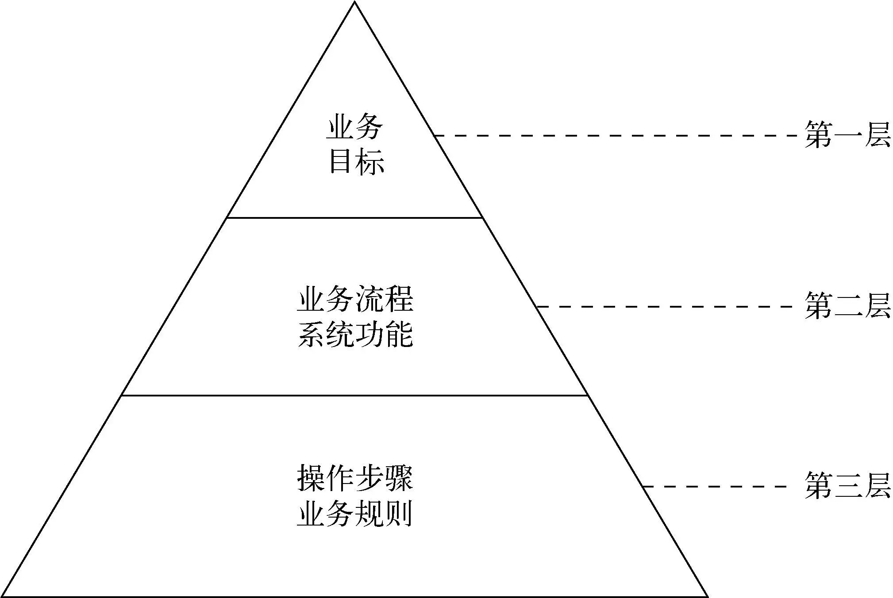
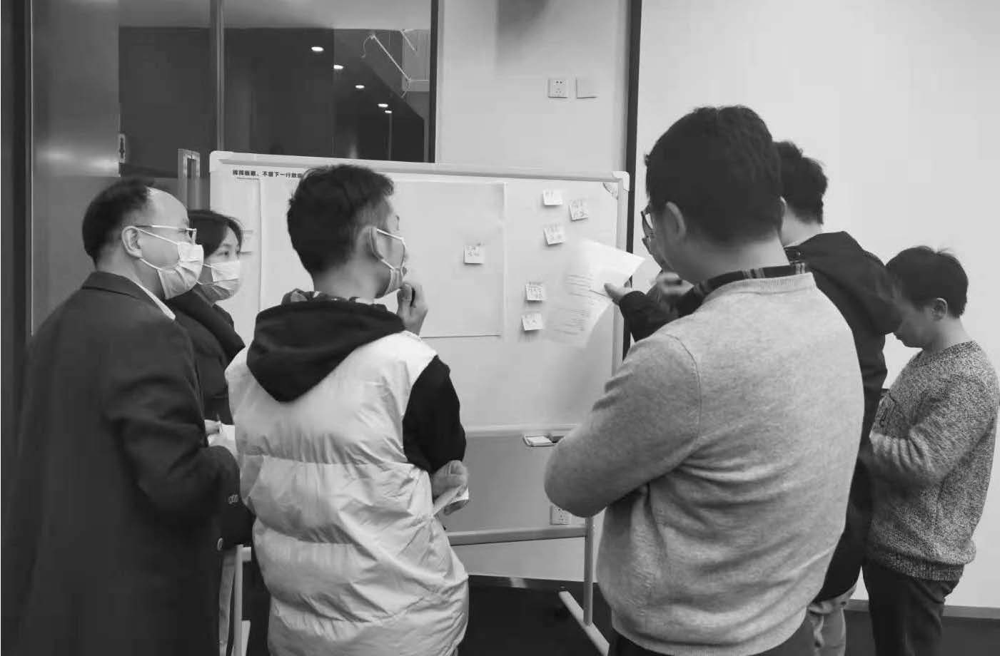
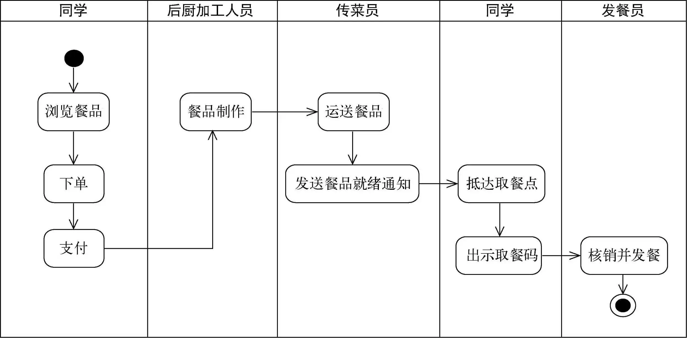
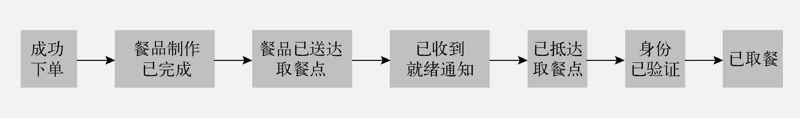
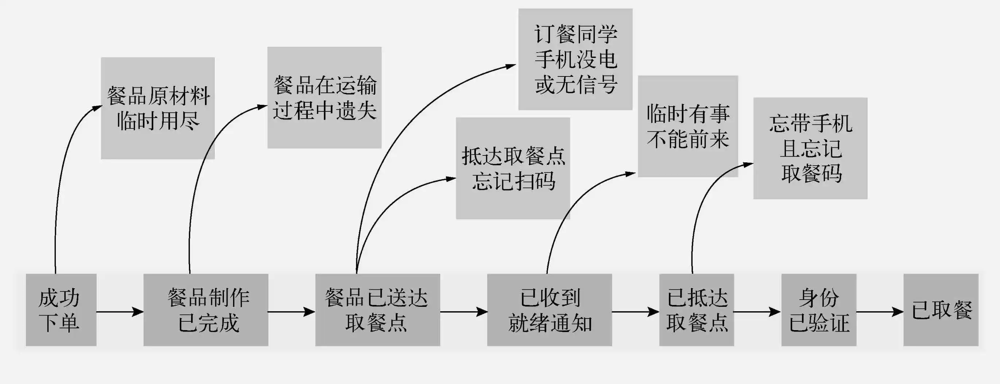
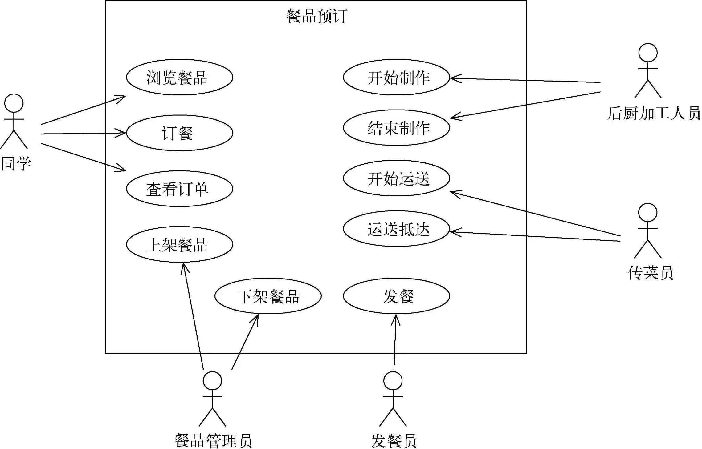
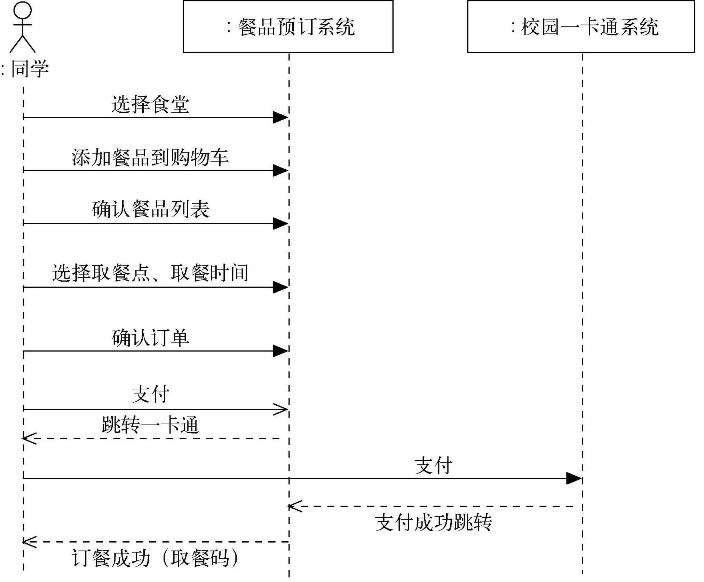
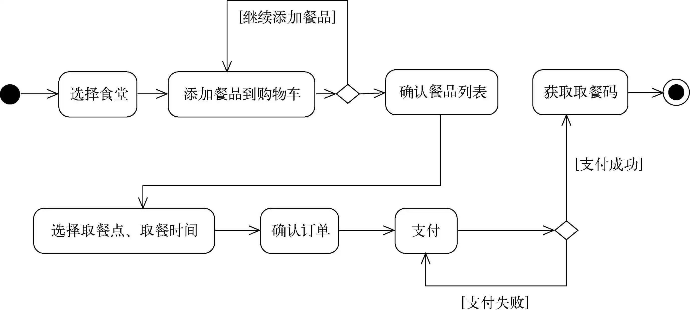
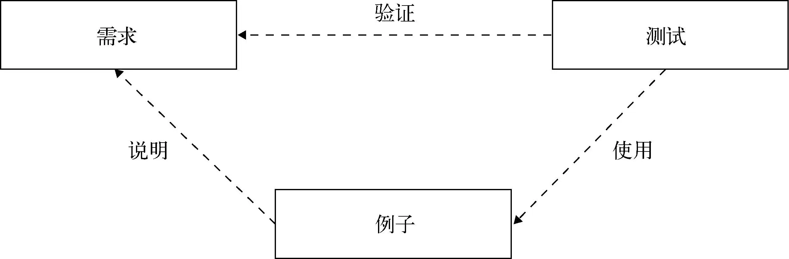
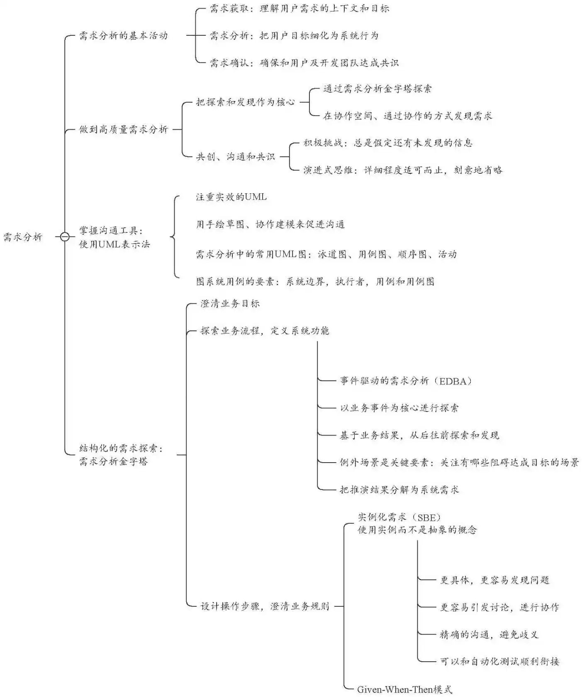

# 第3章高质量的需求

程序员不仅仅要专注于编码，还应该关心开发活动的源头：需求。真正专业的程序员，会积极地投入到需求活动中，而不只是被动地接收来自产品经理或需求分析师的需求输出，因为他们知道：在“正确地做事”和“做正确的事”中，“做正确的事”更加重要。如果努力的方向错了，肯定是越努力，越糟糕。

实践一再证明：在一个项目中，如果程序员没有积极投入到需求活动中，而只是被动地接收需求进行开发，那么往往会错漏百出，即使产品经理或需求分析师的能力很强，也无法改变这个结果。关于这一点，事件风暴（Event Storming）的发明人 Alberto Brandolini 有一句很精确的表述：是程序员的理解，而不是产品经理的设计，成为系统最后的功能。

本章关注需求分析的关键结构和技能。掌握需求分析的技术，不仅可以让开发活动更顺畅，还将为第 4 章关于领域模型的讨论奠定基础。本章内容的组织结构如下。

- 用结构化的方法分析需求。

- 定义业务目标。

- 探索业务流程，定义系统功能。

- 完善操作步骤，澄清业务规则。

## 3.1　用结构化的方法分析需求

需求分析的本质是探索和发现。同时，沟通和确认是需求分析活动中的重要环节。在本节中，我们将首先介绍需求工程定义的三大活动，并在此基础上介绍需求分析的本质——探索和发现；然后介绍支持需求探索和发现的三层金字塔模型；最后介绍沟通和协作在需求探索和发现以及需求确认活动中的重要作用。

### 3.1.1　需求工程的三大活动

要顺畅启动软件开发，首先需要明确应该开发什么。这意味着要正确理解业务目标，即为什么做；要定义清晰的产品需求，即如何做；要让业务相关方对前两点达成共识。

上述三点，恰恰就是需求工程定义的三大活动。

- 需求获取：正确地捕获业务方的诉求，对应达到的结果建立正确的预期。

- 需求分析和定义：把业务方的诉求成功转换为对软件系统的需求，并进行清晰的表述。

- 需求澄清和确认：让相关涉众（如开发人员和测试人员）都正确地理解需求，并达成一致。

需求获取

- 1

需求获取

- 是一个问题导入的过程。在这个阶段，需要理解的核心问题是：要解决谁的问题？

为什么要解决这个问题？只有明确了目标，才能做出正确的解决方案。业务目标并不一定宏大，但是再小的需求也必然有期望达到的业务目标或者要解决的具体问题。

假如我们要开发一个餐饮外卖的业务系统，在初始阶段的目标可能是：通过开发的系统，让用户无须亲临餐馆就可以吃到美味的食物，既方便了顾客，也扩大了餐饮企业的服务范围，自己则可以从餐饮企业增加的收益中获取部分佣金。如果已经进入业务的日常运作和改进阶段，那么需要解决的问题往往更为具体。例如，需要通过新增发红包的功能来促进销售，或者用户的常用地址管理功能不好用，需要增加新的常用地址推荐功能。

需求分析和定义

需求分析和定义是生成解决方案的过程：为了解决特定的问题，系统应该提供什么功能？这些功能包含哪些操作步骤？有哪些业务规则？例如，发红包这个业务可能需要包括管理员设定红包发放对象、为红包发放对象发红包、提醒用户使用红包消费、对红包进行核销等关键的功能。在管理员设定红包发放对象这样的业务功能中，还需要包含设定红包发放对象选择规则、根据选择规则圈定用户等更具体的业务步骤。如何设计这些功能，才能更好地达成业务目标，是在需求分析和定义阶段需要解决的问题。

需求分析和定义需要专业的方法。用例分析、事件分析等都是在需求分析和定义过程中常用的方法。3.3 节将会介绍与此密切相关的技术。

需求澄清和确认

需求获取、需求分析和定义往往以产品经理或需求分析师为主体。但是，他们设计的方案是不是满足了业务方的诉求，有没有遗漏某些需求或者方案与需求是否存在不一致，是需要进一步确认的。此外，由于开发人员、测试人员往往和需求分析师是两拨人，所以还需要确认他们是否正确理解了这些需求方案并达成了一致。这些都是需求澄清和确认阶段需要做的工作。

需求澄清和确认的核心挑战是细节。3.4 节将探讨如何通过实例化需求等方式高质量地澄清和确认需求。

### 3.1.2　探索和发现用户的真正需求

需求描述的是客户（或用户）的期望，那是不是“你说我听”就可以了？如果只是请客户描述一下需求，然后把这些描述的内容记录下来加以整理，最后形成文档就完成了需求分析，那事情就简单多了。

现实远没有这么理想。大多数时候，客户自己在项目早期对目标的认知是模糊的，无论他们表达的时候有多么自信，具体的需求细节更是不可能一开始就很清晰，而需求分析就是要把这些问题逐步清晰化、明确化。如果做不到这一点，就很可能像图 1.1 展示的那样，开发的软件和客户的实际需求天差地别。

- 需求分析的核心是探索和发现：通过持续探索，发现并确立真正的业务目标，从而设计出真正合理的方案，包括系统需求、操作步骤和业务规则等。

### 3.1.3　需求分析金字塔

需求分析是一个探索和发现的过程。在需求分析过程中一个常见的问题是：基本的问题尚未真正得到澄清，就匆忙开始了关于细节的讨论。可想而知，在业务目标、业务流程没有被正确理解时，过多地讨论细节只会偏离正确的方向，掩盖真正的问题。由粗到细、逐步展开显然是一个经济的方法。

图 3.1 展示的是需求分析的金字塔模型，它形象地表达了由粗到细、逐步展开的需求分析过程。

不断质疑，澄清业务目标

金字塔的第一层是业务目标，这是所有需求分析和讨论活动的起点。它致力于搞懂需求获取阶段的核心任务：为什么要做这个功能？有时候这个问题还可以反过来：如果不做这个功能，又会怎样？通过这样反复地质疑，往往能把需求背后的思考表达得更为清晰。业务目标和基于业务目标的共识是后续开发活动的前提，这个前提必须非常清晰，才可以进行后续的工作。

要澄清业务目标并不困难，只要持续、积极地挑战，就肯定能得到想要的答案。真正重要的是不要忽视它，因为目标在第一时刻常常不是以它本来的面目出现。许多时候，急于动手的开发团队往往会假定客户或者产品经理的描述是正确的，丝毫不加质疑就开始后续的详细分析工作。但是，有不少案例表明，通过对业务目标进行质疑和确认，业务分析人员经常会发现业务目标中存在未澄清或者不合理的部分。

探索业务流程，定义系统功能

金字塔的第二层旨在在功能概要的粒度上解决系统应该实现什么功能这个问题，我们称之为系统功能或系统责任。但是，不应该直接从业务目标跳到系统功能。在系统之外，一些外部系统、各种业务参与者也参与了业务活动，他们之间的交互共同构成了业务流程。

业务流程的设计显然需要服务于业务目标。不过，这个设计往往不是简单地复制现实世界的业务流程。如果发现正在运作的业务流程不合理，就需要探索新的流程方案。因此，这一步的关键是“探索”，而不是“描述”。

在业务流程分析清楚之后，系统功能就变得非常清晰了。系统功能就是业务流程中那些和软件系统有关的功能。例如，前述的发红包业务的管理员设定红包发放对象、为红包发放对象发红包等功能，都是在金字塔的这一层进行探索的结果。

设计操作步骤，澄清业务规则

金字塔的最下面一层关注的是需求的细节：具体的操作步骤和业务规则。例如，前述的设定红包发放对象选择规则等具体的步骤和规则，都是在这一层进行探索的结果。

越往金字塔的下层，细节越多，对于讨论的清晰程度的挑战就越大。当然，越往金字塔的上层，细节虽然越少，但是一旦发生错误，影响是最大的。

- 需求分析的过程，是一个持续探索和发现的过程。这个过程应该遵循金字塔结构，由粗到细，逐层展开。

### 3.1.4　共创、沟通和共识是需求分析活动成功的关键

用文档记录结果，不要用文档作为驱动

传统的需求分析方法特别强调文档的作用。例如，需求获取阶段需要产出业务需求的描述文档，需求分析和定义阶段需要产出产品需求的设计文档等。甚至有些开发团队，只要需求文档没有完成，就拒绝参与项目开发。这种做法是不合适的。

需求分析的核心是探索与发现。尽管写文档能梳理思路，让人有所发现，不过总体来说既不有效也不高效。尽可能早地引入需求沟通，进行群体性的共创活动，有助于更早地发现问题，提升需求分析的质量。

在协作空间讨论和完善需求

图 3.2 展示的是某团队中成员们进行需求讨论的场景。在协作空间中讨论是一个创造性的活动，与此相对的是比较正式的、类似于需求评审的活动。

在评审和共创活动中，参与者的心态是不同的。在评审活动中，需求和参与者是“被评审的内容”和“被动确认者”，然而在共创活动中，需求和参与者是“待完善的内容”和“积极参与者”。

因此，协作空间中的主要工具不是投影仪（它只是偶尔被用来演示相关的信息和输入），而是报事贴、白板等适合共创的工具，以及便于协作的空间环境——例如，要尽量避免使用椅子摆放得整整齐齐、中间有大会议桌的会议室，这种会议室天然塑造了一种严肃的氛围，对讨论是不利的。

共创离不开参与者角色的多样性。尽管需求的负责人一定是需求分析师或产品经理，但是开发人员和测试人员常常可以提供另外的视角，这对于完善需求分析的视角是有好处的。因此，在协作空间中，需要需求相关人员、开发人员、测试人员等不同角色共同参与需求分析，这样有助于得到高质量的分析结果。

既然多种角色共同参与到了需求分析的共创活动中，那么需求工程定义的三大活动中的第三个活动——需求澄清和确认的形态也就有了变化，它不再是一个单独的阶段，而是会伴随着需求分析金字塔的探索，在共创空间中同步进行。这最大化了需求分析的反馈速度，同时提高了沟通质量。

最大化发现能力，不畏惧需求变化

软件需求分析的本质是一个持续探索和发现的过程，在这个过程中充满着不确定性。需求分析的复杂性常常来源于如下三个方面。

(1) 需求问题本身很复杂，该分析清楚的需求没被分析清楚。

(2) 需求沟通不充分，开发人员和需求分析人员在对需求的理解上存在偏差。

(3) 业务环境发生了变化，或者在开发和业务运营过程中，相关人员产生了新的业务认知。

其中，第 (1) 点和第 (2) 点可以使用高效的需求分析方法解决。通过采取积极的探索和发现策略，如结构化的需求分析方法、群体性的需求分析活动等，可以提升需求分析和沟通的质量，使发现能力最大化，避免问题的产生。

第 (3) 点是软件开发特有的重要特征。面对变化，采取类似于传统的“冻结需求”方案是徒劳

- 2

的。有效的方案是采取正确的软件工程实践，建立反脆弱

- 的系统，如采用敏捷的迭代开发方[16]，和利用高质量的领域建模（本书第 4 章会讲），提升软件系统对需求变化的适应性。

法

- 需求分析既需要高质量的分析框架，也需要积极的探索策略和及时演进的心智模式。采用正确的分析方法，能够避免遗漏问题，进行良好的沟通，达成共识。通过打造反脆弱能力，可以避免产生对错误的恐惧，做到与时俱进，持续演进。

### 3.1.5　案例——高校食堂餐品预订

为了把概念形象化，从本章开始，我们引入一个大学校园的餐品预订软件作为案例。这个案例的背景如下。

- 虽然目前外卖订餐服务已经非常普及，但是多数大学生的常规选择仍然是在食堂就餐。餐品安全、价格实惠、距离较近等，都是高校食堂的优势。食堂就餐的问题在于在就餐高峰时段，人员非常拥挤。学生数量多、下课时间集中、部分餐品需要现场制作会比较耗时等，都会让队越排越长。此外，由于缺乏信息的输入，食堂只能根据既往的销量准备食材，有些学生可能买不到喜欢的餐品，这也是一个常见问题。为此，高校后勤管理部门决定开发一款软件，通过餐品预订、提前付款、取餐点直取等方式，节省排队时间，提升同学们的满意度。

## 3.2　定义业务目标

本节我们将介绍需求分析金字塔的第一层：定义业务目标。

### 3.2.1　目标要反映关键利益方的诉求

需求不是“业务方告诉我怎么做，我就怎么做”，而是要理解“为什么做这件事情”。正如福特汽车公司的创办者亨利·福特的名言：

- （在汽车发明之前）如果你问客户需要的是什么，客户会告诉你，我需要的是一匹“更快的马”。

理解需求背后的业务目标非常重要。在上面的名言中，受限于认知水平，客户给出的并不是最恰当的解决方案——毕竟客户没有见过汽车，只知道骑马这样一种在当时相对较好的交通方式。但是，客户的诉求——能很快抵达目的地则是比较确定的。相对于客户，汽车生产商拥有更全面的知识，于是可以给出正确的解决方案。

这个例子固然有点极端，但是在现实中因为没能把客户的关键诉求理解到位，只是“照章办事”而导致的问题屡见不鲜。最后即使功能开发出来了，也可能因为没有解决最关键的问题，导致项目没有达到期望的目标。

回到我们要开发的餐品预订软件，如果它的核心诉求是提供更快捷的取餐体验，那么功能上要考虑在教学楼、宿舍等地点设置取餐点；如果核心诉求是更低的运营成本和更低的餐品价格，那么设置取餐点的需求优先级就会比较低；如果核心诉求是减少外卖包装导致的污染，那么可能需要提供不锈钢餐具及回收服务。可见，对同一个系统而言，不同的核心诉求对应的功能设计以及需求优先级可能是完全不同的。

- 业务目标反映了系统的关键利益方（后文统称为业务方）对“通过某个业务过程，达成某种业务目标”的期望，这些业务方往往是业务所有者、项目发起人等。

识别谁是业务方

大多数时候，项目发起人就是最关键的业务方。在不同类型的团队里，需求分析面对的业务方也可能有所不同。例如，在开发一款业务支撑型的内部软件时，开发团队面对的业务方是本团队的业务部门；而对于软件承包商或者外包商来说，业务方往往是外部客户。

达成关于业务目标的共识

任何需求都必然有一个业务目标。在编写需求文档时或者在非正式沟通中，业务方或需求分析人员大多数时候会介绍需求背后的业务目标。不过，成熟的开发团队一定会积极地挑战业务目标，而不只是把业务目标作为背景知识被动地接受。之所以称“积极地挑战”，是因为这种挑战的动机是非常良好的，绝对不是为了使对方难堪，而是为了贡献更多思考，更好地探索和发现。

在讨论业务目标的过程中，常常会出现下列问题。

- 为什么要做这个产品（或者功能）？要达到什么样的业务目标？

- 做出了这个产品（或者功能），期望的业务目标能达成吗？不做的话，可以通过其他途径达到业务目标吗？

- 谁将从这个产品（或者功能）中受益？又有谁可能会受到影响？

在着手开发之前，进行挑战是非常重要的。如果最终业务目标没有达成，那么无论是内部客户还是外部客户，无论软件开发团队是不是完美实现了软件需求，无论软件开发团队有多辛苦，都没法认为这样的软件开发是成功的。

在团队层面达成关于业务目标的共识，还有一个重要的积极影响，就是在后续开发中难免会遇到各种细节，这时候团队成员就能先根据上下文做出有效判断，虽然判断结果还需要经产品经理确认，但是比把一切问题都抛给产品经理要快捷多了。

### 3.2.2　案例

启动一个新项目

假如我们正在启动高校食堂餐品预订这个项目，在这个阶段，最重要的是识别整个项目的启动目的，要优先解决最重要的需求。

高校后勤部门是这个项目的发起方，但评价其是否成功的核心指标不是“做出了一个系统”，而是“供应商和大学生都有了更高的满意度”。所以，如何能通过餐品预订提高满意度，是这个项目成功的关键。

那么，接下来的问题就是：如何提升供应商的满意度？供应商现在有哪些不够满意的地方？如何提升学生的满意度？学生现在有哪些不够满意的地方？例如，供应商不够满意的地方可能有下面三个。

- 没法精准准备食材。采购少了不够卖，采购多了会浪费。

- 在外卖的冲击下，大学生不愿意来食堂就餐，用餐人数减少。

- 餐品的开发和淘汰依据的是经验，缺乏反馈渠道和数字化信息。

学生不够满意的地方可能有下面这两个。

- 食堂在高峰期的排队人数过多，影响用餐体验。

- 为了买齐想吃的餐品，需要到多个窗口反复排队。

注意，这些“可能”的不满并不是“真实”的不满。合格的产品经理，一定会通过访谈、现场调研等多种方式，进一步探索和发现，对“为什么要启动这个项目”获得更深刻的理解。

业务演进中的目标

几乎任何业务都会持续演进，在演进过程中往往要开发新的功能以支持新的业务场景。例如，在基本的餐品预订功能上线之后，就会发现餐品预订软件对后厨加工人员提出了新的要求。如果餐品加工时间过早，那么餐品可能在取餐前就变凉了；如果过晚，又可能导致到了取餐时间，同学却取不到餐品。这时候，就可以引入精益生产中的 JIT（即时生产），增加一个为后厨加工人员制作生产餐品计划的功能。

此外，通过预订数据能够发现，有一些相同的餐品组合在订单中经常出现。那么，为什么不推出优惠的套餐组合呢？套餐是标准品，当套餐的预订数足够多时，也能提升要准备食材和加工时间的可预测性。如果再使用保温箱对餐品进行保温，还能控制取餐时餐品的温度。如果套餐功能上线之后很受欢迎，那么一开始看起来很重要的 JIT 方案，就暂时没那么重要了，增加套餐预订的功能变成了一个优先级更高的需求。

从这个例子中我们可以看出，解决不同的功能需求能够达到相同的业务目标。在这种情况下，应该根据具体的上下文决定开发其中的哪个需求。也就是说，需求开发仅仅是达到业务目标的手段。这一点在开发活动中务必注意。有一些方法可以帮助我们结构化地思考目标和功能之间

- [17]

的关系，例如影响地图

- ，请感兴趣的读者参阅相应的参考书。

## 3.3　探索业务流程，定义系统功能

从业务目标到系统需求并不是一蹴而就的，联系它们的纽带是业务流程。

业务流程聚焦于业务活动中的主体如何通过一系列业务活动交互，最终达成业务目标。业务交互的主体，也就是参与者，既包含特定的业务角色，如食堂餐品管理员、订餐人，也包含系统以及外部系统等。系统功能是整个业务流程的一部分。

在开始定义系统功能前，先把业务流程定义清楚，让参与者之间能顺畅地协作，在此基础上定义清晰的系统功能，最终达到期望的业务目标。

### 3.3.1　表达业务流程的方法

我们固然可以使用自然语言表达业务流程，但是这样非常不利于高效沟通。从现在开始，我们

- [18]

将逐步引入以 UML

- （Unified Modeling Language，统一建模语言）为基础的表示法，来描

述业务需求、产品需求、领域模型、软件设计等。

注重实效的 UML

UML 诞生于 20 世纪 90 年代，出现不久后就得到了广泛认同。但是，它的实际使用范围却不太理想。迄今为止，仍然有相当多的开发者认为 UML 过于复杂，无法在工作中顺畅使用。造成这种现象的根本原因是 UML 非常庞大，如果抱着“先学会再应用”的想法，那应用基本上就遥遥无期了。

去除上面的想法，直接开始使用 UML 就可以了——用到什么再学习什么。你会发现，只要使用 UML 大约 5% 的能力，就足以满足日常所需。在讨论和使用一个工具时，不应该脱离它的本质。

统一表示法的本质是利于达成共识。正如建筑、机械等工程领域都有自己的统一表示法一样，软件开发也需要统一的表示法。UML 就是适用于软件世界的统一表示法。与此相对的是线框图。线框图是随意的，在使用时很难达到精确。例如，方框有时候代表的是一个需求，有时候代表的是一个业务概念，还有时候代表的是一个子系统，因为方框没有精确的语义，所以在使用时不得不随时进行解释，这样的效率显然过于低下而且容易造成误解。而 UML 已经为特定类型的事物创建了特定的表示法，这样就不需要进行烦琐的解释了。而且，由于 UML 建立在大量建模经验的基础上，所以它还有助于提升思考的质量。基于这样的本质认知，合理使用UML 的方式就变得非常清晰了。

- 把 UML 作为一种表示法，记录或者表达思考和讨论的过程。

在这个基础上，完全没必要掌握 UML 的所有细节，事实上有 80% 以上的 UML 特性并不会在日常工作中遇到。我把这种以沟通为目的、仅仅使用 UML 特征的有限子集来建模的方式，称为注重实效的 UML。

多绘制草图，仅在必要时使用建模工具

- [19]、[20]

多数有经验的软件专家会建议使用手绘 UML

- 。我也持有相同的观点。相对于软件建模

工具，手绘的草图更适合用于思考和沟通。

软件开发的本质是持续的探索和发现：发现正确的用户、发现正确的需求、发现正确的设计方案等。既然是探索，那么往往需要集体建模。手绘的图当然没有建模工具绘制的图清晰，但是手绘极为便捷，无须操作键盘和鼠标，无须使用投影仪，在白板上可以随意绘制和擦除，能营造出更适合讨论和思考的氛围。

当然，软件建模工具也有它的适用场景，你仍然可以使用它进行个人思考，或者学习建模符号，或者把集体讨论的结果转换为更规范的文档。

用带有泳道的活动图表达业务流程

有好几种 UML 图都适用于需求建模，这里列举三种。

- 用例图：表达系统有哪些功能，执行者会使用系统的哪些功能。

- 顺序图：表达参与者如何彼此交互，完成一个功能或业务。

- 活动图：表达一个功能或业务设计的活动或流程。

本节中我们使用带有泳道的活动图来表达业务流程。在表达业务流程时，很多时候会涉及多方交互，往往还要体现参与者的具体活动。由于带有泳道的活动图是顺序图和活动图的结合体，所以在这种情况下使用它是最合适的选择。图 3.3 是某个需求分析师设计的订餐业务流程，它包括如下几个重要的建模元素。

- 泳道：泳道代表参与该业务流程的角色。

- 起点和终点：业务流程总是从某个点开始，到某个点（终点可能有多个）结束。实心圆圈代表起点，环形实心圆圈代表终点。

- 活动和流转：圆角矩形代表参与者的活动，箭头代表活动的流转方向。如果需要，还可以在活动图中插入条件判断符号（图 3.3 中未出现）。

刻意地省略——抓住主要问题

可能有读者会有疑问：业务流程的粒度究竟要多小？例如，在图 3.3 中，“下单”是否应该细化到“打开购物车”“勾选餐品”“点击下单按钮”这些活动？“支付”是否应该细化到“点击支付按钮”“弹出支付页面”“扫描二维码”或“打开支付宝”这类活动？

建模要注重实效。UML 有一个非常好的机制——允许刻意地省略。在现实世界中我们也常常如此，例如，在给朋友讲述自己的旅游经历时，肯定不会事无巨细地把坐车、吃饭这类事情全部讲出来，别人也没有兴趣听，重要的是把关键信息传递到位。同样，在业务流程阶段，要能充分反映关键的业务节点，不要陷入操作细节，更为具体的流程可以在后续的操作步骤澄清阶段再进行细化。

### 3.3.2　积极地挑战业务流程

业务流程的合理性对成功的商业活动来说至关重要。把业务流程显式化之后，就很容易基于流程进一步展开讨论。

观察图 3.3，我们可能会发现一个问题：传菜员是在把餐品运送到取餐点之后，才发送餐品就绪通知，那同学抵达取餐点这个活动必然会延迟发生。这个问题值得思考：这个流程设计得是否合理呢？有没有更好的设计方案呢？经过思考，可能会得到如下优化方案：在手机端实时显示订单的当前状态，在订单对应的餐品开始运送时就给同学发送通知，这样同学就可以自行估算抵达时间，缩短实际取餐的等待时间。

在开发活动初期，积极地挑战业务流程是非常有必要的。不合理的业务流程在产品发布之后必然会影响客户满意度，最终既影响业务结果的达成，也浪费宝贵的开发资源。根据缺陷成本递增曲线（图 1.2），问题发现得越早，总成本就越低。把流程显式化，进行集体讨论和建模，有助于在早期发现潜在的问题。

### 3.3.3　使用业务事件推演业务流程

业务流程的设计可以有多种方法，正向的设计思路比较自然，也就是从同学浏览餐品和下单开始，到最终取到餐品结束。从前向后符合人类的思考习惯，不过这不见得是最好的探索与发现方案。经验表明：正向的思考过程往往容易遗漏关键步骤。

本节我们介绍一个行之有效的业务流程设计方法：事件驱动的业务分析（EDBA，Event-Driven Business Analysis）。EDBA 源自领域驱动社区关于业务事件重要性的发现，并通过精益思想放大了这一发现。Alberto Brandolini 注意到了业务事件的核心价值，并在此基础上发明

- [21]

了事件风暴（Event Storming）

- 这一在领域驱动设计社区中广为使用的工作方法。

本章介绍的需求分析方法就是从事件风暴演化而来的，但是鉴于二者在应用范围和关注重点上的不同，为避免和事件风暴的标准做法混淆，本章所述的方法将使用 EDBA 作为名字。EDBA的核心成功要素是：以业务事件为核心、以终为始、逆向思考。通过使用 EDBA，我们能更容易地发现合理的业务流程，避免遗漏关键问题。

业务事件

首先我们引入一个新概念：业务事件。

- 业务事件指的是应该被关心的、具有业务价值的事件。

事件重于动作。事件并不是一个很容易让业务人员理解的术语。但是，为什么要使用业务事件，而不是业务活动来讨论需求分析呢？这是因为业务事件比业务活动具有更明确的业务意义。

让我们用一个实例来解释这一概念。在我们引入的案例中，什么才是真正的业务结果？读者不难想到：同学已经取到餐品，或者稍微抽象一点的订餐交易完成才是餐品预订业务的真正目标。对于正处在设计阶段的业务流程而言，哪怕其他事情都没有确定，这个最终的结果也是可以确定的。同学已经取到餐品或者订餐交易完成就是一个典型的业务事件。

和事件相对应的是动作。取餐动作未必意味着取餐成功，所以从确定性上说，事件的确定性比动作的确定性更高，它有助于让我们更加关注业务流程的结果。无论前面的流程设计得多么合理，只要最终没有达成同学取到餐品这样的业务目标，整个业务流程的设计就是失败的。

基于业务事件进行讨论，可以让需求讨论更聚焦、更清晰。这是因为事件实际发生了，才是业务流程的真正目标。只要事件没发生，业务流程就没有实际意义。相反，事件发生了，那相应的活动反而是可以变通的。例如，在取餐之前往往需要设计取餐人身份验证这样的活动。至于如何验证，可以让同学扫描取餐二维码，也可以让同学出示一个 4 位数的取餐码，还可以让同学出示学生证。业务动作可以多种多样，不好确定，但是业务结果往往更容易确定，也更容易达成一致。

为了能达到同学取到餐品这样的业务目标，必然还需要一些重要的中间业务节点。例如，已下单、已支付、餐品已经制作完成、餐品已经送至取餐点等。当然，这些节点的顺序不像最后的事件那样具有确定性，是否需要它们以及它们的先后顺序都和业务流程的设计相关。例如，在“货到付款”这样的业务流程中，支付动作可以在流程的最后进行，但是在一般的业务流程中，支付动作在下单之后就要完成。

基于事件探索业务流程

对业务流程的探索常常是集体活动。所以，开放的空间、报事贴这类物理建模工具在需求探索中非常有用。为了区分不同的内容，还可以使用不同颜色的报事贴代表不同的实体。例如，可以遵循事件风暴的规则，使用橙色报事贴代表事件，使用黄色报事贴代表操作者，使用蓝色报事贴代表动作。

- 3

最基本的业务流程探索过程如下

- 。

(1) 首先确定代表业务结果的事件，这是最重要的业务事件。用报事贴把它贴在墙面的最末端。

(2) 围绕正在关注的业务事件，思考“为了让这个事件发生，哪件事必须先发生”，然后把这件事贴在业务事件的前面。

(3) 持续进行第 (2) 步，逐级向前寻找前序业务事件，直到找到第一个事件。这时候就获得了如图 3.4 所示的业务流程。

(4) 从第一个业务事件开始，逐个查看在每一个事件跳转中，可能出现中断吗？只要无法正常进行后续步骤，就把当前步骤记录下来，记录结果如图 3.5 中上面一行框里的内容所示。这样做对业务流程异常场景的识别非常重要——因为它们可能导致最终的业务目标无法达到。

(5) 整理业务流程。思考“是谁做了什么事”导致产生了这个业务事件。从业务事件逆向推导出活动，就得到了最终的业务流程设计示意图，如图 3.5 所示。

在实践中使用 EDBA 往往会取得非常好的效果，例如，会快速产生合理的业务流程、发现以前未曾想到的关键遗漏等。这种方法之所以有效，是因为它解决了以下几个关键问题。

- 如何聚焦讨论：业务事件把讨论聚焦到结果和实际发生的事情这样具有确定性的内容上。

- 如何推导：通过逆向思考，让流程设计在思考的过程中自然浮现。

- 关注异常：异常是导致结果不能达成的一个因素，通过在早期发现异常场景，并予以正确应对，有助于业务流程设计的完整性。

- 延迟决策：业务流程需要我们暂时忘记系统，首先关注事件。系统功能的设计是业务流程设计完成后自然而然就可以推演出来的。

### 3.3.4　从业务流程到系统需求

梳理业务流程的最终目的是软件开发，也就是要确定系统需要实现哪些功能。现在回顾图3.4，可以很容易地发现系统需求已经呼之欲出了：在图 3.4 中，第一个业务事件是成功下单事件，那么是谁做了什么事才能让这个事件发生呢？于是我们可以得到系统需求——下单，这个需求的操作者是用户。

- 系统需求是把“软件系统”作为研究对象，定义软件系统应该做什么，确定清晰的输入和输出。

用例和相关概念

系统需求的分析对象是软件系统。用例（use case），顾名思义就是“谁使用系统做什么”。用例

- [18]，起源于 Ivar Jacobson 在爱立信的工作，后来

是一种非常有效的用来表达系统需求的方法成了 UML 标准的一部分，它可以清晰地表达复杂的系统需求，并顺畅过渡到后续对操作步骤、业务规则的讨论和软件设计活动。

首先让我们了解几个重要概念。

- 系统边界：明确哪些工作是在软件系统内完成的，哪些是在软件系统外完成的。用例的执行者处在边界外，用例处在边界内。

- 执行者：用例的发起者，经常是业务角色。涉及多系统交互时，执行者也有可能是外部系统。如果涉及定时任务，那么也可以把定时器作为一个特殊的执行者。

- 系统用例：执行者在系统边界上对系统进行的操作。

- 用例图：表达执行者、系统用例、系统边界之间关系的 UML 图。

从业务流程到系统用例

业务流程的关注点是业务，系统用例的关注点则要低一个层级，它关注系统。设计业务流程必然要依靠系统能力。所以，图 3.3 或图 3.4 中的这种业务流程是分析系统用例时的输入，基于这两个业务流程，就可以提取出系统用例，用例图如图 3.6 所示。

当然了，尽管从原理上看，从业务流程到系统用例的转换过程很完美，但是考虑到业务流程的设计也是一个持续探索和发现的过程，因此第一次分析业务流程时很难做到完全精确。在实际分析系统用例时，往往会对业务流程做进一步优化，还会考虑如何组织用例以体现良好的结构。在本案例的分析过程中，就曾经进行过如下精化和整理。

(1) 从已知用例中拓展。在图 3.3 中存在一个浏览餐品的用例。那么，我们很自然就会想到：餐品从哪里来？于是会去分析餐品管理相关的用例，之后就增加了增加餐品、删除餐品等和餐品列表管理相关的工作。

(2) 完成系统边界上的跨越。不可能所有的工作都发生在线上。例如，图 3.3 中的餐品制作和运送餐品都是线下发生的软件系统外工作。那么，如何让软件系统知道线下动作的状态呢？我们可以为后厨加工人员和传菜员提供一个界面，这个界面能让系统感知到图 3.4 中的两个事件（餐品制作已完成和餐品已送达取餐点）的发生，从而将订单转换为相应的状态。今后如果有了物联网的支持或具备了机器人送餐能力，也只要更改一下这个界面就可以了，其他部分不受影响。

(3) 合并细节，保持粒度一致。可以从出示取餐码推导出系统功能——生成取餐码和查询取餐码，不过相对于其他用例，这二者的粒度更细，事实上可以把它们作为下级用例合并在下单成功和查询订单下。

图 3.6 提供了一个良好的初始版用例图，不过仅从这张图中并不能挖掘出一些关键的业务细节，如刚才提到的查看订单应该可以显示订餐的取餐码，发餐的同时应该完成对于订单的核销等。如何把这些细节表达明白，是需求分析的重点所在。

## 3.4　完善操作步骤，澄清业务规则

现在让我们进入金字塔的第三层，讨论如何完善在第二层分析出来的系统需求，包括操作步骤、业务规则等。

### 3.4.1　问题隐藏在细节中

有开发经验的人都知道：有大量需求问题出现在细节上——要么是遗漏了关键的细节，要么是对细节的理解不一致。所以，在开始开发之前，就要做好对需求的分析和澄清工作。分析需求是为了发现细节，澄清需求为了达成共识。

发现细节

要避免“一句话需求”。在有些团队中，开发团队收到的需求往往是诸如支持用户订餐这样的很泛泛的需求描述，在怎样才是一次成功的订餐、操作步骤应该是怎样的、有什么业务规则这样的细节上却语焉不详。于是，开发团队开始基于自己的理解“脑补”。可以想象，这样开发出的功能一般并不能达到真正的业务目标。

一般来说，细节包括两个重要部分。

- 操作步骤：完成一个任务需要执行的步骤。在我们的案例中，可能需要执行的步骤包括添加食品到购物车、确定取餐时间、选择取餐点、确认订单等。

- 业务规则：从业务视角出发的行为约束。在我们的案例中，可能会约定取餐时间不是任意选择的，而是以 15 分钟为一个时间单位，且仅覆盖就餐时间。

建立共识

图 1.1 形象地展示了因为缺乏需求共识而在信息传导过程中发生的错误传播。用户真正想要的是秋千，但他自己没表达清楚，再经过产品经理、需求分析师、开发人员的一层层解读，最终做出的产品和真实的目标相差十万八千里。

让参与者对需求达成共识非常重要。共识意味着以下两点。

- 1.所有参与者都对将要做的事情有一致的理解，没有歧义。

- 2.所有参与者都知道还有哪些问题尚未澄清。

在第 1 点中，“所有参与者”指的是一切和将要开发的功能有关的人员，一般包括业务分析人员、产品经理、开发人员和测试人员等。“有一致的理解”则是从为什么（Why）、是什么（What）、如何做（How）、何时做（When）等角度要求所有参与者对需求的理解没有歧义。

- 为什么：对为什么实现需求、要达到什么样的业务目标达成共识。

- 是什么：对需求是什么、在整个产品中的上下文达成共识；对需求背后的业务流程、操作步骤、业务规则等理解清晰，没有歧义。

- 如何做：对应该把需求分成哪些小的迭代来实现达成共识，要把需求拆分为可开发的粒度。

- 何时做：对完成需求的整体路线图达成共识。

第 2 点说的是刻意地忽略。不是所有需求都必须马上得到澄清，一开始就澄清所有需求只是一厢情愿，既没有必要，也不符合渐进认知的规律。敏捷开发方法倡导“合适的详细”这一原则，意味着可以刻意地忽略以下需求。

- 近期不会开发的低优先级需求。

- 某些尚未得到澄清，且不影响即将开发的功能的需求。

“刻意地忽略”意味着大家知道哪些事情是暂时被忽略的，这很重要。正是知道“已知的未知”，在遇到这些问题时，开发人员、产品人员和测试人员才会自发地凑在一起互相讨论，避免了大家都以为自己已经知道，于是自行其是，进而造成不必要的错误。

### 3.4.2　表示法

一图胜千言。本节介绍两种常用的表示操作步骤的 UML 符号体系：UML 顺序图和 UML 活动图。

用 UML 顺序图表示操作步骤

UML 顺序图擅长表示多个参与者之间存在互动的操作步骤。图 3.7 中的 UML 顺序图表示的是订餐用例的操作步骤。

UML 顺序图包括如下重要元素。

- 参与者：图 3.7 中的同学、餐品预订系统和校园一卡通都是参与的角色。角色前的冒号遵从UML 对象的命名惯例，冒号前是对象的名称，冒号后是对象的类型，即“对象名称 : 对象类型”。在图 3.7 中，由于对象名称不重要，所以予以省略。箭头代表了参与角色之间的交互情况。

- 交互：在图 3.7 中，从一个参与者指向另一个参与者的箭头反映了二者之间的交互。站在参与者角度，所有指向自己的箭头均反映了自己的职责或操作步骤。例如，餐品预订系统的职责就包括选择食堂、添加餐品到购物车、确认餐品列表等。如果分析的是系统，那这些职责多数会呈现为系统的一个用户界面，也可能作为一种接口接受调用。

- 参数列表：图 3.7 中的订餐成功（取餐码）中的（取餐码）就是参数列表。在分析过程中，写明参数是一种好习惯，因为它可能会启发出更多细节，如选择食堂（食堂 ID）、添加餐品

- 到购物车（餐品 ID、餐品数量）等。

UML 规范中还有一种和顺序图完全等价的图——UML 通信图。两者表达的内容一模一样，但是通信图特别适用于参与者很多的场景。在本例中，参与者只有三个，即同学、餐品预订系统和校园一卡通系统，因此顺序图就可以承载。可如果参与者特别多，那顺序图就会很长，通信

- [19]

图则能较好地避免这个问题。更多的细节，建议读者参阅《UML 和模式应用》

- 。

当然，对 UML 顺序图或通信图的使用肯定不限于需求分析阶段，在架构设计等阶段同样可以使用。例如，把图 3.7 中的餐品预订系统展开为同学手机端、服务器、餐品加工端、餐品配送端等，就成了架构描述。

用 UML 活动图表示操作步骤

我们已经在图 3.3 中见过活动图，而且是一个带有泳道的复杂活动图。图 3.7 中的信息也可以用 UML 活动图来表示，如图 3.8 所示。

对比图 3.7 和图 3.8，我们会发现，二者表达的内容基本类似，但是强调的重点不同。UML 活动图适用于重点不在交互而在执行者所做动作的场景中，用来表示分支等更高效。UML 顺序图或 UML 通信图则适用于重点强调执行者和系统之间的交互的场景，虽然它们也能表达分支，但是直观性要比活动图弱，在实践中更加常见的是用不同的交互图表达各自的分支。

### 3.4.3　用实例化的方式澄清需求

在需求分析和沟通中，错误很常见，本节我们介绍一种非常有效的澄清需求的方法：实例化需求。实例化需求不仅可以让需求讨论更深入，还可以自然而然地创建出测试用例，为自动化测试用例的开发奠定基础，增强质量守护的能力。

实例优于抽象

我们先用一个非常简单的实例来说明，为什么具体的例子比抽象的概念更容易触发思考，提升沟通质量。

在我们的案例中，有一个看起来非常简单的需求：在每个月末，都基于餐品的风味分类进行销量统计，以了解不同风味餐品的受欢迎程度。那把餐品的销售详情按照餐品的风味分类直接汇总不就可以了吗？如果不深入思考，确实是这样。但是，如果多用点儿心，就可能发现：某种餐品在上个月调整了一次风味分类。那么，这样一个需求就存在模糊性：销量统计究竟是基于销售时刻的风味分类，还是最新的风味分类？诸如此类的例子不胜枚举。一个暗含的规律是：在泛泛地讨论概念时觉得没有什么问题的需求，在用具体场景分析时就会出现各种问题。这其实是有必然原因的。

- 人类对于具体事物的感知，要优于对抽象概念的感知。

人们理解世界几乎都是从具体到抽象，正如数学课本往往不会直接给出抽象的概念，而是用实例将概念导入。当我们讨论“餐品预订”这个业务时，也可以使用一个具体的场景，例如，同学小王早上在第二教学大楼上课，他想预订一份第五食堂的午餐，计划下课后在第二教学大楼的取餐点取餐，这比探讨一个抽象的支持订餐功能更容易触发思考。

其实我们已经不自觉地使用了这种方式，在讨论有些复杂的需求时，如果感到需求说不清，就会说：“我举个例子吧。”

Gojko Adzic 基于这个朴素的想法，提出了实例化需求（SBE，Specification By Example）[22]

- ，也就是通过举例来阐述和澄清需求。这是一个非常好的方法，既有助于发现细节问题，

也有助于让所有参与者达成一致。

以终为始地进行思考和讨论要把需求说清楚，一个比较有效的方案是先想好：假如这个需求已经开发完成了，我该怎么测试它？如果能想好怎么测试，那需求应该做成什么样也就变得很清晰了。这就是以终为始的思考方法。而测试必然会用到测试用例，这就让例子成了讨论需求和讨论测试的一个有效桥梁。

用图来表达测试、需求和例子的关系，就是图 3.9 所示的这样。

实例化需求方法把这种做法变成了正式的策略。

- 在讨论需求时，用测试用例解释清楚需求规则，并把这些测试用例作为后续阶段的输入。

在实例化需求方法中，测试用例不仅用于测试，也是业务规则说明的输出，这就有效地保证了对应的需求规则都能被清晰地表述。

实例化需求的本质是沟通

典型的实例化需求活动最好引入多种角色。这是因为业务分析的视角和测试的视角常常是互为补充的。业务人员、开发人员、测试人员的共同参与，不仅能降低后续的沟通成本，更有助于对即将开发的需求建立更全面的认知。所以，在实践中建议通过工作坊的形式组织实例化需求活动。常规的做法是：在每个迭代开始之前，都组织实例化需求工作坊，就即将开发的需求进行讨论，并写出需求的关键实例。

### 3.4.4　实例化需求的步骤

采用实例化需求方法澄清需求的步骤如下。

1. 澄清目标。

- 产品经理或需求负责人讲解业务目标，并介绍将要分析的需求和业务目标的关系。

- 参与者对目标进行积极的挑战，以进行澄清与精化。

2. 发现场景。

- 讨论需求的业务场景。推荐使用前述的精益业务流程的探索方式。

- 界定系统责任，明确用例列表。

3. 澄清细节。

- 讨论实现需求的步骤。

- 写出关键实例，澄清业务规则。

澄清业务规则

对于订餐这样的系统功能，尽管图 3.7 已经展示了清晰的操作步骤，但还是有一些细节没有说清楚，例如下面这些。

- 选择取餐时间的选项是否允许跨越就餐时间段？提前几天就可以订餐？

- 选择取餐点时，是否要提供推荐的取餐点以加快操作？是根据学生的当前位置推荐取餐点，还是根据选择的食堂推荐取餐点？每个食堂都可以把餐品送到每个取餐点吗？

- 如果添加的餐品恰好能构成套餐，那是否应该自动转换为套餐，从而让学生可以享受优惠？

- ……

这一类信息统称为业务规则。业务规则反映了在具体的需求场景中，对特定问题的决策。例如，对于“选择取餐时间、取餐地点”这个细节步骤，可以约定：取餐时间的候选项以 15 分钟为一个时间单位，仅覆盖食堂提供服务的时间段，最多可以提前 3 天订餐。

这类业务规则通常用作用例的补充说明，以文本形式体现。不过文本形式的说明比较容易造成误解。下面我们来介绍如何使用测试用例清晰地说明业务规则。

Given-When-Then 模式一个好的测试用例，应该遵循前置条件（测试准备）、动作和期望的后置条件（验收条件）这3 个基本元素。采用测试用例来描述需求，特别是复杂的业务规则类需求时，最好也采用类似的方案。下面以候选取餐时间的选择规则为例进行介绍。

业务规则

- 取餐时间的候选项以 15 分钟为一个时间单位，仅覆盖食堂提供服务的时间段。

- 时间单位以 00 分、15 分、30 分、45 分为界。如果提供服务的时间段中，开始时间不包含在前述时刻内，就自动向前或向后取整。

- 当校区内多个食堂的服务时间不一致时，以最早和最晚的服务时间定义取餐时间段。

如何清晰地表达和讨论这样的规则呢？我们可以使用前置条件、动作和期望的后置条件这 3 个基本元素，实例化需求中称这为 Given-When-Then 模式，即使用实例来说明业务规则。

实例 1

- 如果　只有一个食堂（第一食堂），而且　第一食堂服务时间段为 16:45～18:15，当　同学 A 在选择取餐时间时，那么　候选取餐时间区间为：16:45～17:00，17:00～17:15，……，18:00～18:15。

实例 2

- 如果　只有一个食堂（第一食堂），而且　第一食堂服务时间段为 16:50～18:10，当　同学 A 在选择取餐时间时，那么　候选取餐时间区间为：16:45～17:00，17:00～17:15，……，18:00～18:15。

实例 3

- 如果　有两个食堂（第一食堂、第二食堂），而且　第一食堂服务时间段为 16:45～18:00，

- 而且　第二食堂服务时间段为 17:00～18:15，当　同学 A 在选择取餐时间时，那么　候选取餐时间区间为：16:45～17:00，17:00～17:15，……，18:00～18:15。

把测试用例列成表格

当类似的示例比较多时，Given-When-Then 模式也可以采用表格的形式来表达。这里以注册或更改密码时的密码强度限制规则为例，如表 3.1 所示。

表 3.1　使用表格表达实例化需求用例

业务规则

- 密码验证结果

- 1111!a

包含字母、数字和特殊字符

- 注册成功

密码长度要大于等于 6 位

- 123!a失败：无效密码

- 11111!

密码要包含字母

- 失败：无效密码

- 11111a

密码要包含特殊字符

- 失败：无效密码

- abcdef!

密码要包含数字

- 失败：无效密码

这样的测试用例可以把需求规则显式化，使之变得清晰具体，更容易引起参与者的讨论，在实践中是非常有效的需求澄清手段。

此外，这些测试用例在后续的开发中也将扮演关键角色。开发人员和测试人员可以使用这些用例思考软件设计、编写自动化测试等。把测试前置，也是“测试先行”“把测试作为设计契约”的一种开发方式，形成了“行为测试驱动的开发”或“接收测试驱动开发”方法。本书的第 7 章还会结合开发活动，再一次讨论“测试先行”的策略。

随时随地展开实例化需求讨论

一般每次迭代，或者实例化重点需求时，都会组织一次实例化需求工作坊。但是，这不意味着只有正式的工作坊才能开展实例化需求活动。在软件开发过程中，在对某些需求有疑问时，应该随时随地召集相关人员进行讨论，这就是所谓的“三剑客”模式。三剑客指的是需求人员、开发人员和测试人员，只要出现了关于需求的歧义，三剑客就可以使用实例化需求的方式进行澄清。

恰当地使用界面原型

大多数系统有交互界面，界面原型是一种进行需求探索的方式。不少团队喜欢使用界面原型来澄清需求。界面原型固然更为形象，但不是效率最高的澄清方法。界面原型需要较大的前期投入，而且不如需求金字塔那样有结构。

建议的方案是：使用界面原型作为补充工具，或者是在业务流程已经基本确定的情况下，再使用界面原型进行需求探索和设计，千万不要把界面原型作为唯一的需求探索工具。

## 3.5　小结

需求分析是软件研发活动的起点，对于提升开发的效率和质量至关重要。同时，高质量的需求分析也是本书将要讲到的领域建模、测试先行、由外而内以及演进式设计的基础。本章介绍了需求分析的基本思维模式和结构化方法，图 3.10 总结了本章中需求分析的关键概念和实践性方法。

[1]：需求获取这个术语带有时代的印记。它发源于软件工程的早期，那个年代的开发团队和需求方往往隶属不同的组织，“需求获取”

- 是站在开发视角的一种说法。今天“获取”一词已经不太精确，在需求发现过程中要更加积极地探索。

[2]：反脆弱是一种应对复杂系统的理论，更多细节请参见 代码清单 2.6。[3]：为了帮助记忆 EDBA 的操作方式，我创造了一个 16 字口诀：事件优先，由后向前，关注例外，整理推演。这四部分分别对应

- 步骤(1)、(2)～(3)、(4)和(5)。
