# 第5章设计分解和责任分配

软件设计的本质是设计分解和责任分配，也就是通常所说的模块化。我们已经在 2.4 节介绍了模块化设计最重要的原则：高内聚和低耦合。但是，仅仅知道原则是不够的。高质量的软件设计，源于可实际落地的、逻辑清晰的设计方法。

本章聚焦如何通过有效和高效的思考，设计出高内聚和低耦合的软件。具体而言，它包含三个层次的内容。

- 设计的基本概念。元素、责任和协作是最基本的设计语言，分形是最基本的设计策略，UML 有助于清晰地表达设计。

- 设计的基本原则。好的设计有规律可循。人们已经总结了一系列使软件设计达到高内聚和低耦合的有效策略。例如，软件设计的单一职责原则、开放 - 封闭原则都是在实践中行之有效的提升设计质量的策略。

- 设计模式和范本。在软件设计中遇到的问题大多数会反复出现，没有必要每一次都从零开始思考。基于已有的经验（架构模式、设计模式），可以有效提高思考的层次和效率。

## 5.1　通过分而治之管理复杂性

在软件开发中，现实世界的复杂性和人类有限的认知能力是一组基本矛盾。为了能管理和控制复杂性，我们需要把“大”的事物划分为“小”的事物，这就是分而治之。

- 分而治之是控制复杂性的有效手段。

### 5.1.1　组织的复杂性类比

假如你空降到一家规模 500 人的企业担任总经理，此时面对一个新组织，你要怎么做，才能快速了解这个组织的各项情况呢？或许最快捷的办法，就是找来企业的组织结构图，并且请相关的同事结合业务流程讲如下三个问题。

- 包含哪些部门？

- 这些部门的职责分别是什么？

- 部门之间在某个业务上如何协作？

这是在组织管理中，面对复杂问题时，基于分而治之的一种思考模式。在软件设计和一切复杂的场景中，“元素”“责任”和“协作”都是非常有效的思考策略和组织策略。这里以 ISO/IEC/IEEE

- [24]

42010《系统和软件工程 - 架构描述》

- 中关于架构的定义为例。

- 架构是系统在其环境中的基本概念或属性，体现为元素、关系以及设计和演进的原则。

虽然和前一句的表述略有不同，但不影响我们从其中体会元素、责任和协作的概念。对这三个概念的解释如下。

- 元素：元素反映了分解。指的是在当前设计层次上，有哪些下层的设计元素。

- 责任：责任反映了职责分配。也就是说，分解得到的每个元素分别具有什么样的职责？

- 协作：协作反映了分解后的元素之间的协同。即下层设计元素是如何协同完成当前设计层次上的目标的？

元素、责任和协作是分解的结果，其中责任和协作又可以相互验证。也就是说，元素的分解定义了责任，责任的存在是为了完成协作。如果在协作过程中发现有些责任没有对应的元素，就需要触发责任分配，甚至产生新的元素。它们的关系如图 5.1 所示。

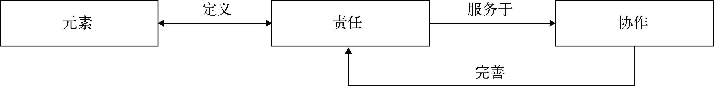

软件设计的分解结果是软件系统模块化了。这里的“模块”等价于“元素”，是一个非常宽泛的概念，可以指代子系统、类、文件、函数等各个粒度的分解结果，甚至还可以表示用户和系统，以及设计分层等。

软件设计的层次看起来很多，也很复杂，不过一旦理解了它的自相似性，就会发现：在所有设计层次上，基本的设计策略和设计原则都是相通的。也就是说，掌握了基本规律后，实现更高或者更低层次的设计并不困难。

### 5.1.2　软件设计的自相似性——分形

自然界有许多事物具有自相似性，这种自相似性被称为分形（fractal）。

对于一棵大树，它的每个枝丫也都形如一棵树。一段海岸线，在大比例尺的地图上呈现的是弯弯曲曲的形状。在非常小的比例尺下观察，它的每个局部也仍然是弯弯曲曲的。六边形的雪花，用放大镜观察，会发现它的每个角仍然是一片六边形雪花。

自相似性非常美妙。它意味着只要掌握了简单的规律，就可以创造出非常复杂的系统。图 5.2展示的是科赫曲线，是由瑞典数学家科赫于 1904 年构造的一个经典分形图形。这个图形是怎么构造出来的呢？

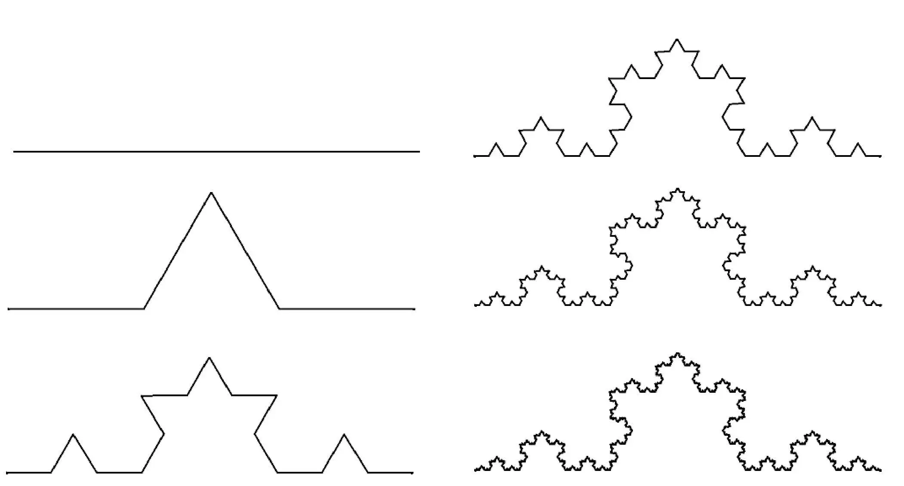

它的构造规律极其简单。第一步，把一条线段三等分，然后用中间的线段构造一个等边三角形。第二步，对得到的每条线段都进行第一步的操作。循环进行第二步。如果不是从一条线段开始，而是从一个等边三角形开始，那么利用科赫曲线的构造规律还可以完美地模拟雪花的形状，构造科赫雪花。

正如自然界中充满了分形结构一样，软件世界也有各种分形结构。软件世界中的元素、责任和协作在各个设计层次上的体现见表 5.1。

表 5.1　不同设计层次上的分解

元素类型

- 责任类型协作描述

- 用户和系统之间、系统和系统之间如何交互，以达成期望

系统 / 子系统

- 用例、功能的业务目标

模块

- 责任各模块如何互相协作，实现系统的用例或功能

- 在面向对象设计中，多个类之间如何协作完成子系统或模

类

- 方法块的功能或责任

在 5.2 节中，我们将用一个大幅简化的例子，来说明上述各个设计层次之间的关系。

### 5.1.3　使用 UML 表达软件设计的分解结果

软件设计需要以某种形式被表达。最终这些表达形式会被落实为代码设计、组件封装或者服务部署。但是，在软件设计过程中的一定抽象粒度上进行的思考和沟通常常需要借助草图才能进行。UML 提供了若干种图和元素来表达设计的分解。这里重点介绍其中的 UML 类图、UML包图和 UML 交互图。

UML 类图

在第 4 章中，我们已经用过 UML 类图。只不过，那里的 UML 类图表达的是领域模型而不是设计元素，只要把领域模型中的业务概念替换为设计元素，表达内容就变成了设计元素和设计元素之间的关系。例如，我们可以使用图 5.3 来表达一个企业的组织结构。如果有需要，我们还可以在这个图中加入每个部门的职责描述，在 UML 类图中可以使用“操作”（operation）来表达职责。

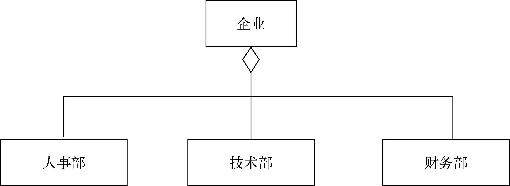

与此类似，我们也可以使用 UML 类图表达系统 / 子系统层次的设计元素（图 5.4）、模块层次的设计元素（图 5.5）和类层次的设计元素（图 5.6）等。

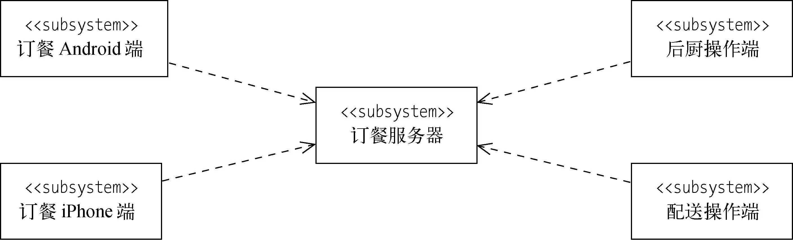

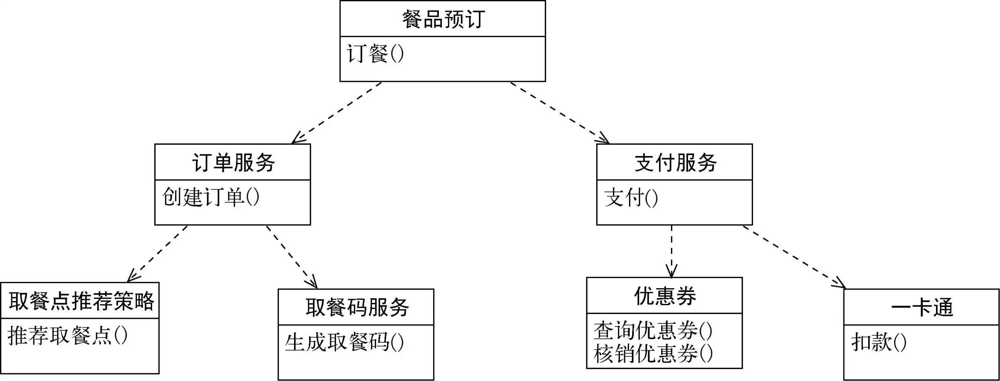

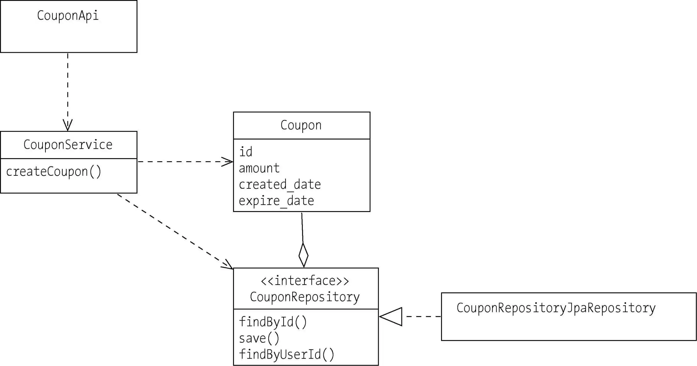

为了让示例尽可能高效，这三张 UML 类图中分别刻意选择了聚合关系、依赖关系、类的属性等元素，尚不熟悉 UML 表示法的读者需要对这部分加以留意。在参考文献 [18] 中，有更详细的关于表示法的介绍。此外，为了表达订餐 Android 端、订餐服务器等是一个子系统，在图

```
5.4 中还引入了 <<subsystem>> 符号，这种符号叫作构造型（sterotype），也就是对某种具
```

体设计元素的类型修饰。

UML 包图

从本质上看，UML 包图和 UML 类图并没有特别大的差异，它们都可以用来表达设计元素，只不过 UML 包图更加强调设计元素的容器属性，UML 类图更加强调设计元素的属性和职责。从这个角度，也可以把 UML 包图看作 UML 类图的一种特殊构造型。设计元素大多是具有属性和职责的，此外，除最细粒度的设计元素之外，设计元素同时也是容器。所以在实际沟通中，是选择 UML 包图还是 UML 类图，甚至推而广之，选择更丰富的 UML 元素［如组件（component）、节点（node）等］，都是结合上下文对不同构造型进行的更细致的表达。

UML 交互图

UML 类图和 UML 包图等表达的都是静态的设计结构，不足以表达更具体的交互过程。要想表达交互过程，可以选择 UML 的顺序图、通信图、带有泳道的活动图等，我们在第 3 章中已经使用过这些图，此处不再赘述，仅给出一个使用顺序图表达软件设计的例子，如图 5.7 所示，供大家参考。

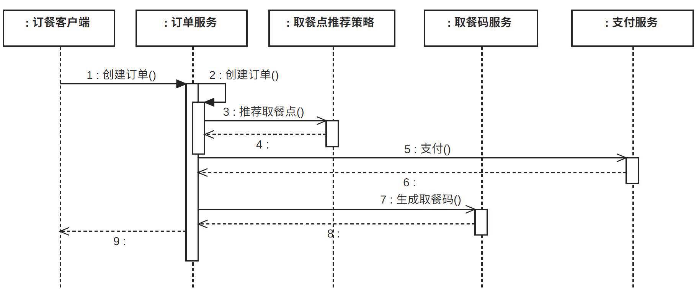

静态结构和动态交互的印证

请读者注意，如图 5.1 所示，设计的静态结构和动态交互之间存在彼此印证、相互促进的关系。如果一个交互消息出现在了交互图中，那在静态结构中应该有一个与之对应的职责。同样，如果在静态结构中存在一个职责，那它必然也要体现在某种业务场景下的交互中，无论是否确实有一张明确描述这种交互的交互图。

这种互为促进的关系，是责任分配中非常重要的概念。正是因为存在这层关系，才让设计单元的职责可以回溯到业务价值和用户功能上。

### 5.1.4　使用代码结构表达软件设计的分解结果

软件设计的分解结果最终必然会体现在软件制品中。其中，粗粒度的体现是服务化部署、二进制的组件封装等。细粒度的体现是代码结构，如代码中的包、类等可以表达软件结构的元素。

类似于图 5.6 这种在类层次的设计元素，只有少部分比较困难或创新的需要使用 UML 图来构思或讨论，大多数时候是可以直接使用代码结构表达的。代码结构是表达设计分解的有效元素。

## 5.2　架构分解的原则与模式

软件架构层次的设计分解是大粒度的分解，这种分解需要考虑多种因素，本章重点讲解逻辑结构层面的架构分解原则。

### 5.2.1　原则 1：优先按照问题领域分解

软件架构层次的设计分解有两个基本入手点：横切和纵切。横切指的是按照设计的层次进行分

- 1

解，如把一个典型的 Web 系统分解为接口层、应用服务层、领域层或者数据库访问层等。纵切指的是按照问题领域进行分解，如把前述的餐品预订系统划分为账户管理子系统、餐品管理子系统、订单管理子系统、菜品加工子系统、取餐子系统、优惠活动子系统等。这种基于问题领域的分解方法，恰好和在第 4 章介绍过的子域的概念相匹配。

横切（按照设计层次分解）和纵切（按照问题领域分解）的示意图分别如图 5.8 和 图 5.9 所示。

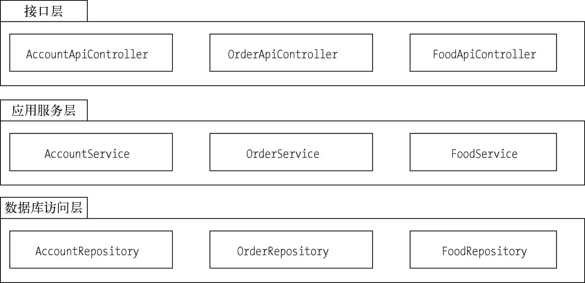

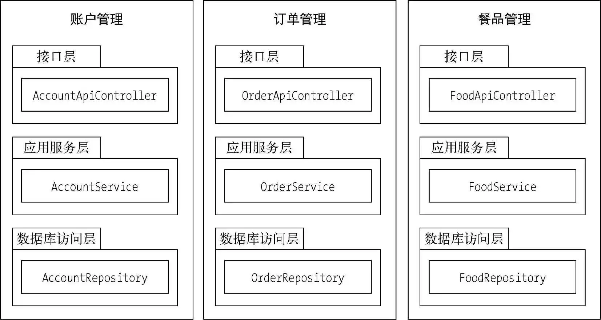

对于中大规模的系统来说，如果按照横切方式分解，那么会遇到一些困难，应该优先选择纵切的方式，也就是按照问题领域分解。原因有以下三个。

- 高内聚和低耦合。属于同一个问题领域的模块之间的联系更为紧密。例如，账户管理子系统的数据库访问层的变更往往会对应用服务层造成影响，如果封装得当，那么完全可以不让订单管理子系统和餐品管理子系统感知账户管理子系统中发生的变更。把问题领域作为分解边界，可以有效实现这种封装。而如果像图 5.8 那样，没有一个和问题领域对应的边界，就很容易破坏这种封装。

- 易于复用。按照问题领域进行分解可以增加复用的机会。在本例中，订单管理子系统如果实现得好，不仅可以适用于餐品预订，还可以适用于线上购物。同理，餐品管理子系统可能也可以适用于食堂的其他业务场景。账户管理子系统的适用范围就更广泛了。而如果优先按照设计层次分解，那么实现这种粒度的复用就需要做更多的工作。

```
避免混乱。按照设计层次分解，很难约束不期望的依赖，如在 OrderService 中调用
AccountRepository。而如果按照问题领域分解，就能传达非常明确的信号，即
OrderService 和 AccountRepository 是分属于两个边界的，不应该互相依赖。在微
```

- 服务架构下，按照问题领域分解还能让服务部署具有边界，这种依赖约束可以获得更强的保证。

### 5.2.2　原则 2：面向质量属性定义架构策略

在架构领域，有一个重要原则是软件架构并不由产品需求决定。不熟悉这个原则的人可能会有点意外，难道不是有了需求之后才会有架构吗？事实上，稍微一想就会明白：业务领域的需求是一直变化的，而软件架构需要具有较好的稳定性。在架构设计中，我们的关注点应该是长期、困难的部分。

有一定软件开发经验的读者都知道，在软件的初始版本开发完成后，在后续版本中增加功能（特别是系统中已有同类功能）时，往往不会有重要的架构决策，重点是理解清楚需求，并在此基础上沿袭既有的解决方案“照着葫芦画瓢”。那么，什么是长期、困难的部分呢？我们称这部分为质量属性（quality attribute），或者非功能需求（non-functional requirement）。本书第1 章中介绍的易于理解、易于演进、易于复用都属于质量属性。

- 架构设计主要取决于质量属性。

- [25]

图 5.18 展示的是 ISO/IEC 25010《系统和需求质量模型》

- 中定义的质量属性模型。其中，

前 6 列可以从外部感知，称它们为外部质量属性；后 2 列仅可以从软件组织内部感知，称它们为内部质量属性。

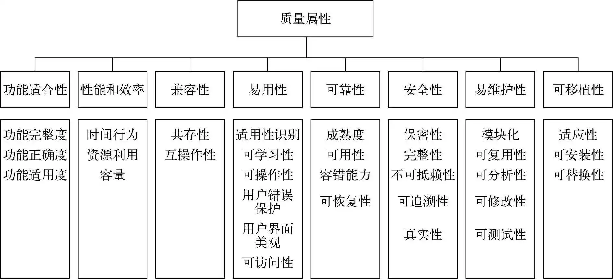

有相当长的一段时期，在软件开发中，特别是开发复杂的软件系统，满足外部质量属性都非常困难，如性能和效率、可靠性、兼容性等，需要非常深厚的架构设计经验。但是，随着软件基础设施的进步，特别是云原生基础设施的发展，如 Kubernetes 生态的成熟，可伸缩性、安全

- 2

性、可靠性等质量属性的实现，都已经内建在基础设施中，开发者的负担已经大大减轻了。

尽管如此，在易于理解、易于演进、易于复用等关键的内部质量属性的实现方面，基础设施依旧无能为力，拥有了良好的架构设计，才能很好地支持它们。不过，人们已经在大量实践中总结了成熟的解决方案，它们可以作为设计的良好起点。这就是原则 3 将要讨论的话题：风格和模式。

### 5.2.3　原则 3：选用合适的架构风格和模式

风格和模式是既往设计经验的结晶。优秀的设计人员往往会让人感觉“见多识广”，在遇到问题时能更快地找到解决方案，这其实是因为他们积累或形成了大量的风格和模式。

风格和模式

风格和模式都来自建筑领域，它们的概念非常类似，不过也有细微的区别。风格，就如其名称所表达的，是“显而易见的特征”。例如，一谈到“巴洛克风格”，读者就会想到浮华的设计；而说到“哥特式风格”，读者就会想到教堂的尖顶。对于软件开发来说也是如此，分层被看作一种架构风格，此外，管道 - 过滤器、微服务等也都可以被看作风格。

- [27]

模式这一概念源自建筑学大师 Christopher Alexander

- ，其核心结构是“上下文—问题—解决[28]

方案”。读过《设计模式》

- 的读者会发现，这也是软件中的设计模式的描述方式。模式的意

义是把解决常见问题的经验固化为方案。在实践中，没有必要过度区分风格和模式的差异。例如，既可以把分层看作一种架构风格，也可以把分层看作一种常见的架构模式。

示例：分层架构

图 5.8 和图 5.9 都应用了分层架构，更具体地说，是三层架构（图 5.11）。分层架构有许多变体，除了三层架构，还有我们将在第 8 章介绍的领域驱动设计的四层架构等。有些变体看起来

- [29]

甚至不太像分层架构，如 Robert C. Martin 提出的整洁架构（Clean Architecture）

- （图

5.12），但是其本质仍然是分层架构。第 6 章中将会介绍的六边形架构，也是分层架构的变体。

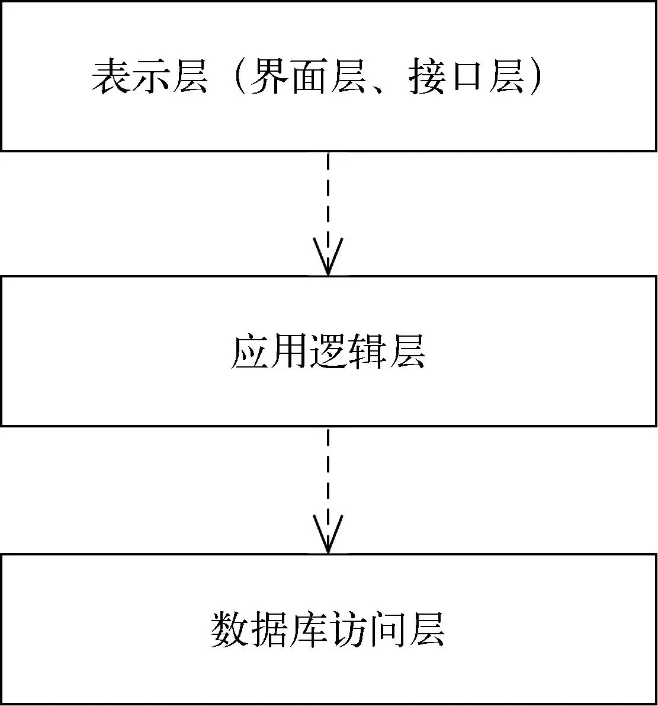

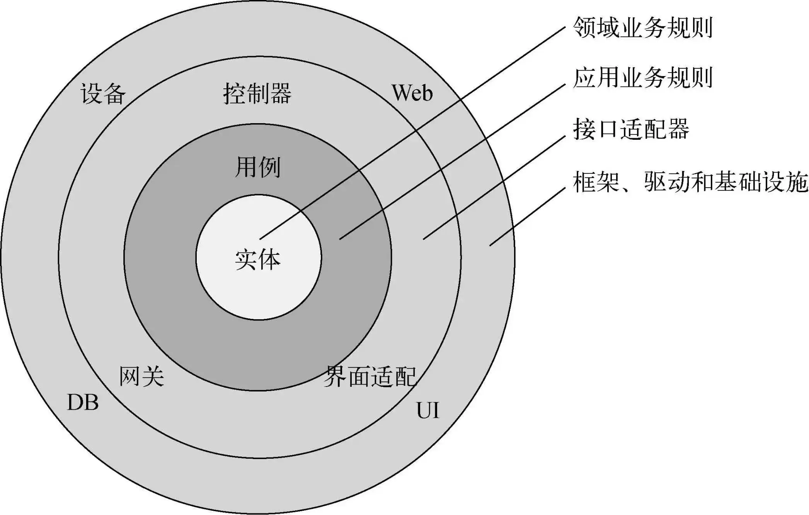

虽然三层架构较为传统，在大多数场景下应该被四层架构或整洁架构等方案代替，但是因为其具备简单性，因此依旧是分析设计思路的好方案。了解了它的基本逻辑后，对于更复杂的架构场景，只要举一反三即可。下面我们就以三层架构为例，介绍为什么架构模式有助于实现质量属性，并用它来指导软件开发。

三层架构包含接口层（界面层、表示层）、应用服务层、数据库访问层。和所有分层架构一样，它的核心是分离关注点。也就是说，在一个业务系统中，用户界面、业务逻辑、数据库访问是三个独立的关注点。

分离关注点能带来如下三个方面的优势。

第一，隔离变化。用户界面和易用性相关，在设计中经常会因为用户体验进行修改，变化比较频繁。我们自然不希望每次更改用户界面时都影响系统的其他部分，所以把用户界面作为一个独立的关注点，在接口层和应用服务层之间建立标准的接口。同样的道理，数据库存储往往和系统的总数据规模（可能导致分库分表）、数据库系统的类型、存储的数据类型（结构化数据和非结构化数据）等细节相关，隔离数据库访问也有利于隔离这些变化维度。

第二，提升可复用性。有许多业务是多端应用，如移动端、Web 端和 PC 端等同时应用。由于业务逻辑层被封装为单独的一层，因此不同的端可以应用同样的业务层。这样的设计，既有效提升了可复用性，也保证了业务逻辑的一致性。

第三，提升可理解性。由于界面、业务逻辑和数据访问是不同的关注点，因此在软件维护活动中，可以很容易地定位到需要分析或者改动的点，便于让拥有合适技能的开发者负责特定部分的开发。

使用架构模式指导设计分解

了解了架构模式后，就可以很容易地基于架构模式完成设计分解。例如，对于餐品预订业务的订单子域，我们可以这样思考：订单子域确实包含了接口层、业务逻辑层和数据库访问层，所以可以像图 5.9 那样进行分解，并基于分解结果进一步完成职责分配。

架构模式有很多，但基本思路都是“上下文 - 问题 - 解决方案”。要成为卓越的设计师，就需要广泛地阅读，学习前人的设计经验，在内心建立丰富的模式库，并将模式灵活运用于实际工作中。

## 5.3　正确使用语言特性

高内聚和低耦合属于非常高层的原则，在实际执行中往往需要更为具体的原则作为指导。本节我们就看看如何把 2.4 节的原则和策略落实到具体的代码实现中。

如何正确地使用语言特性呢？如何把语言特性和设计原则相结合呢？本节将以面向对象的设计作为基础进行讲解。理解了设计的基本原则后，即使面对的不是面向对象的语言（如 C 语言），也可以很容易地把相同的设计策略映射到对应的语言特性中。

### 5.3.1　封装、继承和多态

大多数编程语言类书籍会将“封装”“继承”和“多态”视作面向对象语言的三大基本特征。从语言特性的角度看，这样的陈述没有问题。不过，若从软件设计的角度看，那么更重要的策略是“分解”“组合”“委托”“抽象”这样的设计概念，封装、继承和多态是在语言层面上对这些设计思想的实现。

封装

封装是现代编程语言的基本特征之一，其本质是内聚性和信息隐藏。封装可以让一个设计单元集中于一个目标，并且向外部调用者屏蔽无关细节，减轻了调用者的负担，增强了未来在内部进行结构调整的灵活性。

继承

- 3

继承不是简单的分类法，更不是复用机制，而是抽象

- 在编程语言层面的表达。例如，在一个

文件系统中，FAT 32 格式的文件系统和 NTFS 格式的文件系统虽然实现方式不同，但是都提

```
供了“文件系统”的通用行为，于是 Fat32FileSystem 和 NtfsFileSystem 都可以继承
FileSystem。
```

- 继承的本质不是简单的分类法，更不是复用机制，而是抽象。

```
大多数编程语言显式地区分了接口实现和继承，如 Java 语言中的 implements interface
和 extends class。从本质上讲，接口和继承是两个概念，不过本节讨论的话题是抽象，
```

所以两者在此处大致等价。本节后续的讨论同时适用于接口实现和继承。

多态

多态是非常重要的编程语言基础设施，是继承关系在运行时的行为表现，让抽象在设计层面成为了可能。正如其字面意思，多态反映了同一事物的不同表现。这是一个很强大的能力，可以让潜在的协作者把继承体系里的多个类看作等价物，从而达到抽象和简化的目的。

### 5.3.2　用继承和多态表达抽象

继承不是简单地表达分类结构，它更重要的作用是表达抽象。下面看一个简单的例子，体会一下继承和多态实现的抽象。

```java
abstract class Shape {
   public double getArea();
}
class Rectangle extends Shape {
   public double getArea() { return width * height; }
}
class Circle extends Shape {
   public double getArea() { return PI * radius * radius; }
}
class Client {
   public void foo(Shape shape) {
       System.out.println("the area of shape is: " + shape.getArea());
   }
}
```

代码清单 5.1　使用继承和多态实现抽象

```
在本例中，Shape 类中定义了一个计算面积的方法 getArea。矩形 Rectangle 和圆形
Circle 均继承自该类，并根据对应的面积计算方法对 getArea 进行了不同的实现，如果某
客户端 Client 想要计算面积，那么它可以通过 Shape 引用直接调用 getArea 方法，而无
```

须知道该引用究竟是矩形对象还是圆形对象。这种抽象减少了客户端应该了解的信息，降低了

```
Client 类和外部的耦合（否则需要了解 Rectangle 和 Circle）。
```

### 5.3.3　避免误用继承

“继承不是简单的分类法，更不是复用机制”这一概念非常重要，如果忽视这一点，就会发生继承关系的滥用。

或许有读者会说：在代码清单 5.1 中，形状分为矩形和圆形，这不就是分类吗？为了说明这个问题，我们在代码清单 5.1 的基础上做一个扩展，请看下面的代码。

```java
class Rectangle extends Shape {
   private double width;
   private double height;
   public Rectangle(double width, double height) {
       setWidth(width);
       setHeight(height);
   }
   public double getArea() { return width * height; }
   public void setWidth(double width) { ... }
   public void setHeight(double height) { ... }
   public void getWidth() { ... }
   public void getHeight() { ... }
}
class Square extends Rectangle {
   public Square(double side) {
       setWidth(side);
       setHeight(side);
   }
   public double getSide() {
       return getWidth();
   }
}
class Client {
   void bar(){
       Square square = new Square(5);
       Rectangle rect = square;
       rect.setWidth(3.0);
       System.out.println("正方形的边长为：" + square.getSide());
   }
}
```

代码清单 5.2　误用继承的例子

代码清单 5.2 在代码清单 5.1 的基础上，引入了一个新的形状：正方形。那么，正方形算不算

```
矩形呢？从数学定义上说，是算的。但是，请注意在这里的 Rectangle 类中，新加入了两对
方法：setWidth/getWidth 和 setHeight/getHeight。此时，如果 Square 类继承了
Rectangle 类，那么会出现一些奇怪的事情。
在第 27 行，我们新建了一个 Square 实例，并赋值给 square 变量，传入的参数是 5，代
表边长为 5。然后在第 28 行，我们把这个实例的引用赋值给了 rect 变量。请注意这个赋值
甚至不是距离这么近，而是距离很远的一个函数。在第 29 行，很正常地调用了 rect 变量的
setWidth 方法。
```

单独看每一行代码，都很正常。但是，第 30 行的打印操作显然陷入了两难的境地。这个叫作

```
square 的变量表达的已经不再是一个正方形，调用 getSide 方法获取边长的数值自然也无
从谈起。无论打印结果是 5 还是 3，其实都不对。
```

问题就在于“继承不是简单的分类法”。尽管从数学上讲，正方形是一种特殊的矩形，但是，程

```
序员并不知道第 29 行的变量 rect 背后是一个 Square。也就是说，程序员脑海中存在一个
抽象，认为无须了解 rect 背后的细节，但恰好这个细节会对后续的其他代码行为产生不可忽
```

略的影响。所以，这是一个错误的抽象。

该如何解释“正方形居然不是矩形”这个问题呢？这要回到“对象的职责”这个本质上。尽管从数

```
学角度上讲正方形是一种矩形，但是由于 Rectangle 类定义了 setWidth 和 setHeight
的职责，而 Square 类无法实现这一职责，所以从职责上讲，不能认为“正方形是矩形”。继承
```

不是关于客观事物的分类法，而是关于职责的，也就是面向职责的抽象。

- 面向对象系统的本质不是一个对象系统，而是一个责任系统。

### 5.3.4　用里氏替换原则指导继承关系的使用

在编程语言和软件设计的发展史上，人们对继承的理解经历了一个漫长且曲折的过程。面对这

- [30]

个容易混淆的问题，Barbara Liskov 提出了里氏替换原则

- 。这一原则也被 Robert C. Martin4[31]

收录到了著名的 SOLID 原则

- 中。里氏替换原则的表述如下。

- 的对象的对象编写的程序若每个类型，都存在一个类型，使得在所有针对


- 替换后，程序的行为功能不变，则是的派生类型。中，用

这段话使用的是比较学术化的表达，严谨但是略有拗口。仔细阅读就能提取出：继承不是简单的分类法，而是关于职责的约定。Liskov 称这种职责为“行为功能”。根据这个原则，尽管正方

```
形在数学意义上确实是一种矩形，但是因为 Square 类无法完成 Rectangle 类中关于
setWidth/setHeight 方法的约定，自然 Square 类也就不能继承 Rectangle 类。
Square 类不能依赖于 Rectangle 类，还有一个不利的影响是，本质上正方形面积的计算方
```

式和矩形面积的计算方式是一样的，因此编写两次就不够合理。如何解决这个问题呢？站在职责系统的角度，解决方案一目了然，这就是下面介绍的内容：用委托的方式实现复用。

### 5.3.5　用委托的方式实现复用

- 5

```
我们希望不用在 Square 类中重写 getArea 方法，
就能够复用 Rectangle 的实现。
从责任视角来看，我们可以认为：计算 Square 的面积，本质上是计算长和宽相等的矩形的
```

面积，因此可以委托（delegate）一个已经具备矩形面积计算方法的类来执行这个任务。这样编写出的代码如下所示。

```java
class Rectangle extends Shape {
   private double width;
   private double height;
   public Rectangle(double width, double height) {
       setWidth(width);
       setHeight(height);
   }
   public double getArea() { return width * height; }
   public void setWidth(double width) { ... }
   public void setHeight(double height) { ... }
   public void getWidth() { ... }
   public void getHeight() { ... }
}
class Square extends Shape {
   private Rectangle rect;
   public Square(double side) {
       rect = new Rect(side, side);
   }
   public double getSide() {
       return rect.getWidth();
   }
   public double getArea() {
       return rect.getArea();
   }
}
```

代码清单 5.3　使用委托实现复用

```
在新的实现中，Square 类继承了 Shape 类，而不是 Rectangle 类，这说明 Shape 类承
诺要承担执行 Square 类定义的 getArea 方法的责任。为此，Shape“雇佣”Rectangle 代
为执行，之后当收到 getArea 方法的请求时，Square 就把这个责任委托给 Rectangle。
```

- 委托是一种非常强大的复用方式。在面向对象的程序设计中，需要复用时应该优先考虑委托，而不是继承。

### 5.3.6　面向对象的职责视角——抽象、委托和组合

软件是一个责任系统。无论是面向对象语言、面向过程语言，还是函数式语言，其本质都是责任的分解和责任的抽象。

通过分解，让每个设计单元仅承担一部分的内聚责任。由于责任内聚，所以更容易理解、更容易复用、更容易替换。委托和组合是职责分解的两种表达形式。自上而下的职责分解就是委托；自下而上地把若干设计单元联合起来完成一个更大的职责，就是组合。

抽象的本质就是，从职责视角看，若干设计单元可以等价。通过这种等价，设计就可以得到简化，因为责任的使用方无须知道具体的细节。

## 5.4　关注点分离

设计分解和职责分配的基本原则是 2.4 节中讲过的高内聚和低耦合。尽管在架构层次的设计中也要考虑高内聚和低耦合，但是架构层次的结构划分较为低频，而实现层次的分解却非常高频。同时，相比较而言，实现层次细节更多，对高内聚和低耦合的要求更高，也更难达成。

在实现层面，程序员几乎每时每刻都在做设计决策。无论是新建一个类或接口，还是调整类或接口的职责，都是在进行设计分解和职责分配。高内聚要求把相关的职责放在一起，但这个指导原则相当模糊。从 2.5 节已经看出，初步看起来紧密相关的代码（代码清单 2.11），也可能不那么紧密相关（代码清单 2.16）。因此我们需要更加具体的指导原则。

图 2.8 能让我们有所启发，可以再看一下那张图。

不过，或许有读者会提出如下问题。

- 如何才能更容易地发现代码清单 2.11 中包含不同的关注点呢？

- 代码清单 2.11 中的代码本来也不复杂，这算不算是过度设计呢？

这两个问题都非常重要，我们首先来回答第一个问题。

### 5.4.1　用单一职责原则指导关注点分离

要检验关注点分离得是否清晰，最好的方法是用变化来检验。当程序员面对若干个可能的划分构想，特别是不怎么有把握时，最快的解决方案就是问问自己：如果发生某变化，将会怎样？

```
例如，在 JavaFileNamePrinter 的例子中，假如打印的文件内容发生了变化，那是不是代
```

码清单 2.11 中的代码都会受到影响？

做完了这样的设计假设后，关注点是不是分离得够清晰，就变得一目了然了。这是因为，根据规律，同一个关注点上的事物的变化频率是一致的。不同关注点上的事物，则可能随着业务要求的变化而变化。

在研究“内聚”这种比较定性的描述时，要像物理学中研究运动一样，先找到一个参照系。软件

- [31]

设计中的这个参照系就是“变化”。Robert C. Martin 提出了面向对象设计的单一职责原则

- 。

- 单一职责原则类的职责应该是单一的。所谓单一，是从变化维度衡量的。也就是说：一个类应该只有一个变化的原因。

Robert C. Martin 说的是“类”，其实这个原则可以适用于所有设计单元。把变化作为单一职责的衡量标准，是一个通用策略。例如，用单一职责原则来衡量代码清单 2.10 的登录代码，很容易就能发现，账号登录是一个关注点，消费记录是一个关注点，因此这段代码是不内聚的。在代码清单 2.11 中同样包含两个关注点：如何遍历文件，以及遍历到文件之后应该做什么。

```
以图 2.9 为例，类 JavaFileNamePrinter 实现了接口 FileVisitor。所以，如果
FileVisitor 的定义发生变化，JavaFileNamePrinter 就会受影响，这是一种耦合关
```

系。

### 5.4.2　如何判断关注点分离和过度设计

现在我们讨论第二个问题：什么时候进行关注点分离是过度设计，什么时候不是呢？

一般来说，只要能识别出不同的关注点，新代码就不会比原有代码复杂。虽然代码清单 2.16确实比代码清单 2.11 多两个类，但是从理解的难易程度上讲，代码清单 2.16 是更容易理解的。如果有读者对这部分概念有所疑惑，可以参考第 9 页的扩展阅读：面条代码和馄饨代码。代码并不会因为关注点分离而变得更加复杂，所以这算不上过度设计。

```
但是，或许会有这样的挑战：认为目前的 JavaFileNamePrinter 包含两个关注点，判断一
```

个文件是不是 Java 文件，以及打印出文件名。假设出现了一个

```
JavaFileContentPrinter，那现在要不要先定义一个 JavaFileVisitor，让
JavaFileNamePrinter 和 JavaFileContentPrinter 都继承它呢？
```

这样的设计看起来是合理的，但正如我们在论证代码清单 2.11 和代码清单 2.16 哪个更合理时一样，设计是否合理的终极评判标准是总体收益是否得到了最大化，要同时考量成本和效率。新增的抽象增加了额外的复杂度（新增了只有一个子类的抽象类），但是这个抽象的收益极低。

```
第一，虽然减少了重复，但是并没有减小认知复杂度（新增了一个类，而且 isJavaFile
```

- 方法仅有两行代码，同时发生改变的可能性很低）。

```
第二，JavaFileContentPrinter 的需求仅处于假想阶段，这个需求可能永远都不会真
实产生，可在每次遇到 JavaFileNamePrinter 时，都要回忆为什么多出了一个父类。
```

当收益和付出不平衡时，这种抽象就显得没有必要。当然，如果在未来出现了若干针对 Java文件的处理需求，如打印文件名、打印文件内容、统计文件行数等，那么投资收益就发生了变化，也就不再是过度设计了。

第二个关于关注点分离的难题是“分析瘫痪”，即总是认为当前的职责分离得还不够好，在猜想还有没有更好的分离方法，但是又没有充分的证据。关于这一点，解决策略也是一样的。既然目前看不出来关注点分离得好不好，那不妨把存疑的关注点当作单一关注点看待。也就是说，如果所有人都发现不了代码清单 2.11 中存在两个关注点，那就是“此时此刻最优的设计”，仅当真的发生变化时，再如同在 2.5 节中介绍的那样，及时分离关注点，消除重复，也就是合理的设计了。

### 5.4.3　用开放 - 封闭原则检验关注点分离

开放 - 封闭原则（Open-Closed Principle）是检验关注点分离的有效手段，这个原则出自

- [32]

Bertrand Meyer的经典名著《面向对象软件构造》

- 。我们先来看一下开放 - 封闭原则的定

义。

- 开放 - 封闭原则设计元素应该对修改封闭，对扩展开放。

先解释一下其中的两个术语，“修改”指的是“打开代码实体进行修改”，“扩展”指的是“增加代码实体”。整个原则的意思是，如果一个设计在每次实现新的需求时都必须打开既有的代码，那它就不是一个好的设计。因为“打开代码”意味着要让这段代码变复杂，会增加出错的风险，同时还必须重新测试所有和这段代码相关的功能。相反，如果在每次实现新的需求时，仅新增代码元素即可，不会显著增加原来设计的复杂性，出错的风险也较低，那这就是一个良好的设计。

开放 - 封闭原则是一种检验手段，可以检验产出的设计是否高质量。例如，代码清单 2.16 对

```
于扩展是开放的：当新增一个处理文件的需求时，仅需要扩展 FileVisitor 接口。如果缺
```

乏这样的抽象，则可能产生如下代码。

```java
public class FileRecursiveProcessor {
   public void processFiles(String rootPath) {
       File dir = new File(rootPath);
       processFiles(dir);
   }
   private void processFiles(File node) {
       if (isJavaFile(node)) {
           System.out.println(file.getAbsolutePath());
       } else if (isTextFile(node)) {
           Files.readAllLines(node.toPath()).forEach(line->System.out.println(li
       }
       if (!node.isDirectory()) return;
       File[] subnodes = node.listFiles();
       Arrays.asList(subnodes).forEach(subnode->processFiles(subnode));
   }
   private boolean isJavaFile(File node) {
       if (!node.isFile()) return false;
       return FilenameUtils.getExtension(node.getName()).endsWith("java");
   }
   private boolean isTextFile(File node) {
       if (!node.isFile()) return false;
       return FilenameUtils.getExtension(node.getName()).endsWith("txt");
   }
}
```

代码清单 5.4　对目录下的文件进行处理

从功能上看，这个设计和其他设计完全等价，但是这显然是一个不内聚的设计，也不符合单一职责原则。我们从开放 - 封闭原则的角度来看看，这样的设计会导致什么后果。

- 如果现在再有一个新的需求，如打印 Python 文件的内容行数，那你会怎么实现这个功能

```
呢？我相信大多数人最自然的选择，就是在第 16 行增加一个新的条件判断：else if
(isPythonFile(node)) { ... }。
```

这是一个非常典型的开放 - 封闭原则的反例：对扩展封闭，对修改开放。这样的代码在每次修改后都需要重复测试，还可能影响既有的功能，更重要的是代码将会越来越复杂、越来越臃肿。

开放 - 封闭原则是关注点分离的有效试金石。凡是关注点分离得不足时，它往往意味着需要在原有的代码上进行修改，而不是扩展。在第一次遇到这种场景时，及时对概念进行抽象，就可以分离关注点，提升设计质量，同时也满足了开放 - 封闭原则。

## 5.5　设计模式

我们已经在 5.2 节讨论了架构模式，现在来看一下在设计层次上，设计模式如何支持了设计分解。设计模式是程序员的得力助手，但是对新手来说往往意味着神秘和负担，如果运用不当，还可能导致过度设计。

### 5.5.1　模式的价值

讲到模式，可以改编鲁迅先生的一句话，得到：“世界上本来没有模式。类似的事情做多了，就形成了模式。”模式运动起源于 20 世纪 80 年代 Kent Beck 和 Ward Cunningham 的工作，这

- [33]

些工作发表在软件工程领域的著名软件会议 OOPSLA

- 上。在软件设计领域，知名度最高的6[28]

工作是 GoF

- 。此后还产生了一大批有影响力的工作，特别是 POSA的《设计模式》[34][35]

（Pattern of Software Architecture）系列

- 、Martin Fowler 的《企业应用架构模式》等。

其中不少模式已经成为了软件工程领域开发者日常沟通时使用的术语，以及许多框架中的标准

```
概念。例如，代码清单 2.16 中的 FileVisitor 的概念就来自《设计模式》。Spring 中的
```

Controller、Hibernate 等持久化框架中的 Unit of Work、Repository 等都源自《企业应用架构模式》。

模式最重要的价值是提升思考的粒度。这如同下围棋，高手在许多场景下，无须计算，只要扫一眼，就能大概知道场上的情况和接下来的发展趋势。这背后就是棋局的模式。尽管在没有模式时也可以从零开始一步步推演，但是思考的粒度会琐碎很多，也很容易造成失误。

模式还有助于便捷地交流。例如，两个开发者正在讨论系统之间接口不匹配的问题，当其中一个开发者说“这个地方我们需要加一个适配器”时，对方马上就知道他表达的是什么，这是因为存在适配器这个模式，且双方都知道这个模式，否则还得针对具体问题画出类图，进行一番烦琐的解释。

### 5.5.2　用设计模式指导软件设计

熟练掌握设计模式，有利于进行关于软件设计的思考和交流。代码清单 2.16 就是一个好的范例，它使用了一种叫作 Visitor 的设计模式。熟悉这个模式的程序员在遇到适合的场景时，就很容易在脑海中形成模式匹配，选择这个模式，形成解决方案。Visitor 模式就是：定义对象结构的类很少改变，但经常需要在此结构上定义新的操作。这句话援引自《设计模式》一书 5.11 节关于 Visitor 模式的表述，恰好符合我们面临的场景：访问文件夹下的文件，这是一个确定的关注点。但是，对访问到的文件进行什么操作，是可能发生变化的关注点，在这个关注点上，需要定义不同的操作策略。例如，在代码清单 2.16 中，是打印 Java 文件的文件名，在代码清单 2.17 中，则是打印文本文件的内容。

Visitor 模式完美地体现了软件设计的分解和抽象原则：分解指的是把不同的关注点分离，即刚才提到的把如何访问文件夹下的每一个文件作为一个关注点，把打印 Java 文件的文件名或打印文本文件的内容作为另一个关注点；抽象指的是把打印 Java 文件的文件名或打印文本文件

```
的内容抽象为进行某种操作，即 FileVisitor。
```

许多设计模式是对关注点分离和抽象的应用。下面列举四个模式。

- Iterator 模式是对“遍历执行”这个活动的抽象，也是“如何遍历”和“遍历后做什么”这两个关注点的分离。

- Strategy 模式是对具体操作行为的抽象。

- Composite 模式是对整体和部分的分离，也是对事物自相似性的抽象。

- Decorator 模式是对核心职责和附加职责的分离。

如果熟悉设计模式，在遇到恰当的场景时，就可以快速决定应该如何分离关注点，并快速将它转换为实现。

在实际工作中，常常见到许多读者虽然能熟读《设计模式》，但是并不能灵活运用其中的知识，核心原因在于他们并未非常了解软件设计的关注点分离和抽象这两个视角。换言之，即使你不了解设计模式，只要坚持关注点分离和及时抽象，设计模式也会自我显现。相反，如果没有理解关注点分离的本质，只是生搬硬套设计模式，那结果往往是：不仅没有改善设计，还会导致代码更加晦涩难懂。

### 5.5.3　在重构中涌现模式

避免生搬硬套设计模式的核心要诀是：仅在需要的时候才进行关注点分离和概念的抽象。前文已经提到，即使是代码清单 2.11 这样的代码（没有关注点分离），在确定出现新的变化方向之前，也不是必须抽象为 Visitor 模式。

让我们介绍一个来自真实项目的场景。multilang-depends 是一个分析代码元素间的依赖的开

- [14]

```
。在它的早期版本中，有一个叫作 EntityRepo 的类，用于存储所有解析到的代码
```

源项目元素，如类、方法等。最初它仅仅是一个简单的内存数据存储结构，类似于下面这样。

```java
public class EntityRepo {
   Map<String, Entity> allEntieisByName;
   public Entity getEntity(String entityName) {
       return allEntieisByName.get(entityName);
   }
   public List<Entity> resolveImportEntity(String importedName) {
       ArrayList<Entity> result = new ArrayList<>();
       Entity imported = this.getEntity(importedName);
       if (imported == null) return result;
       result.add(imported);
   }
   // 其他代码略
}
代码清单 5.5　早期版本的 EntityRepo
其中，第 2 行使用了 Map 结构，以名字为键存储解析到的代码实体。第 3 行至第 5 行的
getEntity 方法用于根据名字查找对应的代码实体。
```

根据需要分离接口和实现

在迭代了若干版本之后，发现解析到的文件中代码实体的数量非常庞大，占用了许多内存，因此决定采用一个数据库来存储。为此，我们发现了两个不同的关注点：关注点 1 是如何实际存储；关注点 2 是如何对外部表达存储能力。这是一个典型的 Bridge 模式：分离接口和实现。

所以，代码演进为如下这样。

```java
public interface  EntityRepo {
   public Entity getEntity(String entityName);
   // 其他代码略
}
public class InMemoryEntityRepo implements EntityRepo {
   Map<String, Entity> allEntieisByName;
   @Override
   public Entity getEntity(String entityName) {
       return allEntieisByName.get(entityName);
   }
   // 其他代码略
}
public class Neo4jEntityRepo implements EntityRepo {
   @Override
   public Entity getEntity(String entityName) {
       // 代码略
   }
   // 其他代码略
}
代码清单 5.6　分离了接口和实现的 EntityRepo
```

根据需要分离查找策略

```java
此外，在代码清单 5.5 中，第 7 行至第 12 行的 resolveImportEntity 方法实现了该程序
的一个重要功能：根据 import 语句（如 import java.nio.file.Files;）找到实际的
代码实体。由于 Java 语言中的 import 语句非常直接，提供了全路径名，所以很容易就可以
```

找到，在第 9 行直接进行查找即可。

当把这个方法扩展到也可以分析 C 语言代码时，情况就变复杂了很多，因为 C 语言中需要根

```
据 #include 语句逐级上溯，这时候直接查找就变得不可能了。因此，这部分代码演进为如
```

下这样。

```java
public interface ImportLookupStrategy {
   /**
    * How to find the corresponding entity out of current scope
    *
    * @param name - the entity name
    * @param fileEntity - the current file
    * @param repo - the whole entity repo, which could be used when necessary
    * @param inferer - the inferer object, which could be used when necessary
    * @return the founded entity, or null if not found.
    */
   Entity lookupImportedType(String name, FileEntity fileEntity,
                             EntityRepo repo, Inferer inferer);
}
public class CppImportLookupStrategy implements ImportLookupStrategy {
   @Override
   public Entity lookupImportedType(String name, FileEntity fileEntity,
                                    EntityRepo repo, Inferer inferer) {
       // 代码略
   }
}
public class JavaImportLookupStrategy implements ImportLookupStrategy {
   @Override
   public Entity lookupImportedType(String name, FileEntity fileEntity,
                                    EntityRepo repo, Inferer inferer) {
       // 代码略
   }
}
代码清单 5.7　分离 import 查找为策略模式
```

从上述例子可以看出，责任分解并不总是一蹴而就的，它往往会随着设计的持续演进，发现新的变化方向、新的关注点和新的抽象。这种持续改善代码的设计行为，就是重构。本书 11.3节还将深入探讨重构的概念。

重构和设计模式之间存在彼此促进的关系。首先，设计模式为重构过程提供了有效的牵引。其次，重构是应用设计模式的最好时机。避免过度设计的一个很难把握的点就是不知道什么情形才是过度设计。重构给出了非常明确的回答。因为代码中已经出现了坏味道，所以必然需要改进设计。那么，在需要时使用设计模式来分离关注点，就成为了一个恰当的选择。最后，根据设计中出现的关注点分离的信号，按需分配职责，也是达成第 2 章所述的“没有多余的设计”的最佳选择。

## 5.6　小结

模块化是软件设计的基础。如何在架构层次和设计层次上分解设计，并使用 UML 或正确的语言特性表达设计，是高质量软件设计的基础。本章讲解了软件设计的基本概念：元素、职责和协作，并介绍了软件设计的核心原则，尤其是单一职责原则。

此外，应该利用架构模式和设计模式来加速设计进程，提高设计质量，因此熟练掌握架构模式和设计模式，能够大幅提升设计效率。

图 5.13 总结了本章讲到的核心概念和方法。

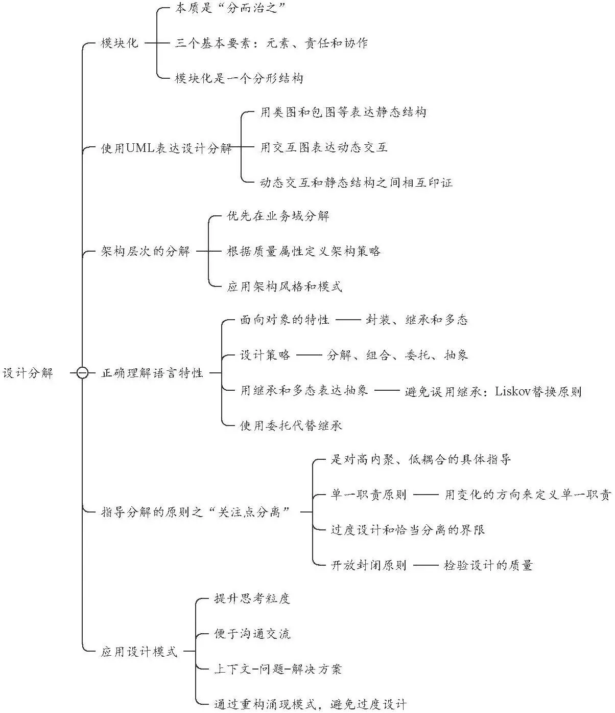

[1]：为了表达简单，本节使用三层架构模式，在实际业务系统中更推荐使用领域驱动设计的四层模型，本章会有介绍。[2]：当然，在嵌入式等领域，这些关键质量属性的实现，仍然是重要的话题。关于这部分内容，感兴趣的读者可以参阅相关书籍获

- 取更多信息。

[3]：本书在 4.3节 已经介绍过抽象，只不过是从领域模型角度讲解的。设计层面的抽象和领域模型的抽象，在本质上并无区别。[4]：“里氏替换原则”还隐含了对设计契约的要求，我们将在下一章再次讨论这一原则。[5]：当然， 的实现逻辑确实很简单，重写代价也不大，可对于实际业务中的复杂逻辑，复用就显得很重要了。[6]：GoF（Gang of Four）常被用来指代《设计模式》的四位作者：Erich Gamma、Richard Helm、Ralph Johnson 和 John

- Vlissides。
