# 第6章依赖、接口和契约

设计分解和职责分配促进了设计元素间的协作。协作就必然需要引入依赖，依赖是软件设计中最复杂的部分。良好的依赖会让代码看起来结构清晰、井井有条；而管理得不好的依赖，有可能让代码乱糟糟的像一团麻，让软件设计不稳定、易出错、难复用。

本章将从依赖的设计原则、接口、契约和事件机制的角度，来讨论如何良好地管理依赖，实现高质量的软件设计。

## 6.1　依赖的设计原则

软件是一个职责系统。有职责分工，就会有协作，业务需求或者系统的某种职责正是通过模块间的彼此协作达成的。也就是说，在软件系统中，绝大多数模块要想正常发挥作用，离不开其他模块的配合。这意味着模块间普遍存在依赖关系。

管理不良的依赖常常是发生设计问题的根源。在 2.4 节，我们曾经提到过一个设计不良的

```
AccountService 的例子（读者如想了解该例，请参阅代码清单 2.10 和代码清单 2.12）。我
分析了 AccountService 的实际依赖，并把部分结果展示在了图 6.1 中。
```

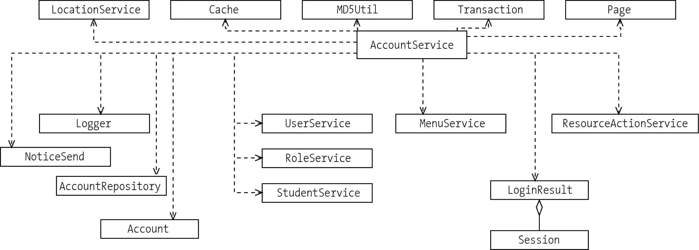

```
不好的设计往往有着复杂的依赖。根据图 6.1 ，AccountService 直接依赖了至少 15 个
类，其中有些类还有其他依赖，如 AccountRepository 依赖 Account、LoginResult
依赖 Session 等。复杂的依赖会影响代码易理解、易演进和易复用的能力。
影响易理解：依赖越多，理解 AccountService 所需要掌握的知识就越多。
影响易演进：依赖越多，AccountService 受影响和出错的可能性就越大。
```

- 影响易复用：依赖越多，复用时受的约束就更多，要么把依赖的元素一起带上，要么修改相关代码解除依赖。而当依赖层次很深的时候，难免“拔出萝卜带出泥”，会直接导致复用失败。

- [36]

那么，如何设计依赖才能降低以上的影响呢？袁英杰在《变化驱动：正交设计》

- 一文中做

了如下总结。

- 依赖最小化原则：只依赖必需的设计元素。

- 稳定依赖原则：尽量依赖稳定的、不易变更的设计元素。

使用这两个原则，很容易理解软件设计中一系列设计策略和模式，包括面向接口编程、依赖倒置、接口分离等。

### 6.1.1　面向接口编程

面向接口编程是一种关注点分离机制，其核心是分离接口（做什么）和实现（怎么做），这两点贯彻了上面提到的两个原则。

- 依赖最小化原则：具体的实现比抽象的接口涉及更多细节，知识和信息也更复杂，依赖于接口贯彻了依赖最小化原则。

- 稳定依赖原则：具体的实现比抽象的接口发生变化的概率更高，依赖于接口可以让依赖更稳定。

```
在图 6.1 中没有明确指出 AccountService 依赖的是接口还是实现。我们取其中一个依赖关
```

系做更仔细的观察。图 6.2 是典型的面向接口编程的策略。作为对比，图 6.3 依赖于具体的实

- 1

现。

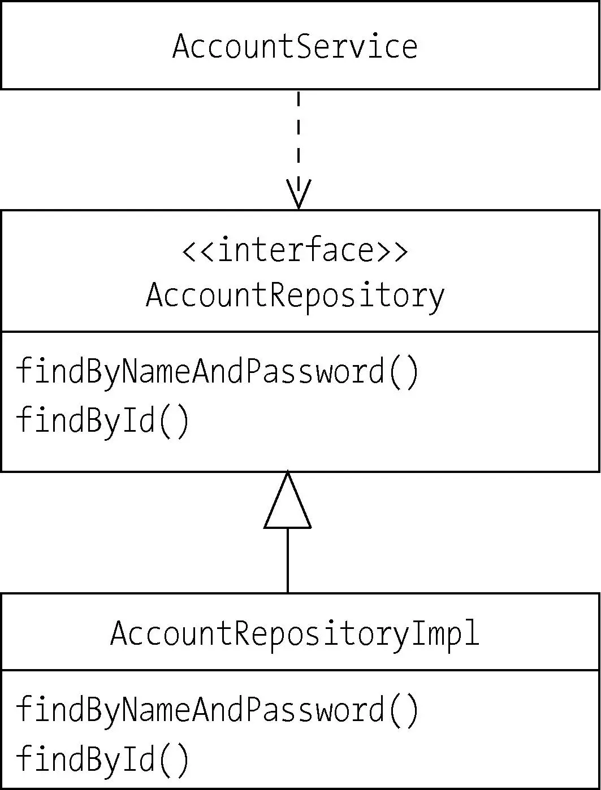

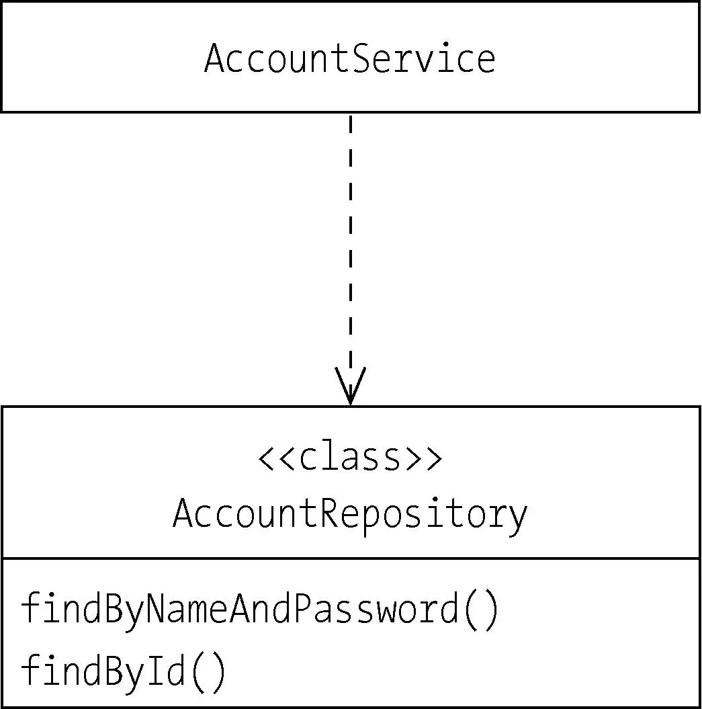

如果读者熟悉设计模式，可能已经看出来了，图 6.2 就是设计模式中的 Bridge（桥接）模式。面向接口编程在本质上和 Bridge 模式是统一的。只不过，面向接口编程的概念相当重要，已经成为了一种重要的编程范式。无论是编程语言（如 Java、C#），还是现代的编程框架（如Spring），都对接口和面向接口编程提供了广泛支持。

面向接口编程有两方面的好处。

一方面是面向接口编程带来了更稳定的设计。使用面向接口编程的方式，依赖方不会受被依赖

- 2

```
接口的具体实现方式的影响。例如，AccountRepositoryImpl 可以是一个基于 MySQL
```

- 34

的实现，也可以是一个基于 MongoDB

- 的实现，还可以是一个基于 h2的实现，甚至是一

个仅仅基于内存数据结构（如列表）的模拟存储结构。在具体实现方式上，可以使用 JDBC，

- 5

也可以使用 MyBatis

- ，还可以使用 Hibernate 或者 Spring JPA。无论实现方式如何变化，只

```
要接口不变，依赖于 AccountRepository 的 AccountService 就不会有感知。
```

面向接口的编程方式可以有效阻断依赖传递。图 6.2 仅仅展示了一层依赖关系。在实际的系统中，依赖肯定不会只有一层。当层次非常多的时候，面向接口编程和非面向接口编程之间的差异就很大了。


在图 6.4 中，左侧使用的是面向接口编程，右侧是依赖于具体的实现。其中，左侧的

- （C


表示 Class）仅依赖于

- （I 表示 Interface），也就是说，只有变化才会引起变化；


- 也仅依赖两个接口。而在右侧的依赖关系中，只要中的任何一个发生变

和

- 、、

- 变化。显然右侧的稳定性要弱于左侧。

化，就会导致

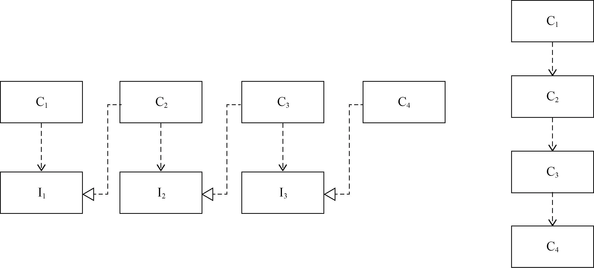

另一方面是面向接口编程的方式把“A 依赖于一个具体的 B”变成了“A 依赖于接口定义的标准”或者“A 依赖于接口定义的能力”。这是一个非常重要的思维模式的不同。

- “A 依赖于一个具体的 B”类似于我们在日常生活中遇到的非标准件。假设汽车上的一个小零件坏了，而且这个零件是一个非标准件，那么需要到把车开到专门的汽车门店去修理。这个

- 门店要是没有这种零件，就还需要花时间订购。可如果是家里的灯泡坏了，那么只需要到附近的五金店，就可以买到新的，很快就能修好。之所以能有这种便利，是因为所有灯泡都必须遵循国家标准，从而能够灵活互换。更重要的是：标准化的接口让所有家庭的照明系统和各家照明设备制造厂商成功解耦了，仅和国家标准存在耦合。国家标准非常稳定，自然整个照明系统的维护成本就大幅降低了。标准化是现代工业的基础。对于在上一段中提到的标准，现行最新的标准是 GB/T 1406.1-2008《灯头的型式和尺寸》。例如，日常生活中最常用的灯头是 E27 螺口灯头，更细一点的是 E14 灯头。正是因为有了这些标准，各家灯具制造厂商和灯泡制造厂商才可以各自独立，产品互相兼容。这种简单性和互换性也是软件系统设计所追求的目标。尽管由于软件系统的复杂度要远远超出照明系统，导致实现完全的标准化定义非常困难，但是依赖于接口，而不是依赖于具体的实现，是一个普遍适用的原理。

顺便提及，在接口标准化方面，类似于 OpenAPI 的机制正在逐渐形成。通用且常用的系统组件（如短信发送等）都在渐渐走向标准化。

### 6.1.2　依赖倒置

- [31]

依赖倒置

- 是一个著名的软件设计原则，是面向接口编程的具象化说法。

为什么叫依赖倒置呢？这是因为在软件设计中，我们常常会把更靠近依赖树顶端的部分称为上层，把更靠近底端的部分称为下层。例如，在图 5.11 所示的分层架构中，接口层是上层，数

据访问层是下层。在图 6.4 右侧的图中，

- 是上层，是下层。当然上层、下层是一组相

- 相对于是下层，相对于就是上层。

对的概念。例如，

按照习惯性思维，上层肯定是要依赖于下层的，但是，在讨论面向接口编程时，我们已经理解到这种设计是不好的，应该要依赖于接口。按照这样的逻辑设计软件系统，就得到了图 6.4 中左侧的图。这其中遵循的就是依赖倒置原则。

- 高层模块不应该依赖于低层模块，二者都应该依赖于抽象。

依赖倒置还有一个类似的说法，叫作抽象不应该依赖于细节，细节应该依赖于抽象。细节指的就是具体的实现，抽象指的就是接口。这也从另外一个视角强调了稳定依赖这一原则。

我们可以在图 6.4 中看到：右侧图中的

- 和的关系是上层依赖于下层，这是传统且不够

- 和都对有依赖，也就是模块依赖于接口，而

合理的依赖设计方式。而在左侧图中，

不是模块间直接依赖。图 6.5 是一个更为清晰的示意图，从

- 的视角，我们可以清晰看到依

赖方向的反转。

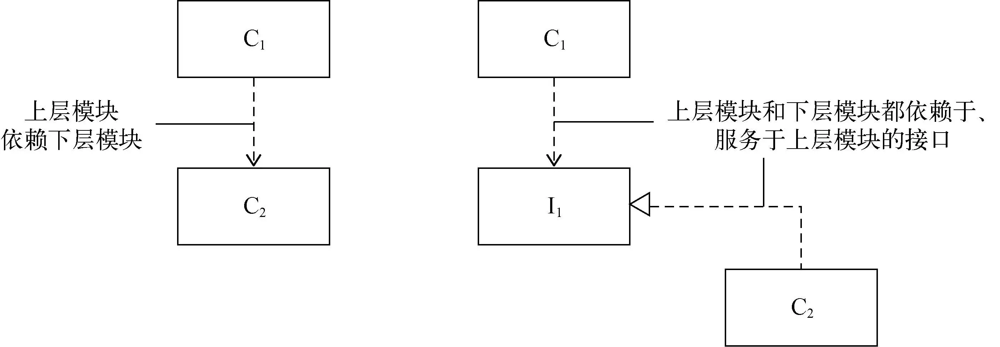

### 6.1.3　接口分离

接口分离原则是一个关于接口粒度设计的很有效的原则。在本节前面的讨论中，我们已经知道：依赖于接口要优于依赖于实现。但是，接口的设计有没有要求呢？有，接口分离就是一个重要原则：接口的设计应该小且内聚。

接口分离原则有两种表述。

(1) 不应该强迫客户依赖于它们不用的方法。

(2) 类之间的依赖应该建立在最小的接口上。

下面我们通过一个例子来讲解接口分离原则。许多打印机兼有扫描和复印功能，这种打印机叫

```
作“多功能一体机”。一个不恰当的 Printer 接口定义如下。
```

```java
public interface Printer {
   void print();
   void fax();
   void scan();
}
```

代码清单 6.1　不恰当的接口定义

如果接口是按代码清单 6.1 这样定义的，那么当我们开发一个应用时，会遇到什么问题呢？下面分场景来讨论这个问题。

- 场景 1：该应用需要同时用到打印、传真、扫描功能。在这种场景下，似乎暂时没有问题。

```
场景 2：该应用仅需要用到打印功能。在这种场景下，用不到接口中定义的 fax 方法和
scan 方法，要付出一点额外的理解成本，好像影响也不算大。
```

真正的问题出在演进上。业务和软件设计不可能是静态的：打印机的能力会不断发展，软件设计也可能发生变化。

(1) 新增接口能力导致接口膨胀，膨胀的接口又进一步影响了调用方和实现方。

```
打印机制造商要生产一种更复杂的打印机，它可以自动装订。所以，Printer 接口增加了一
个新的方法：staple。原来的应用由于依赖于 Printer 接口，因此尽管它们并不需要装订
```

能力，但是接口发生了变化，它们也不得不受影响。

```
实现了 Printer 接口的一般打印机，也不得不因为接口的变化而变更实现。甚至，接口中还
不得不引入 isSupportStaple 方法，以避免那些根本不支持装订功能的打印机调用
staple 方法。
```

(2) 减少接口能力受到约束：新的设计被过去的方案所影响。

由于对传真功能的使用已经越来越少，所以打印机制造商决定在未来的新机型中去掉传真功

```java
能。基于同样的道理，因为 Printer 接口中的 fax 方法仍然在老机型中使用，所以即使新
机型根本就没有传真功能，也不得不提供一个默认的 fax 实现，可能就只是抛出
UnsupportedOperationException。
同样的道理，为了避免 fax 方法被误调用，还得提供一个和 isSupportStaple 方法类似的
方法：isSupportFax。而这个新增的方法又无可避免地会影响所有的调用方和实现方。
根据以上分析修改后的 Printer 接口定义如下。
public interface Printer {
   void print();
   boolean isSupportFax();
   void fax();
   void scan();
   boolean isSupportStaple();
   void staple();
}
```

代码清单 6.2　缺乏分离的接口更容易导致变更和膨胀

出现上述接口不断膨胀、旧的功能无法删除、上下游很容易受影响的问题，其根源是

```
Printer 接口承担了过多职责。
```

当我们把单一职责原则也应用于接口时，解决思路就变得非常清晰了。尽管某种打印机确实同时实现了打印、传真、扫描甚至装订功能，但是这些功能既没有必要、也不应该被强行放到一

```
个接口中。完全可以把它们独立实现为 Printer 接口、Scanner 接口、Fax 接口和
Stapler 接口。
```

```
把接口分离之后，可以有仅实现 Printer 接口的打印机，也可以有实现所有接口的多功能
机，甚至还可以有仅实现 Stapler 接口的订书机。使用这些接口的应用程序也变得非常灵
活。对于一个不需要关心装订的应用程序而言，它完全可以无视 Stapler 接口，设计也因此
```

变得更加稳定。

按照这种设计，我们可以写出如下代码。

```java
interface Printer {
   void print();
}
interface Fax {
   void fax();
}
interface Scanner {
   void scan();
}
interface Stapler {
   void staple();
}
class SimplePrinter implements Printer {
   @Override
   public void print() { /* 实现略 */ }
}
class MultiFunctionPrinter implements Printer, Fax, Scanner, Stapler {
   @Override
   public void print() { /* 实现略 */ }
   @Override
   public void fax() { /* 实现略 */ }
   @Override
   public void scan() { /* 实现略 */ }
   @Override
   public void staple() { /* 实现略 */ }
}
```

代码清单 6.3　分离接口带来高质量的设计

- 扩展阅读：SOLID 原则[31]Robert C. Martin 有一本很有名的书《敏捷软件开发：原则、模式和实践》。在这本书中，他用五个面向对象设计的原则的首字母组成了 SOLID，也让这些原则得到了广泛的传播。从严格意义上讲，SOLID 原则既不全面，也不正交。它涉及内聚性、耦合性、面向对象设计的若干方面。但是，SOLID 原则具有非常积极的意义，它非常易于理解、易于传播。本章和上一章的中有许多内容源自 SOLID 原则。为了便于读者记忆和串联相关的知识点，我们对 SOLID 原则做一个系统的总结。单一职责原则（Single Responsibility Principle，SRP）：类的职责应该是单一的。所谓的单一，是从变化的维度衡量的。也就是说：一个类应该只有一个变化的原因。

- 开放 - 封闭原则（Open-Closed Principle，OCP）：设计元素应该对修改封闭，对扩展开放。

- 里氏替换原则（Liskov Substitution Principle，LSP）：所有的子类，都应该完整地实现父类所要求的所有行为。

- 接口分离原则（Interface Segregation Principle，ISP）：类之间的依赖应该建立在最小的接口上。不应该强迫客户依赖于它们不用的方法。

- 依赖倒置原则（Dependency Inversion Principle，DIP）：高层模块不应该依赖于低层模块，二者都应该依赖于抽象。

- 其中，本书在 5.4 节讲解了单一职责原则和开放 - 封闭原则，在 5.3 节讲解了里氏替换原则，在本节前面讲解了接口分离原则和依赖倒置原则。学完这些部分的内容，相信大家能对SOLID 原则有更加深入的体会。

## 6.2　需求方接口

毫无疑问，接口是设计元素之间依赖的最普遍表现形式。无论是 Java 语言中的 interface，还是 C/C++ 语言中的头文件，扮演的都是接口这一角色。

但是，不少实践者往往忽视了看待接口的两个不同视角，从而引入了不必要的耦合，降低了设计质量。这就是我们将要在本节和 6.3 节探讨的话题：需求方接口和提供方接口。

### 6.2.1　看待接口的两种视角

我们还是以一个例子开始，这个例子是 6.1 节中例子的继续。在图 6.2 中我们刻意忽略了一个

```
问题：AccountRepository 究竟是距离 AccountService 更近一些，还是距离
```

AccountRepositoryImpl` 更近一些？也就是说，把图 6.2 中的三个设计元素划分为更细粒度的模块，得到图 6.6 中的两个图，其中哪个表示更为精确？

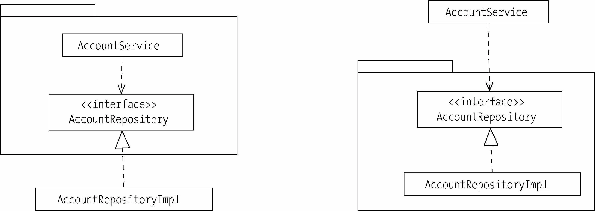

两种不同的归属方法代表两种不同的设计意图。请大家仔细阅读下面两段，体会其中的差异。

```
对于左图，它的意义是：AccountService 需要一个叫作 AccountRepository 的服务。
AccountRepository 的定义是从 AccountService 的需要出发的。如果想使用
AccountService，就必须提供一个能够实现 AccountRepository 的模块予以配合。在
本例中，这个模块是 AccountRepositoryImpl。——在这个叙述中，AccountService
是主动方，它决定了 AccountRepository 的定义。
对于右图，它的意义是：AccountRepository 对外声明了一组服务接口，这组接口通过
AccountRepositoryImpl 实现。如果 AccountService 想使用 AccountRepository
提供的存储能力，就需要理解 AccountRepository 的具体定义。——在这个叙述中，
AccountService 是被动方，它被动接受了 AccountRepository 的定义，或者至少要和
AccountRepository 的实现方进行协商。
图 6.6 所示的这两种情况分别代表两种接口类型。左图中的 AccountRepository 是需求方
接口，右图中的 AccountRepository 则是提供方接口。
```

那么，什么时候应该使用需求方接口，什么时候应该使用提供方接口，甚至两种接口都需要使用呢？我们下面就分别介绍一下它们的概念和关系。

### 6.2.2　不良的依赖结构影响设计的稳定性

如果你正在编写一段代码，且这段代码依赖于其他人提供的接口。那么，你可能会遇到如下场景。

- 你对接口的定义影响有限，因为接口提供方可能是一个通用服务，服务于许多人，你只是其中之一，所以并没有太大的话语权。

- 接口不太稳定，但是你并不想让自己的设计受接口提供方的影响。

在这种情况下，如果直接依赖于别人的接口，就可能是错用了接口类型，你应该定义自己的需求方接口。

需求方接口这一概念非常重要，它是设计稳定性的保证。同时，它也是达成依赖倒置原则的手段。我们使用一个简单的例子来说明需求方接口的定义思路及价值。这个例子改编自 RobertC. Martin 关于依赖倒置原则的示例，只是解读视角略有不同。

示例：开关控制电机

- 假设有一个电机，我们需要用一个开关来控制这个电机，有两个控制动作：开始和结束。那么，开关应该如何实现对电机的控制呢？

最直接的方式是在开关类中直接调用电机实例的方法。代码如下。

```java
public class Switch {
   Motor motor;
   void on() {
       motor.start();
   }
   void off() {
       motor.stop();
   }
}
```

代码清单 6.4　在开关类中直接调用电机实例的方法

```
在代码清单 6.4 中，如果 Motor 是一个类，那这样的设计就违反了依赖倒置原则。Switch
类的实现要是建立在具体的 Motor 类的基础上，就会影响稳定性。可如果 Motor 是一个接
```

口呢？就像图 6.7 所示的那样。

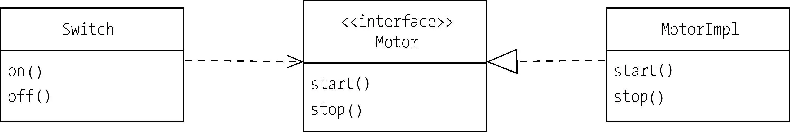

从提供方视角看到的接口依赖，不是真正的依赖倒置

```
固然这时的 Motor 是一个接口而不是具体的类，但看起来已经满足了具体依赖于抽象这一原
则。而且，机械地看，无论是站在从 Switch 到 Motor 的视角，还是站在从 MotorImpl 到
Motor 的视角，都符合这一原则。但是这并不是真正的依赖倒置，这样的设计并不能真正解
开 Switch 和 Motor 之间的耦合。让我们来看一个设计演进，来发现其中的设计困境。
```

提供方视角的接口依赖导致演进的困难

假如电机的能力升级了，新增了一个调整转速的能力。那么，如何才能让操作员可以控制这个

```
新增的能力呢？基于图 6.7 中的设计，可能会在 Switch 类中新增一个方法 setSpeed，并
调用 Motor 实例的 setSpeed 方法实现。这时候的 Switch 对象从一个简单的开关升级到
了调速开关。但是，一旦这么做，就会导致 Switch 的通用性出现问题。
例如，此时面临一个新场景：开关要被用于控制一盏灯。那么，增加了 setSpeed 方法的
Switch 类（代码清单 6.4）就会遇到一个新问题：它已经不能被复用了。如果要复用，只能
```

通过几种很“将就”的修改来实现。

```
(1) 引入一个新的成员变量 Lamp，然后在 Switch 类中设置一个标识，说明当前控制的是灯
还是电机。根据该标识，在控制灯时调用 Lamp 接口，在控制电机时调用 Motor 接口。这种
```

修改方式的示意图如图 6.8 所示。

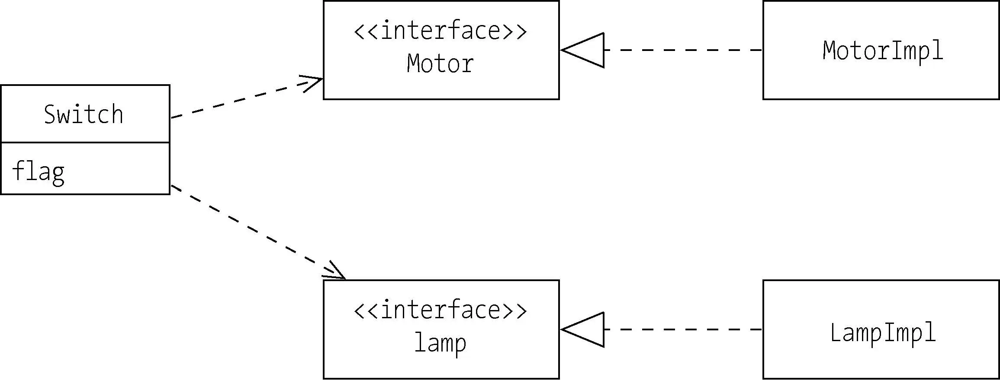

```
(2) 复制 Switch，让两个 Switch 分别用于控制灯和电机，灯和电机可以有各自的接口声
```

明。这种修改方式的示意图如图 6.9 所示。

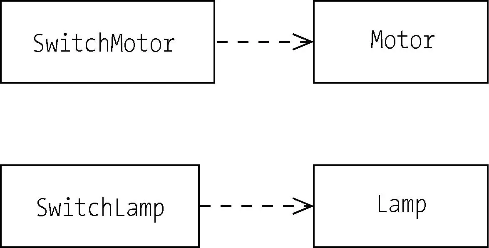

```
(3) 让 Lamp 接口继承 Motor 接口。这种修改方式的示意图如图 6.10 所示。
```

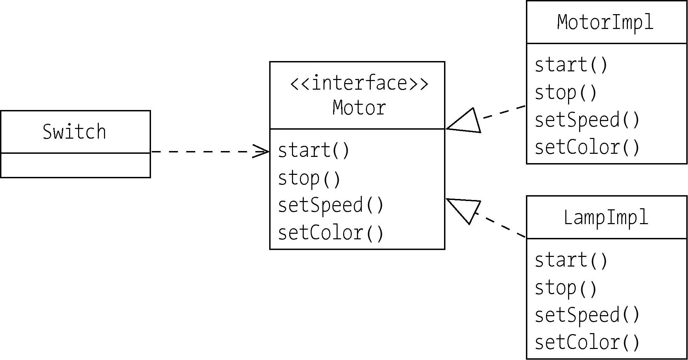

这三种方式无一优雅。第一种方式是代码膨胀的根源，同时它不符合开放 - 封闭原则。第二种

```
方式则是代码重复的根源。第三种方式首先从语义上讲就不合适：start 方法和 stop 方法
用在 Lamp 的实现上特别怪异，setSpeed 方法更是不得不实现为空。如果将来增加
setColor 方法把灯变成可变色的，那么还将反向影响 Motor 接口的既有实现，对 Motor
```

接口造成影响。

```
出现这种问题的原因其实很简单，就是对于 Switch 类来说，不应该依赖于一个具体的
Motor 接口，这二者之间并没有概念上的关联。接口依赖不应该从提供方出发，而应该从需
```

求方出发。这就是需求方接口的重要意义：接口属于需求方。

### 6.2.3　从需求方视角定义接口

```
我们回到图 6.7 和代码清单 6.4。造成上述问题的根本原因在于我们假定了 Switch 类必然依
赖于 Motor 接口。而在现实中，生产出一个开关后是不会关心要用它去控制什么的，电机、
```

灯或者风扇等都可以。现实中开关的背面如图 6.11 所示。

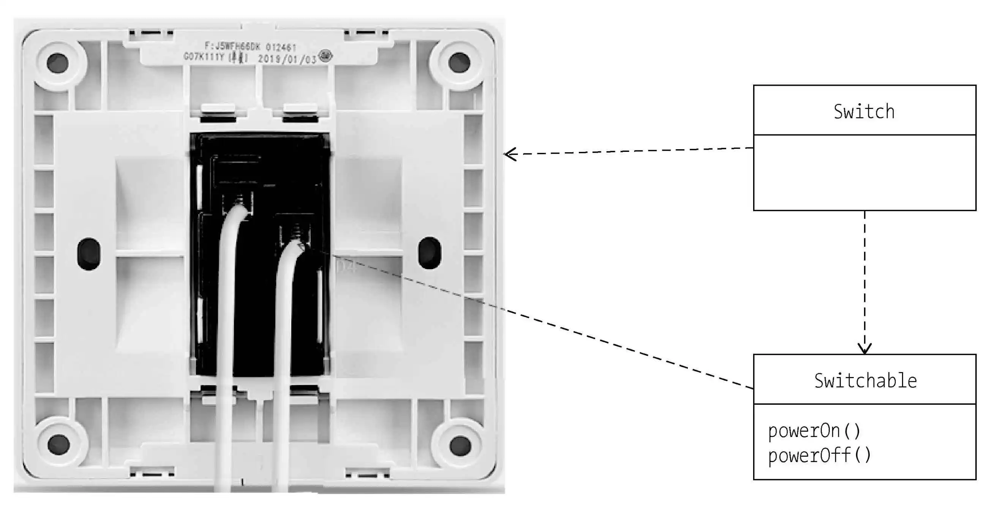

开关的生产厂商并不关心开关的具体应用场景，它只会从通用视角出发，定义开关的接入规范，也就是开关背面的两个接线柱。换句话说，凡是能通过两个接线柱接入开关的设备，就都能用开关控制。其本质是电流的通断。把这个设计转换为类图，就是图 6.11 中右侧的类图。一切能用开关控制的设备，都必须声明其在通电和断电场景下的行为。接线柱接口

```
Switchable 就是从开关视角声明的需求方接口。
定义了 Switchable 接口后，就可以让 Lamp 类和 Motor 类实现这个接口了，类图如图
```

6.12 所示。这恰恰也是 6.1 节中依赖倒置原则的体现。

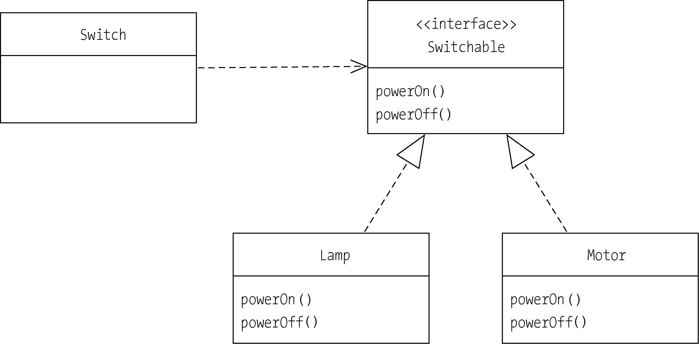

```java
下面是 Motor 类的代码实现。
public class Motor implements Switchable {
   void powerOn() {
       start();
   }
   void powerOff() {
       stop();
   }
}
代码清单 6.5　Motor 类实现 Switchable 接口
这段代码从意义上讲，反映了“powerOn
 start”的概念，这恰恰和现实中的逻辑是一致
```


```
的。当然，我们需要一种机制，让 Motor 类实现的 Switchable 接口可以被 Switch 类感
```

知。代码实现如下。

```java
public class Switch {
   Switchable switchable;
   void on() {
       switchable.powerOn();
   }
   void off() {
       switchable.powerOff();
   }
}
代码清单 6.6　Switch 类依赖 Switchable 接口
```

### 6.2.4　依赖注入

```
在代码清单 6.6 中，Switch 类依赖了 Switchable 接口。在面向对象系统中，这意味着依
赖注入。依赖注入意味着用一种方式把抽象的 Switchable 接口和真实的 Motor、Lamp 等
```

类连接在了一起。最常见的依赖注入做法是使用构造函数注入，或者使用方法注入。第一种做法的示例代码如下。

```java
public class Switch {
   Switchable switchable;
   Switch(Switchable switchable) {
       this.switchable = switchable;
   }
   void on() {
       switchable.powerOn();
   }
   void off() {
       switchable.powerOff();
   }
}
public class Client {
   public init() {
       Motor motor = new Motor();
       Switch switch = new Switch(motor);
   }
}
```

代码清单 6.7　使用构造函数注入依赖

```java
第二种做法的示例代码与此类似，只不过是在 Switch 类中定义了一个方法
setSwitchable。
public class Switch {
   Switchable switchable;
   void setSwitchable(Switchable switchable) {
       this.switchable = switchable;
   }
}
```

代码清单 6.8　使用方法注入依赖

依赖注入是一个非常重要且极其常用的模式。很多开发框架提供了更为便捷的依赖注入做法，

```
如 Spring（@Autowired）、Mock（@InjectMocks）等。不了解相关开发框架的读者，可
```

进一步阅读相关资料。

### 6.2.5　防腐层

明确需求方接口的概念对提升设计的稳定性来说非常重要。除了编码，需求方接口在架构设计中也处于重要的位置。例如，在嵌入式系统中，硬件封装层就是在把需求方接口接入不同硬件提供方时的一种常见方案。而在领域驱动设计中，添加防腐层是一种能屏蔽其他设计单元带来的影响的架构手段。这二者的本质都是需求方接口。这里我们简单介绍一下防腐层的概念，以此说明需求方接口在架构设计中的应用。

- 防腐层（ACL，Anti-Corruption Layer）是一种架构模式。当一个子系统、模块等的外部依赖不受控，或质量不高，或可能存在多个实现方案等时，就应该定义防腐层了。防腐层意味着从需求出发定义需求方接口，让子系统（或模块等）的所有实现均基于需求方接口，从而和具体的依赖解耦。防腐层的实现依赖于适配器模式。在 6.3 节将会有关于适配器模式的具体介绍。

### 6.2.6　需求方接口和接口分离原则

从需求方的视角定义出的接口很容易符合接口分离原则。还是以开关控制为例：当加入调速功能时，很容易就能发现并不是所有需求方都需要这个功能，有些需要，有些不需要。所以，把

```
调速功能和 Switchable 接口放在一起是没有道理的，Switchable 这个名字也明确指示了
增加一个 setSpeed 方法是不合理的。当为 Lamp 接口加入调色功能时，道理也是一样的。
```

结合这样的分析，可以得出如图 6.13 所示的设计。与图 6.8 、图 6.9 和图 6.10 对比，可以明显看到分离接口后的设计更为清晰，设计单元更为内聚，可复用性也更强。

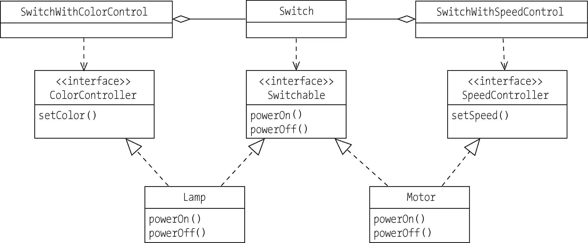

需求方接口是一个重要的概念。从内聚性的角度看，设计单元应该定义请求方接口，其概念相关性可以得到显著提升。从接口的角度看，接口标识的是一种能力。无论是谁，只要它实现了

```
接口定义的能力，依赖方就可以和它顺畅协作。例如，对于 Switch 类来说，它真正依赖的
```

既不是灯，也不是电机、风扇或者其他东西，而是一种“能够被开或者关的东西”。任何具备可

```
开关能力的东西，Switch 都可以与之顺畅地协作。
```

## 6.3　提供方接口

提供方接口说明的是设计单元对外提供服务的能力。需求方接口反映的是某个设计单元“需要什么”，提供方接口反映的则是某个设计单元“能做什么”。

在本节中，我们首先介绍定义提供方接口的核心概念（围绕核心概念定义接口），然后介绍连接需求方接口和提供方接口的适配器模式，最后介绍从适配器模式和分层模型派生而来的六边形架构（也包括本质上是同类的整洁架构、洋葱架构）。

### 6.3.1　围绕核心概念定义接口

举例来说，在一个外卖订餐的场景中，为了提升配送效率，我们可能需要一个计算送餐路径的服务。而提供这个服务的可能是一个路径规划服务，和送餐这件事没什么直接联系，它就是个通用服务，可能需要输入节点、边以及边的权重，从而根据某种最优化方法获得一条路径。

从路径规划的能力视角看，这个能力除了用于送餐场景，还能用于顺风车路径规划、旅游路径规划等各种各样的场景。所以，路径规划服务不能仅遵循送餐服务定义的请求方接口，而应该定义自己的服务能力，供潜在的使用方使用自己的服务。

例如，我们可以这样声明路径规划服务。

```java
public interface RoutePlanningService {
   void createMap(Collection<Node> nodes, Collection<Edge> edges);
   List<Node> planNodeVisitSequence(Collection<Node> nodes);
}
```

代码清单 6.9　路径规划服务的接口声明

```
其中，createMap 负责初始化一张图，需要传入节点和边的信息；
planNodeVisitSequence 负责计算出应该访问的节点的顺序。
```

无论什么服务，只要它需要路径规划服务提供的能力，就可以从该接口声明中获得必要的信息。这就是从提供方定义接口的意义。

如果在一个产品或团队内部，某个模块的存在完全是为了让另一个模块使用，这时候就无须定义提供方接口，把二者合二为一即可。但是，一旦在后续演进过程中，该模块有了更多潜在的客户，而且这些客户使用模块的方式有差异，就应该及时地把它分裂为需求方接口和提供方接口。

### 6.3.2　适配器模式

分开考虑需求方接口和提供方接口，必然会产生接口不能完全匹配的情况。在 6.1 节中，我们曾经提到不同的灯头规范，如 E27 或者 E14 等。假如恰好有某个场景，需要把一个 E14 灯泡装到一个 E27 灯座上时，此时适配器就要大展身手了。在软件世界中也是一样，适配器模式的结构如图 6.14 所示。

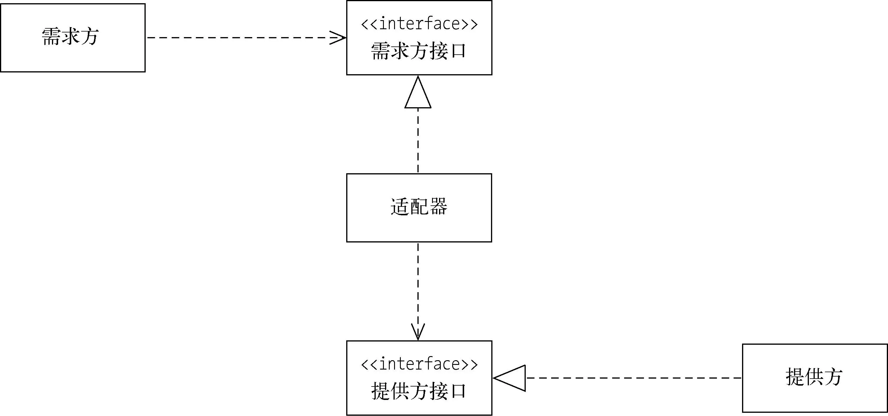

```
在路径规划的例子中，定义的需求方接口可能是 List<Site> calculateRoutes()，这
时，我们就需要提供一个适配器，能通过 RoutePlanningService 接口提供的
planNodeVisitSequence 方法实现 calculateRoutes 方法，从而让路径规划服务和送
```

餐服务完成连接，并且避免彼此的概念污染。

### 6.3.3　六边形架构

- [37]

六边形架构是 Alistair Cockburn 提出的一种架构模式

- ，它的另外一个名字叫作“端口 - 适配

器模式”。这个别名非常清晰地说明了六边形架构的本质。

- 六边形架构是分层架构加上需求方接口和适配器模式的自然结果。

六边形架构的结构如图 6.15 所示。需要注意，“六”其实是一个虚指，它的核心是处在设计层次中央的是应用部分，外围的依赖则通过端口和适配器接入应用。

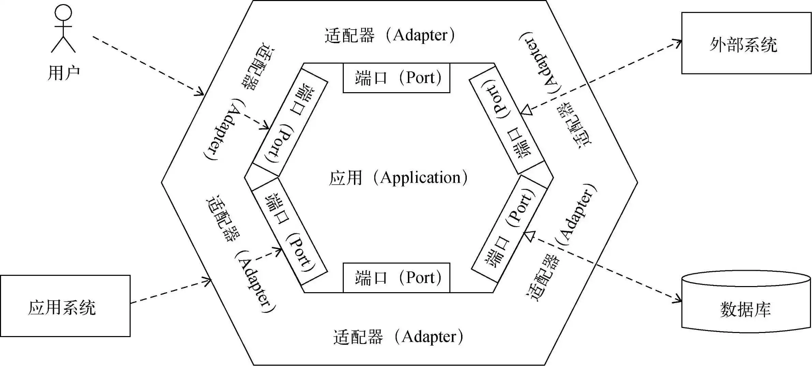

在分层架构中，上层是依赖于下层的。但是，如果在开始设计项目时，就优先建立了底层基础设施（如数据库、文件系统、消息机制等），那么在开发中就会不自觉地使用这些基础设施的特性，如某些数据库的非标准特性。一旦引入这种依赖，后期要替换依赖时就会非常复杂。

六边形架构以“应用逻辑和领域逻辑”为核心来看待分层架构。实现六边形架构的过程分成三步。

1. 把真正重要的、和业务逻辑密切相关的内容放在核心。

2. 从需求方的视角来定义端口，即定义需求方接口。

3. 基于项目的实际依赖实现适配器。

按照这种方式实现的设计，虽然最终看起来依旧像分层架构，但是可移植性和可测试性都得到了大幅改善，同时也可以让项目在早期就聚焦于核心业务逻辑，而不是把大量时间花费在基础设施的建立上。

我们在 5.2 节提到过整洁架构，读者可以发现它具备和六边形架构类似的形态，这是因为它本质上也是需求方接口的一种应用。

## 6.4　设计契约

为了实现软件设计单元之间的协作，搞清楚如何定义接口很重要，搞清楚如何精确地定义接口更为重要。在现实中，许多接口的定义是不清晰的，这也往往是产生许多软件问题的根源，人们很早就意识到了这个问题，并提出了设计契约的概念。设计契约的概念非常重要，值得给予特别地重视。

### 6.4.1　语焉不详的接口

许多设计看起来是定义了接口的，但是它们的责任往往语焉不详。我们来看看某个项目中存在的真实代码。

```java
/**
* Expression: 提供四则运算能力
*/
public interface Expression {
   /**
    * 计算四则运算表达式的结果
    * @param expression  四则运算表达式
    * @return 计算结果
    * @throws ExpressionError 运算错误
    */
   Double evaluate(String expression) throws ExpressionError;
}
```

代码清单 6.10　不够清晰的接口声明

```
代码清单 6.10 中声明了 Expression 接口，接口中定义了 evaluate 方法，甚至还出现了
```

JavaDoc 形式的注释。不过，对依赖于该接口的用户来说，该方法所能完成的任务是否清晰呢？

我试着用表 6.1 中的数据对该接口的实现做了测试，其中一些输出结果是预期之内的，一些则是预期之外的。

```
表 6.1　使用数据对 Expression 接口进行测试
```

输入数据

- 输出结果是否符合预期

```
1+1
2
```

- 符合预期

```
(1+2)*3
9
```

- 符合预期

```
(1+2)/0
Divided by zero
```

- 符合预期

```
Overflow
```

- 预期之外

```
Expression is too long
```

（一个包含 51 个字符的表达式）

- 预期之外

在代码清单 6.1 中，“符合预期”代表该接口的实际表现和我的预期一致，“预期之外”则代表在实际测试之前，我根本没有想到“该接口居然有这种限制”。在真实系统中，如果有其他模块依赖于该接口，那么这种预期之外的行为很可能会成为一个陷阱，造成系统缺陷。

代码清单 6.10 中的接口声明看起来简单，但是并没有包含足够的细节。例如，最大能计算多大的数据？最长能处理多长的表达式？能支持多少种运算？支持函数吗？除号是用 / 表示还是用÷表示？支持中文全角字符吗？

软件设计中充满了细节，只要有一个模块的能力定义不清晰，就有可能造成缺陷。但是在实际情况下，责任定义不清或者理解不一致反而是常态，这是一个非常值得关注的问题。

- 火星气候探测器的悲剧1998 年 12 月 11 日，美国发射了一颗火星气候探测器。在经历了 6.65 亿公里、8 个多月的漫长飞行之后，探测器终于抵达火星。但遗憾的是，探测器在即将进入火星轨道时，意外坠毁了。这个项目的损失达到了惊人的 3 亿美元。事故的调查结果令人叹息——发生坠毁竟然只是因为单位换算出了问题。探测器上的飞行系统使用公制单位来计算推进器的动力，而地面人员输入的方向校正量和推进器参数使用了英制单位。所以，探测器进入火星大气层之后，与火星的距离大约只有 60 千米，这一高度已经低于科学家提出的大约 85 千米的最小安全距离，与预定的轨道高度 150 千米更是相差甚远。从设计的角度看，模块交互必须保证双方对接口具有一致的理解。度量单位是边界上的重要问题，如果能更加重视接口的清晰度问题，那么探测器的坠毁或许有机会避免。

### 6.4.2　用契约规范协作

契约常常作为一个社会学概念出现。不过，契约对软件设计具有特别重要的意义。Andrew

- [10]

Hunt 和 David Thomas 在《程序员修炼之道》

- 中提到下面的内容。

- 软件系统是复杂的，但是人类系统更为复杂。人类系统解决协作的一个有效方案就是契约。

- [32]

设计契约以及契约式设计的理念来自 Bertrand Meyer

- 。其核心思想是：要让每个软件模块

都具备清晰明确的责任，并确保这些责任可以被检验，从而保障最终的软件系统的健壮性和稳定性。

- 6

让我们先通过一个例子

- ，来说明清晰的设计契约的典型特征。

```java
public
class Stack<E> extends Vector<E> {
    /**
    * 说明：移除栈顶的元素，并且以该元素作为返回值
    * 返回值：栈顶的元素
    * 异常：如果栈为空，则抛出 EmptyStackException
    */
   public synchronized E pop() { /* 代码略 */ }
   /**
    * 获取栈顶的元素，且不移除该元素
    * 返回值：栈顶的元素
    * 异常：如果栈为空，则抛出 EmptyStackException
    */
   public synchronized E peek() { /* 代码略 */ }
   /**
    * 说明：获得某个元素在栈中的位置。该位置从 1 开始数
    *       对象 o 如果是栈中的一个元素，那么返回的是该元素到栈顶的距离；
    *       如果是栈顶元素，则返回 1
    *       元素的比较使用 equals 方法
    * 参数：o - 传入的元素
    * 返回值：从栈顶开始，以 1 为基的位置。如果未找到，则返回-1
    */
   public synchronized int search(Object o) { /* 代码略 */ }
}
代码清单 6.11　Stack 类的声明
```

权利和义务

```
代码清单 6.11 是一个类的声明。如果从契约视角看，那么它定义的是如何使用 Stack 类的契
```

约。契约有什么特点呢？我们可以参考人类社会的契约定义回答这个问题。

在社会系统中，契约形成阶段就要和合作方定义清楚协作的权利和义务。一旦契约形成，双方就都要严格受契约的约束。如果一方没能遵循契约，另一方就应该拒绝服务。同样，如果一方遵循了契约，另一方未能提供相应的服务，那它就应该受到相应的惩罚。基于契约定义权利和义务，是人类社会的复杂商业活动可以有效运作的基础。

这个的逻辑也适用于软件世界。契约式设计意味着下面三点。

- (1) 定义清晰的契约，并约束服务提供方和服务调用方的权利和义务。(2) 只有调用方履行了义务，提供方才会提供正确的服务。(3) 调用方只有履行了义务，才能享有获得正确服务的权利。

权利和义务是对等的。从提供方的视角看，权利意味着调用方的调用必须满足前置条件，义务则意味着调用之后必须满足后置条件。

```
从代码清单 6.11 中我们可以看到 pop 方法和 peek 方法都定义了前置条件：栈不能为空。也
就是说，如果栈为空，那么 Stack 类将会抛出异常。因此，保证栈不为空是调用方的义务。
接着来看权利。pop 方法定义了后置条件，即调用这个方法后栈顶元素会被弹出。如果栈顶
元素没有弹出，那调用方无须负责，这是 pop 方法需要负责的。
定义了契约，就需要进行严格地检查。例如，我们可以在测试中调用 Stack 类的 size 方法
检查 pop 方法的行为是否正确，即调用 pop 方法后栈的尺寸应该比调用前小 1。在 10.2 节
```

我们将介绍如何进行契约检查。把契约作为中心的设计叫作契约式设计。契约式设计是获得高质量软件的重要手段。

总是定义清晰的职责

清晰的职责是否就是把文档写得更清楚呢？这种理解不够本质。造成职责不清晰的最常见原因是：职责定义本身过度复杂或者不符合预期。如果职责本身定义得都不清楚，那么无论文档写得多好，都会导致设计问题产生。

```
我们现在在 search 方法的基础上进行扩充得到一个新方法。假设栈中包含若干个相等的元
。按照定义，search(3) 应该返回 1。假如有一
```


素，栈顶到栈底的元素数值分别为

```
个遍历栈中所有 3 的要求，那应该如何增强这个 search 方法的功能呢？
一种方法是：增加一个 advancedSearch 方法，把职责扩充为第一次查找返回第一个 3 在
```

栈中的位置，第二次查找返回第二个 3 在栈中的位置，……，在查找到最后时，返回 -1。按照这种职责定义，可以编写出如下代码。

```java
public void searchAllValuesBadExample(Stack stack) {
   int pos = -1;
   do {
       pos = stack.advancedSearch(3);
       System.out.println("3 at position " + pos);
   } while (pos != -1);
}
```

代码清单 6.12　不合适的职责定义

```
这段代码尽管看起来很简洁，但是很危险。其中 advancedSearch 方法的定义意味着
Stack 要为 advancedSearch 维护一个状态，而每一次 advancedSearch 调用它，都会
```

改变这个状态。即使把文档说明写得极度清晰，也仍然非常容易误用它。

如何避免这类问题呢？命令和查询就是一种非常有效的职责分类。下面我们来看它们的定义。

区分命令和查询基本的模块职责有两类：一类是被请求完成某件事情，这类职责叫作命令；另一类是被请求获取某些数据，这类职责叫作查询。命令和查询是对接口职责的分类。在软件设计中留意命令和查询的概念，对设计清晰的职责是很有帮助的。

- 命令。命令意味着被调用方获得了一个指令，然后执行某种动作。命令一般不用于状态的获取。

- 查询。查询意味着从被调用方请求数据。查询不会改变被调用方的状态——也就是说，无论查询多少次，对于同样的输入，总是会得到相同的输出。

现在我们依照命令和查询的概念来解释代码清单 6.12 中的问题。虽然从名字和目的上看，

```
advancedSearch 是一个查询方法，但是它改变了 Stack 对象的状态。从事实上看，
advancedSearch 方法是命令和查询的混合体，虽然看起来调用过程更简洁，但这样的定义
```

是不合适的：它不符合对查询的预期——查询就是查询，它不应该改变任何状态。

因此，要在职责定义中避免命令和查询的混合体。要解决代码清单 6.12 中的问题，有一个更

```
好的做法：新增一个带有起始查找位置的 search 方法，如 int search(Object o,int
start)。事实上，这就是 Java 的容器类（如 Vector、List 等结构）中的 indexOf 的定
```

- 7

义形式。

```
明确命令和查询非常重要。在 Stack 类的声明中，peek 和 search 都是查询方法，它们肯
定不会改变 Stack 对象的状态。而 pop 是命令方法，不应该把它用作查询。有些程序员对命
令和查询的概念区分不够敏感，又恰好不知道 peek 方法，就会误把 pop 当成查询方法来
用，如调用 pop 方法获取栈顶元素的数值。可即使是调用 pop 方法后再次调用 push 方法把
```

该数值压回栈里，这种做法也是不正确的。

如何避免误把命令方法用作查询呢？一个较好的编程实践是永远不让命令方法返回任何数据。

```
按照这个要求，代码清单 6.11 中的 pop 方法的定义就不够好。它应该返回 void。尽管返回
void 会给某些场景中的使用造成不便，但同时也减少了误用的可能性。
```

通过上述例子我们可以看到，清晰职责的第一个要点如下。

- 单一职责，并且区分命令和查询。

定义清晰的职责很重要，想办法让使用者能清晰地理解职责也很重要。代码清单 6.11 使用了JavaDoc 对接口职责进行描述，对职责的描述也很完整，是较好的范例。

文档不是描述职责的唯一方式。在 7.5 节我们还将介绍一种新的描述手段：把自动化测试作为活文档。此外，设计契约还带来了一种新的设计范式：契约式设计（10.2 节）。

### 6.4.3　从设计契约视角解读里氏替换原则

我们曾经在 5.3 节介绍过里氏替换原则。在本节中，我们从一个新的视角，也就是从设计契约的视角来重新观察这一原则，将会发现：里氏替换原则其实是设计契约在继承场景下的具体运用。

为什么说里氏替换原则是设计契约的自然结果呢？我们仍然以代码清单 52. 为例进行说明。下面是从代码清单 5.2 中截取的部分密切相关的代码。

```java
class Rectangle extends Shape {
   public void setWidth(double width) { ... }
   public void setHeight(double height) { ... }
}
class Square extends Rectangle {
}
class Client {
   void bar() {
       Square square = new Square(5);
       Rectangle rect = square;
       rect.setWidth(3.0);
       System.out.println("正方形的边长为：" + square.getSide());
   }
}
```

代码清单 6.13　继承的本质是契约的继承

```
这段代码的第 1 行至第 4 行是 Rectangle 类的声明，也就是 Rectangle 类的对外承诺：
只要是一个长方形，就可以给它设置宽和高。第 6 行至第 7 行的 Square 类继承了
Rectangle 类，这意味着 Square 类需要继承 Rectangle 类承诺的一切——这是继承的本
质特征，代码中的第 12 行把 Square 对象赋值给 rect 变量也印证了这一点：父类可以指向
```

子类的引用。

```
但是很遗憾，Square 类并没能力完成“只要是一个长方形，就可以给它设置宽和高”这样的承
诺，因此这个继承关系无法建立，也就是说，Square 类不能继承 Rectangle 类。
```

## 6.5　事件机制

耦合度最低的依赖是没有依赖。本节将要介绍的事件机制，就是解耦依赖的一种重要设计手段。

### 6.5.1　引例

现在我们有这样一个需求：

- 当用户注册成功后，系统会向用户发送一个注册成功的消息。

最常规的实现方式就是直接调用。我们先来看一种不好的实现方式。

```java
public class AccountService {
   public void register(String username, String phoneNumber, String password) {
       if (!accountExisted(username)) {
           accountRepository.add(username, phoneNumber, password);
           smsService.notify(phoneNumber, "注册成功");
       }
   }
}
```

代码清单 6.14　违反单一职责原则的注册服务

```
这段代码显然有问题。在 AccountService 的 register 方法中直接调用短信通知服务，
```

违反了单一职责原则。用户如何进行注册是一个关注点，注册成功后系统如何通知用户是另一个关注点。这两个关注点不在一个变化方向上，所以不应该把它们放在一起。

现在我们来看一种更轻的耦合方式——基于事件的耦合。

### 6.5.2　基于事件的耦合

业务事件

我们曾经在第 3 章中介绍过业务事件。业务事件指的是，从业务视角看，具有重要意义的某件事发生了。注册成功、登录失败、订单完成都是业务事件的例子。

发布 - 订阅机制

发布 - 订阅模式是一种设计单元间的协作机制。参与协作的两侧，分别叫作发布者（publisher）和订阅者（subscriber）。其中，发布者负责对外告知某个事件发生了，订阅者负责监听特定事件的发生并触发相应的动作。它们之间的关系类似于图 6.16 中展示的内容。

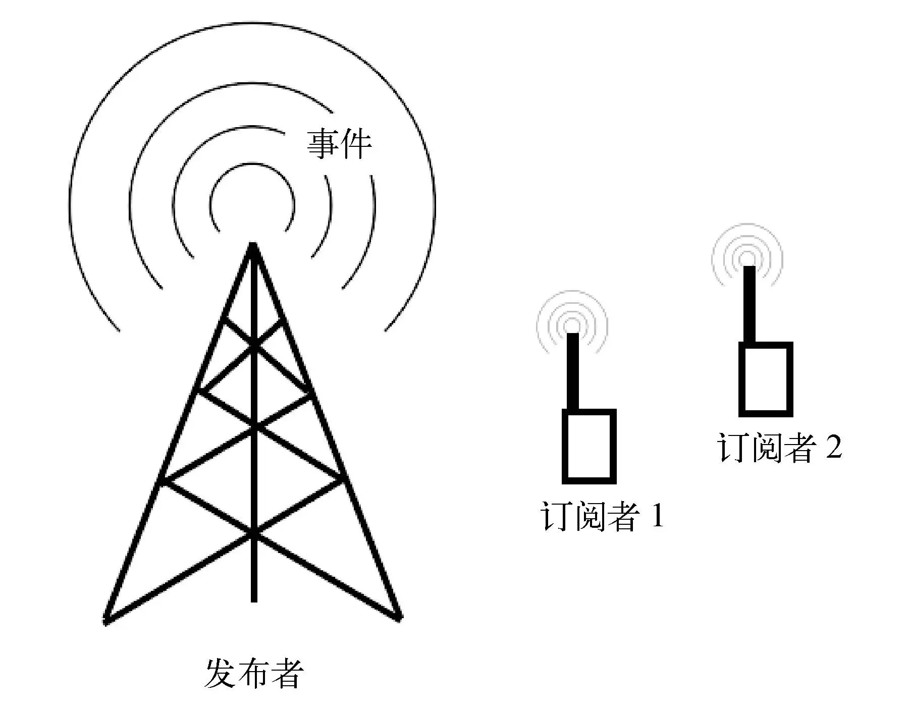

在发布 - 订阅模式中，发布者负责对外告知某件事发生了，发布者感知不到订阅者的存在，订阅者负责监听特定的事件，并不关心这个事件是由谁发出的。这样，发布者和订阅者就实现了完全的解耦。它们之间仅有一种公共的约定，就是事件本身。

- [28]

图 6.16 展示的设计方案有多种实现方式。面向对象的设计中最常用的观察者模式

- 就是一种

常见的实现。在此基础上，还进一步演化出了基于消息的分布式实现等技术方案。

观察者模式

- 8

```
观察者模式有两个角色，分别为主体（Subject）
和观察者（Observer）。其中，主体等
```

价于发布 - }订阅模式中的发布者角色，观察者等价于订阅者角色。观察者模式的结构如图6.17 使用用户注册的例子对观察者模式进行了实例化。

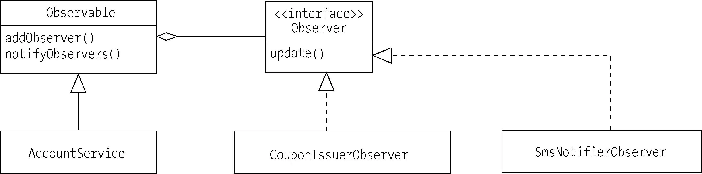

```sql
图 6.17 中的 Observable 就是主体，在面向对象的程序设计中把它定义为了一个抽象类。
Observable 持有一个 Observer 列表，可以往其中加入任意数量的 Observer。在本例
中，CouponIssuerObserver 和 SmsNotifierObserver 都是具体的 Observer，所以
它们都必须实现 Observer 接口定义的 update 方法。
```

观察者模式已经是 Java 的 util 包中的标准实现，所以我们可以直接使用

```
java.util.Observable 和 java.util.Observer 来完成这个注册成功后给用户发送短
```

信的功能。主要代码如下。

```java
public class AccountCreatedEvent {
   private Account account;
   public AccountCreatedEvent(Account account) {
       this.account = account;
   }
   Account getAccount() {
       return account;
   }
}
public class AccountService extends Observable {
   AccountRepository accountRepository;
   public void register(String accountName, String phoneNumber, String password)
       if (!accountExisted(accountName)) {
           Account account = accountRepository.add(accountName,phoneNumber,passw
           notifyAccountCreatedEvent(account);
       }
   }
   private void notifyAccountCreatedEvent(Account account) {
       this.setChanged();
       notifyObservers(new AccountCreatedEvent(account));
   }
}
public class SmsNotifierObserver implements Observer {
   private SmsService smsService;
   public void notifyWhenRegistrationSuccess(Account account) {
       smsService.notify(account.phoneNumber(), "注册成功！");
   }
   @Override
   public void update(Observable observable, Object event) {
       if (event instanceof AccountCreatedEvent) {
           notifyWhenRegistrationSuccess(((AccountCreatedEvent)event).getAccount
       }
   }
}
```

代码清单 6.15　基于观察者模式实现发送通知短信的功能

```
在这段代码的第 1 行至第 9 行，定义了事件类 AccountCreatedEvent。
AccountService 是 Observable 的子类，持有 Observer 列表，同时可以通过
Observable 中的 addObservable 方法增加 Observer。
SmsNotifierObserver 实现了 Observer 接口，在 AccountService 触发
AccountCreatedEvent 事件时，可以调用实际的短信发送服务给用户发送短信。
```

- 关于观察者模式还需要做一点辅助说明。在诞生观察者模式的时代，人们对于事件的重视度还普遍不够，首先注意到的是“状态”。在《设计模式》一书中，对观察者模式的讨论也是以“状态”为出发点的。这也是为什么它被称为“观察者（Observer）”而不是“监听者

```sql
（Listener）”、对应的方法名为 update 以及在调用 notifyObservers 之前需要调用
setChanged 的原因。
事件机制降低了耦合。在本例中，AccountCreatedEvent 是
AccountEventSmsNotifier 和 AccountService 共享的唯一数据。相对于代码清单
```

6.14，这里大幅降低了耦合。

```
更进一步，在代码清单 6.15 中，我们还是隐含地认为 SmsNotifierObserver 的事件来源
是 AccountService。在大多数场景下这样想是合理的。但是，有时候我们希望让事件的发
```

布者和事件的订阅者彻底解耦，应该如何做呢？

为了实现一个纯粹的事件机制，我们可以在观察者模式的基础上叠加中介者模式，建立一个单

```
独的 EventPublisher 作为事件发送和消费的中介。其结构如图 6.18 所示。
```

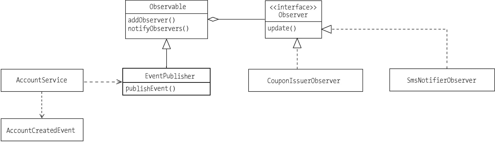

```
使用了 EventPublisher 的事件机制，在分布式系统中是一种常见的范式。这也是大多数分
```

布式消息框架的主要作用，这类常用的框架有 RocketMQ、Kafka 等。

在事件机制下，通信的双方如账户注册和发送注册短信之间唯一的耦合就是注册已成功这个事件。这样就把依赖降到了最低，让彼此可以独立变化。事件机制在架构设计中具有重要的价值，它也是事件驱动架构（EDA，Event-Driven Architecture）的基础。

CloudEvents 规范

为了更规范地定义和使用事件，云原生计算基金会（CNCF）定义了一套事件规范。尽管不是所有系统都已经构建在云原生之上，也不是所有系统都适合云原生，但是这套规范仍然有参考意义——即使你仍然是在传统的技术栈上开发系统。首先我们来看一个基于 CloudEvents v1.0规范的事件实例。9

```json
{
   "specversion" : "1.0",
   "type" : "com.github.pull_request.opened",
   "source" : "https://github.com/cloudevents/spec/pull",
   "subject" : "123",
   "id" : "A234-1234-1234",
   "time" : "2018-04-05T17:31:00Z",
   "datacontenttype" : "text/xml",
   "data" : "<much wow=\"xml\"/>"
}
```

代码清单 6.16　基于 CloudEvents v1.0 规范的事件实例

这是一个使用 JSON 格式定义的事件。我们重点研究其中的一些关键数据。

```
specversion 是事件基于的规范的版本号。
type 代表一个事件的类型。
source 代表触发事件的事件源。
subject 是对事件源相关数据的更具体的补充，代表更具体的上下文。
id 是事件的全局唯一 ID。
time 代表事件的发生时间。
datacontenttype 和 data 代表某事件的特定数据。
```

如果你正在开发一个云原生应用，那么可以考虑使用 CloudEvents 事件规范。即便在其他场

```
景下，该规范定义的关键内容，如 id、specversion、data 和 source 等概念，对于正
```

确地实现一个事件系统也会非常有帮助。

## 6.6　小结

良好的依赖管理是使软件设计具备易于理解、易于演进、易于复用等特性的关键因素。本章介绍了依赖设计的基本原则：依赖最小化原则和稳定依赖原则。同时，本章讨论了 SOLID 模式中的接口分离原则和依赖倒置原则。

面向接口编程是现代软件设计中最重要的概念之一。显式地区分需求方接口和提供方接口，并且定义清晰的接口契约，是提升软件独立演进能力、提高复用能力的关键。同时，设计契约也是本书在第 7 章将要介绍的自动化测试和在第 10 章将要介绍的契约式设计的基础。

图 6.19 总结了本章的主要内容。

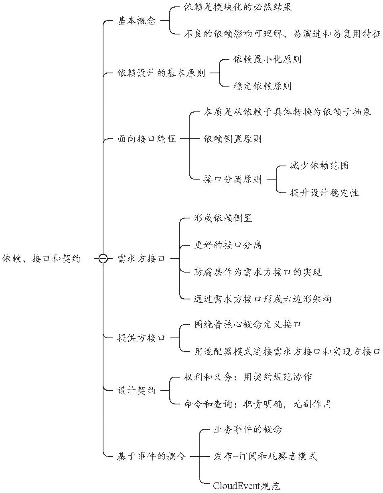

[1]：图 6.3 中的 是一个类，这本来是不言自明的，但是为了突出，我特意给它加了一个构造型 。构造型是 UML 的一种通用机制，

- 用来说明某种设计元素的类型。

[2]：MySQL 是一种关系型数据库。[3]：MongoDB 是一种文档数据库。[4]：h2 是一种内存数据库。[5]：MyBatis 是一种数据库 Wrapper 机制。[6]：本例来自 Java 标准库中 类的定义。为了方便读者，我把其 JavaDoc 的内容翻译成了中文。[7]：二者的定义有细微差别： 是 0-based，而 方法是 1-based，不过这样的差别不影响本文的讨论。[8]：由于主体的概念不是很直观，在现代的设计中往往使用更容易理解的 来指代。[9]：摘自 ，略有缩减。
