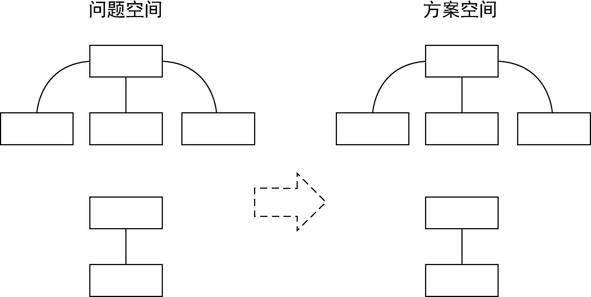
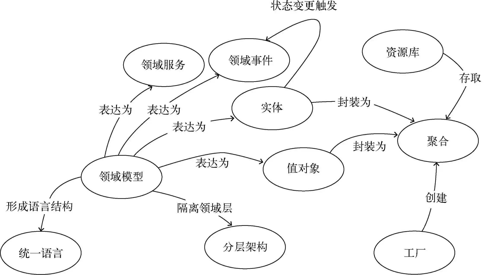
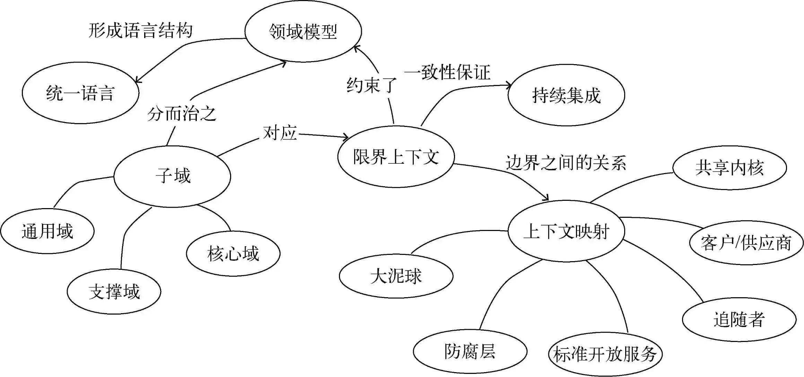
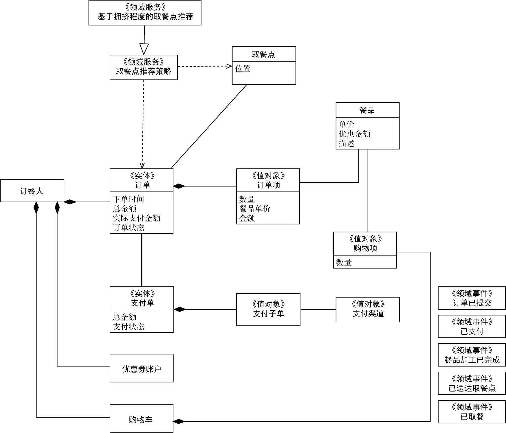
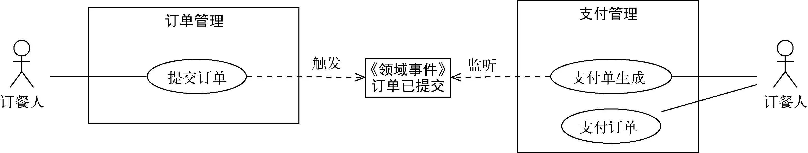
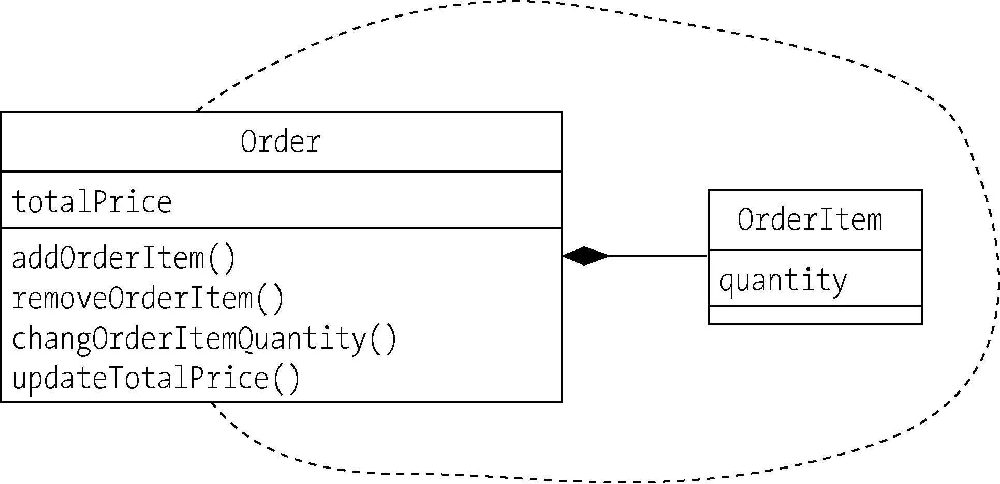
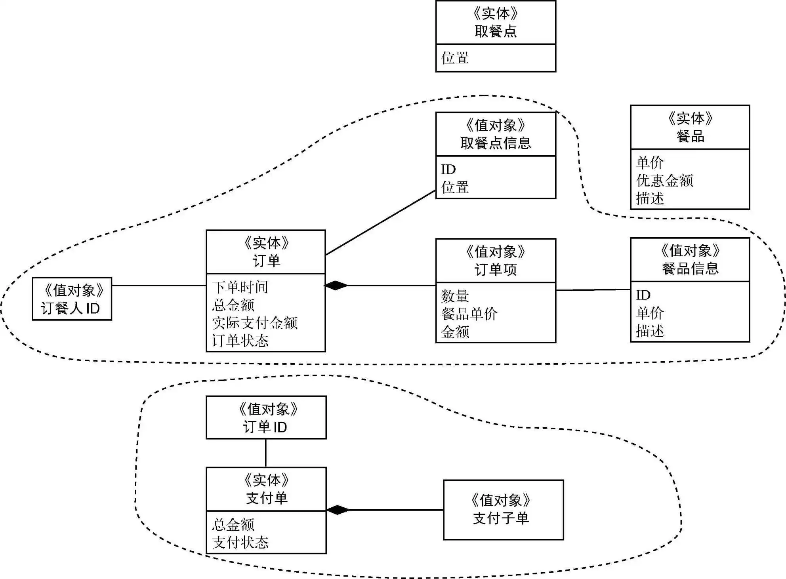
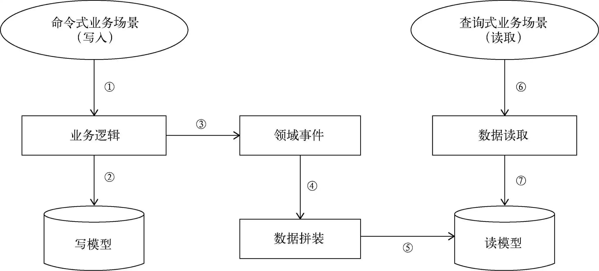
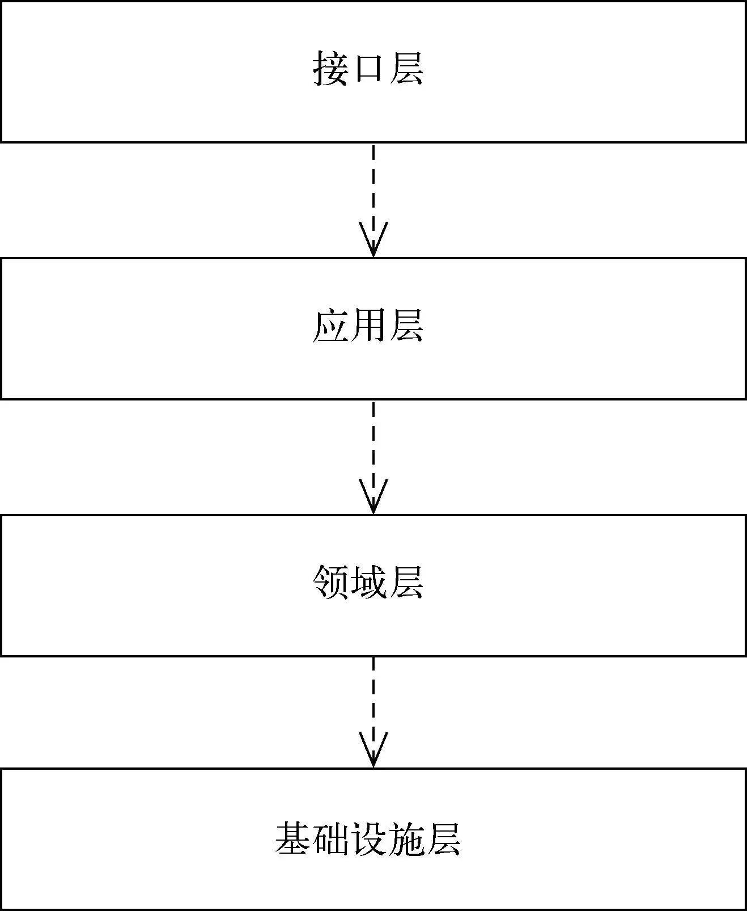

# 第8章用领域模型指导实现(1)

在第 2 章中，我们介绍了高质量软件设计的基本要求：高内聚和低耦合。在第 5 章和第 6 章中，我们也讨论了实现高内聚、低耦合的设计原则和方法，如 SOLID 原则、设计模式等。不过，这些原则和方法都还没有和第 3 章及第 4 章的业务分析结合起来。如果能把业务分析的结果，包括需求分析、领域模型等，结合那些原则或要求落实到代码中，就更有指导意义了。本章和第 9 章我们就针对这个问题展开讨论。

- [23]

本章介绍的核心内容源自领域驱动设计（DDD，Domain-Driven Design）

- ，它包括一组实

现模式（一般称为“战术模式”）和一组架构模式（一般称为“战略模式”）。其中，战术模式包括

- 1

实体、值对象、领域服务、领域事件、聚合、资源库、工厂和分层架构；战略模式包括子域、限界上下文和上下文映射。

应用上述这些模式，可以顺畅地把在第 4 章获得的业务概念映射为代码，提升代码的可理解性和可扩展性。这就是我们本章的主题：用领域模型指导实现。

## 8.1　用领域模型指导实现

从需求分析到软件实现的转换应该是一个流畅的过程。软件实现应该表达业务逻辑，如果它从整体上能和业务逻辑建立清晰的关系，那么将有助于从需求分析到它的自然过渡，带来许多方面的好处。

在软件工程历史上，人们走了很多弯路才认识到这一点。一度有许多人认为，需求分析的重点就是理解需求，软件实现的重点则更偏重技术架构，或者算法、数据库等。人们很肯定软件实现是需求分析的接续这点，但是没有一个很清晰的指引能够说清楚二者究竟是如何接续的，这导致分析活动和实现活动之间产生了断裂。

领域驱动设计突破了这个难题，在二者之间建立了一个顺畅的连接——领域模型，成为连接需求分析和软件实现的重要桥梁。

### 8.1.1　代码应该表达业务概念

图 8.1 展示了领域驱动设计的基本思想：方案空间应该和问题空间保持一致。



减小表示差距

让软件实现和业务概念保持一致，可以减小表示差距，提升代码的可理解性。请阅读如下来自真实项目的代码。

```python
interface ReviewService {
   void addComment(SessionDto session, String resourceId, ReviewDto comment);
   void deleteComment(SessionDto session, String id);
   long getCommentsCount(String resourceId);
   ReviewInfoPageDto getComments(SessionDto session, String resourceId,
       Integer offset, Integer limit);
   void addLike(String resourceId, SessionDto user);
   void deleteLike(SessionDto session, String resourceId);
   long getLikeCount(String resourceId);
   ReviewInfoPageDto getLikes(SessionDto session, String resourceId,
       Integer offset, Integer limit);
   boolean isLiked(String resourceId, String userId);
}
class ReviewServiceImpl implements ReviewService {
   void addLike(String reviewedResourceId, SessionDto session)
       throws RequestedResourceNotFound {
       if (!isLiked(reviewedResourceId,session.userId()) {
           Like like = buildLike(like, session);
           likeReviewRepository.save(like);
           eventPublisher.publishEvent(
               new LikeEvent(ReviewInfoConverter.toDto(like)));
       }
   }
   // 剩余代码略
}
```

代码清单 8.1　评论服务的接口声明和实现

这是一段关于评论服务的代码，常常在新闻论坛、购物体验等各种涉及社区评论或者用户评论

```
的场景中出现。Comment 指的是文本评论，Like 指的是点赞。我刻意没有为这段代码添加
任何注释，请试着自己阅读一下，会发现它很容易理解。例如，addComment 用于为一个资
源（resourceId）添加文本评论，isLiked 用于查询一个用户（userId）是否点赞了一
个资源（resourceId），等等。
```

代码的易理解程度取决于阅读者能否快速辨识代码中的业务概念和意图。在代码清单 8.1 中出

```
现的业务概念，大多数源自领域模型——虽然也存在少许仅和实现相关的概念（如 Dto、
Repository），但是并不影响理解。领域模型反映的是问题域认知，所以对于这个问题域的
```

人来说，很容易就能理解这段代码。

这反映了一个重要的诉求：好的代码，其中的业务概念和术语要能传承来自需求分析和领域建

- 2这样的好处是，开发人员在设计和编码过程中不需要进行业务概念的二次

模活动的结果。转换，既不容易出错，也提升了思考效率。

- 好的代码，应该尽量接近问题域的表达。业务人员能够看懂的部分越多，代码就越接近领域模型。

提升演进能力

代码和领域模型的一致，有利于提升代码的演进能力。当业务域发生变化时，如果代码中有许多地方都和业务域对应，就很难分析清楚究竟哪些地方会受到影响。可如果代码和领域模型的对应关系和图 8.1 所示的一样，就很容易定位要修改的地方。

新的需求虽然层出不穷，但是核心业务概念往往不会发生根本性的变化。例如，商品的促销方式可能五花八门，但是从业务概念上看，无非就是优惠券、发放策略、核销策略、折扣这些基本业务概念的反复组合而已。把业务场景和基本的领域模型实现区分为两个层次，就能反复使用同样的已经在领域层建立的能力，获得丰富的功能。

此外，把领域模型在实现上的边界处理得很干净，还能增加领域资产的复用机会。例如，前面提到了评论服务，其中的点赞、评论、获取评论数、获取点赞数都是非常通用的功能。如果把

```
评论对象的边界处理得很干净（如使用 resourceId，而不是具体的 orderId 或
foodId），就可以很顺利地把这个评论服务应用于新闻论坛、商品购买等不同的场景。
```

- 在实现中做到从领域模型到代码的直接映射，并且分离易变的业务逻辑和稳定的业务概念，可以带来更好的演进能力。

### 8.1.2　领域驱动设计

领域驱动设计既是一种设计方法，也是一种指导软件实现的模式集合。Eric Evans 在 2004 年编写了同名图书《领域驱动设计》，他把领域模型作为领域驱动设计的核心，用领域模型来指导软件架构和软件实现。

领域驱动设计的方法体系是使用模式进行组织的，它包括两组模式：战术模式和战略模式。其中，战术模式关注具体的软件实现方法，战略模式重点关注大粒度的业务架构和服务划分。图

- 3

8.2 展示的是战术模式，图 8.3 展示的是战略模式，它们

- 都源自 Eric Evans 的《领域驱动设[41]

计参考》

- 。我们将在后续的各个小节展开讲解这两张图中的主要模式。





领域模型和统一语言

正如“领域驱动设计”这个名字所指示的，领域模型是战术模式和战略模式的出发点，所有模式都围绕领域模型而展开。

统一语言是一个重要的概念，在 4.5 节我们已经介绍过它，只不过当时没有介绍它其实是领域驱动设计的模式的一部分。统一语言的精髓，就是尽量缩小问题域和实现域的表示差距，增强可理解性，同时保持领域模型的持续演进。

战术模式

领域驱动设计的战术模式聚焦于提升面向对象设计的质量。具体地说，战术模式包括三方面内容。

- 基本构造块。领域驱动设计定义了四种构造块：实体、值对象、领域服务和领域事件。这些构造块是表达业务概念的基本元素，8.2 节将会对它们展开介绍。4业务完整性的单元。类和对象的粒度很细。领域驱动设计提出了聚合这个关键概念，把面向对象设计的粒度从基本构造块提升到了能真正表达业务意义的层次。基于聚合，领域驱动设计还定义了资源库和工厂，这两个模式分别用于管理聚合的存取和创建。8.3 节将介绍聚合、资源库和工厂。

- 分层架构。领域模型不应该“淹没”在频繁变化的业务逻辑中。所以，领域驱动设计提出了四层分层架构，特别突出了领域层。在此基础上，又发展出了一系列变体，包括六边形架构、整洁架构等。8.4 节将介绍分层架构和相关概念，以及如何基于分层架构完成代码实现。

战术模式基于面向对象范式，不过它的思想是通用的。即使使用的不是面向对象的语言，了解这些模式也有助于写出更高质量的代码。

战略模式

领域模型不仅可以指导软件实现，它在企业架构规划和业务架构设计方面也有重要意义。战略模式的基础是按照问题域把复杂系统划分为子域，把复杂的问题分而治之。这就是曾经在第 4章介绍过的子域的概念。

在实现层面，子域的划分可以直接对应到实现，如模块、服务、数据库设计等。例如，在第 4章提到的餐品预订业务中，餐品目录、订单、餐品加工、取餐等都可以被实现为单独的模块，模块之间可以保持较低的耦合。如果采用微服务架构，还可以把这些模块作为单独的服务进行开发和部署。

领域驱动设计的战略模式定义了限界上下文（Bounded Context），用来表达架构层次上的边界。显然，在理想情况下，限界上下文的边界和子域的边界应该保持一致。

既然进行了划分，就需要考虑集成的问题。不同场景下的集成策略有所不同，领域驱动设计总结了一个很全面的集成策略，就是上下文映射。我们将在 8.5 节和 8.6 节讨论限界上下文和上下文映射的问题。

为什么需要领域驱动设计模式

模式的价值在于放大思考的粒度，提升思考的宏观程度。固然，就算不了解这些模式，经过反复琢磨和推演也能够编写高质量的代码，但掌握了这些模式可以更快得到答案。这和下围棋颇有类似之处。熟练掌握围棋的定式，是围棋入门的必备技能。不掌握这些定式，慢慢推演行不行呢？当然也行，只不过要付出更多的思考代价。在 8.3 节中将会有一个例子，从例子中，我们可以看到聚合模式是如何帮助开发者提升思考的宏观层次，降低思维负担的。

### 8.1.3　继续使用餐品预订的领域模型

在第 4 章，我们曾经使用餐品预订的业务场景，获得了关于订餐业务的领域模型（图 4.10）。在本章中，我们将继续使用这个领域模型来指导代码实现。

软件实现必须依托于具体的业务场景。为了便于讨论，我们引入一个业务场景。

- 订餐人打开购物车，勾选需要的餐品，点击下单。系统显示订单的总金额，提示选择取餐点，并给出支付链接。订餐人选择使用校园一卡通进行在线支付，支付成功后系统提示取餐码信息。

从这个场景中，我们可以看到若干已经出现在领域模型中的业务概念，包括订餐人、购物车、餐品、订单、取餐点等。那么，如何使用面向对象的方法，在代码中将这些业务概念表达为业务对象，并使用它们实现业务功能呢？如前所述，领域驱动设计的模式给出了非常好的指导，我们就基于本例进行介绍和分析。

## 8.2　基本构造块

在传统的面向对象设计方法中，对象就是对象，不会特别进行更具体的分类。UML 定义了构造型，这作为一种通用的扩展机制，确实可以对对象进行分类，但是并没有就如何分类给出具体的指导。

领域驱动设计的战术模式指明了构成领域模型的对象类型其实是不同的，可以把它们分为四类：实体、值对象、领域服务和领域事件。

为了让读者能有更直观的理解，我们首先直接给出示例结果，然后分别讲解上述四种类型。图8.4 是在图 4.10 的基础上，根据领域驱动设计的构造块模式进行分类的结果。



### 8.2.1　实体

实体是一类重要的业务对象。业务系统的演进往往伴随着实体的状态变迁。

定义

首先请读者注意观察图 8.4 中的订单这个业务概念。读者可能会有一种直觉：和订餐人、订单项相比，订单这个业务概念看起来要更重要。这是为什么呢？仔细思考就会发现，有许多业务场景是围绕着订单进行的。例如，当订餐人创建一个订单时，订单处于已创建状态；当订餐人提交这个订单时，订单状态就需要变为已提交；当和该订单相关的支付操作做完后，订单就处于已支付状态；当用户取餐完成后，订单状态变为已取餐。

对于支付场景来说，支付单具有和订单相同的地位。业务活动的进展，往往可以通过订单或支付单的状态变化得到体现。在建模领域，这类非常重要的业务对象很早就引起了人们的注意。

- [42]

Peter Coad 在四色建模理论

- 中，把这类会随着时间变化发生变化的对象，称为时标

（Moment-Interval）对象。其中 Moment 代表时刻，Interval 代表某个时间间隔，时标对象这个名字非常形象地表达了“随着业务活动的进展，有一些重要的业务对象会发生状态变化”这样的特征。

领域驱动设计同样注意到了这类重要的业务对象。在领域驱动设计的战术模式中，把会随着业务变化发生变化的业务概念叫作实体对象。

实体需要唯一标识

在代码实现中，实体需要一个 ID 作为自己的唯一标识。由于实体的状态可变，所以这是一个很容易理解的结论。上述的订单、支付单这两个业务概念本来都没有 ID 属性，因此需要我们为它们加入唯一的 ID，这个 ID 是采取某种策略生成的。一个常见的策略是使用 UUID（通用唯一识别码，Universally Unique Identifier）。

有些业务对象自带唯一标识，如身份证号。如果想在软件设计中直接使用这类业务标识作为实体的唯一标识，那么需要深思熟虑。这样做固然有便利之处，但是往往会强依赖于外部世界的业务逻辑，如身份证号升级，或者起初用户输错了身份证号，后来不得不进行更新等，都可能会带来不必要的麻烦。在大多数时候，我更倾向于选择与业务无关的 ID 生成策略，这样虽然略显复杂，但是保证了更好的扩展性。

按照实体的定义，图 8.4 中的订单、支付单都是实体。取餐点、餐品这些业务概念在特定的上下文中是实体，在其他上下文中则不是，这取决于我们正在分析什么业务，所以我暂时没有在图 8.4 中标记它们的对象类型，在 8.5 节介绍完界限上下文的概念之后，它们的类型就很清楚了。以取餐点为例，在订单管理上下文中，它是一个值对象。在取餐点管理上下文中，它就是一个实体。

### 8.2.2　值对象

并不是每一个对象都和实体一样重要。还有一些对象在表达业务概念时是必须的，可业务并不围绕着它们进行，它们仅是对这些重要业务概念的描述，这一类对象叫作值对象。

值对象的意义取决于属性

值对象是描述性对象。图 8.4 中的订单项和购物项就是值对象，它们描述的是具体内容。例如，一个订单项可能包括具体是什么餐品（如西红柿炒蛋）、数量是多少（如 1 份）、下单时餐品单价的快照（如 5 元），以及总金额（如果没有优惠，那么就是单价乘以数量）。

值对象有什么特点呢？作为具体性描述，它们存在的意义就是它们的值本身。例如，把  这个

```
订单项中的 quantity 值从 1 改为 2，相当于删除对象 ，然后创建新的对象 。因为订单项
```

描述的本来就是订单中的条目，所以更改一个对象和替换一个对象并无区别。尽管从业务视角看确实可以认为修改订单项中的数量值是一个合适的业务逻辑，但是我们完全没必要跟踪订单项的数据变化，因为它是没有生命周期的，仅仅是对订单的一个修饰。

值对象是描述性对象，所以只要对象的属性一模一样，那么对象就是相同的。如同在数学中，一个坐标点 (2,3) 和另一个坐标点 (2,3) 或许是不同的变量，但它们指向的是平面空间中的同一个点，是完全等价的。从实际应用视角看，我们并不在意究竟使用哪个对象。

当实体的属性发生变化后，它仍然是原来的实体。所以，实体需要用 ID 作为唯一标识，这是它的关键。而对于值对象，我们只关心它的属性，并不关心它有没有唯一标识。

顺便请注意两个细微概念的差别。虽然在图 8.4 中有从订单项指向餐品的箭头，而且餐品中也包含单价信息，但是订单项中的餐品单价和餐品中的单价是不一样的。后者随时可以调整，而且调价历史是一个确实有价值的信息，所以餐品是一个实体。而从下单那刻起，前者就成为了一个不可变更的事实。所以要使用两个不同的属性来记录这两个单价。

在领域模型中，值对象的数量要远远多于实体的数量，毕竟任何一个实体都需要不少描述性的

```
信息。此外，对于有些属性，如订单中的订单状态，我们往往会使用一个 OrderStatus 类
```

对它进行封装，这种属性也是值对象。甚至类似于数量、单价这些属性，使用原生类型也不一

```
定合适（参见 Martin Fowler 的《重构》一书 3.9 节），当我们使用 Quantity、UnitPrice
```

类对它们进行封装后，它们也就成为了一个小的值对象。

尽量把值对象实现为不可变对象

在编程时，值对象可以用非常轻量级的方式实现。首先，不需要像实体那样给它们创建 ID。

```
其次，不需要给它们设置任何用于修改数据的方法。例如，对于订单项 OrderItem 来说，
changeQuantity 就是一个可有可无的方法。如果订餐人在下单前更改数量，那么更好的做
法是创建一个新的 OrderItem 对象，并用其直接代替原来的对象。
```

这种只用替换不用修改的特征在编程中非常有用。这也就是不可变对象（Immutable Object）

```
的概念。不可变对象是一种设计模式，其对象的值不可变。例如，Java 语言中的 String 对
```

象就是不可变对象，下面举个例子。

```
String s = "String class is immutable";
s.toUpper();
当调用 s.toUpper 方法时，字符串 s 的值并没有改变，而是创建了一个新的对象。不可变
```

对象有以下两个巨大的优势。

- 不可变对象不会被无意地修改。

- 不可变对象天然是线程安全的。

其中第一个优势很重要。看如下示例代码。

```
OrderStatus orderStatus = order.status();
在这行代码中，我们使用 order 对象的 status 方法获取了订单状态，并把它赋值给
orderStatus 对象。如果 OrderStatus 对象是不可变的，那么就和刚举的 String 对象
的例子类似，无论后续的代码做什么，都可以安全地使用 OrderStatus 对象和 Order 对象
```

的数据，而不用担心后续某一行的代码会无意影响这些数据。

```
如果 OrderStatus 对象是可变的，就没有这么美好了。在后续的代码中，只要不小心做了
某种更改，Order 对象的数据就会进入错误状态。所以，值对象是不可变对象这一点，能够
```

给软件设计的质量带来更多保障。

现在越来越多的系统是多线程或分布式应用。此时如果对象存在被修改的可能，就需要使用加锁机制避免并发修改。不可变对象由于无法被修改，因此天然避免了这个问题，这可以简化实现的复杂度，减小出现问题的概率。

值对象需要重写 equals 方法

前面已经提到，值对象是一种描述性对象，只要对象的属性一模一样，那对象从本质上讲就是


- 和另一个金额是一样的，其中代表货币单位。

一样的。例如，金额


```java
需要注意，在软件实现时，这往往意味着要重写编程语言默认的 equals 方法。例如，下面
是重写 OrderItem 类中的 equals 方法的结果。
public class OrderItem {
   private SaleableItemId itemId;
   private int quantity;
   private int unitPriceInCent;
   private int totalPriceInCent;
   @Override
   public boolean equals(Object o) {
       if (this == o) return true;
       if (o == null || getClass() != o.getClass()) return false;
       OrderItem orderItem = (OrderItem) o;
       if (quantity != orderItem.quantity) return false;
       if (unitPriceInCent != orderItem.unitPriceInCent) return false;
       if (totalPriceInCent != orderItem.totalPriceInCent) return false;
       return Objects.equals(itemId, orderItem.itemId);
   }
   @Override
   public int hashCode() {
       // 代码略
   }
}
代码清单 8.2　重写值对象的 equals 方法
在这段代码中，equals 方法的真正判断依据在于两个订单项的 itemId、quantity、
unitPriceInCent、totalPriceInCent 的数值是否相等，也就是第 13 行至第 16 行。
此外，在 Java 语言中，hashCode 方法和 equals 方法总是成对出现，因此，在重写
equals 的同时还需要重写 hashCode，这一点也请大家注意。
```

实体也需要重写 equals 方法，但策略不同

```
值对象的 equals 方法的判定依据是数值，实体的 equals 方法则恰好相反，它是基于 ID 判
```

定的。也就是说，只要两个实体的 ID 相等，那它们就是同一个对象。特别是在从集合中查询特定的对象时，用 ID 作为唯一的判定依据，是一个非常重要的原则。基于此，我们重写

```java
Order 类的 equals 方法和 hashCode 方法。
public class Order {
   Id id;
   // 其他属性略
   @Override
   public boolean equals(Object o) {
       if (this == o) return true;
       if (o == null || getClass() != o.getClass()) return false;
       Order order = (Order) o;
       // 仅使用 ID 作为判定依据
       return Objects.equals(id, order.id);
   }
   @Override
   public int hashCode() {
       // 仅使用 ID 作为 hashCode 方法的计算依据
       return id != null ? id.hashCode() : 0;
   }
}
代码清单 8.3　重写实体的 equals 方法
```

在设计中明确地区分实体和值对象，能让领域模型的代码表达更为精确。此外，值对象还有其他重要的用途，特别是用于表征领域事件、外部接口的数据传输对象和聚合之间的引用。我们在后文还会看到这几个方面的应用。

### 8.2.3　领域服务

实体和值对象构成了领域模型的主体。但是，仅仅依赖实体和值对象是无法完整描述领域模型的。当我们试图描述一种商业策略，或某个业务的处理过程时，需要依赖领域服务。

定义

图 8.4 中的取餐点推荐策略就是领域服务，这是一类特殊的对象。这些对象自身是没有数据的，只是表达了某种业务计算逻辑，或者业务的某种策略。之所以叫领域服务，是为了指代这些对象是领域层的对象。

取餐点推荐策略负责根据多种信息，如订餐人的当前位置、取餐点的拥挤程度等，计算一个合适的取餐点。

领域服务的实现

领域服务实现起来非常灵活，可以使用策略模式（Strategy Pattern）, 也可以定义一个服务，还可以使用函数计算等。例如，我们可以使用代码清单 8.4 中的代码实现一个取餐点推荐策略。

```java
public interface SiteRecommender {
   List<Site> orderedSites(Order order);
}
public class SiteRecommenderBasedOnCrowd implements SiteRecommender {
   HistoryCrowdData crowdData;
   List<Site> orderedSites(Order order) {
       // 基于拥挤程度对取餐点排序
   }
}
```

代码清单 8.4　实现领域服务

```
在上述代码中，接口 SiteRecommender 对应于取餐点推荐策略，类
SiteRecommenderBasedOnCrowd 对应于基于拥挤程度的取餐点推荐策略的具体实现。
```

区分领域服务和一般领域对象的责任

注意不要滥用领域服务。在面向对象设计中，特别要注意区分什么是真正的领域服务，什么是一般领域对象的责任，不要把本来属于一般领域对象（如实体）的责任分配给领域服务。

例如，向某个订单中增加一个订单项，可不可以针对此操作定义为一个名为

```
OrderItemAppenderService 的领域服务呢？固然这样做也可以实现功能，但是显而易
见，这个方法所做的一切事情都是围绕着 Order 类进行的。根据高内聚、低耦合原则，这个
责任显然应该属于 Order 类，而不应该建立一个独立的领域服务。
```

只有在确实表达了一个相对独立的业务概念或者业务策略，并且不能简单地把它归结到某个既有的业务对象上时，才是一个真正的领域服务。

领域服务是无状态的

由于领域服务不持有数据，所以它自身是没有状态的。对软件实现来说，无状态是一件好事。它不担心并发，可以在需要时扩展任意多的计算实例，从而提供更好的性能支持。

### 8.2.4　领域事件

在本节的最后，我们来介绍领域模型中的另外一类对象：领域事件。领域事件并不是新概念。在第 3 章中，我们曾经把业务事件作为重要的需求分析手段，业务事件的本质就是领域事件。

定义

领域事件代表从业务专家视角看到的某种重要的事情发生了。例如，当用户提交一个订单时，会产生一个值得关注的业务结果，即订单已提交；当用户完成支付时，会产生一个事件，即已支付。

- 领域事件指的是业务专家关心的事件，它源自于业务活动的结果。

领域事件对需求分析和架构设计具有重要意义

领域事件是非常重要的。在 3.3 节进行业务分析时，我们已经见到过它们，不过因为当时的上下文是业务分析，对于业务人员来说，领域事件这个词多少有些陌生，所以我们使用了“业务事件”这个名字，便于业务人员更好地理解。

在领域驱动设计理论发展的早期，人们还没有充分意识到领域事件的重要作用。例如，在《领域驱动设计》一书刚刚出版时，它包含的构造块仅有实体、值对象和领域服务三种。但是，很快人们就意识到了领域事件的巨大价值，Eric Evans 也在《领域驱动设计参考》中正式加入了事件这一基本构造块。

尽管不使用领域事件也能完整地描述业务概念，但是领域事件是一个极为有力的工具。在加入领域事件后，无论是需求分析，还是架构设计，都可以获得更大的益处。在需求分析阶段，可以使用领域事件进行业务分析、开展事件风暴活动。在架构设计中，不但可以流畅地继承业务分解阶段关于领域事件的结果，还可以进一步使用领域事件作为核心架构元素对系统进行解耦，和事件驱动架构、事件溯源架构等有效结合。

领域事件具有强大的架构解耦能力。我们在第 6 章曾经讨论过基于事件进行解耦的方式。在餐品预订的业务场景中，我们定义了一个订单已提交的领域事件。当订餐人提交订单时，系统会生成一个支付单，并通知用户进行支付。如果我们使用 6.5 节介绍的事件机制，应该如何实现呢？

图 8.5 给出了一个简单的架构示意。如果使用领域事件解耦，那么完全可以把订单管理和支付管理实现为两个独立的系统。业务场景的具体实现步骤如下。



(1) 订餐人提交订单。

(2) 订单管理系统触发“订单已提交”事件。

(3) 支付管理系统监听“订单已提交”事件，并创建一张支付单。

(4) 用户进行支付。

使用领域事件可以获得很好的架构灵活性。它最大的优势是：可以在原有系统无感知的基础上增加新的业务能力。例如，在系统基本功能已经实现的基础上，如果我们需要增加一个统计分析取餐效率的功能，那么，只要系统中已经记录了“已取餐”和“已送达取餐点”两个事件，无须改动系统的任何部分就可以实现。可以说，事件机制是实现开放 - 封闭原则的重要手段。

领域事件是一种特殊的值对象

在本节前面，我们曾经介绍过实体和值对象的概念。领域事件尽管是一个独立的模式，但它也是持有数据的。它具备值对象的特点：领域事件一旦产生，就不可能再修改，所以它本质上也是一种值对象，在编程时就可以利用不可变对象的性质。

当然领域事件也有它复杂的地方。特别是在分布式情况下，由于事件传输会跨越系统的边界，所以难免会出现事件的丢失、重复等问题。于是在分布式系统中，领域事件往往还需要一个全局唯一的 ID，来实现事件的可追踪、防止重复等。在 6.5 节中，我们曾经介绍过云事件规范，可以认为这是分布式系统中对事件机制的一个较好的实践。

## 8.3　聚合、资源库和工厂

本节我们将介绍领域驱动设计中的聚合模式，以及与此密切相关的资源库和工厂模式。

### 8.3.1　聚合

在 8.2 节中，我们介绍了领域模型的四种构造块。不过，我们会发现，如果直接使用这些构造块来构造系统，那么可能会丢失某些重要的联系。例如，订单和订单项之间存在密切的联系，订单和订餐人之间也存在某种联系，而订单项中又必然包含餐品。

如果再仔细分析，就会发现这些联系的强度又是不一样的。订单项中虽然包含餐品，但是餐品也可能出现在其他业务场景下，如出现在用户浏览餐品列表时的展示页面中，但是订单项只能和某一个具体的订单相关联。

如果只是从构造块的粒度来理解和实现业务模型，那么上述信息很难以一种整齐的逻辑呈现。事实上，在面向对象的系统中，系统并不是直接在构造块粒度组织的，而是按照业务概念之间的联系和紧密程度，被组织成一簇一簇的样子。也就是说，在对象和系统之间，还应该存在一个“对象簇”。这就是我们本节将要介绍的最重要的概念：聚合。

具体到我们的案例中，我会把订单、订单项等放到一起，形成一个订单聚合。此外，还可以有餐品聚合、用户聚合。在图 8.7 中，我们将会看到这种聚合划分方法。

### 8.3.2　聚合本质上反映的是业务完整性

Eric Evans 在《领域驱动设计》中给出的聚合定义如下：“将实体和值对象划分为聚合并围绕着聚合定义边界。选择一个实体作为每个聚合的根，并仅允许外部对象持有对聚合根的引用。作为一个整体来定义聚合的属性和不变性因素，并把其执行责任赋予聚合根或指定的框架机制。”

这个定义是正确的，却不太容易理解。本节将会介绍聚合的核心概念：业务完整性。

聚合从本质上讲是在基础的构造块上增加了一层边界，用边界把那些紧密相关的对象放到了一起。处在同一个边界内的对象就形成了一个聚合。不过，哪些对象应该放到一起，哪些不能呢？此外，聚合形成了边界，又能带来什么优势呢？如果用一句话来概括，那就是下面这句话。

- 聚合是业务完整性的基本单元。

下面我们使用一个例子来解释这个问题。

紧密相关的对象存在数据一致性问题

我们曾在订单中引入一个订单总金额的属性。在一般情况下，订单总金额是各个订单项的金额之和。不过，有时候计算逻辑会变得复杂，如包含满减优惠时，像满 100 减 20。此外，订单的实际支付金额是创建支付单时的重要输入。所以，我们不在每次查询订单总金额时直接累加各个订单项金额，而是使用一个属性单独维护其值。

由于数据彼此相关，所以会产生一个新问题：订单总金额虽然不是简单累加的结果，但它确实和订单项金额存在数据一致性的问题。当用户在下单之前增减订单项时，订单总金额也应该相应地更新。那么，如何保证此时能正确更新订单总金额这个属性呢？

缺乏边界时，维护数据一致性是困难的

不正确的做法是把订单总金额的计算逻辑实现为一个单独的方法或者服务，订单和订单项只作为纯数据类存在。这个做法固然可以生效，但会在计算方法 / 服务和订单、订单项之间引入一个严重的耦合：只要订单项有更新，就要调用计算方法 / 服务重新计算订单总金额。只要某次更新订单项时漏掉了这个调用，就会产生数据一致性问题。

```
真正的麻烦还不限于此。由于用户可以单独查询订单项，因此如果 OrderItem 类又提供了
setter 方法，那么用户就可以更改订单项中的餐品数量（甚至如果不在同一个代码上下文
```

中，那问题就更麻烦了）。这种情况下的代码如下所示。

```java
public void exampleOfUnexpectedModification(Order order) {
   // 假设传入的 Order 对象中仅有一个订单项，其餐品数量为 2，单价为 10
   List<OrderItem> items = order.getOrderItems();
   aFunction(items.get(0));
}
private void aFunction(OrderItem orderItem) {
   orderItem.setQuantity(3);
}
```

代码清单 8.5　没有显式边界时容易产生数据一致性问题

```
在这段代码中，exampleOfUnexpectedModification 方法获取了传入的 Order 对象的
所有订单项，然后把其中的第一个作为参数传给了 aFunction 方法。
aFunction 方法会更新传入的订单项中的餐品数量，并且没有意识到还需要重新计算订单总
金额。甚至，在编写 aFunction 方法的时候，可能还没加入订单总金额属性，那
aFunction 方法就更不可能维护订单总金额属性了。
为什么会产生这种问题呢？根本原因在于：虽然 Order、OrderItem 看起来是两个对象，
但是它们之间有着紧密联系。无论是 Order 对象的 items 属性，还是 OrderItem 对象的
quantity 属性，都不能脱离订单这个上下文进行修改，否则很容易和订单的其他数据造成
不一致性。换句话说，OrderItem 对象紧紧依附于 Order 对象，它们加起来才是一个整
```

体，才是真正有意义的订单和订单项。

利用聚合，建立一致性的边界

以下是正确的做法。

```
把 Order 对象和 OrderItem 对象作为一个整体，也就是聚合，如图 8.6 所示。
```



```
当从外部访问这个聚合时，仅能访问 Order。即使仅是更新 OrderItem 的 quantity 属
性也是如此。所以，Order 也叫作聚合根（aggregate root）。
从外部仅可以读取 OrderItem，不可以直接修改它。
```

由于所有操作都通过聚合根进行，相当于给紧密相关的对象集合增加了一个守卫，所以业务逻辑的完整性非常容易得到保障。例如，我们可以把计算订单总金额的能力放在

```
addOrderItem、removeOrderItem 和 changeOrderItemQuantity 方法中，这样无
论如何都不会破坏订单数据的一致性。聚合是让领域对象具有业务语义，而不是只有 getter
和 setter 方法，继而退化为纯数据类的关键。
```

聚合是一个非常重要的概念，它的核心是封装业务逻辑，保证业务完整性，将实体对象和值对象划分为聚合，并且要围绕聚合去定义边界。这样，我们很容易就能理解 Eric Evans 的定义了：“作为一个整体来定义聚合的属性和不变性因素，并把其执行责任赋予聚合根或指定的框架机制。”

### 8.3.3　划分聚合的启发式规则

聚合是业务完整性的单元——但是，业务完整性是一个听起来容易，执行起来模糊的概念。对初学者来说，聚合的边界在哪里往往是一个比较难以确定的问题。本节我们将介绍划分聚合的启发式规则。

首先，需要明确，在软件设计中，对象之间普遍存在连接。例如，订单包括订单项，订单项又包括餐品和餐品数量。订单还包括取餐人信息，取餐人又是一个用户。划分边界的关键在于既不要让整个系统成为一个整体，又让每个单独划分出的聚合具有明确的业务意义。

聚合作为领域驱动设计的对象体系中的一个层次，同样应该遵循高内聚、低耦合的原则。结合

- 6

经验，我总结了三条划分聚合的启发式规则。

(1) 生命周期一致性。

(2) 问题域一致性。

(3) 尽量小的聚合。

下面我们来介绍这三条规则。

生命周期一致性

生命周期一致性是聚合的本质。聚合边界内的对象，和聚合根之间存在“人身依附”关系。也就是说：如果聚合根消失，那么聚合内的其他元素也都应该同时消失。例如，在前述例子中，如

```
果聚合根 Order 不存在了，那么 OrderItem 当然也就失去了存在的意义。而餐品、作为订
餐人的用户等对象，和 Order 之间则不存在此关系。
```

生命周期一致性可以用反证法来证明：如果一个对象在聚合根消失之后仍然有意义，那么说明此时在系统中必然存在能够访问该对象的方法。这和聚合的定义矛盾，所以聚合内的其他元素必然在聚合根消失后失效。

如果违反了生命周期一致性，那么在代码实现上也会面临问题。请看以下例子。

```python
class Order {
   private List<OrderItem> items;
   private User submitter;
   ...
}
代码清单 8.6　Order 聚合中不正确地包含了 User 对象
其中 User 对象和 Order 对象的生命周期不一致。现在假设有两段代码并行执行。
代码 1 是修改 Order 对象。
order = orderRepository.findOne(id);
// ... 一些修改
orderRepository.save(order);
代码清单 8.7　修改 Order 对象会导致保存 User 对象
这段代码获得了某个 Order 对象，修改该对象后保存。注意，由于 User 对象嵌入到了
Order 类中，因此如果使用的是 Hibernate 这种 ORM 持久化框架，那 User 对象也会被同
```

时保存。

```
代码 2 是修改 User 对象。
User user = userRepo.findOne(order.getSubmitter().getId());
// ... 一些修改
userRepo.save(user);
代码清单 8.8　并行修改 User 对象会导致冲突
```

```
这段代码也获得了该 Order 对象对应的 User 对象，修改该对象后保存。这会导致一种完全
不可接受的后果：对 User 对象进行修改的不确定性！
```

因此，对于那些说不清楚是否应该划入同一个聚合的对象，不妨问一下：这个对象如果脱离聚合根，有单独存在的价值吗？只要答案是肯定的，该对象就不属于本聚合。

问题域一致性

问题域一致性是一个非常快捷的判断规则。生命周期一致性在大多数时候挺有效，但有时候也存在一些歧义。例如下面这个场景。

- 有一个在线论坛，用户可以对其上的文章发表评论。文章显然应该是一个聚合根，如果文章被删除，那么用户的评论看起来也要同时消失。评论是否可以属于文章这个聚合？

这个例子不能用生命周期一致性来解释，而应该考虑评论是否还有其他用途，如用户也可以对图书网站的图书发表评论。如果只是因为在在线论坛上删除文章和评论消失之间存在逻辑上的关联，就让文章聚合持有评论对象，那么显然约束了评论对象的适用范围。

一目了然的事实是，“评论”这个概念，在本质上和“文章”这个概念相去甚远。所以，我们得到了一个新的、凌驾于生命周期一致性规则之上的规则。

- 不属于同一个问题域的对象，不应该出现在同一个聚合中。

我们已经在第 4 章中介绍过子域的概念。本章 8.5 节还会讲到实现领域中与此对应的限界上下文。站在限界上下文的角度，理解问题域一致性就非常自然了。因为限界上下文已经约束了实现的边界（如一个微服务、一个模块），聚合自然不能突破这个边界。

尽量小的聚合

聚合的本质作用是提升对象系统的粒度，确保一致性、降低复杂度。不过，粒度绝不是越大越好。如果聚合的粒度太大，那内部的逻辑复杂度也会大大增加还会影响到复用度。因此，要能够比较容易地断开聚合。

观察图 8.4，其中订单和支付单之间存在连线，订单项和餐品之间也存在连线，如何处理这些连线呢？如果不能断开它们，就只能被迫构造庞大的聚合。

我们引入一个实现策略来解决这个问题，在领域驱动设计的实现模式中，一个典型的做法就是引入新的值对象，如订餐人 ID、餐品 ID 等，来建立订单聚合、餐品聚合和用户聚合之间的关系，这样各个聚合之间就比较独立了。方法示意图如图 8.7 所示。



和图 8.4 相比，图 8.7 中增加了几个新的值对象，分别是订餐人 ID、订单 ID、取餐点信息和餐品信息。

我们把图 8.7 直接翻译为以下代码。

```java
public class Order {
   Id id;
   SubmitterId submitterId;
   List<OrderItem> orderItems;
   int totalPriceInCent;
   OrderStatus orderStatus；
   // 方法部分略
}
public class OrderItem {
   FoodData food;
   int quantity;
   int unitPriceInCent;
   int totalPriceInCent;
   // 方法部分略
}
public class FoodData {
   FoodId id;
   int unitPriceInCent;
   String description;
}
```

代码清单 8.9　用代码表达聚合

引入值对象断开聚合之后，出现了一个新的问题：这些为了断开聚合而额外引入的值对象，还能算领域模型或者是“统一语言”的一部分吗？换句话说，业务人员需要了解这些值对象吗？

其实没有必要和业务人员沟通这些概念，仅使用从问题域识别出的实体、值对象、领域服务和领域事件跟业务人员进行沟通即可。扩展出的值对象、聚合、聚合根这些概念，以及即将讲到的资源库、工厂，都仅是服务于实现，只要开发人员自己能理解，在实现中能正确使用就可以了。尽管它们也是领域模型的一部分，但是选择性地忽略，注重实效才是合理的做法。

使用值对象断开后的聚合看起来更干净了，每个聚合现在都非常内聚，每个类也都很小。但是这样有没有缺点呢？是有的，例如，在原来的领域模型中，查询支付单或许可以看到订单的详情，而现在仅能看到 ID，这样能满足需求吗？这本质上是架构决策面临的一个普遍问题：有收获就会有付出，既然我们收获了内聚性，就必然需要用其他稍微复杂的机制进行弥补。下面我们就分析这个问题。

### 8.3.4　小聚合之间的协作

虽然我们可以使用值对象把聚合断开，但是在实际应用场景中，这些聚合还是需要一起工作的。例如，在支付单中查看订单的详细信息。当遇到这类问题时怎么做呢？

在应用层进行拼装

对于这个例子，最常规的做法是发起两次查询，一次查询面向订单聚合，一次查询面向支付单聚合，然后在应用层把两次查询所得的信息组合起来对外输出。另外，对于某些常用数据，如文章评论信息中的用户头像，可以把它们放入缓存，这样不仅能大大提高查询速度，整体性能也会得到提升。

在对象中存储冗余信息

某些查询数据是相对确定的。例如，在查询订单项时，总是不可避免地要参考餐品的信息，那么在订单聚合中除了要存储餐品 ID，还要多存储一份描述信息。这其实是一种缩微版本的读写模型分离。

这种冗余信息是有一定缺点的，如餐品信息的同步问题。如果餐品维护人员更新了餐品的描述信息，那订单中的描述应该更新吗？如果更新，那么需要使用事件监听机制，监听维护人员的更新。

基于消息机制完成数据同步

前述的两种场景都是数据读取场景。在数据更新的场景下，则可以使用消息机制来保持不同聚合之间的数据一致。例如，加入在删除文章时也同步删除文章评论的需求，那么就可以在删除文章的时候，给评论系统发送一个文章删除的消息，当上层应用系统监听这个消息，并在接收到消息之后，调用评论系统删除对应的评论。

采用最终一致性方案

某些重要的业务系统对一致性有严格要求，如一旦用户端扣款成功，订单状态就应该立马改为支付成功。要是扣款状态和支付状态不一致，必然会导致损失，带来糟糕的用户体验。当然，产生这个问题不仅仅是因为聚合划分，更抽象地看，所有分布式系统都面临这个问题。这需要用最终一致性（eventually consistent）解决。最终一致性是分布式系统的重要架构课题，但是它和本书重点讲解的设计方法关系不大，因此这部分内容请有需要的读者自行检索相关文献。

- ORM 框架性能太差了？有不少程序员会抱怨类似于 Hibernate 这样的 ORM 框架“性能太差了”：为了查询一个数据，关联了一堆数据表，最终变成了规模巨大的联合查询。

```
这未必是 ORM 框架的问题。请看代码清单 8.6，在这样的设计中，查询 Order 对象必然
会导致查询 User 对象，说不定 User 对象又关联了其他数据……缺乏聚合的概念，或者
```

- 聚合过大，就会产生这样的结果。当然，ORM 框架一般会提供 LazyFetch 加载机制，但这并不是首选方案。尽管该机制确实能在首次查询时表现出更好的性能，但是不得不一直保留数据访问的上下文，不仅使系统出错的概率大大增加，也给分布式设计带来了不便。优先保证小聚合，才是高质量设计的根本解。

### 8.3.5　资源库

理解了聚合的业务完整性后，领域驱动设计中的另外两个模式——资源库和工厂就变得非常容易理解了。我们首先来介绍资源库。

基本概念

数据集是软件实现时的重要概念。我们会从数据集中查询所需要的数据，或者往数据集中保存数据。最常用的保存数据集的基础设施就是数据库。

以订餐系统为例。当用户在订餐 App 或订餐页面的订单列表页中点击某个订单时，对系统来说，就需要通过该订单的 ID 从数据库中查询订单详情。用户基于某种条件从数据库中检索订单也是一种查询场景，这个查询条件可能不是订单 ID，而是类似于金额、时间之类的数据。当用户修改订单，或者订单状态发生变化时，则需要保存订单数据。

对于查询、创建、修改、删除数据的操作，领域模型使用“资源库（Repository）”这个概念来承载它们。下面是一个简单的例子。

```java
public interface OrderRepository {
   Order findOne(OrderId id);
   Page<Order> findAll(Pageable pageable);
   void save(Order order);
}
```

代码清单 8.10　资源库示例

```
在接口 OrderRepository 中，findOne 方法用于根据传入的订单 ID 查询对应的订单。
findAll 方法有一个分页查询的参数 pageable，用来返回分页数据。save 方法用于保
存，如果 order 之前在数据库中不存在，那它就会自动新建一个。
```

资源库和聚合要一一对应

不少程序员总是弄不明白究竟要提供多少个数据访问接口。例如，在数据库中，肯定有一张表

```
对应 Order，有一张表对应 OrderItem，那么需不需要为每张表都提供一个访问接口呢？
如果理解了聚合的概念，就会发现仅应该为 Order 对应的表提供访问接口，至于
OrderItem，则是既不需要，也不应该。
聚合是业务完整性的单元。如果提供了 OrderItemRepository，那么意味着可以单独把
OrderItem 取出来进行修改，这显然会破坏聚合所期望的业务完整性。
```

- 一个聚合对应一个资源库。

资源库是聚合的存储机制。外部世界能且只能通过资源库来访问聚合。从设计约束上讲，一个聚合只能对应一个资源库对象，那就是以聚合根命名的资源库，除了聚合根之外的其他对象，都不应该提供资源库对象。

把资源库声明为接口

```
在代码清单 8.10 中，把 OrderRepository 声明为了一个接口，而不是一个类。这是很重要
```

的一个细节。

接口相当于一种“能力”，使用什么方式来获取这种能力是具体实现需要关心的。例如，可以把

```
接口 OrderRepository 通过关系型数据库实现，也可以通过内存数据库（如 h2）或者文档
```

数据库（如 MongoDB）实现。甚至一个简单的文件或者一个内存中的集合（如果没有持久化需求的话）就可以实现。

接口和实现的分离使具体实现有了灵活性。例如，我经常会在单元测试和模块级测试中使用内存数据库，因为它可以很快地启动，并且可以方便地构建干净的测试环境，在集成测试和实际生产环境中，则使用关系型数据库，因为这才是真正符合业务需要的数据库环境。

分离接口和实现还有更本质的原因。资源库接口属于领域模型层，和具体的实现无关。而资源库接口的具体实现和具体的数据库以及采用的具体技术（如 Hibernate、myBatis 等）相关，所以资源库的实现是基础设施层的一部分。

为什么没有强调数据库

数据建模是非常重要的软件开发技能。我还听到过一种说法：只要把用户界面和数据库设计清楚，系统基本上就不会有大问题了。从某种视角来说，这个说法是正确的——只是我们要看到这种说法的本质。

用户界面的本质是用户场景，我们已经在第 3 章对它进行了讨论。界面是场景的一种具体化表达方式。数据建模的基础则是领域模型。

在领域模型中，实体、值对象在大多数情况下是需要持久化的。在严格遵循数据库设计范式的情况下，数据库模型和领域模型应该非常一致。所以，“搞定数据库”非常接近于“澄清领域模型”。当然，领域模型中的业务策略、非持久化信息等一定是数据库模型所不能表达的。从这个概念上讲，领域模型是数据库的超集。

当然，数据库也有领域模型所不能涵盖的范围，如索引、外键等。索引仍然重要，因为它和访问数据库的性能密切相关。不过，索引未必一定是在创建数据库表的时刻建立的，完全可以先分析资源库接口中的查询内容，发现性能敏感部分，再建立索引。

数据库的外键是另一个值得讨论的问题。在关系型数据库中，同一个聚合内部的对象之间的连接往往体现为数据库的外键关系。这是很正常的设计逻辑。有些 ORM 框架可以根据对象模型自动创建数据库结构，这是一种便捷的建立外键关系的方法。但是，如果不关注领域模型，仅仅从纯粹的数据库视角进行建模，以现代软件设计的视角来看，这是不合理的，应该尽可能消除。

命令 - 查询职责分离

命令 - 查询职责分离（CQRS）是一种重要的架构模式，这种模式也叫作读写模型分离。顾名思义，就是对业务场景中的读操作和写操作使用不同的数据库模型。

前面讲到的领域驱动设计中的战术模式，能让代码精确地和领域模型对应，这样固然降低了表示差距，也更容易表达业务概念，但对复杂查询是不利的，因为每次都从多个聚合中获取数据，未必能满足性能要求。

读写模型分离是一种有效的架构策略，可以大幅改善查询性能。其基本示意图如图 8.8 所示。它把数据的存储模型分为读模型和写模型。其中，写模型面向领域模型定义，读模型面向查询场景定义。可以为每个不同的查询场景，分别定义一个专门的读模型，这样的性能一定是很高的：由于读模型和查询场景保持了精确的一致，所以在查询时不需要数据之间的连接、不需要编写数据转换的代码，性能自然就很难成为问题了。



在图 8.8 中，按常规的方式把数据存储到了写模型对应的数据库，并同步触发了一个领域事件。面向读取场景的数据转换服务会监听该事件，并把符合查询要求的数据写入读模型对应的数据库中。

CQRS 当然也会带来新的问题。由于存在两套数据（更多情况下是多套数据，每种查询场景都有对应的读模型），所以必然存在数据的同步和延迟问题。和单一模型相比，CQRS 的实现也更为复杂。因此，应该权衡利弊，做出符合实际业务需要的架构选择。

### 8.3.6　工厂

和资源库一样，工厂也是面向聚合定义的。一个聚合往往包含多个对象，这些对象的数据之间又可能存在联系，如果允许分别创建这些对象，就会让聚合是业务完整性的单元这个定义面临失败。

从这个视角看，领域驱动设计中的工厂和《设计模式》中的工厂本质上是相同的，都是分离了构造和使用，并且封装了对复杂对象的构造过程。不同的是，前者更强调聚合的关注点，保证了聚合的业务完整性。

## 8.4　分层架构和代码结构

在 8.3 节中，我们讲解了如何用领域模型指导编码，当然，代码并不全由领域层构成。如图4.9 所示，领域模型是从业务场景中提炼出来的，这些场景又需要使用领域模型来表达。在软件架构中，我们把领域模型相关的部分放在领域层，把业务功能表达对应的部分放在应用层。

除了领域层和应用层，真正的业务系统还需要接口层或用户界面层，以及基础设施层等。

图 8.9 展示了领域驱动设计的四层架构。



和图 5.11 相比，图 8.9 最显然的不同是增加了领域层，而且我刻意放大了这一层的厚度。在图 8.9 中，每层负责的内容分别如下。

- 接口层负责处理跟边界相关的部分。

- 应用层负责处理业务逻辑，业务逻辑是变化较为频繁的。

- 领域层负责处理领域模型和领域逻辑，领域模型稳定且接近业务本质，是最为重要的一层。

- 基础设施层负责处理数据库、消息等系统运行时所必须的基础设施。

代码结构应该和架构层次相一致。代码清单 8.11 展示了一个基于 maven 的 Java 项目的src/main/ 下的目录结构。

```
── main
   └── java
      └── com.project.sample
         ├── interfaces
         ├── application
         ├── domain
         └── infrastructure
```

代码清单 8.11　四层架构模型的目录结构

### 8.4.1　按照聚合组织领域层代码

领域层包含多种领域对象，例如，领域服务、领域事件、聚合（实体、值对象、工厂、资源库）等。代码也可以按照这样的结构进行组织。请看代码清单 .。

```
── main
  └── java
     └── example.food
     ├── interfaces
     ├── application
     ├── domain
     │  ├── services
     │  │  └── PickupSiteRecommender // 取餐点推荐策略
     │  ├── order
     │  │  ├── Order                 // 订单聚合根
     │  │  ├── OrderItem             // 订单项值对象
     │  │  ├── OrderFactory          // 工厂
     │  │  ├── OrderRepository       // 资源库
     │  │  ├── OrderStatus           // 值对象
     │  │  └── OrderCreatedEvent     // 领域事件
     │  └── food
     └── infrastructure
```

代码清单 8.12　领域层代码的结构

```
这段代码展示了领域层代码常见的组织形式。order、food 是两个聚合，在 order 聚合
```

内，放置了聚合根、值对象、工厂、资源库以及和本聚合相关的领域事件。领域服务比较独立，放置在单独的目录中。代码结构和领域模型结构的高度一致，可以减小表示差距，更好地应对对象世界的复杂性。

### 8.4.2　编写代码

本节不深入讨论如何在每一层上编写代码，只编写领域层代码的基础部分（也就是已经在建模中发现的领域对象及属性）。本书推荐的编码方式是即将在第 9 章介绍的由外而内的设计，大家也可以翻到 9.5 节快速查看各个层次上的代码示例，下面是详情。

- 代码清单 9.39 是接口层代码的示例。

- 代码清单 9.28 是应用层代码的初始版本示例，代码清单 9.34 对其做了完善。

- 代码清单 9.26 是领域层代码的初始版本示例，代码清单 9.34 在其基础上增加了丰富的领域对象操作。

- 消息、对外部服务（如支付网关）的调用、数据库存储（如果有）等的代码，则应该放置在基础设施层中。

在编写领域层代码时，可以使用一些实现策略来突出战术模式构造型。这样不仅有助于改善可

- 8

读性，也给代码增加了有益的设计约束。例如，在开源项目 dddsample-core

- 中，就定义了

```
Entity、DomainEvent、ValueObject 等抽象接口（构造型），并让具体的领域对象实现
```

了这些接口。请看下例。

```java
public class Cargo implements Entity<Cargo> {
   // 代码略
}
```

代码清单 8.13　在代码中体现领域驱动设计的构造型

这种实现策略是可选的。鉴于领域驱动设计的突出价值和影响力，一些重要的编程框架已经内

```
建了其模式，如在 Spring Data 中，就内建了 Domain Event、AbstractAggregateRoot
```

等抽象类或 Annotation。利用这些机制，编程框架不仅可以更好地表达对象的领域驱动设计构造型，更重要的是它们内建了一些有用的能力，如便捷地领域事件发布。

### 8.4.3　六边形架构和领域驱动设计

我们曾经在第 6 章介绍了六边形架构（图 6.15）。事实上，在以领域模型为中心的设计场景中，六边形架构的中央部分已经不是一个泛泛的“应用”，而是领域模型，即代码清单 8.12 中domain 目录下的内容。

在第 6 章的讨论中，我们已经知道六边形架构的本质是思考的逻辑和构建的顺序，对最终制品并没有本质上的结构影响。所以，无论是使用分层架构还是六边形架构，最终的目录结构都和代码清单 8.11 或代码清单 8.12 中的结构是一致的。

[1]：已经在第 4 章中介绍过。[2]：把使用领域模型表达业务概念推到极致，就是领域特定语言（DSL，Domain Specific Language）。[3]：出于清晰表达的目的，这两张图相对参考文献有所修改。[4]：领域驱动设计中的聚合和 UML 中的聚合概念有所不同，请读者注意区分。[5]：从实现视角看，本图尚未完成，在后续的聚合部分我们还将做进一步优化。[6]：最早发表的版本中还包括“场景和频率一致性”，由于该原则适用场景较少，所以本书中不再列入。[7]：图 8.9 的基础设施层和图 5.11 的数据访问层有所重叠，但是概念更为通用，除了数据库，它还包括一切领域层需要对外依赖的

- 基础设施。

[8]：领域驱动设计的示例项目：。
