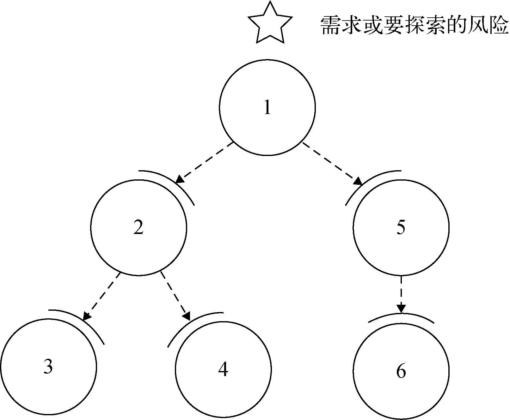
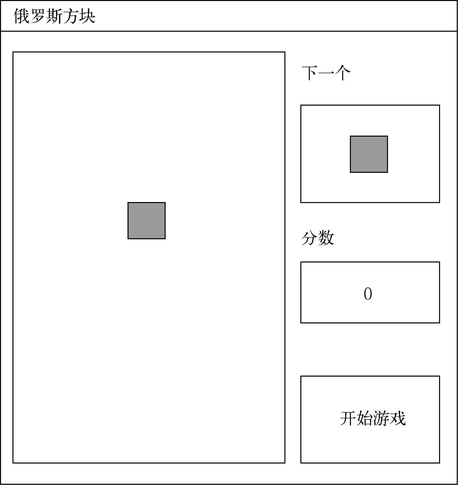
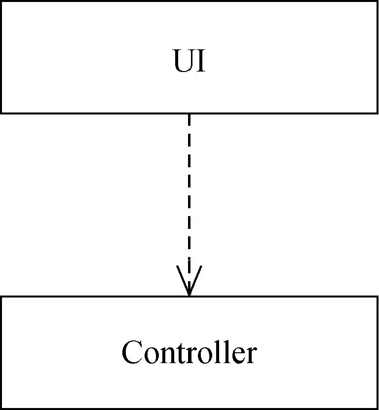
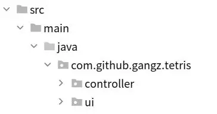
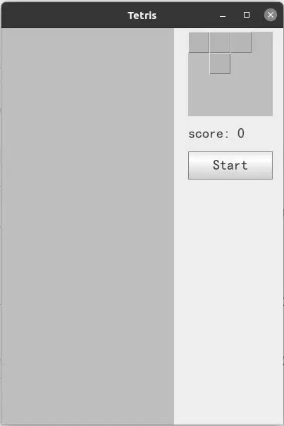
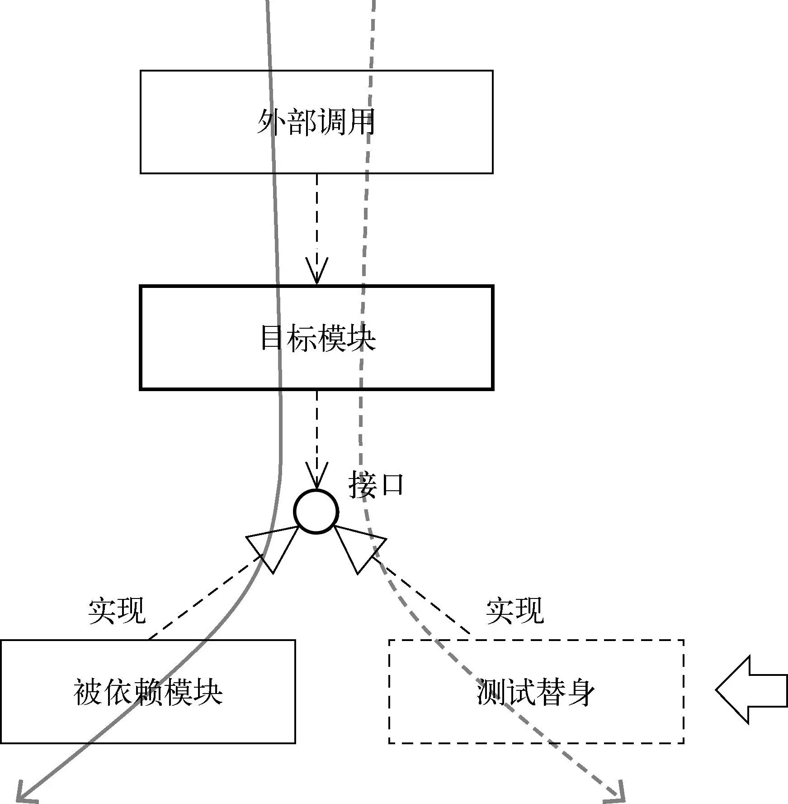
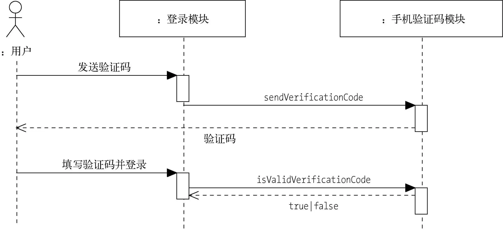

# 第9章由外而内的设计(1)

设计和编码本是一体。由外而内的设计，也叫作意图导向的编程，是把设计的思考过程、编码实现过程以及演进式设计完美结合在一起的方法。熟练掌握由外而内的设计，可以大幅提升编码效率和质量。本章将介绍由外而内的设计。

## 9.1　如何由外而内

图 9.1 是一个关于由外而内设计策略的大致示意图。其中圆形代表实际的编码实现，弧形代表在前一步导出的接口，数字代表实现的顺序。



由外而内的设计包括如下几个步骤。

1. 选择一个系统功能，或者需要探索的问题。

2. 思考实现该功能或解决该问题，需要哪些更低层的模块，每个模块分别需要承担什么样的责任。

3. 用在第 2 步假设的模块和责任完成编码，当然此时这些模块和责任可能并不存在。

4. 逐个选择第 3 步中未实现的责任，把它作为一个新的待解决的问题，回到第 1 步。

为了更清晰地说明由外而内设计的具体做法，本节我们以俄罗斯方块游戏作为范例。

### 9.1.1　案例说明

俄罗斯方块（Tetris）是一个历史悠久的电脑小游戏。像我们这一代人（我是 70 后），小时候玩过的第一款电子游戏，大概率就是俄罗斯方块。1984 年，俄罗斯人阿列克谢·帕基特诺夫发明了这个游戏，它从此经久不衰，至今在休闲类游戏中仍然占有一席之地。

游戏规则

俄罗斯方块的规则非常简单，屏幕上方持续地产生不同形状的方块，玩家通过按键旋转方块或者调整方块的位置，让方块落到合适的位置，留下尽可能少的空洞。如果底部堆积的方块形成了完整的行，这些方块就可以自行消除，同时玩家会因此得分。消除的行数越多，对应的分数奖励就越高。

当然，如果方向和位置调整得不好，就会留下填补不了的空洞，形不成整行，没有消除掉的方块会不断堆积，越来越高。一旦堆积的方块到达屏幕顶端，游戏就结束了。

思考

为了让大家能从案例中获得更多思考，我准备了 3 个问题，请先试着思考一下，再开始阅读后续内容。

- 问题 1。你会如何思考这个游戏的架构和详细设计？你将如何把设计结果表达出来？除了使用设计文档记录，还有别的方法吗？

- 问题 2。猜一猜，大概会有多少个类？最复杂的方法是哪个？这个方法会有多少行代码？

- 问题 3。你会怎么存储游戏中的方块？某个程序员决定使用矩阵（Matrix）来存储正在活动的方块以及底部堆积的区块。你认为合理吗？还有没有别的选择？

如果你对这 3 个问题有了自己的答案，那么继续往下看。在阅读完本节内容后，请再看看自己对这些问题的回答，还和之前的答案一样吗？如果不完全一样，又会激发怎样的启发和思考？

一个快速演示

我们在本章开头就提到，由外而内的设计也叫作意图导向的编程。既然是意图导向，就表示“所想即所写”。现在我先从游戏实现中提取一个功能片段，来快速演示一下如何实现图 9.1。

这个例子会实现一个简单的能力：响应来自用户的向左按键指令。当用户按下向左按键时，活动的方块将向左侧移动一格。如果在移动方向上会被墙壁或者位于底部的区块阻挡，那方块就会停在受阻位置保持不动。

所想即所写。把刚才想的写下来，就得到了如下代码。

```java
public void moveLeft() {
   if (canMoveLeft()) {
       activeBlock.moveLeft();
   }
   refreshGameUI();
}
```

代码清单 9.1　意图导向编程演示：第 1 步

```
在编写这段代码时，canMoveLeft、refreshGameUI 甚至 activeBlock 都没有必要预
先实现。为了 moveLeft 能运行，我们先实现 canMoveLeft。
public boolean canMoveLeft() {
   if (collisionDetector.isCollision(activeBlock, borderBlock, MOVE_LEFT) ||
       collisionDetector.isCollision(activeBlock, piledBlock, MOVE_LEFT))
       return false;
   else
       return true;
}
```

代码清单 9.2　意图导向编程演示：第 2 步

```
同样地，在编写这个清单时，collisionDetector 和它的 isCollision 方法也都没有必
要预先实现。为了 canMoveLeft 能运行，我们会先实现 collisionDetector ……
通过这个分析可以看出，由外而内的设计就是一个层层驱动的过程。canMoveLeft 方法是被
moveLeft 方法驱动出来的；在具体实现 canMoveLeft 方法的过程中，又驱动出了
collisionDetector 方法；如果恰好存在 isCollision 方法，则是最好，反之还需要进
```

一步实现该方法。这也是由外而内的设计这个名字的由来，从外层逐步向内驱动实现。

接下来我们从项目的第一步开始，正式地实现游戏设计。

### 9.1.2　绘制草图和初始架构

以终为始，我们先构思一下游戏最终的状态，绘制草图是一个较为快捷的构思方法。

绘制草图

图 9.2 是我绘制的俄罗斯方块游戏的草图。这个图很“简陋”，不过它足以支撑我们思考游戏的设计和实现，这就够了。



从图 9.2 中可以看到，游戏包括如下关键元素。

- 左侧为游戏区。

- 右侧上方为预览区，用于提示玩家下一个出现的方块形状是什么。

- 右侧中部为计分区，用于显示当前获得的分数。

- 右侧下方为一个按钮，用于开始或者暂停游戏。

初始架构

虽然说是由外而内，但在开始之前还是需要思考整体架构：它应该如何分层？有什么重要的架构决策？

一个游戏显然应该有一个游戏界面。不过，我并不想把所有的游戏逻辑都写在界面层，而是希望有一个类似于控制器的层，来负责实际的游戏逻辑。这样，在以后就可以请专门的交互设计师帮忙优化界面，或者把这个界面框架更改为其他类型。

于是，我们就有了一个分层架构，这是一个两层架构，如图 9.3 所示。其中包含两部分。

- UI 代表显示部分。

- Controller 代表控制部分，用于承载游戏逻辑的实际控制。游戏规则应该在这部分实现。



### 9.1.3　用代码表达初始架构

创建架构分层

根据已经想清楚的分层架构，我们首先在代码库中创建两个包——ui 和 controller，如图 9.4所示。



用代码表示 UI 层

UI 层应该如何设计呢？按照图 9.2，它包括若干区域，有游戏区、预览区、计分区等。我们这

```
里使用 Java 的图形界面库 swing 来实现 UI 层，先创建一个新的类 SwingUI，它的内容结
```

构如下所示。

```java
public class SwingUI {
   MainBoard mainBoard;
   ScoreBoard scoreBoard;
   PreviewBoard previewBoard;
}
```

代码清单 9.3　UI 层的设计

Controller 层

现在我们加入 Controller 层的代码。

- 提醒：不要想太多或许你会这样想：根据游戏逻辑，最起码要能产生随机形状的方块（I/J/L/O/S/T/Z 中的一种），所以应该有一个产生器。应该能获取用户输入，并根据用户指令旋转、左移或右移方块。或许你还会想：应该有一个定时器，能根据方块下落的速率自动计时，这样就能判断活动方块是否已经落到底部。方块如果落到底部，就应该和周围的方块堆积起来。当然，底部堆积的区块是不是已经形成整行也是需要判断的，形成整行的话需要消除；另外，如果堆积的区块太高，已经到达屏幕顶端时，就需要结束游戏。

- 这样看起来，要做的事情太多了！考虑到人的脑力有限，聪明的做法是：不要一次考虑那么多。先少做一点，后续再对功能做迭代和叠加。

不要想太多。信息是逐渐浮现出来的，设计是逐步演进的。因此先考虑最简单的数据和区块创建——这也是我们在图 9.2 中看到的内容。把想到的相关部分用代码写下来。

```java
public class GameController {
   Block activeBlock;
   Block nextBlock;
   Block piledBlock;
}
```

代码清单 9.4　Controller 层的最小设计

```
俄罗斯方块游戏包括三个方块，分别是运动的方块（activeBlock）、会预览出来的下一个
方块（nextBlock）、堆积在底部的区块（piledBlock）。需要特别指出：虽然我们在这里
使用了 Block 类，但它其实还不存在，因此运行现在的代码会报错。不过不要紧，重要的是
```

代码忠实地反映了我们的构思。

### 9.1.4　第 1 个迭代：让游戏尽快运行

```
我们想尽快看到可以运行的代码。现在的 UI 层（SwingUI）只是声明了一些数据，还没有和
Controller 层（GameController）联系起来。同时，GameController 也没有真正的能
```

力，甚至不能完成游戏的初始化。因此，即使暂时并不能响应玩家的输入，至少也得先让游戏运行起来，一个可以运行的系统会让思考形象化。于是，我们下面要做的是让游戏能尽快运行，越快越好。

加入 main 入口

```java
要运行代码，显然需要一个 main 入口。这里我把入口类命名为 TetrisMain，在 main 方
法中需要初始化两个类，即 SwingUI 和 GameController，并连接它们。
此处需要思考：究竟是 SwingUI 依赖 GameController 呢，还是反过来？UI 层和
Controller 层相比，显然 Controller 层更加稳定。所以，把 GameController 作为游戏的核
心，把 SwingUI 作为服务提供方比较合适。这样做的话，在未来可以很容易地替换或重写
SwingUI。这其实是六边形架构或者依赖倒置的思想。根据这个思路编写以下代码。
public class TetrisMain {
   public static void main(String[] args) {
       new GameController(new SwingUI());
   }
}
代码清单 9.5　加入 main 入口
这里需要引入面向接口的设计。根据六边形架构的思想，既然我们不想让 GameController
依赖具体的 SwingUI，那么不妨把它抽象化。因此我们定义一个接口 GameUI，然后让
SwingUI 实现这个接口。代码如下所示。
public interface GameUI {}
public class GameController {
   private GameUI ui;
   public GameController(GameUI ui) {
       this.ui = ui;
   }
}
public class SwingUI implements GameUI {}
```

代码清单 9.6　引入接口和适配器模式

```
在上述代码段中，第 1 行定义了抽象的 GameUI 接口。然后，第 4 行和第 6 行表明
GameController 仅依赖于抽象的 GameUI，最后在第 11 行让 SwingUI 实现了 GameUI
```

接口。

完成游戏初始化

```
GameController 负责初始化一系列内容。下面是我在经过简单分析之后，列出的在游戏初
始化时 GameController 要做的动作。
创建一个空的 piledBlock。
创建一个 activeBlock。
随机创建一个 nextBlock。
```

4. 初始时分数为 0。

5. 绘制上述信息到用户界面。

```
仍然坚持“所想即所写”的原则。我们在 GameController 类的构造方法中，把上述逻辑用代
```

码表达出来。

```
public GameController(GameUI ui) {
   this.ui = ui;
   createEmptyPiledBlock();
   createActiveBlock();
   createNextBlock();
   initScore();
   refreshGameUI();
}
代码清单 9.7　在 GameController 的构造方法中增加游戏初始化逻辑
```

设计 Block 类的结构

```
现在的代码仍然不能运行。因为 refreshGameUI、createEmptyPiledBlock 等方法都
```

还没有实现，甚至还没有一个用来表达方块的类。我们把这些都加入待实现的清单中，然后逐个实现。

```java
观察 createEmptyBlock、createActiveBlock、createNextBlock 方法，它们都需
要一个 Block 的结构。因此我们要先编写一个 Block 类。在这个类中，x、y 代表方块的坐
标，还要有一个 Shape 对象代表方块的形状。按照这个思路，我们创建一个 Block 类。
public class Block {
   Shape shape;
   int x;
   int y;
   public Block(int x, int y, Shape shape) {
       this.x = x;
       this.y = y;
       this.shape = shape;
   }
}
代码清单 9.8　Block 类的定义
```

实现 createNextBlock 类

```
在动手编写 createNextBlock 前，需要考虑职责分解问题。应该在 GameController 这
```

个类里面创建方块吗？答案是否定的。把这种生成随机形状、创建方块的具体逻辑放在

```
GameController 中，程序也肯定是可以正常工作的，但这样一来，GameController 的
```

责任也将不可避免地膨胀。相信大家已经想到，这是一个可以应用工厂模式的场景。因此，我

```java
们把随机生成形状的逻辑委托给 ShapeFactory 对象。
private void createNextBlock() {
   nextBlock = new Block(0, 0, shapeFactory.makeRandom());
}
```

```
代码清单 9.9　使用工厂模式实现 createNextBlock
```

真的需要立即生成各种各样的随机形状吗？记住我们的目标：让游戏尽快运行起来。因此，我

```
们不会在此刻实现 makeRandom 方法，而是会先随便创建一个形状的方块，如只含一个单元
```

格的最简单方块，然后把它显示在界面上。和把整个游戏流程串起来相比，实现

```
makeRandom 方法只是一个局部问题，如果担心自己会忘记，那么可以准备一张纸，把要实
```

现的功能先记录下来。

设计 Shape 类

```
现在我们需要创建 Shape 类。思考一下俄罗斯方块游戏的规则，你会发现任何一个形状的方
```

块都是由 4 个单元格组成。当然这里我们没有必要约束单元格的数量，可以用一个列表来存放组成一个方块的单元格。更进一步，列表有些严格，我们并不需要那些单元格有序，所以用集

```java
合就已经足够了。下面我们把 Shape 类和 Cell 类编写出来。
// 具体的方块形状
public class Shape {
   private Collection<Cell> cells;
   public Shape() {
       cells = new ArrayList<Cell>();
   }
   public Collection<Cell> getCells() {
       return cells;
   }
}
// 方块中的单元格
public class Cell {
   public Cell(int x, int y) {
       this.x = x;
       this.y = y;
   }
   public final int x;
   public final int y;
}
```

```java
代码清单 9.10　Shape 类和 Cell 类
由于 Shape 类被封装在 Block 类中，所以 Block 类应该提供某种数据接口（这里的接口是
getData），以返回一系列 Cell 对象。下面我们用代码表达这些想法。
public class Block {
   Shape shape;
   int x;
   int y;
   // 其他代码略
   public Collection<Cell> getData() {
       return shape.getCells().stream().map(c->(new Cell(c.x + x, c.y + y)))
                   .collect(Collectors.toList());
   }
}
代码清单 9.11　在 Block 类中增加 getData 方法
```

向界面发出显示请求

到目前为止，所需的数据已经大致准备就绪了，我们还缺少把内容显示在用户界面上的代码。

```
在 GameController 类的实现中，负责这部分功能的是 refreshGameUI 方法。显然，这
个方法需要调用 GameUI 接口才能实现其用途。参照图 9.2 ，我们编写 refreshGameUI 方
```

法的实现。

```java
public void refreshGameUI() {
   ui.updateBlocks(Arrays.asList(activeBlock,piledBlock));
   ui.updateNextBlock(nextBlock);
   ui.updateScore(score);
}
代码清单 9.12　实现 refreshGameUI 方法
```

在这段代码中，由于活动的方块和底部堆积的区块需要显示在一个区域中，所以我们使用一个列表来传递。

```
至此，Block 的数据已经被传递给了 SwingUI 类。接下来我们需要考虑如何在用户界面上
```

实际显示方块。

完成实际的显示

```java
创建一个 Swing 库中 JPanel 类的子类，把它命名为 Board。Board 类需要持有一个
Block 的列表，以便使用 paint 方法根据这个列表里的数据绘制界面。
public void paint(Graphics g) {
   super.paint(g);
   Dimension size = getSize();
   int boardTop = (int) size.getHeight() - height * squareHeight();
   for (Block block: blocks) {
       block.getData().forEach(
           cell -> drawSquare(g, 0 + cell.y * squareWidth(),
               boardTop + cell.x * squareHeight(), 1)
       );
   }
}
代码清单 9.13　根据 Block 的数据绘制界面
```

其中第 7 行和第 8 行负责获取单元格的逻辑坐标，并把对应的单元格显示在界面上。

现在我们完成了第 1 个迭代，代码是可以运行的。实际的运行界面如图 9.5 所示。当然，这个程序除了能在界面上显示一个下一个方块，暂时还不具备任何其他能力。



### 9.1.5　逐步加入行为，完善游戏功能

```
在本节前面，我们使用由外而内的设计方式，串联起了从初始化 GameController 类到把游
```

戏界面显示出来的全部功能。不过，这个游戏目前还不能玩，它既不能接收用户响应，也没有任何控制逻辑。

在接下来的部分，我们将实现一个真正的业务场景，场景描述如下。

- 响应用户的下降指令。当收到下降指令时，活动的方块向下移动一格。如果到达底部，则将活动的方块和底部堆积的区块相连接，得到新的底部堆积的区块，同时生成新的活动的方块。如果新的底部堆积的区块占据了满行，还应该执行消除动作。

希望读者在阅读完接下来的内容后，可以进一步理解由外而内的设计和意图导向编程的特征，编写出更易读的代码，并且体会代码的持续演进过程。

用代码表达设计意图

```
实现这个场景的方法显然应该定义在 GameController 类中，我把它命名为 moveDown。
```

和前一部分类似，我们先列出完整的业务规则，也就是这个方法要实现的功能。

- 规则 1。如果活动的方块还有下降空间，也就是说既没有碰到地面，也没有碰到底部堆积的区块，那么它将向下移动一格。

- 规则 2。如果已经没有下降空间，那么活动的方块要合并到底部堆积的区块中。

- 规则 3。如果底部堆积的区块形成了整行，那么需要把整行的部分消除掉。如果消除掉后，底部堆积的区块内部出现了悬空，那么悬空上方的区块要下移。

- 规则 4。如果底部堆积的区块的高度已经超出了游戏区的高度，游戏将结束。

- 规则 5。如果底部堆积的区块的高度尚未达到游戏区的高度，则创建一个新的活动的方块。

让我们执行意图导向的策略，用代码表达上面的规则。

```java
public void moveDown() {
   if (isFallenBottom()) {
       piledBlock.join(activeBlock);           // 规则 2
       piledBlock.eliminate(widthOfWindow());  // 规则 3
       fallDownIfPiledBlockHanged();           // 规则 3
       checkGameOver();                        // 规则 4
       createActiveBlock();                    // 规则 5
   } else {
       activeBlock.moveDown();                 // 规则 1
   }
}
代码清单 9.14　由外而内驱动出 moveDown 方法的实现
```

从编译错误发现要实现的代码

```
我们编写的 moveDown 方法只有寥寥数条语句，它和上面列出的规则一一对应。毫不意外，
此时 IDE 还是会报错，因为 moveDown 调用的所有方法都还没有实现。
这是一件非常好的事情：报错信息会提示我们下一步该做什么——实现 moveDown 调用的方
```

法。

- 小技巧完成由外而内的设计活动时，可以利用 IDE 的自动纠错功能，这个小技巧可以大幅减少编程时的击键次数。现代的 IDE，如 IntelliJ 和 eclipse 都具备自动纠错功能。在 IntelliJ 中，可以使用快捷键 ALT+Enter。在 eclipse 中，则可以使用快捷键 CTRL+F1。这样可以自动创建缺少的方法，并跳到对应的方法体中编写实现代码。

继续由外而内的设计过程

```
利用 IDE 的自动纠错功能，我们创建了一个 isFallenBottom 方法。在规则 1 中已经说
```

明，没有下降空间意味着碰到了地面或底部堆积的区块。在本游戏中，我引入一个小小的实现

```java
技巧，即在初始化阶段构造一个围绕着游戏区的不可见墙体对象 borderBlock，这样就把是
否还有下降空间的问题也转换为了对两个 Block 对象进行碰撞检测的问题。基于这个思路，
我们来实现 isFallenBottom 方法。
private boolean isFallenBottom() {
   return collisionDetector.isCollision(activeBlock, borderBlock, MOVE_DOWN) ||
          collisionDetector.isCollision(activeBlock, piledBlock, MOVE_DOWN);
}
代码清单 9.15　实现 isFallenBottom 方法
我们立刻就发现，还需要定义一个新的类 CollisionDetector 和一个新的变量
borderBlock。根据这个需求，我们更新 GameController 中的字段声明。
public class GameController implements CommandReciever{
   GameUI ui;
   CollisionDetector collisionDetector;
   Block activeBlock;
   Block nextBlock;
   Block piledBlock;
   Block borderBlock;
   // ...
}
代码清单 9.16　在 GameController 中新增新发现的字段
其中 CollisionDetector 和 borderBlock 是新驱动出来的字段。
```

实现 isCollision 方法

```
这一步的重要任务是实现 CollisionDetector 类中的 isCollision 方法。这个方法具有
```

一定的复杂度，我们将在第 11 章中讲解如何使用测试驱动的方法来实现它。现在先直接给出结果。

```java
public class CollisionDetector {
   public boolean isCollision(Block moveObj, Block stillObj, Integer direction)
       int offset[][] = {, , };
       int index = direction - GameController.MOVE_LEFT;
       for (int i = 0; i < moveObj.size(); i++) {
           Cell cellMove = moveObj.getAt(i);
           for (int j = 0; j < stillObj.size(); j++) {
               Cell cellStill = stillObj.getAt(j);
               if (cellMove.x + offset[index][0] == cellStill.x &&
                   cellMove.y + offset[index][1] == cellStill.y)
                   return true;
           }
       }
       return false;
   }
}
代码清单 9.17　实现 CollisionDetector 类中的 isCollision 方法
```

回到顶部，完成其他实现

至此，这个下降过程的业务逻辑的第一步，也就是图 9.1 中最左侧的分支就实现完了。按照同

```
样的思路，我们可以继续补入 piledBlock.eliminate、
fallDownIfPiledBlockHanged 等的具体实现，最终就实现了 moveDown 方法的所有功
```

能。

当然，编写完这个场景的实现代码，我们还可以继续实现其他业务场景，例如下面这两个场景。

- 场景 1：响应用户的旋转指令。当收到旋转指令时，活动的方块顺时针旋转 90 度。

- 场景 2：响应定时器消息。每当被定时器消息触发时，活动的方块向下移动一格（即执行一次向下指令）。

场景实现的步骤是类似的，大家可以自行尝试实现这两个场景。这里我给出了一个最终实现的

- 1

完整代码

- 供大家参考。

## 9.2　由外而内设计的优势

由外而内的设计的对立面是：自顶向下设计、自下而上编码。相对于这种设计方式，由外而内的设计有什么优点呢？

在 9.1 节，我曾经请大家思考了 3 个问题。这 3 个问题都反映了由外而内的价值。对于问题1，设计的思路除了可以记录在文档中，还可以在代码中即时呈现。也就是说，思考的过程就是编码的过程。对于问题 2，方块下降的逻辑虽然很复杂，但是实现出来的代码很简单，只有短短 9 行，而且易读性非常好。对于问题 3，存储结构并没有采用矩阵，而是一个元素为单元格的列表。

接下来，我们结合俄罗斯方块游戏的例子和这些问题，总结一下由外而内的设计具有的优势。

### 9.2.1　由外而内，从延迟决策中受益

由外而内首先是一种延迟决策的策略。从设计的本质上说：设计本身是一种在信息不完全的情况下做的决策。比如，在俄罗斯方块游戏的例子中，我们应该使用哪种数据结构来存储俄罗斯

```
方块的数据？我们真的需要一个叫作 CollisionDetector 的类吗？
```

由于做这些决策的相关因素都处在较深的设计层次，所以一开始的信息非常贫乏。传统的自下而上的编码意味着，在设计阶段要把这些因素都想清楚。要有非常强的思考能力，才能想到比较深的设计层次。这往往是困难的。

而在由外而内的设计方式下，程序员并不需要在一开始就做出所有决策。这恰恰和设计的逐渐认知趋势是一致的。不仅如此，延迟决策还可以保证概念的抽象、避免过度设计、在早期聚焦重点。

延迟决策，直到信息更丰富

外层功能比内层功能具有更高的确定性。如果能从设计的外层开始，先完成一部分设计，同时通过代码编写的检验，那么较为深层次的设计问题就能获得更多的输入。

```
例如，在前述的例子中，CollisionDetector 类和它的 isCollision 方法都是在实现
moveDown 方法或者 moveLeft 方法过程中自然导出的需求。由于需求是实践导出的，所以
```

这些方法的职责就很明确。

数据的存储方式是另外一个例子。如果选择从最内层开始实现，那么，究竟是用一个矩阵来存储数据呢？还是用一个列表呢？或许你会陷入想当然的境地：矩阵的复用性高一些吧！矩阵可以找到可以复用的库吧！这些问题在一开始提出来时都很难有确切答案。但是，等到真正看到

```
由实现 Block 类导出的需求只是存储几个单元格时，就可以确信一定没必要采用复杂的矩阵
```

了。

延迟决策，保证概念的抽象

一开始就选择从底层开始实现还会产生一个关键的问题，我们举例来说明，假设我们已经使用

```
了矩阵作为存储结构，这个结构将不可避免地被传递到更高层，甚至是 GameController
```

类。

```
现在来看看在 9.1 节中产出的代码。由于在外层只有抽象的概念，如 Block、Shape 等，它
```

们的实现都是在需要用到它们的层次才出现。更低层的存储结构出现得非常晚，自然也不可能污染到上层代码。这带来了更好的概念抽象和封装。这种封装可以使我们即使到了项目的非常后期，也仍然能轻松换掉低层被依赖的代码。

由外而内，驱动出来的是契约，也就是接口声明。接口声明要比具体怎么实现更稳定，也更重

```
要。例如，isCollision 在刚刚出现的时候就只是一个接口声明，而不是具体实现。在初始
```

阶段把注意力放在契约上，而不是具体的算法上，是非常重要的。

延迟决策，避免过度设计

在俄罗斯方块游戏中，使用矩阵就不是一个好的设计。一旦决定使用这样的结构，又没有来自外部的价值拉动，就很可能会自行“脑补”很多可能在未来用得到的功能，或者一个大而全的实

```
现。例如，通过脑补把 Matrix 类中的 rotate 方法设计成一个通用的矩阵旋转方法，这样
```

肯定会引入复杂的矩阵变换甚至三角函数计算。而我们的俄罗斯方块游戏并不需要这么复杂的

```
rotate 方法，这就是一个过度设计。
```

- 2

```
 为例，所谓的 rotate 方法只是下面这段代码。
```

在本例的实现中，以形状 I

```java
public class ShapeI extends RotatableShape {
   public ShapeI(){
       // shapeI 包含 2 个值对象列表，一个是横向条，一个是纵向条
       shape = new ArrayList<>();
       shape.add(new Cell(0,0));
       shape.add(new Cell(0,1));
       shape.add(new Cell(0,2));
       shape.add(new Cell(0,3));
       shapeList.add(shape);
       shape = new ArrayList<>();
       shape.add(new Cell(0,2));
       shape.add(new Cell(1,2));
       shape.add(new Cell(2,2));
       shape.add(new Cell(3,2));
       shapeList.add(shape);
       shape = shapeList.get(0);
   }
}
public class RotatableShape extends Shape {
   protected ArrayList<ArrayList<Cell>> shapeList;
   int currentShapeIndex = 0;
   public RotatableShape() {
       shapeList = new ArrayList<ArrayList<Cell>>();
   }
   // rotate 方法从值对象列表中循环选择下一个形状
   public void rotate() {
       currentShapeIndex++;
       currentShapeIndex %= shapeList.size();
       this.shape = shapeList.get(currentShapeIndex);
   }
}
```

代码清单 9.18　用固定的值对象实现形状旋转

无论哪种形状，俄罗斯方块游戏中的形状数量是有限的，4 个旋转角度也是确定的，所以，

```
rotate 仅仅是从 shapeList 中取得下一个形状而已。相比于复杂的矩阵转置，这个实现成
```

本相当低，而且不容易出错。

延迟决策，在早期聚焦重点

如果在设计游戏之初，开发者的精力就放到了如何检测碰撞冲突、如何存储数据这类细枝末节的事情上，那么很容易“见树木而不见森林”，丢失全局视野。越是细枝末节，涉及的决策、具体算法、相关技术依赖这些问题往往就越多。在早期由外而内地思考可以有效地把精力奉献给最核心的业务诉求和业务逻辑，保持对大局的把控。

### 9.2.2　由外而内带来了意图导向的编程

相信大家已经从俄罗斯方块游戏的实现中，体会到了意图导向编程带来的愉悦。意图导向意味着“所想即所写”“怎么想就怎么写”，这样做起来是非常流畅的。

```
意图导向编程往往能提升代码质量。大家应该能感受到代码清单 9.14 中的 moveDown 方法易
```

读性非常好。为什么会这样呢？这是因为在意图导向的思维模式下，抽象层次是天然一致的。在 2.3 节中，我们曾经讨论过抽象层次不一致带来的问题，而在使用了意图导向的编程之后，很难写出抽象层次不一致的代码。

好的代码应该跟文章一样，让人读起来感觉非常清爽，意图导向编程就是达到这种状态的一个捷径。实践表明，意图导向的编程不仅能提升代码的易读性，还有助于减小重构的必要性。因为抽象层次的一致使实现正确封装的概率从一开始就大大增加了。

### 9.2.3　由外而内达成了设计顺序和编程顺序的统一

由外而内达成了设计顺序和编程顺序的统一。事实上，不管是先编写外层代码，还是先进行底层实现，在设计思路上，毫无疑问都经历了一个从外部需求到底层结构的拆解过程。只不过，在传统的开发方法中，把这种由外而内的拆解称为详细设计，把自下而上的构造称为编码。

凡是有较多实际开发经验的人都知道，这种把设计和编程分开的“理想”实践在现实中非常难实施。其根源在于：详细设计包含大量的细节。如果忽略细节，就没有办法思考深入。如果考虑过多细节，依赖文档形式表述又会有比较重的负担，常常陷入“我还不如直接开始写代码”的烦恼。

由外而内的编码解决了设计顺序和编码顺序不一致的问题。在这种情况下，也真正实现了代码即文档，即编写完的代码具有极强的可理解性，使别人不必通过文档来理解代码的功能。

当然，要完美实现设计顺序和编程顺序的统一，并不只是采用由外而内的方式这么简单。“身剑合一”的本质是基本功扎实。一边思考，一边编码，其本质是持续地进行职责的分解。如果对软件设计的理解不够，对内聚性的判断不准确，或者缺少设计模式等方面的基础知识储备，那么这些缺失的技能在由外而内的设计中会更加凸显。当然，技能的提升总是渐进的，你也无须非要等各项技能都具备以后才开始应用由外而内的设计，可以在实践中不断精进技能。只是一定要深刻理解一点，持续提升设计技能才是真正实现高效编程的基础。

### 9.2.4　由外而内意味着随时集成

```
采用自下而上的编码方式，将不可避免地先生产一批“零件”，如本例中的 Matrix、Shape、
Block 等，再在某个集成环节进行拼装。这些预先生产而没有实际集成起来的零件会对脑力
```

造成较大的负担。在并行进行多个项目，或中断比较频繁的场景中，这类问题尤为突出。因为是断断续续，缺少了自顶向下的即时集成，所以过不了多久就会忘记上一次开发到哪儿了，进度也很难把握。而在由外而内的实现方式下，代码中不会有任何散落的零件，这是因为它随时随地都在集成，软件随时随地都是一个整体，甚至在一天工作结束的时候根本无须记忆自己工作到哪儿，报错的地方就是第二天需要开始的地方。

## 9.3　应用测试替身

由外而内是很有效的一种思考方法，它还可以更进一步。如果能在实践中结合测试替身，那么会获得更大的收益。

在 9.2 节中，我们刻意忽略了一个问题。自下而上的编码方式就像盖大楼，总是先造地基，再依次建造第一层、第二层，第三层……这是符合工程逻辑的，因为更高层依赖于更低层，所以先把更低层造出来，更高层就有了基础。

由外而内的开发方法尽管有种种优势，但还是存在一个不可回避的问题。细心的读者可能已经发现：虽然这样开发看起来很顺利，但是在仅有上层代码，还没有完全实现低层代码的时候，整个程序是没办法真正运行的。

对小规模的程序来说，一开始不能运行或许不是大问题。但对于那些规模很大、无法在短时间内完成的项目，或者多人协作的项目，长期无法编译运行、只能依赖于人的记忆来推进，是难以接受的。

测试替身（Test Double）是由外而内设计的有力帮手。通过测试替身，由外而内的设计方式可以在任何阶段持续编译和运行程序，以持续获得反馈，并得到比自下而上的开发方法更好的设计质量和可测性。

### 9.3.1　什么是测试替身

测试替身的两个相关关键词是：依赖、仿冒。测试替身是一种仿冒的依赖。

测试替身就是仿冒的依赖

设计单元之间存在依赖。从测试视角看，测试替身表现出了和被依赖方相同的行为。图 9.6 反映了测试替身的概念。



在图 9.6 中，目标模块是我们正在开发的模块，如果我们希望这个模块运行，就必须得解决它的依赖问题。测试替身的意义就是它能够模仿一个被依赖的模块，让自己看起来如同一个真实的被依赖模块，从而可以解开依赖，让系统可以在更小的范围内运作。处在右下角的虚线框部分，就是测试替身。

测试替身能够生效的关键是图 9.6 中的接口。一般而言，如果希望断开依赖，则目标模块需要依赖一个接口定义，而不是具体的实现。这是符合逻辑的：接口即契约。被断开的依赖自然应该是设计的边界，在设计的边界上的契约，具体对应的就是接口声明。

由于测试替身实现了接口，所以从目标模块的视角看，测试替身和目标模块的真实依赖并无差别，也就使得目标模块可以在被依赖模块尚未就绪的情况下运行和被测试。

测试替身的价值

测试替身的用途很广泛。测试替身是一种依赖解耦的方式，被广泛地应用在自动化测试中，包括单元测试、模块测试等场景。只要是在正开发的项目中，被依赖的模块尚不可用，就可以使用测试替身来解耦依赖。这种情况包括：需要单独测试目标模块、被依赖的模块正处于开发中、被依赖的模块还不够成熟、怀疑被依赖模块的缺陷可能影响到本模块的行为、被依赖的模块还依赖其他模块、需要很复杂的逻辑才能让被依赖的模块返回期望的结果等。

解耦真实的依赖很重要。如果代码测试和调试总是需要依赖一个真正的模块，那么上述情况就会影响到正常的工作。有一些开发团队由于缺乏有效的依赖解耦能力，无论在进行多大规模的测试和调试时，都不得不先把整个系统跑起来——不管这个系统规模多么庞大、构造一份测试数据多么复杂。这种现象显然不是高效软件开发所期望的，而测试替身恰恰能完美地解决这个问题。

测试替身的具体分类

在第 6 章中，我已经介绍过依赖的两种分类：命令和查询。命令意味着依赖方对被依赖方发出一个请求，被依赖方按照依赖方的要求执行响应动作。查询意味着依赖方对被依赖方发出一个请求，被依赖方返回特定的数据。

例如，在使用手机码进行登录校验的场景（图 9.7）中，登录模块（目标模块）会向手机验证

```
码模块（被依赖模块）发出一个请求 sendVerificationCode(phoneNumber)，从目标
```

模块的视角看，这就是命令式依赖。用户在收到验证码、填写验证码之后，登录模块给手机验

```
证码模块发送了一个请求 isValidVerificationCode(phoneNumber, code)，从目标
```

模块的视角看，这就是查询式依赖。



从目标模块的视角说，命令式依赖和查询式依赖的关注点是不一样的，对测试替身的要求也不

```
一样。对命令式依赖来说，其重点关注的是目标模块确实发出了 sendVerificationCode
```

命令。如果没有发出这个命令，那目标模块就有错误。只要发出了这个命令，同时参数也正确，目标模块就是正确的。至于手机验证码模块是否真的发送了验证码，和我们关注的目标模块没什么关系。

查询式依赖需要让被依赖模块返回特定的数据。例如，我们需要分别测试验证码有效和无效的

```
情况，那么被依赖模块就得根据需要或者返回 true，或者返回 false。因此，查询式依赖
```

的返回结果是需要能被操控的。根据具体依赖关系的不同，有些文献中会更详细地区分测试替身的类型，例如下面几个。

- 测试桩（stub）：测试桩能够在测试用例的指示下，按照要求在特定时刻返回特定的值，从而使得被测代码能够跳转到相应的路径，或者执行特定的行为。

- 仿冒对象（mock）：仿冒对象可以校验操作是否被调用、调用顺序是否正确以及参数值是否正确等。

- 测试哑元（dummy）：测试哑元是不会被真正调用的简单桩，仅适用于某些语言。例如在 C语言中，由于链接步骤的存在，测试哑元是必须的，否则无法通过链接。

```
测试替身完全可以手写实现，在俄罗斯方块游戏的例子中，最早我们仅是让 ShapeFactory
返回了一个最简单的 Shape，这就是一个使用硬编码的、快速实现的桩。这个桩的作用，就
是让我们暂时忽略具体的 Shape 类型，先让游戏的其他部分运行起来，从而快速获得反馈。
```

在大多数情况下，手写测试替身往往意味着要付出较多的工作量。而且，目前各种语言中都已经有了多种测试替身框架，那我们应该尽量借用这些框架的能力来实现测试替身。此外，几乎所有的测试仿冒工具都能同时支持命令式依赖和查询式依赖，即使一个工具是以 Mock 为名，它本质上也仍然是一个全面的测试替身工具。这一点请读者不要混淆。

### 9.3.2　使用测试替身框架

测试替身框架非常丰富，几乎在每种语言中都有多种实现。本节我们以 Java 语言的测试替身工具 Mockito 为例，介绍测试替身框架的使用方法。

仿冒查询式依赖

我们先来看要测试的登录服务的代码。

```java
public class LoginService {
   VerifyCodeService verifyCodeService;
   public boolean login(String phoneNumber, String code) {
       // 省略实际登录的逻辑，如赋予特定的权限、创建后续对话的 Session 等
       return verifyCodeService.isValidVerificationCode(phoneNumber, code);
   }
}
```

代码清单 9.19　登录服务向校验码服务发出查询指令

```
在这段代码中，LoginService 的 login 方法调用了验证码服务对象
verifyCodeService 来验证传入的 code 是否有效。如果有效则返回登录成功，否则返回
```

登录失败。

```
我们不想让 LoginService 和 VerifyCodeService 紧密耦合在一起，因为后者可能尚在
```

开发，或者是一个需要付费的第三方服务，又或者因为网络等原因不够稳定。因此，我们选择

```
在测试中使用 VerifyCodeService 的替身，下面使用 Mockito 工具结合 JUnit 工具来完成
```

这个目标。

```java
package mockito.demo;
import org.junit.Test;
import org.junit.runner.RunWith;
import org.mockito.InjectMocks;
import org.mockito.Mock;
import org.mockito.junit.MockitoJUnitRunner;
import static org.junit.Assert.assertTrue;
import static org.mockito.ArgumentMatchers.any;
import static org.mockito.Mockito.verify;
import static org.mockito.Mockito.when;
@RunWith(MockitoJUnitRunner.class)
public class LoginServiceTest {
   @InjectMocks
   LoginService loginService = new LoginService();
   @Mock
   VerifyCodeService verifyCodeService;
   @Test
   public void shouldSuccessIfVerificationCodeValid() {
       when(verifyCodeService.isValidVerificationCode(any(), any())).thenReturn(
       boolean loginResult = loginService.login("13812345678", "1234");
       assertTrue(loginResult);
   }
}
代码清单 9.20　使用 Mockito 工具仿冒 VerfiyCodeService
第 14 行和第 15 行表明这是一个测试，测试目标是 LoginService。
VerifyCodeService 已经被声明为接口，现在需要使用 Mockito 工具仿冒一个测试替身。
```

为了完成仿冒，我们需要完成两个工作。

1. 创建一个测试替身的实例。

2. 把这个实例注入依赖方，让依赖方以为这就是真正的被依赖方。

第 21 行完成了工作 1。这个清单中使用了一些稍微高级的语言功能。如使用

```
MockitoJUnitRunner 作为 Runner 运行测试时，它会扫描带有 @Mock 注解的接口，并自
动为这些接口创建一个 Mockito 的实现。当然，使用 verifyCodeService =
Mockito.mock(VerifyCodeService.class) 这种传统的方法也可以达到相同的目标。
第 18 行完成了工作 2。在本例中的具体实现机制是：MockitoJUnitRunner 扫描带有
@InjectMocks 注解的实例，在 LoginService 中找到对应的 verifyCodeService 字
段，并把该字段指向 VerifyCodeService 的仿冒实例。同样，也有传统的依赖注入方法，
```

就是在第 6 章中介绍的方式。

完成测试替身的仿冒后，还需要能操纵这个替身，让它按我们期望的行为配合依赖方的代码。

```
在本例中，第 25 行“告诉”Mockito 框架：在后续调用 verifyCodeService 这个对象的
```

- 3

```
isValidVerificationCode 方法时，无论参数是什么
，都返回 true。
当测试代码在第 26 行调用 loginService.login 时，被测代码（代码清单 9.19）中第 4
行的调用被重新定向到了 Mockito，然后 Mockito 框架按照设定的要求返回了 true。这是一
种“狸猫换太子”的手法，让我们在还没有真正实现 VerifyCodeService 的时候，能顺利地
完成 LoginService 的编码和测试工作。
```

测试替身框架的一个优势是：可以使用非常简洁的声明式语句完成对测试替身的操控。在本例中，如果我们希望测试的内容是当验证码无效时登录失败，那么仅需要替换第 25 行的代码。

```
       when(verifyCodeService.isValidVerificationCode(any(), any())).thenReturn(
```

代码清单 9.21　使用 Mockito 工具操控被依赖对象的行为

这样就可以达成操控的目的。Mockito 还提供了更多的机制，如在第 1 次调用的时候返回

```
true，在后续调用时则返回 false，或者当手机号是 13812341234 的时候返回 true，当
手机号是 13856785678 的时候返回 false 等。在较为复杂的场景中，这些精细化的操控就
```

比较有用。

仿冒命令式依赖

当用户使用手机验证码登录时，需要点击“发送验证码”，之后用户的手机会收到一个验证码短信。假设被测试的代码如下所示。

```java
public class LoginService {
   VerifyCodeService verifyCodeService;
   public void sendVerificationCode(String phoneNumber) {
       verifyCodeService.sendVerificationCode(phoneNumber);
   }
}
```

代码清单 9.22　登录服务请求验证码服务发送验证码

同样，我们希望不依赖真实的验证码服务，就让这段代码运行起来并且通过测试。下面使用Mockito 工具的验证能力来达到这个目标：在没有真实验证码服务的情况下，仍然能知道登录

```java
服务 LoginService 确实向验证码服务 VerifyCodeService 发送了一个请求。
@Test
public void shouldSuccessfullySendVerificationCode() {
   loginService.sendVerificationCode("13812345678");
   verify(verifyCodeService).sendVerificationCode("13812345678");
}
```

代码清单 9.23　验证登录服务确实向验证码服务发送了请求

```
verify 是 Mockito 提供的调用验证功能的方法。如果 LoginService 类的实现是正确的，
```

那么这个测试可以通过。相反，如果忘记了调用所期待的方法，那么在测试运行时，Mockito将会给出以下出错信息。

```
Wanted but not invoked:
verifyCodeService.sendVerificationCode(
   "13812345678"
);
-> at mockito.login.LoginServiceTest.shouldSuccessfullySendVerificationCode(Login
Actually, there were zero interactions with this mock.
```

代码清单 9.24　Mockito 在发现违反了命令契约时报错

Mockito 提供的验证能力是比较丰富的，它不仅可以验证某个方法是否被调用，还可以验证调用时的参数数值是否符合期望、调用次数是否符合期望，或者发生了不期望的调用等。这些机制使我们的测试比连接真实的依赖都更加灵活。

### 9.3.3　在俄罗斯方块游戏的实现过程中使用测试替身

引入测试替身，使由外而内的软件开发从一种思考方法进化为了更为敏捷的编码实践。现在，由外而内不仅具备了延迟决策、意图导向、随时集成的优势，更诱人的是，待开发的系统可以在低层代码或者服务尚未就绪时，就能够随时测试外层功能、模拟运行系统、提前预览界面、提前发现风险等。

```
以俄罗斯方块游戏的 moveDown 方法的实现为例。在 moveDown 方法中，会检测活动的方块
是否还有下降空间，对应的方法名为 isFallenBottom。该方法在实现时会调用
CollisionDetector 类的 isCollision 方法。我们并不想在实现更重要的功能（如连接
```

区块、消除整行等）之前，先把精力花费在具体地计算两个区块是否碰到一起的数学逻辑上。那怎么办呢？这时我们就可以使用测试替身来仿冒实现这个能力。

```java
下面的测试使用 Mockito 实现一个测试替身，无须使用真实的 CollisionDetector，就可
以测试区块落到底之后的连接（join）功能。
@RunWith(MockitoJUnitRunner.class)
public class TestGameController {
   // 仿冒一个 GameUI。它在本例中是测试哑元
   @Mock GameUI ui;
   // 仿冒一个 CollisionDetector。稍后我们来操控这个仿冒对象
   @Mock CollisionDetector collisionDetector;
   @Test
   public void moveDownWithCollisionShouldJoin() {
       // 无论 is Collision 的输入是什么，都返回 true
       when(collisionDetector.isCollision(any(), any(), any())).thenReturn(true)
       // 通过构造函数注入 ui 和 collisionDetector 的依赖
       game = new GameController(ui, collisionDetector);
       game.start();
       // 将在 moveDown 方法中间接调用 isCollision 方法
       game.moveDown();
       // 判断是否发生了预期的行为
       assertTrue(piledBlockMergedWithActiveBlock());
   }
}
```

代码清单 9.25　使用 Mockito 仿冒依赖

```
本例中的 GameController 是我们正在关注的设计。在 moveDown 方法中，如果活动的方
块已经没有下降空间（符合 isFallenBottom 的条件），那么它将合并入底部堆积的区块。
使用了 Mockito 提供的仿冒能力，我们不需要真的去实现 CollisionDetector 类的
isCollision 方法，就可以完成对方块合并功能的测试。
真正实现一个 isCollision 是要付出一定工作量的。如果你想较快地看到反馈，那么使用
```

仿冒显然是更便捷的策略。而且，如果不仿冒，而是使用真实的依赖而，那为了测试

```
isFallenBottom，需要很仔细地造数据：方块的位置和形状都要恰当，才能让活动的方块
在下降一格时恰好碰撞在一起。数据造得不对，或者 isCollision 实现得不正确，都会干
扰对 isFallenBottom 和 moveDown 方法的测试。
```

仿冒巧妙地解决了这个问题。我们可以随意构造两个方块，不管它们的真实位置距离多远，只

```
要我们告诉 Mockito 框架请返回 isCollision 为 true，Mockito 框架都会返回 true。这
```

样，两个方块的距离就不会成为把它们连接在一起的影响因素了。

灵活巧妙地使用 Mockito 工具，再结合外而内的实现，可以大幅提升编程效率。

- 附加讨论

```
在本例中有一个值得关注的细节：为什么我们仿冒的是 CollisionDetector 类的
isCollision 方法而不是 GameController 类的 isFallenBottom 方法呢？这是一
个很有趣的关注点。它背后反映的是设计抉择。如果选择的是 isFallenBottom，那么会
认为 GameController 对外的边界在 isFallenBottom 处。同理，选择了
isCollision，反映的是 GameController 对外的边界在 CollisionDetector 处。
正确的选择是把 CollisionDetector 作为边界。注意，究竟是像代码清单 9.15 那样把
isFallenBottom 中的代码作为一个单独的方法，还是把代码直接实现在 moveDown 方
法的内部，是 GameController 这个设计单元的内部决策，可能会随着认知的变化、设
计的改进而发生变化。而一旦把边界移到 isFallenBottom，这个选择权就没有了，这是
我们不期望看到的。GameController 的真正边界是对 CollisionDetector 的依赖。
```

- 关于这一点，请读者注意辨析。

[1]：。[2]：形状 I 指代俄罗斯方块游戏中的条形。[3]：第 25 行的两个 是参数匹配器。
