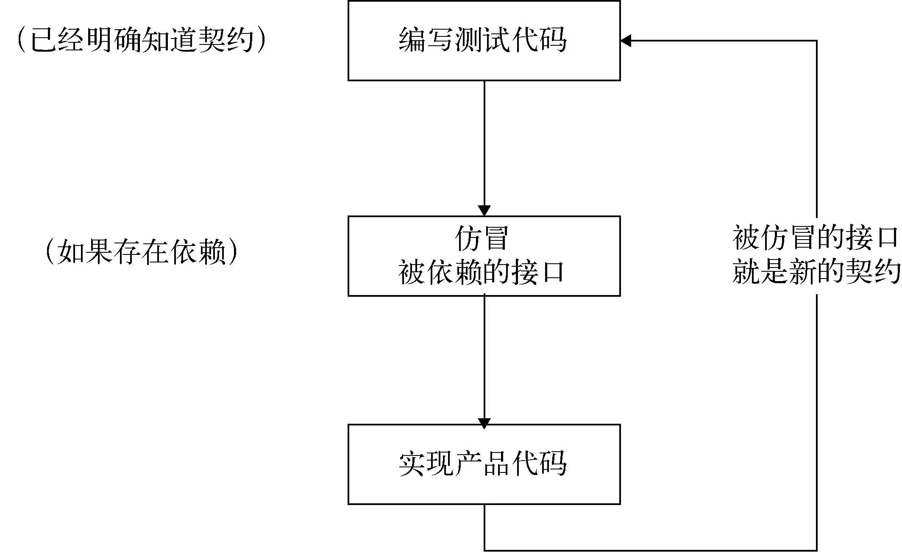
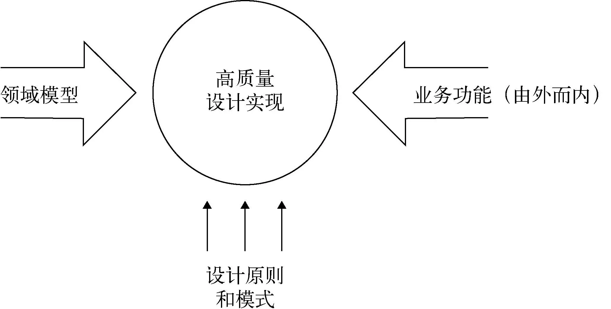
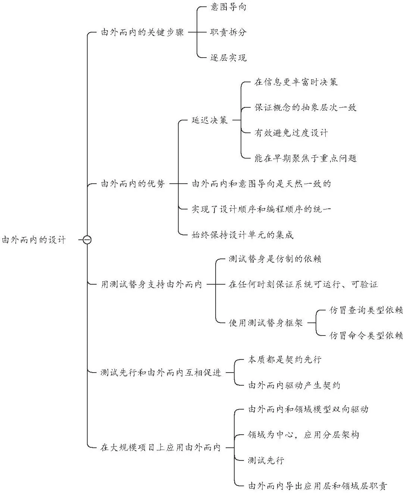

# 第9章由外而内的设计(2)

## 9.4　测试先行和由外而内

测试先行和由外而内是密切相关的两个实践。下面概括一下两者的关系。

- 由外而内和测试先行都是契约先行，两者是统一体。

- 由外而内可以驱动产生契约。

- 测试先行让由外而内的约束更少：由外而内可以从任何需要的层次开始，而不必非从最外层开始。

### 9.4.1　由外而内和测试先行都是契约先行

由外而内和测试先行都是关于契约的实践。它们有着共同的目标。

- 为什么要由外而内？是因为外部功能更显然、更确定，底层决策在初期并不是那么显然。外部功能就等价于已经被定义清楚的契约。

- 为什么要测试先行？是因为通过测试可以更容易地说清楚契约到底是什么。测试是沟通和澄清契约的高效手段。

因此，从这个意义上讲，由外而内和测试先行是统一体。它们一个使用契约来驱动设计，一个用测试来说明契约。更重要的是，测试先行是由外而内的重要支持。如果单纯应用由外而内，就缺乏及时验证和测试的手段。引入了测试先行后，由外而内就变得更加显然：完全可以采用自动化测试，一步一步地推进由外而内的实现。

测试先行不仅可以应用于最外层，它可以应用于由外而内设计的任何层次。例如，在设计早

```
期，可以应用于 GameController 的 moveDown 方法。在后续过程中，它又会继续应用于
CollisionDetector 的 isCollision 方法。
```

### 9.4.2　契约源自由外而内的驱动

测试先行需要设计契约。但是，可靠的契约从哪里来呢？在由外而内的开发方法中，契约就是利用这种层次递进的手段，一步一步驱动出来的。

例如，在俄罗斯方块游戏的例子中，尽管你可以猜测：肯定需要一个检测方块是否碰到一起的功能。但是这个认知也只是停留在一个大概的层次上，对于它应该有几个输入参数，类型是什么，可能并不是那么确切。

编写使用方的代码是让契约明确的最好方式。由外而内的逻辑恰好是一个循环：

1. 根据已经明确的契约编写测试代码；

2. 在编写测试代码的过程中仿冒被依赖方的接口；

3. 实现该层次的产品代码，并通过测试；

4. 把在测试过程中产生的被依赖方的接口作为新的契约，回到第 1 步。

这个过程的示意图如图 9.8 所示。



```
仍然以 moveDown 方法为例。moveDown 方法是最外层功能，和业务逻辑直接相关。在实现
它的过程中导出了 isCollision 的契约。于是，就可以先把 isCollision 加入待实现的
清单，在后续过程中再继续完成它。当然，如果在实现 isCollision 的过程中又发现了新
```

的契约，也可以把它加入待实现清单。

一个上层实现可能驱动出多个下层的契约和实现需求。然而不是每个被驱动的契约都必须立即实现，由于可以使用测试替身工具，所以它们不会阻碍正在编写的功能。在由外而内的节奏下，可以随时根据当前情况，从待实现清单中选择最重要的功能继续推进。

在包含多个模块、子系统、甚至是组织边界的情况下，由外而内还可能会把契约推进到模块、系统和组织的边界上。这时，由外而内导出的契约也就是本模块、本系统对外暴露的请求方接口。

### 9.4.3　测试先行扩展了由外而内的范围

在实施由外而内的设计时，你也许会遇到这样的困惑：是不是“外”就一定意味着系统的最外层

```
功能？在俄罗斯方块游戏的实现中，这个最外层，究竟是用户界面 GameUI 呢，还是控制游
戏逻辑的 GameController？
```

由外而内的本质是在恰当的时机做决策。所以，作为起点的“外”不限于功能的最外层，而是当下较为确定性的、可以开始设计和编码的起点，或者是需要探索的地方。高价值或高风险都可以作为由外而内的起点。

测试是提供反馈的好方法。在不少设计层次上可能并没有用户界面或者外部可见的接口，此时自动化测试就是一种非常好的手段。所以，测试先行可以让我们在任何需要的设计层级上开始设计探索，而不一定从设计的最外层开始。

## 9.5　把由外而内应用于大规模的项目

由外而内的工作方法，在开展复杂度很高的大项目时尤其重要。它和在第 8 章中讲解的用领域模型指导实现可以彼此配合，提升软件设计和编码的效率。

在本章中，我们将继续使用餐品预订的例子，来展示由外而内的方法如何和领域建模、分层架构等设计手段配合，产生高质量的编码。

### 9.5.1　领域划分和设计分层

餐品预订是一个典型的业务系统。遵循第 8 章所介绍的子域和限界上下文的概念，我们首先将它划分为不同的服务，让每个子域都包含一个或若干个服务，然后在每个服务内应用设计分层的概念。

我们面临的第一个问题是：有那么多的服务要去实现，应该从哪个服务开始呢？每个服务的职责又是什么？仅从粗略的子域划分上很难得到清晰的答案。这就是我们应用“由外而内”的第一个层次，使用由外而内，驱动产生服务的职责和边界。

相信你已经看出来了，这本质上是一种领域模型和由外而内双向驱动的过程。一边是我们对业务本质的认知，它体现为领域模型，包括领域划分以及内部的关键概念模型，一边是业务系统的需求。软件实现是从这两个视角向中间驱动的结果，如图 9.9 所示。



在本图中，我还在底部增加了一个支撑：设计原则和设计模式。下面就让我们通过一个具体的功能，来看这三个关键要素是如何融合在一起的。

从核心域开始

从哪里开始一个新系统的设计？很有意思的是，我见过不少团队开发的第一个功能惊人地相似：登录。为什么是登录呢？因为对于大多数系统，用户需要先登录，才能开始使用实际的功能。不过，这绝非最好的选择。

没有人会对登录感兴趣。如果你的业务方希望你开发一个系统，过了两个星期，在需要展示进度时，你给业务方展示了辛苦实现的登录功能，界面可能很漂亮，功能可能很完整，但是猜猜业务方会说什么？在比较有耐心的情况下，对方可能会比较无奈地说：“好的，我知道搭建一个好的系统需要时间。”更多时候则可能是不理解：“都两个星期了，还什么都没做呀！为什么呢？”尽管登录是必须的，但它和业务价值几乎没有关系。所以，从登录开始设计肯定不是一个好的选择。

开发一个登录系统也不会给探索和发现带来帮助。大多数系统的登录逻辑是类似的。如果你真的推陈出新，做了一个很不一样的登录系统，那么用户可能反而会不习惯。登录是一个通用域，尽管是必须的，价值却不高。

正确答案是从核心域开始。核心域反映了最重要的业务价值，而且往往是风险或者未知因素的聚集地。用由外而内的方式，如果需要还可以配合测试替身工具，可以在很快的时间内产出外部可见的成果，推进项目进展。

在本例中，订餐是一个比较好的业务起点。根据由外而内的设计原则，我们完全可以假设餐品目录已经存在、餐品的容量管理（防止超卖）等能力已经存在，用户管理能力也已经存在。这样，我们就可以直接进入更有业务价值的订餐环节了。

选择四层架构

快速开始编码并不意味着不需要设计。事实恰恰相反。在开始动手之前，编程高手往往已经对系统的大概样子做到胸有成竹。不过这并没有什么复杂之处，如果掌握了一些诀窍，经验不是特别丰富一般开发者同样可以做到。这个诀窍就是灵活运用架构和设计模式。

即使是由外而内，你也不可能把所有的代码都写在一层。否则，就真的成了 SmartUI 反模式。餐品预订应用是一个典型的业务系统，我们决定采用领域驱动设计的四层架构来实现它。

### 9.5.2　由外而内添加功能实现

至此，我们已经明确了接下来要做的事情，就是从核心业务开始编码。我们也定义了大致的项目架构，如采用四层架构。现在是着手实现一个功能的时候了。

在本节中，我们将选用下单这样一个简单的功能来展开讨论。假设本例是一个前后端分离架构下的后端实现。也就是说，本节的例子中不包含用户界面，它的最外层是供图形化界面调用的RESTful 接口。那么开始吧！

创建需要的领域层对象

在开始实现真正的业务功能之前，我们需要先做一点不那么由外而内的工作。尽管从理论上讲，领域模型的概念也是可以通过由外而内的方式驱动出来的，但这没必要。因为在领域建模阶段，我们已经识别了关键的业务概念，根据统一语言的要求，我们自然应该使用这些概念来

```
表达业务需求。直接在领域层先创建一部分领域层的概念，如 Order、OrderItem 等，是
```

有助于编码工作的。

```java
遵循第 8 章中关于代码结构的建议，我们首先创建一个名为 domain 的包，这代表四层架构
中的领域层。然后在其下创建一个名为 order 的包，这代表 order 聚合。接着在该包下面
创建 Order 类以及其他相关的类。
public class Order {
   private OrderId orderId;
   private UserId userId;
   private List<OrderItem> items;
   private OrderStatus orderStatus;
}
public class OrderId {
   private final String id;
   public OrderId(String orderId) {
       this.id = orderId;
   }
   public static OrderId of(String orderId) {
       return new OrderId(orderId);
   }
}
public class OrderItem {
   private FoodId foodId;
   private int quantity;
}
// UserId, OrderStatus 等代码略
```

代码清单 9.26　在领域层中创建领域模型

```
这段代码看起来并不完整，Order 和 OrderItem 不可能只有几个私有成员，也不可能既没
有构造函数，又没有获取数值的方法。同样，Order 类中也还没有声明获取 OrderItems 的
```

方法。这不是疏漏，而是刻意为之——它们是否需要，取决于后续是否真正有业务场景用到它们，这恰恰是由外而内的设计可以做到的。

需要明确，在第一步就创建领域模型的目的是创建功能描述中的语汇——也就是统一语言。对开发者来说，这也同时是领域概念的回顾过程。做到概念的回顾和语汇的创建，这一步基本上

```
就足够了。剩下的事情则完全可以交给由外而内的开发来驱动，如刚才提到的问题，Order
类是否真的存在一个获取 OrderItems 的方法，是完全取决于业务需要的。如果需要，就把
```

- 4

这个方法创建出来。如果不需要，则不用创建。这本质上是一种演进式设计的思维方式。

测试先行

坚持测试先行，也就是契约先行。当用户创建一个订单时，应该提供什么样的输入？应该有什么样的预期输出？

由外而内，首先需要构思的是应用层用户如何使用我们的系统。如果你熟悉网购的常见流程，就会发现用户操作一般并不是先通过一个按钮来创建一个订单，然后把要买的餐品一条一条加到订单中。可能性更大的是，用户首先浏览餐品列表，然后把选中的加入购物车，最后打开购物车，在购物车里勾选特定的餐品，调整数量，并直接下单。

按照这样的逻辑，我们编写一个应用层的测试。

```java
public class OrderApplicationTest {
   OrderApplicaton orderApplicaton;
   @BeforeEach
   public void setUp() {
       orderApplicaton = new OrderApplicaton();
   }
   @Test
   public void createOrderShouldBeSuccess() {
       List<OrderItemDTO> selectedItems =
           Arrays.asList(OrderItemDTO.build(FoodId.of("food_1"), 1),
           OrderItemDTO.build(FoodId.of("food_2"), 1));
       OrderDTO order = orderApplicaton.create(UserId.of("user_1"), selectedItem
       assertEquals(OrderStatus.SUBMITTED, order.status());
       assertEquals(2,order.itemCount());
   }
}
```

代码清单 9.27　订单创建的应用层契约（初始版本）

在上述测试中，假定用户已经在购物车中选中了一些餐品，并且设定好了数量。这些数据存放

```
在 selectedItems 中。接着，调用 OrderApplicaton 的 create 方法来创建订单。验
证条件是：创建后的订单应该是已提交（SUBMITTED）状态，包含所请求创建的 2 个条目。
```

上述代码还有一个设计的关注点，就是在测试中新引入了两个 DTO（Data Transfer Object）

```
对象，而没有直接使用领域层的 Order 和 OrderItem。这是一种良好的设计习惯，从设计
```

分层上看，接口层的对象和领域层的对象最好不是一个。从变化频率上看，接口层代表对外的承诺。一旦这个接口对外发布，它就应该尽量保持稳定。即使是需要升级，也往往是新增版本，旧版本在一定时间内需要保持向前兼容。领域层代表的是对领域的认知，它可能会随着认知的升级而演进。把二者合二为一就会把这两个变化频率不同的东西硬性捆在一起，不利于设计的演进。

由外而内分配应用层和领域层职责，实现契约

```
我们来实现代码清单 9.27 中定义的契约。根据分层架构，OrderApplicaton 应该位于应用
```

层。现在创建一个新类。

```java
public class OrderApplicaton {
   public OrderDTO create(UserId userId, List<OrderItemDTO> selectedItems) {
   }
}
```

代码清单 9.28　实现应用层的订单创建（版本 1）

```
现在需要思考：应该如何实现 create 方法呢？Order 是一个聚合，所以我们很快想到了领
域驱动设计中的工厂模式。于是，让 OrderApplication 持有一个工厂对象，在 create
```

方法中将应用层职责交给领域层的工厂看起来是一个比较合理的设计。把设计想法表达为代码。

```java
public class OrderApplicaton {
   OrderFactory orderFactory;
   public OrderApplicaton() {
       orderFactory = new OrderFactory();
   }
   public OrderDTO create(UserId userId, List<OrderItemDTO> selectedItems) {
       Order order = orderFactory.create(UserId.of("user_1"), selectedItems);
       return OrderConverter.toDto(order);
   }
}
```

代码清单 9.29　实现应用层的订单创建（版本 2）

```java
现在 OrderFactory 的职责也明确了：它需要接收一个 UserId 对象和一个元素为
OrderItemDTO 的列表，据此创建出一个 Order。此外，create 方法的实现还表明，需要
一个 OrderConverter 对象来负责从领域对象到 DTO 对象的转换。
首先创建领域层对象 OrderFactory。
public class OrderFactory {
   public Order create(UserId userId, List<OrderItemDTO> orderItems) {
       Order order = new Order();
       orderItems.forEach(item->order.addItem(item.foodId(), item.quantity()));
       order.submit();
       return order;
   }
}
代码清单 9.30　实现 OrderFactory
这一步导出了 Order 类的两个新方法：addItem 和 submit。下面我们在 Order 类中增加
这两个方法，下面是 Order 类的完整代码。
public class Order {
   private OrderId orderId;
   private UserId userId;
   private List<OrderItem> items;
   private OrderStatus orderStatus;
   public Order() {
       this.orderStatus = OrderStatus.DRAFT;
       this.items = new ArrayList<>();
       this.orderId = OrderId.of(UUID.randomUUID().toString());
   }
   public Order(UserId userId) {
       this();
       this.userId = userId;
   }
   public void addItem(FoodId foodId, int quantity) {
       this.items.add(new OrderItem(foodId, quantity));
   }
   public OrderStatus status() {
       return this.orderStatus;
   }
   public int itemCount() {
       return items.size();
   }
   public void submit() {
       this.orderStatus = OrderStatus.SUBMITTED;
   }
}
代码清单 9.31　Order 类的完整代码
类似地，再添加一个 OrderConverter 类，完成从 Order 到 OrderDTO 的转换。这部分
```

代码比较简单，既可以手写，也可以使用一些转换框架，此处不再赘述。现在，

```
TestOrderApplication 就可以成功通过测试了，至此我们也结束了由外而内实现功能的
```

第一个循环。

增加存储能力创建订单时要做的事情还有很多。例如，创建的订单必须保存起来，并且在以后可以查询到。此外，如果我们决定采用事件驱动的架构，那么当创建的订单进入“已提交”状态时，应该有一个负责发送支付通知的服务，提醒用户支付订单。这些都应该表现为契约。

我们先新增持久化的测试方法。

```java
@Test
public void createOrderShouldBePersistent() {
   List<OrderItemDTO> selectedItems =
       Arrays.asList(OrderItemDTO.build(FoodId.of("food_1"), 1),
                     OrderItemDTO.build(FoodId.of("food_2"), 1));
   OrderDTO order = orderApplicaton.create(UserId.of("user_1"), selectedItems);
   OrderDTO orderRetrieved = orderApplicaton.getOrderWithId(order.id());
   assertNotNull(orderRetrieved);
}
```

代码清单 9.32　订单创建的应用层契约（新增持久化的要求）

这段代码很简单：创建订单之后，使用订单的 ID 可以查询到该订单。既然涉及存储，那它就

```
和 OrderRepository 相关了。这一部分比较复杂，下面我们来思考如何实现。
第一种选择是仅仅在领域层声明 OrderRepository 为接口，但是并不真正实现它，而是仿
```

冒一个持久化的基础设施层实现。不过对于持久化来说，这种选择比较没有意义：仿冒的存储和仿冒的查询之间是断开的，并没有真正的数据连接和逻辑连接。即使通过测试，也不能说明什么。如果确实想这样做，那正确的做法不是通过查询订单来校验，而是要确保

```
orderApplication.create 这个动作调用了 OrderRepository 的 save 方法。
第二种选择是实现一个简洁版本的 OrderRepository。我们有很多选择，如使用容器类在
```

内存中模拟一个实现。不过，更简洁的做法是直接使用现成的内存数据库如 h2，我们已经在第 6 章中讨论过这个问题。当然了，h2 仅仅是一个轻量级的数据库，

```
createOrderShouldBePersistent 也显然不再是一个单元测试，而是一个集成测试，因
此 createOrderShouldBePersistent 这个测试也就没法和
createOrderShouldBeSuccess 放在一个类中了，而是需要新建一个集成测试的类。
```

第二种选择距离终极目标更近，我们就采用这种方案来推进项目。集成数据库是烦琐而常见的工作，在 Java 世界中有许多现成的框架可复用。我们选择 Spring Boot 配合 Spring JPA 来完成该订餐应用。改用 Spring 的集成测试框架来编写测试类。

```java
@SpringBootTest
public class OrderApplicationSpringTest {
   @Autowired
   OrderApplicaton orderApplicaton;
   @Test
   public void createOrderShouldBePersistent() {
       // 测试代码同前，略
   }
}
```

代码清单 9.33　使用 Spring 集成测试

```
注意，OrderApplicationSpringTest 被加上了 @SpringBootTest 注解。在运行测试
```

时将会建立一个真正的 Spring 应用，并构建和组装相应的组件。这意味着需要一个真正的

```
SpringBoot 应用，并把应用层的 OrderApplication、负责仓储的 OrderRepository 都
```

声明为组件（Component）。向既有的代码加入注解，摘录部分代码如下。

```java
@SpringBootApplication
public class FoodApplication {
   public static void main(String[] args) {
       SpringApplication.run(FoodApplication.class, args);
   }
}
@Component
public class OrderApplicaton {
   private final OrderRepository orderRepository;
   public OrderApplicaton(@Autowired OrderRepository orderRepository) {
       this.orderRepository = orderRepository;
   }
   // 其他代码略
}
@Entity
@Table(name = "[Order]")
public class Order {
   @Id
   @Embedded
   private OrderId id;
   @Embedded
   @AttributeOverrides({@AttributeOverride(name = "id",
       column = @Column(name = "user_id"))})
   private UserId userId;
   @OneToMany(cascade = CascadeType.ALL, orphanRemoval = true)
   private List<OrderItem> items;
   private OrderStatus orderStatus;
   // 其他代码略
}
@Repository
public interface OrderRepository extends CrudRepository<Order,OrderId> {
}
```

代码清单 9.34　向既有代码加入注解，完成基于 Spring 的集成

在增加注解的过程中我们同步做出了一些设计决策。一个可能会有争议的点是，要不要保持领

```
域层的“纯净”？即可不可以在 Order 类中增加用于存储的 @Entity 注解？
```

在讨论接口层对象和领域层对象时（代码清单 9.27），因为它们处于两个不同的变化方向，不应该紧耦合，所以 DTO 对象和领域对象是刻意被分开的。现在我们面临同样的问题：存储层的对象和领域层对象也可能会有不同，要不要分开呢？

确实，在一些组织中，特别是对于超大规模、24 小时运行的系统而言，调整数据库结构是一个复杂且有风险的任务。从这一点上看，领域层对象和持久化对象最好不要保持同样的变化频

```
率。不过，我们已经有了 OrderRepository 接口做隔离，具备了在未来演进的能力。而
```

且，我们的系统也还没有出现复杂的迁移需求和风险。此时此地就预先考虑太多，未必不是一种过度设计。为了更快更低成本地实现，我们优先选择在领域对象上加入持久化相关的注解。

```
一旦在未来确实需要分离领域关注点和存储关注点，那么只要重写 OrderRepository 的实
```

现，增加一个新的适配器即可。

除了修改代码，还需要在 application.properties 文件中增加如下配置，以方便测试和调试。

```sql
spring.h2.console.enabled=true
spring.datasource.platform=h2
spring.datasource.url=jdbc:h2:mem:order
spring.datasource.driverClassName=org.h2.Driver
spring.datasource.username=sa
spring.datasource.password=
spring.jpa.show-sql=true
spring.jpa.properties.hibernate.dialect=org.hibernate.dialect.H2Dialect
spring.jpa.hibernate.ddl-auto=update
```

代码清单 9.35　添加 Spring 配置

相应地，如果你使用 maven 或 gradle 构建工具，那么还需要修改 maven 的 pom 文件或gradle 的 build.gradle 以增加必须的依赖。下面是 maven 的 pom 文件例子。

```xml
<dependencies>
   <dependency>
       <groupId>org.springframework.boot</groupId>
       <artifactId>spring-boot-starter</artifactId>
   </dependency>
   <dependency>
       <groupId>org.springframework.boot</groupId>
       <artifactId>spring-boot-starter-test</artifactId>
       <scope>test</scope>
   </dependency>
   <dependency>
       <groupId>com.h2database</groupId>
       <artifactId>h2</artifactId>
       <scope>runtime</scope>
   </dependency>
   <dependency>
       <groupId>org.springframework.boot</groupId>
       <artifactId>spring-boot-starter-web</artifactId>
   </dependency>
   <dependency>
       <groupId>org.springframework.boot</groupId>
       <artifactId>spring-boot-starter-data-jpa</artifactId>
   </dependency>
</dependencies>
```

代码清单 9.36　修改 pom 文件增加 spring 依赖

现在我们的测试就可以运行起来了。当然，测试暂时是失败的，这不要紧。只要在

```
OrderApplicaton 类中增加对 OrderRepository 中的 save 方法的调用，让测试通过，
```

就意味着我们已经完成了订餐应用的集成，并且也具备了持久化存储的功能。最终实现的

```java
OrderApplication 类如下所示。
@Component
public class OrderApplicaton {
   private final OrderRepository orderRepository;
   private final OrderFactory orderFactory;
   public OrderApplicaton(@Autowired OrderRepository orderRepository) {
       orderFactory = new OrderFactory();
       this.orderRepository = orderRepository;
   }
   public OrderDTO create(UserId userId, List<OrderItemDTO> selectedItems) {
       Order order = orderFactory.create(UserId.of("user_1"), selectedItems);
       orderRepository.save(order);
       return OrderConvertor.toDto(order);
   }
   public OrderDTO getOrderWithId(String id) {
       return OrderConvertor.toDto(orderRepository.findById(OrderId.of(id)));
   }
}
代码清单 9.37　增加了持久化的 OrderApplicaton 类
```

再次运行测试，我们可以看到测试会成功通过。从应用运行输出的日志中，我们发现程序也确实执行了数据库的存储和查询功能。

```sql
Hibernate: insert into "order" (order_status, user_id, id) values (?, ?, ?)
Hibernate: insert into order_item (quantity, id) values (?, ?)
Hibernate: insert into "order_items" ("order_id", items_id) values (?, ?)
Hibernate: select order0_.id as id1_0_0_, order0_.order_status as order_st2_0_0_,
```

代码清单 9.38　查看餐品预订应用的持久化日志

与上述步骤类似，我们还可以继续在此基础上，使用由外而内的方式增加触发领域事件的能力。两部分内容的思路完全一致，此处不再赘述。

为应用层增加 RESTful 接口

餐品预订系统被设计为一组微服务应用。尽管我们已经完成了餐品预订子系统的一部分实现，但是这些功能尚且无法从外部通过接口调用。因此我们需要为它们增加 RESTful 接口。

```java
根据 RESTful 规范，我们把订单操作的路径定义为 /orders，使用 POST 方法创建订单，使
用 GET 方法获取订单。直接添加 RestController 如下。
@RestController
@RequestMapping("/orders")
public class OrderRestController {
   private final OrderApplicaton orderApplication;
   public OrderRestController (@Autowired OrderApplicaton orderApplicaton) {
       this.orderApplication = orderApplicaton;
   }
   @GetMapping("/")
   public ResponseEntity<OrderDTO> getOrder(@PathVariable("id") final String id)
       throws ResourceNotFoundException {
       OrderDTO order = orderApplication.getOrderWithId(id)
           .orElseThrow(()->new ResourceNotFoundException("given id is not exist
       return new ResponseEntity<>(order, HttpStatus.OK);
   }
   @PostMapping
   public
   ResponseEntity<String> createOrder(@RequestBody OrderDTO orderCreationRequest
       OrderDTO order = orderApplication.create(orderCreationRequest);
       return new ResponseEntity<>(order.getId(), HttpStatus.OK);
   }
}
```

代码清单 9.39　为订单操作增加 RESTful 接口

在完成这一步之后，我们就可以通过 HTTP 协议访问定义的 RESTful 接口并对订单进行操作了。

### 9.5.3　分析

当把由外而内的设计方法应用于大规模的系统时，设计并不完全是由外而内的。例如，我们并不是优先实现接口层代码或者用户界面代码，而是直接从应用层开始。甚至，在开始应用层之前，我们还先编写了一点领域层的代码。现在让我们从由外而内设计的根本出发点来进行分析。

由外而内的本质是价值导向的设计探索

由外而内的本质是设计探索，所以由外而内的顺序应该和设计探索的顺序是一样的。当我们开始一个新的设计时，会面临诸多不确定因素，如应该实现什么样的功能、架构应该怎样分层、应该采用怎样的框架等。

由外而内是把不确定的信息通过代码表达变为确定性信息的过程。既然领域模型已经在领域分析中有了许多认知，那这部分就应该直接先作为代码写下来。应该实现什么样的功能，在应用层采用编写测试的方式，看起来就比直接通过 RESTful 接口表达更为清晰。这是因为：RESTful 接口的表达同时要包含 2 个关注点：接口的表达和接口的语义。通过优先在应用层完成探索，再去实现 RESTful 接口就变得更为简单而自然。

设计探索不限于接口和契约。如果在实现中使用了一些尚未尝试过的新技术，或者存在某些未知的风险，也应该为该特定的探索点应用由外而内的方法。例如，如果是系统中第一次应用Spring JPA，此前缺乏了解，那么完全可以直接写一个基于探索目标的用户故事，例如“验证SpringJPA 的复杂查询”，把这个探索目标直接作为价值，开始进行由外而内地探索。这就是常说的探针（Spike）方法。

由外而内导出领域层职责

从实现视角来看，领域层对象不仅包括数据，还应该包含丰富的职责。只有数据的领域层对象往往被称为贫血模型。但是，领域层职责从哪里来呢？

在业务分析阶段，如果刻意留意，是能大致推导出领域对象的部分职责的。但是，这类推导往往既不全面，也缺乏足够的验证。唯有在特定的业务上下文中，才可以确切地知道领域对象的职责是不是准确。

9.5.2 节的示例展示了一个更好的推导领域对象职责的方法。在由外而内的模式下，没有必要

```
也不应该只要看到一个领域对象，就立即对包含的每个数据都增加 getter 和 setter 方
```

法。如果确实需要领域对象的某个方法，那由外而内自然会把它推导出来，就像

```
order.addItem、order.submit、order.status 这些方法，都是在代码清单 9.30 的
```

实现过程中自然推导出的结果一样。

## 9.6　小结

由外而内是提升软件设计效率的法宝。本章介绍了由外而内的实践方式，并通过演示案例和稍微复杂的案例，展示了由外而内如何和设计契约相结合、如何和测试先行及测试替身有效协同，如何应用设计模式和设计原则，达成高效的软件实现。

图 9.10 总结了本章的核心概念和方法。



[4]：我们还将在第 11 章中系统地讨论演进式设计。
