# 04 | 如何快速搭建Prometheus系统？

你好，我是秦晓辉。

前面三讲我们介绍了监控系统的一些基本概念，这一讲我们开始进入实操环节，部署监控系统。业界可选的开源方案很多，随着云原生的流行，越来越多的公司开始拥抱云原生，而云原生标配的监控系统显然就是 Prometheus，而且 Prometheus 的部署非常简单，所以这一讲我们就先来自己动手搭建 Prometheus。

## 通用架构回顾

还记得我们上一讲介绍的监控系统通用架构吗？我们可以回顾一下。

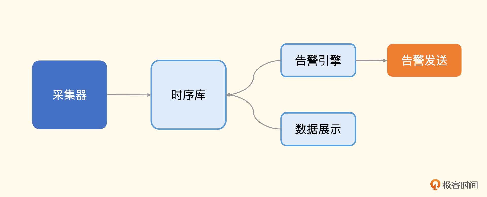

之所以说 Prometheus 比较容易搭建，是因为它把服务端组件，包括时序库、告警引擎、数据展示三大块，整合成了一个进程，组件的数量大幅减少。Prometheus 生态的采集器就是各种Exporter，告警发送靠的是 AlertManager 组件，下面我们先来部署 Prometheus 模块。

## 部署 Prometheus

因为生产环境大概率是 Linux 的，所以我们选择 Linux 下的发布包，把 Prometheus 和Alertmanager 两个包都下载下来。

注：Prometheus 的下载地址：https://prometheus.io/download/

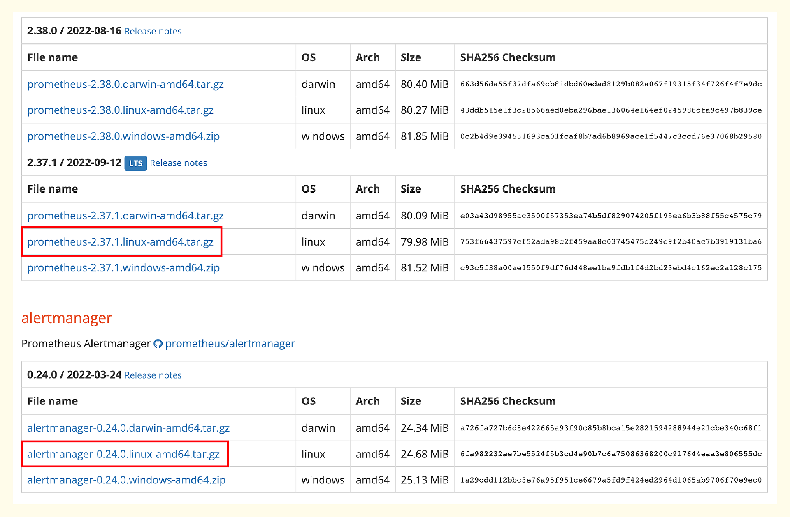

下载之后解压缩，使用 systemd 托管启动，你可以参考下面的命令。

```bash
mkdir -p /opt/prometheus
wget https://github.com/prometheus/prometheus/releases/download/v2.37.1/prometheu
tar xf prometheus-2.37.1.linux-amd64.tar.gz
cp -far prometheus-2.37.1.linux-amd64/*  /opt/prometheus/
# service
cat <<EOF >/etc/systemd/system/prometheus.service
[Unit]
Description="prometheus"
Documentation=https://prometheus.io/
After=network.target
[Service]
Type=simple
ExecStart=/opt/prometheus/prometheus  --config.file=/opt/prometheus/prometheus.ym
Restart=on-failure
SuccessExitStatus=0
LimitNOFILE=65536
StandardOutput=syslog
StandardError=syslog
SyslogIdentifier=prometheus
[Install]
WantedBy=multi-user.target
EOF
systemctl enable prometheus
systemctl start prometheus
systemctl status prometheus
```

这里需要重点关注的是 Prometheus 进程的启动参数，我在每个参数下面都做出了解释，你可以看一下。

```
--config.file=/opt/prometheus/prometheus.yml
指定 Prometheus 的配置文件路径
--storage.tsdb.path=/opt/prometheus/data
指定 Prometheus 时序数据的硬盘存储路径
--web.enable-lifecycle
启用生命周期管理相关的 API，比如调用 /-/reload 接口就需要启用该项
--enable-feature=remote-write-receiver
启用 remote write 接收数据的接口，启用该项之后，categraf、grafana-agent 等 agent 就可以通
--query.lookback-delta=2m
```

- 即时查询在查询当前最新值的时候，只要发现这个参数指定的时间段内有数据，就取最新的那个点返回，这个时

```
--web.enable-admin-api
启用管理性 API，比如删除时间序列数据的 /api/v1/admin/tsdb/delete_series 接口
```

如果正常启动，Prometheus 默认会在 9090 端口监听，访问这个端口就可以看到 Prometheus的 Web 页面，输入下面的 PromQL 可以查到一些监控数据。

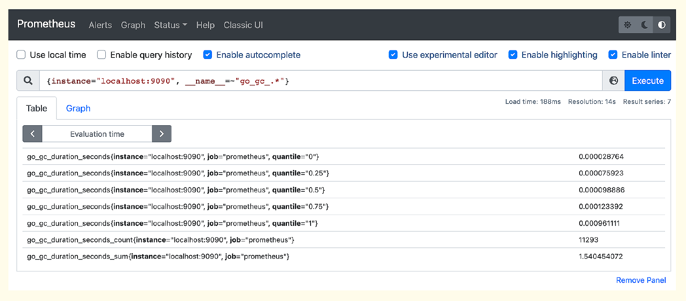

这个数据是从哪里来的呢？其实是 Prometheus 自己抓取自己的，Prometheus 会在

```
/metrics 接口暴露监控数据，你可以访问这个接口看一下输出。同时 Prometheus 在配置文
```

件里配置了抓取规则，打开 prometheus.yml 就可以看到了。

```
scrape_configs:
 - job_name: 'prometheus'
   static_configs:
   - targets: ['localhost:9090']
localhost:9090 是暴露监控数据的地址，没有指定接口路径，默认使用 /metrics，没有指定
scheme，默认使用 HTTP，所以实际请求的是 http://localhost:9090/metrics。了
```

解了 Prometheus 自监控的方式，下面我们来看一下机器监控。

## 部署 Node-Exporter

Prometheus 生态的机器监控比较简单，就是在所有的目标机器上部署 Node-Exporter，然后在抓取规则中给出所有 Node-Exporter 的地址就可以了。

首先，下载 Node-Exporter。你可以选择当下比较稳定的版本 1.3.1，下载之后解压就可以直接运行了，比如使用 nohup（生产环境建议使用 systemd 托管） 简单启动的话，可以输入下面这一行命令。

```
nohup ./node_exporter &> output.log &
```

Node-Exporter 默认的监听端口是 9100，我们可以通过下面的命令看到 Node-Exporter 采集的指标。

```bash
curl -s localhost:9100/metrics
```

然后把 Node-Exporter 的地址配置到 prometheus.yml 中即可。修改了配置之后，记得给

```
Prometheus 发个 HUP 信号，让 Prometheus 重新读取配置：kill -HUP <prometheus
pid>。最终 scrape_configs 部分变成下面这段内容。
scrape_configs:
 - job_name: 'prometheus'
   static_configs:
   - targets: ['localhost:9090']
 - job_name: 'node_exporter'
   static_configs:
   - targets: ['localhost:9100']
```

其中 targets 是个数组，如果要监控更多机器，就在 targets 中写上多个 Node-Exporter 的地址，用逗号隔开。之后在 Prometheus 的 Web 上（菜单位置 Status -> Targets），就可以看到相关的 Targets 信息了。

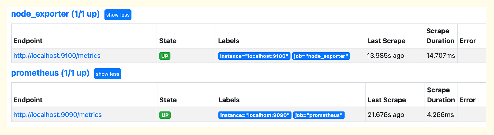

在查询监控数据的框里输入 node，就会自动提示很多 node 打头的指标。这些指标都是Node-Exporter 采集的，选择其中某一个就可以查到对应的监控数据，比如查看不同硬盘分区的余量大小。

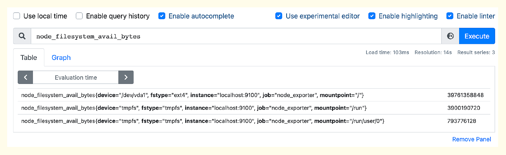

Node-Exporter 默认内置了很多 collector，比如 cpu、loadavg、filesystem 等，可以通过命令

```xml
行启动参数来控制这些 collector，比如要关掉某个 collector，使用 --no-collector.
<name>，如果要开启某个 collector，使用 --collector.<name>。具体可以参考 Node-
```

Exporter 的 README。Node-Exporter 默认采集几百个指标，有了这些数据，我们就可以演示告警规则的配置了。

## 配置告警规则

Prometheus 进程内置了告警判断引擎，prometheus.yml 中可以指定告警规则配置文件，默认配置中有个例子。

```
rule_files:
 # - "first_rules.yml"
 # - "second_rules.yml"
```

我们可以把不同类型的告警规则拆分到不同的配置文件中，然后在 prometheus.yml 中引用。比如 Node-Exporter 相关的规则，我们命名为 node_exporter.yml，最终这个 rule_files 就变成了如下配置。

```
rule_files:
 - "node_exporter.yml"
```

我设计了一个例子，监控 Node-Exporter 挂掉以及内存使用率超过 1% 这两种情况。这里我故意设置了一个很小的阈值，确保能够触发告警。

```
groups:
- name: node_exporter
 rules:
 - alert: HostDown
   expr: up{job="node_exporter"} == 0
   for: 1m
   labels:
     severity: critical
   annotations:
     summary: Host down {{ $labels.instance }}
 - alert: MemUtil
   expr: 100 - node_memory_MemAvailable_bytes / node_memory_MemTotal_bytes * 100
   for: 1m
   labels:
     severity: warn
   annotations:
     summary: Mem usage larger than 1%, instance:{{ $labels.instance }}
```

最后，给 Prometheus 进程发个 HUP 信号，让它重新加载配置文件。

```
kill -HUP `pidof prometheus`
```

之后，我们就可以去 Prometheus 的 Web 上（Alerts 菜单）查看告警规则的判定结果了。

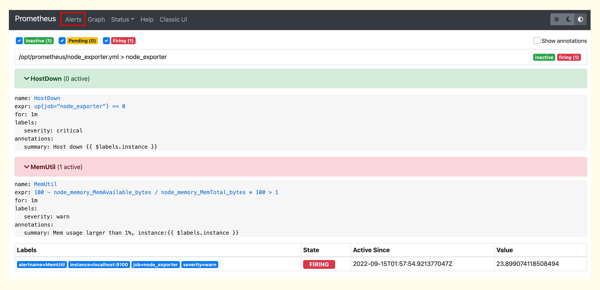

我们从图中可以看出，告警分成 3 个状态，Inactive、Pending、Firing。HostDown 这个规则当前是 Inactive 状态，表示没有触发相关的告警事件，MemUtil 这个规则触发了一个事件，处于 Firing 状态。那什么是 Pending 状态呢？触发过阈值但是还没有满足持续时长（ for 关键字后面指定的时间段）的要求，就是 Pending 状态。比如 for 1m，就表示触发阈值的时间持续 1分钟才算满足条件，如果规则判定执行频率是 10 秒，就相当于连续 6 次都触发阈值才可以。

在页面上我们看到告警了，就是一个巨大的进步，如果我们还希望在告警的时候收到消息通知，比如邮件、短信等，就需要引入 AlertManager 组件了。

## 部署 Alertmanager

部署 Prometheus 的时候，我们已经顺便把 Alertmanager 的包下载下来了，下面我们就安装一下。安装过程很简单，把上面的 prometheus.service 拿过来改一下给 Alertmanager 使用即可，下面是我改好的 alertmanager.service。

```
[Unit]
Description="alertmanager"
After=network.target
[Service]
Type=simple
ExecStart=/usr/local/alertmanager/alertmanager
WorkingDirectory=/usr/local/alertmanager
Restart=on-failure
SuccessExitStatus=0
LimitNOFILE=65536
StandardOutput=syslog
StandardError=syslog
SyslogIdentifier=alertmanager
[Install]
WantedBy=multi-user.target
```

我把 Alertmanager 解压到 /usr/local/alertmanager 目录，通过 ExecStart 可以看出，直接执行二进制就可以，实际 Alertmanager 会读取二进制同级目录下的 alertmanager.yml 配置文件。我使用 163 邮箱作为 SMTP 发件服务器，下面我们来看下具体的配置。

```bash
global:
 smtp_from: 'username@163.com'
 smtp_smarthost: 'smtp.163.com:465'
 smtp_auth_username: 'username@163.com'
 smtp_auth_password: '这里填写授权码'
 smtp_require_tls: false
route:
 group_by: ['alertname']
 group_wait: 30s
 group_interval: 1m
 repeat_interval: 1h
 receiver: 'email'
receivers:
 - name: 'web.hook'
   webhook_configs:
     - url: 'http://127.0.0.1:5001/'
 - name: 'email'
   email_configs:
   - to: 'ulricqin@163.com'
inhibit_rules:
 - source_match:
     severity: 'critical'
   target_match:
     severity: 'warning'
   equal: ['alertname', 'dev', 'instance']
```

首先配置一个全局 SMTP，然后修改 receivers。receivers 是个数组，默认例子里有个web.hook，我又加了一个 email 的 receiver，然后配置 route.receiver 字段的值为 email。

```
email_configs 中的 to 表示收件人，多个人用逗号分隔，比如 to: 'user1@163.com,
user2@163.com'，最后收到的邮件内容大概是这样的，你可以看一下我给出的样例。
```

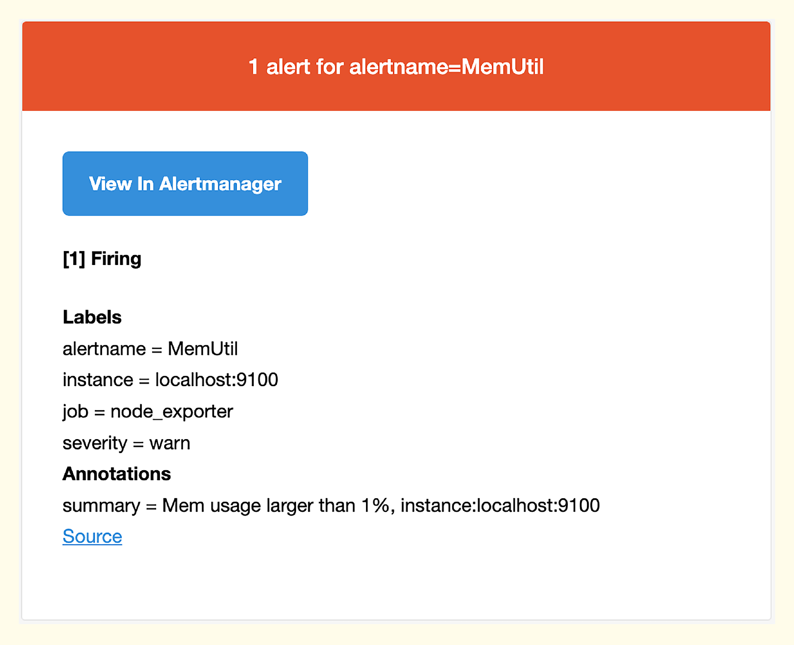

收到告警邮件，就说明这整个告警链路走通了。最后我们再看一下数据可视化的问题。Prometheus 自带的看图工具，是给专家用的，需要对指标体系非常了解，经验没法沉淀，而且绘图工具单一，只有折线图。如果你希望有一个更好用的 UI 工具，可以试试 Grafana。

## 部署 Grafana

Grafana 是一个数据可视化工具，有丰富的图表类型，视觉效果很棒，插件式架构，支持各种数据源，是开源监控数据可视化的标杆之作。Grafana 可以直接对接 Prometheus，大部分使用 Prometheus 的用户，也都会使用 Grafana，下面我们就来部署一下。

我们可以先把 Grafana 下载下来，它分为两个版本，企业版和开源版，开源版本遵照AGPLV3 协议，只要不做二次开发商业化分发，是可以直接使用的。我这里就下载了开源版

```
本，选择 tar.gz 包，下载之后解压缩，执行 ./bin/grafana-server 即可一键启动，
```

Grafana 默认的监听端口是 3000，访问后就可以看到登录页面了，默认的用户名和密码都是admin。

要看图首先要配置数据源，在菜单位置：Configuration -> Data sources，点击 Add datasource 就能进入数据源类型选择页面，选择 Prometheus，填写 Prometheus 的链接信息，主要是 URL，点击 Save & test 完成数据源配置。

Grafana 提供了和 Prometheus 看图页面类似的功能，叫做 Explore，我们可以在这个页面点选指标看图。

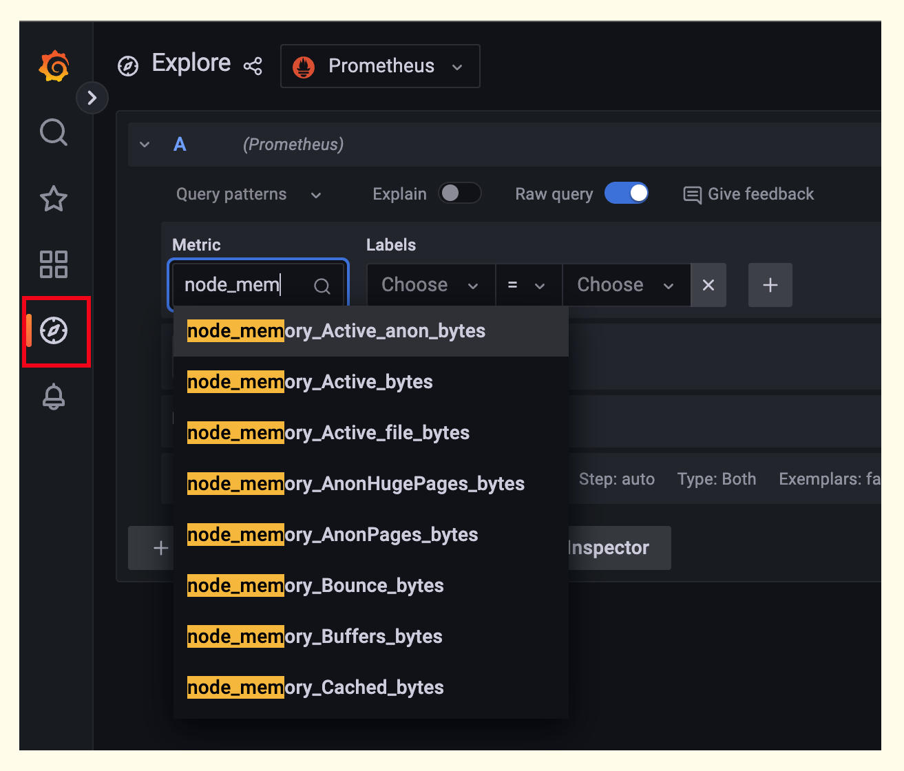

但 Explore 功能不是最核心的，我们使用 Grafana，主要是使用 Dashboard 看图。Grafana 社区有很多人制作了各式各样的大盘，以 JSON 格式上传保存在了 grafana.com，我们想要某个 Dashboard，可以先去这个网站搜索一下，看看是否有人分享过，特别方便。因为我们已经部署了 Node-Exporter，那这里就可以直接导入 Node-Exporter 的大盘，大盘 ID 是 1860，写到图中对应的位置，点击 Load，然后选择数据源点击 Import 即可。

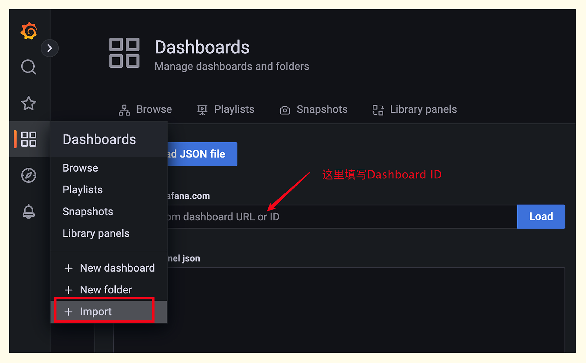

导入成功的话会自动打开 Dashboard，Node-Exporter 的大盘长这个样子。

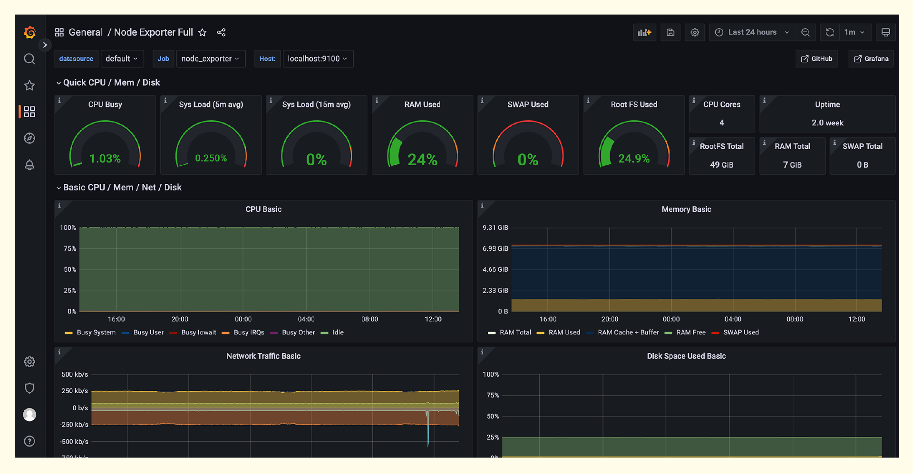

走到这个监控看图的部分，我们也走完了整个流程。下面我们对这节课的内容做一个简单总结。

## 小结

本讲的核心内容就是演示 Prometheus 生态相关组件的部署。如果你在课程中是一步一步跟我操作下来的，相信你对 Prometheus 这套生态就有了入门级的认识。学完这些内容我们再来看一下 Prometheus 的架构图，和监控系统通用架构图相互做一个印证，加深理解。

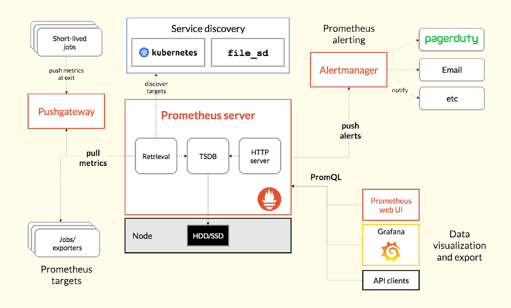

- 图片来自官网

图上有两个部分我们没有讲到，一个是 Pushgateway 组件，另一个是 Service discovery 部分。这里我再做一个简单的补充。

- Pushgateway：用于接收短生命周期任务的指标上报，是 PUSH 的接收方式。因为Prometheus 主要是 PULL 的方式拉取监控数据，这就要求在拉取的时刻，监控对象得活着，但是很多短周期任务，比如 cronjob，可能半秒就运行结束了，就没法拉取了。为了应对这种情况，才单独做了 Pushgateway 组件作为整个生态的补充。

- Service discovery：我们演示抓取数据时，是直接在 prometheus.yml 中配置的多个Targets。这种方式虽然简单直观，但是也有弊端，典型的问题就是如果 Targets 是动态变化的，而且变化得比较频繁，那就会造成管理上的灾难。所以 Prometheus 提供了多种服务发现机制，可以动态获取要监控的目标，比如 Kubernetes 的服务发现，可以通过调用kube-apiserver 动态获取到需要监控的目标对象，大幅降低了抓取目标的管理成本。

最后，我把这一讲的内容整理了一张脑图，供你理解和记忆。

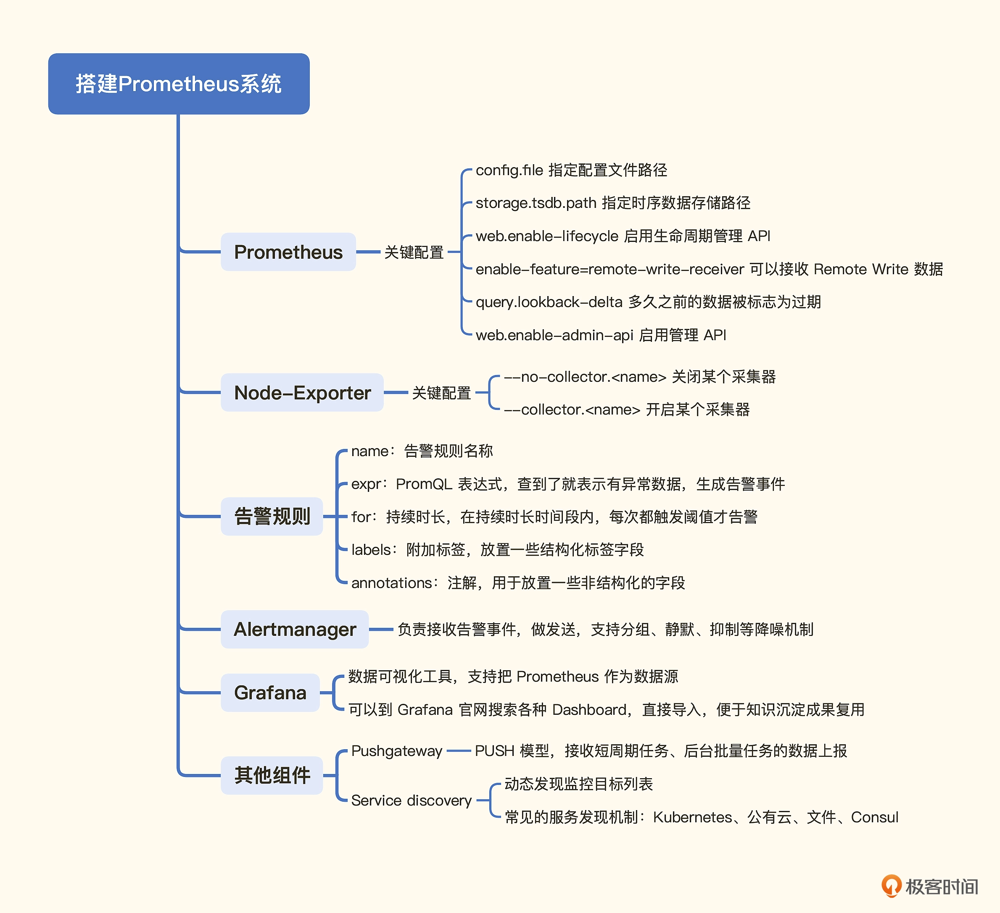

## 互动时刻

监控数据的获取，有推（PUSH）拉（PULL）两种模式，不是非黑即白的，不同的场景选择不同的方式，本讲我们在介绍 Pushgateway 模块时提到了一些选型的依据，你知道推拉两种模式的其他优缺点和适用场景吗？欢迎留言分享，也欢迎你把今天的内容分享给你身边的朋友，邀他一起学习。我们下节课再见！
