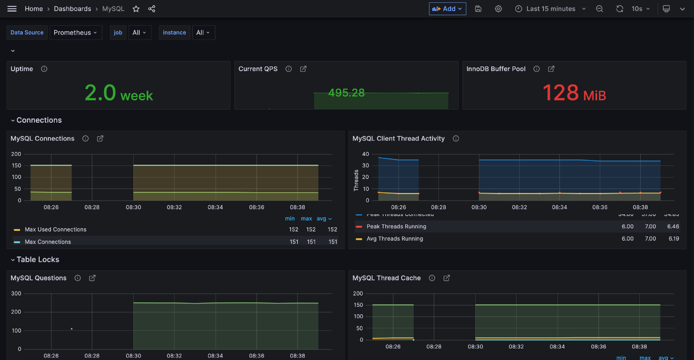
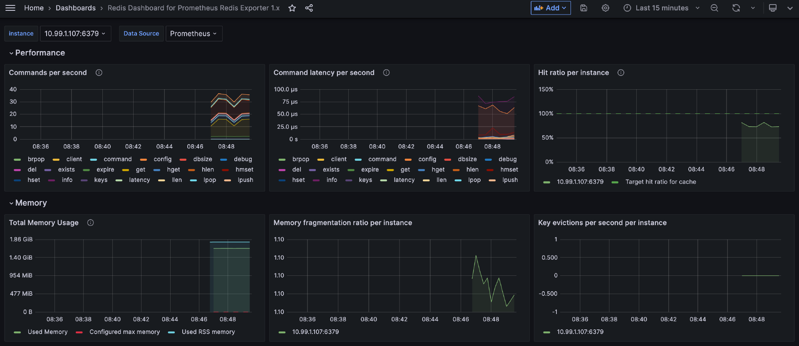
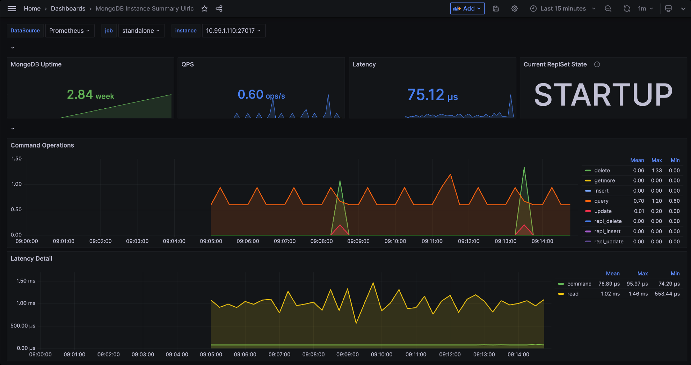
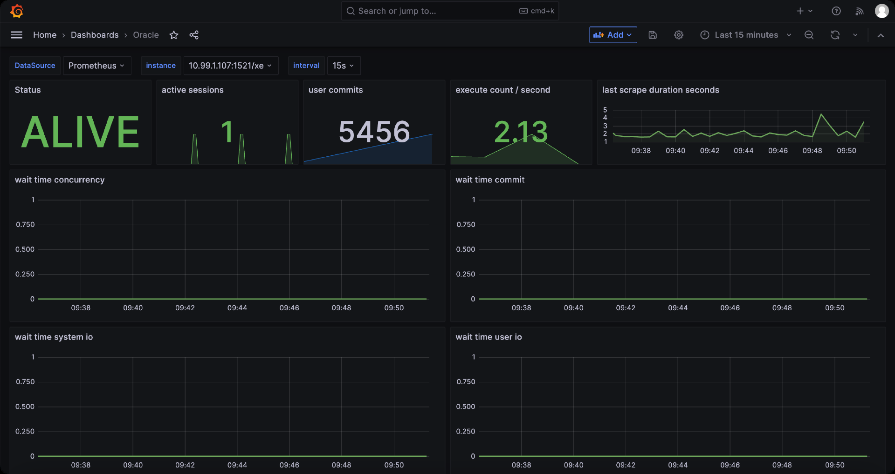
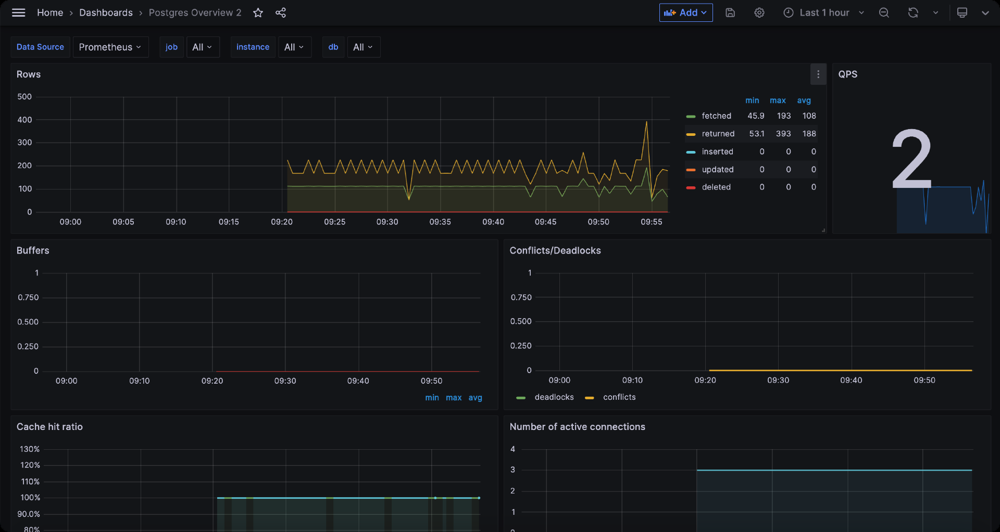
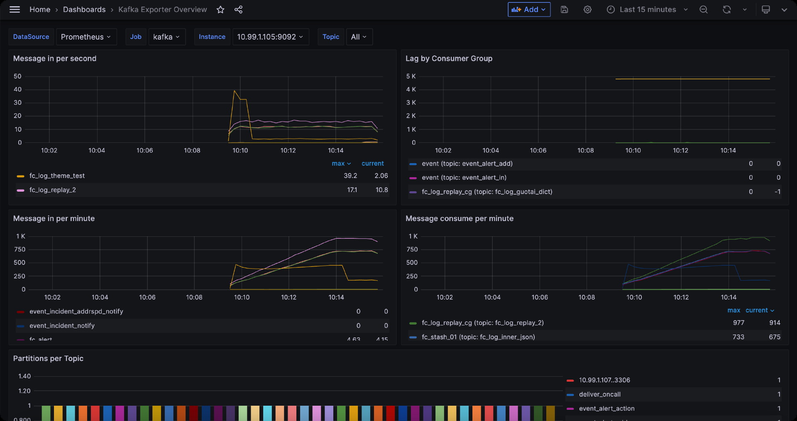
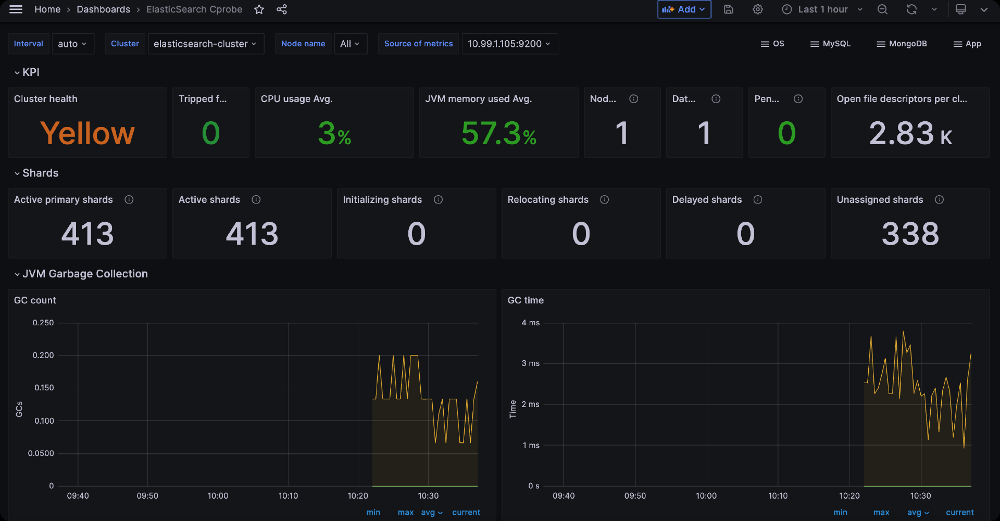
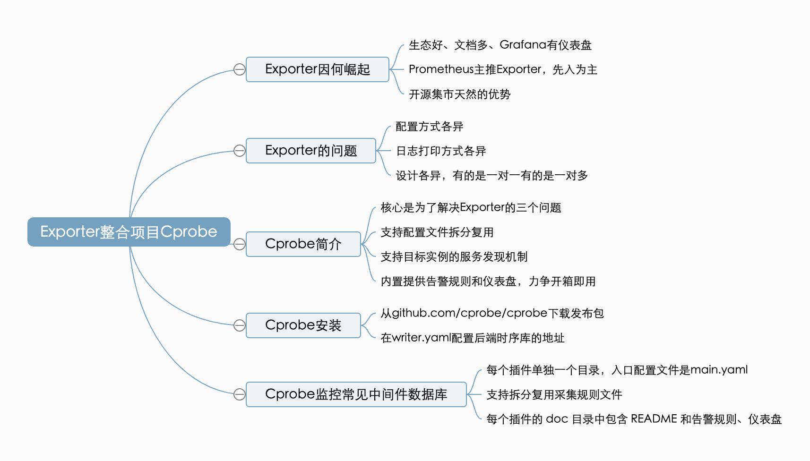

# 加餐 | Exporter生态太过零散，如何整合？

你好，我是秦晓辉。

上一节我们对比了 Zabbix 和 Prometheus 的设计理念，在数据采集方面 Prometheus 依靠了庞大的社区力量缔造了 Exporter 生态。这节课我们就围绕 Exporter 来聊一聊，看看 Exporter是因何崛起，有什么问题，以及如何解决。


## Exporter 因何崛起

纵观国际可观测性头部厂商，比如 Datadog、Dynatrace、NewRelic，他们都有自己的 all-in-one 的 agent，可见大家普遍认为这是一个最佳实践。开源社区也有类似的项目，就是Telegraf、Categraf。但是企业要真正落地的时候，很多公司还是在使用各种零散的Exporter。原因何在？我感觉主要是因为如下几点。

- Exporter 的生态更好，包括各类文档、博客、分享，以及 Exporter 对应的 GrafanaDashboard；

- Prometheus 主推的就是 Exporter，用户接触这个生态肯定是从 Prometheus 官网文档开始，被引导去使用 Exporter 也是理所当然。而一旦用起来了，再换就有迁移成本了；

- Exporter 是开源集市的玩法，普通技术人员很容易做一个 Exporter，既满足自己的需求也建立了个人品牌。同时又因为是自己的需求驱动，Exporter 的研发人员对相关数据如何采集、哪些数据更为关键，相对更熟悉，做出来的 Exporter 也就更实用。

当然，可能还有其他因素我暂未想到，欢迎你在评论区发表自己的看法。当然了，凡事没有尽善尽美，在落地 Exporter 的过程中，我们也会遇到一些问题。

## Exporter 的问题

由于 Exporter 是不同的人开发的，其代码风格、配置方式、使用体验都有较大差别，比如下面这些。

- 有的 Exporter 采用命令行参数的方式来控制 Exporter 的行为，另一些则是采用配置文件，而且不同的 Exporter 其配置文件的格式各异；

- 日志打印方式各异，有的是打印到标准输出有的是打印到日志文件，日志级别定义的方式也不尽相同；

- 有的 Exporter 是一对一的设计（即一个 Exporter 采集一个目标实例），而有的 Exporter 是一对多的设计（即一个 Exporter 可以采集多个目标实例）。

那么有没有可能把众多的 Exporter 整合在一起，类似各大头部厂商做的那样，搞成一个统一

的 agent 呢？这样使用体验既可以趋于一致且维护方便，也不用部署很多采集器进程，从而节省了机器资源。

其实确实已经有厂商这么做了，比如 GrafanaLabs 的 Grafana-agent，不过 Grafana-agent后来放弃维护，转头去做 OTel 发行版了，比较可惜。

我也做了一个这样的开源项目，纯粹为了自己方便，叫 Cprobe。如果你也有类似诉求，可以来一起完善这个项目。借助专栏加餐的方式，给你分享一下我的一些设计逻辑以及基本用法，希望对你有所启发和帮助。

## Cprobe 简介

Cprobe 算是一个缝合怪，把众多 Exporter 缝合在一起，尝试解决零散 Exporter 的问题，关键设计逻辑和目标如下。

- 直接把 Exporter 作为 lib 库 import 进来，避免 Exporter 频繁迭代导致 Cprobe patch 滞后，如果原本 Exporter 的写法没法支持 import，则把代码拷贝过来，尽量不修改原本的代码，这样后面改动方便；

- 集成代码的时候，使用统一的日志库来替代各个 Exporter 原本的日志库，可以确保日志格式统一、级别统一、日志打印到统一的文件；

- 统一配置方式，把各个 Exporter 原本的配置方式全部改成配置文件的方式，使用尽可能一致的配置格式，让体验一致；

- 把采集方式统一为一对多的方式，比如 Cprobe 的 MySQL 插件，可以同时采集多个MySQL 实例；Cprobe 的 Redis 插件，可以同时采集多个 Redis 实例；

- 配置文件支持复用，因为同类实例可以采集多个，每个实例的采集配置很有可能是类似甚至相同的，这就需要做到配置复用，类似配置文件 include 机制；

- 支持服务发现，即类似 Prometheus 的 SD 机制，自动发现目标实例，至少支持 Static、File、HTTP、Kubernetes 这几种 SD 方式；

- 不但提供采集能力，还要尽可能提供开箱即用的 Grafana 仪表盘和告警规则，把最佳实践

- 沉淀下来。

你可以点击超链接跳转项目地址，项目 License 采用 AGPL-3.0 开源协议。通过社区各位Contributor 通力合作，目前已经集成了 MySQL、Redis、Kafka、Oracle、DM8 等 18 个Exporter 插件，涵盖了常见的中间件、数据库，上面提到的设计目标也基本完成，下面我来做个实操演示，助你快速上手。

## Cprobe 安装

到 Cprobe 的 releases 页面下载发布包。解包之后可以看到二进制 cprobe，可以通过如下命令安装。

```
./cprobe --install
```

如果是支持 systemd 的 OS，上面的安装过程实际就是自动创建了 service 文件，你可以通过下面的命令查看。

```
systemctl status cprobe
```

Cprobe 需要配置正确的 remote write 地址才能正常启动，作为一个采集器，Cprobe 采集了数据要推给时序库，推送协议是 remote write 协议，后端时序库的地址配置在conf.d/writer.yaml，样例如下。

```
global:
 extra_labels:
   colld: cprobe
writers:
- url: http://127.0.0.1:8428/api/v1/write
```

```
writers  是个数组，可以配置多个后端时序库地址，extra_labels 是附加标签，会附加到所
```

有采集的数据上，一般不用配置。当然，还支持 metric_relabel_configs 等 relabel 配置，查看

配置样例即可，这里就不赘述了。

上例中的 url 样例，其端口是 8428，这是 VictoriaMetrics 单机版的默认端口，我建议新项目在选型时序库的时候，用 VictoriaMetrics 就可以了。如果是 Prometheus 作为后端时序库，默认端口改成 9090，另外 Prometheus 默认是不开 remote write receiver 的，需要通过命令行参数开启。

配置好了 remote write 地址就可以启动 Cprobe 了，可以通过如下命令启动。

```
./cprobe --start
```

如果是支持 systemd 的 OS，Cprobe 默认交给 systemd 托管，所以也可以直接使用systemctl 来启动。

```
systemctl start cprobe
如果要开机自启动，记得要  systemctl enable cprobe 来 Enable 一下 Cprobe 服务。
```

Cprobe 也是插件机制，我们以 MySQL 举例，讲解一下其配置方法，其他插件都是类似的。

### Cprobe 监控 MySQL

每个插件一个配置目录，每个目录中都有一个入口配置叫 main.yaml，MySQL 插件的入口配置自然就是 conf.d/mysql/main.yaml ，下面是一个样例。

```
global:
```

```
 scrape_interval: 15s
 external_labels:
```

```
   cplugin: 'mysql'
scrape_configs:
- job_name: 'mysql_static'
 static_configs:
 - targets:
   - '127.0.0.1:3306'
 scrape_rule_files:
 - 'rule_head.toml'
 - 'rule_coll.toml'
- job_name: 'mysql_http_sd'
 http_sd_configs:
 - url: http://localhost:8080/get-targets
 scrape_rule_files:
 - 'rule_head.toml'
 - 'rule_coll.toml'
- job_name: 'mysql_file_sd'
 file_sd_configs:
 - files:
   - 'inst.yaml'
 scrape_rule_files:
 - 'rule_head.toml'
 - 'rule_coll.toml'
 - 'rule_cust.toml'
```

整体配置和 Prometheus 的抓取配置特别像。global 部分配置全局抓取频率以及插件级别的全局附加标签（可以没有），scrape_configs 是抓取目标，支持 static、http_sd、file_sd，暂不支持 Kubernetes SD，scrape_rule_files 是一个比较有意思的配置，定义详细的采集规则，这是个数组，程序处理时会把数组里的每个规则文件拼接成一个整体来使用，通过这种方式可以实现配置文件拆分管理和复用。

假设你有两组 MySQL 实例，认证方式不同，就可以创建两个配置文件只存储认证信息，比如rule_head1.toml 的内容如下。

```
[global]
user = 'cprobe1'
```

```
password = '1234'
```

rule_head2.toml 的内容如下。

```
[global]
user = 'cprobe2'
password = '5678'
```

然后把这两组 MySQL 实例使用两个 job 来抓取，第一个 job 引用 rule_head1.toml，第二个job 引用 rule_head2.toml，剩下的采集配置项都相同，可以放到 rule_coll.toml 中。然后两个job 都引用 rule_coll.toml，以此做到配置拆分和复用。

rule_coll.toml 中的内容较多，你可能不知道是什么意思，其实就是把 mysqld_exporter 的命令行配置转成了 toml 格式的配置，至于每个配置项具体含义，可以参考 mysqld_exporter 的文档。Cprobe 每个插件下面通常都有一个 doc 目录，里边有个 README.md 会介绍这个插件 fork 自哪里，doc 目录里的 alerts 目录（如有）存放的是这个插件相关的告警规则，dash目录（如有）存放的是这个插件相关的仪表盘。

MySQL 采集规则配置好了可以通过如下命令测试。

```
./cprobe --no-writer --no-httpd --plugins mysql
相关参数的解释可以参考  ./cprobe --help 的信息，这里我重复解释一下。
--no-writer 表示当前启动 Cprobe 进程时不推送监控数据到远端时序库，仅仅打印到控
```

- 制台，通常测试的时候是这么用；

```
--no-httpd 表示当前启动 Cprobe 进程不监听 HTTP 端口，Cprobe 默认会监听 HTTP
```

- 端口 5858，用处不大，就是暴露了一个健康检查的页面。如果当前已经有一个 Cprobe 在运行了，我们测试 MySQL 插件的时候就要加上这个参数，防止报重复绑定端口的错误；

```
--plugins mysql 是指定只运行 mysql 这个插件。
```

如果上面的命令输出一堆 MySQL 监控指标，就说明采集成功。然后我们重启 Cprobe 进程，稍等片刻 Cprobe 就会把采集的数据写到时序库中。然后我们把 conf.d/mysql/doc/dash 下面的仪表盘导入 Grafana，效果如下。



其他插件的配置方式和 MySQL 类似，我再举几个例子。

### Cprobe 监控 Redis

Redis 的插件配置在 conf.d/redis 下面，main.yaml 举例如下。

```
global:
 scrape_interval: 15s
 external_labels:
   cplugin: 'redis'
scrape_configs:
- job_name: 'redis'
 static_configs:
 - targets:
   - '10.99.1.107:6379'
 scrape_rule_files:
 - 'rule.toml'
```

通过如下命令可以测试是否采集成功。

```
./cprobe --no-writer --no-httpd --plugins redis
```

只要输出一堆 Redis 指标就说明采集正常，重启 Cprobe 稍等片刻就可以在时序库查到 Redis相关的监控数据了，仪表盘样例如下。



### Cprobe 监控 MongoDB

MongoDB 的插件配置在 conf.d/mongodb 下面，main.yaml 举例如下。

```
global:
 scrape_interval: 15s
 external_labels:
   cplugin: 'mongodb'
scrape_configs:
- job_name: 'standalone'
 static_configs:
 - targets:
   - 10.99.1.110:27017
 scrape_rule_files:
 - 'rule.toml'
```

如果有认证信息，可以在 conf.d/mongodb/rule.toml 中配置，如果不同的 MongoDB 认证信息不同，可以类似 MySQL 那样拆分配置文件，通过如下命令可以测试采集是否成功。

```
./cprobe --no-writer --no-httpd --plugins mongodb
```

只要输出一堆 MongoDB 指标就说明采集正常，重启 Cprobe 稍等片刻就可以在时序库查到MongoDB 相关的监控数据了，仪表盘样例如下。



### Cprobe 监控 Oracle

Oracle 的插件配置在 conf.d/oracledb 下面，main.yaml 举例如下。

```
global:
 scrape_interval: 15s
 external_labels:
   cplugin: 'oracle'
scrape_configs:
- job_name: 'oracle'
 static_configs:
 - targets:
   - 10.99.1.107:1521/xe # ip:port/service
 scrape_rule_files:
```

```
 - 'link.toml'
 - 'comm.toml'
```

一般监控目标，即 target 的配置都是 IP + 端口，Oracle 的略有不同，需要配置成 IP + 端口 +service，上例中的 xe 就是 service。通过如下命令可以测试采集是否成功。

```
./cprobe --no-writer --no-httpd --plugins oracledb
```

只要输出一堆 Oracle 指标就说明采集正常，重启 Cprobe 稍等片刻就可以在时序库查到Oracle 相关的监控数据了，仪表盘样例如下。



### Cprobe 监控 Postgres

Postgres 的插件配置在 conf.d/postgres 下面，main.yaml 举例如下。

```
global:
 scrape_interval: 15s
 external_labels:
```

```
   cplugin: 'postgres'
scrape_configs:
- job_name: 'postgres'
 static_configs:
 - targets:
   - '10.99.1.107:15432'
 scrape_rule_files:
 - 'rule.toml'
```

通过如下面命令可以测试是否采集成功。

```
./cprobe --no-writer --no-httpd --plugins postgres
```

只要输出一堆 Postgres 指标就说明采集正常，重启 Cprobe 稍等片刻就可以在时序库查到Postgres 相关的监控数据了，仪表盘样例如下。



### Cprobe 监控 Tomcat

Tomcat 的插件配置在 conf.d/tomcat 下面，依旧是 main.yaml 举例如下。

```
global:
 scrape_interval: 15s
 external_labels:
   cplugin: 'tomcat'
scrape_configs:
- job_name: 'tomcat'
 static_configs:
 - targets:
   - '10.211.55.3:8080'
 scrape_rule_files:
 - 'rule.toml'
```

这里注意，Tomcat 监控需要修改 conf/tomcat-users.xml 配置，增加 role 和 user，比如下面这样。

```xml
<tomcat-users xmlns="http://tomcat.apache.org/xml"
             xmlns:xsi="http://www.w3.org/2001/XMLSchema-instance"
             xsi:schemaLocation="http://tomcat.apache.org/xml tomcat-users.xsd"
             version="1.0">
 <role rolename="manager-gui"/>
 <user username="tomcat" password="s3cret" roles="manager-gui"/>
</tomcat-users>
```

其次，通常 Cprobe 和 Tomcat 部署在不同的机器上，需要修改 webapps/manager/META-INF/context.xml 配置，把下面的部分注释掉。

```xml
<Valve className="org.apache.catalina.valves.RemoteAddrValve"
        allow="127\.\d+\.\d+\.\d+|::1|0:0:0:0:0:0:0:1" />
```

xml 的注释使用 ，所以，最终注释之后变成下面这样。

```xml
<!--
<Valve className="org.apache.catalina.valves.RemoteAddrValve"
        allow="127\.\d+\.\d+\.\d+|::1|0:0:0:0:0:0:0:1" />
-->
```

然后修改 Tomcat 的 rule.toml，写上认证信息，即可测试。

```
./cprobe --no-writer --no-httpd --plugins tomcat
```

Tomcat 的仪表盘暂未整理，欢迎你来贡献 PR 呀。

### Cprobe 监控 Kafka

```
Kafka 的众多指标是通过 jmx 的方式暴露的，所以，在 Kafka 启动的 shell 里通过  -
javaagent  埋入  prometheus_jmx_agent.jar ，就可以暴露 Prometheus 协议的监控
```

数据了，使用 Cprobe 的 Prometheus 插件来抓即可。但是 Cprobe 还是提供了一个专门的Kafka 插件，用于抓取 consumergroup 的 lag 信息，配置文件在 conf.d/kafka 目录下，main.yaml 内容举例如下。

```
global:
 scrape_interval: 15s
 external_labels:
   cplugin: 'kafka'
scrape_configs:
- job_name: 'kafka'
 static_configs:
 - targets:
   - '10.99.1.105:9092'
 scrape_rule_files:
 - 'rule.toml'
```

如果是监控集群，想要写多个实例，Kafka 的 target 写法跟其他的 plugin 会有不同，如下。

```
global:
 scrape_interval: 15s
 external_labels:
   cplugin: 'kafka'
scrape_configs:
 - job_name: 'kafka'
   static_configs:
     - targets:
         - '172.21.0.162:9092,172.21.0.163:9092,172.21.0.164:9092'
   scrape_rule_files:
     - 'rule.toml'
```

和 mysql 插件对比一下，应该可以看出差别吧？你知道为啥会有这样的不同设计么？欢迎在评论区留言探讨 :-)

可以通过如下面命令可以测试是否采集成功。

```
./cprobe --no-writer --no-httpd --plugins kafka
```

只要输出一堆 Kafka 指标就说明采集正常，重启 Cprobe 稍等片刻就可以在时序库查到 Kafka相关的监控数据了，仪表盘样例如下。



### Cprobe 监控 ElasticSearch

ElasticSearch 的监控插件配置在 conf.d/elasticsearch 目录下，main.yaml 举例如下。

```
global:
 scrape_interval: 15s
 external_labels:
   cplugin: 'elasticsearch'
scrape_configs:
- job_name: 'elasticsearch'
 static_configs:
 - targets:
   - 10.99.1.105:9200
 scrape_rule_files:
 - 'rule.toml'
```

通过如下面命令可以测试是否采集成功。

```
./cprobe --no-writer --no-httpd --plugins elasticsearch
```

只要输出一堆 ElasticSearch 指标就说明采集正常，重启 Cprobe 稍等片刻就可以在时序库查到 ElasticSearch 相关的监控数据了，仪表盘样例如下。



常用的插件就介绍到这里，下面对本节内容做一个小结。

## 总结

Prometheus 生态使用各式各样的 Exporter 采集监控数据，但是 Exporter 比较零散难以管理，配置方式、日志打印、设计模式都不尽相同，所以我写了一个 Cprobe 的小项目，用于解决这些问题。然后我对 Cprobe 做了简介，讲解了如何安装以及常用插件的配置，希望对你有所帮助。

本节内容整理了一个脑图如下，供你参考记忆。


