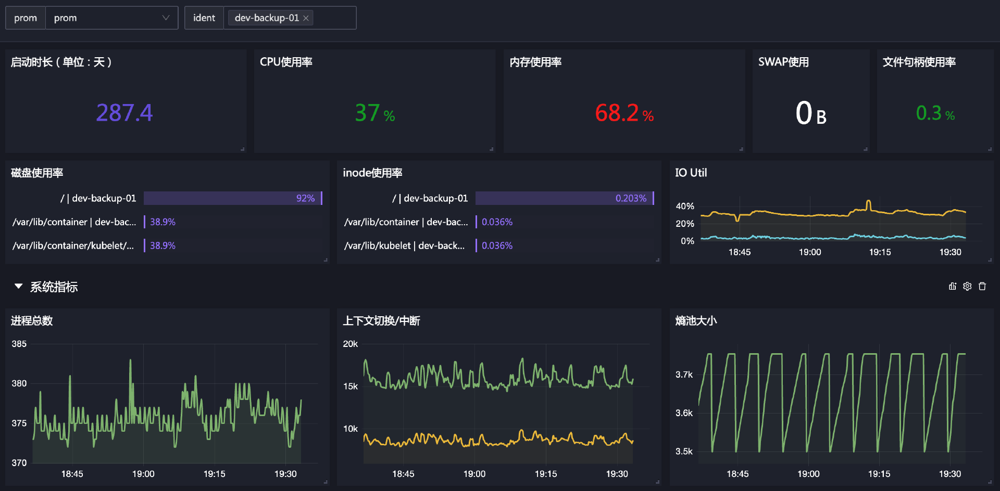
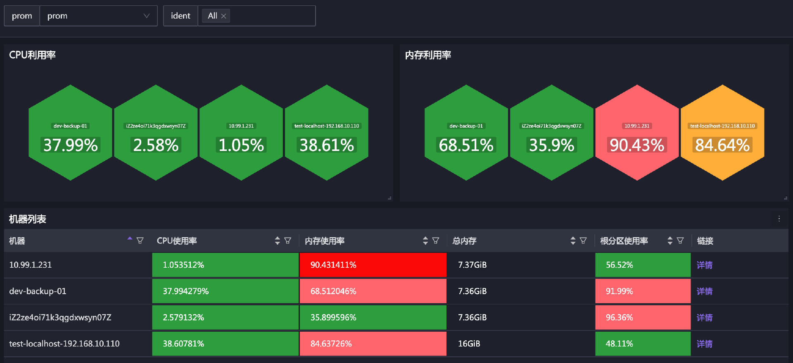
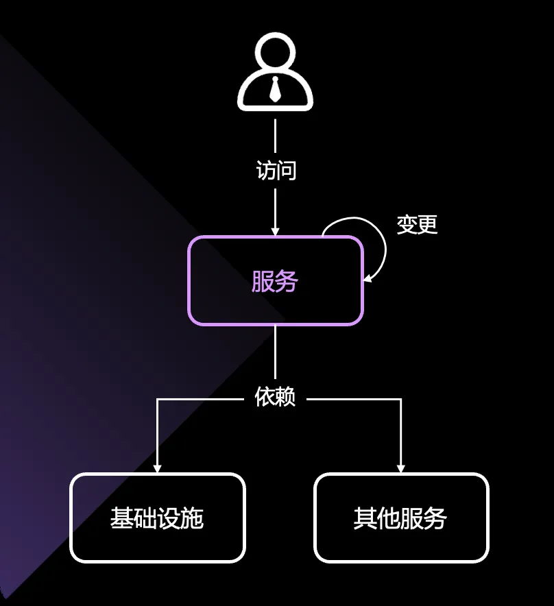
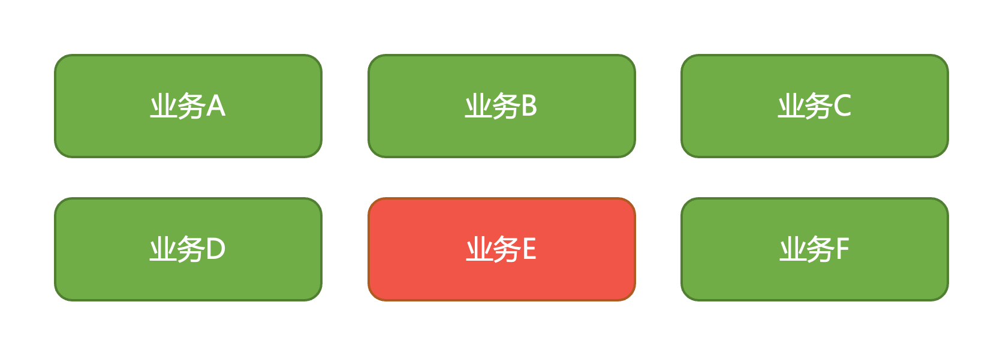
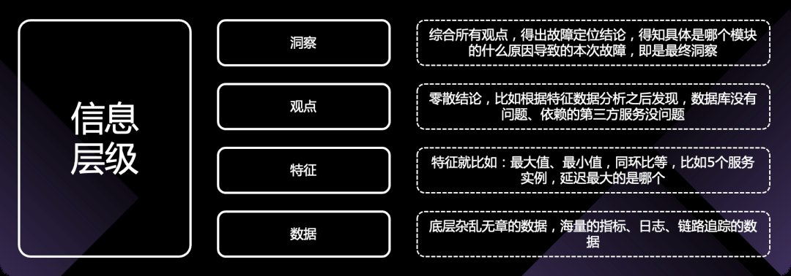
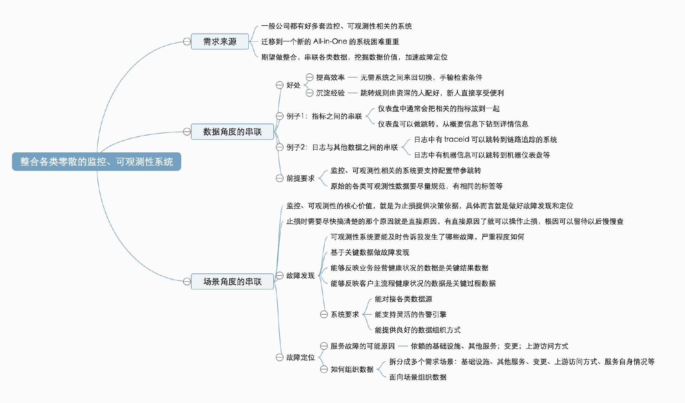

# 加餐 | 众多零散的监控、可观测性系统，如何整合？

你好，我是秦晓辉。

随着现代企业对业务稳定性越来越重视，监控、可观测性相关的系统也得到极大的普及，绝大部分公司都有两套以上的这类系统，比如 Zabbix、Prometheus、夜莺、ELK、Skywalking、Jaeger 等，外加云上的监控可观测性产品（大部分用户还都是多云架构），两套都说少了，大部分企业估计都得五套以上（我曾经见过一个社区用户有 280 多套 Prometheus）。

如此多零散的系统，就形成了一个一个的数据孤岛，如何把这些系统串联起来，提升故障定位的效率，变成了一个普遍性问题。尤其是在“可观测性”这个词开始流行之后，各个厂商都在宣传 All-in-One 的好处，把大家搞得更是焦虑不安。

为了获得好的产品功能效果，很多厂商都建议用户放弃现在的零散系统，统一使用一个新的All-in-One 的系统重新来做数据采集和分析。但抛弃现有的系统谈何容易，人性是懒惰的，用户习惯的迁移必然阻碍重重。而且老系统的立项是前人的决策，要推翻老系统就是要推翻前人的决策，其难度可想而知。

那么如何在利旧现有系统，在尽可能少的改造的前提下，提升数据串联的能力、提升可观测性的洞察力、提升故障定位的效率呢？这是这节课希望和你探讨的问题。我会从数据、场景两个思考维度来尝试回答。熟悉我的朋友都知道我就是在这个领域创业的，这节课内容就是和盘托出我创业这几年的思考、我们产品的底层逻辑，如果你也要建设这样的能力，相信会有一些借鉴意义。

## 数据角度

实际上应该先讲场景，因为一切软件系统都是为了解决某些需求场景的，但是数据更直观，普通用户眼里是一条条监控指标、日志记录和 Trace，所以我们从具象的数据出发，看看数据层面有哪些串联的可能性。

数据层面的串联，核心就是从一个数据可以跳转查看另一个数据。这会带来下面两个好处。

- 提高效率：原本是多个系统来回切换，通过手输各种检索条件，查询多种数据。串联后变成看完一个数据之后，通过超链接等快速跳转查看另一个数据，减少手输成本，提高效率；

- 经验沉淀：经验丰富的人把跳转规则配置好，新人接手直接使用即可，大大降低学习成本。我之前调研的时候发现，很多公司的研发对自己公司总共有几套监控可观测性产品并不清楚，更遑论在各个系统之间切换检索了。通过经验沉淀，把各个系统串联起来，其迸发的价值远超我们想象。

数据层面的串联，不需要引入新的系统，就是基于现有的系统做配置优化。下面我举两个例子，希望能给你一些启发。

### 指标之间的串联

指标之间的串联最为常见，典型的手段就是仪表盘以及仪表盘之间的跳转。比如下面是一个机器的监控指标面板。

通常我们会把某个机器相关的 CPU、内存、磁盘、IO 等信息都放到一个面板中，本质上就是为了方便一起查看，这就是一种典型的串联手段，相比直接输入 PromQL 做探索查询，仪表盘显然是更为易用、高效且能够沉淀经验的方式。

除了上面介绍的方式，另一个极为有效的指标串联方式是建立仪表盘之间的跳转。比如我们可以制作一个展示所有机器概要信息的仪表盘，如下所示。

在这个仪表盘中，CPU 利用率和内存利用率是两个蜂窝图，展示了 TopN 的数据。每个蜂窝图中的一个蜂窝代表一台机器，点击某个蜂窝可以跳转到该机器详情的仪表盘，并且把点击的那个机器的信息作为参数带过去。下面表格是机器概要数据，点击表格中某一行右侧的详情链接，也会跳转到上面那个机器详情的仪表盘。

在普通用户眼中，这只是不同的图表类型，而从数据分析角度，这两个仪表盘的组织方式，建立了典型的数据下钻能力。

- 第二个仪表盘是概要信息仪表盘，它把所有的机器都排列在一起，传递了哪些机器相对更繁忙的信息，通过不同的颜色做了区分和引导，让用户能够更快的发现数据特征；

- 第一个仪表盘是机器详情仪表盘，要么是从第二个仪表盘跳转过来的，要么是用户原本就知道要看哪个机器的信息，进而直接通过仪表盘变量过滤对应的机器；

- 通过仪表盘之间的串联跳转，实现了从全局到局部的下钻效果，这样的数据分析查看路径，对用户的心智负担也是比较小的。

除了上面机器的例子，其他各类监控对象都可以做这样的配置。比如 MySQL，我们可以先创建一个 Overview 的 MySQL 仪表盘，把所有的 MySQL 实例都放到一个 Table 中，Table 的各列放置 MySQL 的关键指标，每个实例给一个详情链接，链到对应的 MySQL 详情仪表盘。Redis、Postgres、Kafka、微服务、域名，各类监控对象都可以复用这个套路制作仪表盘。

上面讲的跳转可以看做是图表里某个数据颗粒度的跳转。实际上，仪表盘层面、或者仪表盘里某个图表层面，也都可以设置跳转链接，总之系统就是给尽可能方便让你做数据串联。

### 日志与其他数据的串联

最常见的场景是日志里带有 traceid，查看日志的时候点击 traceid 就自动跳转到链路追踪的系统并展开相关 Trace 的瀑布图。这里会涉及下面两个环节。

1、在日志中打印 traceid

不同的 Tracing 框架基本都会提供这个能力，比如 Java 的服务使用 OpenTelemetry 做Tracing 埋点，可以引入其 javaagent，然后配置日志打印的内容把 traceid 打印出来。

2、从日志中识别出 traceid 并附加一个超链接

如果日志是结构化的 JSON，那再好不过。这种情况下 traceid 肯定是一个特定的字段，把这个字段设置为超链接的方式，链到 Tracing 系统的瀑布图页面，然后把该字段的内容作为链接参数传过去即可。

如果日志是非结构化的字符串，那就要使用正则提取了。一般来讲，日志中的 traceid 会有一个特定的 log pattern，使用正则提取并把提取到的内容做成超链接就可以了（当然，需要日志可视化系统支持这个能力）。

既然可以跑通日志到链路追踪的串联，那自然也可以做日志到指标的串联，比如从日志中提取机器名跳转到机器的仪表盘，从日志中提取服务名跳转到服务的仪表盘等。

通过上面两个数据串联的例子，你应该有些感觉了？当然还有其他的串联方式，但原理上都是类似的，下面我来做一个小总结，讲一讲其中的共性。

### 数据串联总结

数据之间要能做到精确串联，就需要把数据中的一部分内容作为参数传递下去，作为下一类数据的过滤条件。想要达成好的串联效果，需要从下面两个方面持续改进。

- 系统本身的串联配置能力。比如要想达成上面例子中的效果，就需要仪表盘和日志可视化系统支持相关的串联配置能力，你可以把这一点作为系统选型的关键依据；

- 原始数据的规范和丰富性。比如指标、日志、链路数据要打上相同语义甚至相同 Key 的标签。时间格式要一致，因为有时要按照时间做串联过滤。在采集数据时尽量做好规范的话，后面就可以省很多事，否则就要持续治理了。

如上就是从数据角度出发建立串联关系的一些思路，但可能稍显零散，下面我们从另一个更具整体性的角度出发，即从场景角度来看如何串联。

## 场景角度

首先我们来思考一个问题，公司建立监控、可观测性整套体系的核心目的是什么？是想解决什么需求场景的问题——是为了更方便梳理系统架构？为了方便统计资产利用率？还是为了制作一些炫酷的大屏给老板邀功？确实会有这些方面的诉求，不过最最核心的，其实是为了快速止损。

一般公司都会提前准备好一些故障止损预案，比如某某银行的三板斧，某某出行公司的八大止损手段，无非就是重启、回滚、限流、降级、切流量等等。止损手段通常是可枚举的，但是要决策对哪个服务实施哪个止损手段是不容易的，尤其是在微服务盛行的现代 IT 环境下，错综复杂的调用关系、某个毫不起眼的服务，可能就会影响到客户主流程。而监控、可观测性在事（故障）发之后起到了极大的作用，要能够发出告警及时通知相关人员，要能够提供很好的分析能力帮助 SRE（泛指响应并处理线上故障的人） 快速定位原因，之后 SRE 才能操作止损。

概括来讲：监控、可观测性体系的最核心价值，就是为止损提供决策依据，具体而言，就是做好故障发现和故障定位。

这里的故障定位，需要额外阐释一下，它并非是指根因定位，而是指定位到导致故障的直接原因。这两个原因有何区别？举个例子：某次故障发生于昨天 18:00，因为 A 服务发起一次变更，上线了一个有 Bug 的版本，Bug 的原因是研发人员少考虑了一种边界场景。这里的变更操作就是导致故障的直接原因，代码 Bug 是根因，当然你可以继续深挖，根上是 CodeReview 没做好？流程机制不健全？管理没做好？招的人不行？公司文化导致的？还是说创始人导致了这样坏的文化？挖太深没有意义，我们无法左右。

我们可以这样看待二者的区别：止损时需要尽快搞清楚的那个原因就是直接原因，止损后大家坐一起复盘时要搞清楚的那个原因就是根因。

实际要准确定义两个原因的边界，没有太大价值，我核心想表达的是，事中（故障发生处理）阶段要拎清楚主次，一切以快速止损为目的。

还是上面的例子，昨天 18:00 的故障，如果 A 服务是双机房互备的，只对其中一个机房做了变更引发了故障，此时即便我们不知道是变更导致的，但知道其中一个机房有故障，另一个机房健康的话，我们就可以通过切流量到另一个机房的方式完成止损。此时的直接原因是什么？

显然是 A 服务第一个机房故障。至于具体什么故障，我们在止损阶段并不关心，我们要做的就是发通告、禁变更、执行切流止损。

接下来我们一起来看看面向故障处理的可观测性体系应该如何建设，尤其是如何组织数据做串联分析。我会拆分成两个关键环节来讲解：故障发现环节和故障定位环节。

### 故障发现

首先什么是故障？通常来讲，生产环境任何一点不正常都可以称为问题，但只有影响客户的问题才称为故障，故障区分等级，根据影响面、受损程度等来定义故障等级。而我们建设可观测性体系，第一个诉求就是希望这套体系能够及时告知我们发生了哪些故障，故障严重程度如何。

可观测性数据是海量的，如何从海量的数据中发现故障呢？如果能有个智能体，时刻分析所有的数据，发现故障后就第一时间通知我，那该多好。可惜这只是一个愿景，技术发展尚未到这个阶段，目前业内的典型做法是从海量数据中梳理出关键数据，对这些关键数据配置告警规则。

那么什么样的数据才是最关键数据？就是能够反映业务经营健康状况的数据（关键结果数据），以及反映客户主流程健康状况的数据（关键过程数据）。

比如电商系统，订单量、销售额这类数据就是关键结果数据，我们通常称为北极星指标。客户要完成下单支付，有哪些关键过程指标呢？客户首先要登录，登录系统的 RED（Request、Error、Duration） 指标就是关键过程指标；客户要浏览、检索商品，那就涉及推荐系统、商品橱窗系统、商品详情系统，客户要加入购物车结算，那就涉及购物车系统、优惠券系统、订单系统、收银台系统，所有这些系统的 RED 指标都是关键过程指标。因为在这个过程中操作失败或响应时间太久都可能会使客户放弃购买。

落到系统实现层面，可观测性系统要能实现上述需求，大概要做到如下几点。

- 要能对接不同的数据源，关键结果数据可能来自关系库或分析库，而 RED 指标可能来自时序库、日志库；

- 要建立完备的告警引擎，因为这些数据都是极为关键的数据，要重点保障、要能提供多种告警方式，比如数据缺失检测、同环比检测、阈值匹配、算法检测等；

- 要提供一个良好的数据组织方式，让用户一目了然看到整个公司各个业务的健康状况（当然，也应该支持筛选和视图保存），如果是大范围的业务异常，通常就是底层基础设施的问题，如果只有个别业务异常那就是对应的业务系统的问题；

- 如果有余力还可以把这些关键数据放到大屏上，增加重视程度，同时作为业务团队和技术团队的关键对话基础。

从故障发现这个场景而言，我们的串联逻辑是把各种数据放到一起统一做呈现和告警判定，不管这个数据来自哪个底层数据源（来自 ElasticSearch、ClickHouse、Prometheus、Oracle 都可以），只要对我这个需求场景有用就行。可以看出，基于场景的串联逻辑和上面提到的数据串联是截然不同的思路。

故障发现之后，OnCall 人员会迅速介入，建立 warroom，把相关人员拉进来开始做故障定位，此时更会严重依赖可观测性数据，接下来我们就看如何组织可观测性数据有助于我们快速定位故障原因。

### 故障定位

要想定位故障原因，首先我们分析一下故障原因可能来自哪些方面。如果故障原因的类别可枚举，那这个事就简单多了。假设我们有一个 HTTP 服务，相关影响因素如下。

- 图片来自SRETALK

- 依赖的基础设施，比如基础网络、硬件、操作系统、Kubernetes 等，如果基础设施出问题显然会影响服务；

- 依赖的其他服务，比如自己公司其他团队提供的服务，或外部公司提供的接口等，如果依赖的服务出问题显然也会影响服务；

- 服务自身变更，比如二进制变更、配置变更、部署方式变更、流量接入方式变更，也会对服务有影响，可能会引发服务故障；

- 上游的访问方式如果发生变化，比如流量突增，显然也可能会带来故障。

上面基本列出了服务故障的主要可能原因，那如何定位？显然就是通过分门别类的组织各类可观测性数据，让 SRE 能够很容易得出相关的判断：

- 把基础设施相关的指标、日志组织串联在一起，来判断基础设施是否健康；

- 把其他服务的调用日志、统计指标组织串联在一起，来判断其他服务是否健康；

- 把服务变更事件组织在一起，来判断是否是变更导致的故障；

- 把服务的整体流量数据、各个接口的请求数据和访问日志组织在一起，来判断流量和请求相关的问题。

我故意用了一个相同的句型，来强调面向场景的可观测性数据组织方式。从工程师的角度，想要确认是否是变更导致的故障，这就是一个需求场景。作为可观测性系统，就要把变更相关的数据组织到一起，才方便工程师排查。这种可观测性数据组织方式，相比数据层面的串联，明显更具整体性。当然了，两种思路相辅相成，面向场景组织数据的过程中，也可以同时做数据层面的串联。

上面论述的内容，是面向单个服务的故障排查，即已经确认是哪个服务故障了，此时要排查具体是哪方面的原因。那如果尚不清楚是哪个服务的故障，应该如何快速定位到具体服务呢？

这里我提供一个思路，类似上面提到的机器概要表格，把所有的服务放到一个表格中，展示服务的关键指标，然后表格支持按照指标列排序，相当于 TopN 的效果，就可以较为方便的找到出问题的服务了。

如果服务数量太多，可以分分类，每次看一个类别的服务，稍微会费劲一点点，但因为同时查看的服务数量少所以不会有性能问题。另外，也可以搞成多个层级，类似服务树，某个下层服务故障的话，上浮到顶层节点，顶层节点数量少，可以一目了然看到哪个顶层节点有问题，进而下钻排查即可，示意图如下。

这个图中的每个图形表示服务树的一个顶层节点，假设业务 E 下面的某个微服务故障了，状态上浮，业务 E 节点展示为红色，排障的时候看到这个颜色区分就非常清晰了，想要查看业务 E 下面的哪些服务有问题，点击业务 E 下钻查看详情即可。

面向场景的数据组织更为抽象一些，下面我做个小总结。

### 面向场景的数据组织方式总结

数据最终是为场景服务的，先分析场景，再来看解决对应的场景需求需要哪些类型的数据，然后把相关的数据组织到一起，即可加速用户从数据中提取信息的效率。

- 对于故障发现来说，这个场景需要的是反映业务经营状况的关键结果数据和反映客户主流程健康状况的关键过程数据。把这些数据组织到一起，让大家能够一目了然看到公司各个业务的健康状况，对于故障发现和界定都很有价值。

- 对于故障定位而言，这是一个大场景，我们梳理了引发服务故障的可能的原因类别，排查每个类别的原因就是一个典型的小需求场景，比如排查基础设施的问题，就要把基础设施相关的指标、日志组织在一起；排查变更事件，就要把相关的变更事件组织在一起。

面向场景的数据组织方式就介绍到这里，下面我来做一个整体的总结。

## 结语

现代企业会建设不止一套的监控、可观测性相关的系统，非常零散，大都期望能有个方案可以把这些零散的系统、数据串联在一起，加速故障定位。

这节课我们提出了面向数据以及面向场景两个角度的思路。对于面向数据角度的串联组织来说，基于现有的系统做配置优化就可以了；而面向场景角度的串联组织，就需要在可观测性数据底座之上额外建设一层新的系统，把各类零散的系统作为数据源接入（类似 Grafana 的做法），然后在这个上层系统中，基于不同的场景来组织数据。某个场景下可能会同时需要指标、日志、链路数据，不拘泥于某一类数据。

还记得之前提到的那张信息层级的图吗？

- 图片来自：面向故障处理的可观测性体系建设

仪表盘呈现的是数据特征，面向不同的场景组织数据，可以产出的是零散的观点，综合所有的观点，即可得出最终的洞察：止损依据。

OK，本节内容就到这里，最后老规矩，我整理了一张脑图供你参考，期望这节课对你有所帮助，也欢迎在评论区多多留言，我们一起交流进步。

