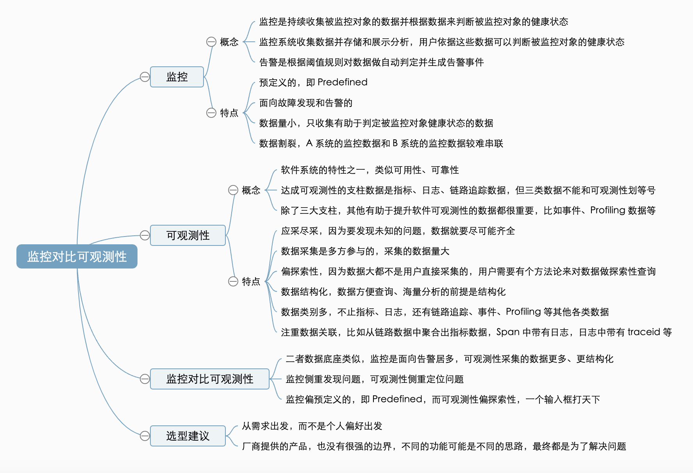

# 加餐 | 对比理解监控和可观测性

你好，我是秦晓辉。

专栏主要讲的是监控，但是一旦你踏入监控这个领域，很快就会发现“可观测性”是监控从业者绕不开的话题，而且这两个领域看起来极为相像，都是在处理指标、日志等数据，感觉“可观测性”就像某些厂商在新瓶装旧酒，想出新词来唬人。但真的是这样么？接下来我们就来对比一下这两个领域，看看二者之间有什么区别和联系。

## 监控的概念

在运维领域，当我们谈及“监控”时，通常指的是：持续收集被监控对象的数据并根据数据来判断被监控对象的健康状态。当我们谈及“监控系统”时，显然指的是一个软件，这个软件可以采集（或被动接收）被监控对象的数据，并对监控数据进行存储和分析展示，用户可以通过监控系统呈现的数据分析出被监控对象的健康状态。

比如某个数据库软件，我们使用监控系统持续收集其暴露的运行指标、进程日志、慢查询、进程存活与否、端口存活与否、进程占用的资源等各类数据，把这些数据存储起来，进而使用各类图表查询分析，这就是典型的监控过程。

那告警呢？告警指的是根据阈值规则对数据分析判断，如果数据异常则生成告警事件的这么一个过程。虽然很多监控系统也包含了告警能力，但我仍然建议把监控和告警区分开，更便于日常沟通讨论。

## 监控的特点

监控的最大特点，是“预定义”，即英文中经常提到的 Predefined。即，我提前知道某个软件可能会有哪些问题，进而去收集能够体现这些问题的数据并对数据做分析判定。当然了，数据的收集方式近年来有了较大的迭代发展。

行业初期，监控更多像是外挂，写应用程序的人没有意识刻意去暴露软件的运行指标，从运维视角来看，一个个应用程序都是黑盒，只能通过进程端口存活性、进程资源占用情况、进程的运行日志来推测进程的健康状况。

只有那些极为成熟的中间件、数据库，因为发展年头长、研发人员意识好，才会刻意暴露一些数据来体现自身运行情况。这个阶段软件暴露状态数据的方式各异，有的是通过 JMX，有的是通过 HTTP 接口，有的则是通过内部的视图、表数据等。虽然方式各异，总比完全没有好多了。

随着技术发展以及人才进步，越来越多的应用程序开始主动埋点，暴露自身的状态和性能数据，行业里涌现出了很多跨语言埋点方案，比如曾红极一时的 StatsD 就是个中翘楚。后来Prometheus 慢慢发展起来，生态就更好了，不但应用程序愿意采用，很多中间件、数据库也会内置支持 Prometheus 的指标埋点方式，行业发展步入顶峰。虽然后来又有 OpenTelemetry等项目，但仅从监控视角来看，OpenTelemetry 的思路承袭自 Prometheus，并没有跨代式创新。

纵观整个发展过程，不管是通过外挂手段采集软件运行数据，还是应用研发人员主动暴露运行数据，都是非常刻意的行为，他们对这些监控数据如数家珍，监控数据的量相对不算很多。如果某个指标触发阈值告警，对应的维护人员甚至连日志都不用看就知道如何解决。

如果用几个关键词来描述监控的特点，我觉得这几个词会比较合适：预定义、面向故障发现和告警、数据量偏小、不同系统的监控数据相对割裂。

看完了监控的概念和特点，下面我们继续来看可观测性的概念和特点，看看二者有何差别与联系。

## 可观测性的概念

可观测性是软件的一个特性，和软件的可用性、可靠性类似，都是描述软件特性的一个词。可观测性是指通过软件暴露的数据可以推断软件内部运行情况的一个特性。软件暴露的数据越完备、越规整、越合理，我们越容易对软件内部运行情况做出推断，即软件的可观测性越高。

业界通常认为，要想让软件可观测，需要收集指标、日志、链路追踪三类主要数据，这个说法我觉得是对的。但是很多人有所误解，认为可观测性就等于指标 + 日志 + 链路追踪，那就有失偏颇了。软件的一个特性没法和几种数据类别划等号，而且，你也不要忽视除了三大支柱之外的其他支柱。只要是有助于提升软件可观测性的数据，都可以看作是支柱之一，比如网络拓扑、软件拓扑、软件 Profiling 数据、软件的事件（也可以看做是一种结构化的日志记录）等等，甚至是软件的一个 /healthz 的页面，都可以看做是提升软件可观测性的数据。

只是探讨概念，容易让一部分人钻牛角尖，其实大可不必对概念太过执着，只要你的脑子里有这么个具象的东西就行，至于这个东西叫什么、怎么定义，不太关键。下面我们继续来聊聊可观测性的发展和特点，加深你的理解。

## 可观测性的特点

可观测性概念引入软件领域，是有一些契机的，比如：微服务的发展、链路追踪的发展、研发人员意识提升、指标数据爆炸式增长、一些商业公司的营销诉求等等。概括来看，就是软件系统越来越复杂，暴露的状态数据越来越多，排障越来越难，需要用一个新的思路来解决这些困难，用一个新的词来吸引有识之士的加入和贡献，需要一个新的词来把自己的商业软件和现有的软件区分开，抢占增量市场。最终，软件领域的“可观测性”开始提出并迅速传播。

要想让软件具备很好的可观测性，就需要收集尽可能多的数据，因为我们也不知道未来会出现什么问题，先把能采到的数据都收集了再说，要不然后面排障的时候没有数据就没法观测软件了。所以可观测性的第一个特点是“可采尽采”，即能采集到的数据尽可能都要采集，极端情况下，我们希望每个函数甚至每行代码的参数和结果都能采集到，这样我们才能根据暴露的数据很好地推断软件内部运行情况，达成观测软件的目的。但是这么多数据全部采集的话代价太高，一个是存储成本高昂，一个是采集对软件本身造成性能影响，所以，不能眉毛胡子一把抓，还是需要有一些人为经验的指导，从“可采尽采”转变到“应采尽采”。

一个软件系统会包含多个微服务，引入很多 lib 库，使用各类中间件和存储，具体采集什么数据需要依托经验来确定。那谁最有经验？显然不同细分领域的研发人员对自己开发的那部分代码最有经验，这些研发人员最好是能搞定自己开发的那部分代码的观测数据的采集，举例来说：

- 某个微服务，其研发人员要搞定自己所负责的微服务的观测数据的采集；

- 微服务用到了某个 httpclient 的库，这个库的研发人员要能搞定这个库的观测数据的采集；

- 微服务可能会调用 MySQL、MQ 等，都有对应的 SDK，这些 SDK 的研发人员要能搞定自身的观测数据的采集；

- 存储侧比如某个 KV 存储，其研发人员要能搞定 KV 存储自身的观测数据的采集。

如此一来，软件系统的各个部分都收集了很多观测数据，导致可观测性具备了第二个特点：“数据量大”。计算机领域没有银弹，通常都是各种折中，数据量大会导致存储成本高昂，投入产出比下降。折中的做法就是引入“数据采样”，比如指标历史数据的降采样、链路数据的头尾采样等。

另外由于观测数据量大、由不同的人采集，就很难有人能做到对所有的数据指标如数家珍了，相比监控的“Predefined”特点，可观测性更多的是偏 **“探索性”。而数据要能方便被探索，就要很“结构化”**，否则没法做到下钻、上卷式的探索，行业内给观测数据附加了各类标签元信息，就是结构化的体现。

在监控领域，主要面向的是指标，也会涉及日志，一般指标告警了大概就能确定是什么原因，顶多再看看日志基本就可以最终确认。在微服务不算盛行的时代，监控基本就够用了。但随着微服务的发展，一个请求的处理涉及太多微服务、太多团队，导致排查问题的难度激增，因此业内出现了分布式链路追踪技术，这是一个跨越式创新。链路数据不但可以串联各个微服务，很方便地观测请求的各个环节，而且 Span 中通常可以带有事件、日志信息，可以对同类Span 聚合出指标，所以更进一步，业界普遍认为要想观测软件，得把指标、日志、链路数据综合起来，串联查看。所以可观测性还有一个特点就是“数据类别多”，注重“数据关联”。

如果用几个词来描述可观测性的特点，那就是应采尽采、数据海量、偏探索性、数据结构化、数据类别多、注重数据关联。

到这里，我们已经了解了监控与可观测性各自的概念和特点，下面我们做一个概要性的对比。

## 监控对比可观测性

从数据方面来看，二者都是依托指标、日志等数据构建起来的，具有类似的数据底座，不同点是监控的数据种类较少、量小、结构化不好（当然，现在越来越好了）。可观测性的数据类别更多，除了指标和日志，还有链路数据、Profiling 数据等。即便同一个数据类别，比如指标数据，可观测性相比监控，也倾向于采集更多的数据，并让数据更结构化。

从稳定性保障这个最重要的场景而言，监控侧重于发现问题，通常监控系统都会集成告警功能，就是为了快速让用户知道问题发生。可观测性侧重定位问题，通过综合分析各类可观测性数据，快速定位导致问题的直接原因，执行止损，后面在复盘的时候，再次依托可观测性数据追查根因。

从系统设计角度来讲，监控系统偏 Predifined，可观测性系统偏探索性。监控系统对将要采集的指标门清，都是一些偏告警的重要指标，可观测性系统除了包含监控关注的那些数据，还会采集很多其他数据，而且是由不同的人采集的，这导致最终的用户在使用可观测性系统的时候，需要有很强的探索性，比如通过指标的不同标签维度来分析数据特征，通过 log pattern分析异常时段和正常时段的日志区别等，这些行为都充满了探索意味。

这么讲可能比较抽象，我来举个例子。如果一个系统在查看指标数据时给你呈现的是一个表格，罗列了各个指标的名称、含义、单位、说明，并且指标量不算太大，这就是监控系统的风格（比如 Zabbix）。如果一个系统一上来就只给你一个输入框，让你通过标签维度等做统计汇总分析，通过分析查询结果，继续进行标签下钻（即细化过滤条件），这就是可观测性系统的风格（比如 uptrace）。

通过以上分析，你是不是觉得可观测性会比监控更强大？或者监控比可观测性对新手更友好？后面选型时，内心已经默默下决心，只使用监控或只使用可观测性系统？那你就陷入二元对立了。

实际厂商提供的监控 / 可观测性的系统，并没有很强的设计分界，有些功能的设计是遵照的监控理念，而另一些功能又是遵照的可观测性的理念。这两个理念没有谁好谁坏，只是侧重点不同。我之所以这节课带你区分监控、可观测性的概念和特点，并非让你只择其一，而是探讨隐藏在其中的设计思路，了解其所以然。

对于监控 / 可观测性类的产品选型，还是要回归到你的需求上，比如你就是想解决故障发现和定位的需求，那就看不同的产品的需求解决思路到底哪个更适合你。至于产品里的某个功能是遵照的监控思路还是可观测性思路，不关键，黑猫白猫，抓到耗子就是好猫。你的原始需求是抓耗子，不是探讨黑的猫更好还是白的猫更好。

这节课内容比较烧脑，下面我们做一个总结。

## 总结

这一讲我们先是介绍了监控和可观测性的概念和各自特点，然后对二者做了对比，并提供了选型建议。整体而言，监控的概念相对较老，而可观测性的概念相对较新。但从系统落地角度，原本的监控系统也都在吸收可观测性的理念，没有非黑即白。建议你了解其中的发展思路和设计折衷，而在具体选型时，则要回归需求初衷，不要被理念偏好所左右。

我把这节课的内容整理成了一张脑图，供你参考。关于监控和可观测性的对比，很多人都有自己的想法，欢迎你在评论区留言讲讲你的思考，咱们共同探讨共同进步。

