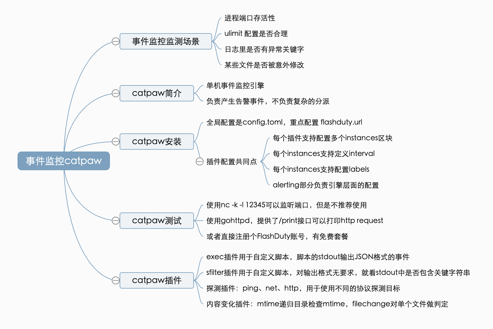

# 加餐 | 轻量级事件监控工具，一种实用的监控思路

你好，我是秦晓辉。

从通常监控系统的逻辑来看，都是采集数据（可能是指标、日志等）汇聚到中心，然后在中心放置一个告警引擎，根据告警规则周期性查询数据做判定。但有时我不想这么麻烦，我就想在被监控机器上跑一些简单逻辑直接诊断问题并发告警（比如监控系统的自监控就是这样一个典型的场景）。


监控系统的职能是监控其他的系统，但是监控系统自身也可能会有问题，自身也需要监控。为

了避免循环依赖，监控系统自身的监控通常需要另一个监控系统来解决。但是要搭建两套监控系统就有点大材小用了，有没有一些简单的方案呢？本节课会给你提供一个新的思路，我称之为事件监控：通过运行一些小的检测逻辑直接对监控目标做异常诊断，如果有问题直接生成告警事件。有些人可能会觉得这种方式比较 low，但我觉得挺实用的，毕竟黑猫白猫抓到耗子就是好猫。

这些所谓的小检测逻辑有哪些场景呢？举几个例子。

- 判断进程是否存活、端口是否能连通；

- 判断 ulimit 是否合理；

- 判断日志里是否有异常关键字；

- 判断某些文件是否被意外修改。

当然，场景是没法枚举的，最好也能让我自定义 check 脚本，想检测啥就检测啥。但是呢，要想能直接产生告警事件，除了检测逻辑，还需要一些引擎逻辑，比如连续检测几次才生成事件、最多生成几次事件、让我自定义事件名称、附加一些标签等。如果能有个工具提供这些引擎逻辑，让我补充自定义的检测逻辑就好了。很遗憾，开源社区找了一圈没找到。于是我自己攒了一个，借助这次加餐的机会介绍给你。这个小项目我取名为 catpaw，如果你也有类似的需求可以拿去使用，也欢迎参与进来一起建设。

## catpaw 简介

一句话介绍 catpaw：单机的告警引擎，可以产生告警事件，用于监测一些零零散散的场景。当然了，告警事件产生之后还要发送出去，这就要管理多种通知媒介、多种通知模板、人员联系信息、告警分派策略等，如果让 catpaw 把这些事情也干了，就有点重了。而且，每个公司通常都有一个自己的 OnCall 事件中心，所以最好是让 catpaw 和 OnCall 中心打通，这样各司其职、边界清晰。

目前 catpaw 直接对接的 OnCall 中心是 FlashDuty，当然你也可以把 catpaw 的 Webhook地址改成你自己的地址，这样 catpaw 产生的事件就会推给你的程序了。咱们先不关注事件的

推送，先看看 catpaw 如何安装、配置以及它有哪些开箱即用的能力。

## catpaw 安装

catpaw 的源码托管在 github，你可以点击这里下载编译好的发布包，解包之后可以看到其内容。

```
> # tree
.
├── LICENSE
├── README.md
├── catpaw
└── conf.d
   ├── config.toml
   ├── p.exec
   │   └── exec.toml
   ├── p.filechange
   │   └── filechange.toml
   ├── p.http
   │   └── http.toml
   ├── p.journaltail
   │   └── journaltail.toml
   ├── p.mtime
   │   └── mtime.toml
   ├── p.net
   │   └── net.toml
   ├── p.ping
   │   └── ping.toml
   ├── p.procnum
   │   └── procnum.toml
   └── p.sfilter
       └── sfilter.toml
10 directories, 13 files
```

核心就是一个二进制 + 一个配置目录，配置目录里有个主配置文件 config.toml，外加一堆插件配置目录，插件配置目录以 p 打头，p 是 plugin 的缩写。

我们先来看看主配置文件 config.toml 的内容。

```
[global]
```

```
interval = "30s"
[global.labels]
from_agent = "catpaw"
from_hostname = "$hostname"
from_hostip = "$ip"
[log]
level = "info"
# format = "json"
# output = "stdout"
# fields = {}
[flashduty]
url = "https://api.flashcat.cloud/event/push/alert/standard?integration_key=xxx"
timeout = "10s"
```

global.interval 是告警引擎的全局检测频率，每个插件也可以自定义自己的检测频率。

```
global.labels 是全局标签，其中 $hostname 和 $ip 是特殊变量，catpaw 会自动替换这两个
```

变量为本机的机器名和本机 IP。

log 部分是日志配置，如果没有特殊需求维持默认即可。flashduty 是配置 FlashDuty 的事件推送地址（FlashDuty 中的 integration 的地址）以及超时时间。待会具体做测试的时候，我们会修改 url 为一个假地址以期尽快看到效果。当然，你也可以直接注册一个 FlashDuty 的测试账号，有免费套餐可以用，这样就可以直接使用 FlashDuty 做事件通知了。

各个插件的配置有下面这一些共同点。

- 每个插件配置都包含多个 instances 区块，即同一个插件可以检测多个目标，比如 procnum插件是进程数量检测插件，可以同时判断多个进程的存活性；

- 每个 instances 下面都支持配置 interval，用于自定义这个 instances 的采集频率，如果没有自定义 interval，则复用全局 config.toml 中的 interval；

- 每个 instances 下面都支持配置 labels，用于给这个 instances 生成的事件附加一些标签；

- 每个 instances 下面都有一个 alerting 的配置，可以配置持续时长、重复通知间隔、最大通

- 知次数、是否发送恢复消息等。

OK，了解了各个插件的基本配置，我们就可以做测试了，下面我们体验一下 catpaw 的相关功能。

## catpaw 测试

为了方便看到 catpaw 生成的告警事件，我们需要修改 config.toml 中的 flashduty.url，如果你已经注册了 FlashDuty 的账号，直接在 FlashDuty 中创建一个“集成”，然后把“集成”的Webhook 地址配置到 flashduty.url 中即可。

如果你没有 FlashDuty 账号，我这里提供两个办法来启动一个假的端口监听。你可以直接使用如下命令启动一个端口监听。

```
nc -k -l 12345
```

该命令使用 nc 监听了 12345 端口，然后把启动 nc 的这个机器的 IP 配置到 flashduty.url 中即可。如果 nc 这个命令就是在 catpaw 所在机器上运行的，那就把 flashduty.url 设置为

```
http://127.0.0.1:12345 即可。这个方法虽然可以看到 catpaw 推过来的 http request，
```

但是 nc 无法返回 http response，所以更建议使用第二个方法。

第二个方法是使用 gohttpd，这是一个很简单的 http server，提供了 /print 接口。如果调用gohttpd 的 /print 接口，gohttpd 就会把收到的请求打印到 stdout，方便我们观察。下载并启动gohttpd 的方法如下。

```bash
wget https://github.com/UlricQin/gohttpd/releases/download/v0.3/gohttpd-v0.3-linu
tar zxvf gohttpd-v0.3-linux-arm64.tar.gz
cd gohttpd-v0.3-linux-arm64
./gohttpd 12345
```

上例中可以看出 gohttpd 也是托管在 github 的，你可以从该项目的 releases 中下载 v0.3 版

本。因为我是 linux arm64 的机器，所以下载的 linux-arm64 的包，如果你是 x86 的机器，则需要下载 amd64 的包。下载之后解压缩，直接启动即可。启动的时候传入了一个参数：12345，表示让 gohttpd 进程监听在 12345 端口。然后，修改 flashduty.url 的配置如下。

```
[flashduty]
url = "http://127.0.0.1:12345/print"
timeout = "10s"
```

config.toml 配置好后，就可以启动 catpaw 了，启动命令如下。

```bash
cd catpaw-v0.8.0-linux-arm64
./catpaw
```

启动方法很简单，进入 catpaw 的安装目录直接启动即可，如果想做成后台服务，可以使用systemd 托管。我这里测试方便，就直接把进程启动到前台了。启动之后正常来讲会打印一堆info 日志，没有 error 就表示成功了。为了看到 catpaw 产生的事件，我这里配置一个 http 探测，修改 conf.d/p.http/http.toml，在 targets 中增加一个假的目标地址。

```bash
[[instances]]
targets = [
   # "https://baidu.com",
   "http://127.0.0.1:8888/request",
]
```

这个地址是假的，所以稍等片刻 catpaw 就可以侦测到，然后生成事件推送给127.0.0.1:12345/print，我们就可以在 gohttpd 的 stdout 中看到推送过来的告警事件，样例如下。

```
# ./gohttpd 12345
2024/12/16 16:40:06 main.go:211: listening http on 12345
r.RequestURI: /print
r.URL.Path: /print
r.URL.Host:
r.URL.Hostname():
r.Method: POST
r.URL.Scheme:
gohttpd pid: 554061
Headers:
Content-Length: 525
Content-Type: application/json
Accept-Encoding: gzip
User-Agent: Go-http-client/1.1
Payload:
{"event_time":1734339605,"event_status":"Warning","alert_key":"4f1b21a435253bf868
```

这里的 Payload 就是 catpaw 生成的告警事件，至于是选择交由 FlashDuty 做发送还是自己写个小程序来承接，都是可以的。主流程跑通了，下面我们详细介绍一下各个插件的功能。

## catpaw 插件介绍

由于 catpaw 只是一个个人开发使用的小工具，不想做的太复杂，只要解决我的个人需求即可，所以插件目前并不多。不过好在提供了自定义脚本的能力，有了这个能力，一切皆有可能。

### exec 插件

该插件是自定义脚本的插件，要求用户把脚本路径配置到 exec.toml 里，然后 catpaw 定期去执行并捕获脚本输出的 stdout。对 stdout 的格式有要求，样例如下。

```json
[
   {
       "event_status": "Warning",
       "labels": {
```

```
           "check": "oom killed",
       },
       "title_rule": "$check",
```

```
       "description": "kernel: Out of memory: Kill process 9163 (mysqld) score 5
   }
]
```

这个内容是一个数组，数组中的每个元素是一个事件，事件包含下面四个字段。

- event_status：事件状态，有 Critical、Warning、Info、Ok，前三个是告警事件的级别，如果告警恢复了就把状态设置为 Ok；

- labels：事件标签，一些结构化的字段，用于对事件做筛选之类的，类似 Prometheus 告警规则里的那个 labels；

```
title_rule：用于生成告警事件标题的规则，可以引用 labels 中的字段，比如  $check -
$instance 就是把 labels 中的 check 和 instance 取出拼接在一起，中间加一个短横线；
```

- description：描述信息，是一个非结构化的普通字符串，用于描述这条告警的详情。

catpaw 从脚本的 stdout 中读取事件 JSON，然后根据 alerting 下面的配置来决定是否要把告警事件推给服务端。

### sfilter 插件

sfilter 是 string filter 的缩写，是想提供一个比 exec 插件更简便的方法。sfilter 也是执行脚本并截获脚本的 stdout，然后对 stdout 这个大字符串做过滤。如果这个字符串匹配了过滤规则，就生成告警事件。过滤规则由下面两个字段定义。

```
# support wildcard
filter_include = ["*WARNING*", "*CRITICAL*"]
filter_exclude = []
```

顾名思义，filter_include 用于定义包含的内容，filter_exclude 用于定义不能包含的内容。

另外 check 字段用于配置告警事件标题，command 用于指定自定义脚本的路径，timeout 是脚本执行的超时时间，interval 是执行频率，labels 是附加标签。

### http 插件

该插件用于探测 HTTP 地址，然后判断返回的 status code 是否符合预期，返回的 responsebody 是否包含某个特定字符串，如果 HTTP 地址是 HTTPS 的，还可以判定证书过期时间。

核心配置是 instances 部分，通过 targets 指定探测目标。

```bash
[[instances]]
targets = [
   "https://baidu.com",
   "http://127.0.0.1:8888/request",
]
partial = "default"
```

探测 HTTP 可能有很多参数，比如要指定什么样的 Header、HTTP Method、Proxy 等，这部分配置不同的 instances 可能是相同的，为了更方便复用，我们就把这部分配置单拎出来，定义一个 partial，然后在 instances 下面指定引用哪个 partial 即可。

是否探测到问题，取决于 instances.expect 部分的配置，目前支持 3 个配置项。

- response_status_code：用于定义预期的 HTTP status code，是个数组，每个元素支持通配符的写法；

- response_substring：用于定义 response body 中必须包含的内容；

- cert_expire_threshold：证书过期时间，如果实际证书过期时间小于这个值，就会生成告警事件。

### net 插件

net 插件和 http 插件很类似，只不过因为 net 是 4 层协议探测，比 7 层的 http 插件的配置项

更少。

net 插件在 targets 里直接写探测目标即可，支持 tcp 和 udp 两个协议来探测。

- tcp：在超时时间之内成功建立了 tcp 连接，就认为正常，否则就生成告警事件；

- udp：会发送一个字符串（由 send 字段配置）给 target 地址，如果在超时时间之内收到了内容，且收到的内容包含 expect 字段指定的字符串，就认为正常，否则就生成告警事件。

另外还有一个 ping 插件也是类似的逻辑，ping 是否正常取决于丢包率，如果丢包率超过（含）了 alert_if_packet_loss_percent_ge 指定的值，就告警。

### filechange 插件

该插件用于判定某个文件近期是否有修改，配置样例如下。

```
[[instances]]
time_span = "3m"
filepaths = ["/etc/shadow"]
check = "文件变化检测"
interval = "30s"
```

上面的例子表示，/etc/shadow 这个文件在最近 3 分钟内有变化就会触发事件。当然了，这个事件是否要发给后端，取决于 alerting 部分的配置。

还有一个类似的插件是 mtime。mtime 是指定一个目录，然后递归这个目录下的所有文件，拿到最大的 file mtime，如果在近期这个最大的 mtime 发生变化，就生成告警事件。

### procnum 插件

该插件的功能是判断进程存活与否，有的时候有些进程不监听端口，只能通过进程是否存在来判定其健康状态。配置样例如下。

```
[[instances]]
# # executable name (ie, pgrep <search_exec_substring>)
# search_exec_substring = ""
```

```
# # pattern as argument for pgrep (ie, pgrep -f <search_cmdline_substring>)
search_cmdline_substring = ""
# # windows service name
# search_win_service = ""
alert_if_num_lt = 1
check = "进程存活检测(进程数量检测)"
interval = "30s"
在 Linux 中每个进程都有自己的 Name（从  /proc/<pid>/status 拿到 ） 和 Cmdline（从
/proc/<pid>/cmdline 拿到），procnum 的逻辑就是遍历所有进程，然后查看其 Name 和
```

Cmdline 是否匹配用户给的匹配项，如果匹配了就加 1，最终得到一个值，如果这个值小于alert_if_num_lt 则告警。匹配项用如下字段给出。

- search_exec_substring：Name 匹配项，可以设置为 Name 字符串的一部分；

- search_cmdline_substring：Cmdline 匹配项，可以设置为 Cmdline 字符串的一部分；

- search_win_service：Windows Service 名称匹配项，用于 Windows 场景。

以上就是 catpaw 提供的一些基础插件，如果你的需求这些插件无法满足，可以给 catpaw 提issue，有些朋友可能会帮你解决。

## 总结

最后我来给你总结一下今天的内容。这节课我们介绍了一种事件监控的思路，用于解决一些零散的场景，比如进程端口存活性、文件异常修改、HTTP 探测、日志关键字检测等，是一种非常简单、实用的方法。为了解决这些需求，我攒了一个 catpaw 的开源项目，你可以直接拿去使用，欢迎参与一起建设。

本节内容我也总结了一张脑图，方便你复习记忆。


