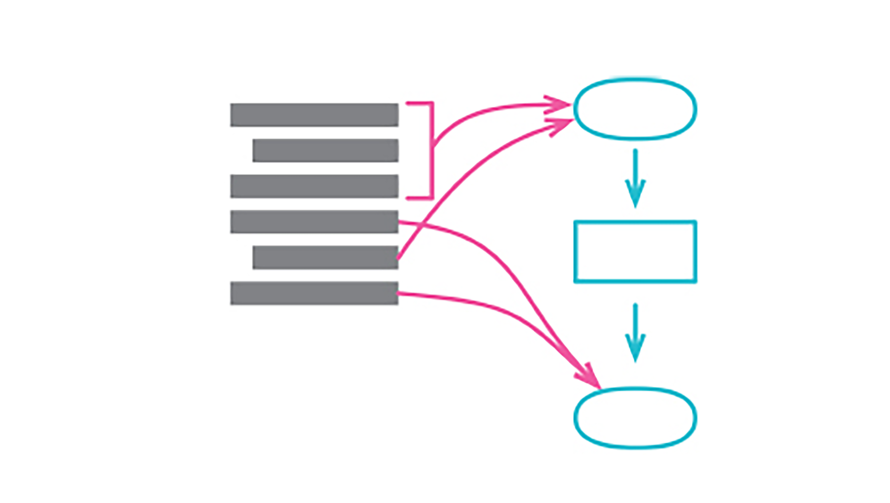
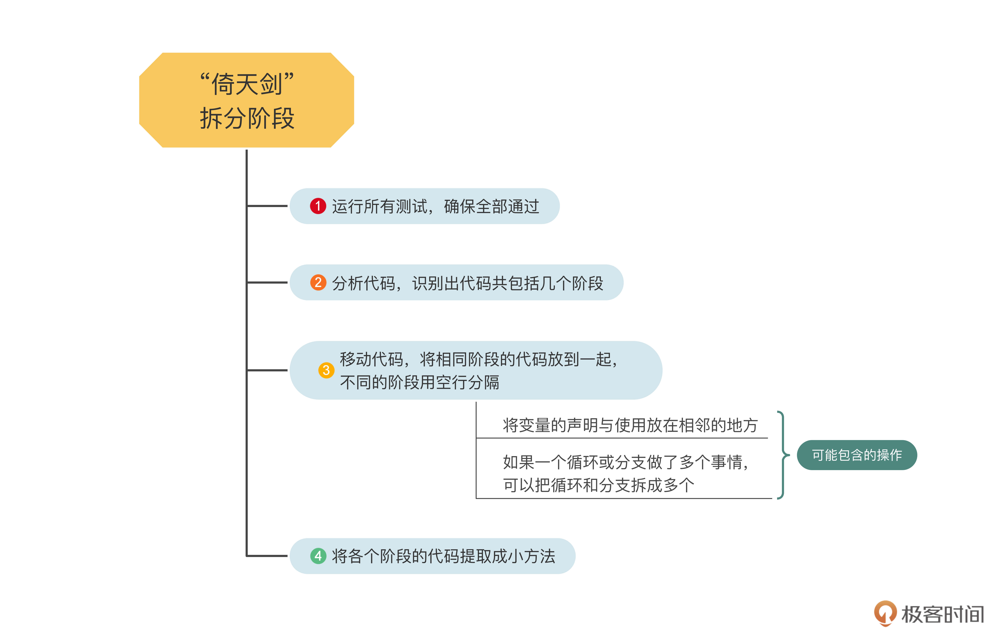
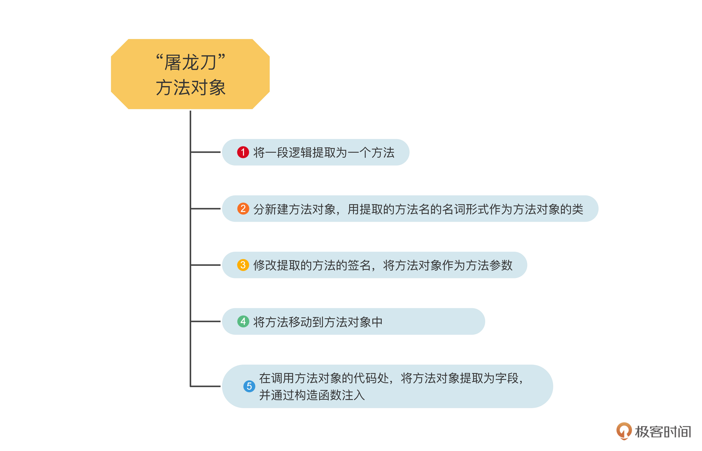
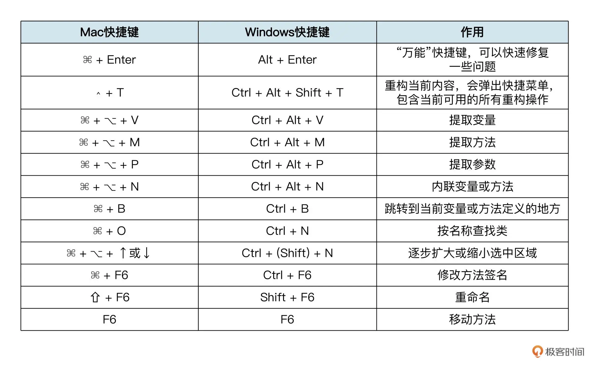

# 09-代码现代化：如何将一个300行的方法重构为3行？

你好，我是姚琪琳。

在上节课里，我们学习了如何对遗留代码做可测试化重构，并添加测试。有了测试的保障，接下来就可以大胆地开始重构“烂代码”了。

在重构了大量遗留代码后，我终于找到了两个最实用的方法，这节课我就带你认识这两种重构遗留代码的利器，我把它们称为“倚天剑”和“屠龙刀”，可以帮你劈开一团乱麻式的代码。

我曾经用这两种模式将一个 300 行代码重构为 3 行。是不是感觉很神奇？

## 基于坏味道的重构

在此之前，我先来简单絮叨两句我们重构代码的原则，就是基于坏味道来重构。也就是说，我们在重构时，要尽量先去识别《重构》中总结的二十几种坏味道，再用书中对应的重构手法去重构。

你可能会质疑，要不要这么教条啊？这其实并不是教条。Martin Fowler 已经“阅码无数”，甚至可能比我吃的饭都多。他总结出来的坏味道已经足够典型，对应的重构手法也足够好用。我也承认我的智商远不如他，那为什么不能拿来主义呢？

和第六节课学习代码增量演进时一样，在重构代码之前，我还是先带你识别坏味道，然后再重构。遗留系统的代码，简直是最具代表性的“代码坏味道大观园”。

尽管重构起来挑战重重，但攻克它们又令人上瘾、着迷、欲罢不能。我这样安排，是为了授之以渔（即重构的方法），而不光是授之以鱼（即重构好的方法）。

准备好了吗？我们开始。

## 倚天剑：拆分阶段

我们先来见识见识重构遗留代码的倚天剑，拆分阶段（Split Phase）。这是 Martin Fowler 在《重构（第 2 版）》中新提出的一种重构手法。当我第一次看到这个手法的介绍时，简直茅塞顿开（当然，我第一次看到《重构》中的很多内容时，都是这个状态）。它解决了我在面临遗留代码时最头疼的问题。



遗留代码最大的问题就是方法过长。方法长了之后，前后几代开发人员不停往里塞东西，有的加在这里，有的加在那里，导致最后谁都无法分清到底方法做了几件事情。我们都说，方法长了就不是单一职责（SRP）了，但更要命的是，由于代码过于混乱，你甚至说不清楚到底有哪些职责。

拆分阶段就像倚天剑一样，轻巧地把方法到底做了几件事情给拎清楚，把相关的代码组织到一起。

比如，大多数情况下，一个方法都在处理这样的三个阶段：第一，校验、转换传入的数据；第二，根据传入或转换后的数据，完成业务处理；第三，准备要返回的数据并返回。其中第二个阶段如果过于复杂，还可以拆分成更多的小步骤。

现在我们来举一个例子。以下代码来自一个拆分阶段的重构 Kata，它出自《重构（第 2 版）》的第 1 章，作者对原来的代码做了一些简化，使之更适合拆分阶段的重构练习。你可以在GitHub上找到完整的代码。

```java
public class TheatricalPlayers {
  public String print(Invoice invoice) {
      var totalAmount = 0;
      var volumeCredits = 0;
      var result = String.format("Statement for %s\n", invoice.customer);
      NumberFormat format = NumberFormat.getCurrencyInstance(Locale.US);
      for (var perf : invoice.performances) {
          var play = perf.play;
          var thisAmount = 40000;
          if (perf.audience > 30) {
              thisAmount += 1000 * (perf.audience - 30);
          }
          var thisCredits = Math.max(perf.audience - 30, 0);
          if ("comedy".equals(play.type)) thisCredits += Math.floor((double) per
          totalAmount += thisAmount;
          volumeCredits += thisCredits;
      }
      result += String.format("Amount owed is %s\n", format.format(totalAmount /
      result += String.format("You earned %s credits\n", volumeCredits);
      return result;
  }
}
```

我们一起来看看它有哪些坏味道。

它计算了演出的总费用以及观众量积分（volume credits，根据到场的观众数量来计算的积分，下次客户再请剧团演出的时候，可以用这个积分获得折扣），并且对这两项数据进行格式化并返回。

看到这样的描述，估计你的第一反应就是，它违反了单一职责原则（SRP）。没错，一个方法承担了计算总费用、计算观众量积分和格式化信息这三个职责。然而我更喜欢用《重构》中介绍的坏味道发散式变化（divergent change）来评价它。

一个类或方法应该只有一个引起它变化的原因，而对于这个方法来说，显然有三个。如果计算费用的逻辑发生变化，比如观众的基数从 30 改成了 50；如果计算积分的逻辑发生变化，比如演出悲剧也有相应的积分；如果格式化的逻辑发生变化，比如用 HTML 来输出清单，你都需要修改这个方法。引起它变化的原因，不是一个，而是三个。

对于这个坏味道，《重构》的建议是，如果不同的变化方向形成了先后顺序，就用拆分阶段手法将它们分开。我们来看看该怎么操作。

首先，在开始正式重构之前，我建议你先运行一下所有的测试，确保通过。

再仔细观察这段代码，你会发现，很多变量的声明和使用的位置离得非常远。这是遗留代码的典型特点。一方面，一些古老的编程语言或编程风格，以及某些大学课程，要求你把方法内的所有变量都声明在方法开头。另一方面，由于代码经手的人太多，很多人会有意无意将自己的代码插入到变量的声明和使用之间。

但你应该清楚的是，我们更倾向于给局部变量更小的作用域，也就是在使用它之前再声明。

我们先把 result 和 format 两个变量的声明往下挪，挪到 result 使用之前。仅此一步，你其实已经完成了拆分阶段的部分内容，把格式化部分的逻辑择了出来。

别忘了运行测试。虽然只有这一步，你几乎可以 100% 确认没有问题，但你仍然需要运行一下测试，养成好习惯。

```java
public class TheatricalPlayers {
  public String print(Invoice invoice) {
      var totalAmount = 0;
      var volumeCredits = 0;
      for (var perf : invoice.performances) {
          var play = perf.play;
          var thisAmount = 40000;
          if (perf.audience > 30) {
              thisAmount += 1000 * (perf.audience - 30);
          }
          var thisCredits = Math.max(perf.audience - 30, 0);
          if ("comedy".equals(play.type)) thisCredits += Math.floor((double) per
          totalAmount += thisAmount;
          volumeCredits += thisCredits;
      }
      var result = String.format("Statement for %s\n", invoice.customer);
      NumberFormat format = NumberFormat.getCurrencyInstance(Locale.US);
      result += String.format("Amount owed is %s\n", format.format(totalAmount /
      result += String.format("You earned %s credits\n", volumeCredits);
      return result;
  }
}
```

第二步，来看看 for 循环里面吧。play 变量也和使用它的地方差了 6 行的距离，你一定二话不说，也往下移。但是等等，再仔细观察一下，其实只有一个地方在使用这个 play，干脆不用移动了，直接内联（inline）吧。

注意，我说的移动一行代码和内联，包括后面的提取方法和移动方法，在大多数 IDE 中都是有快捷键的。我强烈建议你记住并熟练运用这些快捷键，它们可以使你事半功倍。后面讲解“屠龙刀”时会专门说说快捷键。

第三步，计算 thisAmount 的代码已经集中在了一起，这也是拆分阶段的阶段性成果。不要迟疑，把它们提取成一个方法，彻底和下面的代码划清界限。我们来看看，现在的代码变成了什么样子：

```javascript
public String print(Invoice invoice) {
   var totalAmount = 0;
   var volumeCredits = 0;
   for (var perf : invoice.performances) {
       int thisAmount = getThisAmount(perf);
       var thisCredits = Math.max(perf.audience - 30, 0);
       if ("comedy".equals(perf.play.type)) thisCredits += Math.floor((double) p
       totalAmount += thisAmount;
       volumeCredits += thisCredits;
   }
   // format代码
}
```

第四步，把 totalAmount 的累加代码上移，让使用 thisAmount 和声明 thisAmount 的代码挨在一起。这时你会发现，thisAmount 也只有这一处调用，完全可以内联。你可能正发愁这个变量名不知道怎么改好，这样一内联，它就不见了，真是一了百了。

第五步，重复上面的第三、四步，把计算 thisCredits 的方法提取出来，并内联 thisCredits。这时 for 循环内部，只剩短短的两行代码了。

```javascript
for (var perf : invoice.performances) {
   totalAmount += getThisAmount(perf);
   volumeCredits += getThisCredits(perf);
}
```

是不是已经很清爽了？但其实还有改进空间，不要停止脚步，我们继续。变量 totalAmount 和valumeCredits 的声明和使用还是分离的，而且它们在循环内部赋值，在循环后面使用，这样的变量似乎只能在循环前面声明。

第六步，复制一下这个 for 循环，分别删掉两个 for 中的 volumeCredits 和 totalAmount 的赋值语句，用两个 for 循环分别计算 totalAmount 和 volumeCredits。对这一步你可能有异议，本来一个循环变为了两个，性能变差了呀。的确，性能是变差了那么一点点，但这一点点性能损失与它所带来的可读性提升相比，根本不值一提。

第七步，把 totalAmount 和 volumeCredits 的声明和各自的 for 循环移到一起，形成下面这样的形式：

```javascript
public String print(Invoice invoice) {
   var totalAmount = 0;
   for (var perf : invoice.performances) {
       totalAmount += getThisAmount(perf);
   }
   var volumeCredits = 0;
   for (var perf : invoice.performances) {
       volumeCredits += getThisCredits(perf);
   }
   var result = String.format("Statement for %s\n", invoice.customer);
   var format = NumberFormat.getCurrencyInstance(Locale.US);
   result += String.format("Amount owed is %s\n", format.format(totalAmount / 10
   result += String.format("You earned %s credits\n", volumeCredits);
   return result;
}
```

到这一步，我们基本完成了拆分阶段的重构。代码本来是一团乱麻，被倚天剑劈成了三段，分别负责计算 totalAmount、计算 volumeCredits 和格式化输出结果。代码已经相当清爽了。

讲到这，其实你会发现，拆分阶段不过就是重新组织代码，把跟某个逻辑相关的语句，从原先分散的各处拎出来，统统合并在一起。你可以用空行隔开不同阶段，也可以抽取出方法，这样就能让原方法显得更简洁一些。

因此，第八步，把各个阶段提取成单独的方法，彻底完成重构。

```
public String print(Invoice invoice) {
   int totalAmount = getTotalAmount(invoice);
   int volumeCredits = getVolumeCredits(invoice);
   return getResult(invoice, totalAmount, volumeCredits);
}
```

总结一下我们重构这段代码的八个步骤，如下图：



- 拆分阶段

把一个长方法拆分成多个阶段，并抽取成小的方法，这样做不但能使代码异常整洁，而且在你需要修改的时候，只需找到相关的小方法，而完全不需要去关心其他小方法内的细节，从而降低了认知负载。

拆分阶段不仅适用于代码拆分，而且也可以用于存储过程和函数的拆分，我们后面在实战篇里还会看到这个模式。

展示了倚天剑，是时候掏出屠龙刀了，它可以将职责不相关的代码彻底斩断关系。

## 屠龙刀：方法对象

方法对象（Method Object）是极限编程和 TDD 之父 Kent Beck 在《实现模式》中提出的一种模式。Kent Beck 甚至直言，这是他最喜爱的模式之一。

所谓方法对象，就是指只包含一个方法的对象，这个方法就是该对象主要的业务逻辑。如果你不知道如何隔离不同的职责，就可以“无脑”地使用方法对象模式，将不同职责都提取到不同的方法对象中。

我们仍然以上面介绍的代码为例来介绍方法对象。拆分阶段完成之后的完整代码如下：

```java
public class TheatricalPlayers {
   public String print(Invoice invoice) {
       int totalAmount = getTotalAmount(invoice);
       int volumeCredits = getVolumeCredits(invoice);
       return getResult(invoice, totalAmount, volumeCredits);
   }
   private int getTotalAmount(Invoice invoice) {
       var totalAmount = 0;
       for (var perf : invoice.performances) {
           totalAmount += getThisAmount(perf);
       }
       return totalAmount;
   }
   private int getThisAmount(Performance perf) {
       var thisAmount = 40000;
       if (perf.audience > 30) {
           thisAmount += 1000 * (perf.audience - 30);
       }
       return thisAmount;
   }
   private int getVolumeCredits(Invoice invoice) {
       var volumeCredits = 0;
       for (var perf : invoice.performances) {
           volumeCredits += getThisCredits(perf);
       }
       return volumeCredits;
   }
   private int getThisCredits(Performance perf) {
       var thisCredits = Math.max(perf.audience - 30, 0);
       if ("comedy".equals(perf.play.type)) thisCredits += Math.floor((double) p
       return thisCredits;
   }
   private String getResult(Invoice invoice, int totalAmount, int volumeCredits)
       var result = String.format("Statement for %s\n", invoice.customer);
       var format = NumberFormat.getCurrencyInstance(Locale.US);
       result += String.format("Amount owed is %s\n", format.format(totalAmount
       result += String.format("You earned %s credits\n", volumeCredits);
       return result;
   }
}
```

代码的坏味道仍然是发散式变化，只不过从方法级别变成了类级别，当三个阶段的任何一个逻辑发生变化的时候，你都需要修改这个类。

我们要做的就是把 getTotalAmount、getVolumeCredits 和 getResult 三个方法都移动到不同的方法对象中。

你可能会说，这有何难？我最擅长的就是 Copy&Paste 了。先别急着按 Ctrl（Cmd）+ C，IDE 普遍提供了强大的重构工具支持，如果不能物尽其用，简直就是暴殄天物了。你完全可以全都使用重构工具来自动完成这些重构，甚至都不需要碰鼠标。

我在这里就以 Mac 版的 IntelliJ IDEA 来演示一下，如何只用键盘就安全地实现移动方法的重构。仔细看好，不要眨眼。

我们先来移动 getTotalAmount 这个方法。由于它还调用了 getThisAmount，所以必须连带着把它也移走。为了避免这个麻烦，你可以选择先把 getThisAmount 内联，这样就只需要移动一个方法了。

你可以把光标放到 getThisAmount 的方法定义处或者调用处，然后按 Cmd+Opt+N，在弹出的对话框中选择“Inline all and remove the method”。

下一步，按下 Opt+F1，唤出选择视图的菜单，再按回车选择第一个 Project View，这时焦点正好在 TheatricalPlayers 类上。你可以按 Cmd+N 在相同的包内创建一个新类，名字就叫TotalAmountCalculator 吧。

Kent Beck 在书中介绍方法对象时说，可以用方法名的变形作为类名。如果方法名叫complexCalculation，那么类名就可以叫 ComplexCalculator。我们这里的方法叫做getTotalAmount，按同样的思路应该叫 TotalAmountGetter，但这个名字并不好，因为getTotalAmount 这个名字本身就不好，其实应该叫 calculateTotalAmount。

创建完类之后，IDE 会帮我们打开这个类，然而我现在并不打算对这个类做修改。你可以按Ctrl+Tab 跳回到 TheatricalPlayers 类中，把光标放到 getTotalAmount 方法签名上，按Cmd+F6 来修改它的签名，将刚刚创建的 TotalAmountCalculator 作为方法的参数，在参数默认值的文本框中，可以填 new TotalAmountCalculator()。

按下回车，方法的签名就改好了。你可能会问，为什么要把新建的类作为方法参数呢？方法内又没有用到，这不是多此一举吗？不用急，你很快就会发现原因了。

接下来就是见证奇迹的时刻。把光标放到 getTotalAmount 的方法名上，按下 F6，会弹出移动方法的对话框，你要选择一个对象来移动你的方法。由于我们想把方法移动到新建的TotalAmountCalculator 中，所以当然要选这个。按下回车，getTotalAmount 方法就被神奇地移动到了 TotalAmountCalculator 中。

现在你应该明白了为什么要把 TotalAmountCalculator 放到方法参数中了吧？因为要移动方法时，需要选择一个位置，这个位置就是这个方法所依赖的类。放到方法参数中就相当于让它依赖了 TotalAmountCalculator，这样你才能在后续移动方法时，选择 TotalAmountCalculator 作为移动的目标。

接下来，你可以用同样的方式来移动 getVolumeCredits 和 getResult 方法，这里就不一一演示了。完成之后的代码如下：

```
public String print(Invoice invoice) {
   int totalAmount = new TotalAmountCalculator().getTotalAmount(invoice);
   int volumeCredits = new VolumeCreditsCalculator().getVolumeCredits(invoice);
   return new ResultFormatter().getResult(invoice, totalAmount, volumeCredits);
}
```

由于我们是在方法中直接构造的这些 DOC，你可以把它们提取成接缝，通过构造函数进行注入。我们再做一些重命名，把看着不爽的方法名通通改掉。

```java
public class TheatricalPlayers {
   private TotalAmountCalculator totalAmountCalculator;
   private VolumeCreditsCalculator volumeCreditsCalculator;
   private ResultFormatter resultFormatter;
   public TheatricalPlayers(TotalAmountCalculator totalAmountCalculator, VolumeC
       this.totalAmountCalculator = totalAmountCalculator;
       this.volumeCreditsCalculator = volumeCreditsCalculator;
       this.resultFormatter = resultFormatter;
   }
   public String print(Invoice invoice) {
       int totalAmount = totalAmountCalculator.calculate(invoice);
       int volumeCredits = volumeCreditsCalculator.calculate(invoice);
       return resultFormatter.format(invoice, totalAmount, volumeCredits);
   }
}
```

到这里，方法对象的重构就全部完成了。它就像屠龙刀一样，彻底劈开了不同职责之间的联系，让它们各自位于自己的方法对象里。

我在重构了大量遗留代码之后发现，虽然不同代码最终的样子不尽相同，但过程中似乎都包含了方法对象。有些可能会进一步重构成行为型的设计模式，有些就干脆以方法对象为终点。可以说，方法对象，是设计模式的中间步骤。



- 方法对象

我们用快捷键秀操作的过程就到此为止了。我强烈建议你跟着文稿，实际操练一遍，体会快捷键编程带来的快感。



- IntelliJ IDEA常用快捷键速记表

我创建了两个关于快捷键的小测验，一个是Mac 版，一个是Windows 版，你可以刻意练习一下。

这样做的好处是，每一个步骤都是 IDE 自动完成的，是比较安全的。即使在没有测试的情况下，也能相对安全地完成重构。当然，我这可不是鼓励你在没有测试的情况下就去重构，这只是万不得已的情况。

用快捷键来操作，也是 IntelliJ IDEA 的正确打开方式，它可以大大提高你的开发效率，让你的手速能够跟上你的思维。如果你熟练的话，整个重构过程不超过 1 分钟就能完成，省去了各种上下文切换的成本，比如键鼠切换、Tab 页切换等。

## 重构结束了吗？

有人可能认为重构已经结束了，但如果你对代码有洁癖，就不能容忍坏味道的存在。我们虽然提取出了三个方法对象，但代码仍然有问题。

下面我再提供两种不同的重构方向。你可以来比较一下。

### 重构到策略模式

仔细观察 TotalAmountCalculator 和 VolumeCreditsCalculator，你会发现，它们的方法签名非常类似，都是接受一个 Invoice 参数，返回一个 int。这种坏味道叫做异曲同工的类（Alternative Classes with Different Interfaces），我们可以提取接口，让这两个类实现同一个接口：

```java
public interface InvoiceCalculator {
   int calculate(Invoice invoice);
}
```

TheatricalPlayers 将变成：

```java
public class TheatricalPlayers {
   private InvoiceCalculator totalAmountCalculator;
   private InvoiceCalculator volumeCreditsCalculator;
   private ResultFormatter resultFormatter;
   public TheatricalPlayers(InvoiceCalculator totalAmountCalculator, InvoiceCalc
       this.totalAmountCalculator = totalAmountCalculator;
       this.volumeCreditsCalculator = volumeCreditsCalculator;
       this.resultFormatter = resultFormatter;
   }
   // print方法
}
```

现在，不同的 calculator 都实现了同一个接口，我们貌似重构到了策略模式。看过《重构与模式》的人可能会暗喜，重构到设计模式可是重构的最高境界啊，我的代码貌似向着“整洁”的方向又迈进了一大步。然而真的是这样吗？我们先来看看另一种重构思路。

### 重构到领域模型

我们看看 TotalAmountCalculator 这个方法对象，它只依赖 Invoice 类，并且本身没有任何数据。这种大量依赖外部数据，而不依赖自己内部数据的坏味道，叫做依恋情结（FeatureEnvy）。我们可以直接将方法移动到 Invoice 内部。用上面学到的快捷键，按一下 F6 就可以搞定。

移动之后的 Invoice 类如下所示：

```java
public class Invoice {
   // 其他代码
   int calculate() {
       var totalAmount = 0;
       for (var perf : performances) {
           var thisAmount = 40000;
           if (perf.audience > 30) {
               thisAmount += 1000 * (perf.audience - 30);
           }
           totalAmount += thisAmount;
       }
       return totalAmount;
   }
}
```

这时这个方法再叫 calculate 就不合适了，我们把它改回 getTotalAmount，如果你不喜欢 get为前缀的名字，也可以叫 calculateTotalAmount。

你还会发现，移动到 Invoice 中来之后，这个方法就只依赖 Performance 了，Invoice 不过是遍历了多个 Performance 而已。你可以提取计算单个 Performance 的 Amount 的方法，看看会发生什么。

```javascript
int calculateTotalAmount() {
   var totalAmount = 0;
   for (var perf : performances) {
       int thisAmount = getThisAmount(perf);
       totalAmount += thisAmount;
   }
   return totalAmount;
}
private int getThisAmount(Performance perf) {
   var thisAmount = 40000;
   if (perf.audience > 30) {
       thisAmount += 1000 * (perf.audience - 30);
   }
   return thisAmount;
}
```

你会发现 getThisAmount 方法只依赖 Performance，这又是依恋情结坏味道。同样的，可以把方法移动到 Performance 内来消除。移动完之后，calculateTotalAmount 变为：

```javascript
int calculateTotalAmount() {
   var totalAmount = 0;
   for (var perf : performances) {
       int thisAmount = perf.calculateAmount();
       totalAmount += thisAmount;
   }
   return totalAmount;
}
```

这时你还可以充分发挥 Java stream 的语法特性，将 for 循环也消除掉：

```
int calculateTotalAmount() {
   return performances.stream().mapToInt(Performance::calculateAmount).sum();
}
```

同样的，VolumeCreditsCalculator 方法也存在依恋情结坏味道，可以用同样的方式来重构。都完成后，TheatricalPlayers 类的 print 方法将如下所示：

```
public String print(Invoice invoice) {
   int totalAmount = invoice.calculateTotalAmount();
   int volumeCredits = invoice.calculateVolumeCredits();
   return resultFormatter.getResult(invoice, totalAmount, volumeCredits);
}
```

这时，你可以将 totalAmount 和 volumeCredits 内联，这样方法就剩下了一行。它的职责就只剩下了格式化结果，因为计算 totalAmount 和 volumeCredits 的逻辑已经被隔离在了 Invoice中。那么当前方法和 ResultFormatter 的职责也重叠了，我们可以把这个 getResult 方法也内联掉。

```javascript
public String print(Invoice invoice) {
   var format = NumberFormat.getCurrencyInstance(Locale.US);
   var result = String.format("Statement for %s\n", invoice.customer);
   result += String.format("Amount owed is %s\n", format.format(invoice.calculat
   result += String.format("You earned %s credits\n", invoice.calculateVolumeCre
   return result;
}
```

我们把重构出来的三个方法对象，居然又全部消除掉了！

为什么产生了“消消乐”一样的效果呢？这是因为我们把计算的逻辑都放到了 Invoice 和Performance 对象中，就没有必要引入其他的算法类（方法对象）了。这种把数据行为都放在对象中的模式，叫做领域模型模式。我们将在下节课详细介绍。

比较一下上面提到的两种重构方向，你觉得哪种更适合当前的代码呢？我的答案是第二种。

第一种重构虽然看上去像是“策略模式”，但实际上策略接口的两个实现类并不是相互替换的关系，而是“毫无关系”。所有行为型模式的共同特点是，不同的行为可以根据某些条件相互替换，直白点说就是，要有 if/else，才能体现出这些替换。而代码中的 TotalAmountCalculator和 VolumeCreditsCalculator 虽然都叫 calculator，但没有 if/else，它们在原方法中是顺序执行的，不能相互替换。

你必须对所有代码坏味道和模式非常熟悉，才能找到正确的重构方向。重构到设计模式固然美好，但并不一定就是最终目标，有时候你可能会用错设计模式，有时候会过度设计。重构到一个刚刚好的状态，没有明显的坏味道，就足够了。

## 小结

终于学完了今天的课程，希望你学完的感受是“大呼过瘾”。有时候重构的感觉就是这样，比实际写代码更让人身心愉悦。

我今天为你展示了重构遗留代码的倚天剑和屠龙刀，希望它们能助你在遗留系统的荆棘之中，杀出一条血路。其实重构手法和模式还有很多很多，我之所以认为这两个特别实用，是因为在重构了大量遗留代码后，我发现拆分阶段和方法对象是必不可少的中间步骤。

当你通过这两种方式完成了初步重构之后，还要审视一下代码，根据坏味道实现下一步的重构。

我还在介绍方法对象的时候，穿插了如何使用快捷键来完成重构。你可能会觉得记住额外的快捷键属于外在认知负载，其实不然。它们能够提高你的工作效率，而且一旦记住并且熟练掌握，就能一劳永逸。这种知识属于内在认知负载，是我们完成工作必须具备的技能。

重构手法也好，快捷键也罢，都不是什么奇技淫巧，而是像玄铁重剑一样，重剑无锋，大巧不工。它们应该融化在每一个开发人员的血液里。如果你还不熟悉，就抓紧练起来吧。

无他，唯手熟尔。

## 思考题

感谢你学完了今天的内容，希望你能通过书籍和博客去学习一下其他的重构手法和模式。今天的课后作业，还是请你来贴一段项目中的实际代码，我们一起来分析一下其中的坏味道，并通过坏味道来驱动我们重构。

如果你觉得今天的课程对你有帮助，请把它分享给你的同事和朋友，我们一起来重构吧。下节课，我们继续挑战代码的分层重构，敬请期待。
