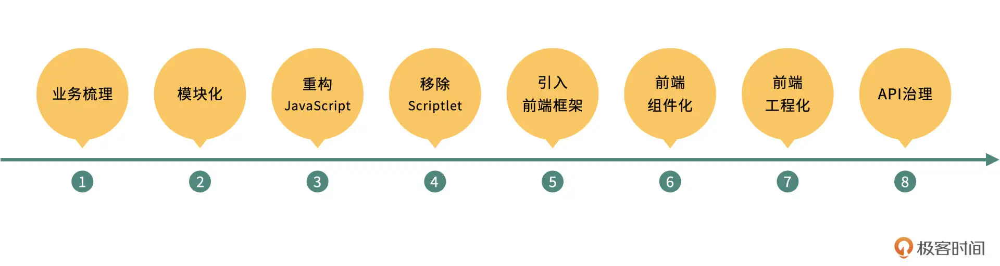

# 13-架构现代化：如何改造老城区前端？

你好，我是姚琪琳。

前面两节课，我们学习了架构现代化中建设新城区的一些模式。从这节课开始，我们来聊聊改造老城区相关的模式。

我们先回顾下什么是“改造老城区”。改造老城区模式是指对遗留系统内部的模块进行治理，让


模块内部结构合理、模块之间职责清晰的一系列模式。也就是说，在遗留系统的单体内部，我们应该如何更好地治理架构。


我们按照从“前”往“后”的顺序，先从前端开始。

## 遗留系统的前端

在第十节课我们学习了一种架构反模式——Smart UI，它是遗留系统最常见的前端模式。以Java Web 项目为例，它们往往在 JSP 页面中掺杂着大量的 JavaScript、Java 和 HTML 代码。其中最致命的就是 Java 代码，因为它们可以随意访问后端的代码，甚至访问数据库。我们重构前端代码最主要的工作，就是移除这些 Java 代码。

前端的遗留代码和后端的遗留代码一样，也是坏味道的重灾区。Martin Fowler 在《重构（第 2版）》中，用 JavaScript 重写了所有代码示例，这对于前端开发人员是相当友好的。它能帮助你识别出 JavaScript 中的坏味道，并重构这些代码。

要重构前端代码，最好也要优先添加测试。但不幸的是，已有的前端测试工具对基于框架（Angular、React、Vue）的 JavaScript 代码是相对友好的，但遗留系统中的前端代码，既有JavaScript 又有 Java，很难用前端工具去编写单元测试。

这里我推荐你编写一些 E2E 测试，来覆盖端到端的场景。或者使用HtmlUnit 这样的工具，通过编写 Java 代码来测试 JSP。但实际上 HtmlUnit 也属于某种程度的 E2E 测试。

## 重构前端代码

前端 JSP 代码的重构和后端有相似之处，但也有很多不同。我的同事王万德和胡英荣开源了一套端（前端 JSP）到端（后端 Java API）的遗留 JSP改造方案，包括重构前后的代码对比。我将以这个代码库的代码为示例，给你讲解一下如何重构前端代码。

我们对于遗留 JSP 代码的重构，可以分成以下八个步骤。每个步骤都可以小步迭代，增量演进。

### 第一步，梳理业务

要想重构前端代码，你必须先搞懂它的含义。类似代码现代化时，我们用活文档工具去理清一

个场景，要重构前端代码，你也得先梳理它的业务含义，搞清楚它到底做了哪些事情。遗憾的是，针对前端的活文档工具，现在我还没发现哪种比较好，因为前端有多种语言交织在一起，分析起来太麻烦。

不过好在前端并不像后端代码那样调用链很深，很多前端代码都是围绕一个页面来展开的，相对来说还算内聚，梳理起来也更容易一些。

### 第二步，模块化

梳理完业务逻辑，下一步就是对前端代码进行模块化。这里的模块化是指，按职责把原先冗长的 JSP 页面拆分出来，分解成多个小的 JSP 页面，比如 header、footer、content 等，并将它们 include 到大页面中。

开发人员在编写 JSP 时，很少有这种模块化的思想，导致所有的东西都写到一个文件里。随着页面逻辑越来越复杂，页面里的各种代码越来越多，文件也越来越大。我甚至见过很多超出64KB 限制的 JSP 文件。

模块化怎么实现，我们结合例子来分析分析。从下面这段 to-do list 的代码示例，可以很明显地看出它由 4 个部分组成：一个包含若干 hidden 字段的 form、一个包含一段文字的header、一个包含 to-do 列表的 section 和一个包含删除按钮的 footer：

```xml
<% List<Todo> todoList = (List<Todo>) request.getAttribute("todoList"); %>
<section class="todoapp">
   <form name="todoForm" action="" method="post">
       <input type="hidden" name="sAction"/>
       <input type="hidden" name="title"/>
       <input type="hidden" name="id"/>
   </form>
   <header class="header">
       <h1>todos</h1>
       <input class="new-todo" placeholder="What needs to be done?" autofocus>
   </header>
```

```xml
   <section class="main">
       <input id="toggle-all" class="toggle-all" type="checkbox">
       <label for="toggle-all">Mark all as complete</label>
```

```xml
       <ul class="todo-list">
           <% for (int i = 0; i < todoList.size(); i++) {
               Todo todo = todoList.get(i);
           %>
           <li <%if (todo.getCompleted()) %> data-id="<%
               <div class="view" id="todo_<%=todo.getId()%>">
                   <input class="toggle" id="todo_toggle_<%=todo.getId()%>" onch
                          type="checkbox" <%if (todo.getCompleted()) {%> checked
                   <label><%=todo.getTitle()%>
                   </label>
                   <button class="destroy" onclick="deleteTodo(this)"></button>
               </div>
               <%--            <input class="edit" value="<%=todo.getTitle()%>">
           </li>
           <%}%>
       </ul>
   </section>
   <footer class="footer">
       <%
           boolean hasCompleted = false;
           for (Todo todo : todoList) {
               if (todo.getCompleted()) {
                   hasCompleted = true;
                   break;
               }
           }
       %>
       <%if(hasCompleted) %>
   </footer>
</section>
```

对于这段代码，我们就可以将它提取成 4 个小的 JSP 页面，重构之后的代码就相当清爽了。

```xml
<section class="todoapp">
   <%@ include file="todoForm.jspf" %>
   <jsp:include page="todoHeader.jsp"/>
   <jsp:include page="todoList.jsp"/>
   <jsp:include page="todoFooter.jsp" />
</section>
```

### 第三步，重构 JSP 中的 JavaScript 代码

将页面拆小后，我们还要继续重构各个小页面中的 JavaScript 代码。

长函数是遗留系统前端最常见的坏味道。早年开发 JSP 页面的都不是专业的前端开发，很多都是赶鸭子上架的后端开发人员，去写一些相对简单的 JavaScript 代码。或者是不知道怎么写某个页面元素的联动效果，就去论坛复制一大堆代码过来，稍加修改，只要代码能跑就敢提交，很少会清理和重构代码。这些操作导致业务逻辑、显示逻辑和控件操作杂糅在一起，根本没法维护。

面对这种混乱的代码，我们更要确保思路清晰。你可以按职责来将它分解为若干个小的函数，每个函数只做一件事情。这有点类似于代码重构中的拆分阶段（可以回顾第九节课），只不过拆分出来的是不同的职责，而不是一个职责的不同阶段。

下面这段代码是一个页面校验的函数，大体业务是，某家公司在组织团建时需要选择一个团建活动，而不同的团建活动之间有一些校验逻辑。具体的说明可以参考这里。

```javascript
function clickActivityCheck(activityCheckedObject, packageId, activityId) {
   if (activityCheckedObject.checked) {
       var countInput = document.getElementById("activity_" + activityId + "_cou
       var count = !countInput.value ? -1 : parseInt(countInput.value);
       if (count < 1 || count > 50) {
           alert("参加人数必须在1到50之间！");
           activityCheckedObject.checked = false;
           return;
       }
       if (activityId === 1) {
           var checkBox2 = document.getElementById("activity_2");
           if (checkBox2 && checkBox2.checked) {
               alert("冬奥两日游和户外探险一日游不能同时选择！");
               activityCheckedObject.checked = false;
               return;
           }
       }
       if (activityId === 2) {
           var checkBox1 = document.getElementById("activity_1");
```

```
           if (checkBox1 && checkBox1.checked) {
               alert("户外探险一日游和冬奥两日游不能同时选择！");
               activityCheckedObject.checked = false;
```

```javascript
               return;
           }
       }
       if (activityId === 5) {
           var checkBox1 = document.getElementById("activity_1");
           if (!checkBox1 || !checkBox1.checked) {
               alert("选择住宿前必须选择冬奥两日游！");
               activityCheckedObject.checked = false;
               return;
           }
       }
       var result = createActivity(activityCheckedObject, packageId, activityId)
       if (!result.success) {
           alert(result.errorMessage);
           activityCheckedObject.checked = false;
           return;
       }
   } else {
       var countInput = document.getElementById("activity_" + activityId + "_cou
       countInput.value = "";
       activityCheckedObject.checked = false;
       if (activityId === 1) {
           var checkBox5 = document.getElementById("activity_5");
           if (checkBox5 && checkBox5.checked) {
               checkBox5.click();
           }
       }
       cancelActivity(activityCheckedObject, packageId, activityId);
   }
```

这段代码有点长，不过我稍微解释一下你就清楚了。

在选择团建活动的时候，用户可以在“冬奥两日游”、“户外探险一日游”、“唱歌”、“吃饭”、“住宿”等活动中做出选择。

在勾选 checkbox 的时候，会触发这个函数来进行校验。它首先会校验所填的人数，然后校验所选活动之间的关系，比如冬奥和户外探险不能同时选择，选住宿则必须选冬奥。此外，当取消勾选的时候，也会触发一个联动逻辑，也就是取消冬奥的时候，会连带着一起取消住宿。

题面分析完了，你想到重构的思路了么？你脑海里涌现的第一个想法可能是这样的：可以将每个 if 都抽取成函数。但这样抽取出来的函数仍然有很多重复代码，逻辑并没有得到简化，而且

页面元素的读写和业务判断还是混杂在一起的。仔细观察你会发现，所有的校验逻辑可以大体上分为 3 种：校验人数、校验互斥的活动、校验有依赖的活动。

对校验逻辑做了抽象之后，就可以把代码重构为下面这个样子：

```javascript
function validateActivities(activityId) {
   var result = validateCount(activityId);
   if (result.success) {
       result = validateMutexActivities(activityId);
       if (result.success) {
           result = validateReliedActivities(activityId);
       }
   }
   return result;
}
function selectActivity(activityId) {
   var result = validateActivities(activityId);
   if (result.success) {
       result = createActivity(activityId);
   }
   return result;
}
function clickActivityCheck(activityId) {
   let activityInfoRow = new ActivityInfoRow(activityId);
   if (activityInfoRow.isChecked()) {
       var result = selectActivity(activityId);
       if (!result.success) {
           alert(result.errorMessage);
           activityInfoRow.setChecked(false);
       }
   } else {
       unSelectActivity(activityInfoRow, activityId);
   }
}
```

注意，这里面还提取了一个 ActivityInRow 对象，用于保存每一行的活动元素。这样，我们就把页面元素和判断逻辑分离出来了。

### 第四步，移除 JSP 中的 Java 代码

JSP 中，用 <% %> 括起来的 Java 代码叫做 Scriptlet，正是这样的代码，把 JSP 变成了Smart UI。其实早在 JSTL 和 EL 诞生的时候，就不再推荐使用 Scriptlet 了。然而十几年来，情况不曾改观，反倒是新型前端框架的兴起，使前后端彻底分离，才遏制住了 Scriptlet 的滥用之势。

但对于遗留系统来说，Scriptlet 仍然泛滥成灾，重构前端代码的重点，就是移除它们。JSP 中的 Scriptlet 大致可以分为这么几类：

1. 对所有请求执行相同的 Java 代码，如权限验证。这类 Scriptlet 可以迁移到后端，写到一个Filter 里。

2. 直接与数据库交互的 Java 代码，如从数据库中查询出数据并显示在 table 中，或登录页面中验证用户名和密码等。这类 Java 代码其实处理的都是 GET/POST 请求，也可以迁移到后端，实现一个新的 Servlet，将代码迁移到 doGet/doPost 中。

3. 控制页面显示逻辑的 Java 代码，如上面 to-do 的例子中，从后端拿到一个 Todo 对象的列表，然后遍历这个列表，用 <li> 便签展示出来。

对于第三种 Java 代码，你可以用 JSTL 和 EL 来替换，就像下面这样：

```xml
<section class="main">
   <ul>
       <c:forEach var="todoItem" items="${todoList}">
           <li>${todoItem.title}</li>
       </c:forEach>
   </ul>
</section>
```

完成替换后，JSP 中就只剩下了 HTML、JavaScript 和 JSTL，已经相当清爽了。如果你的工作就只是移除 Java，那么到此就可以告一段落。

但如果目标是前后端分离，彻底告别 JSP，你可能会希望使用纯 JavaScript 来替换。这时候

就可以先保留这部分 Scriptlet，等下一步引入前端框架的时候，再来替换。

### 第五步，引入前端框架

当 Java 代码移除之后，我们再引入前端框架。比如对于 todoList 这个模块，引入 Vue 后的代码就变成了下面这样：

```xml
<%
   List<Todo> todoList = (List<Todo>) request.getAttribute("todoList");
   ObjectMapper objectMapper = new ObjectMapper();
   String todoListString = objectMapper.writeValueAsString(todoList);
%>
<div id="todoListContainer"></div>
<script>
   (function () {
       var todos = JSON.parse('<%=todoListString%>');
       new Vue({
           el: "#todoListContainer",
           data: function () {
               return {
                   todos
               }
           },
           template:`
<section class="main" v-show="todos.length">
   <ul class="todo-list">
       <li v-for="todo in todos" :key="todo.id" :class="{completed: todo.complet
           <div class="view">
               <input class="toggle" v-model="todo.completed" type="checkbox" @c
               <label>{{todo.title}}</label>
               <button class="destroy" @click="deleteTodo(todo)"></button>
           </div>
       </li>
   </ul>
</section>
           `,
           methods: {
               toggleComplted: function (todo) {
                   var sAction = "markDone";
                   if (!todo.completed) {
                       sAction = "markUnfinished";
                   }
                   rootPage.toggleTodo(todo.id, sAction);
```

```javascript
               },
               deleteTodo: function (todo) {
                   rootPage.deleteTodo(todo.id);
```

```
               }
           }
       });
   })();
</script>
```

注意，我们这里只是使用脚本的方式引入了 Vue。要想更好地使用前端框架，你还需要对这些代码进行组件化和工程化。为了实现小步前进，我们把这两部分内容交给第六和第七步。

### 第六步，前端组件化

引入前端框架之后，我们就可以进一步重构，将前面拆分出来的各个模块转换为组件。比如上面的 Vue 可以转换为下面这样的组件：

```xml
var todoListComponent = {
   props:{
       todos: {
           type: Array
       }
   },
   template:`
<section class="main" v-show="todos.length">
   <ul class="todo-list">
       <li v-for="todo in todos" :key="todo.id" :class="{completed: todo.complet
           <div class="view">
               <input class="toggle" v-model="todo.completed" type="checkbox" @c
               <label>{{todo.title}}</label>
               <button class="destroy" @click="deleteTodo(todo)"></button>
           </div>
       </li>
   </ul>
</section>
           `,
   methods: {
       toggleComplted: function (todo) {
           var sAction = "markDone";
           if (!todo.completed) {
               sAction = "markUnfinished";
           }
```

```
           this.$emit("toggle-todo", todo.id, sAction);
       },
```

```sql
       deleteTodo: function (todo) {
           this.$emit("delete-todo", todo.id);
       }
   }
}
```

在 index.jsp 文件中，就可以使用这种方式来引用这个组件：

```xml
<div id="app">
   <todo-list-component :todos="todos" v-on:toggle-todo="toggleCompleted" v-on:d
   </todo-list-component>
</div>
```

此时组件的初始化数据还是从 request 中获取的，要把它们替换成对后端的 Ajax 调用。这需要你改造一下原有的 Servlet，让原本在 request 中设置 attribute 的 Servlet 返回 json：

```
ObjectMapper objectMapper = new ObjectMapper();
PrintWriter out = response.getWriter();
response.setContentType("application/json;charset=UTF-8");
response.setCharacterEncoding("UTF-8");
response.setStatus(HttpServletResponse.SC_OK);
List<Todo> todoList = todoRepository.getTodoList();
out.write(objectMapper.writeValueAsString(todoList));
out.flush();
```

这时，前端页面中的所有 Scriptlet 都清除干净了，你可以将文件名的后缀从 jsp 改为 html了。

### 第七步，前端工程化

我们上一步虽然将小模块都转换成了前端组件，但它们还是通过 <script> 的方式引入到页面中

的，只能说是个半成品。要构建一个现代化的前端应用，工程化是必不可少的。

对于上面的例子，我们引入 Vue CLI，它能更好地管理 Vue 组件。比如之前的 todoList.js，将会变成下面这样的 TodoList.vue：

```bash
<template>
 <section class="main" v-show="todos.length">
   <ul class="todo-list">
     <li v-for="todo in todos" :key="todo.id" :class="{completed: todo.completed
       <div class="view">
         <input class="toggle" v-model="todo.completed" type="checkbox" @change=
         <label>{{todo.title}}</label>
         <button class="destroy" @click="deleteTodo(todo)"></button>
       </div>
     </li>
   </ul>
 </section>
</template>
<script>
import $ from 'jquery';
export default {
 name: "TodoList",
 props:{
   todos: {
     type: Array
   }
 },
 methods: {
   toggleComplted: function (todo) {
     console.log("toggleComplted ")
     console.log(todo)
     var sAction = "markDone";
     if (!todo.completed) {
       sAction = "markUnfinished";
     }
     $.ajax({
       url: "/todo-list/ajax?sAction=" + sAction,
       method: 'post',
       data: {
         id: todo.id
       },
       error: function () {
         todo.completed = !todo.completed;
       }
```

```javascript
     })
   },
   deleteTodo: function (todo) {
```

```sql
     var _this = this;
     $.ajax({
       url: "/todo-list/ajax?sAction=delete",
       method: 'post',
       data: {
         id: todo.id
       },
       success: function () {
         _this.$emit('delete-todo', todo.id);
       }
     })
   }
 }
}
</script>
```

第五步到第七步这三步，如果要改造的页面比较多，无法在一个交付周期内改造完成。你就可以采取这种单页应用注入（SPA Injection）的方式来逐步地完成替换。

它与绞杀植物模式的思想类似，都是一种以新替旧的方法。只不过与绞杀植物由外及内（outside-in）的替换方式不同，单页应用注入是由内及外（inside-out）的。它把 SPA 注入到JSP 内部，先替换一个局部的组件，然后再慢慢扩散，直到替换完全部功能。通过这种方式，我们就能让 SPA 和老的 JSP 共存，更有利于增量演进。

### 第八步，API 治理

完成了前面的七个步骤，前端的工作基本上告一段落，接下来要治理的就是后端的 API 了。在第七步，我们已经将部分 Servlet 改造成了对 Ajax 调用友好的 API，但这还不够，你可以更进一步，将它们改写为 REST API，并且对后端进行分层，以消除事务脚本。这就比较接近第十节课代码分层重构的内容了。

## 微服务架构下的前端

前端代码的重构是个浩大的工程，持续的时间会很长。因此我通常不建议直接重构遗留系统的所有前端代码，而是以后端的微服务拆分为契机，拆分出来哪些模块，就重构哪些模块的前端。这样重构的范围会更小，拆分出来的服务从前到后也都是现代化的。

但这样一来会出现一个问题，老的页面仍然是 JSP 的，而新的页面已经组件化工程化了，如

何集成呢？你可以使用微前端（Micro frontend）技术。

微服务是把庞大的单体应用分解成小的、认知负载低的服务，从而将“大事化小，小事化了”。微前端也是同样的思路，它将一个单体的前端应用拆分为多个小型的前端应用，并通过某种方式聚合到一起。各个前端应用可以独立运行、开发和部署。

对于这一部分的内容，推荐你参考我的同事黄峰达开源的一套微前端框架Mooa，还有跟它配套套的微前端解决方案文档。

## 小结

又到了总结的时候。

今天我们学习了遗留系统前端的特点，以及前端重构的八个步骤， 分别是：梳理业务、模块化、重构 JavaScript、移除 Scriptlet、引入前端框架、前端组件化、前端工程化和 API 治理。



最后，为了在旧页面中更好地集成新的前端组件，我还带你粗略地了解了微前端技术。

在重构前端的时候，对开发人员的要求是很高的。如果他只会前端，可能无法移除 Scriptlet；如果只会后端，也许可以按重构 Java 代码的方式重构 JavaScript，但却很难对前端进行组件化和工程化，更别提什么微前端。

作为架构师或重构负责人的你，这时候需要带领不同能力的人一起攻关，必要的时候可以让他们结对，以发挥不同人的特长。

前端的治理就像是对老城区中的“老破小”小区粉刷了一遍外墙，让它变得好看了一些。但实际

上，你还是需要好好整治一下内部结构（后端代码），否则就是虚有其表。下节课我们就来学习一下，如何治理老城区的后端架构。

## 思考题

感谢你学完了今天的内容，我今天在讲解的过程中故意遗漏了一点，那就是如何遵循以增量演进为手段这个原则，不知道你是否看出来了。要想更好地对前端遗留代码进行增量演进，除了小步替换以外，还需要在出现问题时能够及时回退。

你能说说如何实现前端的回退吗？如果需要，可以回过头去复习一下第六节课的内容。期待你的分享。

欢迎你在评论区留下你的思考，也欢迎你把这节课分享给你的同事和朋友，我们一起重构前端。
