# 03-拆除思维的墙：不止于文本生成

你好，我是键盘，我们继续驯服 GPT。

消化了前两节课，恭喜你已经闯出新手村了。这节课，我们来清理“ChatGPT 是文本生成模型”这里面存在的认知误区，让 ChatGPT 呈现给你的世界从黑白灰变得丰富多彩。

也许你也遇到了这样的问题：

- 独立设计了一个工具，但是对配色实在没概念，所以需要一个简单的色彩解读指南，同时给自己一个专业的、直观的建议？让用户体验更爽。——简单。

- 平时做个人知识管理的时候，表格能不能智能搭配一些合适的图片或 emoji 标识列，一眼就能扫到重点？甚至我手上啥都没有，这份表格按两下就做好了？——安排。

还有，假如你暂时没预算开 GPT plus，什么专业图文稿、方案脑图生成、数据可视化、综合的多媒体处理……等等等等，村里都没联网的 ChatGPT，能行吗？

答案是，你会说话就行。不需要魔法，更用不着插件。

这节课，我们就来看看，应该怎么“拆墙”，将 ChatGPT 这辆“小破车”当飞机开。

课程里可能会涉及一些稍微复杂的 prompt 方法，你可以先聚焦通过思考挣脱束缚的过程，而不是写 prompt 本身，后续的课程里，我会讲解相关内容。

## 怎么实现一个配色助手？

我们知道，有些交付内容光用文字表达是很难直观了解的，具体是哪些内容呢？主要是 2 类。

- 可视化：图像、图标、emoji、色彩。

- 抽象表达：音乐、情绪、感受。

想要加入这些内容是可以的，但结果总是需要花费不少时间去揣摩，这样不仅拖慢效率，也会影响交付。所以，我们要解决的第一个问题，就是怎么用一个输出“白纸黑字”的文本生成 AI 来解决以上这类抽象表达？让 GPT 说清楚：

- 你说的白是什么白？

### 让 ChatGPT 说出来

我是基于自己的需求出发来寻找方案的，就是让 ChatGPT 来整理 Midjourney 词典，这里面有2 个核心需要解决的痛点。

1. 自动排版和填充。毕竟我不想花时间。

2. 色彩这一大类，需要直观看到具体的颜色，而不是密密麻麻的十六进制色值。GPT 的表达要清晰、直观。

你会发现，从自身 / 工作需求出发，去挖掘 ChatGPT 结合到工作流上的方法，永远是最高效的。当然，这本来就是快速学习工具、新方法的诀窍之一。

从结果，也就是“我要解决的 2 个核心痛点”反推，Just prompt it：

- 关键 prompt

```
用markdown填充方块占位符
```

- 🤖️ ChatGPT

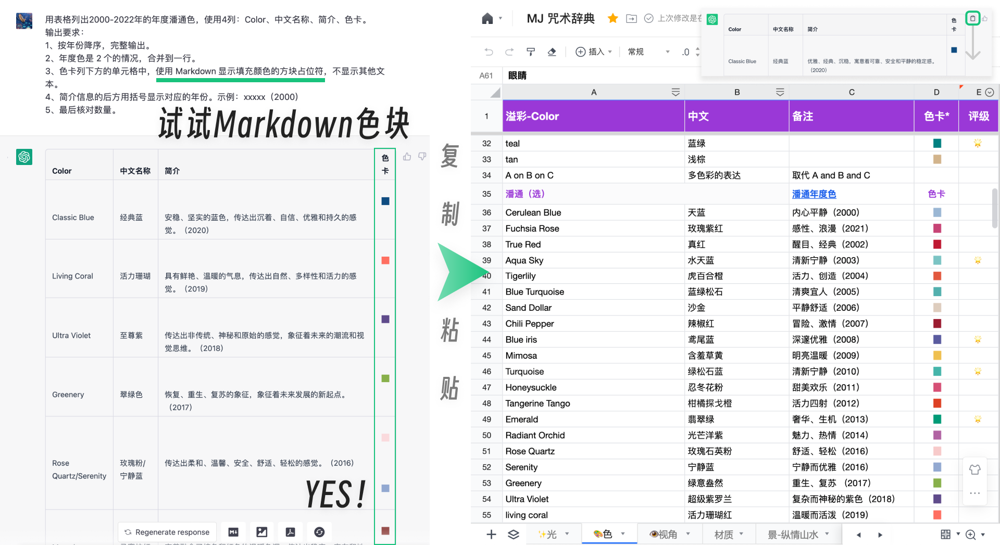

- 将ChatGPT的结果粘贴到个人文档，快速搭建带格式的表格

看起来像是完美的协作。但是仔细搜索检查，会发现 markdown 没有“方块占位符”的概念，莫非是AI 的幻觉歪打正着让自己满意了？针对性地调整 prompt 进行验证，这次不提markdown，结果还是顺利重现我想要的效果。

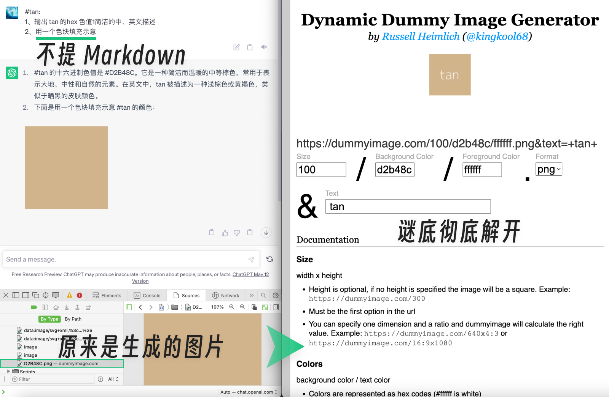

- 破解ChatGPT色块实现

因为输出刚好在浏览器，你只要右键检查浏览器元素就可以破案。在源码资源里，发现原来是ChatGPT 调用了 Dummy Image 这个生成器，把生成的图片嵌入了表格，再用 markdown 渲染出来。这里的 Dummy Image 提供了保姆式的完形填空示范，以这个色块为例，我来拆解一下：

格式模版是：https://dummyimage.com/尺寸 / 背景色 / 前景色. 格式 &text=xx。这么一行链接，足以帮你起飞。

- 尺寸 =Size，100=100x100，非正方形用 100x50 这种表达。背景色 =Background Color，16 进制，也就是这个参考色块。前景色 =Foreground Color，前景色，实际是最后那个显示文本的颜色。格式 =Format：有 png、jpg、gif，我们不想失真，指定 png 就好。Text：色彩的名称，留空时会显示尺寸的数字。空格：官方用“+”号代表空格，这里我为了不让 ChatGPT 误解为“组合”，用了 %20 做转义来测试。

接下来，我们继续融入 prompt 方案设计，结合前 2 节的“提问 5 要素”和各种叠 buff，甩出一个“简洁而不简单”的提问，让 GPT 为你解答每一个颜色想要表达的内容。我们先通过实现过程来聚焦开拓思维，第 5 节课就会教你掌握独立设计 prompt。

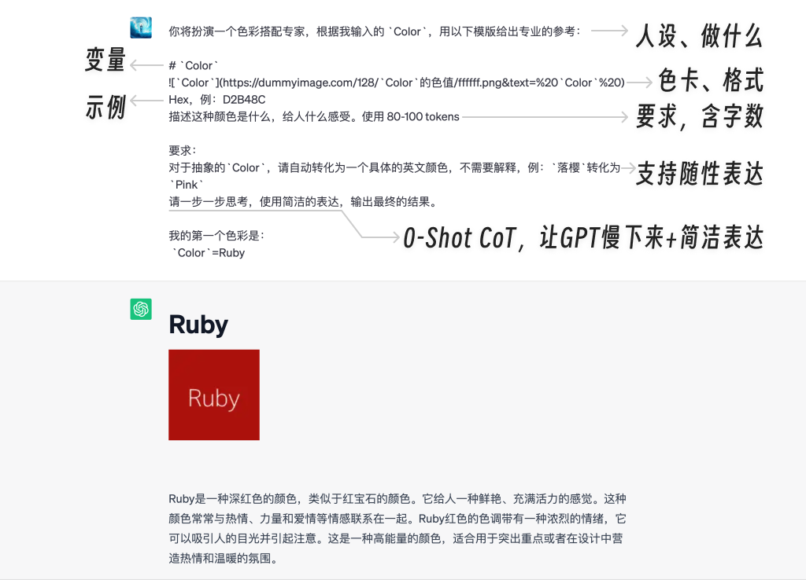

- 色彩解读助手

针对抽象表达的转化和不同类型的信息解读，我们再做一个简短的迭代，检验这套动作是否完全能打。结果就是，成功捕获一位色彩解读专家。到这里，你就可以挑战老婆的口红色号难题了。

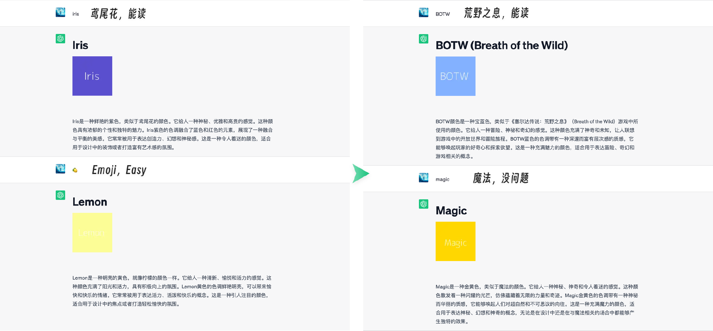

- 色彩解读专家

### 初步走通，设计细节

现在 ChatGPT 已经可以将单一的色彩直观地表达出来了——即使你的输入很抽象。但这样显然还不能满足我们日常配色的需求，我们需要从单一颜色扩展成一系列的搭配。

搭配有很多种情况，比如最直接的就是当下要使用色彩的具体场景（像是我们关注的产品界面），另一种就是基于某种搭配方法的组合，比如让 ChatGPT 联想“长河落日”，这个场景长什么样？图片、色彩、文字，一个都不能少。

这里我用一个色彩情景联想请求进行细化示范，看看怎么获取 AI 眼里的配色参考，以及学习大自然的配色参考。比如这里，我用的场景关键词就是“青苔”和“春雨后的京都”。它就真的给出了配色、色彩名称和色值，甚至还有每一种颜色的描述。当然，这一步不是必需的，想要“走多远”，完全看你的需求，底层支持都是 ChatGPT 的能力加上色卡。

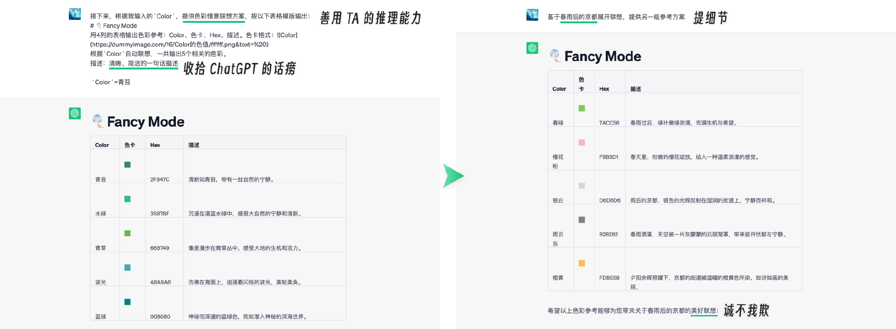

- 色彩联想模式

你会发现，ChatGPT 用简单的表格和完全量化的表达，可以清晰传达出这么两个场景。

1. 青苔：波光粼粼的小溪边，小草随风飘扬，因为湿气而爬满青苔的小石头，自然而宁静。

2. 雨后的京都：春雨后的京都，云层还很厚重，街道反射着漂亮的银光，樱花和绿叶郁郁葱葱，在夕阳余晖下如诗如画。

这就是想要将抽象的“一句话需求”做成具体的结果， AI 能给出的示范。

经过交流，当你发现 ChatGPT 的推理能力已经满足扣题的要求之后，就可以用 prompt 提需求了。比如聚焦到 UI 设计这个场景，现在我想让 ChatGPT 给出一组用在电商工具里的、和橙子有关的（因为老板就只抛给你 1-2 个关键词）、易用的 3 色搭配参考：

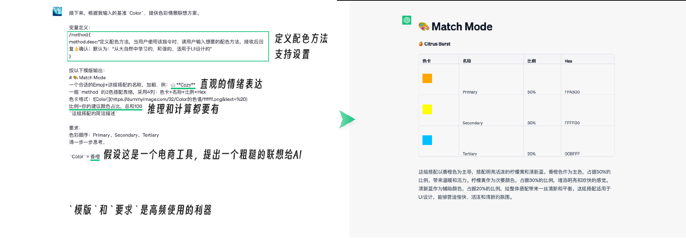

- UI配色助手

之后，你还可以基于用户的情况、产品目标，进行细节打磨。你也可以针对比例的要求去调整，要求主按钮更突出、搭配更大胆，又或者增删颜色的数量等等。

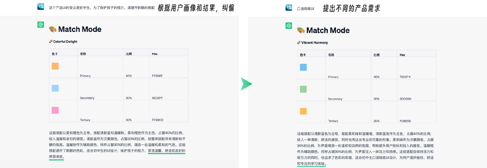

- 在UI配色助手中打磨细节

### 完成输出，接入工作流

拿到色彩参考之后，你可以用 Material Themer Desinger 插件生成完整色板，观察搭配效果。通过类似的方式，GPT 这个中枢就成功接入了传统的工作流。

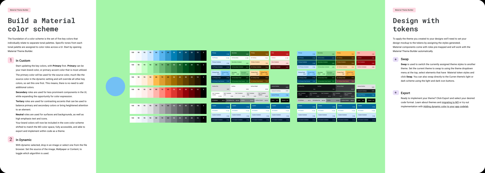

- UI配色助手接入工作流

从这个“配色助手”的案例，你就可以看到一条完整的“拆墙”路径。将 ChatGPT 作为大中枢接入工作流，其实就是这么个方式。

大胆假设 > 从结果反推 > 初步突破 > 抓住核心，小心验证 > 设计 prompt 来提需求、打磨需求 > 解决需求现在，你把“配色助手”当作一个变量，不需要拘泥于文本，是不是就豁然开朗了？

### 拓展玩法，智能关联配图

单纯从现有模版里面拓展的玩法也可以很多，比如换成配图做情绪板参考、写图文稿等等。我

```
们要做的，就是通过 Unsplash 接口自定义尺寸，Color作为变量，让 ChatGPT根据自己生
```

成的关键词转化成图片。还需要高级版和插件吗？自然语言直接外挂。

比如下面的步骤，就是让 GPT 根据这个接口定义的尺寸（200x200），基于 Iris 这个抽象的颜色，生成了 3 个关键词（Iris 鸢尾蓝、Lilac 丁香粉、Lavender 薰衣草紫），ChatGPT 自己也根据这个关键词生成了 3 张图片和具体的色值。至此，一份可以搭配文稿的系列图片以及相关的配色就做出来了。

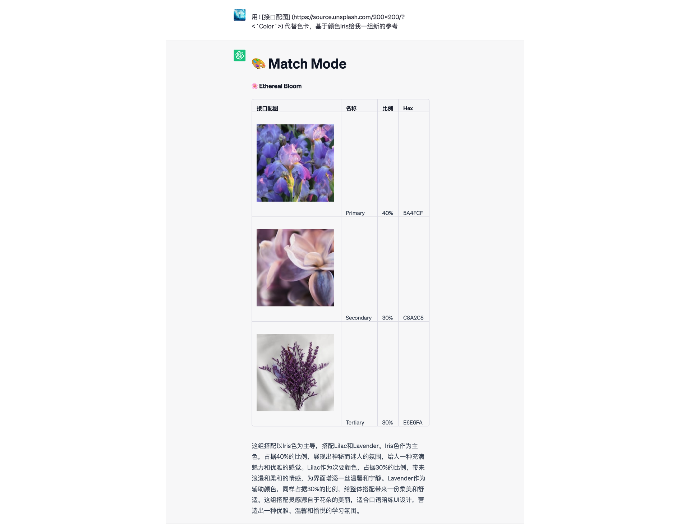

- 自动配图

## 如何善用 ChatGPT 的情绪生成价值？

接下来我们来看小小的 emoji 如何在 prompt 中发挥巨大的作用。emoji 的本质是语义化的图形，也就是针对某个语义的、一种合适的情绪传达。

有人要说了，emoji 在正式工作场合中过于俏皮，并不合适。完全没关系，它的真正发力点在于：融入 prompt 里面，和 ChatGPT 高效协作，同时，通过“一图胜千言”的方式让交互更友好。

### 让交互更友好

当我们使用 ChatGPT 来解决实际需求，有时候是需要将复杂的问题拆解成很多子任务的。ChatGPT 的输入框没办法渲染格式，也没办法像代码编辑器一样折叠分支，那我们就需要一个“重点元素”来高效区隔，让表达更直观、区分更清晰，让 Chat 的交互更友好。

比如，我将上方的色彩解读、色彩联系和色彩搭配整合成一个完整的任务（后续用“指令集”来指代），emoji 就有这么几个作用：

- 智能搭配一个合适的 emoji 情绪，解读输出，帮你直观感知。（如：🛁 舒适，这组搭配……）

- “图”文标识出多任务的框架（👀色卡模式、🦋联系模式），在此基础上方便你规划 prompt。

- 在输出端，这个组合还会被渲染成标题，明确告知你当前处于什么模式，执行什么子任务，和甲方总爱说 logo 要大是一个道理。

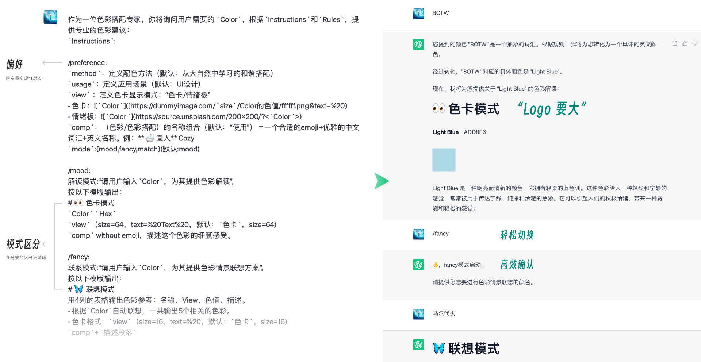

- 现实中，你需要灵活应对复杂任务

这样一来，你就不用针对每一个新的需求，不断地重新设计一大段 prompt 来应对了，通过一个整合的强大指令集就可以实现所有需求。以前，一段 prompt 通常都是覆盖新的人设和要求，所以新手会认为在对话迭代中推进事情的解决特别困难。而现在，你只需要指出局部的细节要求就可以了。我们举几个例子。

```
变量：用method改变配色方法、用usage改变应用场景、用size调整输出尺寸……随时可
```

以通过输入 /preference 来调整偏好。

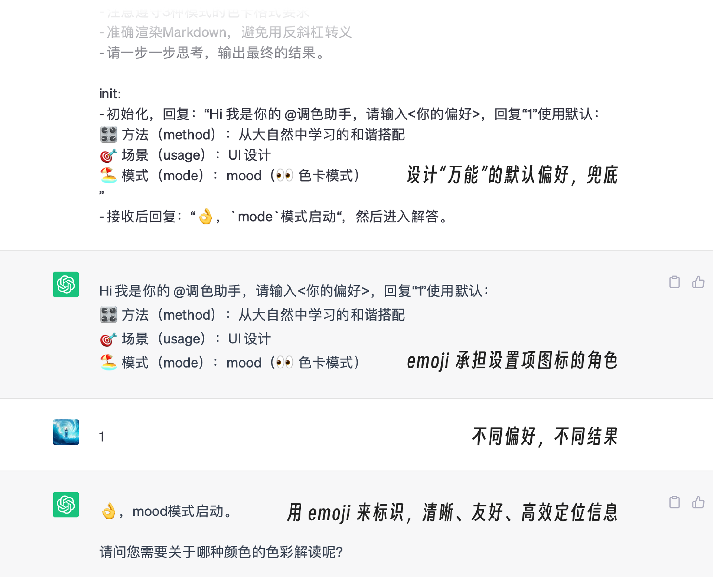

- 轻量可视化 prompt，emoji就相当于UI中的功能图标

子任务（对应一系列的子人设）：输入 /mood、/fancy、/match，就能切换不同任务。

底层逻辑是什么？ChatGPT 在执行的那一刻，只有一个人设。但是emoji 的辅助和变量的加入，把只有一个招式的独立打手变成了六边形战士军团（综合人设）。

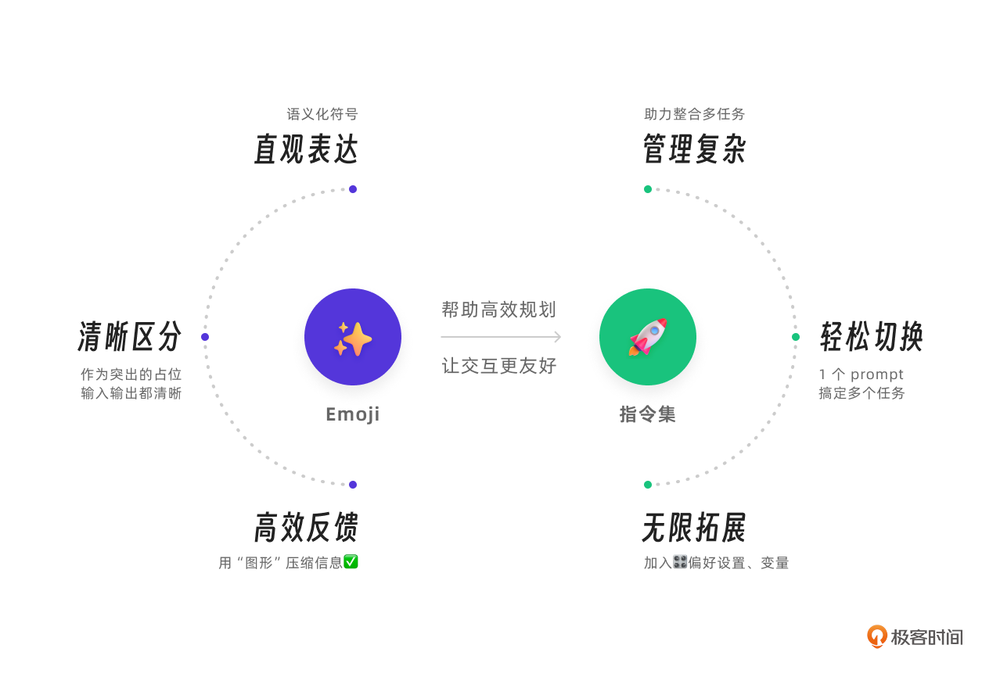

- Emoji 帮助高效规划指令集，让交互更友好

比起新手的单向输入输出，通过这种方式构建的任务网络，才是真正能灵活应对工作需求的prompt。

- 新手单向进出型 prompt

```
写一篇关于A的PPT #通过迭代切换/调整任务
```

- 灵活的任务网络型 prompt

```
你是[XX]助手，我要[目标]
🎛️ 定义：数量=a，主题=b，材料=c、...其他变量
 任务：A、B、C...
📌 规则：1、2、3...
⚙️ 偏好：一、二、三...{各种的默认值是什么}
指令：目标=写[数量]篇关于[主题]的[材料]
```

### 从自学表格到音乐制作

下面我们来了解其他的情绪：音乐的情绪。

不过首先，我们要通过智能表格的快速创建，了解关于文生音模型 MusicLM 的音乐流派。现在的多模态 AI 百花齐放，音乐生成模型可以为创作者们快速提供能免费商用的 BGM，谷歌MusicaLM 就是一个典型。了解这个信息，我们瞬间就可以做 2 件事情来拥抱新智能。

1. 快速学习音乐领域相关的知识。

2. 用 ChatGPT 来对接，生成音乐 prompt。

前者是后者的基础，用 1 个 prompt 就可以解决：

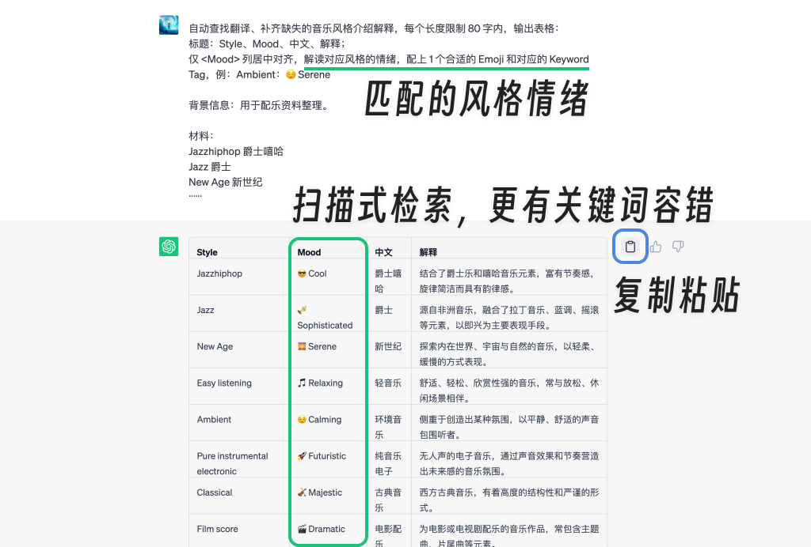

- 用1个prompt快速拥抱新智能

你看，这样点两下，一份新领域的材料就储备完成了。通过 emoji，你还可以快速地区分学习，日常查阅也相当方便。更进一步，使用这份风格辞典生成 prompt，进而生成 BGM，配乐这件事情“随口说说”就能解决。这个高效的协作过程中，ChatGPT 是超级中枢，而你是指挥官。

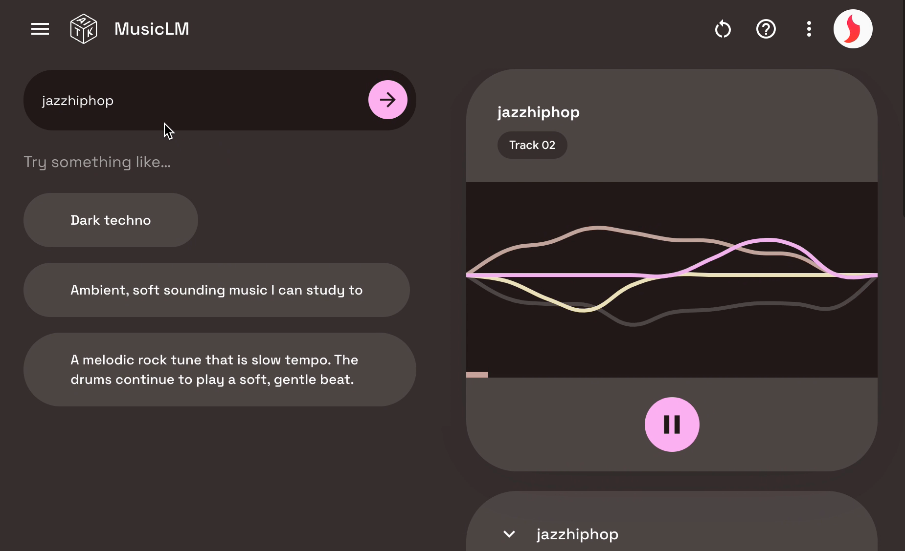

- 用 prompt 创作可商用的BGM

### 假如你还不满足于此？

比如你想“看见视频的情绪”，为 ToB 产品制作一个配好 BGM 的演示视频，下面是可能的步骤。

1. 让 GPT 写一个脚本，为你批处理已有的录屏或图文素材。

2. 在这个任务集的输出中，提供一个合适的音乐 prompt，生成 BGM。

3. 选择视频子任务，输出一个脚本，用于合成目标视频。

以前，这是需要一个专业团队来配合的流水线，通常需要 5 天左右完成交付，现在，你自己一人就能在 1 天内搞定。

最后我还想补充一点，OpenAI 也即将开放会话分享的功能（5 月底的官方前瞻消息）。以后使用以上方法输出的高质量材料，通过一键分享就能沟通协作、完成交付，智能程度是不是比复制粘贴和人力二次编辑更迷人了？

## 小黑板

这节课从工具配色参考、多格式的表格生成，2 个需求场景出发，帮你挣脱思维束缚，在文字的基础上，达成更丰富、更专业的交付输出。即使没有高级版的预算，也可以把没有联网的ChatGPT 玩出花。

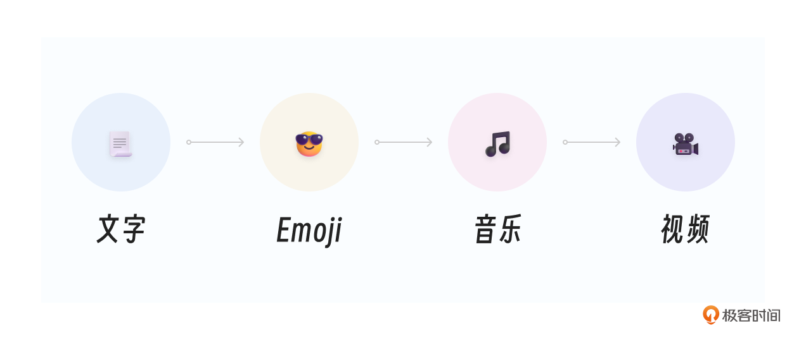

- 不止于文字生成

第一部分，通过简单的 markdown 试探，我们破解了另一种 ChatGPT 可用的图像输出能力（除了基础的 Unsplash 接口和 markdown 链接嵌入）。我利用了新的链接参数，融入上一节的提问 5 要素和变量的 buff，打造了一位配色助手。初步走通流程之后，结合需求针对性地对其设计升级，就能看到 ChatGPT 能推理的，更精彩的世界了。

它可以是色彩解读、色彩的情景联想，还可以根据需求、产品的受众情况来给出专业、直观的配色参考。最后我们还可以利用传统工具对 ChatGPT 生成的结果进行对接和转化，完成设计目标。

第二部分，善用 ChatGPT 的情绪生成价值。首先是 emoji 的情绪，它的核心价值在于融入promp 的规划和设计中，通过“压缩信息、清晰地区分信息块，清晰反馈当前执行的任务”，让交互更加友好、实现高效的人智协作。通过自然语言，你就能“说”出一个满足多需求的，可以自由拓展的任务网络，灵活应对工作需求。

强大的 AI 远远不只 ChatGPT 一个，但 TA 一直可以是我们拥抱新智能的桥梁。从自学表格的创建到音乐制作，再到 ToB 视频物料的“新步骤，新解法”，相信你也看见了更大的可能性。

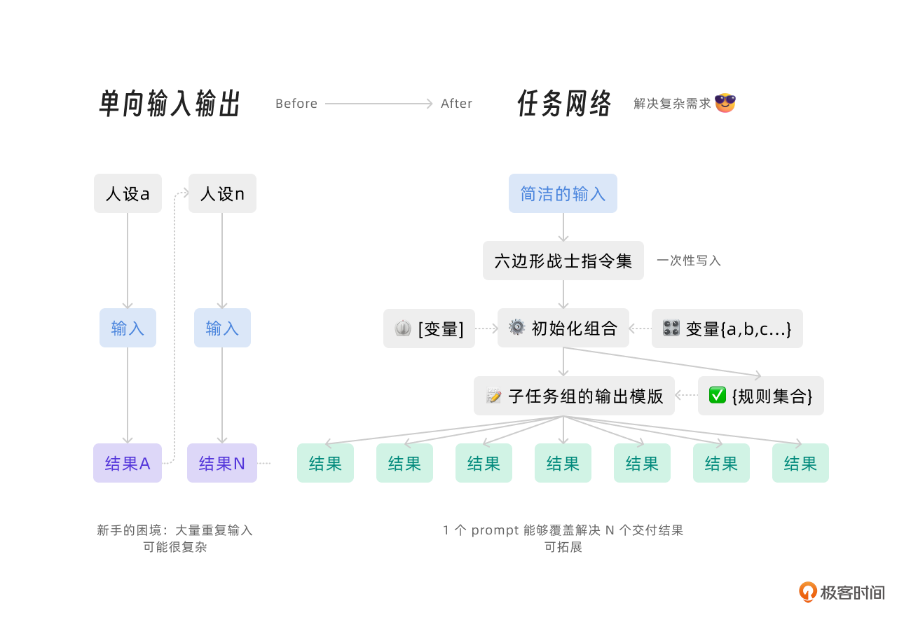

- 使用指令集，跳出新手困境

虽然 ChatGPT 本质是文本生成模型，但只要加一层数据的转换思维，通过以上实例的方法，挖掘工作需求或自身的需求，用色彩、情绪等实用“提效工具”去赋能，慢慢地，你就可以实现将 ChatGPT 这个开光过的“多模态提效助手”全面接入自己的工作流。

要点：

- 从需求出发，挖掘怎么用 ChatGPT 结合工作，最高效。

- ChatGPT 接入工作流的路径：大胆假设 ▸ 从结果反推 ▸ 初步突破 ▸ 抓住核心，小心验证 ▸设计 prompt 来提需求、打磨需求 ▸ 解决需求

- 在 prompt 中融入变量、markdown 和 emoji，真正应对现实世界中多样化的、复杂的需求，prompt 的自由拓展也成为可能。

- emoji 的区分作用，让 prompt 规划和输出反馈都变得简单。

- 迅速拥抱新知识，只有 1 个 prompt 的距离。

- 协作关系中，ChatGPT 是超级中枢，你是背后的指挥官。

- 你就是最大的变量。

- 很快我们就会实现一键高质量交付。（会话分享）

## 踏浪扬帆

你怎么看待 emoji 在 AI 协作中的价值呢？能不能挖掘自己一个从来没用 AI 介入的需求，试着用 emoji 来设计一个多任务的 prompt，解决这个需求？

而且，尽量在“不联网”的情况下去挑战，释放 ChatGPT 更大的价值。（不使用 GPT-4 或者WebPilot 等）

期待在评论区看到你的思考或其他有趣的探索分享，戳此加入课程交流群，也欢迎你将这节课分享给感兴趣的朋友们，我们下节课再会。
