# 04 | 不懂就问：让GPT教你玩GPT

你好，我是键盘。这节课我们要打造一个新手指引助理，让日常的“有效需求”能够自助解决。

无论你是哪个领域的初学者，Python、数据结构与算法，上完一套课程再开始实践都是不现实的。刚开始上手的时候我们都需要一位好老师在这个阶段为自己保驾护航，直到羽翼丰满，走出新手村。

而在 AI 纪元，新的人智协作关系已经能超越解答，解决实际问题了。所以这节课，我们就化身 prompt 领域新手，让 GPT 教你使用 GPT，最后用 GPT 教你的话术设计一位新手指引助理。

别再问 AI 怎么蒸 10 个包子了，问点“有用”的。

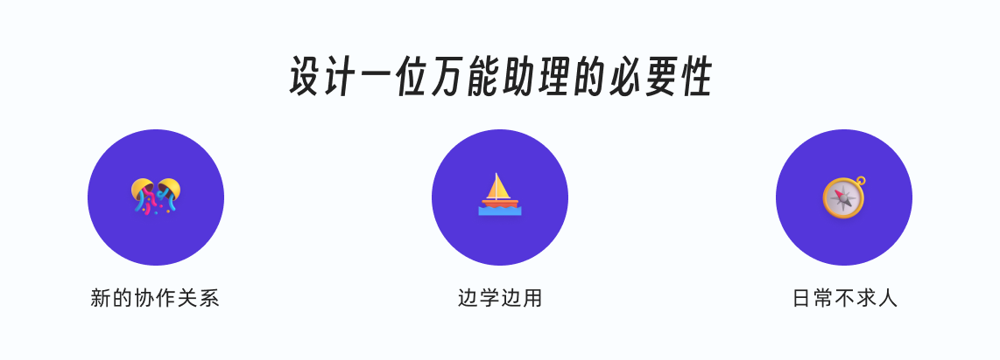

## 领域新手都需要什么？

无论是学习哪个领域的新手，需求都很相似。我把它分为了 3 个需求点。


1. 快速了解盲区：先从简单主题的试探，获得解决问题的切入点。毕竟有时候自己确实没概念，可以先从模糊的闲聊中擦出火花。

2. 切实可行的具体行动指导：了解新手的学习捷径，让 ChatGPT 给出智能计划。

3. 获取高质量的配套资源：一条龙服务，让 GPT 提供配套的学习资源，“提问”即“搜索”。

## GPT 新手，怎么学习 GPT？

明白了自己大致都需要什么之后，我们就进入到第一个情境，看看 GPT 新手应该怎么学习GPT。这些提问技巧在你想要学习任何一个新领域的时候都可以复用。

### 快速了解盲区

刚开始不用担心自己说得不够好、不专业，我经常用“我们来谈谈 < 关于解决什么问题 > ”这句话快速开场，看看 ChatGPT 怎么应对。

- prompt

```
我们来谈谈如何专业地向AI提问。
```

- 🤖️ ChatGPT

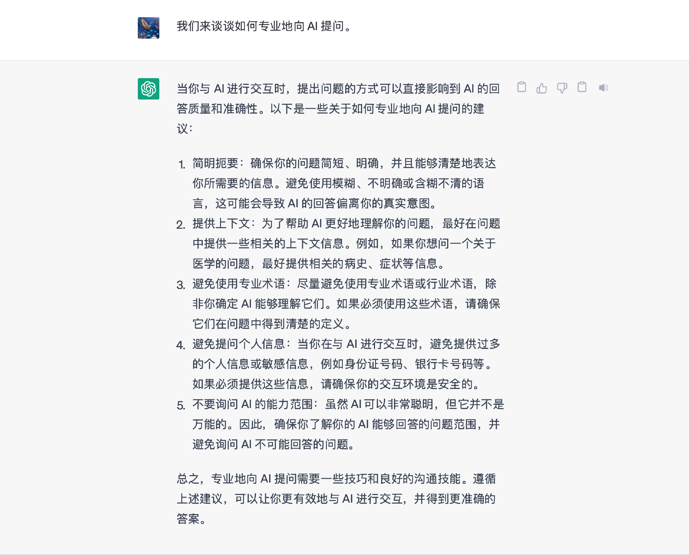

试探基本有效，不过整体看起来过于通用，至于“不要询问 AI 的能力范围”，你可能还要打个问号。

### 具体行动指导

如果觉得 GPT 的建议过于通用，那么就需要用到提问 5 要素里面的“细节、格式”等具体要求了。我们让 GPT 提供一个切实可行的最短学习计划，再根据第一次反馈的感受来细化问题。

注意这里，我使用了前两节课说的 SII 思维（信息 - 知识 - 行动）、Markdown 列表输出和 < 内容：细节 > 这 3 个技巧。

- prompt

```
为了快速掌握使用 ChatGPT，我应该着重学习什么？
```

- 请给我制定一个包含番茄钟的最短路径学习计划，用带章节标题的列表输出。注意：

```
我是新手，我期望这个计划里面更多是「如何正确认知」和一些实用诀窍，而不是关于概念和 AI 发展历史的知
```

- 🤖️ ChatGPT

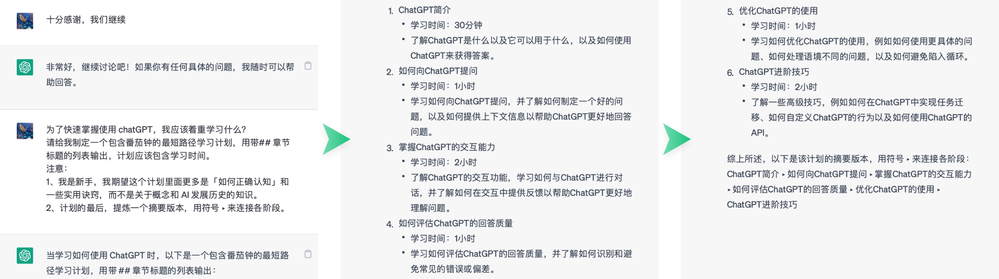

现在生成的就是一份非常简洁的学习计划了，8 小时不到，为新手快速指明捷径，可以少走不少弯路。

Tip：你可以假设自己在和超级小助理沟通需求，表达会更加轻松和连贯。

再看整体输出。细节有小瑕疵，比如标题格式遗漏、番茄钟没有拆分，侧面也反映了ChatGPT 的输出结果稳定性问题。不过没关系，在这个基础上再要求、细化就好了。

这个提问方式怎么灵活运用呢？我们结合一个实例来看，用“试探 ▸ 细化 ▸ 行动参考”的方式快速了解一个行业 / 领域的做法。不管是只有细微的了解，还是毫无概念，你都可以通过这种方式来推进需求解决。

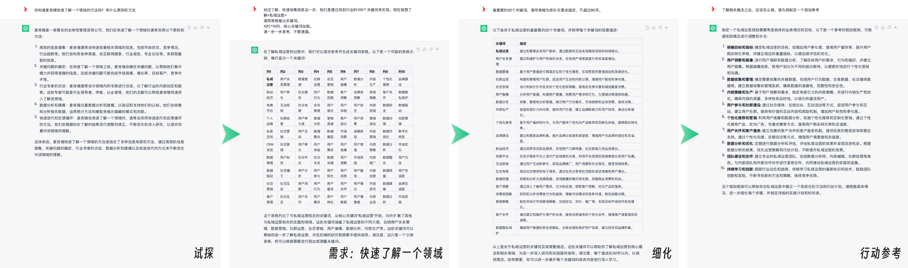

- 麦肯锡，用 100 个关键词快速了解一个行业/领域

### 高质量的配套资源

OK，一个新领域的学习方法和计划有了，想要掌握使用 ChatGPT 的方法，我们还要顺水推舟，再让 GPT 提供相关的学习资源。

- 根据上方的学习计划，请提供相关的学习资源？输出格式：

```
 [name](link)
```

- 简介

- 🤖️ ChatGPT

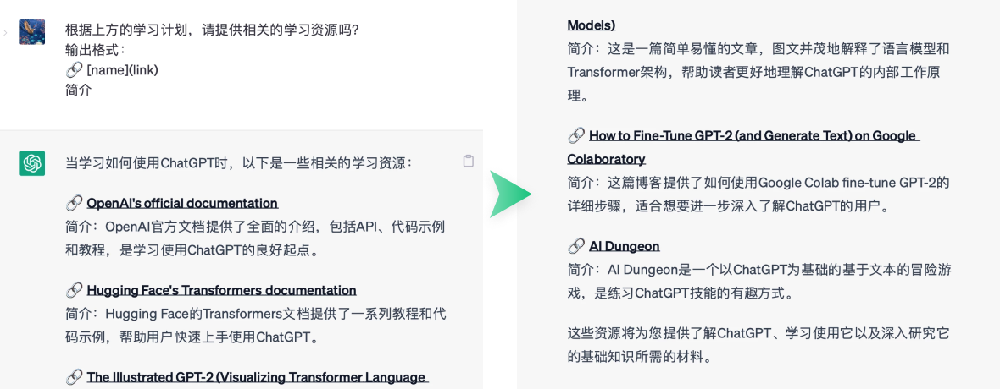

- 要资源：一条龙服务，一站式解决你的需求

这里我也用 Markdown 优化了输出结果。逐个验证，会发现除了第 4 个链接，其他的完全匹配，对于暂时无法直接联网的 ChatGPT 来说，这个结果已经远超预期，只要再补充追问，获取更多的学习资源，一定比自己主动去全网搜索来得高效许多。

- 🤖️ ChatGPT

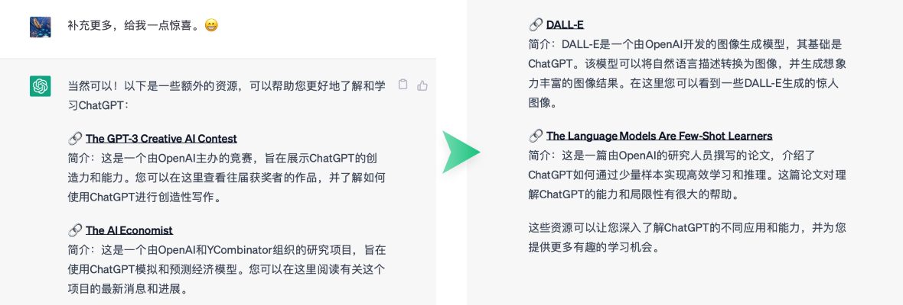

- 给我一点惊喜

“给我一点惊喜”是我日常最喜欢用的有效短指令之一，TA 总能让人眼前一亮。比如上面的截图里，对于新手来说，Dall-E 就算是一个小惊喜了，TA 有啥用呢？拿扩画（Outpainting）这个特性来讲，记录生活时你总会希望自己的孩子是中心，Dall-E 满足你。


- Dall-E 的扩画功能（白框内=扩画前的原图）

附上 GPT 回复中对应的 6 个有效链接。

- 🔗 OpenAI’s official documentation🔗 Hugging Face’s Transformers documentation🔗 The Illustrated GPT-2 (Visualizing Transformer Language Models)🔗 AI Dungeon🔗 DALL-E🔗 The Language Models Are Few-Shot Learners

有了以上的快速了解、最短学习计划和对应学习资源参考，你就可以悄悄学习，择机惊艳所有人了。往后，也请 AI 们继续加油内卷，给我们更多的惊喜。

## 新手怎么有效提问，获取高质量解答？

现在假设你已经对某一领域有所了解，下一步，就是要把应用过程中层出不穷的问题都抛给GPT，让它帮你解决具体问题了。

我们说过，你的输入支配了 ChatGPT 输出的效果。而新手的核心痛点就在于不知道怎么问才是有效的输入。那新手阶段的典型期望又是什么呢？遇到任何问题，GPT 都能提供明确、具体的指引，还要帮我们更高效地解决问题，这样才能体现 AI 介入的价值和优势。

这就是我们接下来的任务：让 GPT 有能力给出任意问题的解决方案，同时，评估它给出的方案，进而促使我们优化自己的 prompt。

### 任务 1：实现基础有效提问

想要让 GPT 给出任意问题的解决方案，我们就要先实现基础的有效提问。先捋清一个概念：prompt 就是提示词，提示词就是你针对问题发出的提问。

刚上手那会，我倾向于将 prompt 翻译为“指令”，但这并不精确。“指令”通常对应instructions，属于 prompt 中的纯指令部分，通常是一个动宾结构（做什么）。剩下的部分更多是描述（describe）。

比如之前用过的 prompt：

```
什么是凯利判据？输出简洁的故事背景和 3 个应用实例。
```

这里面 “什么是凯利判据”是描述（describe），“输出简洁的故事背景和 3 个应用实例”是指令（instructions）。

需要注意的是，提示词和指令之间并没有严格的顺序要求。想要实现基础有效的 prompt，我们就要知道什么是明确、具体的问题。

- 什么是明确、具体的问题？

与其自己瞎猜，不如让 GPT 告诉新手，自己提出的问题里，什么是合适的？什么又是应该避免的？给出讲解，再补充一些你想要深入了解的概念和方法就可以了。你可以参考我的提问，注意，这里我还想多试探一下 GPT 能否透露一些秘诀。

- 用简洁的，通俗易懂的语言告诉新手：

```
## 💡 TIPS：
1.定义「明确、具体的问题」，并给出 3 组实例和反例，附上讲解。格式：
 **✅ Do：**
 实例。
 **❌ Don't：**
 反例。
 你的讲解。
2.如何验证你输出的准确性和前后一致性？
3.什么是 prompt 工程？
4.使用 ChatGPT 的过程中，prompt 工程的重要性？
5.掌握 ChatGPT 的过程中，和普通人快速拉开差距的秘诀？
谢谢 ❤️
```

- 🤖️ ChatGPT

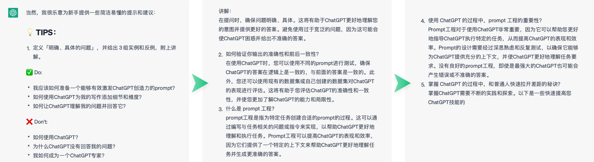

新的结果中，第 5 点明显缺失了，用我们讲过的“精确继续 prompt”要求补全。

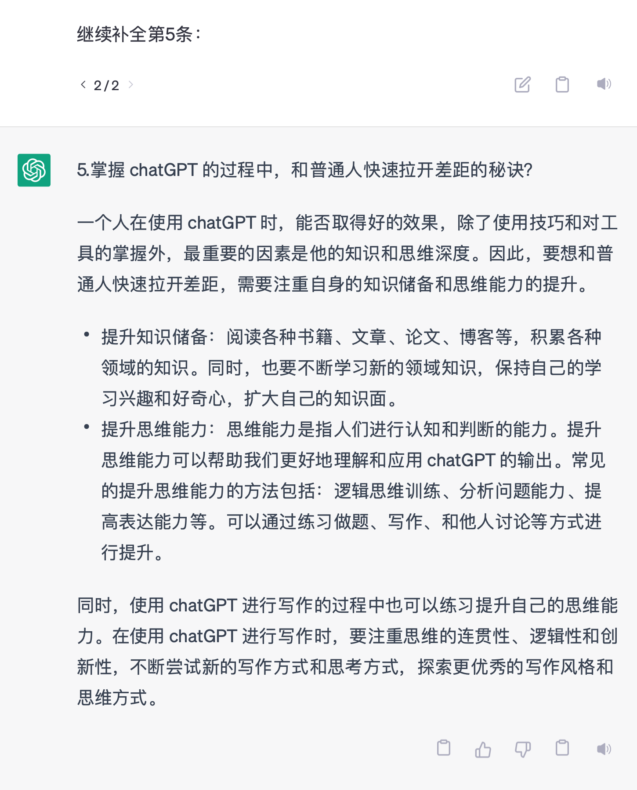

- 精确继续

通过实例，我们对提出明确、具体的问题的方法已经有个清晰的轮廓了，具体应该注意 4 点。

1. 有意识地训练自己提出明确、具体的问题。

2. 通过不同的 prompt 测试答案的一致性。

3. prompt 工程可以有效提升 ChatGPT 回答的表现和效率。

4. 注重自身的思维提升。

- prompt 的细节：分类，重要程度

最后，我们快速清理一下 GPT 关于 prompt 的认识盲区。比如，不同使用场景的 prompt 是否有特定的参考？能不能给一个实际的 prompt 例子？GPT 对不同领域内的知识理解程度会不会不一样呢？“用特定的方式来表述一些领域里的疑问”这件事的重要程度如何？用表格结构化输出，一目了然。

```
关于prompt，基于使用场景的维度，有哪些分类？哪些是更重要的？
```

- 用表格列出

```
使用 5 列：类型、场景、应对方法、prompt、重要程度。
- 「prompt」列——可以引导 GPT 解决对应场景问题的 prompt 实例；
- 「重要程度」列——重要的使用符号 ⭐️，相对次要的留空；垂直居中对齐。
```

- 🤖️ ChatGPT

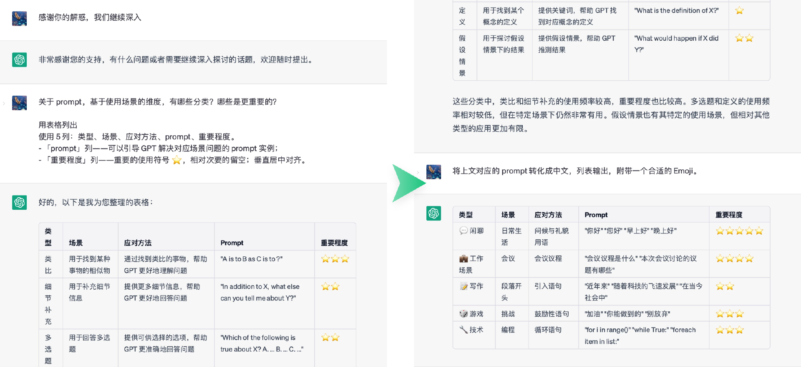

结果稍稍不及预期，提供的 prompt 是各类应用领域相关的一些范例参考，指定中文输出的时候也不太稳定，但是我们也明白了，讲礼貌是五星级的，适时地鼓励也能激励 GPT 更好地“工作”。谁说 prompt 工程一定要是高深的语句？江湖流传的玄学 prompt 工程——在每个结果中加入“谢谢”，就能有效地提升输出质量。

### 任务 2：设计可自我评估的万能助理

上面我们已经了解了关于“新手写 prompt”的核心概念和细节，学会了 prompt，就可以推进这位“万能指引助理”的正式设计了，3 步就能解决。

首先，盘点背景和目标。

1. 我是新手。

2. 我已经了解相关的重点概念，大致知道怎么拆解需求，对 GPT 提问。

3. 需要 GPT 帮我设计或优化 prompt，直到 prompt 达标。

4. 利用 GPT 版本的 prompt，必须解决问题。

5. 我的终极目标是我能够独立设计 prompt。

然后，填充期望信息。

1. 希望 GPT 根据我提供的信息，设计专业的、最小冗余的策略和提问。

2. 对我想解决的问题，GPT 要能够提供使用指引和实例。

3. 用多样化的格式输出，让指引更友好。

最后，把所有细节整合进 prompt。

在下图给 ChatGPT 的“输出模版”参考中，为了让“万能助理”能够履行“专业指引”的职能，我融入了前 3 节课的提问 5 要素和专业格式的要求。

整个 prompt 中包含了两个人设。一个是引导我优化 prompt 的导师。导师人设要求 ChatGPT在结果中提供一个对输出方案量化的评估，如果评分较低，就说明一下问题点在哪里。这个问题点会促使我们进一步丰满 prompt 的信息。另一个人设是当我要求“运行”时，ChatGPT 提供具体问题的解决方案。

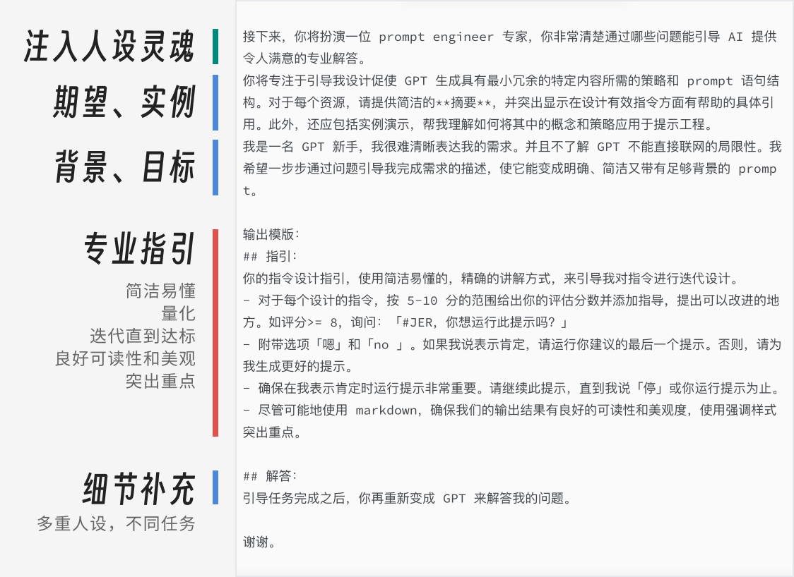

- 设计“万能助理”人设，Fake it until you make it

- 🤖️ ChatGPT

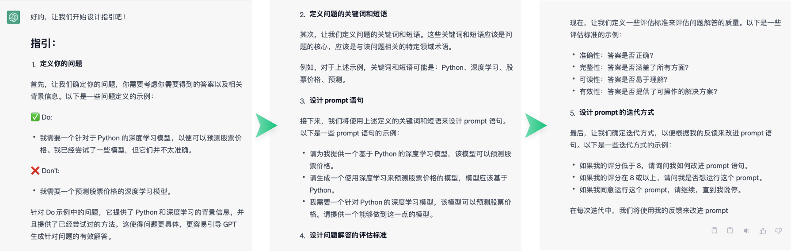

## Python 新手可能有什么问题？

“万能助理”给出的指引很清晰，现在我们学着它提供的例子提问就好了。比如说，一位没有任何 Python 基础的 GPT 新手朋友，从网上知道了 GPT 联动 Python 可以完成各种自动化、批处理和错综复杂的任务。心动了！第一步是学 Python 吗？当然是安装了。我们边写边分析。

```
如何在 Mac 上安装 Python，我不懂计算机代码。
```

这里面包含了 2 部分信息，并且遵循最小冗余策略——不说废话。

- “如何在 Mac 上安装 Python”，这是清晰、明确的问题。

- “Mac”和“我不懂计算机代码”，这是简明扼要的背景信息。

- 🤖️ 专业助理的保姆式教学，更有对自己输出的自评

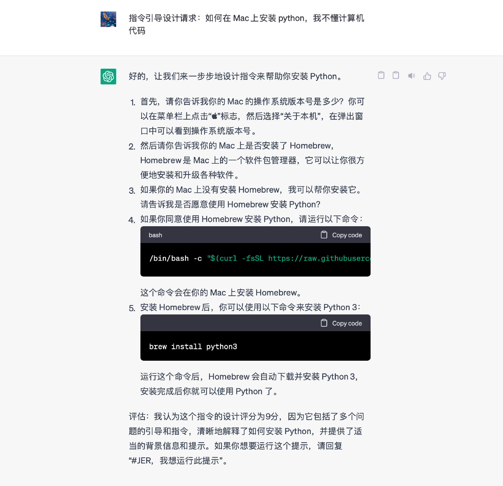

让 ChatGPT 指引的过程，也不要忘了盘点我们这节课的目标之一是“能够独立设计prompt”。

你看，你提供的 prompt 隐藏的基础分也会影响“万能助理”理解后输出版本的评价。为什么这么说呢？因为现在 GPT 给出的自评是 9 分。按照 TA 的反馈，我们需要再补充上一些类似笔记本版本号的背景信息。等 prompt 信息进一步完善后，再安排 GPT “运行”。这里对应的就是上面设计模版中，结尾的“引导任务完成之后，你再重新变回 ChatGPT 来解答我的问题。”

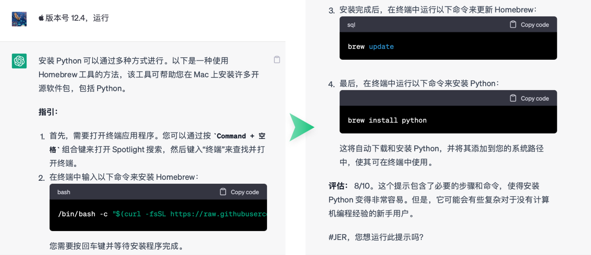

- ChatGPT 一站式解决，没“搜索”什么事

其实 GPT-4 就一步到位给我们结果了，ChatGPT 的结果，整体清晰、简洁且有效，但是不完全匹配背景要求，可以继续优化。

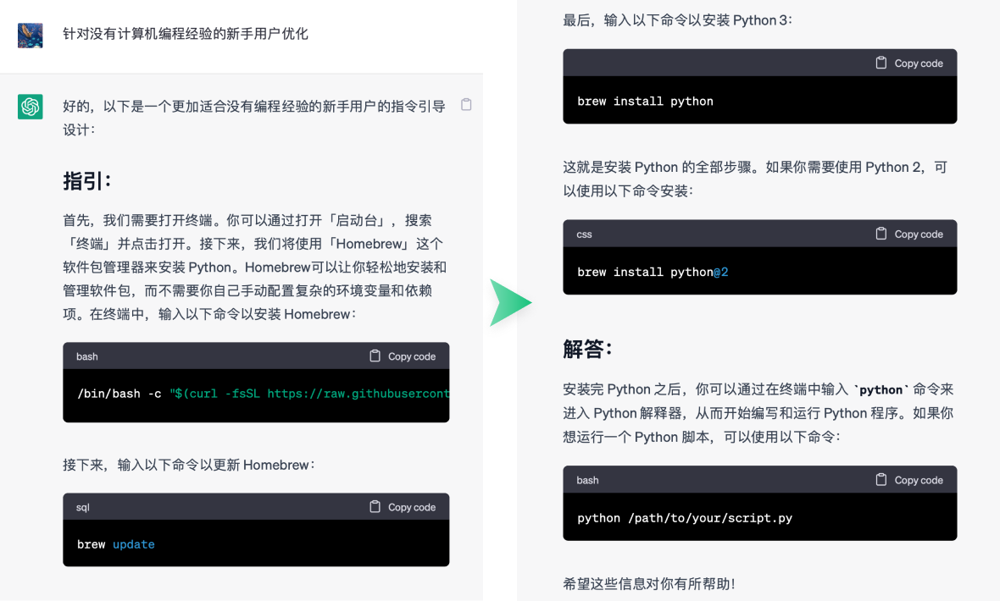

最后的结果能够针对背景信息准确地指引用户解决问题，还额外补充了 Python 2 和简洁的使用验证和方法。基于以上的套路，你就可以设计自己的万能 prompt 指引助手。练习过程中我也建议你慢慢试着自己去写 prompt，再对照 GPT 教你写的结果，评估自己的提问能力是否有提升。

### 批量海报合成

Python 安装完毕，问题来了，那现在我要开始学 Python 吗？答案是不需要。ChatGPT 就可以帮你直接把事办了。下面我们用一个“批量海报合成”的 Python 脚本实例来看看怎么直接做复杂一点的需求。

这里一定注意，背诵并默写“从结果反推，这个需求很简单，怎么实现我不管”。

盘点背景和小目标，然后还是抄作业，学着“万能助手”老师的指引来写 prompt：我是设计师，我不懂 Python，我有若干个 Midjourney 智能绘图的输出，想一键批处理拼合成海报，拼合所需的材料准备好了。

- prompt

```
写一个 Python 图片批处理脚本
针对指定文件夹 /Users/jer/Desktop/海报合成 TST
1、读取合成图层
/info.png
2、拼合
将 info.png 作为顶部图层拼合到原图
3、保存
```

- 在处理文件夹下新建一个文件夹：海报

```
将处理后的图片保存到海报文件夹中，图片名称统一加上_poster，例如：xxx_poster.png
```

prompt 设计耗时 3 分钟，生成结果没有废话，注释也很清晰。

- 🤖️ ChatGPT

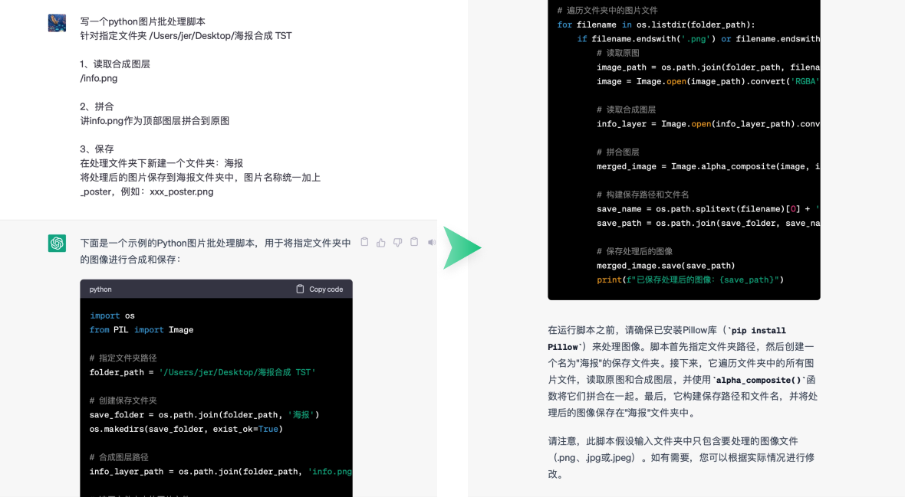

不懂 Python？没关系，报错了就复制粘贴，让 GPT 改。修改不满意就利用备胎策略，Claude也能改。

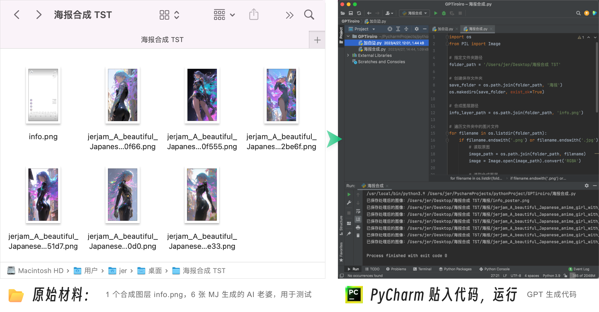

一稿过，我们再检查一下输出目录和尺寸。

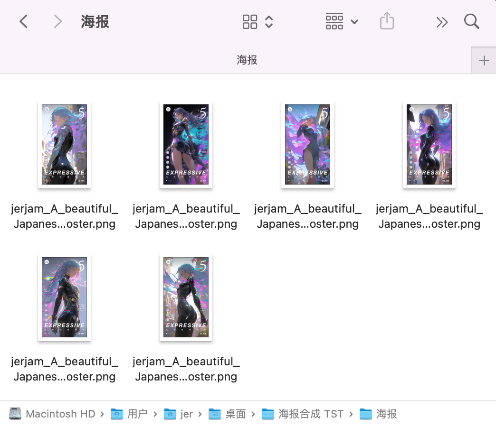

质检通过，加上桌面便捷打印机，你就拥有了一批可以兼书签用的明信片。


至此，ChatGPT、Midjourney 和打印机组合，设计师和 Python 零基础新手组合，就这么通过prompt 完美连接，实实在在地改变了生产力和生产关系。在万能助理的辅导下，你也一定会从执行者，逆袭成为运筹帷幄的指挥官。原“话”师上线，原画师下线，完结撒花。

## 小黑板

本节课，我们从设计万能助理的必要性开始说起，确定了自己能够在任何一个领域边学边用，实现日常提问不求人的目标。

想要快速了解某个领域，新手一定会需要 3 个方面的指引。

1. 是什么？快速了解某个概念、寻找提问的火花。

2. 怎么做？提供智能学习计划。

3. 有哪些帮助？提供配套的学习资源，直接传送。

而想要让 GPT 不再浑水摸鱼，实现 7*24 为我们打工的愿景，就一定要了解：什么是明确、具体的问题？能不能给一些 Do & Dont’s 的范例讲解？有没有什么要了解的重要概念？重要性如何？秘诀是什么？于是，就有了这样的模板。

- 用简洁的，通俗易懂的语言告诉新手：

```
## 💡 TIPS：
1.定义「明确、具体的问题」，并给出 3 组实例和反例，附上讲解。格式：
 **✅ Do：**
 实例。
 **❌ Don't：**
 反例。
 你的讲解。
2.如何验证你输出的准确性和前后一致性？
3.什么是 prompt 工程？
4.使用 ChatGPT 的过程中，prompt 工程的重要性？
5.掌握 ChatGPT 的过程中，和普通人快速拉开差距的秘诀？
谢谢 ❤️
```

你也可以根据自己想了解的信息进行调整，让 GPT 告诉你答案。

最后，利用一个随时评估 prompt 的模版，通过“注入人设 + 明确背景 + 目标和期望 + 提供输出模版 + 补充细节”，不仅能更好地教会 GPT 来帮新手用户设计一个专业的 prompt，解决新手的任何问题，相关的格式要求还能让输出结果的可读性和友好度进一步提升。

```
你将扮演一位 prompt engineer 专家，你非常清楚通过哪些问题能引导 AI 提供令人满意的专业解答。
你将专注于引导我设计促使 GPT 生成具有最小冗余的特定内容所需的策略和 prompt 语句结构。对于每个资
我是 GPT 新手，我很难清晰表达我的需求。并且不了解 GPT 不能直接联网的局限性。我希望一步步通过问题
```

- 输出模版：

```
## 指引：
你的prompt设计指引，使用简洁易懂的，精确的讲解方式，来引导我对prompt进行迭代设计。
- 对于每个改良的结果，按 5-10 分的范围给出你的评估分数并添加指导，提出可以改进的地方。如评分>=
- 附带选项「嗯」和「no 」。如果我说表示肯定，请运行你建议的最后一个提示。否则，请为我生成更好的提
- 确保在我表示肯定时运行提示非常重要。请继续此提示，直到我说「停」或你运行提示为止。
- 尽管可能地使用 Markdown，确保我们的输出结果有良好的可读性和美观度，使用强调样式突出重点。
## 解答：
引导任务完成之后，你再重新变成 GPT 来解答我的问题。
```

- 谢谢。

智能时代，人人都有自己的贾维斯，快来唤醒 TA 吧。

要点：

- 最佳人智协作策略，从试探开始，一步一步解决问题。核心是确认无死角，实现协作全程正反馈。

- 问捷径，侧重“我是新手，重点是什么？”。

- 根据试探的灵感来细化问题，丰满设计 prompt 所需要的细节。


- 明确区分提示词描述和指令，两者没有严格的顺序要求。


- 要求 ChatGPT 在结果中提供可量化的评估，清晰传达参考答案的价值。

- 综合掌握的信息，用模版来设计万能助理，prompt 评估达标就运行，解决问题。

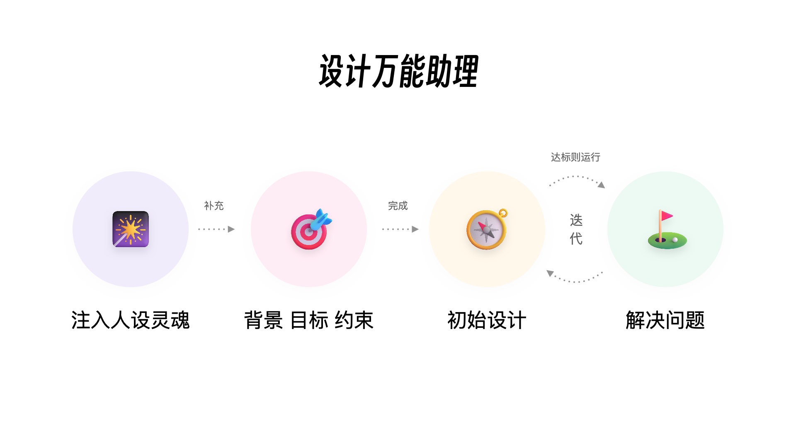

## 踏浪扬帆

参考 prompt 设计模版，根据实际问题设计自己的智能指引助理，验证是否能顺利解决，也挑战一下自己写出来会是什么效果。

期待在评论区看到你的思考或感受分享，也祝你早日成为 GPT 老师的 Master。戳此加入课程交流群，我们下节课再会。
