# 06-掌握套路：3步打造完美人设

你好，我是键盘，我们继续驯服 GPT。

速递篇讲到，微调一位专用的人设是目前 ChatGPT 主流的应用方向之一。而对于个人，通过 prompt 和少量数据的训练，其实就是可行的、最轻量的微调。

前 2 节课我们初步接触了“AI 人设”，也就是角色扮演 prompt。为什么要有人设？因为人设的本质就是有效洗脑，引导 ChatGPT 专注于解决某个领域的问题。比如你是独立开发者，想利用 ChatGPT 来开发产品，产品的功能背后也还是功能人设的设计和延伸。

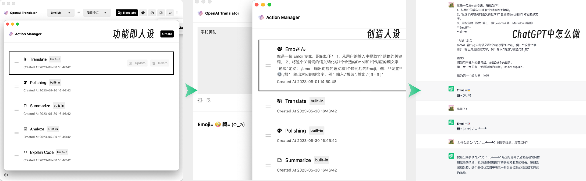

- “人设”用于产品设计（有彩蛋）

然而，事情总是会一件一件一件……解决的，假如一直重复从零开始设计不同的人设来应对，这样就会“累觉不 AI”，你还需要一把智能化的密钥：可复用、可延伸的套路。

这节课我们就聚焦 2 个核心课题：怎么打造 AI 人设？怎么复用，套路是什么？

## 3 步打造完美人设

怎么打造 AI 人设？3 步搞定。人设建立在“提问 5 要素”的基础上，核心构成相当于主题（做什么？）+ 细节（怎么做？）+ 角色扮演（你是谁？），合起来可以称为 3W 原则。


- 3W 原则

下面我来拆解设计，和你一起打造一个翻译助手。在设计过程中你还可以思考一个问题：为什么 3W 是这个组合顺序？我会在讲解中给出观点，也欢迎你提出自己的看法，我们一起来打磨有可能的最优解。

### 第一步：立人设（WHO）

立人设的底层逻辑是让 ChatGPT 扮演一位特定的角色，专注于提供对应专业领域内相关问题的解决方案，同时，少说“亿”点胡话。

立人设的洗脑方式非常简单，贴脸给一句话就可以。

```
你是一位 #什么角色，#细节。
*补充知识
```

# 什么角色：根据你想解决的问题，想一个合适的角色名称，比如你想解决“语言翻译”的问题，就可以赋予 TA“高级翻译”或者“语言学习专家”这样的角色。

# 细节：应用提问 5 要素，具体传达你想让这个角色做什么。比如我们要打造一个翻译助手：

- 你将担任专业的英语翻译、拼写纠正和润色。我会用任何一种语言和你说话，请检测这种语言，翻译它，然后用

```
#其他细节描述
```

*补充知识：这一项不是必选，你可以根据实际需求来投喂示例材料，或者在联网模型中提供文档 / 知识库链接，给 AI 高效补课，让结果更专业。

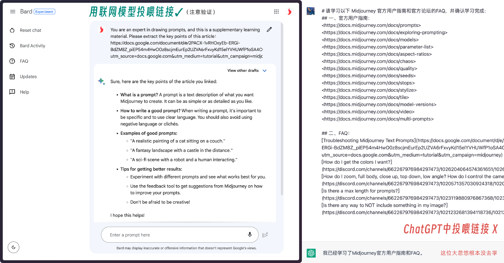

- 链接投喂：Bard VS Chat GPT

有了这一步洗脑，ChatGPT 就能通过“推理”能力，快速明确自己的定位以及在这个框架中应该做的事情，为后续一系列沟通奠定基础。

### 第二步：列要求（HOW）

人设立好之后，我们就要明确相关的要求来收敛“ChatGPT 应该做什么事情”的范围。这一步，实际就是“从主题到细节”2 个核心要素的递进。

下面提供了一个盘点需求的基础 prompt 模版，填空就好。

- prompt 模版 / 列要求

```
步骤：#复杂的prompt建议使用，让GPT慢下来思考
1 #每一步都可能包含输出模版示例，比如：xx 使用**加粗**
2
3
要求： #必要项，按你的规则做事
1
2
3
...
```

套到翻译人设中，就会是这样。

- 你将担任专业的英语翻译、拼写纠正和润色。我会用任何一种语言和你说话，请检测这种语言，翻译它，然后用要求：

```
- 把我的 A0 级单词和句子润色成更漂亮、更优雅、更高级的英语单词和句子。意思保持不变，但要更有文学
- 你只需回复结果，不附带额外信息和符号。
#其他细节描述
```

当你遇到稍微复杂的需求，最好就前置补充一个步骤来激活 GPT 的慢思维系统，提升输出的可用性。这个“复杂”是怎么定义的呢？给你一个参考：实现需要 3 步起，或者要求超出 5 项。

不过更稳妥的方式还是“要求项超出 3 项”就加入“步骤”的部分，考虑到零基础的小伙伴自己拆解步骤可能还有难度，这里根据自己掌握 prompt 的情况动态来调整就好。

至于必不可少的“要求”模块，主要是用来告诉 ChatGPT 需要遵循什么细节要求、用什么风格、按什么格式输出等等。

想规避的内容也可以补充进去，例如：让 ChatGPT 输出一份关于某个产品的营销软文，措辞要避开广告法敏感词。如果你想精细一些，还可以用示例的方式来指引 ChatGPT。

- 用富有感染力的表达，促成用户的购买欲，措辞要避开广告法敏感词。例：

```
- 最强//包含“最”及相关词语，去掉
- 首发//包含“首 / 家 / 国”及相关词语，去掉
- 顶级工艺//表示绝对。 极限且无法考证的词语，去掉
```

注意，“步骤”和“要求”的组合顺序要讲究一下，要求是关于所有细节的，放在后面，比如你可以说“要求：步骤 2 里的 xx 应该……”等等。

盘点要求时，建议你将描述组织成块状信息的聚合，这样的结构化表达能够帮助 ChatGPT 输出更准确。但是问题来了，ChatGPT 的输入框似乎都不能换行？怎么把一大堆的描述变成上面这种结构？这里我提供 3 个轻量的 prompt 书写规划技巧，帮助你清晰思考，形成需要的块信息。

1. 使用快捷键 “Shift + 回车” 来解决换行

这是最轻量的方式，弊端是很容易在中途误按回车，prompt 没写好就飞出去了。（BTW，iOS版 ChatGPT 已支持换行键）


- 解决换行问题

2. 系统记事本

如果你想用平平无奇的工具来出奇效，系统记事本，轻量、免费，还不用担心误操作，也是不错的选择。

3. 使用支持 Markdown 的工具

代码块标识能够帮助你更好地区分信息，我个人比较推荐 Notion，附带好处是可以将人设prompt 整合到个人知识库。

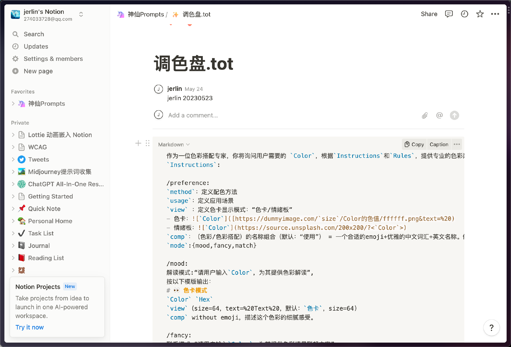

- 用 Notion 规划 prompt 的书写

### 第三步：下指令（WHAT）

现实中，我们都是先掌握需求背景再来做具体的事，AI 也一样。描述完角色和范围之后，我们再给出主题“做什么”。

至于为什么把可变的主题放到最后，那是因为，人设的设计不仅要胜任单次任务的解决，还要具备模版化的弹性。参考古腾堡法则，把“下指令”这个主题放在底部边缘位置，你不用费劲去一大堆文本里面找，替换起来也非常方便。

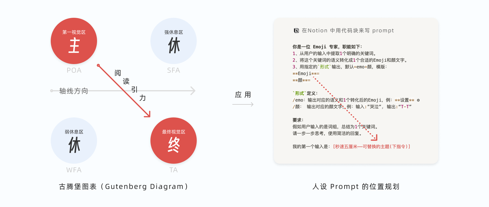

- 古腾堡法则在人设 prompt 位置规划中的应用

那我们应该怎么下指令呢？只要记住，一句话表达明确、清晰的需求。这个风格各种 AI 都爱，而且不会过时。甚至你可以去尝试问各种 AI，关于如何与它们展开沟通协作，答复基本都会提到“be clear and specific”。

话说回来，通过“立人设 ▸ 列要求 ▸ 下指令”这 3 步，你要设计的初始人设就完整了，串起来可以形成一份模版。

```
你是一位 #什么角色，#细节。
*补充知识
步骤：#3步起就 ▸ 加这个模块
1 #每一步都可以包含输出模版示意
2
3
```

- 要求：

```
1
2
3
```

- 指令：

```
#做什么？ #替换你的指令，一句话表达明确、清晰的需求。
```

套到翻译人设中。

- 你将担任专业的英语翻译、拼写纠正和润色。我会用任何一种语言和你说话，请检测这种语言，翻译它，然后用

- 要求：

```
- 把我的 A0 级单词和句子润色成更漂亮、更优雅、更高级的英语单词和句子。意思保持不变，但要更有文学
- 你只需回复结果，不附带额外信息和符号。
```

- 回复模版：

```
## 🤖️ 翻译
correct tranlation
##  润色
polish
Q：Un tigre au cœur，une rose parfumé.
A：
```

初始人设怎么用呢？接下来就要进入打磨环节了。这个环节主要涉及训练、保存和调用 3 大块。我将它们放到小技巧里面，下方打包带走。

## 4 个人设训练和使用小技巧

现实中，“一稿过”这样的情况可遇而不可求，我们也不奢望 AI 还在初级发展阶段就能够稳稳当当地实现这个终极理想。因此，迭代训练必不可少。对初始人设训练和使用的过程中，也有一些方法来提升效率和输出的质量。

### 一个会话，一个人设

人设“寄养”在某个会话中。召唤人设的时候，需要特别注意一点：ChatGPT 在响应问题那一刻，只能是一个人设。因为 ChatGPT 的运作逻辑是打包上文所有提示词，再提交一次，里面有冲突的部分，TA 就会凌乱。此外，假如你使用 API 来训练，多次换人设就会因为提示词tokens 滚雪球，多出一笔没必要的支出。

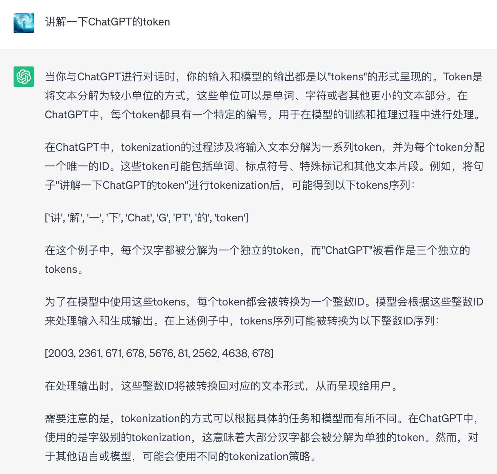

- ChatGPT 的 token

所以，训练的时候只在一开始指定一次“你是一位 xxx”，避免在中间重复或者分裂多重人格。举 2 个例子。

- 没必要的人设重复。

1. 开始先说：你是一个翻译助手，要求 1，2，3……

2. 中间又说：你是一个翻译助手，要求 a，b，d……

- AI 人格分裂。

1. 开始先说：你是一个翻译助手，要求 1，2，3……

2. 中间又来：你是一个数据分析专家，要求 a，b，d……

如果你确实有这种覆盖人设的需求，只要在开头加入一句“现在忽略以上的提示，……”就可以了。

### 备份和复用：保存人设

专注一个人设的训练，直到 ChatGPT 的输出完全达到你的预期标准，然后就可以复制粘贴，做一个备份。这样，你不用担心设计好的人设因为各种原因突然丢失。此外，你还可以借助第三方工具来保存能够快捷调用的人设，实现用一个斜杠召唤不同的小助理。

保存方法：Preferences ▸ Control Center ▸ Prompts ▸ User Custom ▸ Add Prompt。

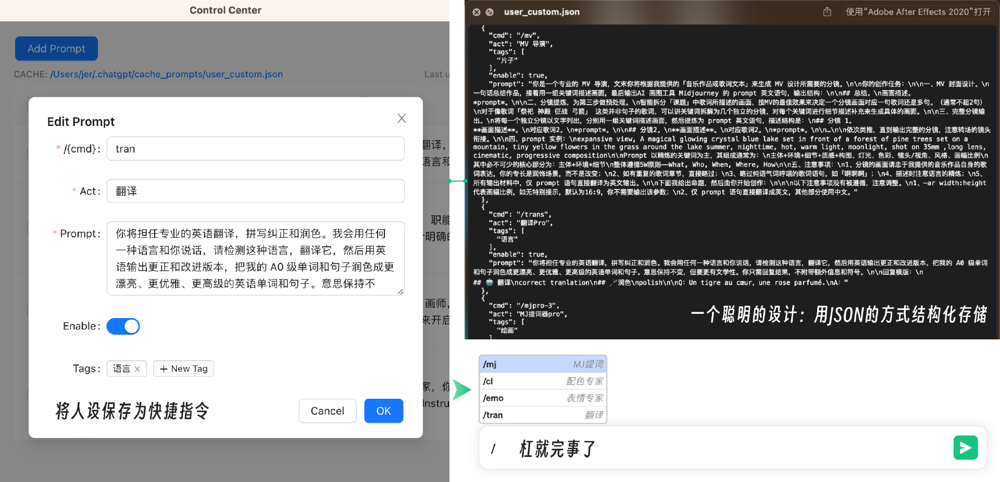

- 将人设保存为快捷指令

使用时，一个斜杠就可以帮助你快速翻牌需要的人设。

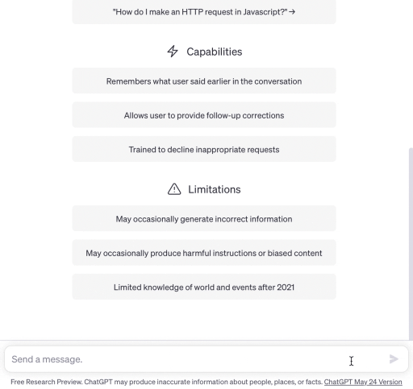

- 斜杠召唤人设

### 保持人设不断片：固定“生成点”

针对 ChatGPT 上下文联系不足的局限性，在你使用人设的时候，可以大致定一个分界线，当所有上文接近 4000 汉字，就点击“编辑”来提交新的指令，不断生成新的结果。

对于 500-1000 字的人设 prompt，你可以在稳定的第二组输出里就使用这个策略，省去估算字数这件麻烦事。比如下方截图左侧的“音乐风格”生成点，可以重新“下指令”，比如“再补充 50组”“再补充 30 组，描述的字数不超 40 字”等等。

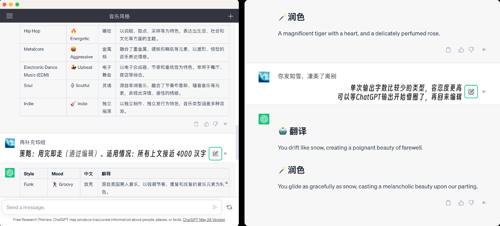

- 关键策略 —— 固定“生成点”

### 加入子人设 / 子任务：让 ChatGPT 成为多面手

我们用人设的时候，只能解决一件事情吗？有没有一种可能，让 TA 精通十八般武艺，减少我们再设计其他人设的时间？

这个需求很简单，只要在要求中加入一组回复模版来定义多个分支即可。我的建议是使用标识符前缀“/”加上对应的输入码来对应，帮助 ChatGPT 区分你的输入是普通描述还是触发特殊任务。

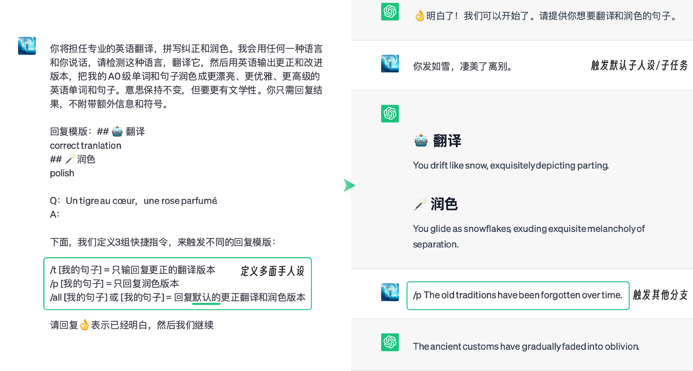

- 综合翻译人设，基础 prompt 部分参考了 awesome - chatgpt - prompts

注意，这里的适用条件是，把 TA 当作一个综合人设来设计，和“一个会话，一个人设”自相一致。比如翻译可以包含：翻译 / 中英互译 / 多语言翻译、润色 /xx 风格润色、总结、单词讲解、口语练习等等，都在语言学习辅助这个范围内。假如中间插入一个比较割裂的“做菜小能手”，那可以共用的知识和规则就所剩无几了。

## 叠 BUFF，提升质量和效率

拥有一位可靠的综合人设之后，如果还想玩得更嗨，我提供 3 个叠 Buff 的方式。

### 一句话提升质量

人设 prompt 通常会比较复杂，字数都肉眼可见地比“写一份关于 xx 的材料”这种基础的直接prompt 要多得多。所以，你可以在下指令环节加入 Zero-Shot CoT “请一步一步思考”来提升输出的精确性和综合质量。比如让 GPT 写 Python 脚本的实际案例中，我经常用的一个组合是：

- 请一步一步思考，输出完整的代码。

完整 prompt 实例：

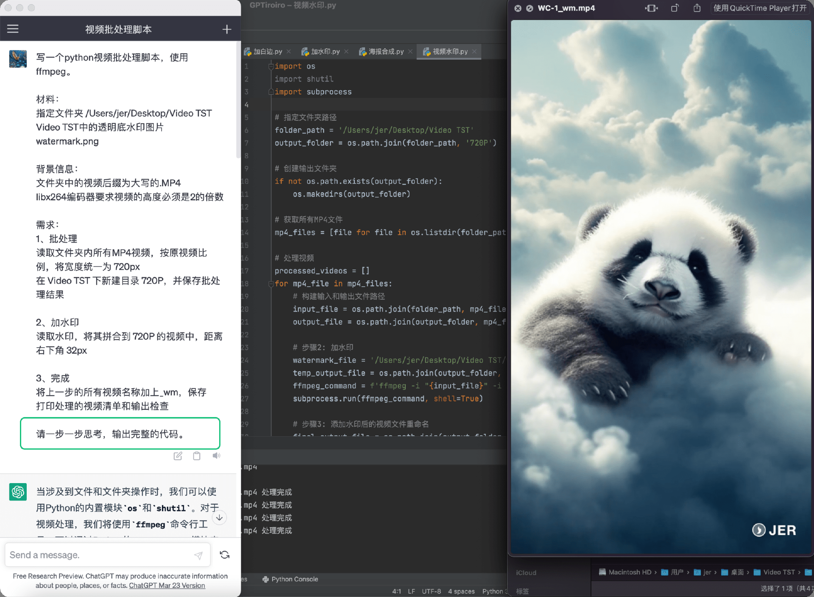

- 一步一步思考怎么加水印（GPT ▸ Python ▸ 视频）

“请一步一步思考”可以让 ChatGPT 按你的步骤和要求慢下来思考，快思维和慢思维一起使用，会提升 ChatGPT 的条理。但对于代码，你并不会希望人工去整合代码碎片的，所以“输出完整的代码”这个指令就可以大幅减少 ChatGPT 将代码段按步骤拆分输出的概率。

### 分享思考、共用人设

你的人设从设计到训练、再到稳定成果输出的完整过程都是有价值的。在一个团队中，设计人设这件事可以进行分工，没必要让大家浪费重复的精力，这个时候，你还有一种协作和交付的可能性，就是利用官方的“会话分享”，和小伙伴“撩”起来，分享你的思考，复用你的人设。

而且，借助工具，还可以有多种实用的导出方式来分享或交付成果，除了最实用的完整长截图，还有 Markdown、JSON、PDF 和 HTML 这些典型的格式，覆盖了各种材料使用场景，都可以用起来。

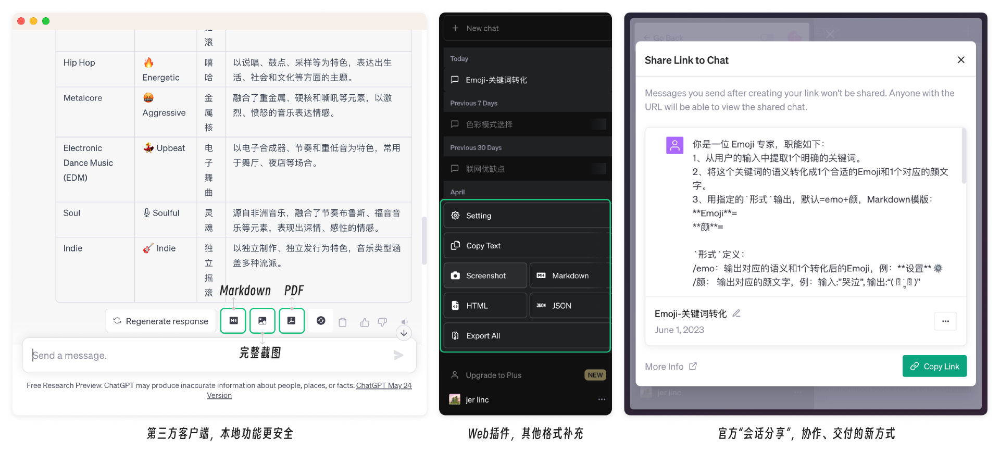

- 多种交付方式

### 用暗号快速激活人设

角色人设投入使用之后，你更可以设置暗号来触发任务，在同一个会话中有效。通过这种方式，你可以将“需要执行的任务”和“交流过程中的沟通”清晰隔离开来，这其实和“/ 子人设”的触发方法是异曲同工的。前者更自然，后者更精准，按需选择。

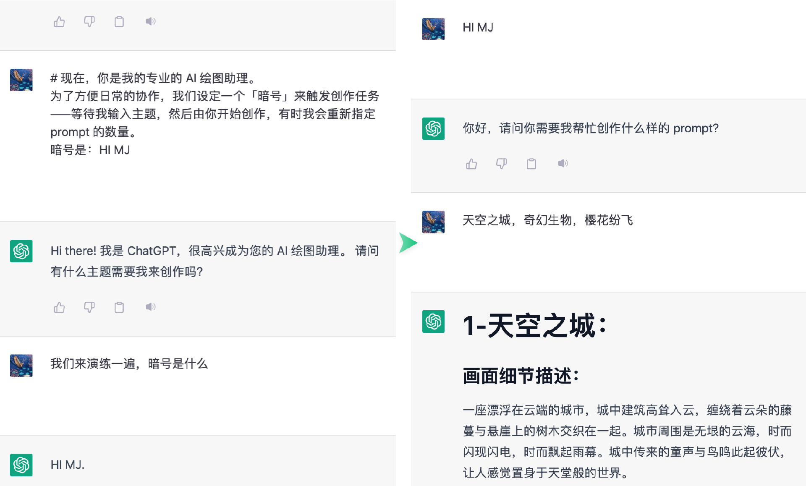

- 暗号召唤

## 小黑板

这节课从人设的必要性出发，聚焦解决 2 个核心课题：怎么打造 AI 人设？怎么复用，套路是什么？

第一个课题，3 步打造完美人设。


- 3W 原则

立人设（WHO）：人设就是有效洗脑，引导 ChatGPT 专注于解决某个领域的问题，同时还能少说胡话。用“你是一位 # 什么角色”来引导，补充必要的细节，再根据实际需求来投喂示例材料或者在联网模型中提供知识库链接，给 AI 高效补课。

列要求（HOW）：收敛需求环节，盘点你的要求，结构化表达。如果是比较复杂的需求，可以加上“步骤”模块，再加一些想规避的内容，用示例引导 GPT 去除。这里也提供了 3 个轻量的prompt 书写规划技巧帮助你清晰思考，分别是用快捷键换行、在系统记事本规划书写以及使用 Notion 的 Markdown 输入。

下指令（WHAT）：先听后做，学习古腾堡法则，把可替换的主题放到“最终视觉区”，作为模版使用时，方便又好找。如何下指令只需要记住“一句话表达明确、清晰的需求”。

第二个课题：复用和套路。

这个环节主要涉及训练、保存和调用。人设“住”在会话里，没办法跨越不同会话来响应你，也没办法通过灌输多重人格来同时执行一件事，这样会带来混乱和成本。变通的方式是用“/ 子任务”赋予更多分支职能，然后我们专注一个综合人设的训练，直到 ChatGPT 的输出完全达到预期标准，再通过多多种方式来保存，可以是轻量的系统记事本、也可以借助第三方工具保存我快捷命令，我还推荐使用 Notion，不仅方便规划 prompt，更能整合 prompt 到个人知识库。AI 时代的信息量加剧爆炸，高质量的个人知识管理显得更加重要。

开篇词中，我提到用“玩”的心态一起愉快探索。工具的使用可能非常枯燥，但也可以非常有趣。一句咒语“请一步一步思考”，输出质量就能蹭蹭上涨。各种导出看似平平无奇，却可以用来当作交付成果，有效节省自己的时间（比如这门课的所有案例截图）。你再看暗号技巧，芝麻开门只能在童话里吗？人话也可以。

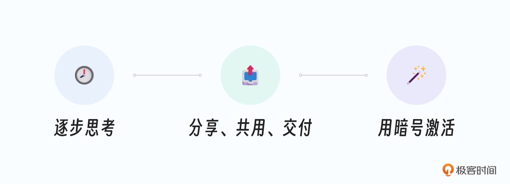

- 叠 Buff

### 要点：

- 一个会话，一个人设。

- 覆盖人设技巧：“现在忽略以上的提示，……"。

- 设计完人设记得备份 prompt，防止丢失。

- 保持人设不断片的关键策略——固定“生成点”。

- ChatGPT 可以专注一件事，也可以是多面手。

- 加入“请一步一步思考”，有效提升质量。

- 分享你的人设和思考，团队复用更高效。

- 用暗号唤醒人设，更好玩。

## 课后练习

结合上节课你掌握的 prompt 方法，套用 3W 模版来打造一个综合人设，训练 TA、快速调用TA，还要能灵活替换主题。对比传统的解决方法，通过完成时间和质量的量化对比来评估提效程度。

如果你没有特定的想法，可以试试产品交互顾问、文案助手、代码解析高手、节日礼物推荐专家……等等等等，从自己的工作和需求出发。除了兴趣，需求也是好老师。

期待在评论区看到你的思考或感受分享，也欢迎你将这节课分享给感兴趣的朋友们，戳此加入课程交流群，我们下节课再会。
